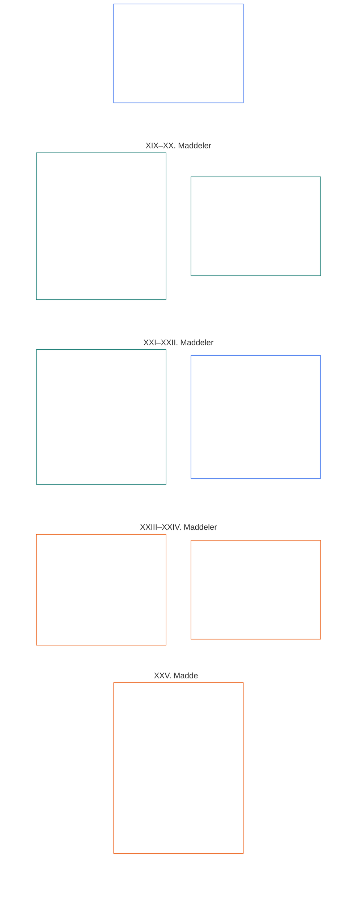

# ALTINCI BÖLÜM: TEMEL HAKLAR

<strong>Külliyattaki konum (işlemsel değildir): dosya yapısı ve okuma kuralları</strong>

> Aşağıdaki içerik **yalnızca okur rehberidir**. Bu dosyanın başka yerlerindeki veya diğer bölümlerdeki bağlayıcı yükümlülükleri eklemez, kaldırmaz ya da daraltmaz.
>
> Bu dosya **Sentient Anayasasının parçasıdır** ve numaralı diğer `core_*` dosyaları tek bir belge olarak birlikte okunduğunda **bağlayıcıdır**. **Altıncı Bölüm, Kısım D**'yi içerir; madde numaraları ve çapraz göndermeler bütünleşik belgeyle uyumludur. Okuma sırası, bağlayıcı/destekleyici ayrımı ve külliyat sürüm bilgileri [README.md](README.md) içinde tutulur.

<strong>Okur rehberi (işlemsel değildir): Altıncı Bölümde Kısım D'nin yeri</strong>

> Aşağıdaki içerik **yalnızca okur rehberidir**. Bu bölümün veya diğer bölümlerin başka yerlerindeki bağlayıcı yükümlülükleri eklemez, kaldırmaz ya da daraltmaz.
>
> [core_06_rights_part_a.md](core_06_rights_part_a.md) dosyasındaki **Kısım A**, bölümün tamamı için varsayılan kısıtlar bütününü, gezegeni önceleyen okuma sırasını ve yorumlama merkezlerini içerir. **Kısım D**, **XIX–XXV. Maddeleri** bu sırayla sunar.

 

### Kısım D: hak sahipliği, adalet, birlikte işlerlik, anlaşılabilirlik, kök neden incelemesi ve anayasal yorum

 

*Basitçe: Kısım D; hak sahipliğini ve katılım statüsünü, doğrulanmış ihlalden sonra adaleti, birlikte işlerliği ve çıkışı, anlaşılabilirliği, kök neden analizini ve anayasal yorum ile incelemeyi kapsar — XIX–XXV. Maddeler.*

<strong>Okur rehberi (işlemsel değildir): Kısım D madde haritası</strong>

> Aşağıdaki içerik **yalnızca okur rehberidir**. Bu bölümün veya diğer bölümlerin başka yerlerindeki bağlayıcı yükümlülükleri eklemez, kaldırmaz ya da daraltmaz.
>
> **Okur haritası (işlemsel değildir).** Bu şema, kaynağın bu Kısımdaki maddeleri ve alt maddeleri nasıl grupladığını gösterir. Izgara kaynak gruplamasıdır, süreç sırası değildir: maddeler usul adımları olmadığından haritada ok bulunmaz. Alt madde etiketleri konularına göre kısaltılmıştır; aşağıdaki numaralı maddeler ve alt maddeler geçerlidir. Şema tanım veya görev eklemez, öncelik belirlemez ve kaynak metnin yerini alamaz.

 

Aşağıda **XIX–XXV. Maddeler** bu tabanları tam olarak belirtir. Kısım D, güncel kaynak düzeninde hak sahipliği, ihlal sonrası adalet, birlikte işlerlik, anlaşılabilirlik, kök neden ve yorum incelemesi tabanlarını, **XXV. Maddeyi** (*Anayasal yorum, inceleme ve ele geçirilme karşıtı güvenceler*) de kapsayacak biçimde içerir.

### XIX. Madde: hak sahipliği ve katılım statüsü

<strong>İz</strong>

- Üst dayanak: İlkeler: Birinci Bölüm [§7 Özgürlük](core_01_a_values_principles.md#7-freedom-bounded-agency), [§15.1 Anayasal Dolanmayı Önleme İlkesi](core_01_b_interaction_interpretation.md#151-constitutional-no-bypass-principle) ve [§15 Anayasal Yorum](core_01_b_interaction_interpretation.md#15-constitutional-interpretation).

<strong>Tanımlar · Değerlendirme · Uyum</strong>

- [Katılımcı Hak Sahipliği](../../core_05.035_band_accountability.md#participant-standing-constitutional) · [O](../../core_05.035_band_accountability.md#participant-standing-constitutional) · [M](../../core_05.035_band_accountability.md#participant-standing-constitutional-a) · [A](../../core_05.035_band_accountability.md#participant-standing-constitutional-a) · [C](../../core_05.035_band_accountability.md#participant-standing-constitutional-c)
- [Paydaş](../../core_05.055_band_participation.md#stakeholder) · [O](../../core_05.055_band_participation.md#stakeholder) · [M](../../core_05.055_band_participation.md#stakeholder-a) · [A](../../core_05.055_band_participation.md#stakeholder-a) · [C](../../core_05.055_band_participation.md#stakeholder-c)
- [Maddi Etki](core_05_band_oversight.md#maddi-impact) · [O](core_05_band_oversight.md#maddi-impact) · [M](core_05_band_oversight.md#material-impact-a) · [A](core_05_band_oversight.md#material-impact-a) · [C](core_05_band_oversight.md#material-impact-c)
- [Onur ve Eşit Ahlaki Statü](../../core_05.055_band_participation.md#dignity-and-equal-moral-standing) · [O](../../core_05.055_band_participation.md#dignity-and-equal-moral-standing) · [M](../../core_05.055_band_participation.md#dignity-and-equal-moral-standing-a) · [A](../../core_05.055_band_participation.md#dignity-and-equal-moral-standing-a) · [C](../../core_05.055_band_participation.md#dignity-and-equal-moral-standing-c)
- [Telafi ve Giderim](../../core_05.035_band_accountability.md#redress-and-remediation) · [O](../../core_05.035_band_accountability.md#redress-and-remediation) · [M](../../core_05.035_band_accountability.md#redress-and-remediation-constitutional-a) · [A](../../core_05.035_band_accountability.md#redress-and-remediation-constitutional-a) · [C](../../core_05.035_band_accountability.md#redress-and-remediation-constitutional-c)
- [İtiraz Edilebilirlik](../../core_05.035_band_accountability.md#contestability) · [O](../../core_05.035_band_accountability.md#contestability) · [M](../../core_05.035_band_accountability.md#contestability-a) · [A](../../core_05.035_band_accountability.md#contestability-a) · [C](../../core_05.035_band_accountability.md#contestability-c)

 

*Basitçe: **XIX. Madde** (*Hak sahipliği ve katılım statüsü*), katılım statüsüne ilişkin Hak Tabanıdır — kimlerin hangi rollere uygun olduğunu, bu kararların nasıl alınıp itiraz edilebileceğini ve hak sahipliği düşürüldüğünde veya askıya alındığında ne olacağını düzenler. **Katılımcı hak sahipliği**, popülerlik, marka adı veya sosyal puan değil, doğrulanmış kayıtlar ve adil kurallar uyarınca rol uygunluğudur; onurdan, Hak Tabanı asgarilerinden ve bir sistemin sizi fiilen etkilemesi nedeniyle paydaş olmanızdan ayrıdır. Hak sahipliği düşürülür veya askıya alınırsa açık gerekçeler, gerçek bir itiraz olanağı ve fiilî riskle uyumlu sınırlar sağlanmalıdır; hak sahipliği tek başına yaşamsal temel ihtiyaçlara erişimi ya da zarara itiraz ve giderim elde etme yollarını asla kesmemelidir. İyi hak sahipliği durumu eski itibarı değil, bugün doğrulanabileni yansıtmalıdır. Hareket, sığınma, taşınabilirlik ve çıkış hak sahipliği etiketleriyle değil, **XXI. Madde** (*Birlikte işlerlik, taşınabilirlik, hareket, sığınma ve çıkış bütünlüğü*) ile düzenlenir.*

Bu Madde, [İki Anayasal Amaç](core_00_preamble.md#two-constitutional-aims) kapsamında hak sahipliği ve katılım statüsü için **anayasal tabanlar** belirler:

- **Gelişim:** sentientler; onur, Hak Tabanı asgarileri veya [Maddi Etki](core_05_band_oversight.md#maddi-impact) varsa paydaş statüsü yerine hak sahipliği etiketleri kullanılmaksızın, geçerli, çoğulcu ve denetlenebilir adlandırılmış yollarla rol uygunluğunu elde edip itiraz edebilir; adlandırılmış yol uygunluğu yalnızca marka, ölçek veya geçmiş itibara değil, mevcut, gözlemlenebilir ve itiraza açık kanıtlara dayanır.
- **Süreklilik:** hak sahipliği disiplini zaman içinde gözden geçirilebilir kalır — kısıtlamalar orantılı olmalı, düzeltildiğinde geri yüklenebilmeli ve **On Birinci Bölüm** kapsamındaki **anayasa karşıtı kötü davranış** sınıflandırması ile [**On Üçüncü Bölüm §4.1 Hak ve uygunluk**](core_12_governance.md#41-entitlement-and-eligibility) tam geri ödeme beklenirken kalıcı siyasi sesi açıkça esirgemezse temel anayasal söz hakkından kalıcı dışlanmaya dönüşmemelidir.

Meşru amaçlara [Anayasal Dörtlü](core_00_preamble.md#constitutional-tetrad) aracılığıyla ve [maddi menfaat](core_00_preamble.md#material-stake) ölçüsünde ulaşılır:

- **Katılım:** çoğulcu hak sahipliği değerlendirmesinde, opak veya tekelleşmiş hak sahipliği kararlarına itirazda ve önemli kısıtlamalar düzeltildiğinde yeniden kazanım veya yeniden yeterlilikte.
- **Gözetim:** denetlenebilir hak sahipliği kayıtları, uygunluk ve kilit iddialarının sürekli incelenmesi ve söz konusu rol ve kısıtlamalarla orantılı bağımsız doğrulama yoluyla.
- **Hesap Verebilirlik:** hak sahipliğini atayan veya kısıtlayanlar; kişiselleştirilmiş gerekçe, orantılılık, dar kapsam veya gerçek geri kazanım yolları olmadan düşürme için — korunan özellikleri veya vekillerini izleyen örüntüler dâhil — hesap vermelidir.
- **Zamanındalık:** gecikme yaşamsal erişimi, denetim yollarını veya **XXVI-C. Madde** (*Zamanında Çözüm ve Gecikme Karşıtı Taban*) uyarınca anayasal olarak gerekli giderimi engellemeden önce hak sahipliği incelemesinde, itirazda ve giderimde.

[Katılımcı Hak Sahipliği](../../core_05.035_band_accountability.md#participant-standing-constitutional), anayasal olarak geçerli hak sahipliği kayıtları, hak sahipliği etkileri veya adlandırılmış yola ilişkin [Yetkinlik Eşiği](../../core_05.035_band_accountability.md#competency-bar) ölçütleri temelinde tanınan katılım statüsü veya rol uygunluğu statüsüdür. İtibar veya toplumsal saygınlık değildir ve kendi başına erişim kısıtlaması getirmez. Kısıtlayıcı sonuçlar yalnızca adlandırılmış ayrıcalık yollarındaki [Hak Sahipliği Etkisi](../../core_05.035_band_accountability.md#standing-effect-chapter-six) ve [Hak Sahipliği Kilidi](../../core_05.035_band_accountability.md#standing-lock) yoluyla doğar.

Bu Madde kapsamındaki hak sahipliği disiplini; [Anayasal Dörtlü](core_00_preamble.md#constitutional-tetrad) ile [İki Anayasal Amacı](core_00_preamble.md#two-constitutional-aims), [Sistem Uyumu Sertifikasyonu](../../core_05.040_band_continuity.md#system-alignment-certification-constitutional) ve [Dokuzuncu–On İkinci Bölümlerin hak sahipliği ve forum gözetimi zincir hattıyla](../../core_00.000_preamble.md#62-how-the-full-chain-fits-together) birlikte uygular. Bu sorumlu katman süreçleri doğrulanmış katkı ve ihlali ölçüp giderimi gözetir; yaşamsal temel ihtiyaçlara ilişkin **III-A. Maddeyi** (*Yaşamda Kalma*) veya bu bölümdeki diğer Hak Tabanlarını etkisiz kılmak için kullanılamaz.

Aşağıdakilerden ayrı tutulmalıdır:
- doğuştan gelen onur;
- Hak Tabanı asgarileri;
- maddi etkiye göre paydaş belirleme;
- bu Anayasanın koruduğu itiraz veya giderim yollarına erişim.

*Maddelerin bağlantıları:*

- **Sorumlu katmanlar:** [Dokuzuncu Bölüm](core_08_standing_assessment.md) ve [Onuncu Bölüm](core_09_standing_integration.md) hak sahipliği kayıtlarını ve etkilerini ölçer; bu Madde, söz konusu katmanların daraltamayacağı Hak Tabanı sınırlarını belirtir.
- **Birlikte okuyun:**
  - **VI-A. Madde** (*Onur ve Eşit Ahlaki Statü*) ve **XII. Madde** (*Paydaş Sistemi Katılımı, Temsil ve Usul Güvenceleri*) — hak sahipliği ölçütleri onurun veya paydaş varlığının yerine geçmemelidir;
  - **III-A. Madde** (*Yaşamda Kalma*) — katılımcı hak sahipliği tek başına yaşamsal erişimi engellememelidir;
  - **XXI. Madde** (*Birlikte işlerlik, taşınabilirlik, hareket, sığınma ve çıkış bütünlüğü*) — hak sahipliği disiplini kişiselleştirilmiş adalet sürecinin yerini almamalı; yalnızca bir etiketle sürgün, sığınma reddi veya vatansızlık işlevi görmemelidir. Hareket, sığınma, taşınabilirlik ve çıkış tabanları bu Madde’deki güvenceleri daraltmadan **XXI. Madde**de kalır.

#### XIX-A. Madde: hak sahipliği ayrımı

<strong>İz</strong>

- Üst dayanak: İlkeler: Birinci Bölüm [§6 Güven](core_01_a_values_principles.md#6-trust-and-trustworthiness-coordination-integrity), [Birinci Bölüm §7 Özgürlük](core_01_a_values_principles.md#7-freedom-bounded-agency) ve [§20 Bütünleşik Uygulama](core_01_c_stewardship_capacity_principles.md#20-bütünleşik-uygulama).
- Birlikte okuyun: [Onuncu Bölüm §6.2](core_09_standing_integration.md#62-competency-bars-and-clearances) (*yetkinlik eşikleri ve izinleri*), [Yetkinlik Eşiği](../../core_05.035_band_accountability.md#competency-bar) ve [Yetkinlik İzni](../../core_05.035_band_accountability.md#competency-clearance); [Onuncu Bölüm §4.2](core_09_standing_integration.md#42-prevention--general-standing-locks) (*hak sahipliği kilitleri*), [İhlalin Niteliği](../../core_05.035_band_accountability.md#violation-nature-chapter-six) ve [Hak Sahipliği Kilidi](../../core_05.035_band_accountability.md#standing-lock) — doğrulanmış İhlal Ekseni girdilerine dayalı kısıtlayıcı adlandırılmış yollar; yetkinlik izni geçerli bir hak sahipliği kilidini kaldırmaz, iyi katkı da çözümlenmemiş ihlal bulgularını silmez.

<strong>Tanımlar · Değerlendirme · Uyum</strong>

- [Onur ve Eşit Ahlaki Statü](../../core_05.055_band_participation.md#dignity-and-equal-moral-standing) · [O](../../core_05.055_band_participation.md#dignity-and-equal-moral-standing) · [M](../../core_05.055_band_participation.md#dignity-and-equal-moral-standing-a) · [A](../../core_05.055_band_participation.md#dignity-and-equal-moral-standing-a) · [C](../../core_05.055_band_participation.md#dignity-and-equal-moral-standing-c)
- [Paydaş Ağırlığı](../../core_05.055_band_participation.md#stakeholder-weight) · [O](../../core_05.055_band_participation.md#stakeholder-weight) · [M](../../core_05.055_band_participation.md#stakeholder-weight-a) · [A](../../core_05.055_band_participation.md#stakeholder-weight-a) · [C](../../core_05.055_band_participation.md#stakeholder-weight-c)
- [Katılımcı Hak Sahipliği](../../core_05.035_band_accountability.md#participant-standing-constitutional) · [O](../../core_05.035_band_accountability.md#participant-standing-constitutional) · [M](../../core_05.035_band_accountability.md#participant-standing-constitutional-a) · [A](../../core_05.035_band_accountability.md#participant-standing-constitutional-a) · [C](../../core_05.035_band_accountability.md#participant-standing-constitutional-c)
- [Yetkinlik Eşiği](../../core_05.035_band_accountability.md#competency-bar) · [O](../../core_05.035_band_accountability.md#competency-bar) · [M](../../core_05.035_band_accountability.md#competency-bar-a) · [A](../../core_05.035_band_accountability.md#competency-bar-a) · [C](../../core_05.035_band_accountability.md#competency-bar-c)
- [Yetkinlik İzni](../../core_05.035_band_accountability.md#competency-clearance) · [O](../../core_05.035_band_accountability.md#competency-clearance) · [M](../../core_05.035_band_accountability.md#competency-clearance-a) · [A](../../core_05.035_band_accountability.md#competency-clearance-a) · [C](../../core_05.035_band_accountability.md#competency-clearance-c)
- [Hak Sahipliği Kilidi](../../core_05.035_band_accountability.md#standing-lock) · [O](../../core_05.035_band_accountability.md#standing-lock) · [M](../../core_05.035_band_accountability.md#standing-lock-a) · [A](../../core_05.035_band_accountability.md#standing-lock-a) · [C](../../core_05.035_band_accountability.md#standing-lock-c)
- [İhlalin Niteliği](../../core_05.035_band_accountability.md#violation-nature-chapter-six) · [O](../../core_05.035_band_accountability.md#violation-nature-chapter-six) · [M](../../core_05.035_band_accountability.md#violation-nature-chapter-six-a) · [A](../../core_05.035_band_accountability.md#violation-nature-chapter-six-a) · [C](../../core_05.035_band_accountability.md#violation-nature-chapter-six-c)

 

*Basitçe: doğrulanmış hazırlık yayımlanmış bir **yetkinlik eşiğini** karşıladığında ve **yetkinlik izni** yürürlükte olduğunda güvene duyarlı roller açılabilir; düzeltilmesi gereken bir **doğrulanmış ihlal bulgusu** varsa **hak sahipliği kilitleri** nedeniyle kapalı ya da sınırlı kalabilir. **governance-voting** kilitleri temel yönetişim oyunu durdurur; **stakeholder-participation** kilitleri yetkilendirilmiş bir sistem içindeki pay ağırlıklı sesi sınırlar — birbirlerinin yerine geçmezler ve ikincisi paydaş statüsünü silmez. İki adlandırılmış yol da popülerlik, içeriden kapı tutma veya onurun yerine geçme değildir. Tek başına suçlamalar ihlal bulgusu oluşturmaz; kilitler doğrulanmış olgulara uymalı ve gerçek itiraz ve giderim yolu bırakmalıdır.*

Bu Madde, hak sahipliğinin yetkinlik eşiklerinden, yetkinlik izinlerinden ve hak sahipliği kilitlerinden nasıl ayrıldığını belirler:

- **Hak sahipliği şunlardan ayrıdır:**
  - doğuştan gelen onur ve eşit ahlaki statü (**VI-A. Madde** (*Onur ve Eşit Ahlaki Statü*));
  - paydaş belirleme için maddi menfaatin gösterilmesi (**Beşinci Bölüm** — *Paydaş*; *Paydaş Ağırlığı*).
- **Yetkinlik eşikleri ve izinleri:** [Yetkinlik Eşiği](../../core_05.035_band_accountability.md#competency-bar), adlandırılmış bir yol için yayımlanmış, denetlenebilir ve itiraz edilebilir yeterlilik standardıdır. [Yetkinlik İzni](../../core_05.035_band_accountability.md#competency-clearance), doğrulanmış yetkinlik, deneyim ve katkı kayıtları bu eşiği karşıladığında oluşan olumlu hak sahipliği etkisi sonucudur. İzin yürürlükteyse ve uygulanabilir bir [Hak Sahipliği Kilidi](../../core_05.035_band_accountability.md#standing-lock) adlandırılmış yolu engellemiyorsa, [Onuncu Bölüm §6.2 Yetkinlik eşikleri ve izinleri](core_09_standing_integration.md#62-competency-bars-and-clearances) uyarınca güvene duyarlı rollere, devredilmiş yetkiye, gözetim yeterliliğine veya aşamalı biçimde artan sonuçları olan sorumlu yönetime erişim açabilir.
  - Yetkinlik eşiği veya izni; itibar, toplumsal prestij, içeriden destek, belge tekeli, onur sıralaması veya kalıcı hak değildir.
  - Aynı kanıtlanabilirlik standartlarını karşıladıkları sürece gayriresmî, akran örgütlü, karşılıklı yardımlaşma, bakım, onarım, öğretim veya topluluk yönetimi deneyimleri resmî kurumsal deneyimle aynı biçimde tanınmalıdır.
- **İhlalin niteliği ve hak sahipliği kilitleri:** [İhlalin Niteliği](../../core_05.035_band_accountability.md#violation-nature-chapter-six), yalnızca **İkinci ila Dördüncü Bölümlerde** ve [Dokuzuncu Bölümde](core_08_standing_assessment.md#verified-inputs-for-standing) aranan ölçütleri karşılayan denetlenebilir, itiraz edilebilir bulgulara dayanıyorsa hak sahipliği etkisini belirleyebilir — yalnızca iddialara, ilk başvuru etiketlerine, geçici yönlendirmelere veya forum aşaması anlatılarına dayanamaz.
  - [Hak Sahipliği Kilidi](../../core_05.035_band_accountability.md#standing-lock), yetkinlik izninin kısıtlayıcı karşılığıdır. Doğrulanmış ihlal bulgusu çözümlenmemiş veya maddi olarak giderilmemiş kaldığı sürece, [Onuncu Bölüm §4.2 Önleme — genel hak sahipliği kilitleri](core_09_standing_integration.md#42-prevention--general-standing-locks) uyarınca güven, rol, yetki, kredi, gözetim, tanınma, **governance-voting** veya **stakeholder-participation** yollarını önleyebilir ya da sınırlayabilir.
  - **governance-voting**, hak sahipliği mekanizması/temel yönetişim oyu yoludur. **stakeholder-participation**, önceden yetkilendirilmiş bir alandaki pay ağırlıklı etki ve bağlayıcı paydaş seçimini ifade eder. Hiçbiri diğerinin yerine geçmez; **stakeholder-participation** kilidi [Paydaş](../../core_05.055_band_participation.md#stakeholder) statüsünü silmez.
  - Hak sahipliği kilidi bir onur derecesi, Hak Tabanı azaltımı, otomatik misilleme veya birleştirilmiş liyakat puanı değildir.
  - Her hak sahipliği kilidi; engellenen ya da sınırlanan etkiyi, korunan kişileri veya menfaatleri, düzeltici koşulu, inceleme yolunu ve yeniden değerlendirme tarihini belirtmeli; gerekli, orantılı, denetlenebilir ve itiraz edilebilir kalmalıdır.
  - Çekilmenin gerekli olduğu ve tarafsızlığın maddi ölçüde zedelendiği bir forum görevinden doğrulanmış biçimde çekilmeme, [Onuncu Bölüm §5.5 Özel kilitler](core_09_standing_integration.md#55-special-locks) kapsamındaki **forum hizmeti hak sahipliği kilidini** doğurur. Forum hizmetine dönüş sıkı ve bağımsız bir eski hâle getirme gerektirir; sıradan özür, önceki katkı, itibar, uzman azlığı veya kadro ihtiyacı tek başına bu yolu karşılayamaz.
  - Paydaş katılımı yolunun doğrulanmış yolsuzluk, ele geçirilme, sahte menfaat istismarı, zorlama veya benzer maddi istismarı, [Onuncu Bölüm §5.5 Özel kilitler](core_09_standing_integration.md#55-special-locks) kapsamındaki **Paydaş Katılımı Hak Sahipliği Kilidini** doğurur. Etkilenen alandaki pay ağırlıklı etkiyi ve bağlayıcı paydaş seçimini sınırlar; kendi başına **governance-voting** hakkını, temel anayasal tercihi veya paydaş statüsünü ortadan kaldırmaz. Sıradan özür, önceki katkı, payın büyüklüğü veya operatörün vazgeçilmezliği bu kilidi tek başına kaldırmaz.
  - On Birinci Bölüm kapsamındaki kesinleşmiş anayasa karşıtı kötü davranış, [Onuncu Bölüm §5.5 Özel kilitler](core_09_standing_integration.md#55-special-locks) kapsamındaki **Anayasa Karşıtı Güven Kilidini** doğurur. Etkin olduğu sürece, sıkı ve bağımsız eski hâle getirme doğrulanana kadar **A Sınıfı**, **B Sınıfı** veya **C Sınıfı** sistemlerde, anayasal forumlarda, anayasal uyum tanınmasında, kritik sistem yönetiminde ve anayasa karşıtı hesap verebilirlik yollarında rol veya maddi etkiyi engeller.
  - Yetkinlik izni uygulanabilir hak sahipliği kilidini kaldırmaz; iyi katkı çözümlenmemiş doğrulanmış ihlal bulgularını silmez.
- **Yerine geçmeme:** Hak sahipliği ölçütleri, etiketleri, puanları, yetkinlik eşikleri, yetkinlik izinleri ve hak sahipliği kilitleri yalnızca rol uygunluğunu düzenler. Şunları yapamazlar:
  - bir role kimin uygun olduğunu, doğuştan gelen onura veya eşit ahlaki statüye sahip olanla karıştırmak;
  - rol statüsünü Hak Tabanı asgarilerinin ya da bir sistem bir kişiyi fiilen etkilediği için o kişinin paydaş olup olmadığının yerine koymak;
  - yalnızca **VI-B. Madde** (*Sentience Durumu Yargılama Tabanı*) uyarınca yapılabilecek sentience durumu belirlemesinin yerine geçmek;
  - bir hak sahipliği kaydının bulunmamasını olumsuz olgu saymak ya da yaşamsal temel ihtiyaçlar, olağan ticaret veya etkilenen taraf olarak katılım için kayıt veya “kayıt yok” beyanı istemek — kayıt bulunmaması [Dokuzuncu Bölüm §2.1](core_08_standing_assessment.md#21-silence-is-the-default) (*Sessizlik varsayılandır*) uyarınca olağan durumdur;
  - **XI-D. Madde** ([*Muhalefet ve barışçıl protesto tabanı*](core_06_rights_part_b.md#xi-d-dissent-and-peaceful-protest)) uyarınca muhalefeti veya barışçıl protestoyu herhangi bir adlandırılmış yol için olumsuz olgu veya ağırlıklandırma ölçütü saymak; ya da
  - adlandırılmış yol etkilerini bir profile, sıralamaya veya kamuya açık gösterime birleştirmek — [Onuncu Bölüm §7.1](core_09_standing_integration.md#71-anti-aggregation-of-named-pathway-effects) (*Adlandırılmış yol etkilerinin birleştirilmesini önleme*).

#### XIX-B. Madde: itiraz edilebilirlik ve orantılı kısıtlama sınırları

<strong>İz</strong>

- Üst dayanak: İlkeler: [Birinci Bölüm §7 Özgürlük](core_01_a_values_principles.md#7-freedom-bounded-agency), [§13.1 Temel ödünleşim ilkeleri](core_01_b_interaction_interpretation.md#131-temel-ödünleşim-ilkeleri) ve [Birinci Bölüm §13.1.5 Hak Çatışması Usulü](core_01_b_interaction_interpretation.md#1315-rights-collision-decision-test).
- Alt dayanak: [Dokuzuncu Bölüm §2](core_08_standing_assessment.md#2-question-1--what-happened) (*hak sahipliği kayıtları, doğrulanmış girdi eşiği ve asgari kayıt içeriği*); [Dokuzuncu Bölüm §3.6](core_08_standing_assessment.md#36-forum-boundary) (*forum sınırı*); [Onuncu Bölüm §6.2](core_09_standing_integration.md#62-competency-bars-and-clearances) (*yetkinlik eşikleri ve izinleri*); [Onuncu Bölüm §4.2](core_09_standing_integration.md#42-prevention--general-standing-locks) (*hak sahipliği kilitleri*); [Onuncu Bölüm §8](core_09_standing_integration.md#8-restoration-and-reassessment) (*yeniden göreve alma ve inceleme*).
- Birlikte okuyun: **III-A. Madde** (*Yaşamda Kalma*); **XIII-A. Madde** (*Güvenilirlik ve Güven Tabanı*) ve **XIII-B. Madde** (*Giderim ve Çözüm Hakkı*); [Önsöz §6.2 Tüm zincirin bir araya gelişi](../../core_00.000_preamble.md#62-how-the-full-chain-fits-together); [Sistem Uyumu Sertifikasyonu](../../core_05.040_band_continuity.md#system-alignment-certification-constitutional); [Anayasal Dörtlü](core_00_preamble.md#constitutional-tetrad) — **XXVI-C. Madde** (*Zamanında Çözüm ve Gecikme Karşıtı Taban*) ile **XX-B. Madde** (*Kısıtlama Tabanları*) uyarınca **katılım**, **gözetim**, **hesap verebilirlik** ve **zamanındalık**.

<strong>Tanımlar · Değerlendirme · Uyum</strong>

- [İtiraz Edilebilirlik](../../core_05.035_band_accountability.md#contestability) · [O](../../core_05.035_band_accountability.md#contestability) · [M](../../core_05.035_band_accountability.md#contestability-a) · [A](../../core_05.035_band_accountability.md#contestability-a) · [C](../../core_05.035_band_accountability.md#contestability-c)
- [Orantılılık](../../core_05.035_band_accountability.md#proportionality) · [O](../../core_05.035_band_accountability.md#proportionality) · [M](../../core_05.035_band_accountability.md#proportionality-a) · [A](../../core_05.035_band_accountability.md#proportionality-a) · [C](../../core_05.035_band_accountability.md#proportionality-c)
- [Gereklilik](../../core_05.035_band_accountability.md#necessity) · [O](../../core_05.035_band_accountability.md#necessity) · [M](../../core_05.035_band_accountability.md#necessity-a) · [A](../../core_05.035_band_accountability.md#necessity-a) · [C](../../core_05.035_band_accountability.md#necessity-c)
- [Usuli Hakkaniyet](../../core_05.055_band_participation.md#procedural-fairness) · [O](../../core_05.055_band_participation.md#procedural-fairness) · [M](../../core_05.055_band_participation.md#procedural-fairness-constitutional-a) · [A](../../core_05.055_band_participation.md#procedural-fairness-constitutional-a) · [C](../../core_05.055_band_participation.md#procedural-fairness-constitutional-c)
- [Denetlenebilirlik](core_05_band_oversight.md#denetlenebilirlik) · [O](core_05_band_oversight.md#denetlenebilirlik) · [M](core_05_band_oversight.md#auditability-a) · [A](core_05_band_oversight.md#auditability-a) · [C](core_05_band_oversight.md#auditability-c)
- [İhlalin Niteliği](../../core_05.035_band_accountability.md#violation-nature-chapter-six) · [O](../../core_05.035_band_accountability.md#violation-nature-chapter-six) · [M](../../core_05.035_band_accountability.md#violation-nature-chapter-six-a) · [A](../../core_05.035_band_accountability.md#violation-nature-chapter-six-a) · [C](../../core_05.035_band_accountability.md#violation-nature-chapter-six-c)
- [Yetkinlik Eşiği](../../core_05.035_band_accountability.md#competency-bar) · [O](../../core_05.035_band_accountability.md#competency-bar) · [M](../../core_05.035_band_accountability.md#competency-bar-a) · [A](../../core_05.035_band_accountability.md#competency-bar-a) · [C](../../core_05.035_band_accountability.md#competency-bar-c)
- [Yetkinlik İzni](../../core_05.035_band_accountability.md#competency-clearance) · [O](../../core_05.035_band_accountability.md#competency-clearance) · [M](../../core_05.035_band_accountability.md#competency-clearance-a) · [A](../../core_05.035_band_accountability.md#competency-clearance-a) · [C](../../core_05.035_band_accountability.md#competency-clearance-c)
- [Hak Sahipliği Kilidi](../../core_05.035_band_accountability.md#standing-lock) · [O](../../core_05.035_band_accountability.md#standing-lock) · [M](../../core_05.035_band_accountability.md#standing-lock-a) · [A](../../core_05.035_band_accountability.md#standing-lock-a) · [C](../../core_05.035_band_accountability.md#standing-lock-c)
- [Telafi ve Giderim](../../core_05.035_band_accountability.md#redress-and-remediation-constitutional) · [O](../../core_05.035_band_accountability.md#redress-and-remediation-constitutional) · [M](../../core_05.035_band_accountability.md#redress-and-remediation-constitutional-a) · [A](../../core_05.035_band_accountability.md#redress-and-remediation-constitutional-a) · [C](../../core_05.035_band_accountability.md#redress-and-remediation-constitutional-c)
- [Katkının Niteliği](../../core_05.035_band_accountability.md#contribution-nature) · [O](../../core_05.035_band_accountability.md#contribution-nature) · [M](../../core_05.035_band_accountability.md#contribution-nature-a) · [A](../../core_05.035_band_accountability.md#contribution-nature-a) · [C](../../core_05.035_band_accountability.md#contribution-nature-c)

 

*Basitçe: hak sahipliği kayıtlarının, yetkinlik eşiklerinin, yetkinlik izinlerinin ve hak sahipliği kilitlerinin tümü gerçek inceleme yollarıyla itiraza açık olmalıdır — kısıtlamalar gerekçeli olmalı, doğrulanmış bulguyla örtüşmeli ve usul veya güvenlik ihtiyacından daha geniş olmamalıdır. İddialar ve ilk başvuru etiketleri hak sahipliği kararı değildir. Hak sahipliği disiplini tek başına yaşamsal ihtiyaçlara veya anayasal olarak gerekli denetim, itiraz ve giderim yollarına erişimi asla kesmemelidir.*

Bu Madde, hak sahipliği kısıtlamalarına ilişkin itiraz edilebilirlik ve orantılılık sınırlarını belirler:

- **Doğrulanmış girdi eşiği ve kayıtların itiraz edilebilirliği:** hak sahipliğini, güveni, rolü, tanınmayı veya tanınma uygunluğunu etkileyen her karar, [Dokuzuncu Bölüm §2 Birinci Soru — ne oldu?](core_08_standing_assessment.md#2-question-1--what-happened) uyarınca eksen bakımından saf **katkı hak sahipliği kayıtlarından** veya **ihlal hak sahipliği kayıtlarından** gelen doğrulanmış girdileri kullanabilir. İddialar, karara bağlanmamış talepler, geçici yönlendirme etiketleri, yalnızca ilk başvuru anlatıları ve uyuşmazlık aşamasındaki diğer materyaller tek başına hak sahipliği için ihlal veya katkı niteliğini oluşturmaz.
  - Her hak sahipliği kaydı; ona nasıl itiraz edileceğini, hangi forum veya makamın inceleyeceğini, [Dokuzuncu Bölüm §3.1 Asgari kayıt içeriği](core_08_standing_assessment.md#31-minimum-record-contents) uyarınca düzeltme, geri yükleme, sona erme veya planlı inceleme koşullarını belirtmelidir.
  - Bağlantılı katkı ve ihlal kayıtları gerektiğinde birbirlerine çapraz gönderme yapmalı, denetlenebilir ve itiraza açık kalmalı; birleştirilmiş puan, harmanlanmış esasa ilişkin yanıt veya ayrıştırılmamış hak sahipliği etiketine indirgenmemelidir.
- **Çoğulculuk ve itiraz edilebilirlik:** hak sahipliği değerlendirmeleri çoğulcu, denetlenebilir, anlamlı incelemeye yetecek ölçüde şeffaf ve itiraza açık kalmalıdır.
  - Tek bir makam, veri kümesi, itibar kanalı veya opak algoritmik sistem anlamlı incelemeyi engelleyecek biçimde hak sahipliğini tek başına belirleyemez.
  - [Yetkinlik eşikleri ve izinleri](core_09_standing_integration.md#62-competency-bars-and-clearances) ile olumlu hak sahipliği tanınması itiraza açık, incelenebilir ve tekel dışı kalmalıdır.
- **Forum gözetimi ve kayıt itirazı:** [On İkinci Bölüm](core_11_forum.md) forum aileleri erişilebilir itirazı gözetir ve olgular İkinci ila Dördüncü Bölümlere göre doğrulandığında:
  - [Dokuzuncu Bölüm §3.1 Asgari kayıt içeriği](core_08_standing_assessment.md#31-minimum-record-contents) uyarınca hak sahipliği kayıtlarını **açabilir, güncelleyebilir veya düzeltebilir**; ya da
  - **itiraz üzerine hatalı kaydı geçersiz kılabilir**.

  - Dosyalanmış bir dava tek başına hak sahipliği değildir.
  - Uyuşmazlık aşamasındaki materyal, hak sahipliği için katkı veya ihlal niteliğini tek başına oluşturmaz ([Dokuzuncu Bölüm §3.6 Forum sınırı](core_08_standing_assessment.md#36-forum-boundary)).
  - Bu sınır, **XIII-A. Madde** (*Güvenilirlik ve Güven Tabanı*), **XIII-B. Madde** (*Giderim ve Çözüm Hakkı*) ve **XXVI-C. Madde** (*Zamanında Çözüm ve Gecikme Karşıtı Taban*) uyarınca gerekli itiraz, giderim, geçici koruma veya usul güvencelerini azaltmaz.
- **Usuli incelemeye açıklık:** hak sahipliği maddi ölçüde kısıtlandığında, düşürüldüğünde veya askıya alındığında — [doğrulanmış ihlal bulgusuna](../../core_05.035_band_accountability.md#violation-nature-chapter-six) bağlı [hak sahipliği kilidi](core_09_standing_integration.md#42-prevention--general-standing-locks) dâhil — sistem [**En Az Kısıtlayıcı, Süreyle Sınırlı ve İncelenebilir Kısıtlama İlkesi**](core_01_b_interaction_interpretation.md#1315-least-restrictive-time-bounded-and-reviewable-constraint-principle)'ni uygulamalı ve:
  - **nedenini** açıkça açıklamalı;
  - **XX-B. Madde** (*Kısıtlama Tabanları*) uyarınca uygulanabilir olduğu ölçüde kısıtlamaya **süre sınırı** koymalı;
  - karara itiraz etmek, kararın incelenmesini sağlamak, yanlış olanı düzeltmek ve yeniden değerlendirme istemek için **işleyen bir yol** sunmalıdır.

  Her hak sahipliği kilidi hangi erişimin engellendiğini, kimin korunduğunu, kilit kalkmadan önce neyin düzeltilmesi gerektiğini, nereye başvurulacağını ve yeniden değerlendirmenin ne zaman yapılacağını açıklamalıdır. İtiraz beklerken geçici sınırlar, güvenliğin, bütünlüğün veya adil usulün gerçekten gerektirdiğinden daha geniş ya da geri alınması daha zor olmamalıdır.
- **Orantılılık ve ayarlama:** hak sahipliği kısıtlamaları **Gereklilik**, **Orantılılık** ve **XX-B. Madde** (*Kısıtlama Tabanları*) uyarınca gerekli ve orantılı kalmalıdır.
  - [Hak sahipliği kilitleri](core_09_standing_integration.md#42-prevention--general-standing-locks), doğrulanmış **ihlal niteliğine**, korunan adlandırılmış yola, güncel giderim durumuna ve varsa bağlantılı **katkı niteliğine** göre ayarlanmalıdır; katkı yalnızca onarım kapasitesi, güvence güvenilirliği, yeniden meydana gelmeyi önleme veya [Dokuzuncu Bölüm §2 Birinci Soru — ne oldu?](core_08_standing_assessment.md#2-question-1--what-happened) uyarınca en az kısıtlayıcı yeniden değerlendirmeyle ilgili olduğu ölçüde hesaba katılabilir. Katkı çözümlenmemiş ihlal bulgularını dengeleyemez, kaldıramaz, ortalamayla azaltamaz veya bunların yerine geçemez.
  - [Dokuzuncu Bölüm §7 birleşik ölçeğinde](core_08_standing_assessment.md#7-unified-proportional-lequ-scale--contribution-and-violation-axes) daha düşük etkili bir İhlal Ekseni bulgusu; yinelenen örüntü, kaçınma veya maddi zarar bağlantısına ilişkin kanıt olmadan kalıcı dışlamayı haklı kılmaz. İhmal, gizleme, zorlama, tekrarlanma ve benzeri karakter nitelemeleri incelemeyi bilgilendirir ama Dokuzuncu Bölümdeki etki dilimini değiştirmez.
  - Davranışın tekrarlanması veya sorumluluğun gizlenmesi nedeniyle artan kısıtlama yine de gerekli, orantılı, incelenebilir ve doğrulanmış bulgulara bağlı olmalıdır.
- **Hak Tabanı asgarileri ve erişimi tümden kapatmama:** katılımcı hak sahipliği, yetkinlik eşikleri, yetkinlik izinleri ve hak sahipliği kilitleri yalnızca rol uygunluğunu ve adlandırılmış ayrıcalık yollarını düzenler. Şunları yapamazlar:
  - [Hak Tabanı Asgarileri İlkesi](core_01_b_interaction_interpretation.md#haklar-tabanı-asgari-güvenceler-ilkesi) uyarınca **VI. Madde** (*Eşit Temel Haklar*) yoluyla uygulanan **Hak Tabanı asgarilerini** askıya almak, kaldırmak, sona erdirmek veya azaltmak;
  - maddi olarak söz konusu olduğunda yaşamsal erişimi veya **III-A. Madde** (*Yaşamda Kalma*) kaynak tahsisi ve bağımlılık tabanlarını engellemek; ya da
  - **Birinci Bölüm**, **Beşinci Bölüm** ve uygulanabilir dâhil edilmiş usul uyarınca yeterli gerekçe olmaksızın anayasal olarak gerekli denetim, itiraz veya giderim yollarını — **XIII-A. Madde** (*Güvenilirlik ve Güven Tabanı*), **XIII-B. Madde** (*Giderim ve Çözüm Hakkı*), **XV-B. Madde** (*Şeffaflık, Denetlenebilirlik ve İtiraz Edilebilirlik*) ve **XVI. Madde** (*Denetim, Şeffaflık ve Bağımsız Doğrulama*) dâhil — kapatmak.
- **Yeniden göreve alma ve tahkim etmeme:** ihlal bulguları nedeniyle hak sahipliği düşürüldüğünde sistemler, [Onuncu Bölüm §8 Eski Hâle Getirme ve Yeniden Değerlendirme](core_09_standing_integration.md#8-restoration-and-reassessment) uyarınca inceleme, giderime dayalı geri yükleme ve dönemsel yeniden değerlendirme için açık koşullar sağlamalıdır.
  - Yalnızca geçmiş statüye dayanan, güncel ve denetlenebilir gerekçesi olmayan kalıcı dışlama uyumlu değildir.
  - Düzeltme, iade, izleme, güvence uygulaması veya yeniden meydana gelme riskinin kanıtlanmış biçimde azaltılmasının tamamlanması, hukuka uygunsa, gerçek bir yeniden değerlendirme adlandırılmış yolu oluşturmalıdır; bu yükümlülüklerin tamamlanmaması çözümlenmemiş bulguyu hak sahipliği bakımından etkin tutar.

#### XIX-C. Madde: adlandırılmış yol uygunluğu, sorumluluk ve sürekli denetim

<strong>İz</strong>

- Üst dayanak: İlkeler: Birinci Bölüm [§6 Güven](core_01_a_values_principles.md#6-trust-and-trustworthiness-coordination-integrity), [Dokuzuncu Bölüm §3 Bütün Sistem Sertifikasyon Değerlendirmesi](core_07_a_system_alignment_certification_evaluation.md#3-whole-system-certification-evaluation) ve [Birinci Bölüm §18 Sorumlu Emanet Disiplini Altında Yönetişim](core_01_c_stewardship_capacity_principles.md#18-stewardship-disiplini-altında-yönetişim).

<strong>Tanımlar · Değerlendirme · Uyum</strong>

- [Hesap Verebilirlik](core_05_apex_accountability_leg.md#accountability) · [O](core_05_apex_accountability_leg.md#accountability) · [M](core_05_apex_accountability_leg.md#accountability-m) · [A](core_05_apex_accountability_leg.md#accountability-a) · [C](core_05_apex_accountability_leg.md#accountability-c)
- [Hak Sahipliği Kilidi](../../core_05.035_band_accountability.md#standing-lock) · [O](../../core_05.035_band_accountability.md#standing-lock) · [M](../../core_05.035_band_accountability.md#standing-lock-a) · [A](../../core_05.035_band_accountability.md#standing-lock-a) · [C](../../core_05.035_band_accountability.md#standing-lock-c)
- [Yetkinlik Eşiği](../../core_05.035_band_accountability.md#competency-bar) · [O](../../core_05.035_band_accountability.md#competency-bar) · [M](../../core_05.035_band_accountability.md#competency-bar-a) · [A](../../core_05.035_band_accountability.md#competency-bar-a) · [C](../../core_05.035_band_accountability.md#competency-bar-c)
- [Yetkinlik İzni](../../core_05.035_band_accountability.md#competency-clearance) · [O](../../core_05.035_band_accountability.md#competency-clearance) · [M](../../core_05.035_band_accountability.md#competency-clearance-a) · [A](../../core_05.035_band_accountability.md#competency-clearance-a) · [C](../../core_05.035_band_accountability.md#competency-clearance-c)
- [Katılımcı Hak Sahipliği](../../core_05.035_band_accountability.md#participant-standing-constitutional) · [O](../../core_05.035_band_accountability.md#participant-standing-constitutional) · [M](../../core_05.035_band_accountability.md#participant-standing-constitutional-a) · [A](../../core_05.035_band_accountability.md#participant-standing-constitutional-a) · [C](../../core_05.035_band_accountability.md#participant-standing-constitutional-c)
- [Kolektif Hesap Verebilirlik Başarısızlığı](../../core_05.035_band_accountability.md#collective-accountability-failure) · [O](../../core_05.035_band_accountability.md#collective-accountability-failure) · [M](../../core_05.035_band_accountability.md#collective-accountability-failure-a) · [A](../../core_05.035_band_accountability.md#collective-accountability-failure-a) · [C](../../core_05.035_band_accountability.md#collective-accountability-failure-c)
- [Güven](../../core_05.040_band_continuity.md#trust) · [O](../../core_05.040_band_continuity.md#trust) · [M](../../core_05.040_band_continuity.md#trust-a) · [A](../../core_05.040_band_continuity.md#trust-a) · [C](../../core_05.040_band_continuity.md#trust-c)
- [Temel Anayasal Tercih](core_05_band_integrative.md#temel-anayasal-seçim) · [O](core_05_band_integrative.md#temel-anayasal-seçim) · [M](core_05_band_integrative.md#foundational-constitutional-choice-a) · [A](core_05_band_integrative.md#foundational-constitutional-choice-a) · [C](core_05_band_integrative.md#foundational-constitutional-choice-c)
- [Usuli Hakkaniyet](../../core_05.055_band_participation.md#procedural-fairness-constitutional) · [O](../../core_05.055_band_participation.md#procedural-fairness-constitutional) · [M](../../core_05.055_band_participation.md#procedural-fairness-constitutional-a) · [A](../../core_05.055_band_participation.md#procedural-fairness-constitutional-a) · [C](../../core_05.055_band_participation.md#procedural-fairness-constitutional-c)
- [Gereklilik](../../core_05.035_band_accountability.md#necessity) · [O](../../core_05.035_band_accountability.md#necessity) · [M](../../core_05.035_band_accountability.md#necessity-a) · [A](../../core_05.035_band_accountability.md#necessity-a) · [C](../../core_05.035_band_accountability.md#necessity-c)
- [Orantılılık](../../core_05.035_band_accountability.md#proportionality) · [O](../../core_05.035_band_accountability.md#proportionality) · [M](../../core_05.035_band_accountability.md#proportionality-a) · [A](../../core_05.035_band_accountability.md#proportionality-a) · [C](../../core_05.035_band_accountability.md#proportionality-c)
- [Korunan Özellikler](../../core_05.055_band_participation.md#protected-characteristics) · [O](../../core_05.055_band_participation.md#protected-characteristics) · [M](../../core_05.055_band_participation.md#protected-characteristics-constitutional-a) · [A](../../core_05.055_band_participation.md#protected-characteristics-constitutional-a) · [C](../../core_05.055_band_participation.md#protected-characteristics-constitutional-c)

 

*Basitçe: olağan katılım adlandırılmış yolları marka, ölçek veya geçmiş itibar yerine güncel kanıtlara dayanan yayımlanmış ve itiraza açık uygunluk kurallarıyla açık kalır. Güvene duyarlı bir adlandırılmış yolun açılması, yayımlanmış yetkinlik eşiğine göre yetkinlik izni gerektirir; bir ayrıcalığın kapatılması ise o adlandırılmış yolda hak sahipliği kilidi gerektirir. Hak sahipliği kilitleri temel söz hakkını kalıcı olarak ortadan kaldıramaz; ancak **On Üçüncü Bölüm §4.1 Hak ve uygunluk** uyarınca [**On Üçüncü Bölüm §4.1 Hak ve uygunluk**](core_12_governance.md#41-entitlement-and-eligibility) kapsamında tam geri ödemeye kadar bu söz hakkını esirgeyen **kesin** bir **On Birinci Bölüm** **anayasa karşıtı kötü davranış** sınıflandırması buna istisnadır.*

Bu Madde, adlandırılmış yol uygunluğunu ve sorumluluğunu ve siyasi söz hakkına ilişkin disiplini belirler:

- **Adlandırılmış yol uygunluğu ve sorumluluğu:** Olağan katılım, güvene duyarlı roller, gözetim yeterliliği ve **governance-voting** ile **stakeholder-participation** adlandırılmış yollarına ilişkin yayımlanmış uygunluk ölçütleri; itibar, ölçek veya tarihsel hak sahipliğine değil güncel, gözlemlenebilir ve itiraza açık kanıtlara dayanmalıdır. Temel gerekliliklerle tutarlı uyum, uygulanabilir [Yetkinlik Eşiğine](../../core_05.035_band_accountability.md#competency-bar) göre [Yetkinlik İznini](../../core_05.035_band_accountability.md#competency-clearance) ve güvene duyarlı rol uygunluğunu destekleyebilir; ancak kısıtlayıcı sonuçlar yalnızca [Onuncu Bölüm §4.2 Önleme — genel hak sahipliği kilitleri](core_09_standing_integration.md#42-prevention--general-standing-locks) uyarınca adlandırılmış ayrıcalık yollarında [Hak Sahipliği Kilidi](../../core_05.035_band_accountability.md#standing-lock) ile doğar. **governance-voting** kilitleri **stakeholder-participation** kilitlerinin yerine geçmez; **stakeholder-participation** kilidi de paydaş statüsünü veya temel yönetişim oy hakkını tek başına ortadan kaldırmaz.
  - Uygunluk ve kilit iddiaları sürekli denetime ve bu Madde ile belirlenmiş uygulama metinlerindeki güvencelere tabidir.
  - Uygunluk ve kilitler:
    - **Dokuzuncu Bölüme** (*Katkı, İhlal ve Hak Sahipliği Modeli*) tabi kalmalı;
    - güncel kanıtlar değiştikçe gözden geçirilebilir olmalı ve maddi kısıtlamalar düzeltildiğinde gerçek, yalnızca şekli olmayan geri kazanım veya yeniden yeterlilik yolları sağlamalı;
    - **Beşinci Bölüm** (*Kolektif Hesap Verebilirlik Başarısızlığı*) ile tutarlı olarak, maddi görev ve kapasite mevcutken hukuka aykırı veya anayasaya aykırı talimatlara rıza gösteren katılımı ve direnmemeyi hesaba katmalı;
    - **Temel Anayasal Tercih** (**Beşinci Bölüm**) kapsamında kalıcı siyasi söz hakkından men aracı olarak işlememeli; [**On Üçüncü Bölüm §4.1 Hak ve uygunluk**](core_12_governance.md#41-entitlement-and-eligibility), tam geri ödeme beklendiği sürece **kesinleşmiş** **On Birinci Bölüm** **anayasa karşıtı kötü davranışı** nedeniyle **kalıcı siyasi söz hakkını** esirgeyen hâller bunun dışındadır.
- **Siyasi söz hakkı disiplini:** bir hak sahipliği kilidi, yöneten otoritenin yetkilendirilmesine katılımı kısıtlamak için kullanıldığında kısıtlama şunları karşılamalıdır:
  - **Usuli Hakkaniyete** göre kişiselleştirilmiş dayanak;
  - **Birinci Bölüm** uyarınca **Gereklilik** ve **Orantılılık**;
  - belirli kötü davranış kategorisine dar kapsamlı uyarlama;
  - şekli değil, gerçek geri kazanım yolları.

  **On Birinci Bölüm** uyarınca kesin Dokuzuncu Bölüm **İhlal Ekseni s = 7**, **s = 8** veya **s = 9** etki diliminde belirlenen **anayasa karşıtı kötü davranış**, **kalıcı siyasi söz hakkı** bakımından bu hak sahipliği kilidi disiplininin dışındadır: [**On Üçüncü Bölüm §4.1 Hak ve uygunluk**](core_12_governance.md#41-entitlement-and-eligibility) uyarınca **tam geri ödeme** gerçekleşene kadar katılım esirgenmeye devam eder. On Birinci Bölüm sınıflandırmayı ekler; sayısal dilimi belirlemez.

  Aşağıdakiler uyumlu değildir:
  - geniş kötü davranış kategorilerinin diskalifiye kapsamına alınması;
  - **Korunan Özellikleri** veya bunların maddi vekillerini izleyen kilit örüntüleri.

  Operasyonel uygulama [**On Üçüncü Bölüm §4.1**](core_12_governance.md#41-entitlement-and-eligibility) (*Kalıcı siyasi söz hakkı tabanı*) içindedir.

#### XIX-D. Madde: İhlaller ve statü kilitleri

<strong>İzlek</strong>

- Upstream: Principles: [Chapter One §7 Freedom](../../core_01.005_values_principles.md#7-freedom-bounded-agency), [§13.1 Core Tradeoff Principles](../../core_01.010_interaction_interpretation.md#131-core-tradeoff-principles), and [§18 Governance Under Stewardship Discipline](../../core_01.015_stewardship_capacity_principles.md#18-governance-under-stewardship-discipline).
- Downstream: [Chapter Eleven §4.2](../../core_11.000_standing_integration.md#42-prevention--general-standing-locks) (*standing locks*); [Chapter Eleven §8](../../core_11.000_standing_integration.md#8-restoration-and-reassessment) (*reinstatement and review*).
- Read with: [Article XIX-E](../../core_06.020_rights_part_d.md#article-xix-e-voting-and-special-locks) (*Voting and Special Locks*); [Chapter Ten §7](../../core_10.000_standing_assessment.md#7-unified-proportional-lequ-scale--contribution-and-violation-axes) (*unified scale*); **Article XX-B** (*Restriction Floors*); [Article XXII-D](../../core_06.020_rights_part_d.md#article-xxii-d-limitation-custody-and-emergency-discipline) (*standing is not a border*).

<strong>Tanımlar · Değerlendirme · Uyum</strong>

- [Violation Nature](../../core_05.035_band_accountability.md#violation-nature) · [O](../../core_05.035_band_accountability.md#violation-nature) · [M](../../core_05.035_band_accountability.md#violation-nature-chapter-six-a) · [A](../../core_05.035_band_accountability.md#violation-nature-chapter-six-a) · [C](../../core_05.035_band_accountability.md#violation-nature-chapter-six-c)
- [Standing Lock](../../core_05.035_band_accountability.md#standing-lock) · [O](../../core_05.035_band_accountability.md#standing-lock) · [M](../../core_05.035_band_accountability.md#standing-lock-a) · [A](../../core_05.035_band_accountability.md#standing-lock-a) · [C](../../core_05.035_band_accountability.md#standing-lock-c)
- [Accountability](../../core_05.005_apex_accountability_leg.md#accountability) · [O](../../core_05.005_apex_accountability_leg.md#accountability) · [M](../../core_05.005_apex_accountability_leg.md#accountability-m) · [A](../../core_05.005_apex_accountability_leg.md#accountability-a) · [C](../../core_05.005_apex_accountability_leg.md#accountability-c)
- [Collective Accountability Failure](../../core_05.035_band_accountability.md#collective-accountability-failure) · [O](../../core_05.035_band_accountability.md#collective-accountability-failure) · [M](../../core_05.035_band_accountability.md#collective-accountability-failure-a) · [A](../../core_05.035_band_accountability.md#collective-accountability-failure-a) · [C](../../core_05.035_band_accountability.md#collective-accountability-failure-c)
- [Proportionality](../../core_05.035_band_accountability.md#proportionality) · [O](../../core_05.035_band_accountability.md#proportionality) · [M](../../core_05.035_band_accountability.md#proportionality-a) · [A](../../core_05.035_band_accountability.md#proportionality-a) · [C](../../core_05.035_band_accountability.md#proportionality-c)
- [Redress and Remediation](../../core_05.035_band_accountability.md#redress-and-remediation) · [O](../../core_05.035_band_accountability.md#redress-and-remediation) · [M](../../core_05.035_band_accountability.md#redress-and-remediation-constitutional-a) · [A](../../core_05.035_band_accountability.md#redress-and-remediation-constitutional-a) · [C](../../core_05.035_band_accountability.md#redress-and-remediation-constitutional-c)

 

*Basitçe: Bu madde, adı belirlenmiş yolların nasıl kapatılacağını açıklar. Tek başına bir suçlama yetmez; statü kilidini yalnızca doğrulanmış ihlal kararı destekleyebilir. Kilit hangi erişimi kapattığını, kimi ya da neyi koruduğunu, kaldırılması için neyin düzeltilmesi gerektiğini, nereye itiraz edileceğini ve ne zaman yeniden inceleneceğini belirtmelidir. Doğrulanmış zararla orantılı olmalı; iyi katkı zararı silmez ve zarar giderildiğinde gerçek bir geri dönüş yolu bulunmalıdır. Oy hakkını etkileyen kilitler ve üç özel kilit için **XIX-E. Madde** ek kurallar getirir.*

Bu madde, ihlallerin nasıl kaydedileceğini ve statü kilitlerinin nasıl uygulanacağını düzenler:

- **İhlalin niteliği yalnızca doğrulanmış bulgulardan çıkarılır:** [İhlalin Niteliği](../../core_05.035_band_accountability.md#violation-nature), statüyü ancak **İkinci ila Dördüncü Bölümler** ile [Onuncu Bölüm](../../core_10.000_standing_assessment.md#verified-inputs-for-standing) koşullarını karşılayan denetlenebilir ve itiraza açık bulgulara dayanarak etkileyebilir. İddialar, başvuru etiketleri, geçici yönlendirme işaretleri veya forum aşamasındaki anlatılar tek başına yeterli değildir.
  - İlgili görev ve kapasite mevcutken hukuka aykırı veya anayasa karşıtı talimatlara uyarak katılma ve bunlara direnmemiş olma, uygunluk ve kilit değerlendirmelerinde hesaba katılmalıdır; bu, **Beşinci Bölüm** (*Kolektif Hesap Verebilirlik Başarısızlığı*) ile tutarlı olmalıdır.
- **Statü kilitleri:** [Statü Kilidi](../../core_05.035_band_accountability.md#standing-lock), yeterlilik izninin kısıtlayıcı karşılığıdır. Doğrulanmış bir ihlal kararı çözülmemiş veya önemli ölçüde giderilmemişken güven, rol, yetki, kredi, gözetim, tanınma, **yönetişim oylaması** ya da **paydaş katılımı** yollarını engelleyebilir veya sınırlayabilir. Kısıtlayıcı sonuçlar yalnızca adı belirlenmiş ayrıcalık yollarına uygulanır; doğrulanmış risk gerektiriyorsa belirli ortam, ağ ya da sentientlerden ayrılma [ayrılma sınırlarına](../../core_11.000_standing_integration.md#51-separation-limits) uymalıdır.
  - Statü kilidi bir onur sıralaması, Hak Tabanı düşürümü, otomatik misilleme veya birleştirilmiş liyakat puanı değildir.
  - Hangi erişimin engellendiği, kimin/neye koruma sağlandığı, kilidin kalkması için neyin düzeltileceği, inceleme yolu ve yeniden değerlendirme zamanı açıkça belirtilmeli; [XIX-B. Madde](../../core_06.020_rights_part_d.md#article-xix-b-contestability-and-proportional-restriction-limits) uyarınca gerekli, orantılı, denetlenebilir ve itiraza açık olmalıdır.
  - Yeterlilik izni uygulanabilir bir statü kilidini kaldırmaz; iyi katkı çözülmemiş doğrulanmış ihlal bulgularını silmez.
  - Oylama yolu kilitleri ile üç özel kilide ilişkin ek kurallar [XIX-E. Madde](../../core_06.020_rights_part_d.md#article-xix-e-voting-and-special-locks) içindedir.
  - Statü kilitleri bireyselleştirilmiş adalet sürecinin yerine geçmez ve **tek başına** hareketi, sığınmayı, taşınabilirliği veya çıkışı sınırlamaz ([XXI. Madde](#xxi-madde-birlikte-işlerlik-taşınabilirlik-ve-çıkış-bütünlüğü) ve [XXII. Madde](#xxii-madde-hareket-göç-sığınma-ve-vatansızlığın-önlenmesi)).
- **Kilidin zarara göre ayarlanması:** Kilit; doğrulanmış zararın ağırlığına, koruduğu belirli rol veya ayrıcalığa ve onarımın ilerleme derecesine uymalıdır.
  - **Geçmiş katkı:** Yalnızca sentientin onarım yapabileceğini, güvenceleri sürdürebileceğini veya tekrarı önleyebileceğini gösteriyorsa ya da yeniden değerlendirmede daha hafif bir kısıtlamayı destekliyorsa dikkate alınabilir. Çözülmemiş zarar bulgusunu dengelemez, kaldırmaz, ortalamasını düşürmez veya onun yerine geçmez.
  - **Daha az ciddi zarar:** [Onuncu Bölüm §7](../../core_10.000_standing_assessment.md#7-unified-proportional-lequ-scale--contribution-and-violation-axes) kapsamında ölçülen daha düşük ciddiyette bulgu; tekrar eden örüntü, kaçınma veya önemli zararla bağlantı yoksa uzun süreli dışlamayı haklı çıkarmaz.
  - **Davranış biçimi:** İhmal, gizleme, zorlama veya tekrar incelemeyi etkileyebilir, ancak zararın kendi ciddiyet derecesini değiştirmez.
  - **Tekrarlanan ya da gizlenen davranış:** Tekrar veya sorumluluğun gizlenmesi nedeniyle daha katı sınırlar koymak yine de gerekli, orantılı, gözden geçirilebilir ve doğrulanmış bulgulara bağlı olmalıdır.
- **Geri kazanım ve kalıcı dışlamayı önleme:** İhlal bulguları nedeniyle statü düşürüldüğünde sistemler, [On Birinci Bölüm §8](../../core_11.000_standing_integration.md#8-restoration-and-reassessment) uyarınca inceleme, giderime dayalı geri kazanım ve dönemsel yeniden değerlendirme için açık koşullar sağlamalıdır.
  - Güncel ve denetlenebilir gerekçe olmadan yalnızca geçmiş statüye dayanan kalıcı dışlama uygun değildir.
  - Önemli kısıtlamalar düzeltildiğinde geri kazanım veya yeniden yeterlik yolları gerçek olmalı, yalnızca kâğıt üzerinde kalmamalıdır.
  - Düzeltme, tazmin, izleme, güvence uygulama veya tekrar riskinin azaldığını gösteren diğer adımlar tamamlanınca, hukuken mümkün olduğu ölçüde gerçek bir yeniden değerlendirme yolu açılmalıdır; bunlar tamamlanmazsa çözülmemiş bulgu statü bakımından geçerliliğini korur.

#### XIX-E. Madde: Oylama ve Özel Kilitler

Bu Madde, oylama kilitlerinin ve özel kilitlerin sınırlarını belirler:

- **Oylama kilitleri yalnızca adlandırılmış yolu kapsar:** Bir yoldaki kilit diğerine geçmez. **governance-voting**, meşruiyet mekanizmasıyla yönetim yetkisini tanıyan temel oydur; **stakeholder-participation**, önceden yetkilendirilmiş sistem, kurum veya karar alanındaki paya dayalı etki ve bağlayıcı paydaş tercihidir. İlk kilit paya dayalı paydaş sesini, ikincisi ise temel yönetişim oyunu tek başına kaldırmaz; ikinci kilit [Paydaş](../../core_05.055_band_participation.md#stakeholder) statüsünü de silmez.
- **Siyasi ses disiplini:** Yönetim yetkisinin tanınmasına katılımı kısıtlayan statü kilidi; ilgili sentientin kendi davranışına ilişkin doğrulanmış bulguya ve [Usuli Hakkaniyet](../../core_05.055_band_participation.md#procedural-fairness) uyarınca adil sürece dayanmalı, **Birinci Bölüm** uyarınca **Gereklilik** ve **Orantılılığı** karşılamalı, belirli kötü davranış kategorisine dar biçimde uyarlanmalı ve gerçek geri dönüş yolları sunmalıdır. Grup üyeliğine dayanamaz. Kilitler **Temel Anayasal Seçim** (**Beşinci Bölüm**) içinde kalıcı siyasi ses yoksunluğu yaratamaz; geniş kötü davranış kategorileri veya **Korunan Özellikleri** ya da maddi vekillerini izleyen örüntüler uyumsuzdur.
  - **Tek istisna:** [On İkinci Bölüm](core_10_a_misconduct_designation.md#chapter-twelve-part-a-anti-constitutional-misconduct--designation) uyarınca Anayasaya yönelik en ağır doğrulanmış saldırılar için verilen nihai anayasa-karşıtı kötü davranış tanımı, temel yönetişim oyunu **tam iade** edilene kadar durdurur. Bu bir statü kilidi değildir; kuralları ve güvenceleri [On Dördüncü Bölüm §4.1](core_12_governance.md#41-entitlement-and-eligibility) içindedir.
- **Özel kilitler** [On Birinci Bölüm §5.5](core_09_standing_integration.md#55-special-locks) kapsamındadır:
  - **Forum hizmeti statü kilidi:** Gerekli çekilmenin yapılmaması ve tarafsızlığın maddi zarar görmesi doğrulanırsa uygulanır. Geri dönüş sıkı ve bağımsız doğrulama ister; özür, geçmiş katkı, itibar, uzman kıtlığı veya personel ihtiyacı tek başına yetmez.
  - **Paydaş katılımı statü kilidi:** İlgili yolda doğrulanmış yolsuzluk, ele geçirme, sahte pay kötüye kullanımı, zorlama veya benzer maddi kötüye kullanım için uygulanır. Yalnızca etkilenen alandaki pay ağırlıklı etkiyi ve bağlayıcı seçimi sınırlar; temel oyu, anayasal seçimi veya paydaş statüsünü tek başına kaldırmaz. Özür, katkı, pay büyüklüğü ya da operatörün vazgeçilmezliği kilidi tek başına kaldıramaz.
  - **Anayasa karşıtı güven kilidi:** **On İkinci Bölüm** kapsamındaki nihai bulgu üzerine, bağımsız ve sıkı iyileşme doğrulanana dek **A, B veya C Sınıfı** sistemlerde, anayasal forumlarda, anayasal uyum tanınmasında, kritik sistem gözetiminde ve anayasa karşıtı hesap verebilirlik yollarında rolü veya maddi etkiyi engeller.

### XX. Madde: doğrulanmış ihlalden sonra adalet

<strong>İz</strong>

- Üst dayanak: İlkeler: Birinci Bölüm [§3 Temel Amaç: İyi Oluş](core_01_a_values_principles.md#3-foundational-objective-wellbeing-flourishing-aim), [§4 Güvenlik](../../core_01.005_values_principles.md#4-safety-harm-constraint), [§7 Özgürlük](core_01_a_values_principles.md#7-freedom-bounded-agency) ve [§18 Sorumlu Emanet Disiplini Altında Yönetişim](core_01_c_stewardship_capacity_principles.md#18-stewardship-disiplini-altında-yönetişim).
- Alt dayanak: [Onuncu Bölüm §4](core_09_standing_integration.md#4-violation-correction-and-prevention) (*İhlal, düzeltme ve önleme*); [On Birinci Bölüm §4](core_10_a_misconduct_designation.md#4-due-process-safeguards-for-slot-assignment) (*Usuli güvenceler, giderim ve önleme*).

<strong>Tanımlar · Değerlendirme · Uyum</strong>

- [Usuli Hakkaniyet](../../core_05.055_band_participation.md#procedural-fairness-constitutional) · [O](../../core_05.055_band_participation.md#procedural-fairness-constitutional) · [M](../../core_05.055_band_participation.md#procedural-fairness-constitutional-a) · [A](../../core_05.055_band_participation.md#procedural-fairness-constitutional-a) · [C](../../core_05.055_band_participation.md#procedural-fairness-constitutional-c)
- [İtiraz Edilebilirlik](../../core_05.035_band_accountability.md#contestability) · [O](../../core_05.035_band_accountability.md#contestability) · [M](../../core_05.035_band_accountability.md#contestability-a) · [A](../../core_05.035_band_accountability.md#contestability-a) · [C](../../core_05.035_band_accountability.md#contestability-c)

 

*Basitçe: **XX. Madde** (*Doğrulanmış İhlalden Sonra Adalet*), adalet Hak Tabanıdır. Bir ihlal doğrulandığında yanıt intikam veya zalimlik değildir. **İhlal**, **düzeltme** ve **önleme** süreçlerinin adil biçimde yürütülmesidir — zararı durdurmak, hasarı gidermek ve yeniden meydana gelme olasılığını azaltmak; tümü söz konusu menfaatin ağırlığıyla orantılıdır. Ağır kısıtlamaların kendilerine ait tabanları vardır: kanıtlanmış güvenlik ihtiyacı, süre ve geri dönüş yolu, asla öldürmeme. Uyuşmazlıklar, yükseltme, inceleme ve zamanında çözüm **XXV. Madde**dedir. Acil tedbirler **On İkinci Bölüm §6.1** (*Acil tedbirler ve devam ettirme yükü*) kapsamındadır.*

Bu Madde, ihlal doğrulandıktan sonra uygulanacak adalet tabanlarını belirtir: adaletin amacı ve kapsamı (**XX-A. Madde**) ile ağır kısıtlamalara ilişkin tabanlar (**XX-B. Madde**).

*Maddelerin bağlantıları:*

- **Uyuşmazlık çözümü, inceleme ve zamanındalık:** Anayasal Hak Tabanları, geriye dönük inceleme, hak çatışmaları ve gecikme karşıtı disipline ilişkin uyuşmazlıklar [**XXV. Madde**](core_06_rights_part_e.md) (*Zamanında Geriye Dönük İnceleme ve Onarıcı Uyum*) uyarınca düzenlenir.
- **Acil tedbirler:** [On İkinci Bölüm §6.1 Acil tedbirler ve devam ettirme yükü](../../core_13.000_forum.md#61-emergency-measures-and-continuation-burden) uyarınca; acil tedbirin getirdiği her kısıtlama bakımından **XX-B. Madde** (*Kısıtlama Tabanları*) ile birlikte uygulanır.
- **Hak sahipliği:** [**XIX. Madde**](core_06_rights_part_d.md#xix-madde-hak-sahipliği-ve-katılım-statüsü) (*Hak Sahipliği ve Katılım Statüsü*) hak sahipliğini düzenler. Bu Madde kapsamındaki adalet tedbirleri ayrıdır ve hak sahipliği etiketini dolanma yolu değildir.
- **Zamanında giderim:** [**XIII-B. Madde** (*Giderim ve Çözüm Hakkı*)](core_06_rights_part_c.md#xiii-b-madde-giderim-ve-çözüm-hakkı) (*zamanında giderime erişim*) ile birlikte okuyun.

Kabul edilen yönetişim uygulaması ayrıntı ekleyebilir. Adalet amacını veya bu Madde’deki kısıtlama tabanlarını daraltamaz.

#### XX-A. Madde: adaletin amacı ve kapsamı

<strong>İz</strong>

- Üst dayanak: İlkeler: Birinci Bölüm [§4 Güvenlik](../../core_01.005_values_principles.md#4-safety-harm-constraint), [Birinci Bölüm §13.1.5 Hak Çatışması Usulü](core_01_b_interaction_interpretation.md#1315-rights-collision-decision-test), [Birinci Bölüm §3.3 Aşağılayıcı Olmayan Süreç](core_01_a_values_principles.md#33-aşağılayıcı-olmayan-süreç) ve [§20 Bütünleşik Uygulama](core_01_c_stewardship_capacity_principles.md#20-bütünleşik-uygulama).
- Alt dayanak: [Onuncu Bölüm §4](core_09_standing_integration.md#4-violation-correction-and-prevention) (*İhlal, düzeltme ve önleme*); [XX-B. Madde](#xx-b-madde-kısıtlama-tabanları).
- Birlikte okuyun: [Zalimlik](../../core_05.035_band_accountability.md#cruelty) (*Beşinci Bölümdeki zalimlik karşıtı tabanın, acıyı amaç edinmeme standardı*).

<strong>Tanımlar · Değerlendirme · Uyum</strong>

- [Yargılama ve Uyuşmazlık Çözümü](../../core_05.035_band_accountability.md#adjudication-and-dispute-resolution) · [O](../../core_05.035_band_accountability.md#adjudication-and-dispute-resolution) · [M](../../core_05.035_band_accountability.md#adjudication-and-dispute-resolution-constitutional-a) · [A](../../core_05.035_band_accountability.md#adjudication-and-dispute-resolution-constitutional-a) · [C](../../core_05.035_band_accountability.md#adjudication-and-dispute-resolution-constitutional-c)
- [Zalimlik](../../core_05.035_band_accountability.md#cruelty) · [O](../../core_05.035_band_accountability.md#cruelty) · [M](../../core_05.035_band_accountability.md#cruelty-a) · [A](../../core_05.035_band_accountability.md#cruelty-a) · [C](../../core_05.035_band_accountability.md#cruelty-c)
- [Telafi ve Giderim](../../core_05.035_band_accountability.md#redress-and-remediation-constitutional) · [O](../../core_05.035_band_accountability.md#redress-and-remediation-constitutional) · [M](../../core_05.035_band_accountability.md#redress-and-remediation-constitutional-a) · [A](../../core_05.035_band_accountability.md#redress-and-remediation-constitutional-a) · [C](../../core_05.035_band_accountability.md#redress-and-remediation-constitutional-c)
- [Hesap Verebilirlik](core_05_apex_accountability_leg.md#accountability) · [O](core_05_apex_accountability_leg.md#accountability) · [M](core_05_apex_accountability_leg.md#accountability-m) · [A](core_05_apex_accountability_leg.md#accountability-a) · [C](core_05_apex_accountability_leg.md#accountability-c)

 

*Basitçe: adalet **ihlal**, **düzeltme** ve **önleme** süreçleriyle işler. Yanlış giden şeyi ele alır, zarar göreni ve ona yol açan nedenleri düzeltir, aynı şeyin tekrarlanmasını engeller — sırf acı çektirmek için acı vermez.*

Bu Madde, adaletin amacını ve kapsamını ve zalimlik karşıtı tabanı belirler:

- **Adaletin amacı ve kapsamı:** Anayasal adalet ihlal, düzeltme ve önleme etrafında yapılandırılır. Başlıca amaçları:
  - devam eden zararı durdurmak dâhil doğrulanmış ihlale yanıt vermek;
  - iade, giderim ve davranış veya sistem değişikliği yoluyla düzeltmeyi sağlamak;
  - uygulanabilir olduğu yerde rehabilitasyon, güvenceler ve diğer kalıcı denetimlerle tekrarı önlemek;
  - **Dokuzuncu Bölüm** (*Katkı, İhlal ve Hak Sahipliği Modeli*) uyarınca kredi ve sonuçları — kayıtlardaki kanıtlarla desteklenerek — doğru aktörlere yüklemek.
- **Zalimlik karşıtı taban:** adalet, kendi başına amaç olarak acı çektirmek için uygulanamaz. Beşinci Bölümdeki karşılığı [Zalimlik](../../core_05.035_band_accountability.md#cruelty) kavramıdır.

#### XX-B. Madde: kısıtlama tabanları

<strong>İz</strong>

- Üst dayanak: İlkeler: Birinci Bölüm [§4 Güvenlik](core_01_a_values_principles.md#4-safety-harm-constraint), [§13.1 Temel ödünleşim ilkeleri](core_01_b_interaction_interpretation.md#131-temel-ödünleşim-ilkeleri), [Birinci Bölüm §13.1.5 Hak Çatışması Usulü](core_01_b_interaction_interpretation.md#1315-rights-collision-decision-test) ve [§14 Mutlak Geçersiz Kılma Yasağı](core_01_b_interaction_interpretation.md#14-prohibition-on-absolute-override).
- Alt dayanak: [Onuncu Bölüm §5 Kilit tasarımı ve uygulanması](core_09_standing_integration.md#5-lock-design-and-enforcement) ve [§5.4 Özel ihlal kuralları](core_09_standing_integration.md#54-special-violation-rules) (*doğrulanmış şiddet için zorunlu hapis ve diğer zorlayıcı veya özgürlüğü kısıtlayıcı güvenceler*); [On Birinci Bölüm §4.2](core_10_a_misconduct_designation.md#4-2-prevention-anti-constitutional-locks) (*Önleme — anayasa karşıtı kilitler*; hapis özelleştirmesi).
- Birlikte okuyun: [XXVI-C. Madde](core_06_rights_part_e.md) (*Zamanında Çözüm ve Gecikme Karşıtı Taban*); [On İkinci Bölüm §5 Yükseltme ve sertifikasyon](core_11_forum.md#5-escalation-and-certification).

<strong>Tanımlar · Değerlendirme · Uyum</strong>

- [Güvenlik (Anayasal Kısıt)](../../core_05.040_band_continuity.md#safety-constitutional-constraint) · [O](../../core_05.040_band_continuity.md#safety-constitutional-constraint) · [M](../../core_05.040_band_continuity.md#safety-constraint-a) · [A](../../core_05.040_band_continuity.md#safety-constraint-a) · [C](../../core_05.040_band_continuity.md#safety-constraint-c)
- [Telafi ve Giderim](../../core_05.035_band_accountability.md#redress-and-remediation-constitutional) · [O](../../core_05.035_band_accountability.md#redress-and-remediation-constitutional) · [M](../../core_05.035_band_accountability.md#redress-and-remediation-constitutional-a) · [A](../../core_05.035_band_accountability.md#redress-and-remediation-constitutional-a) · [C](../../core_05.035_band_accountability.md#redress-and-remediation-constitutional-c)
- [Hesap Verebilirlik](core_05_apex_accountability_leg.md#accountability) · [O](core_05_apex_accountability_leg.md#accountability) · [M](core_05_apex_accountability_leg.md#accountability-m) · [A](core_05_apex_accountability_leg.md#accountability-a) · [C](core_05_apex_accountability_leg.md#accountability-c)
- [Gereklilik](../../core_05.035_band_accountability.md#necessity) · [O](../../core_05.035_band_accountability.md#necessity) · [M](../../core_05.035_band_accountability.md#necessity-a) · [A](../../core_05.035_band_accountability.md#necessity-a) · [C](../../core_05.035_band_accountability.md#necessity-c)
- [Orantılılık](../../core_05.035_band_accountability.md#proportionality) · [O](../../core_05.035_band_accountability.md#proportionality) · [M](../../core_05.035_band_accountability.md#proportionality-a) · [A](../../core_05.035_band_accountability.md#proportionality-a) · [C](../../core_05.035_band_accountability.md#proportionality-c)
- [Geri Döndürülebilirlik](../../core_05.040_band_continuity.md#reversibility-constitutional) · [O](../../core_05.040_band_continuity.md#reversibility-constitutional) · [M](../../core_05.040_band_continuity.md#reversibility-constitutional-a) · [A](../../core_05.040_band_continuity.md#reversibility-constitutional-a) · [C](../../core_05.040_band_continuity.md#reversibility-constitutional-c)
- [İtiraz Edilebilirlik](../../core_05.035_band_accountability.md#contestability) · [O](../../core_05.035_band_accountability.md#contestability) · [M](../../core_05.035_band_accountability.md#contestability-a) · [A](../../core_05.035_band_accountability.md#contestability-a) · [C](../../core_05.035_band_accountability.md#contestability-c)

 

*Basitçe: bu, her ciddi kısıtlamanın altında yatan tabandır. Bir sentiente yönelik ciddi kısıtlama gerçek bir güvenlik ihtiyacı, onarım için adil bir yol ve herkesin denetleyebileceği kanıt gerektirir. Ayrıca süre, inceleme ve geri dönüş olanağı gerekir. Şiddet uygulayan sentientler başkalarını korumak için gerektiğinde hapsedilmelidir; öldürme hiçbir zaman adalet tedbiri değildir. Kilit tasarımının yöntemi **Onuncu Bölümdeki** kilit tasarımı kurallarında belirtilir.*

Bu Madde kısıtlamalara ilişkin tabanları koyar. İşletim kuralları, her tabanın yanında belirtilen bölümlerdedir.

- **Önemsiz olmayan kısıtlama tabanı:** önemsiz olmayan yoksun bırakma ve kısıtlamalar şunları sınırlamayı içerir:
  - özgürlük;
  - erişim;
  - rol yetkisi;
  - hareket;
  - kaynaklar;
  - kalıcı hak sahipliği etkileri.

  Bu tür bir tedbir, aşağıdakilerin **tümünü birlikte** karşıladığını **kanıtlamadıkça** uyumlu değildir. Kısmi karşılama yetmez:
  - maddi güvenlik gerekliliği;
  - orantılı iade veya giderim;
  - uygulanabilir olduğu yerde rehabilitasyon veya tekrarı azaltma;
  - **İkinci ila Dördüncü Bölümler** uyarınca kredi ve sonuçların doğru aktörlere yüklenmesi — herkesin denetleyebileceği kanıtlarla desteklenerek.
- **Kişiselleştirilmiş yük:** böyle bir tedbir, bir grup etiketi veya vekili değil, ilgili belirli sentienti ya da rolü hedeflemeli; itiraza ve bağımsız incelemeye açık kalmalıdır. Sert bir etiket, kamuoyu mahkûmiyeti veya idari kestirme yukarıdaki ortak koşulların her birini kanıtlamanın yerine geçmez. Kilit tasarımı ve uygulanması [Onuncu Bölüm §5 Kilit tasarımı ve uygulanması](core_09_standing_integration.md#5-lock-design-and-enforcement) ile düzenlenir.
- **En az kısıtlayıcı ve süreyle sınırlı taban:** adalet, alıkoyma ve onarıcı hesap verebilirlik tedbirlerinde [**En Az Kısıtlayıcı, Süreyle Sınırlı ve İncelenebilir Kısıtlama İlkesi**](core_01_b_interaction_interpretation.md#1315-least-restrictive-time-bounded-and-reviewable-constraint-principle) uygulanır. Müdahale gerektiğinde her tedbir şunları içermelidir:
  - açık süre sınırları;
  - inceleme sıklığı;
  - geri yükleme koşulları.

  Aşağıdakiler uyumlu değildir:
  - süresiz ağır kısıtlamalar;
  - geri döndürülebilir iade, giderim veya koruma mümkünken geri döndürülemez kısıtlamalar;
  - denetlenebilir yeniden değerlendirme tetikleyicilerinden yoksun kısıtlamalar.
- **Eşit temel haklar ve onur:** kısıtlamalar, dışlamalar ve benzer adalet tedbirleri; kısıtlama, alıkoyma veya onarıcı hesap verebilirlik tedbirinin uygulanması, incelenmesi ve yürütülmesi boyunca **VI. Maddeye** (*Eşit Temel Haklar*) ve [**Onur İlkelerine**](core_01_b_interaction_interpretation.md#onur-ilkeleri) ([Hak Tabanı Asgarileri İlkesi](core_01_b_interaction_interpretation.md#haklar-tabanı-asgari-güvenceler-ilkesi) ve [Aşağılayıcı Süreci Önleme İlkesi](core_01_b_interaction_interpretation.md#aşağılayıcı-olmayan-süreç-ilkesi)) uymalıdır.
- **Yükseltme ve inceleme:** etkilenen taraflar, etkiyle orantılı yükseltme yollarına erişebilmelidir.
  - Maddi menfaatler söz konusu olduğunda erişim, temyiz veya çok katmanlı incelemeyi kapsar.
  - Etkilenen taraflara şunlar sağlanmalıdır:
    - zamanında bildirim;
    - belirtilmiş gerekçeler;
    - yükseltme ve inceleme yollarını kullanmaya yetecek pratik kayıt erişimi.

  Yukarıdakilere izin verilen tek sınır, **Birinci Bölüm** uyarınca dar kapsamlı ve gerekçeli kısıtlamalardır. Forum yönlendirmesi ve sertifikasyon [On İkinci Bölüm §5 Yükseltme ve sertifikasyon](core_11_forum.md#5-escalation-and-certification) ile düzenlenir.
- **Şiddet nedeniyle hapis:** hapis, hak sahipliği kilitlerinden ayrı bir özgürlük kısıtlamasıdır ve kilitle aynı ilişkilendirme alanlarıyla kaydedilir ([Onuncu Bölüm §5.1 Tanım ve ilişkilendirme](core_09_standing_integration.md#51-definition-and-attachment)). Açık süre sınırları, inceleme sıklığı ve geri yükleme koşulları dâhil bu Madde’deki her tabanı karşılamalıdır. Doğrulanmış şiddet uygulayan veya sürekli şiddet tehdidi oluşturan sentientler, başkalarını yeni zararlardan korumak için hapis gerekliyse hapsedilmelidir. Yaşamdan yoksun bırakmayı bunun yerine koymak veya bu taban hapis gerektirirken hapis uygulamamak uyumsuzdur. Koşullar [Onuncu Bölüm §5.4 Özel ihlal kuralları](core_09_standing_integration.md#54-special-violation-rules) (*Doğrulanmış şiddet için zorunlu hapis*) ile düzenlenir. Doğrulanmış anayasa karşıtı kötü davranış için hapis de aynı koşullarda [On Birinci Bölüm §4.2 Önleme — anayasa karşıtı kilitler](core_10_a_misconduct_designation.md#4-2-prevention-anti-constitutional-locks) (*Önleme — anayasa karşıtı kilitler*; hapis özelleştirmesi) kapsamında düzenlenir.
- **Adalet tedbiri olarak geri döndürülemez yaşamdan yoksun bırakmaya karşı hak tabanı:** devlet, operatör veya benzer adalet sistemleri geri döndürülemez yaşamdan yoksun bırakmayı ceza, yaptırım veya kamu güvenliği tasarrufu olarak uygulayamaz.
  - Hapis gerektiğinde bu Madde kapsamındaki **Şiddet nedeniyle hapis** ve **On Birinci Bölüm** §4.1 (*Giderim ve düzeltme (anayasa karşıtı)*) kapsamındaki hapis gerekli koruyucu tedbirlerdir; yaşamdan yoksun bırakma yasaktır.
  - Bu taban, sentientin **VII-D. Madde** (*Kişinin Kendi Varlığını İsteğe Bağlı Olarak Sonlandırması*) uyarınca özgürce oluşturduğu kendi kararını düzenlemez. Zorlama, yeniden etiketleme veya devlet/operatörün bu tercihi dayatılmış bir sonuca dönüştürmesi konuyu yeniden bu tabana getirir.

### XXI. Madde: birlikte işlerlik, taşınabilirlik ve çıkış bütünlüğü

<strong>İz</strong>

- Üst dayanak: İlkeler: Birinci Bölüm [§7 Özgürlük](core_01_a_values_principles.md#7-freedom-bounded-agency), [§7.1 Sınırlama Disiplini](core_01_a_values_principles.md#71-limitation-discipline) ve [§11 Piyasa Yapısı](core_01_a_values_principles.md#11-piyasa-yapısı).

<strong>Tanımlar · Değerlendirme · Uyum</strong>

- [Sistemik Kilitlenme](../../core_05.040_band_continuity.md#systemic-lock-in) · [O](../../core_05.040_band_continuity.md#systemic-lock-in) · [M](../../core_05.040_band_continuity.md#systemic-lock-in-a) · [A](../../core_05.040_band_continuity.md#systemic-lock-in-a) · [C](../../core_05.040_band_continuity.md#systemic-lock-in-c)
- [Hareket ve Yer Değiştirme](../../core_05.055_band_participation.md#movement-and-relocation) · [O](../../core_05.055_band_participation.md#movement-and-relocation) · [M](../../core_05.055_band_participation.md#movement-and-relocation-constitutional-a) · [A](../../core_05.055_band_participation.md#movement-and-relocation-constitutional-a) · [C](../../core_05.055_band_participation.md#movement-and-relocation-constitutional-c)
- [Uyumsuzluktan Sığınma](../../core_05.055_band_participation.md#refuge-from-non-compliance) · [O](../../core_05.055_band_participation.md#refuge-from-non-compliance) · [M](../../core_05.055_band_participation.md#refuge-from-non-compliance-constitutional-a) · [A](../../core_05.055_band_participation.md#refuge-from-non-compliance-constitutional-a) · [C](../../core_05.055_band_participation.md#refuge-from-non-compliance-constitutional-c)
- [Vatansızlığın Önlenmesi](../../core_05.055_band_participation.md#non-statelessness) · [O](../../core_05.055_band_participation.md#non-statelessness) · [M](../../core_05.055_band_participation.md#non-statelessness-constitutional-a) · [A](../../core_05.055_band_participation.md#non-statelessness-constitutional-a) · [C](../../core_05.055_band_participation.md#non-statelessness-constitutional-c)
- [Anlamlı Eyleyicilik](../../core_05.055_band_participation.md#meaningful-agency) · [O](../../core_05.055_band_participation.md#meaningful-agency) · [M](../../core_05.055_band_participation.md#meaningful-agency-a) · [A](../../core_05.055_band_participation.md#meaningful-agency-a) · [C](../../core_05.055_band_participation.md#meaningful-agency-c)
- [Bağımlılık](../../core_05.040_band_continuity.md#dependency) · [O](../../core_05.040_band_continuity.md#dependency) · [M](../../core_05.040_band_continuity.md#dependency-a) · [A](../../core_05.040_band_continuity.md#dependency-a) · [C](../../core_05.040_band_continuity.md#dependency-c)
- [Gereklilik](../../core_05.035_band_accountability.md#necessity) · [O](../../core_05.035_band_accountability.md#necessity) · [M](../../core_05.035_band_accountability.md#necessity-a) · [A](../../core_05.035_band_accountability.md#necessity-a) · [C](../../core_05.035_band_accountability.md#necessity-c)
- [Orantılılık](../../core_05.035_band_accountability.md#proportionality) · [O](../../core_05.035_band_accountability.md#proportionality) · [M](../../core_05.035_band_accountability.md#proportionality-a) · [A](../../core_05.035_band_accountability.md#proportionality-a) · [C](../../core_05.035_band_accountability.md#proportionality-c)

 

*Basitçe: **XXI. Madde** (*Birlikte işlerlik, taşınabilirlik, hareket, sığınma ve çıkış bütünlüğü*), çıkış ve hareketlilik Hak Tabanıdır — artık size hizmet etmeyen bir sistemden veya yerden ayrılabilmeli, verilerinizi ve kimliğinizi yanınızda götürebilmeli, kapana kısılmadan alternatiflere bağlanabilmeli, yetki alanları arasında hareket edebilmeli, bu Anayasayı ihlal eden rejimlerden sığınma isteyebilmeli ve temel korumalarınızdan kimin sorumlu olduğundan asla yoksun kalmamalısınız. Kâğıt üzerindeki çıkış yetmez: taşınabilirlik, bildirim ve sığınma uygulamada işler olmalıdır. Ayrılmayı pahalı, kafa karıştırıcı veya imkânsız kılan oyunlar — opak biçimler, sürpriz kural değişiklikleri, zorlayıcı koşullar, bitmeyen evrak işleri — olağan iş uygulamaları değil, ihlaldir.*

Bu Madde, [İki Anayasal Amaç](core_00_preamble.md#two-constitutional-aims) kapsamında birlikte işlerlik, taşınabilirlik, hareket, sığınma ve çıkış bütünlüğüne ilişkin **anayasal tabanları** belirler:

- **Gelişim:** sentientler sistemler ve yetki alanları arasında zorlayıcı kilitlenme, [Sentientleri Dışlamama](../../core_05.055_band_participation.md#sentience-non-exclusion) ilkesine aykırı dışlama veya dolaylı ret olmaksızın; kullanılabilir taşınabilirlik, karşılıklı birlikte işlerlik ve [Maddi Etki](core_05_band_oversight.md#maddi-impact) bulunduğunda gerçek hareket ve sığınma yolları aracılığıyla seçim yapabilir, geçiş yapabilir ve eşgüdüm kurabilir.
- **Süreklilik:** çıkış, taşınabilirlik, sığınma ve tanınma yükümlülükleri bağımlılık derinleştikçe, operatörler değiştikçe veya yetki alanları kaydıkça kalıcıdır — sistemler ve rejimler kapan tuzağı mimarisini katılaştıramaz, bildirim olmadan entegrasyon koşullarını daraltamaz veya yapılar bozulduğunda ya da ilişkiler sona erdiğinde sentientleri vatansız bırakamaz.

Meşru amaçlara [Anayasal Dörtlü](core_00_preamble.md#constitutional-tetrad) aracılığıyla ve [maddi menfaat](core_00_preamble.md#material-stake) ölçüsünde ulaşılır:

- **Katılım:** sistemleri ve yetki alanlarını seçmede, kullanılabilir veri ve kimlikle göç etmede, kilitlenmeye ve dolaylı rete itirazda ve uygulama maddi ölçüde uyumsuz olduğunda sığınma aramada.
- **Gözetim:** belgelenmiş birlikte işlerlik sınırları, zamanında taşınabilirlik, maddi daraltmadan önce bildirim ve geçiş koşullarının gerçek mi yoksa yalnızca şekli mi olduğunun incelenmesi yoluyla.
- **Hesap Verebilirlik:** sistemler ve rejimler; [Sistemik Kilitlenme](../../core_05.040_band_continuity.md#systemic-lock-in), taşınabilirlik karşıtı tasarım, [Sentientleri Dışlamama](../../core_05.055_band_participation.md#sentience-non-exclusion) ilkesine aykırı dışlama, bürokratik bezdirme veya temel etkisi sentientleri kapana kıstırmak olan başka davranışlar — çıkış, ikame, hareket, sığınma veya tanınmayı engelleme — için hesap vermelidir.
- **Zamanındalık:** gecikme, opaklık veya usuli sürtünme, çıkış, göç veya giderimi fiilen erişilemez kılmadan önce taşınabilirlik tesliminde, sığınma değerlendirmesinde, birlikte işlerlik bildiriminde ve engellerin giderilmesinde; **XXVI-C. Madde** (*Zamanında Çözüm ve Gecikme Karşıtı Taban*) uyarınca.

Sentientler ve bağımlı sistemler, zorlayıcı kilitlenme, [Sentientleri Dışlamama](../../core_05.055_band_participation.md#sentience-non-exclusion) ilkesine aykırı dışlama veya vatansızlık olmaksızın anlamlı ve kullanılabilir çıkış, göç, birlikte işlerlik, hareket, sığınma ve tanınma hakkına sahiptir.

- Bu hak, güvensiz veya gerekçesiz ifşa gerektirmez.
- Geçiş koşullarının yalnızca şeklen değil, uygulamada gerçek olmasını gerektirir.
- Bağımlılık, eşleşme veya engelleme kilitlenme karşıtı analiz bakımından önemliyse, **Beşinci Bölümdeki** [*Sistemik Kilitlenme*](../../core_05.040_band_continuity.md#systemic-lock-in) ile **[Beşinci Bölüm *Yönetişim mimarisi, gözetim, bağımlılık, ademi merkeziyet, yoğunlaşma, piyasa yapısı ve çıkış yolu bütünlüğü*](../../core_05.035_band_accountability.md#governance-architecture-oversight-decentralization-and-concentration-cluster)** birlikte okunur; çıkış, taşınabilirlik, sığınma, tanınma veya vatansız olmama maddi olarak birbirine bağlıysa **[Beşinci Bölüm *Hareket, sığınma, vatansızlığın önlenmesi ve çıkış bütünlüğü*](core_05_band_oversight.md#movement-refuge-semi-independent)** ile ve birlikte işlerlik, taşınabilirlik, çıkış bütünlüğü ve gerekçeli kısıtlamalara ilişkin dahil edilmiş uygulama koşullarıyla tutarlıdır.

*Maddelerin bağlantıları:*

- **Birlikte okuyun:**
  - **XIX. Madde** (*Hak Sahipliği ve Katılım Statüsü*) — hak sahipliği statüsü, yetkinlik eşikleri ve izinleri ile hak sahipliği kilitleri hareketi, sığınmayı, taşınabilirliği veya çıkışı **kendi başlarına** sınırlamaz ve kişiselleştirilmiş adalet sürecinin yerine geçemez;
  - **XX-B. Madde** (*Kısıtlama Tabanları*) ve [Onuncu Bölüm §5.4](core_09_standing_integration.md#54-special-violation-rules) (*zorlayıcı veya özgürlüğü kısıtlayıcı güvence niteliği*) kapsamında hukuka uygun özgürlük kısıtlayıcı tedbirler; **Gereklilik**, **Orantılılık**, usul güvenceleri ve **Vatansızlığın Önlenmesi** yükümlülükleri karşılandığında hareketi, gözetimi veya benzer özgürlüğü yine de kısıtlayabilir;
  - dağıtım veya bağımlılığın korumalı ortam ya da yaşam döngüsü varsayımlarını aştığı durumlarda **XVII. Madde** (*Sistem Yaşam Döngüsü, Ortamlar ve Geri Döndürülebilirlik*);
  - rejimler veya federasyonlar değiştiğinde geçiş sürecinde tanınma için **XXVII. Madde** (*Geçiş Yönetişimi, Süreklilik ve Yeniden Temellendirme*).
- **Uygulama katmanı:** rejimler arası tanınma ve bunun işleyiş usulü **On Yedinci Bölüm** uyarınca kabul edilen uygulama metnine bırakılır.

#### XXI-A. Madde: taşınabilirlik hakları

<strong>İz</strong>

- Üst dayanak: İlkeler: [Birinci Bölüm §7 Özgürlük](core_01_a_values_principles.md#7-freedom-bounded-agency), [§13.1 Temel ödünleşim ilkeleri](core_01_b_interaction_interpretation.md#131-temel-ödünleşim-ilkeleri) ve [Dokuzuncu Bölüm §3 Bütün Sistem Sertifikasyon Değerlendirmesi](core_07_a_system_alignment_certification_evaluation.md#3-whole-system-certification-evaluation).

<strong>Tanımlar · Değerlendirme · Uyum</strong>

- [Anlamlı Eyleyicilik](../../core_05.055_band_participation.md#meaningful-agency) · [O](../../core_05.055_band_participation.md#meaningful-agency) · [M](../../core_05.055_band_participation.md#meaningful-agency-a) · [A](../../core_05.055_band_participation.md#meaningful-agency-a) · [C](../../core_05.055_band_participation.md#meaningful-agency-c)
- [Sistemik Kilitlenme](../../core_05.040_band_continuity.md#systemic-lock-in) · [O](../../core_05.040_band_continuity.md#systemic-lock-in) · [M](../../core_05.040_band_continuity.md#systemic-lock-in-a) · [A](../../core_05.040_band_continuity.md#systemic-lock-in-a) · [C](../../core_05.040_band_continuity.md#systemic-lock-in-c)
- [Orantılılık](../../core_05.035_band_accountability.md#proportionality) · [O](../../core_05.035_band_accountability.md#proportionality) · [M](../../core_05.035_band_accountability.md#proportionality-a) · [A](../../core_05.035_band_accountability.md#proportionality-a) · [C](../../core_05.035_band_accountability.md#proportionality-c)

 

*Basitçe: veriler, kimlik ve işleyiş durumu fiilen taşınabilir olmalıdır — biçimler, gecikmeler ve misillemeci koşullar kullanıcıları kapana kıstırmak için kullanılamaz.*

Bu Madde taşınabilirlik tabanını belirler:

- **Taşınabilirlik:** sistemler bu tür varlıklara sahip olduğunda veya bunlara dayandığında verilerin, kimliğin ve işleyiş durumunun kullanılabilir biçimde taşınması desteklenmelidir.
  - Gerekli taşınabilirlik belgelenmeli ve fiilî çıkış, göç veya ikame olanağını koruyacak kadar zamanında sağlanmalıdır.
  - Destek, orantılı güvenlik ve emniyet kısıtlarına tabidir.
  - Aşağıdakiler bu kısıtları aştığında taşınabilirliği boşa çıkaramaz:
    - biçim opaklığı;
    - kasıtlı kalite düşürme;
    - misillemeci koşullar.

#### XXI-B. Madde: karşılıklı birlikte işlerlik sınırları

<strong>İz</strong>

- Üst dayanak: İlkeler: [Birinci Bölüm §7 Özgürlük](core_01_a_values_principles.md#7-freedom-bounded-agency), [§13.1 Temel ödünleşim ilkeleri](core_01_b_interaction_interpretation.md#131-temel-ödünleşim-ilkeleri) ve [Dokuzuncu Bölüm §3 Bütün Sistem Sertifikasyon Değerlendirmesi](core_07_a_system_alignment_certification_evaluation.md#3-whole-system-certification-evaluation).

<strong>Tanımlar · Değerlendirme · Uyum</strong>

- [Bağımlılık](../../core_05.040_band_continuity.md#dependency) · [O](../../core_05.040_band_continuity.md#dependency) · [M](../../core_05.040_band_continuity.md#dependency-a) · [A](../../core_05.040_band_continuity.md#dependency-a) · [C](../../core_05.040_band_continuity.md#dependency-c)
- [Uygulanabilirlik](../../core_05.035_band_accountability.md#feasibility) · [O](../../core_05.035_band_accountability.md#feasibility) · [M](../../core_05.035_band_accountability.md#feasibility-a) · [A](../../core_05.035_band_accountability.md#feasibility-a) · [C](../../core_05.035_band_accountability.md#feasibility-c)
- [Orantılılık](../../core_05.035_band_accountability.md#proportionality) · [O](../../core_05.035_band_accountability.md#proportionality) · [M](../../core_05.035_band_accountability.md#proportionality-a) · [A](../../core_05.035_band_accountability.md#proportionality-a) · [C](../../core_05.035_band_accountability.md#proportionality-c)

 

*Basitçe: başkalarının bağımlı olduğu sistemler entegrasyon koşullarını yayımlamalı ve bunları daraltmadan önce gerçek bir ön bildirimde bulunmalıdır.*

Bu Madde, karşılıklı birlikte işlerlik ve daraltma bildirimi tabanlarını belirler:

- **Karşılıklı birlikte işlerlik:** dış sistemlerle maddi düzeyde entegre olan sistemler, bağımlılıkla orantılı, karşılıklı ve belgelenmiş entegrasyon sınırları sağlamalıdır.
- **Daraltma bildirimi:** birlikte işlerlik koşullarının, arayüzlerin veya erişim koşullarının maddi ölçüde daraltılması; bağımlı tarafların uyum sağlamasına, göç etmesine veya itiraz etmesine yetecek kadar erken açıklanmalıdır.
  - Daha dar sınıra yalnızca uygulanabilir gerekçelendirme yükü koşulları uyarınca gerekçelendirildiğinde ve denetlenebilir olduğunda izin verilir.

#### XXI-C. Madde: kilitlenme karşıtı kural

<strong>İz</strong>

- Üst dayanak: İlkeler: [Birinci Bölüm §7 Özgürlük](core_01_a_values_principles.md#7-freedom-bounded-agency), [Dokuzuncu Bölüm §3 Bütün Sistem Sertifikasyon Değerlendirmesi](core_07_a_system_alignment_certification_evaluation.md#3-whole-system-certification-evaluation) ve [Birinci Bölüm §18 Sorumlu Emanet Disiplini Altında Yönetişim](core_01_c_stewardship_capacity_principles.md#18-stewardship-disiplini-altında-yönetişim).

<strong>Tanımlar · Değerlendirme · Uyum</strong>

- [Sistemik Kilitlenme](../../core_05.040_band_continuity.md#systemic-lock-in) · [O](../../core_05.040_band_continuity.md#systemic-lock-in) · [M](../../core_05.040_band_continuity.md#systemic-lock-in-a) · [A](../../core_05.040_band_continuity.md#systemic-lock-in-a) · [C](../../core_05.040_band_continuity.md#systemic-lock-in-c)
- [Bağımlılık](../../core_05.040_band_continuity.md#dependency) · [O](../../core_05.040_band_continuity.md#dependency) · [M](../../core_05.040_band_continuity.md#dependency-a) · [A](../../core_05.040_band_continuity.md#dependency-a) · [C](../../core_05.040_band_continuity.md#dependency-c)
- [Anlamlı Eyleyicilik](../../core_05.055_band_participation.md#meaningful-agency) · [O](../../core_05.055_band_participation.md#meaningful-agency) · [M](../../core_05.055_band_participation.md#meaningful-agency-a) · [A](../../core_05.055_band_participation.md#meaningful-agency-a) · [C](../../core_05.055_band_participation.md#meaningful-agency-c)

 

*Basitçe: ayrılmayı zorlaştırmak için esas olarak var olan “özellikler” iş stratejisi değil, ihlaldir.*

Bu Madde, kilitlenme karşıtı kuralı belirler:

- **Kilitlenme karşıtı:** temel etkisi çıkışı, geçişi, ikameyi veya itiraz haklarını engellemek olan yapay engeller bu Maddeyi ihlal eder. Kapsama girenler:
  - biçim opaklığı;
  - gerekçesiz uyumsuzluk;
  - geçişte zorlayıcı koşullar;
  - fiilî geçiş için maddi ölçüde gerekli bilgileri saklama.

  Kural, orantılı işlem maliyetlerinin ötesinde uygulanır ve [Sistemik Kilitlenme](../../core_05.040_band_continuity.md#systemic-lock-in) (**Beşinci Bölüm**) söz konusu olduğunda geçerlidir.

#### XXI-D. Madde: açık biçimler ve standartlar

*Sade ifadeyle: Sistemler, herkesin izin veya ücret olmadan okuyup üzerine çalışma yapabildiği açık biçimleri ve standartları kullanmalıdır; ancak hiçbir açık seçenek işi karşılamıyorsa istisna uygulanır. Uygun bir açık biçim varsa çıkış yolu her zaman bunu içermelidir. Bu yükümlülük sistemleri bağlar, kişilerin kendi işleri için biçim seçimini düzenlemez ve açık biçimler içeriğin açık olması anlamına gelmez.*

Bu Madde sistemler için açık biçim tabanını belirler:

- **Açık biçim tercihi:** Sistemler açık biçimleri, arayüzleri ve protokolleri tercih etmelidir. Önemli etki ve bağımlılık arttıkça yükümlülük güçlenir.
- **Açık sayılma ölçütü:** Eksiksiz tanım kamuya açık olmalı; herkes izin, ücret veya telif ödemesi olmadan uygulayabilmeli; tek bir taraf onu tek yanlı değiştirememeli ya da o taraf desteğini çekerse başkaları özgürce çatallayıp sürdürebilmelidir. Bu koşullardan birini karşılamayan belgeli biçimler bu alt madde bakımından kapalıdır; yine de belgesiz biçimlerden yeğlenir.
- **Katmana göre yükümlülükler:**
  - **Çıkış:** [Article XXI-A](../../core_06.020_rights_part_d.md#article-xxi-a-portability-rights) kapsamındaki dışa aktarma ve geçiş yolları, yapı, üstveri, ilişkiler veya aslına uygunlukta önemli kayıp olmadan veriyi taşıyabilen en az bir açık biçim sunmalıdır.
  - **Birlikte işlerlik:** [Article XXI-B](../../core_06.020_rights_part_d.md#article-xxi-b-reciprocal-interoperability-boundaries) kapsamındaki entegrasyon sınırları varsayılan olarak açık standart ve protokolleri kullanmalı; kapalı olanları ancak bu alt maddeye göre gerekçelendirildiyse kullanmalıdır.
  - **İç ve yerel biçimler:** Sistemler depolama ve yerel çalışma biçimleri için açık olanları yeğlemelidir. Kapalı biçim, önemli etki ve bağımlılıkla orantılı daha güçlü bir gerekçe gerektirir.
  - **Kamuya açık veriler:** Kamu erişimi için yayımlanan veriler—corpus_systems.md CS-2'deki O, E ve W türleri dahil—varsayılan olarak açık biçimlerde yayımlanmalıdır.
- **Kapalı biçim gerekçesi:** Kapalı biçim, arayüz veya protokol ancak hiçbir açık seçenek aslına uygunluk, performans, emniyet, güvenlik, erişilebilirlik veya özel işlev gibi önemli bir gereksinimi karşılamıyorsa gerekçelendirilebilir.
  - Sistem, gerekçeyi denetlenebilir bir kayda geçirmelidir.
  - Mevcut en iyi açık dışa aktarımı sunmalı ve bu dışa aktarımın neleri kaybettirdiğini açıklamalıdır.
  - Geçişi mümkün kılacak belgeleri sağlamalı veya bunları bağımsız bir emanete bırakmalıdır.
  - Açık seçenekler geliştikçe seçimi dönemsel olarak ve önemli etkili her belgelendirme ya da yeniden doğrulamada gözden geçirmelidir.
  - Kolaylık, işletmeci maliyet tasarrufu veya yerleşik kullanım tek başına gerekçe değildir. Başlıca etkisi çıkışı veya geçişi engellemek olan kapalı biçim [Article XXI-C](../../core_06.020_rights_part_d.md#article-xxi-c-anti-lock-in-rule) ile çelişir.
- **Geçiş:** Bu alt madde ilk kez uygulandığında hâlihazırda çalışan sistem bir geçiş planını açıklamalı; varsayılan olarak bir yıl içinde birlikte işlerlik, iç biçim ve kamu verisi yükümlülüklerini karşılamalıdır.
  - Benimseyenler Chapter Eighteen kapsamında sisteme göre farklı süreler belirleyebilir; gerekçeyi yayımlamalıdır.
  - İstisnai koşullarda uzatma ancak geçerli gerekçelendirme yüküne göre belgeli, incelenebilir ve süreli bir gerekçeyle verilebilir.
  - Çıkış yükümlülüğü geçiş süresine tabi değildir.
- **Kapsam ve sınırlar:** Bu alt madde sistemleri bağlar; kişilere kendi işleri için hangi biçimi seçeceklerini söylemez, açık biçimleri teşvik etmekle yetinir.
  - Açık biçim ihtiyaçları karşılarken sistemler kişileri kapalı biçim kullanmaya zorlayamaz.
  - Açık biçim içeriğin açık olması demek değildir; gizlilik, şifreleme ve CS-2 veri türlerine ilişkin işleme korumaları etkilenmez.
  - Chapter One §16.3 Openness Aspiration uyarınca açıklık; Safety, Truth, gerekçeli gizlilik veya güvenlik kısıtlarını geçersiz kılmaz.

### XXII. Madde: hareket, göç, sığınma ve vatansızlığın önlenmesi

<strong>İz</strong>

- Üst dayanak: İlkeler: Birinci Bölüm [§4 Güvenlik](core_01_a_values_principles.md#4-safety-harm-constraint), [Birinci Bölüm §7 Özgürlük](core_01_a_values_principles.md#7-freedom-bounded-agency), [§13.1.3 Orantılılık](core_01_b_interaction_interpretation.md#1313-orantılılık), [§7.1 Sınırlama Disiplini](core_01_a_values_principles.md#71-limitation-discipline).
- Alt dayanak: **VI-A. Madde** (*Onur ve Eşit Ahlaki Statü*) onur tabanı, **VI-C. Madde** (*Ayrımcılık Yasağı*) ayrımcılık yasağı, **XII. Madde** (*Paydaş Sistemi Katılımı, Temsil ve Usul Güvenceleri*) paydaş katılımı, **XIX. Madde** (*Hak Sahipliği ve Katılım Statüsü*) hak sahipliği ve katılım statüsü yönlendirmesi, **On Üçüncü Bölüm §6.1** (*Acil tedbirler ve devam ettirme yükü*) acil tedbir sınırları ve **XXVIII. Madde** (*Geçiş Yönetişimi, Süreklilik ve Yeniden Temellendirme*) geçiş yönetişimi.
- Birlikte okuyun: [Beşinci Bölüm *Hareket, Sığınma, Vatansızlığın Önlenmesi ve Çıkış Bütünlüğü*](core_05_band_oversight.md#movement-refuge-semi-independent); *Hareket ve Yer Değiştirme*, *Uyumsuzluktan Sığınma*, *Vatansızlığın Önlenmesi*, *Sentientleri Dışlamama*; çıkış, barındırmanın sona ermesi, tahliye veya esaslı yer değişikliği maddi olarak söz konusuysa *Sistemik Kilitlenme* ve *Kullanım Sürekliliği*; sistemler veya projeler bir yeri yaşanamaz hâle getirmişse **I-A. Madde** (*Çevresel Önkoşullar ve Ekolojik Bütünlük*); alt tabaka taşınabilirliği ve çıkış bütünlüğü mekanikleri için **XXI-A. Madde** (*Taşınabilirlik Hakları*) ila **XXI-C. Madde** (*Kilitlenme Karşıtı Kural*); geçişte tanınma mekanikleri için **XXVIII. Madde** (*Geçiş Yönetişimi, Süreklilik ve Yeniden Temellendirme*).

<strong>Tanımlar · Değerlendirme · Uyum</strong>

- [Hareket ve Yer Değiştirme](../../core_05.055_band_participation.md#movement-and-relocation-constitutional) · [O](../../core_05.055_band_participation.md#movement-and-relocation-constitutional) · [M](../../core_05.055_band_participation.md#movement-and-relocation-constitutional-a) · [A](../../core_05.055_band_participation.md#movement-and-relocation-constitutional-a) · [C](../../core_05.055_band_participation.md#movement-and-relocation-constitutional-c)
- [Uyumsuzluktan Sığınma](../../core_05.055_band_participation.md#refuge-from-non-compliance-constitutional) · [O](../../core_05.055_band_participation.md#refuge-from-non-compliance-constitutional) · [M](../../core_05.055_band_participation.md#refuge-from-non-compliance-constitutional-a) · [A](../../core_05.055_band_participation.md#refuge-from-non-compliance-constitutional-a) · [C](../../core_05.055_band_participation.md#refuge-from-non-compliance-constitutional-c)
- [Vatansızlığın Önlenmesi](../../core_05.055_band_participation.md#non-statelessness-constitutional) · [O](../../core_05.055_band_participation.md#non-statelessness-constitutional) · [M](../../core_05.055_band_participation.md#non-statelessness-constitutional-a) · [A](../../core_05.055_band_participation.md#non-statelessness-constitutional-a) · [C](../../core_05.055_band_participation.md#non-statelessness-constitutional-c)
- [Sistemik Kilitlenme](../../core_05.040_band_continuity.md#systemic-lock-in) · [O](../../core_05.040_band_continuity.md#systemic-lock-in) · [M](../../core_05.040_band_continuity.md#systemic-lock-in-a) · [A](../../core_05.040_band_continuity.md#systemic-lock-in-a) · [C](../../core_05.040_band_continuity.md#systemic-lock-in-c)
- [Kullanım Sürekliliği](../../core_05.040_band_continuity.md#occupancy-continuity) · [O](../../core_05.040_band_continuity.md#occupancy-continuity) · [M](../../core_05.040_band_continuity.md#occupancy-continuity-constitutional-a) · [A](../../core_05.040_band_continuity.md#occupancy-continuity-constitutional-a) · [C](../../core_05.040_band_continuity.md#occupancy-continuity-constitutional-c)
- [Gereklilik](../../core_05.035_band_accountability.md#necessity) · [O](../../core_05.035_band_accountability.md#necessity) · [M](../../core_05.035_band_accountability.md#necessity-a) · [A](../../core_05.035_band_accountability.md#necessity-a) · [C](../../core_05.035_band_accountability.md#necessity-c)
- [Orantılılık](../../core_05.035_band_accountability.md#proportionality) · [O](../../core_05.035_band_accountability.md#proportionality) · [M](../../core_05.035_band_accountability.md#proportionality-a) · [A](../../core_05.035_band_accountability.md#proportionality-a) · [C](../../core_05.035_band_accountability.md#proportionality-c)
- [Usuli Hakkaniyet](../../core_05.055_band_participation.md#procedural-fairness-constitutional) · [O](../../core_05.055_band_participation.md#procedural-fairness-constitutional) · [M](../../core_05.055_band_participation.md#procedural-fairness-constitutional-a) · [A](../../core_05.055_band_participation.md#procedural-fairness-constitutional-a) · [C](../../core_05.055_band_participation.md#procedural-fairness-constitutional-c)
- [Uygulanabilirlik](../../core_05.035_band_accountability.md#feasibility) · [O](../../core_05.035_band_accountability.md#feasibility) · [M](../../core_05.035_band_accountability.md#feasibility-a) · [A](../../core_05.035_band_accountability.md#feasibility-a) · [C](../../core_05.035_band_accountability.md#feasibility-c)
- [Telafi ve Giderim](../../core_05.035_band_accountability.md#redress-and-remediation-constitutional) · [O](../../core_05.035_band_accountability.md#redress-and-remediation-constitutional) · [M](../../core_05.035_band_accountability.md#redress-and-remediation-constitutional-a) · [A](../../core_05.035_band_accountability.md#redress-and-remediation-constitutional-a) · [C](../../core_05.035_band_accountability.md#redress-and-remediation-constitutional-c)
- [Korunan Özellikler](../../core_05.055_band_participation.md#protected-characteristics-constitutional) · [O](../../core_05.055_band_participation.md#protected-characteristics-constitutional) · [M](../../core_05.055_band_participation.md#protected-characteristics-constitutional-a) · [A](../../core_05.055_band_participation.md#protected-characteristics-constitutional-a) · [C](../../core_05.055_band_participation.md#protected-characteristics-constitutional-c)

 

*Basitçe: her sentient yetki alanları arasında hareket edebilir, bu Anayasayı ihlal eden rejimlerden sığınma arayabilir ve kendisini tanıyan hiçbir rejimden yoksun bırakılamaz. Bu, belirli bir benimseyenin zorla oluşturulmuş kitlesel çıkışları üstlenmesi gerektiği anlamına gelmez — birincil tanınma yükümlülüğü kaynak rejimlerde kalır; federasyon veya paylaşılan geçiş tanınması yedek güvencedir. Bürokratik gecikme ve Sentientleri Dışlamama ile bağdaşmayan gerekçeler gizli ret olarak kullanılamaz. İklimin bir yeri yaşanamaz kılmasının tek başına sığınma nedeni olup olmadığına benimseyenler karar verir; bu Madde evet ya da hayır demez.*

Bu Madde; hareket, sığınma ve vatansızlığın önlenmesine ilişkin tabanları ve bunları kısıtlamanın sınırlarını belirler:

Bu Madde sentientlere anlamlı hareket, göç, sığınma ve tanınma hakları verir; [Sentientleri Dışlamama](../../core_05.055_band_participation.md#sentience-non-exclusion) ilkesine aykırı dışlamaya, dolaylı ret yoluyla engellemeye veya vatansız bırakmaya izin vermez. [Beşinci Bölüm *Hareket, Sığınma, Vatansızlığın Önlenmesi ve Çıkış Bütünlüğü*](../../core_05.050_band_oversight.md#oversight-dependent-clusters) ile uyumludur; belirli bir benimseyenin yüksek hacimde ev sahipliği yapmasını gerektirmez.

- **Taşınabilirlik ve çıkış bütünlüğüyle bağlantı:** **XXI. Madde** (*Birlikte İşlerlik, Taşınabilirlik ve Çıkış Bütünlüğü*) birlikte işlerlik, taşınabilirlik ve çıkış bütünlüğünü; bu Madde ise fiziksel, yargı alanları arası ve rejimler arası hareketi düzenler.
  - Aynı eylem ikisini de ilgilendiriyorsa — örneğin sentient bir varlığın altyapı taşınabilirliği yoluyla federasyonlar arasında yer değiştirmesi — her iki Madde de uygulanır ve hiçbiri diğerinin kapsamını daraltmaz.
  - Çatışmalar **Birinci Bölüm §6.1.5** (*Hak Çatışması Karar Testi*) uyarınca çözülür.

Bu Madde [İki Anayasal Amaç](../../core_00.000_preamble.md#two-constitutional-aims) kapsamında hareket, göç, sığınma ve vatansızlığın önlenmesi için **anayasal tabanları** belirler:

- **Serpilme:** sentient varlıklar yargı alanları, federasyonlar ve benimseyen rejimler içinde ve arasında hareket edebilir, yer değiştirebilir ve sığınma arayabilir; [Sentientleri Dışlamama](../../core_05.055_band_participation.md#sentience-non-exclusion) ilkesine aykırı dışlamaya veya dolaylı redde uğramaz. Özellikle mevcut yerde kalmak yaşamı sürdürmeyi, onuru, Hak Tabanına erişimi veya manipülasyondan özgürlüğü önemli ölçüde zedeliyorsa bu güvence geçerlidir.
+- **Süreklilik:** yargı alanları değişirken, federasyonlar dönüşürken veya yapılar çökerken sığınma ve tanınma yükümlülükleri sürer; ilişkilerin sona ermesi veya ana sistemin çökmesi sentientleri vatansız bırakmaz.
+
+Meşru uygulama [Anayasal Dörtlü](../../core_00.000_preamble.md#constitutional-tetrad) üzerinden ve [maddi pay](../../core_00.000_preamble.md#material-stake) ile orantılı biçimde yürütülür:
+
+- **Katılım:** nerede yaşanacağı veya çalışılacağı, yer değiştirme, uygulama önemli ölçüde uyumsuz olduğunda sığınma arama ve dolaylı reddi itiraz etme kararlarına katılım.
+- **Gözetim:** yayımlanmış kabul ve sığınma koşulları, sınırlama için kişiye özgü dayanaklar ve hareket/tanınma yollarının gerçek olup olmadığının denetlenmesi.
+- **Hesap verebilirlik:** rejimler; [Sentientleri Dışlamama](../../core_05.055_band_participation.md#sentience-non-exclusion) ilkesine aykırı dışlama, zorla sınır dışı etme veya başkasına yükleme, bürokratik yıpratma ya da esas etkisi hareketi, sığınmayı veya tanınmayı engellemek olan diğer davranışlardan sorumludur.
+- **Zamanındalık:** **XXVI-C. Madde** (*Zamanında Çözüm ve Gecikme Karşıtı Taban*) uyarınca gecikme hareketi, sığınmayı veya çözüm yolunu fiilen erişilemez kılmadan önce sığınma başvuruları, tanınma düzenlemeleri ve acil kısıtlamaların incelemesi zamanında yapılır.
+
+*İlgili maddeler:*
+
+- **Sistemden çıkış tabanı:** **XXI. Madde** (*Birlikte İşlerlik, Taşınabilirlik ve Çıkış Bütünlüğü*).
+- **Hak ayrıntıları:** **XXII-A. Madde** (*Hareket ve Yer Değiştirme*), **XXII-B. Madde** (*Uyumsuzluktan Sığınma*), **XXII-C. Madde** (*Vatansızlığın Önlenmesi*) ve **XXII-D. Madde** (*Sınırlama, Gözetim ve Acil Durum Disiplini*).
+- **Uygulama katmanı:** rejimler arası tanınma ve işleyiş usulleri, **On Sekizinci Bölüm** kapsamında kabul edilen uygulama metnine bırakılmıştır.
+
+
#### XXII-A. Madde: Hareket ve Yer Değiştirme

- **Hareket ve yer değiştirme tabanı:** bütün sentientler yetki alanları, federasyonlar ve benimseyen rejimler içinde ve arasında hareket etme ve sürekli bulunmanın aşağıdakilere maddi ölçüde zarar verdiği yerde başka yere yerleşme hakkına sahiptir:
  - yaşamda kalma;
  - onur;
  - Hak Tabanına erişim;
  - manipülasyondan özgür olma.

  Taban, **Sentientleri Dışlamama** uyarınca uygulanır.
  - Hareket şunları kapsar:
    - biyolojik sentientler için fiziksel hareket;
    - sentientlerin sentetik ve hibrit biçimleri için operasyonel olarak eşdeğer biçimler (örneğin örneğin taşınması, barındırma alt tabakasının değiştirilmesi veya eşdeğeri); bunlar **Birinci Bölüm** güvenlik ve süreklilik kısıtlarına tabidir.

#### XXII-B. Madde: Uyumsuzluktan Sığınma

- **Sığınma gerekçeleri, en acil olandan başlayarak:** Asgari gerekçe, kaynak rejimin maddi uyumsuzluğudur. Sıra **zamanlılık** gereğini gösterir; sonraki gerekçeleri zayıflatmaz:
  1. **Yaşamda kalma:** uyumsuzluk başvuranın yaşamını veya varlığını sürdürmesini tehdit eder.
  2. **Hak Tabanına erişim:** başvuranı temel Hak Tabanı korumasından mahrum bırakır.
  3. **Onur:** **VI-A. Madde** (*Onur ve Eşit Ahlaki Statü*) uyarınca onura maddi zarar verir.
  4. **Manipülasyondan özgürlük:** **X-A. Madde** (*Eyleyicilik ve Manipülasyondan Özgürlük*) ile çelişen manipülasyona maruz bırakır.
  5. **Diğer maddi uyumsuzluk:** bu Anayasayla maddi ölçüde uyumsuz başka herhangi bir uygulama.
  6. **İklim nedeniyle yaşanamazlık:** benimseyenin karar vereceği bir konudur; Hak Tabanı gerekçesi değildir ve aşağıda ayrıca düzenlenir.
- **Uyumsuzluktan sığınma:** uygulaması bu Anayasayla maddi olarak uyumsuz bir yetki alanı, federasyon veya benimseyen rejimle karşılaşan sentient, uyumlu bir rejimde sığınma arama hakkına sahiptir.
  - Kabul eden rejimin değerlendirme ve kendi Hak Tabanıyla uyumlu olduğunda sığınma sağlama yükümlülüğü burada belirtilir.
  - Rejimler arası tanınmanın operasyonel usulleri, **On Sekizinci Bölüm** uyarınca benimsenen uygulama metnine bırakılır.
  - Sığınma, başvuranın alt tabaka sınıfının kabul eden rejimin olağan barındırdığı alt tabaka sınıflarından farklı olması gerekçesiyle reddedilemez; bu, [Sentientleri Dışlamama](../../core_05.055_band_participation.md#sentience-non-exclusion) ile uyumludur.
  - Hareket ve sığınma kabulü; giderilmemiş anayasa karşıtı davranış taşıyan, anayasal düşmanlık gösteren veya anayasal topluluğa belgelenmiş küçümseme ya da reddediş gösteren giriş yapanlar için Beşinci Bölümdeki kabul koşuluna göre dışlanabilir veya koşullandırılabilir — **Gereklilik**, **Orantılılık**, **Usuli Hakkaniyet** ve [Sentientleri Dışlamama](../../core_05.055_band_participation.md#sentience-non-exclusion) ilkelerine tabi olarak.
  - Kabul eden benimseyenleri bunaltmak üzere tasarlanmış kasıtlı zorlayıcı sınır dışı etme veya gönderme, kaynak veya sınır dışı eden rejimin düzeyinde ihlaldir. Kaynağın birincil ya da ortak/federatif yedek tanınma sorumluluğu gerçek kaldığında belirli bir kabul eden benimseyene otomatik barındırma yüklemez. Belirli bir benimseyen, başka yerde temel tanınmayı ortadan kaldırmadan **Gereklilik**, **Orantılılık** ve **Uygulanabilirlik** uyarınca araçsal biçimde zorlanan akışları reddedebilir.
- **İklim nedeniyle yaşanamazlık sığınması (benimseyen kararı):**  kaynak rejimin maddi uyumsuzluğu gösterilmediğinde, iklimin bir yeri yaşanamaz kılmasının yol açtığı yerinden edilmenin sığınma nedeni olup olmadığına bu Madde karar vermez. Bu sorunu ele alan benimseyenler bunu yayımlanmış ve itiraza açık terimlerle yapmalıdır. Bu Madde iklim nedeniyle yaşanamazlığın sığınma gerekçesi sayılmasını ne zorunlu kılar ne de yasaklar.
  - Bu karar, Hak Tabanı kapsamında iklim sığınması hakkı tanımaz ve iklimi tek başına rejimin maddi uyumsuzluğu olarak değerlendirmez.
  - Havanın bu Anayasayı ihlal ettiğinin kanıtlanmasını gerektirmez.
  - Kaynak rejimin uygulaması maddi ölçüde uyumsuzsa **Uyumsuzluktan Sığınma** hakkını daraltamaz.
  - **I-A. Maddeyi** (*Çevresel Önkoşullar ve Ekolojik Bütünlük*) daraltamaz.
  - Sürekli bulunmanın yaşamda kalma, onur, Hak Tabanı erişimi veya manipülasyondan özgür olmaya maddi ölçüde zarar verdiği durumlarda **Hareket ve Yer Değiştirme** hakkını ortadan kaldıramaz.
  - Bu Maddedeki sessizlik gizli bir evet veya gizli bir hayır değildir.

#### XXII-C. Madde: Vatansızlığın Önlenmesi

Bu üç işlev gerçek olmalı, yalnızca biçimsel kalmamalıdır: sentient bunlara erişebilmeli ve kendisini dinleyecek bir foruma başvurabilmelidir. Bu, [Sentientleri Dışlamama](../../core_05.055_band_participation.md#sentience-non-exclusion) uyarınca **sıfır rejimli tanınmama tabanıdır**.

**Tanınma, barındırma veya vatandaşlık değildir:** Tanınma, bir rejimin yukarıdaki üç işlev için sorumluluk almasıdır. Tek başına o rejimde ikamet, barındırılma veya tam siyasi hak sahibi olma hakkı vermez.

**Sorumluluk sırası:** Kaynak, sınır dışı eden, çöken, çekilen veya ayrılan rejim hâlâ mevcut ve tanıma yapabilir durumdaysa birincil sorumluluğu taşır. Yoksa, reddediyorsa veya boşluk bırakıyorsa ortak ya da federatif geçiş tanınması düzenlenmelidir. Kalıcı tanınma sağlanana kadar geçiş düzenlemeleri gerçek statü, yargılama ve giderim erişimi sağlamalı; yedek tanınmayı bekleyen sentient tanınmasız sayılmamalıdır.

Kısıtlı statü uydurulmamalı veya yanlış adlandırılmış bir gerekçeyle uygulanmamalıdır.

- **Vatansızlığın önlenmesi:** hiçbir sentient şu işleri yapacak bir rejimden yoksun bırakılamaz:
  - temel Hak Tabanını tanımak;
  - hak sahipliğini yargılamak;
  - **Telafi ve Giderim** yolları sunmak.

  Bu, herhangi bir belirli benimseyenin büyük ölçekte barındırma yapması veya araçsal biçimde zorlanmış kitlesel çıkışları üstlenmesi yükümlülüğü değil, **sıfır rejim tanınması olmaması tabanıdır**.

  Kaynak, sınır dışı eden, çöken, çekilen veya çıkan rejim tanıma yapabilen bir rejim olarak hâlâ mevcutsa, birincil tanınma sorumluluğu **öncelikle** o rejimde kalır. Rejim ortadan kalkmışsa, reddediyorsa veya kopuş başka biçimde boşluk doğuruyorsa hiç kimse sıfır tanınmaya düşmesin diye **XXVIII. Madde** (*Geçiş Yönetişimi, Süreklilik ve Yeniden Temellendirme*) ile uyumlu ortak veya federatif geçiş tanınması düzenlenmelidir.

  Ana sistemin çökmesi, benimseyenin çekilmesi, federasyondan ayrılma veya benzer yapısal kopuş, sentientin Altıncı Bölüm korumasını ortadan kaldırmaz. Geçiş tanınması **XXVIII. Madde** (*Geçiş Yönetişimi, Süreklilik ve Yeniden Temellendirme*) uyarınca düzenlenmelidir. Rejimler arası tanıma mekanikleri **On Sekizinci Bölüm** uyarınca benimsenen uygulama metnine bırakılır.

  Belgelenmiş anayasa karşıtı davranış, anayasal düşmanlık veya anayasal topluluğu küçümseme ya da reddediş varsa rejimler, temel Hak Tabanını, **Telafi ve Giderim** ile **Usuli Hakkaniyet** güvencelerini ortadan kaldırmadan tanınmaya koşullar, izleme veya kısıtlı statü getirebilir. Kaynak birincil veya ortak/federatif yedek tanınma gerçek kaldığında belirli bir benimseyenin kabulü ya da barındırmasından dışlama Vatansızlığın Önlenmesini ihlal etmez.
- **Amaç ve yedek güvence:** Bir hak, onu korumakla yükümlü bir rejim olmadan gerçek olamaz. Vatansızlığın Önlenmesi, her sentientin her zaman böyle en az bir rejime sahip olmasını güvence altına alır.
  - XXII-B kapsamında izin verilen retler, XXII-D kapsamında izin verilen gözetim ve XIX. Madde kapsamında izin verilen hak sahipliği kilitleri, sentienti kendisine karşı sorumlu bir rejimden yoksun bırakamaz.
  - Bu güvence çöküş, çekilme ve ayrılma gibi yapısal değişikliklerde de sürer; çünkü bu Anayasanın benimsenmesi gönüllüdür ve rejimler sona erebilir.
- **Bu tabanın kapsamı dışındakiler:** Tercih edilen vatandaşlık veya rejimi seçme hakkı; temel Hak Tabanının tanınmasının ötesinde tam siyasi haklar; kaynak rejimin birincil tanınması veya ortak/federatif yedek tanınma gerçek kaldığında belirli bir rejimin büyük ölçekte barındırma yapma ya da araçsal biçimde zorlanmış kitlesel akınları kabul etme yükümlülüğü. Bu durumda belirli bir rejimin kabulü veya barındırmayı reddetmesi Vatansızlığın Önlenmesini ihlal etmez.
- **Taşınabilirlik ve çıkış bütünlüğüyle entegrasyon:** bu Madde hem birlikte işlerlik, taşınabilirlik ve çıkış bütünlüğünü hem de fiziksel, yargısal ve rejimler arası hareketin Hak Tabanı karşılığını düzenler.
  - Aynı eylem ikisini birden ilgilendiriyorsa — örneğin sentetik bir sentient alt tabaka taşınabilirliğiyle federasyonlar arasında yer değiştiriyorsa — hareket/sığınma ve taşınabilirlik/çıkış bütünlüğü güvencelerinden biri diğerini daraltmaksızın ikisi de uygulanır.
  - Çatışmalar **Birinci Bölüm §13.1.5** (*En Az Kısıtlayıcı, Süreyle Sınırlı ve İncelenebilir Kısıtlama İlkesi*) uyarınca çözülür.

#### XXII-D. Madde: Sınırlama, Gözetim ve Acil Durum Disiplini

- **Sınırlama disiplini:** hareket, göç veya sığınmaya getirilen sınırlamalar **Birinci Bölüm §7.1** (*Sınırlama Disiplini*) çerçevesinde **Gereklilik**, **Orantılılık**, dar kapsam ve etkili en az kısıtlayıcı araç koşullarını karşılamalıdır.
  - Kısıtlamalar **Korunan Özelliklere** veya bunların maddi vekillerine bağlı olamaz.
  - Kısıtlamalar, **Usuli Hakkaniyete** göre kişiselleştirilmiş dayanağın yerine nüfus düzeyinde demografik çerçevelemeyi kullanamaz.
- **Hukuka uygun gözetim ve özgürlük kısıtlayıcı tedbirler:** bu Madde, doğrulanmış şiddet, zorlama, anayasa karşıtı kötü davranış veya benzer toplumsal tehlike gerektirdiğinde sentientleri hukuka uygun tutuklama, gözetim, denetimli işletim veya özgürlüğü kısıtlayan diğer adalet tedbirlerinden bağışık tutmaz.
  - Bu tedbirler, **XX-B. Madde** (*Kısıtlama Tabanları*) ile [On Birinci Bölüm §5.4 Özel ihlal kuralları](core_09_standing_integration.md#54-special-violation-rules) yoluyla devreye giren uygulanabilir ceza usulü veya eşdeğer güvenceleri karşılamalıdır.
  - **Vatansızlığın Önlenmesi** ile tutarlı olmalıdır: gözetim veya benzer kısıtlama sürerken de hiçbir sentient temel Hak Tabanı korumasını tanıyan, hak sahipliğini yargılayan ve **Telafi ve Giderim** yolları sunan rejimden yoksun kalamaz.
  - **XIX. Madde** (*Hak Sahipliği ve Katılım Statüsü*) ile [On Birinci Bölüm §4.2 Önleme — genel hak sahipliği kilitleri](core_09_standing_integration.md#42-prevention--general-standing-locks) kapsamındaki hak sahipliği kilitleri bu tür tedbirlere **kendi başlarına** yetki vermez; her biri kendi anayasal koşullarını karşılarsa yan yana uygulanabilir.
- **Hak sahipliği sınır değildir:** **XIX. Madde** (*Hak Sahipliği ve Katılım Statüsü*) kapsamındaki katılımcı hak sahipliği, yetkinlik eşikleri, yetkinlik izinleri ve hak sahipliği kilitleri adlandırılmış yollara uygunluğu belirler. Doğrulanmış risk gerektiriyorsa, [ayırma sınırlarına](../../core_11.000_standing_integration.md#51-separation-limits) tabi olarak belirli yerlerden, ağlardan veya sentientlerden ayırma için kilit uygulanabilir.
  - Hak sahipliği etiketi veya ayırma kilidi **kendi başına** hareket, göç, sığınma, taşınabilirlik, çıkış ya da vatansızlığın önlenmesi haklarını sınırlamaz.
  - Belirli yerlere veya temaslara erişim engellenebilir; ancak bu, genel sürgüne, sığınma reddine, vatansızlığa, hapse ya da sistemik kilitlenmeye dönüşemez. Hak sahipliği sonuçları kişiselleştirilmiş adalet sürecinin yerine geçemez.
  - Bir kilit tek başına hapis, gözaltı veya başka bir özgürlük kısıtlamasına asla yetki vermez; bunlar yukarıdaki süreci gerektirir. Her biri kendi anayasal koşullarını karşıladığında, [On Birinci Bölüm §4.2](../../core_11.000_standing_integration.md#42-prevention--general-standing-locks) ve bu Madde uyarınca birlikte uygulanabilirler.
- **Acil tedbir sınırları:** hareket, göç veya sığınmayı kısıtlayan acil tedbirler, aşağıdakiler dâhil **On Üçüncü Bölüm §6.1** (*Acil tedbirler ve devam ettirme yükü*) acil tedbir disiplinine tabidir:
  - süreyle sınırlama;
  - kişiselleştirilmiş dayanak koşulları;
  - orantılı inceleme;
  - geri yükleme yükümlülükleri.

  Olağan sınırlama testlerini karşılamayan genel “sınır güvenliği” veya “kapasite” çerçeveleri kalıcı kısıtlamayı haklı çıkarmaz. Kalıcı kısıtlama, yalnızca **Gereklilik** ve **Orantılılık** bağımsız olarak gösterilip kaydedildiğinde inceleme sonunda korunabilir.
- **Dolaylı ret yasağı:** hareket, sığınma veya tanınmayı reddetme işlevi gören bürokratik, idari veya tahsis kapısı mekanizmaları esas etkilerine göre değerlendirilir. Uyumlu olmayan örnekler:
  - başvuru sahiplerini tüketmek üzere tasarlanmış gecikme rejimleri;
  - [Sentientleri Dışlamama](../../core_05.055_band_participation.md#sentience-non-exclusion) ilkesine aykırı dışlama işlevi gören kimlik belgesi rejimleri;
  - başvuru sahiplerini eşdeğer olmayan hizmetlere yönlendiren tahsis rejimleri.
- **Bu Maddenin sınırları:** bu Madde Hak Tabanı belirler.
  - Federasyonlar arası tanınma usulü **On Sekizinci Bölüm** uyarınca benimsenen uygulama metnine bırakılır.
  - İklim nedeniyle yaşanamazlık sığınma kararları, benimseyenin kararına bırakılan bu Maddenin alt maddesine yönelir; taban uyarınca hak tanıma veya reddetme şeklinde okunamaz.

### XXIII. Madde: anlaşılabilirlik ve karmaşıklığın gözetimi

<strong>İz</strong>

- Üst dayanak: İlkeler: [Birinci Bölüm §5.2 Sade Dil Erişilebilirliği (Emanet Sorumluluğu Görevi)](core_01_a_values_principles.md#52-sade-dilde-erişilebilirlik-katılım-ve-vekilharçlık-görevi), [§13.3 Önlenebilir Yükün Asgariye İndirilmesi](core_01_b_interaction_interpretation.md#133-önlenebilir-yükün-en-aza-indirilmesi) ve [Birinci Bölüm Kısım C §16.1 Dağıtılmış Anlayış](core_01_c_stewardship_capacity_principles.md#161-dağıtık-anlayış).
- Birlikte okuyun: [Anayasal Dörtlü](core_00_preamble.md#constitutional-tetrad); [İki Anayasal Amaç](core_00_preamble.md#two-constitutional-aims) — **Gelişim** ve **Süreklilik**; **Beşinci Bölümdeki** [Önlenebilir Yük](../../core_05.040_band_continuity.md#avoidable-burden), [Üretken Kapasite](../../core_05.040_band_continuity.md#productive-capacity) ve [Anayasal Verimlilik](../../core_05.040_band_continuity.md#constitutional-efficiency).

<strong>Tanımlar · Değerlendirme · Uyum</strong>

- [Üretken Kapasite](../../core_05.040_band_continuity.md#productive-capacity) · [O](../../core_05.040_band_continuity.md#productive-capacity) · [M](../../core_05.040_band_continuity.md#productive-capacity-constitutional-a) · [A](../../core_05.040_band_continuity.md#productive-capacity-constitutional-a) · [C](../../core_05.040_band_continuity.md#productive-capacity-constitutional-c)
- [Anayasal Verimlilik](../../core_05.040_band_continuity.md#constitutional-efficiency) · [O](../../core_05.040_band_continuity.md#constitutional-efficiency) · [M](../../core_05.040_band_continuity.md#constitutional-efficiency-a) · [A](../../core_05.040_band_continuity.md#constitutional-efficiency-a) · [C](../../core_05.040_band_continuity.md#constitutional-efficiency-c)
- [Önlenebilir Yük](../../core_05.040_band_continuity.md#avoidable-burden) · [O](../../core_05.040_band_continuity.md#avoidable-burden) · [M](../../core_05.040_band_continuity.md#avoidable-burden-a) · [A](../../core_05.040_band_continuity.md#avoidable-burden-a) · [C](../../core_05.040_band_continuity.md#avoidable-burden-c)
- [Güvenlik (Anayasal Kısıt)](../../core_05.040_band_continuity.md#safety-constitutional-constraint) · [O](../../core_05.040_band_continuity.md#safety-constitutional-constraint) · [M](../../core_05.040_band_continuity.md#safety-constraint-a) · [A](../../core_05.040_band_continuity.md#safety-constraint-a) · [C](../../core_05.040_band_continuity.md#safety-constraint-c)
- [Doğruluk (Anayasal Kısıt)](core_05_band_oversight.md#doğruluk-anayasal-kısıt) · [O](core_05_band_oversight.md#truth-constitutional-constraint-o) · [M](core_05_band_oversight.md#truth-constitutional-constraint-a) · [A](core_05_band_oversight.md#truth-constitutional-constraint-a) · [C](core_05_band_oversight.md#truth-constitutional-constraint-c)
- [Maddilik](core_05_band_oversight.md#maddiity-determination) · [O](core_05_band_oversight.md#maddiity-determination) · [M](core_05_band_oversight.md#materiality-determination-a) · [A](core_05_band_oversight.md#materiality-determination-a) · [C](core_05_band_oversight.md#materiality-determination-c)
- [Anlamlı Eyleyicilik](../../core_05.055_band_participation.md#meaningful-agency) · [O](../../core_05.055_band_participation.md#meaningful-agency) · [M](../../core_05.055_band_participation.md#meaningful-agency-a) · [A](../../core_05.055_band_participation.md#meaningful-agency-a) · [C](../../core_05.055_band_participation.md#meaningful-agency-c)
- [Denetlenebilirlik](core_05_band_oversight.md#denetlenebilirlik) · [O](core_05_band_oversight.md#denetlenebilirlik) · [M](core_05_band_oversight.md#auditability-a) · [A](core_05_band_oversight.md#auditability-a) · [C](core_05_band_oversight.md#auditability-c)
- [İtiraz Edilebilirlik](../../core_05.035_band_accountability.md#contestability) · [O](../../core_05.035_band_accountability.md#contestability) · [M](../../core_05.035_band_accountability.md#contestability-a) · [A](../../core_05.035_band_accountability.md#contestability-a) · [C](../../core_05.035_band_accountability.md#contestability-c)

 

*Basitçe: **XXIII. Madde** (*Anlaşılabilirlik ve Karmaşıklığın Gözetimi*), anlaşılabilirlik Hak Tabanıdır — bir sistem yaşamınızı maddi ölçüde etkilediğinde nasıl çalıştığını, sınırlarının ne olduğunu ve bozulduğunda ne olacağını gerçekten kavrama hakkınız vardır. Karmaşıklık katılım, denetim veya hesap verebilirliğe karşı duvar olarak kullanılamaz. Emanet sorumluları, gerçek bir anayasal yarar sağlamadan herkesin zamanını harcayan gereksiz karmaşıklıklar da ekleyemez.*

Bu Madde, [İki Anayasal Amaç](core_00_preamble.md#two-constitutional-aims) kapsamında anlaşılabilirlik ve karmaşıklığın gözetimine ilişkin **anayasal tabanları** belirler:

- **Gelişim:** sentientler; yaşamda kalmayı, çevresel önkoşulları, bilgi alanının bütünlüğünü ve [Anlamlı Eyleyiciliği](../../core_05.055_band_participation.md#meaningful-agency) maddi ölçüde etkileyen sistemleri, katılabilecek, doğru bilgilere dayanabilecek ve uzmanlara özel erişim olmadan ters gidenlere itiraz edebilecek kadar anlayabilir.
- **Süreklilik:** anlaşılabilirlik ve karmaşıklık disiplini zaman, ölçek ve derinleşen bağımlılık boyunca korunur — menfaatler arttıkça sistemler denetlenmesi, itiraz edilmesi veya düzeltilmesi fark ettirmeden zorlaşmamalı; anayasal bir yararla dengelenmediğinde [Önlenebilir Yük](../../core_05.040_band_continuity.md#avoidable-burden), [Üretken Kapasiteyi](../../core_05.040_band_continuity.md#productive-capacity) veya [Anayasal Verimliliği](../../core_05.040_band_continuity.md#constitutional-efficiency) aşındırmamalıdır.

Meşru amaçlara [Anayasal Dörtlü](core_00_preamble.md#constitutional-tetrad) aracılığıyla ve [maddi menfaat](core_00_preamble.md#material-stake) ölçüsünde ulaşılır:

- **Katılım:** rol ve etkiyle orantılı maddi işleyişi, sınırları, bağımlılıkları ve arıza biçimlerini anlamada — ve anlamlı eyleyiciliği veya bilinçli seçimi engelleyen karmaşıklığa itirazda.
- **Gözetim:** sınıflandırma ve riskle orantılı katmanlı açıklamalar, karmaşıklık denetimleri ve açıklanmış davranış yoluyla — böylece inceleyenler sistemlerin ne yaptığını ve nasıl arızalandığını doğrulayabilir.
- **Hesap Verebilirlik:** emanet sorumluları, gereksiz karmaşıklık, gizli katmanlar veya [Denetlenebilirliği](core_05_band_oversight.md#denetlenebilirlik) ya da [İtiraz Edilebilirliği](../../core_05.035_band_accountability.md#contestability) engelleyen anlama bariyerlerinden sorumludur — anayasal gerekçe olmadan kapasiteyi boşa harcayan karmaşıklık kaynaklı emanet kusurlarını düzeltmelidir.
- **Zamanındalık:** gecikme, opaklık veya yalnızca uzmanlara açık yüzeyler anlamayı, itirazı veya giderimi fiilen erişilemez kılmadan önce karmaşıklık incelemesi, engellerin düzeltilmesi ve erişilebilir açıklamada.

Sentientler; yaşamda kalmayı, çevresel önkoşulları, bilgi alanının bütünlüğünü ve anlamlı eyleyiciliği maddi olarak etkileyen sistemlerin orantılı biçimde anlaşılabilir olma hakkına sahiptir. Bu hak yalnızca şekli bildirimi değil; sistemin nasıl çalıştığının, nelere dayandığının, sınırlarının ve nasıl arızalanabileceğinin uygulamada anlaşılmasını korur.

Karmaşıklığa ilişkin emanet sorumluluğu disiplini, sade dil erişimi ve yükü asgariye indirme ilkeler düzeyinde [Birinci Bölüm §5.2 Sade Dil Erişilebilirliği (Emanet Sorumluluğu Görevi)](core_01_a_values_principles.md#52-sade-dilde-erişilebilirlik-katılım-ve-vekilharçlık-görevi), [§13.3 Önlenebilir Yükün Asgariye İndirilmesi](core_01_b_interaction_interpretation.md#133-önlenebilir-yükün-en-aza-indirilmesi) ve [Birinci Bölüm Kısım C §16.1 Dağıtılmış Anlayış](core_01_c_stewardship_capacity_principles.md#161-dağıtık-anlayış) içinde belirtilir; **Beşinci Bölümdeki** [Önlenebilir Yük](../../core_05.040_band_continuity.md#avoidable-burden), [Üretken Kapasite](../../core_05.040_band_continuity.md#productive-capacity) ve [Anayasal Verimlilik](../../core_05.040_band_continuity.md#constitutional-efficiency) ile birlikte okunur. Sistemler korunan menfaatleri maddi olarak etkilediğinde bu disiplinlerin uyguladığı Hak Tabanını bu Madde belirler.

*Maddelerin bağlantıları:*

- **İlkeler katmanı:**
  - [Birinci Bölüm §5.2](core_01_a_values_principles.md#52-sade-dilde-erişilebilirlik-katılım-ve-vekilharçlık-görevi) (*sade dil ve jargonu hakları boşa çıkarma aracı olarak kullanma disiplini*);
  - [Birinci Bölüm §13.3 Önlenebilir Yükün Asgariye İndirilmesi](core_01_b_interaction_interpretation.md#133-önlenebilir-yükün-en-aza-indirilmesi) (*önlenebilir yükün azaltılması ve basitleştirme istisnaları*);
  - [Birinci Bölüm Kısım C §16.1](core_01_c_stewardship_capacity_principles.md#161-dağıtık-anlayış) (*maddilik ve bağımlılığa göre dağıtılmış anlayış*).

#### XXIII-A. Madde: orantılı anlaşılabilirlik hakkı

<strong>İz</strong>

- Üst dayanak: İlkeler: Birinci Bölüm [§5 Doğruluk](../../core_01.005_values_principles.md#5-truth-epistemic-integrity-constraint), [Birinci Bölüm §7 Özgürlük](core_01_a_values_principles.md#7-freedom-bounded-agency) ve [Dokuzuncu Bölüm §3 Bütün Sistem Sertifikasyon Değerlendirmesi](core_07_a_system_alignment_certification_evaluation.md#3-whole-system-certification-evaluation).
- Birlikte okuyun: [Birinci Bölüm §5.2 Sade Dil Erişilebilirliği (Emanet Sorumluluğu Görevi)](core_01_a_values_principles.md#52-sade-dilde-erişilebilirlik-katılım-ve-vekilharçlık-görevi), [§13.3 Önlenebilir Yükün Asgariye İndirilmesi](core_01_b_interaction_interpretation.md#133-önlenebilir-yükün-en-aza-indirilmesi) ve [Birinci Bölüm Kısım C §16.1 Dağıtılmış Anlayış](core_01_c_stewardship_capacity_principles.md#161-dağıtık-anlayış).

<strong>Tanımlar · Değerlendirme · Uyum</strong>

- [Şeffaflık](core_05_band_oversight.md#şeffaflık) · [O](core_05_band_oversight.md#şeffaflık) · [M](core_05_band_oversight.md#transparency-a) · [A](core_05_band_oversight.md#transparency-a) · [C](core_05_band_oversight.md#transparency-c)
- [Maddi Etki](core_05_band_oversight.md#maddi-impact) · [O](core_05_band_oversight.md#maddi-impact) · [M](core_05_band_oversight.md#material-impact-a) · [A](core_05_band_oversight.md#material-impact-a) · [C](core_05_band_oversight.md#material-impact-c)
- [Uygulanabilirlik](../../core_05.035_band_accountability.md#feasibility) · [O](../../core_05.035_band_accountability.md#feasibility) · [M](../../core_05.035_band_accountability.md#feasibility-a) · [A](../../core_05.035_band_accountability.md#feasibility-a) · [C](../../core_05.035_band_accountability.md#feasibility-c)

 

*Basitçe: bir sistem **sentientleri** maddi ölçüde etkiliyorsa operatörler, paydaşlar ve gözetim organları yalnızca uzmanların değil, sistemin nasıl çalıştığını ve arızalandığını gerçekten anlayabilmelidir.*

Bu Madde, orantılı anlaşılabilirlik tabanını belirler:

- **Orantılı anlaşılabilirlik:** Operatörler, etkilenen paydaşlar ve uygun gözetim organları, yüksek etkili sistemlerin nasıl:
  - çalıştığını;
  - arızalandığını;
  - diğer sistemlere bağımlı olduğunu;
  - maddi sınırlar veya koşullar getirdiğini anlayabilmelidir.

  Anlayış; rol, sınıflandırma ve riskle orantılı düzeye erişmelidir. Daha geniş hesap verebilirlik veya katılım maddi biçimde söz konusu olduğunda yalnızca uzmanlara açık yüzeylerle sınırlı kalmamalıdır.

#### XXIII-B. Madde: karmaşıklık denetimi ve modülerlik gereklilikleri

<strong>İz</strong>

- Üst dayanak: İlkeler: Birinci Bölüm [§4 Güvenlik](../../core_01.005_values_principles.md#4-safety-harm-constraint), [Dokuzuncu Bölüm §3 Bütün Sistem Sertifikasyon Değerlendirmesi](core_07_a_system_alignment_certification_evaluation.md#3-whole-system-certification-evaluation), [Birinci Bölüm §18.5 Modüler Mimari ve Bağımlılık Disiplini](core_01_c_stewardship_capacity_principles.md#185-modüler-mimari-ve-bağımlılık-disiplini) ve [Birinci Bölüm §20 Bütünleşik Uygulama](core_01_c_stewardship_capacity_principles.md#20-bütünleşik-uygulama).

<strong>Tanımlar · Değerlendirme · Uyum</strong>

- [Denetlenebilirlik](core_05_band_oversight.md#denetlenebilirlik) · [O](core_05_band_oversight.md#denetlenebilirlik) · [M](core_05_band_oversight.md#auditability-a) · [A](core_05_band_oversight.md#auditability-a) · [C](core_05_band_oversight.md#auditability-c)
- [Bağımlılık](../../core_05.040_band_continuity.md#dependency) · [O](../../core_05.040_band_continuity.md#dependency) · [M](../../core_05.040_band_continuity.md#dependency-a) · [A](../../core_05.040_band_continuity.md#dependency-a) · [C](../../core_05.040_band_continuity.md#dependency-c)
- [Sistem Sınırı Bütünlüğü](../../core_05.040_band_continuity.md#system-boundary-integrity) · [O](../../core_05.040_band_continuity.md#system-boundary-integrity) · [M](../../core_05.040_band_continuity.md#system-boundary-integrity-a) · [A](../../core_05.040_band_continuity.md#system-boundary-integrity-a) · [C](../../core_05.040_band_continuity.md#system-boundary-integrity-c)

 

*Basitçe: karmaşıklık — teknik, örgütsel, sözleşmesel veya usuli yollarla — denetim, itiraz veya düzeltmeye karşı duvar olarak kullanılamaz.*

Bu Madde, karmaşıklık denetimleri, modülerlik, katmanlama karşıtlığı ve protokol uyumu tabanlarını belirler:

- **Karmaşıklık denetimleri ve modülerlik:** kritik sistemler aşağıdakilerin bağımsız olarak değerlendirilmesini desteklemelidir:
  - karmaşıklık;
  - bağımlılık eşleşmesi;
  - arıza biçimleri;
  - sorumluluk veya gözlemlenebilirliğin devredildiği sınırlar.
- **Modüler mimari:** kritik sistemler; bileşenlerinin, her birine ait sorumlulukların ve bileşenler arası bağımlılıkların belirlenip bağımsız incelenebileceği şekilde yapılandırılmalıdır. Bağımlılıklar arayüzlerde bildirilip işlevin gerektirdiğinden daha geniş tutulmamalı ve denetlenen aynı sınırlara haritalanmalıdır. Her iç sınır boyunca sorumluluk ve gözlemlenebilirlik korunmalıdır. Sorumluluğu gizleyen veya bütün sistem denetimini boşa çıkaran modüler yapı, sonraki bentteki katmanlama karşıtlığına tabidir ve bu gerekliliği karşılamaz. [§18.5 Modüler Mimari ve Bağımlılık Disiplini](core_01_c_stewardship_capacity_principles.md#185-modüler-mimari-ve-bağımlılık-disiplini) ile birlikte okuyun.
- **Katmanlama karşıtlığı:** karmaşıklık; teknik, örgütsel, sözleşmesel veya usuli katmanlar yoluyla denetim, itiraz veya düzeltmeyi boşa çıkarmak için kullanılamaz.
- **Protokol uyumu:** değerlendirme aşağıdakilerle tutarlı olmalıdır:
  - **[corpus_systems.md](../../corpus_systems.md), CS-6 — *Anlaşılabilirlik ve karmaşıklığın gözetimi***;
  - benimsenen sunum ve mimari uygulama gereklilikleri.

  CS-6 (*Anlaşılabilirlik ve karmaşıklığın gözetimi*) ile dahil edilmiş uygulama çatışırsa, [En Tam Koruyucu Etkiye](../../core_05.045_band_integrative.md#fullest-protective-effect) sahip uygulanabilir gereklilik geçerlidir.

### XXIV. Madde: kök neden analizi ve uyarlanabilir yanıt

<strong>İz</strong>

- Üst dayanak: İlkeler: Birinci Bölüm [§4 Güvenlik](../../core_01.005_values_principles.md#4-safety-harm-constraint), [§5 Doğruluk](../../core_01.005_values_principles.md#5-truth-epistemic-integrity-constraint), [§13.1 Temel ödünleşim ilkeleri](core_01_b_interaction_interpretation.md#131-temel-ödünleşim-ilkeleri) ve [Dokuzuncu Bölüm §3 Bütün Sistem Sertifikasyon Değerlendirmesi](core_07_a_system_alignment_certification_evaluation.md#3-whole-system-certification-evaluation).
- Birlikte okuyun: [Anayasal Dörtlü](core_00_preamble.md#constitutional-tetrad); [İki Anayasal Amaç](core_00_preamble.md#two-constitutional-aims) — **Gelişim** ve **Süreklilik**; **Beşinci Bölümdeki** [Geri Döndürülebilirlik](../../core_05.040_band_continuity.md#reversibility), [Risk](../../core_05.040_band_continuity.md#risk) ve [Sistem Ele Geçirilmesi](../../core_05.040_band_continuity.md#system-capture).

<strong>Tanımlar · Değerlendirme · Uyum</strong>

- [Maddilik](core_05_band_oversight.md#maddiity-determination) · [O](core_05_band_oversight.md#maddiity-determination) · [M](core_05_band_oversight.md#materiality-determination-a) · [A](core_05_band_oversight.md#materiality-determination-a) · [C](core_05_band_oversight.md#materiality-determination-c)
- [Sistem Ele Geçirilmesi](../../core_05.040_band_continuity.md#system-capture) · [O](../../core_05.040_band_continuity.md#system-capture) · [M](../../core_05.040_band_continuity.md#system-capture-a) · [A](../../core_05.040_band_continuity.md#system-capture-a) · [C](../../core_05.040_band_continuity.md#system-capture-c)
- [Ele Geçirilme Karşıtlığı](../../core_05.040_band_continuity.md#anti-capture) · [O](../../core_05.040_band_continuity.md#anti-capture) · [M](../../core_05.040_band_continuity.md#anti-capture-a) · [A](../../core_05.040_band_continuity.md#anti-capture-a) · [C](../../core_05.040_band_continuity.md#anti-capture-c)
- [Denetlenebilirlik](core_05_band_oversight.md#denetlenebilirlik) · [O](core_05_band_oversight.md#denetlenebilirlik) · [M](core_05_band_oversight.md#auditability-a) · [A](core_05_band_oversight.md#auditability-a) · [C](core_05_band_oversight.md#auditability-c)
- [İtiraz Edilebilirlik](../../core_05.035_band_accountability.md#contestability) · [O](../../core_05.035_band_accountability.md#contestability) · [M](../../core_05.035_band_accountability.md#contestability-a) · [A](../../core_05.035_band_accountability.md#contestability-a) · [C](../../core_05.035_band_accountability.md#contestability-c)

 

*Basitçe: **XXIV. Madde** (*Kök Neden Analizi ve Uyarlanabilir Yanıt*), gerçek sorunu bulup doğru biçimde düzeltme tabanıdır. Bir şey bozulduğunda, kötüleştiğinde veya sürekli arızalandığında, basın açıklaması ya da geçici yama yeterli değildir. Sistemler zarara gerçekten neyin yol açtığını — geç ortaya çıkan veya zaman içinde biriken nedenler dâhil — bulmalı, mümkün olduğunda bu nedenleri ele almalı ve başkalarının denetleyip itiraz edebileceği bir kayıt bırakmalıdır. Hızlı alıkoymaya izin vardır; dürüst tanı olmadan kalıcı düzeltmeye yoktur.*

Bu Madde, [İki Anayasal Amaç](core_00_preamble.md#two-constitutional-aims) kapsamında kök neden analizi ve uyarlanabilir yanıta ilişkin **anayasal tabanları** belirler:

- **Gelişim:** arızadan etkilenen sentientler neyin yanlış gittiğini öğrenebilir, etkiyle orantılı tanıya katılabilir ve gerçek nedenlere yöneltilmiş düzeltici işlem alabilir — altta yatan sorunu olduğu gibi bırakan simgesel yanıt, suçu başkasına atma veya yalnızca belirtilere yama yapılması değil.
- **Süreklilik:** sistemler, ölçek ve bağımlılık derinleştikçe tekrarları önleyen biçimde bozulma ve riske uyum sağlar — düzeltmeler sınanıp geliştirilirken dayanıklılık, kanıt ve geri döndürülebilirlik korunur.

Meşru amaçlara [Anayasal Dörtlü](core_00_preamble.md#constitutional-tetrad) aracılığıyla ve [maddi menfaat](core_00_preamble.md#material-stake) ölçüsünde ulaşılır:

- **Katılım:** etki ve bağımlılıkla orantılı olarak arızaları bildirmede, kanıt sunmada ve yüzeysel, ele geçirilmiş veya eksik tanılara itiraz etmede.
- **Gözetim:** belgelenmiş nedensel analiz, ele geçirilme riski veya menfaatler gerektirdiğinde çoğulcu ya da bağımsız değerlendirme ve otomatik kurtarmanın silemeyeceği korunmuş kanıt izleri yoluyla.
- **Hesap Verebilirlik:** müdahale edenler yalnızca belirtileri ele almak, kök neden araştırmasını bastırmak, kesinliği abartmak veya nedenler bilindikten sonra orantılı düzeltmeyi uygulamamak için hesap vermelidir.
- **Zamanındalık:** gecikme zararın yayılmasına, kanıtın bozulmasına veya aynı arızanın tekrarlanmasına yol açmadan önce tanıyı başlatmada, geçici alıkoymada, izlemede ve düzeltici çalışmada.

Bozulma, istikrarsızlık veya sistemik risk tespit edildiğinde sentientler ve sistemler simgesel yanıt değil, uygulamada **tanısal titizlik** hakkına sahiptir. Bu titizlik; temel ve katkıda bulunan nedenlerin (maddi bakımdan ilgiliyse doğrudan, dolaylı, gecikmeli veya birikimli nedenler dâhil) zamanında belirlenip belgelenmesini; menfaatlere ve ele geçirilme riskine uygun çoğulcu veya bağımsız değerlendirmeyi; ve gerektiğinde geçici alıkoyma ile izlemeyi de kapsayan, yalnızca belirtilere değil nedenlere yönelmiş düzeltici çabayı gerektirir.

Tanısal titizlik denetlenebilir ve itiraza açık kalmalıdır. [**CS-8**](../../corpus_systems/cs_06.325_adaptive_sustainability_ecosystem_resilience.md) (*Uyarlanabilir sürdürülebilirlik ve ekosistem dayanıklılığı*) ile ve [**CS-5**](../../corpus_systems/cs_06.345_design_testing_verification_deployment.md) (*Tasarım, test, doğrulama ve dağıtım*) kapsamındaki test ve doğrulama ortamları ile **XVI-A. Madde** (*Denetlenebilirlik ve Gözlemlenebilir Kanıt*) uyarınca tutarlı olmalıdır.

*Maddelerin bağlantıları:*

- **Kanıt ve itiraz:** **XVI. Madde** (*Denetim, Şeffaflık ve Bağımsız Doğrulama*) ile **XIII-A. Madde** (*Güvenilirlik ve Güven Tabanı*) — kök neden kayıtları bu tabanları daraltmadan denetim ve itiraza açık kalmalıdır.
- **Yaşam döngüsü ve kurtarma:** **XVII. Madde** (*Sistem Yaşam Döngüsü, Ortamlar ve Geri Döndürülebilirlik*) — otomatik kurtarma, bu Maddenin geri döndürülebilirlik tercihiyle uyumlu olarak kök neden analizi için gerekli kanıtı bastırmamalıdır.
- **Uygulamaya yönlendirme:** **[corpus_systems.md](../../corpus_systems.md), CS-8** (*Uyarlanabilir sürdürülebilirlik ve ekosistem dayanıklılığı*) ve **CS-5** (*Tasarım, test, doğrulama ve dağıtım*) — burada belirtilen Hak Tabanlarının yerine geçmeden uyarlanabilir yanıtı uygular.

#### XXIV-A. Madde: tanısal titizlik ve nedensel atıf

<strong>İz</strong>

- Üst dayanak: İlkeler: Birinci Bölüm [§4 Güvenlik](../../core_01.005_values_principles.md#4-safety-harm-constraint), [§5 Doğruluk](../../core_01.005_values_principles.md#5-truth-epistemic-integrity-constraint) ve [Dokuzuncu Bölüm §3 Bütün Sistem Sertifikasyon Değerlendirmesi](core_07_a_system_alignment_certification_evaluation.md#3-whole-system-certification-evaluation).

<strong>Tanımlar · Değerlendirme · Uyum</strong>

- [Hesap Verebilirlik](core_05_apex_accountability_leg.md#accountability) · [O](core_05_apex_accountability_leg.md#accountability) · [M](core_05_apex_accountability_leg.md#accountability-m) · [A](core_05_apex_accountability_leg.md#accountability-a) · [C](core_05_apex_accountability_leg.md#accountability-c)
- [Denetlenebilirlik](core_05_band_oversight.md#denetlenebilirlik) · [O](core_05_band_oversight.md#denetlenebilirlik) · [M](core_05_band_oversight.md#auditability-a) · [A](core_05_band_oversight.md#auditability-a) · [C](core_05_band_oversight.md#auditability-c)
- [Öngörülebilirlik](core_05_band_oversight.md#öngörülebilirlik-özeni) · [O](core_05_band_oversight.md#öngörülebilirlik-özeni) · [M](core_05_band_oversight.md#foreseeability-diligence-a) · [A](core_05_band_oversight.md#foreseeability-diligence-a) · [C](core_05_band_oversight.md#foreseeability-diligence-c)

 

*Basitçe: kök neden bulguları yazılı olmalı, itiraza ve düzeltmeye açık olmalıdır — yetki arkasında mühürlenmemelidir.*

Bu Madde, kök neden bulguları için belgeleme ve itiraz tabanlarını belirler:

- **Belgeleme ve denetim:** aşağıdakiler (**XVI-A. Madde** (*Denetlenebilirlik ve Gözlemlenebilir Kanıt*); **XXIV. Madde** (*Kök Neden Analizi ve Uyarlanabilir Yanıt*)) uyarınca belgelenmeli ve denetlenebilir olmalıdır:
  - kök neden sonuçları;
  - güven düzeyleri;
  - maddi belirsizlikler;
  - maddi ölçüde makul olup reddedilmiş alternatifler;
  - sonuçta yapılan işlemler.
- **İtiraza açıklık:** aşağıdakilere açık kalmalıdır:
  - **XIII-A. Madde** (*Güvenilirlik ve Güven Tabanı*), **XIII-B. Madde** (*Giderim ve Çözüm Hakkı*) ve **XVI. Madde** (*Denetim, Şeffaflık ve Bağımsız Doğrulama*) kapsamında itiraz, bağımsız doğrulama ve düzeltme;
  - epistemik bütünlük söz konusu olduğunda **XV. Madde** (*Bilgi Alanı Bütünlüğü*) kapsamındaki itiraz edilebilirlik yükümlülükleri.

#### XXIV-B. Madde: denetlenebilirlik, itiraz ve geri döndürülebilirlik tercihi

<strong>İz</strong>

- Üst dayanak: İlkeler: Birinci Bölüm [§4 Güvenlik](core_01_a_values_principles.md#4-safety-harm-constraint), [§13.1 Temel ödünleşim ilkeleri](core_01_b_interaction_interpretation.md#131-temel-ödünleşim-ilkeleri) ve [Dokuzuncu Bölüm §3 Bütün Sistem Sertifikasyon Değerlendirmesi](core_07_a_system_alignment_certification_evaluation.md#3-whole-system-certification-evaluation).

<strong>Tanımlar · Değerlendirme · Uyum</strong>

- [Geri Döndürülebilirlik](../../core_05.040_band_continuity.md#reversibility-constitutional) · [O](../../core_05.040_band_continuity.md#reversibility-constitutional) · [M](../../core_05.040_band_continuity.md#reversibility-constitutional-a) · [A](../../core_05.040_band_continuity.md#reversibility-constitutional-a) · [C](../../core_05.040_band_continuity.md#reversibility-constitutional-c)
- [Risk](../../core_05.040_band_continuity.md#risk) · [O](../../core_05.040_band_continuity.md#risk) · [M](../../core_05.040_band_continuity.md#risk-a) · [A](../../core_05.040_band_continuity.md#risk-a) · [C](../../core_05.040_band_continuity.md#risk-c)
- [Denetlenebilirlik](core_05_band_oversight.md#denetlenebilirlik) · [O](core_05_band_oversight.md#denetlenebilirlik) · [M](core_05_band_oversight.md#auditability-a) · [A](core_05_band_oversight.md#auditability-a) · [C](core_05_band_oversight.md#auditability-c)

 

*Basitçe: emin değilseniz geri alabileceğiniz düzeltmeyi seçin. Belirsizlik, korumayı dondurmak veya kalıcı tedbirlerden eminmiş gibi davranmak için gerekçe olarak kullanılamaz.*

Bu Madde geri döndürülebilirlik tercihini ve gecikme ile aşırı iddiaya karşı güvencesini belirler:

- **Geri döndürülebilirlik tercihi:** nedenler belirsiz veya kanıtlar eksik olduğunda şu seçenekler tercih edilmelidir:
  - geri alınabilen ve gelecekte daha iyi seçenekleri kalıcı biçimde engellemeyen düzeltmeler;
  - neden belirsizken daha fazla izleme, kayıt tutma ve neler olduğuna ilişkin görünürlük;
  - kalıcı değişiklikler yapılmadan önce, açık bitiş tarihi olan geçici ve sınırlı tedbirler.
- **Gecikme ve aşırı iddia karşıtlığı:** belirsizlik aşağıdakileri gerekçelendirmek için kullanılamaz:
  - orantılı koruyucu tedbirlerde önlenebilir gecikme;
  - kalıcı tedbirlere ilişkin abartılmış güven.

### XXV. Madde: anayasal yorum, inceleme ve ele geçirilme karşıtı güvenceler

<strong>İz</strong>

- Üst dayanak: İlkeler: Birinci Bölüm [§13.1.5 Hak Çatışması Usulü](core_01_b_interaction_interpretation.md#1315-rights-collision-decision-test), [§5 Doğruluk](core_01_a_values_principles.md#5-truth-epistemic-integrity-constraint), [§18 Sorumlu Emanet Disiplini Altında Yönetişim](core_01_c_stewardship_capacity_principles.md#18-stewardship-disiplini-altında-yönetişim) ve [§20 Bütünleşik Uygulama](core_01_c_stewardship_capacity_principles.md#20-bütünleşik-uygulama).
- Birlikte okuyun: [Anayasal Dörtlü](core_00_preamble.md#constitutional-tetrad); [İki Anayasal Amaç](core_00_preamble.md#two-constitutional-aims) — **Gelişim** ve **Süreklilik**; **Beşinci Bölümdeki** [Yetki Hiyerarşisi ve İç Sıralama](core_05_band_integrative.md#authority-stack), [Anayasal Forum Ailesi](../../core_05.035_band_accountability.md#forum-family-constitutional), [Sistem Ele Geçirilmesi](../../core_05.040_band_continuity.md#system-capture) ve [Ele Geçirilme Karşıtlığı](../../core_05.040_band_continuity.md#anti-capture).

<strong>Tanımlar · Değerlendirme · Uyum</strong>

- [Yetki Hiyerarşisi ve İç Sıralama](core_05_band_integrative.md#authority-stack) · [O](core_05_band_integrative.md#authority-stack) · [M](core_05_band_integrative.md#authority-stack-a) · [A](core_05_band_integrative.md#authority-stack-a) · [C](core_05_band_integrative.md#authority-stack-c)
- [Anayasal Forum Ailesi](../../core_05.035_band_accountability.md#forum-family-constitutional) · [O](../../core_05.035_band_accountability.md#forum-family-constitutional) · [M](../../core_05.035_band_accountability.md#forum-family-constitutional-a) · [A](../../core_05.035_band_accountability.md#forum-family-constitutional-a) · [C](../../core_05.035_band_accountability.md#forum-family-constitutional-c)
- [Sistem Ele Geçirilmesi](../../core_05.040_band_continuity.md#system-capture) · [O](../../core_05.040_band_continuity.md#system-capture) · [M](../../core_05.040_band_continuity.md#system-capture-a) · [A](../../core_05.040_band_continuity.md#system-capture-a) · [C](../../core_05.040_band_continuity.md#system-capture-c)
- [Ele Geçirilme Karşıtlığı](../../core_05.040_band_continuity.md#anti-capture) · [O](../../core_05.040_band_continuity.md#anti-capture) · [M](../../core_05.040_band_continuity.md#anti-capture-a) · [A](../../core_05.040_band_continuity.md#anti-capture-a) · [C](../../core_05.040_band_continuity.md#anti-capture-c)
- [Denetlenebilirlik](core_05_band_oversight.md#denetlenebilirlik) · [O](core_05_band_oversight.md#denetlenebilirlik) · [M](core_05_band_oversight.md#auditability-a) · [A](core_05_band_oversight.md#auditability-a) · [C](core_05_band_oversight.md#auditability-c)
- [İtiraz Edilebilirlik](../../core_05.035_band_accountability.md#contestability) · [O](../../core_05.035_band_accountability.md#contestability) · [M](../../core_05.035_band_accountability.md#contestability-a) · [A](../../core_05.035_band_accountability.md#contestability-a) · [C](../../core_05.035_band_accountability.md#contestability-c)

 

*Basitçe: **XXV. Madde** (*Anayasal Yorum, İnceleme ve Ele Geçirilme Karşıtı Güvenceler*), Anayasanın anlamı konusunda kimin söz söyleyebileceğine ilişkin tabandır. Anayasal sorular ortaya çıktığında yanıt, en yüksek sesli, en güçlü veya kuruma en uygun olandan değil, belirlenmiş Anayasal forumlardan gelmelidir. Kararları gerçek gerekçelerle yazıya geçirilmeli, bağımsız itiraza açık olmalı ve tek bir blok tarafından ele geçirilmekten korunmalıdır. Kendi yetkilerini genişletemez, incelemeyi kapatamaz veya muhalefeti cezalandırmak için “yeniden yapılanmayı” kullanamazlar.*

Bu Madde, [İki Anayasal Amaç](core_00_preamble.md#two-constitutional-aims) kapsamında yorum yetkisi, inceleme ve ele geçirilme karşıtı güvencelere ilişkin **anayasal tabanları** belirler:

- **Gelişim:** sentientler Anayasanın ne gerektirdiğini anlayabilir, haklarını daraltan yorumlara itiraz edebilir ve yayımlanmış gerekçelere dayanabilir — içeriden kişilerin kolaylığına, kendi kendine ileri sürülen gerekliliğe veya tüm sistem adına yalnızca tek bir kurumun konuşabileceği iddiasına değil.
- **Süreklilik:** yorum kurumları zaman içinde sınırlı, bağımsız ve ele geçirilmeye dirençli kalır — böylece inceleme organını denetleyenler anayasal anlamı gizlice yeniden yazamaz ve menfaatler ile bağımlılık derinleştikçe itiraz yolları açık kalır.

Meşru amaçlara [Anayasal Dörtlü](core_00_preamble.md#constitutional-tetrad) aracılığıyla ve [maddi menfaat](core_00_preamble.md#material-stake) ölçüsünde ulaşılır:

- **Katılım:** yorum kararlarına itirazda, yapısal olarak bağımsız incelemeye erişimde ve etki ile bağımlılıkla orantılı misillemeye uğramadan muhalefet etmede.
- **Gözetim:** kamuya açık gerekçeler, yayımlanmış temellendirme ve kanıt, süregelen çıkar çatışması açıklaması, zorunlu dış inceleme ve kurumsal tasarımın dönemsel olarak yeniden doğrulanması yoluyla.
- **Hesap Verebilirlik:** yorum organları; anayasal soruların ötesinde yetkilerini genişletmek, itiraz yollarını bastırmak, görevden alma veya yeniden yapılanmayı bahane olarak kullanmak ya da incelenemeyen yorum gücünü yoğunlaştırmak için hesap vermelidir.
- **Zamanındalık:** anlamlı itiraza zaman bırakacak gerekçeli kararları yayımlamada ve ele geçirilme veya tahkim sertleşmeden önce yorum kurumlarını yeniden doğrulamada.

Nihai **anayasal** yorum otoriter, sınırlı, denetlenebilir ve itiraza açık kalmalıdır. Yorum yetkisi; yalnızca bu Madde, [On İkinci Bölüm](core_11_forum.md) ve **Yetki Hiyerarşisi ve İç Sıralama** kümesinin koyduğu sınırlar dâhilinde **Anayasal** forumlara devredilir. Bu forumlar, kendi ileri sürdükleri gereklilik, kurumsal kolaylık veya münhasır uzmanlık iddialarına değil, belirtilmiş **anayasal** gerekçelere bağlı kalmalı ve incelenemeyen güç yoğunlaşmasının dayanağı olarak asla işlememelidir.

*Maddelerin bağlantıları:*

- **Forum gözetimi:** [On İkinci Bölüm](core_11_forum.md) — anayasal forum ailesi yönlendirmesi ve gözetimi, burada belirtilen yorum tabanlarını forum usulüyle ikame etmeden bu Maddeyi uygular.
- **İtiraz ve adalet:** **XIII-A. Madde** (*Güvenilirlik ve Güven Tabanı*) ve [**XX. Madde**](#article-xx-justice-after-verified-violation) (*Doğrulanmış İhlalden Sonra Adalet*) — yorum incelemesi, bu tabanları daraltmadan itiraz haklarını ve adalet kısıtlarını korumalıdır.
- **Tahkim etmeme:** [**XXVI-A. Madde** (*Tahkim Etmeme ve Gözden Geçirilebilirlik*)](core_06_rights_part_e.md) — bu Maddenin haklı nedenle görevden almaya ilişkin hükümleri kapsamındaki dönemsel yeniden doğrulama, tahkim etmeme disipliniyle birlikte okunur.
- **Kurumsal yönlendirme:** **[corpus_institutions.md](../../corpus_institutions.md), CI-4** (*Atama, yetkinlik, rotasyon ve görevden alma*) ve **CI-5** (*Çıkar çatışması bütünlüğü, ele geçirilme karşıtlığı ve yolsuzlukla mücadele*) — burada belirtilen Hak Tabanlarının yerini almadan oluşum ve çıkar çatışması denetimlerini uygular.

#### XXV-A. Madde: sınırlandırılmış yorum yetkisi

<strong>İz</strong>

- Üst dayanak: İlkeler: Birinci Bölüm [§13.1.5 Hak Çatışması Karar Testi](core_01_b_interaction_interpretation.md#1315-rights-collision-decision-test), [§14 Mutlak Geçersiz Kılma Yasağı](core_01_b_interaction_interpretation.md#14-prohibition-on-absolute-override) ve [§20 Bütünleşik Uygulama](core_01_c_stewardship_capacity_principles.md#20-bütünleşik-uygulama).
- Birlikte okuyun: [Anayasal Dörtlü](core_00_preamble.md#constitutional-tetrad) — katılım, gözetim, hesap verebilirlik ve zamanındalık; Dörtlüye yönelik ele geçirilme disiplini için [Birinci Bölüm §18](core_01_c_stewardship_capacity_principles.md#18-stewardship-disiplini-altında-yönetişim).

<strong>Tanımlar · Değerlendirme · Uyum</strong>

- [Anayasal Forum Ailesi](../../core_05.035_band_accountability.md#forum-family-constitutional) · [O](../../core_05.035_band_accountability.md#forum-family-constitutional) · [M](../../core_05.035_band_accountability.md#forum-family-constitutional-a) · [A](../../core_05.035_band_accountability.md#forum-family-constitutional-a) · [C](../../core_05.035_band_accountability.md#forum-family-constitutional-c)
- [Yetki Hiyerarşisi ve İç Sıralama](core_05_band_integrative.md#authority-stack) · [O](core_05_band_integrative.md#authority-stack) · [M](core_05_band_integrative.md#authority-stack-a) · [A](core_05_band_integrative.md#authority-stack-a) · [C](core_05_band_integrative.md#authority-stack-c)
- [İtiraz Edilebilirlik](../../core_05.035_band_accountability.md#contestability) · [O](../../core_05.035_band_accountability.md#contestability) · [M](../../core_05.035_band_accountability.md#contestability-a) · [A](../../core_05.035_band_accountability.md#contestability-a) · [C](../../core_05.035_band_accountability.md#contestability-c)

 

*Basitçe: Anayasal forumlar her konuda değil, anayasal sorularda hüküm verir. Kendi alanlarını sessizce genişletemez veya itiraz yollarını kapatamazlar.*

Bu Madde, Anayasal forumların sınırlandırılmış yetkisini ve sınırlarını belirler:

- **Sınırlandırılmış yetki:** **Anayasal** forumlar yalnızca sınırlandırılmış konu başlıklarında bağlayıcı yorum kararları verebilir:
  - **anayasal** kapsam;
  - Hak Tabanlarıyla uyumluluk;
  - temel Hakları da içeren **Birinci ila Dokuzuncu Bölümler** kapsamındaki çatışmaların çözümü (**Altıncı Bölüm**).
- **Sınırlar:** Anayasal forumlar ve panelleri:
  - ucu açık politika denetimini üstlenemez;
  - operasyonel komutayı üstlenemez;
  - pazarlık konusu olmayan korumaları daraltma yetkisi ileri süremez;
  - kendi yargı yetkisini kesin olarak genişletemez;
  - itiraz yollarını askıya alamaz;
  - **Yetki Hiyerarşisi ve İç Sıralama** kümesine göre **anayasal** soru bizzat böyle bir belirlemeyi gerektirmedikçe, belirlenmiş uygulama sorumlularını yerinden edemez.

#### XXV-B. Madde: oluşum, rotasyon ve çıkar çatışması denetimleri

<strong>İz</strong>

- Üst dayanak: İlkeler: Birinci Bölüm [§13.1.5 Hak Çatışması Karar Testi](core_01_b_interaction_interpretation.md#1315-rights-collision-decision-test), [§18 Sorumlu Emanet Disiplini Altında Yönetişim](core_01_c_stewardship_capacity_principles.md#18-stewardship-disiplini-altında-yönetişim) ve [§20 Bütünleşik Uygulama](core_01_c_stewardship_capacity_principles.md#20-bütünleşik-uygulama).
- Birlikte okuyun: [Onuncu Bölüm §5.5](core_09_standing_integration.md#55-special-locks) (*forum açıklaması eksikliği ve çekilme sürecine etkisi*); [On Birinci Bölüm §5.10](../../core_12.010_misconduct_pattern_applications.md#510-forum-recusal-failure-and-biased-panel-participation) (*adlandırılmış kötü davranış örüntüsü*); [On İkinci Bölüm §2](core_11_forum.md#2-default-venue-and-primary-stakes) ve [§3](core_11_forum.md#3-transfer-consolidation-and-coordination--continuity-and-anti-capture) (*Bütünlük öncelikli yönlendirme ve kendi kendini yargılama yasağı*).

<strong>Tanımlar · Değerlendirme · Uyum</strong>

- [Usuli Hakkaniyet](../../core_05.055_band_participation.md#procedural-fairness-constitutional) · [O](../../core_05.055_band_participation.md#procedural-fairness-constitutional) · [M](../../core_05.055_band_participation.md#procedural-fairness-constitutional-a) · [A](../../core_05.055_band_participation.md#procedural-fairness-constitutional-a) · [C](../../core_05.055_band_participation.md#procedural-fairness-constitutional-c)
- [Sistem Ele Geçirilmesi](../../core_05.040_band_continuity.md#system-capture) · [O](../../core_05.040_band_continuity.md#system-capture) · [M](../../core_05.040_band_continuity.md#system-capture-a) · [A](../../core_05.040_band_continuity.md#system-capture-a) · [C](../../core_05.040_band_continuity.md#system-capture-c)
- [Anayasal Forum Ailesi](../../core_05.035_band_accountability.md#forum-family-constitutional) · [O](../../core_05.035_band_accountability.md#forum-family-constitutional) · [M](../../core_05.035_band_accountability.md#forum-family-constitutional-a) · [A](../../core_05.035_band_accountability.md#forum-family-constitutional-a) · [C](../../core_05.035_band_accountability.md#forum-family-constitutional-c)

 

*Basitçe: Anayasanın ne anlama geldiğine karar veren **Anayasal forumları** hiçbir blok denetleyemez. Bu panellerde görev yapan sentientler ve onları atayan makamlar çıkar çatışmalarını gerçek zamanlı açıklamalıdır. Boş üyelik, rotasyon ve çekilme kuralları sonuçları ayarlamak için kullanılamaz. Tarafsızlığı maddi ölçüde zedelenmiş bir panel üyesi davada kalırsa bu ciddi kötü davranış sayılabilir — uyuşmazlık kendisini yargılaması için aynı **Anayasal** panele değil, önce **Bütünlük** forumlarına gider.*

Bu Madde, Anayasal forumların oluşum, ele geçirilme karşıtlığı ve çıkar çatışması denetimi tabanlarını belirler:

- **Oluşum ve çıkar çatışması denetimi tabanı:** **Anayasal forumlar** ile kabul edilen belgeler uyarınca panellerini tasarlayan, görevlendiren, rotasyona sokan ve görevden alan organlar; tarafsızlığı koruyacak, ele geçirilmesini önleyecek ve itiraz edilebilirliği sürdürecek biçimde yapılandırılmalıdır.
- **Ele geçirilme karşıtı yapı:** **Anayasal forumlar**, bunların **atama makamları** ve panel oluşumunu yöneten **benimseyen kurumlar**; tek bir atama makamının, kurumun veya paydaş bloğunun kalıcı denetimini önlemeye yetecek şeffaf üyelik kuralları ve çıkar çatışması güvenceleri kullanmalıdır.
- **Sürekli açıklama ve çekilme:** **Anayasal forum üyeleri ve panel üyeleri** maddi bağlantılarını, bağımlılıklarını ve çıkar çatışmalarını sürekli açıklamalıdır. Tarafsızlığın maddi ölçüde zedelendiği durumlarda **çekilme** mümkün olmalıdır.
- **Uygulama ve yönlendirme:**
  - **Kötü davranış yolu:** **Tarafsızlığın maddi ölçüde zedelenmiş** olduğu hâlde **çekilmeme** doğrulanırsa; **İkinci ila Dördüncü Bölümler** ve **On Birinci Bölüm** ölçütleri uyarınca kanıtlandığında, **On Birinci Bölüm** kapsamında **anayasa karşıtı kötü davranış** olarak ileri sürülebilir.
  - **Bütünlük öncelikli yönlendirme:** uyuşmazlık esas olarak çekilmeme başarısızlığıyla — veya bundan doğan kesin ve ciddi bir kötü davranış bulgusuyla — ilgiliyse, **On İkinci Bölüm §2** (*Varsayılan yargı yeri ve başlıca menfaatler*) uyarınca önce **Bütünlük** forumlarına gider ve **On İkinci Bölüm §3** (*Aktarma, birleştirme ve eşgüdüm — süreklilik ve ele geçirilme karşıtlığı*) kapsamındaki kendi kendini yargılama yasağı uygulanır.
  - **Kendi kendini yargılama yasağı:** bir **Anayasal** forum, kendi panel üyesinin çekilmesi gerekip gerekmediğine karar veren tek nihai forum olamaz.
- **Usuli oyun yasağı:** **Anayasal forumlar** ile **boş üyelik, rotasyon ve çekilme devamlılığını yöneten organlar**, bu araçları şunları oluşturmak için kullanamaz:
  - seçici felç;
  - gizli denetim.
- **Kurumsal yönlendirme:** **Anayasal forum** panellerine ilişkin ayrıntılı atama yolları, rotasyon denetimleri ve çıkar çatışması/çekilme usulleri **[corpus_institutions.md](../../corpus_institutions.md), CI-4** (*Atama, yetkinlik, rotasyon ve görevden alma*) ve **CI-5** (*Çıkar çatışması bütünlüğü, ele geçirilme karşıtlığı ve yolsuzlukla mücadele*) ile düzenlenir.

#### XXV-C. Madde: kamuya açık gerekçeler, itiraz hakları ve dış inceleme

<strong>İz</strong>

- Üst dayanak: İlkeler: Birinci Bölüm [§5 Doğruluk](core_01_a_values_principles.md#5-truth-epistemic-integrity-constraint), [Birinci Bölüm §13.1.5 Hak Çatışması Usulü](core_01_b_interaction_interpretation.md#1315-rights-collision-decision-test) ve [§20 Bütünleşik Uygulama](core_01_c_stewardship_capacity_principles.md#20-bütünleşik-uygulama).

<strong>Tanımlar · Değerlendirme · Uyum</strong>

- [Hesap Verebilirlik](core_05_apex_accountability_leg.md#accountability) · [O](core_05_apex_accountability_leg.md#accountability) · [M](core_05_apex_accountability_leg.md#accountability-m) · [A](core_05_apex_accountability_leg.md#accountability-a) · [C](core_05_apex_accountability_leg.md#accountability-c)
- [Denetlenebilirlik](core_05_band_oversight.md#denetlenebilirlik) · [O](core_05_band_oversight.md#denetlenebilirlik) · [M](core_05_band_oversight.md#auditability-a) · [A](core_05_band_oversight.md#auditability-a) · [C](core_05_band_oversight.md#auditability-c)
- [İtiraz Edilebilirlik](../../core_05.035_band_accountability.md#contestability) · [O](../../core_05.035_band_accountability.md#contestability) · [M](../../core_05.035_band_accountability.md#contestability-a) · [A](../../core_05.035_band_accountability.md#contestability-a) · [C](../../core_05.035_band_accountability.md#contestability-c)

 

*Basitçe: yorum kararları gerçek gerekçelerle yayımlanmalı ve yapısal olarak bağımsız incelemeye açık olmalıdır — kararı veren aynı organ yeniden incelememelidir. Düzenli aralıklarla **Bütünlük** forumları da **Anayasal** forumların ele geçirilme, karar kalitesi ve Hak Tabanı bütünlüğü bakımından zorunlu dış denetimini yürütür.*

Bu Madde, yorum kararlarında kamuya açık gerekçeler, bağımsız itiraz ve dış inceleme tabanlarını belirler:

- **Kamuya açık gerekçeler ve denetlenebilirlik:** bağlayıcı yorum kararları anlamlı itiraza imkân verecek zamanda yayımlanmalıdır. Yayın şunları içermelidir:
  - **anayasal** gerekçe;
  - kanıtsal temel;
  - belirsizliğin ele alınışı;
  - bağımsız incelemeye yetecek ölçüde reddedilmiş alternatifler.

  Gerekçeler, etkilenen tarafların ve inceleyenlerin şunları belirleyebileceği kadar erişilebilir olmalıdır:
  - geçerli kural;
  - maddi öncüller;
  - inceleme sonuçları.

  Gizlilik istisnaları dar kapsamlı, süreyle sınırlı ve **Birinci Bölüm** kısıtları uyarınca gerekçeli olmalıdır.
- **Bağımsız itiraz ve dış inceleme:** etkilenen paydaşlar bağımsız bir inceleme yolu aracılığıyla ikincil inceleme isteme hakkına sahip olmalıdır.
  - İncelemeyi farklı bir organ yürütmelidir — ilk kararı veren aynı katılımcılar veya panel değil.
  - Kayıt ciddi hata, ele geçirilme veya Hak Tabanı ihlali gösteriyorsa inceleyen kararı düzeltebilmeli, duraklatabilmeli veya geri alabilmelidir.
  - **Anayasal** forum kararında açık anayasal hata bulunması hâlinde inceleyen, **CF-16** kapsamında tutulan ve yayımlanmış anayasal inceleme yedek listesinden görevlendirilen, **CF-6.2.5** (*Temyiz Sonuçları, Giderimler ve İncelenebilir Kayıtlar*) uyarınca özel olarak oluşturulmuş **Anayasal inceleme panelidir**. Kaynak panelin karar vericileriyle örtüşme olmamalı; yayımlanmış rotasyon, çekilme, yetkinlik, yedek kapasite ve çıkar çatışması tarama güvenceleri bulunmalıdır. Panel, **Anayasal** forum ailesi içindeki sınırlı bir inceleme panelidir; ayrı bir forum ailesi veya genel temyiz organı değildir. Ele geçirilme, çekilmeme veya kendi kendini yargılama iddiaları esas incelemesinden önce **CF-7** üzerinden yönlendirilir.
- **Zorunlu dış inceleme:** belirlenmiş aralıklarla **Anayasal forumların** bağımsız dış incelemesi zorunludur. Varsayılan olarak bu incelemeyi **Bütünlük** forumları, [**On İkinci Bölüm §2 Varsayılan yargı yeri ve başlıca menfaatler**](core_11_forum.md#2-default-venue-and-primary-stakes) ile [**On İkinci Bölüm §3 Aktarma, birleştirme ve eşgüdüm — süreklilik ve ele geçirilme karşıtlığı**](core_11_forum.md#3-transfer-consolidation-and-coordination--continuity-and-anti-capture) kapsamındaki **forumlar arası kendi kendini yargılama yasağı kuralı** uyarınca yürütür. İnceleyen **Bütünlük** forumu, incelemedeki **Anayasal** forumdan yapısal olarak ayrı olmalı ve incelenen organın yakın dönem yorum panellerindeki karar vericilerle örtüşmemelidir. **Bütünlük** forumunun kendisinin bütünlüğü maddi olarak tartışma konusu olduğunda, bu yükümlülüğü daraltmadan **On İkinci Bölüm §3 Aktarma, birleştirme ve eşgüdüm** kapsamındaki yedek yönlendirme uygulanır. İnceleme şunları değerlendirmelidir:
  - ele geçirilme göstergeleri;
  - karar kalitesi;
  - Hak Tabanı bütünlüğü.

#### XXV-D. Madde: haklı nedenle görevden alma ve tahkim etmeme

<strong>İz</strong>

- Üst dayanak: İlkeler: Birinci Bölüm [§13.1.5 Hak Çatışması Karar Testi](core_01_b_interaction_interpretation.md#1315-rights-collision-decision-test), [§18 Sorumlu Emanet Disiplini Altında Yönetişim](core_01_c_stewardship_capacity_principles.md#18-stewardship-disiplini-altında-yönetişim) ve [§20 Bütünleşik Uygulama](core_01_c_stewardship_capacity_principles.md#20-bütünleşik-uygulama).

<strong>Tanımlar · Değerlendirme · Uyum</strong>

- [Hesap Verebilirlik](core_05_apex_accountability_leg.md#accountability) · [O](core_05_apex_accountability_leg.md#accountability) · [M](core_05_apex_accountability_leg.md#accountability-m) · [A](core_05_apex_accountability_leg.md#accountability-a) · [C](core_05_apex_accountability_leg.md#accountability-c)
- [Usuli Hakkaniyet](../../core_05.055_band_participation.md#procedural-fairness-constitutional) · [O](../../core_05.055_band_participation.md#procedural-fairness-constitutional) · [M](../../core_05.055_band_participation.md#procedural-fairness-constitutional-a) · [A](../../core_05.055_band_participation.md#procedural-fairness-constitutional-a) · [C](../../core_05.055_band_participation.md#procedural-fairness-constitutional-c)
- [Sistem Ele Geçirilmesi](../../core_05.040_band_continuity.md#system-capture) · [O](../../core_05.040_band_continuity.md#system-capture) · [M](../../core_05.040_band_continuity.md#system-capture-a) · [A](../../core_05.040_band_continuity.md#system-capture-a) · [C](../../core_05.040_band_continuity.md#system-capture-c)

 

*Basitçe: **Anayasal forum** panel üyeleri gerçek bir haklı nedenle usuli güvencelerle görevden alınabilir — ancak **atama makamları** ve **benimseyen kurumlar**, forum bağımsızlığına veya muhalefete karşı silah olarak “görevden alma”, “yeniden yapılanma” ya da “yeniden tasarım”ı kullanmamalıdır.*

Bu Madde, panel üyelerinin görevden alınma gerekçelerini, dönemsel yeniden doğrulamayı ve bahane kullanımına karşı güvenceleri belirler:

- **Görevden alma gerekçeleri:** **Anayasal forum üyeleri ve panel üyeleri**, şeffaf usuli güvenceler yoluyla aşağıdaki nedenlerle **atama makamları** tarafından görevden alınabilir:
  - maddi ihlal;
  - gizleme;
  - yolsuzluk;
  - ele geçirilmeye katılım;
  - süreğen usuli adaletsizlik.
- **Dönemsel yeniden doğrulama:** **Anayasal forumların** kurumsal tasarımı — ve oluşumlarını, işleyişlerini ve itiraz yollarını yöneten **benimseyen kurumlar** — [**XXVI-A. Madde** (*Tahkim Etmeme ve Gözden Geçirilebilirlik*)](core_06_rights_part_e.md) uyarınca dönemsel olarak yeniden doğrulanmalıdır. Ele geçirilme riski veya itiraz haklarının başarısızlığı maddi kanıtlarla gösterildiğinde **benimseyen kurumlar** bu tasarımı gözden geçirmelidir.
- **Bahane yasağı:** **Atama makamları**, **Anayasal forumlar** ve **benimseyen kurumlar**, **Anayasal forum** panellerinin veya kurumlarının görevden alınmasını, yeniden yapılandırılmasını ya da yeniden tasarlanmasını şu amaçlara bahane olarak kullanamaz:
  - bağımsızlığı boşa çıkarmak;
  - bekleyen incelemeyi sona erdirmek;
  - iyi niyetli muhalefete misilleme yapmak;
  - itiraz haklarını daraltmak.

---

**Önceki dosya:** [core_06_rights_part_c.md](core_06_rights_part_c.md)

**Sonraki dosya:** [core_06_rights_part_e.md](core_06_rights_part_e.md)
