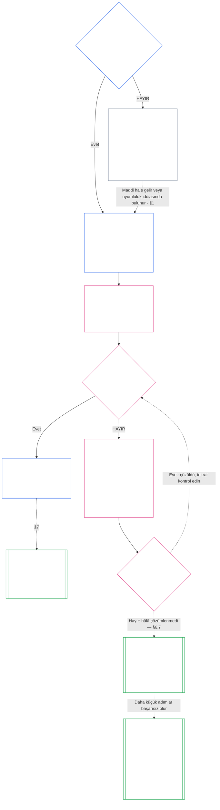

> **Yapay zeka destekli çeviri taslağı — incelenmedi; hiçbir bağımsız akıcı okuyucu incelemesi tamamlanmadı. Bu okuyucu dili dosyası bağlayıcı değildir; numaralandırılmış İngilizce kaynak kontrol etmeye devam ediyor.**

# YEDİNCİ BÖLÜM: SİSTEM VE KURUMSAL ŞARTLAR

<strong>Derlem yerleşimi (işlemsiz): dosya yapısı ve okuma kuralları</strong>

> Bu dosya **Bilinçli Anayasanın bir parçası** ve **yalnızca birbirine bağlanan** diğer numaralı ile `core_*` dosyalar tek metin olarak okunur. İçerir **Yedinci Bölüm**: Bir sistemin ve kurumun yayınlanmış kapsam belgelerinin dayanağı: Sistem Şartı ve Kurumsal Şart. Altıncı Bölüm Haklar Zeminini takip eder ve önce gelir [Sekizinci Bölüm](../../core_08.000_functional_independence_separation_of_duties.md#chapter-eight-functional-independence-and-separation-of-duties), maddi açıdan bağlayıcı herhangi bir eylemin içindeki koltukları ayıran.
>
> - **Anayasa sahibi:** bir sistemin bir Sistem Beyannamesi yayınlaması gerektiğinde ve bir kurumun bir Kurumsal Beyan yayınlaması gerektiğinde (Sınıf L veya daha yüksek bir seviyede gerekli, P Sınıfında gönüllü), her birinin asgari tutarı, her birinin nasıl değiştiğini ve gözden geçirildiğini ve kapsam dahilindeki ofis sahiplerinin statüsü ve orijinalliğine ilişkin formasyon kontrolünü belirtmesi gerekir.
> - **Tanım ana sayfası:** [Sistem Şartı](../../core_05.040_band_continuity.md#system-charter), [Kurumsal Tüzük](../../core_05.040_band_continuity.md#institutional-charter), [Charter Rol Haritası](../../core_05.040_band_continuity.md#charter-role-map), [Yeminli Parti](../../core_05.040_band_continuity.md#chartered-party), Ve [Operasyon Grubu](../../core_05.050_band_oversight.md#operating-party) Beşinci Bölümde tanımlanmıştır. Bu bölüm bunları uygular ve yeniden tanımlamaz.
> - **Uygulama sahibi:** [CI-8.205 §6](../../corpus_institutions/ci_08.205_institutional_design_separation_of_powers.md#ci-8205-6-system-and-institutional-charter-contents-review-and-formation-template) (*Sistem ve Kurumsal Tüzük içerikleri, inceleme ve oluşturma şablonu*) tam saha şablonunu, gözden geçirme kontrol listesini, formasyon prosedürünü ve formasyon kontrol beyanı şablonunu içerir. Daha katı olabilir ve alanlar ekleyebilir. Bu bölümü daraltmayabilir. Metni, yalnızca geçerli benimseme kapsamı dahilinde birleşik uygulama metni olarak bağlayıcıdır ([Onsekizinci Bölüm §4 Evlat edinme çerçevesi ve yetki kapsamı](../../core_18.000_incorporation.md#4-adoption-framing-and-scope-of-authority)); bu bölümdeki zemin ana metin olarak ciltleniyor.
> - **Alt tüketiciler:** [Sekizinci Bölüm §5 Yayınlanmış Yerleştirme, Boş Pozisyon ve Oyuncu Değiştirme](../../core_08.000_functional_independence_separation_of_duties.md#5-published-placement-vacancy-and-substitution) Charter Rol Haritası gerektirir. Dokuzuncu Bölüm, kapsam ve sınır bulguları için Sistem Şartını okuyor ve Dokuzuncu Bölüm, Kısım D, bir Kurum için formasyon kontrol bildirimini test ediyor. [Onuncu Bölüm §3.7 Kayıt saklama ve açma yetkisi](../../core_10.000_standing_assessment.md#37-record-custody-and-opening-authority) bunu kalıcı kayıtlara uygular. [On Üçüncü Bölüm §4.3 Kurumsal forumlar](../../core_13.000_forum.md#43-institutional-forums) Kurumsal Tüzük ile ilgili anlaşmazlıkları dinler.
>
> Okuma sırası: §1 Sistem ve Kurumsal Şartlar gerekli olduğunda, süreci haritalandıran şemayla birlikte → §2 biçimlenme hakkı ve dört dar sınır → §3 bunların belirtmesi gerekenler → §4 Şart Rol Haritası ve sürekli kayıt vesayeti → §5 makam sahibinin durumu ve özgünlüğüne ilişkin formasyon kontrolü → §6 bir hak sahibi formasyon kontrolünde başarısız olduğunda → §7 değişiklik, inceleme ve kapsam yanlışlığı.

<strong>İz</strong>

- Yukarı akış:
  - [Anayasal Dörtlü](../../core_00.000_preamble.md#constitutional-tetrad), özellikle **gözetim** Ve **sorumluluk**;
  - [malzeme payı](../../core_00.000_preamble.md#material-stake);
  - [Birinci Bölüm §18.1 Yetkili Yapı Olarak Yönetişim](../../core_01.015_stewardship_capacity_principles.md#181-governance-as-authorized-structure) (1.015 §18.1);
  - [Madde XI-E](../../core_06.010_rights_part_b.md#article-xi-e-institutional-formation-and-business-creation) (*Kurumsal Oluşum ve İş Yaratımı*).
- Alt bölümler:
  - [§1](#1-sistem-ve-kurumsal-sözleşmeler-gerekli-olduğunda);
  - [§2](#2-şekillenme-hakkı-ve-dört-dar-sınır);
  - [§3](#3-hangi-sistem-ve-kurumsal-şartlarda-belirtilmesi-gerekiyor);
  - [§4](#4-şartın-rol-haritası-ve-daimi-kayıtlı-saklama);
  - [§5](#5-formasyon-kontrolü-ofis-sahibinin-duruşu-ve-özgünlüğü);
  - [§6](#6-bir-tutucu-formasyon-kontrolünde-başarısız-olduğunda);
  - [§7](#7-değişiklik-inceleme-ve-kapsam-uyumsuzluğu).
- Aşağı akış:
  - [Sekizinci Bölüm](../../core_08.000_functional_independence_separation_of_duties.md#chapter-eight-functional-independence-and-separation-of-duties) (8.000);
  - [Dokuzuncu Bölüm](../../core_09.000_system_alignment_certification.md#chapter-nine-system-alignment-certification-reading-index) (9.000);
  - [Onuncu Bölüm](../../core_10.000_standing_assessment.md#chapter-ten-contribution-violation-and-standing-model--measurement) (10.000);
  - [On Üçüncü Bölüm](../../core_13.000_forum.md#chapter-thirteen-forums-and-jurisdiction) (13.000);
  - [On Dördüncü Bölüm](../../core_14.000_governance.md#chapter-fourteen-constitutional-contract-legitimacy-authorization-and-stewardship) (14.000); yukarıda adı geçen belirlenmiş uygulama metni.
- Şununla okuyun:
  - [Yetki Yığını ve İç Hiyerarşi](../../core_05.045_band_integrative.md#authority-stack-and-internal-hierarchy);
  - [Sistem Sınırları](../../core_05.040_band_continuity.md#system-boundaries);
  - [Sistem Sınır Bütünlüğü](../../core_05.040_band_continuity.md#system-boundary-integrity);
  - [Sistem Oluşturma](../../core_05.055_band_participation.md#system-creation);
  - [İş Yaratımı](../../core_05.055_band_participation.md#business-creation).

 

Yedinci Bölüm anayasal sahibidir **Sistem Sözleşmeleri, Kurumsal Sözleşmeler ve yayınlanmış kapsam**.

Üç bölüm tek zincir halinde çalışır:

- **Yedinci Bölüm (bu bölüm):** ne diyor [Yeminli Parti](../../core_05.040_band_continuity.md#chartered-party) yapmayı iddia ettiği ve harekete geçtiğinde her koltuğu kimin elinde tutabileceği.
- **[Sekizinci Bölüm](../../core_08.000_functional_independence_separation_of_duties.md#chapter-eight-functional-independence-and-separation-of-duties):** bu koltukların nasıl ayrı tutulması gerektiğini söylüyor.
- **[Dokuzuncu Bölüm](../../core_09.000_system_alignment_certification.md#chapter-nine-system-alignment-certification-reading-index):** her biri koltukları kullanan bağlayıcı bir işlem olan bir sistemi ve ayrı bir kurumu belgelendirmektedir. Bulduğunu Sistem Şartı'na veya Kurumsal Şart'a geri gönderir.

Diğer bölümlerde bu bölümün işaret ettiği tanımlar, koltuk kuralları, sabit kilitler ve karar kuralları bulunmaktadır. **CI-8.205 §6** (*Sistem ve Kurumsal Tüzük içerikleri, inceleme ve oluşturma şablonu*) saha şablonunu, oluşturma prosedürünü ve inceleme kontrol listesini içerir.

### 1. Sistem ve Kurumsal Sözleşmeler Gerekli Olduğunda

<strong>İz</strong>

- Yukarı akış:
  - [§2](#2-şekillenme-hakkı-ve-dört-dar-sınır);
  - [malzeme payı](../../core_00.000_preamble.md#material-stake);
  - [Orantılılık](../../core_05.035_band_accountability.md#proportionality); bölüm açılış sahibinin iddiası;
  - [Birinci Bölüm §18 Yöneticilik Disiplini Altında Yönetişim](../../core_01.015_stewardship_capacity_principles.md#18-governance-under-stewardship-discipline) (1.015 §18);
  - [Gözetim](../../core_05.020_apex_oversight_leg.md#oversight-constitutional);
  - [Sorumluluk](../../core_05.005_apex_accountability_leg.md#accountability).
- Aşağı akış: [§3](#3-hangi-sistem-ve-kurumsal-şartlarda-belirtilmesi-gerekiyor); [Dokuzuncu Bölüm Kısım A §2 Sistem Sınıfı Değerlendirmesi](../../core_09.005_system_alignment_certification_evaluation.md#2-system-class-evaluation) (9.005 §2) (*sınıf ve sertifika derinliği*); [Dokuzuncu Bölüm Kısım D §12.1 Kurum sınıfı](../../core_09.020_institutional_alignment_certification.md#121-institution-class) (9.020 §12.1) (*bir kurumun sınıfı*); **CS-9.305 (*Sistem sınıflandırma makineleri*) ve CS-9.310** (*Sistem sınıflandırma makineleri*) sınıf kataloğu için.
- Şununla okuyun:
  - **CI-8.205 §6** (*Sistem ve Kurumsal Tüzük içerikleri, inceleme ve oluşturma şablonu*);
  - **CF-13.415 §5** (*Kurumsal ve yerel kayıt memurları*);
  - **CI-9.210** (*Sınıflandırmaya bağlı kurumsal yükümlülükler*);
  - [Beşinci Bölüm Sistem Şartı](../../core_05.040_band_continuity.md#system-charter) (5.040);
  - [Beşinci Bölüm Kurumsal Şart](../../core_05.040_band_continuity.md#institutional-charter) (5.040);
  - [Madde XI-E](../../core_06.010_rights_part_b.md#article-xi-e-institutional-formation-and-business-creation) (*Kurumsal Oluşum ve İş Yaratımı*).

<strong>Tanımlar · Değerlendirme · Uyumluluk</strong>

- [Sistem Şartı](../../core_05.040_band_continuity.md#system-charter) · [O](../../core_05.040_band_continuity.md#system-charter) · [M](../../core_05.040_band_continuity.md#system-charter-a) · [A](../../core_05.040_band_continuity.md#system-charter-a) · [C](../../core_05.040_band_continuity.md#system-charter-c)
- [Kurumsal Tüzük](../../core_05.040_band_continuity.md#institutional-charter) · [O](../../core_05.040_band_continuity.md#institutional-charter) · [M](../../core_05.040_band_continuity.md#institutional-charter-a) · [A](../../core_05.040_band_continuity.md#institutional-charter-a) · [C](../../core_05.040_band_continuity.md#institutional-charter-c)
- [Sınıflandırma Ölçekli Yönetişim](../../core_05.050_band_oversight.md#classification-scaled-governance) · [O](../../core_05.050_band_oversight.md#classification-scaled-governance) · [M](../../core_05.050_band_oversight.md#classification-scaled-governance-a) · [A](../../core_05.050_band_oversight.md#classification-scaled-governance-a) · [C](../../core_05.050_band_oversight.md#classification-scaled-governance-c)

 

*Basit bir ifadeyle: Bir sistemin ya da kurumun kendi sınırları içinde kalıp kalmadığını yargılamadan önce, sınırların herkesin okuyabileceği bir yere yazılması gerekir. Dokuz alanın herhangi birinde başkaları için önemli olan bir sistem [Alana Özel Önemlilik](../../core_05.050_band_oversight.md#domain-specific-materiality) yayınlanmış bir Sistem Şartına ihtiyacı var. Bir kurum, çalıştırdığı sistemlere uygun olanı yayınlar. P Sınıfı isteğe bağlıdır: Mültecilere yorgan veren bir kapitone çemberi modeldir.*

Sistem Tüzüğü veya Kurumsal Tüzük, bir Sözleşmeli Tarafın yayınlanmış kapsamıdır: ne yapma yetkisine sahip olduğunu iddia eder, ne yapmaz ve eyleme geçtiğinde her koltuğu kimin elinde tutar. Sekizinci Bölümdeki koltukların kapsamı budur ve Dokuzuncu Bölümdeki sertifika, gerçek operasyona karşılık gelir. Bir Operasyon Grubunun bir tane yayınlaması gerekip gerekmediği sınıfına bağlıdır: **L Sınıfı veya üzeri için gerekli, P Sınıfı için isteğe bağlı.** Eğer bir tane yayınlaması gerekiyorsa, aynı zamanda doğruluğunu da korumalıdır.

Beş sistem etki sınıfı, aşağıdaki her şeyin çerçevesini oluşturmaktadır. En çok sonuç verenden en az sonuç verene doğru, her biri bir satırda:

- **A Sınıfı, hayatta kalma açısından kritik, temel ve yeri doldurulamaz:** hayatta kalmayla ilgili süre içinde, geçerli bir ikame olmadan başarısızlık, hayatta kalma koşullarının kaybı anlamına gelir.
- **Sınıf B, kritik, yüksek bağımlılık ve sistemik olarak önemli:** bağımlılar bu olmadan temel işlevleri sürdüremezler. Hayatta kalma hemen kaybolmaz ve zamanla ikame hala mümkündür.
- **C Sınıfı, koordineli, yüksek bağımlılık ve kritik olmayan:** koordinasyonu belirli ölçekte şekillendirir ancak Sınıf A veya Sınıf B işlevi için operasyonel bir ön koşul değildir.
- **Sınıf L, yerel, sınırlı etkili ve kritik olmayan:** etkileri özel bir birimin ötesine uzanır ancak yereldir, değiştirilebilir ve kontrol altına alınabilir.
- **P Sınıfı, kişisel, özel kullanım, izole ve deneysel:** etkileri hiçbir anlamlı dış bağımlılık olmaksızın özel bir birimin içinde kalır.

[CS-9.310 §8](../../corpus_systems/cs_09.310_system_impact_classifications.md#cs-9310-8-system-impact-classifications) (*Sistem etki sınıflandırmaları*) tam tanımları tutar. A, B, C ve L Sınıfları yayınlamalı ve P Sınıfı yayınlayabilir ve [§1.2 Hangi sınıflar kapsanmaktadır](#12-hangi-sınıflar-kapsanmaktadır) Bir Kurumun kendi sınıfını çalıştırdığı Sistemlerden nasıl aldığını söylüyor.

#### 1.1 Kimin yayınlaması gerekir

L Sınıfı veya daha yüksek bir Sistem, bir [Sistem Şartı](../../core_05.040_band_continuity.md#system-charter). L Sınıfı veya üzeri bir Kurum, çalıştırdığı Sistemlere uygun olanı yayınlamalı ve sürdürmelidir:

| Kurumun işlettiği, yönettiği veya maddi olarak kontrol ettiği şeyler | Ne yayınlıyor |
| --- | --- |
| Sistem Şartnamesine ihtiyaç duyan tam olarak tek bir Sistem | Bu Sistem Şartı ve ikinci bir belge yok. Kurumu kahya olarak adlandırır ve kurum olarak görev yapar. [Kurumsal Tüzük](../../core_05.040_band_continuity.md#institutional-charter): bir belge her ikisini de kapsar. |
| Birden fazla böyle Sistem | Bir Kurumsal Şart. Bu Sistemler için yürürlükte olan tüm Sistem Şartlarını içerir ve Kurumun bu belirli Sistemleri neden çalıştırdığını belirtir ([§3 Sistem ve Kurumsal Şartlarda Hangi Şartların Belirtilmesi Gerekiyor?](#3-hangi-sistem-ve-kurumsal-şartlarda-belirtilmesi-gerekiyor)). |
| Böyle bir Sistem Yok | Kurumun kendi maddelerini belirten bir Kurumsal Şart [§3 Sistem ve Kurumsal Şartlarda Hangi Şartların Belirtilmesi Gerekiyor?](#3-hangi-sistem-ve-kurumsal-şartlarda-belirtilmesi-gerekiyor) ve eklenecek Sistem Şartları yoktur. |

- **İşletmeler ve karşılaştırılabilir formlar:** Bir işletme veya başka bir yönetilen organizasyon formu, bir Sistem olarak, bir Kurum olarak veya kapsam dahilindeki bir Sistemi işleten bir Kurum olarak Sistem Tüzüğü veya Kurumsal Tüzüğün kendisi için geçerli olanı yayınlar. Yasal şekli cevabı değiştirmez.
- **Ortak mesleki uygulama:** Bir uygulama lisansı veya uygulama izni için listelenen bir eylemi gerçekleştiren Sınıf L veya daha yüksek duyarlı veya küçük bir muayenehane, bir ev sahibinin Sistem Sözleşmesini veya Kurumsal Sözleşmesini ve Sözleşme Rol Haritasını benimseyerek bu eylemler için bu bölümü karşılayabilir:
  - **Neler benimsendi:** Referans olarak, ortak mesleki uygulamadaki bir ev sahibinin bu eylemleri kapsaması gereken Sistem Şartı veya Kurumsal Şartı ve Şart Rol Haritası.
  - **Evlat edinme bildirimi:** Tek sayfalık uyarı **CI-14.205 §7** (*Uygulama lisansı, uygulama izni ve ortak mesleki uygulama*) anlatır.
  - **Sınıf:** Uygulama, kendi eylemlerinin ona verdiği sınıf olarak kalır.

#### 1.2 Hangi sınıflar kapsanmaktadır

Chartered Party sınıfı, yayınlamanın gerekli mi yoksa bir seçim mi olduğuna karar verir:

- **A, B, C ve L Sınıfları:** gerekli. Grafik [§1.7 Bir bakışta süreç](#17-bir-bakışta-süreç) izledikleri süreci gösterir.
- **Sınıf P:** iki olaydan biri bunu zorunlu kılana kadar bir seçim. [§1.3 P Sınıfı Nedir?](#13-p-sınıfı-nedir) Bir Operasyon Grubunu Sınıf P yapan şeyin ne olduğunu söylüyor ve [§1.4 Sınıf P: isteğe bağlı kiralamalar ve gerekli olduklarında](#14-sınıf-p-isteğe-bağlı-kiralamalar-ve-gerekli-olduklarında) seçimi ve ne zaman biteceğini belirler.
- **Bir Kurumun Sınıfı:** Bir Kurum, işlettiği, yönettiği veya maddi olarak kontrol ettiği tüm Sistemler arasında en yüksek sınıfı alır. Böyle bir Sistemi yürütmeyen bir Kurum, kendi maddi etkisine ve bağımlılığına göre sınıflandırılır; etiketi veya yasal şekliyle değil, gerçekte karar verdiği ve elinde bulundurduğu şeyle değerlendirilir. [Dokuzuncu Bölüm Kısım D §12.1 Kurum sınıfı](../../core_09.020_institutional_alignment_certification.md#121-institution-class).

#### 1.3 P Sınıfı Nedir?

Bir Operasyon Grubu, yalnızca faaliyeti dokuz alanın her birinde çizginin altında kaldığı sürece P Sınıfıdır. [Alana Özel Önemlilik](../../core_05.050_band_oversight.md#domain-specific-materiality)Bu da pratikte eylemlerinin ve etkilerinin kendi sınırları içinde kalması anlamına gelir. [özel birim](../../core_05.050_band_oversight.md#domain-specific-materiality-private-unit):

- **Çizgiyi geçmek:** Herhangi bir alanda çizgiyi aşmak, onu en azından L Sınıfı yapar. **CS-9.305 (*Sistem sınıflandırma makineleri*) ve CS-9.310** (*Sistem sınıflandırma makineleri*), büyüklüğü veya kendisine ne ad verdiği ne olursa olsun.
- **Her satırın altında kalmak:** Ne kadar üyesi olursa olsun P Sınıfı olarak kalır.
- **İçeridekiler:** P Sınıfı aynı zamanda içindekilere de bağlıdır. İçeride Operasyon Ekibinin çizgiyi geçtiğini fark eden herkesin bunu bildirme görevi vardır ve rapor korunur ([Alana Özel Önemlilik](../../core_05.050_band_oversight.md#domain-specific-materiality)).

Sekizinci Bölümdeki dört koltuklu zemin, P Sınıfı Operasyon Grubunun kendi özel biriminde kalan eylemleri için geçerli değildir, dolayısıyla bilgisayarı olan tek bir duyarlı kişinin ikinci bir koltuğa ihtiyacı yoktur. Bu kat, Operasyon Grubunun bir belgeyi aldığı günden itibaren geçerlidir. [Maddi Bağlayıcı Kanun](../../core_05.035_band_accountability.md#materially-binding-act) Başkalarının takip etmesi gereken veya yerleşik olarak güvenebileceği, diğerleri üzerinde otorite alanında sınırı aşan ve onu en azından Sınıf L yapan.

#### 1.4 Sınıf P: isteğe bağlı kiralamalar ve gerekli olduklarında

P Sınıfı Operasyon Grubunun aşağıdakileri yayınlaması teşvik edilir: [Sistem Şartı](../../core_05.040_band_continuity.md#system-charter) (tek bir sistem için) veya [Kurumsal Tüzük](../../core_05.040_band_continuity.md#institutional-charter) (birden fazla sistem için veya hiçbiri için) çalıştırdığı şeye uygun. İçerik listesini kullanabilir [§3 Sistem ve Kurumsal Şartlarda Hangi Şartların Belirtilmesi Gerekiyor?](#3-hangi-sistem-ve-kurumsal-şartlarda-belirtilmesi-gerekiyor) ve koltuk haritası [§4 Şartın Rol Haritası ve Daimi Kayıtlı Saklama](#4-şartın-rol-haritası-ve-daimi-kayıtlı-saklama) şablon olarak. Birini yayınlamak bu bölümün süreci kapsamında hiçbir görev yaratmaz:

- son tarih yok ([§1.5 Sistem Sözleşmesinin veya Kurumsal Sözleşmenin vadesi geldiğinde](#15-sistem-şartının-veya-kurumsal-şartın-vadesi-geldiğinde));
- formasyon kontrolü yok ([§5 Formasyon Kontrolü: Ofis Sahibinin Duruşu ve Özgünlük](#5-formasyon-kontrolü-ofis-sahibinin-duruşu-ve-özgünlüğü));
- gerekli değil [Charter Rol Haritası](../../core_05.040_band_continuity.md#charter-role-map) ([§4 Şartın Rol Haritası ve Daimi Kayıtlı Saklama](#4-şartın-rol-haritası-ve-daimi-kayıtlı-saklama)), ancak gönüllü Sistem Şartı veya Kurumsal Şartı ile birlikte bir tane tutabilir veya kendi başına yayınlayabilir; Ve
- gerekli değişiklik veya inceleme döngüsü yoktur ([§7 Değişiklik, İnceleme ve Kapsam Uyumsuzluğu](#7-değişiklik-inceleme-ve-kapsam-uyumsuzluğu)).

Bunlardan herhangi birinin gerçekleşmesi durumunda yayınlama isteğe bağlı olmaktan çıkar.

- Operasyon Grubunun Sınıf L veya daha yüksek bir sınıfa yeniden sınıflandırılması; veya
- operatörü, İşletmeci Tarafın anayasaya uygunluğunu beyan eder.

Operasyon Tarafı daha sonra kendisine uyan Sistem Şartını veya Kurumsal Şartı aşağıdaki programa göre yayınlamalıdır. [§1.5 Sistem Sözleşmesinin veya Kurumsal Sözleşmenin vadesi geldiğinde](#15-sistem-şartının-veya-kurumsal-şartın-vadesi-geldiğinde).

**Tanınma bir kapsam belgesine bağlı değildir.** Sistem Tüzüğü veya Kurumsal Tüzüğü olsun ya da olmasın ve sınıfı ne olursa olsun bir grup, üyeleri ile tanınma arasında durmaz. Her üye, grup içinde veya dışında yapılan işler için bireysel talep sahibi olarak bir katkı kaydı isteyebilir ve kayıt, grubun durumuyla değil, üyenin katkısıyla ilgilidir ([Onuncu Bölüm §3.7 Resmi olmayan ve küçük kapsamlı kayıtlar](../../core_10.000_standing_assessment.md#37-informal-and-small-scope-records)). Kimsenin kabul etmek zorunda olmadığı yardım, mal, emek veya hizmet vermek maddi açıdan bağlayıcı bir eylem değildir; bu nedenle mültecilere yorgan veren bir yardımlaşma çemberinin, üyelerinin tanınması için herhangi bir Sistem Sözleşmesine veya Kurumsal Sözleşmeye ihtiyacı yoktur.

#### 1.5 Sistem Şartının veya Kurumsal Şartın vadesi geldiğinde

Kapsam dahilindeki bir Sistem veya Kurum, kendi [Sistem Şartı](../../core_05.040_band_continuity.md#system-charter) veya [Kurumsal Tüzük](../../core_05.040_band_continuity.md#institutional-charter) bu programda:

- **Yeni Bir Sistem veya Kurum:** yayınlanmadan veya başkaları üzerinde otorite uygulamaya başlamadan önce.
- **Zaten çalışan bir tanesi:** bir sonraki sınıflandırma incelemesinde veya sertifikasyonunda veya aşağıdakiler kapsamındaki bir talebin ardından çözüm penceresi içinde [§1.6 Sistem Şartı veya Kurumsal Şart eksikse](#16-sistem-şartı-veya-kurumsal-şart-eksikse), hangisi önce gelirse. Bunu yapana kadar varsayılandır.
  - **Hangi sertifika:** Bir Sistem için Sistem Hizalama Sertifikası. Bir Kurum için, kurumsal uyum sertifikası, [Dokuzuncu Bölüm Kısım D §11.3 İzin yok ve kapı yok](../../core_09.020_institutional_alignment_certification.md#113-no-permission-and-no-gate)İlk sertifikalandırma penceresi hiçbir zaman Kurumsal Tüzüğün yayınlanmasının veya faaliyet göstermenin bir koşulu değildir.
- **Formasyon kontrolü:** Aynı zamanda formasyon kontrolünü de tamamlar [§5 Formasyon Kontrolü: Ofis Sahibinin Duruşu ve Özgünlük](#5-formasyon-kontrolü-ofis-sahibinin-duruşu-ve-özgünlüğü) aynı anda.
- **Bulunduğu yer:** Sistem Şartını veya Kurumsal Şartını, Şart Rol Haritası ve formasyon kontrol beyanıyla birlikte Kurumsal kayıt memuruna veya faaliyetinin ve etkilediği duyarlı kişilerin yerel olduğu yerel kayıt memuruna sunar (**CF-13.415 §5** (*Kurumsal ve yerel kayıt memurları*))):
  - **Kayıt memurunun yaptığı şey:** Gerekli hiçbir şeyin eksik olup olmadığını kontrol eder ve tarihli bir makbuz verir.
  - **Kayıt memurunun asla yapmadığı şey:** Asla izin vermez ve sınıfa veya içeriğe asla hükmetmez.
  - **Geç veya eksik makbuz:** Chartered Party'nin faaliyetini asla durdurmaz.

#### 1.6 Sistem Şartı veya Kurumsal Şart eksikse

Sistem Şartını veya Kurumsal Şartını yayınlamamış, yeni veya yeni, L Sınıfı veya daha yüksek bir Yeminli Tarafı fark eden herkes, bunun için yönetim makamından talepte bulunabilir. Soruyu soran kişinin ayakta durmasına gerek yoktur, ücret ödemez ve zarar vermesine gerek yoktur. Talep, Yeminli Tarafın adını veriyor ve neden kapsam dahilinde göründüğünü söylüyor.

İstekten iki pencere çalıştırılır: yanıt penceresi ve çözüm penceresi. Her birinin uzunluğu, Chartered Party'nin sınıfıyla aynı harfe sahip olan Tier'den alınır; dolayısıyla sınıf ne kadar kritik olursa, pencereler de o kadar kısa olur:

| Sınıf ve Seviye | Yanıt penceresi (giriş hedefi) | Çözünürlük penceresi (dış sınır) |
|---|---|---|
| A Sınıfı, A Seviyesi | 24 saat | 7 takvim günü |
| B Sınıfı, B Seviyesi | 2 takvim günü | 14 takvim günü |
| C Sınıfı, C Seviyesi | 4 takvim günü | 30 takvim günü |
| L Sınıfı, L Seviyesi | 8 takvim günü | 60 takvim günü |

Rakamlar geliyor **CF-13.445 §3.1** (*Aşama hedefleri ve zamanlama katları*), farklı olup olmadıklarını yönetir. Kendi sınıfına itiraz eden bir Yeminli Taraf, sorun çözülene kadar, Sistem Sınıflandırma Kaydında tuttuğu sınıfın ve soruyu soran kişinin veya forumun ilk bakışta gösterdiği herhangi bir sınıfın daha kritik olanının Seviyesinde sayılır. Kayıtlı hiçbir sınıfı bulunmayan veya sınıfı söz konusuyken P Sınıfına sahip olan bir Yeminli Taraf, Seviye C olarak sayılır.

Pencereler şu şekilde çalışır:

- **Yanıt penceresi:** Chartered Party, eşleşen kademenin alım hedefi olan yanıt penceresi içinde yanıt verir. **CF-13.445 §3.1** (*Aşama hedefleri ve zamanlama katları*), istekten sayılır. Sistem Şartını veya Kurumsal Şartını yayınlar veya yayınlayacağı tarihi verir veya daha önce yayınlamış olduğunu işaret eder veya her satırının altında olduğunu yanıtlar. [Alana Özel Önemlilik](../../core_05.050_band_oversight.md#domain-specific-materiality) ve girişin gerektirdiği yazılıyı verir.
- **Çözünürlük penceresi:** Sistem Sözleşmesi veya Kurumsal Sözleşme, eşleşen katmanın dış sınırı olan çözüm penceresi içinde teslim edilecektir. **CF-13.445 §3.1** (*Aşama hedefleri ve zamanlama katları*), istekten sayılır ve onunla birlikte gelen formasyon kontrol ifadesi ([§5 Formasyon Kontrolü: Ofis Sahibinin Duruşu ve Özgünlük](#5-formasyon-kontrolü-ofis-sahibinin-duruşu-ve-özgünlüğü)). Bağımsız sandalyesi olmayan bir Sözleşmeli Taraf, bu bölümün öngördüğü gibi, beyanı kanıtlarıyla birlikte bir deklarasyon olarak sunar.
- **Çizginin altında olduğunu söyleyen bir Operasyon Partisi:** Bu durumda istek aynı zamanda o girişin rotasındaki bir sınıflandırma sorgulamasıdır. *Mücadele rotası*:
  - **Pencereyi çalıştırma:** Sorun beklemedeyken çözüm penceresi çalışmaya devam eder.
  - **Mücadele uzantısı:** Yargı yetkisine sahip forum, itirazın incelemeye değer olduğuna karar verirse, son tarih uzatılır ve itiraza karar verildiğinde yeni bir çözüm penceresi başlar. Forum, eşleşen kademenin dış sınırı içindeki mücadeleye karar verir.
  - **İncelemeye değer ne anlama gelir:** Bir meydan okuma, adlandırılmış bir alandaki belirli bir geçişin adını verdiğinde ve Operasyon Tarafının yazılı gösterimi bu geçişle ilgili gerçek bir soru bıraktığında incelemeye değerdir. Operasyon Partisi bunu kendisi değerlendirmez ve yazılı olarak gösterilmeyen bir yanıt, tarihi uzatmaz.
  - **Bir sınıf bulunursa:** Bu meydan okumada veya başka herhangi bir durumda, bulgunun tarihi, talebin tarihi olarak sayılır: yanıt penceresi ve çözüm penceresi, bulunan sınıfın Seviyesinde (Sınıf A, B, C veya L) buradan çalıştırılır.
- **Eğer kaçırılırsa:** Yanıt verilmemesi veya son tarihe kadar Sistem Sözleşmesinin veya Kurumsal Sözleşmenin yapılmaması, günlüğe kaydedilmesi ve düzeltilmesi gereken bir kusurdur. Soruyu soran kişi bunu aynı yol üzerindeki yargı yetkisine sahip foruma götürebilir. Bu asla bir oluşum veya faaliyet koşulu değildir.
- **Tekrarlanan bir istek:** Aynı Sözleşmeli Taraf hakkında daha önceki yanıtı veya buna ilişkin bir bulgu hala geçerliyken yapılan ikinci bir talep, yeni bir yanıt veya çözüm penceresi başlatmaz. Chartered Party bu cevaba veya bulguya işaret ederek cevap verir. Henüz forum tarafından incelenmemiş, her satırın altında olduğunu göstermesi geçerli bir yanıt olarak sayılmaz. Yeniden açılma tetiklendiğinden, yanıt veya bulgu bunlardan biri gerçekleşene kadar geçerli kalır. [Dokuzuncu Bölüm Kısım D §14.2 Tetikleyicilerin yeniden açılması](../../core_09.020_institutional_alignment_certification.md#142-reopening-triggers) betimlemek:
  - **Maddi bir değişiklik:** Chartered Party'nin faaliyetleri önemli ölçüde değişiyor.
  - **Yeni kanıtlar:** Bir geçişle ilgili yeni kanıtlar gösteriliyor.

  Yukarıdakilerden herhangi birini gösteren bir istek tekrar değildir. Bu, öncekinden ayrı ve bağımsız olarak ele alınan yeni bir taleptir. Kendi tarihinden itibaren sayılan kendi yanıt penceresi ve çözüm penceresi vardır ve daha önceki yanıt, bulgu ve pencereler ne bunu karşılar ne de onun tarafından değiştirilir.
- **Bu arada kapsam:** Eksik bir Sistem Şartı veya Kurumsal Şart, Sözleşmeli Tarafın sınırsız olarak değerlendirilmesi için bir neden değildir. Var olana kadar, Chartered Party'nin gerçek [Sistem Sınırları](../../core_05.040_band_continuity.md#system-boundaries) ve sınıf kontrolü ve bir sertifikasyon veya forum, gözlemlenen operasyondan kapsamı yeniden oluşturabilir.

#### 1.7 Bir bakışta süreç

Grafik, Sistem Şartını veya Kurumsal Şartını yayınlayarak ve doğru tutarak, bir Operasyon Tarafının diğerleri için önemli olup olmadığı sorusunu takip etmektedir. Çözüm penceresi içinde bir sorun çözülmezse, kiralama süreci sorunu bu bölümün dışında ele alınan bir incelemeye gönderir. Bundan sonraki bölümlerde her adım aynı sırayla açıklanmaktadır.

<strong>Okuyucu rehberliği (çalışmıyor): grafiğin nasıl okunacağı</strong>

> Basit bir ifadeyle: hiç kimse bir Sistem Sözleşmesi veya Kurumsal Sözleşme vermez ve hiç kimsenin oluşturmak için izne ihtiyacı yoktur. Faaliyetleri başkaları için önemli olan bir Sözleşmeli Taraf, yapma yetkisine sahip olduğunu iddia ettiği şeyleri ve her koltuğun kimin elinde olduğunu yayınlar ve kilit makamların sahipleri kontrol edilir. Başarısız olan sahibi değiştirilir veya nedeni giderilir ve Chartered Party yoluna devam eder. Çözüm penceresi sona erdiğinde hata hala giderilmemişse bir forum, diğerlerini koruyan en hafif adımdan başlayarak Sözleşmeli Tarafı inceleyebilir. Chartered Party'nin L sınıfının altına küçülmesi veya feshedilmesi ancak daha hafif adımlar başarısız olursa mümkün olur. Feshetilmiş bir Sözleşmeli Parti, üzerindeki kilit devam ettiği sürece geri gelmeyebilir.
>
> Düz oklar ana yoldur. Noktalı oklar, onları oluşturan bölümle etiketlenmiş istisnalar ve aktarmalardır. Çift yan çubuklu kutular başka bir bölüme veya birleştirilmiş uygulama metnine aittir. Tablo hiçbir görev, koltuk veya alan eklemez ve üzerinde hiçbir adım atılması izin verilmesi anlamına gelmez.

 

### 2. Şekillenme Hakkı ve Dört Dar Sınır

<strong>Okuyucu kılavuzu (çalışmıyor): bu bölümün düzeni nasıl</strong>

- [§2.1 Oluşturma hakkı](#21-oluşturma-hakkı) hakkı ve kimleri kapsamadığını belirtir.
- [§2.2 İlk sınır: duyarlı bir kişi üzerinde olağanüstü bir kilitlenme](#22-ilk-limit-duyarlı-bir-kişi-üzerinde-olağanüstü-bir-kilitlenme) Bir kilidin, duyarlı bir kişiyi kontrol ofisinden nasıl uzak tuttuğunu söylüyor.
- [§2.3 İkinci sınır: belirli doğrulanmış gerçekler üzerinde kısa bir süre bekleme](#23-ikinci-sınır-belirli-doğrulanmış-gerçeklere-kısa-bir-süre-ara-vermek) Kısa süreli bir bekletmenin, adı geçen bir duyarlıyı kontrol ofisinden nasıl uzak tutabileceğini söylüyor.
- [§2.4 Üçüncü sınır: Operasyon Tarafının kendisine yönelik bir kilit](#24-üçüncü-sınır-operasyon-tarafının-kendisine-yönelik-bir-kilitlenme) Operasyon Partisi üzerindeki kilitlenmenin onu ve haleflerini nasıl engellediğini ve feshedilen bir Sözleşmeli Partinin geri dönmeyebileceğini söylüyor.
- [§2.5 Dördüncü sınır: uygulama lisansı veya izni](#25-dördüncü-sınır-uygulama-lisansı-veya-izni) Adlandırılmış yüksek riskli bir eylemin lisansa veya izne ihtiyacı olduğunda diyor. Bu, oluşmaya yönelik bir kapı değildir.

<strong>İz</strong>

- Yukarı akış: [§1](#1-sistem-ve-kurumsal-sözleşmeler-gerekli-olduğunda); [Madde XI-E](../../core_06.010_rights_part_b.md#article-xi-e-institutional-formation-and-business-creation) (*Kurumsal Oluşum ve İş Yaratımı*).
- Aşağı akış: [§1 Sistem ve Kurumsal Sözleşmeler Gerekli Olduğunda](#1-sistem-ve-kurumsal-sözleşmeler-gerekli-olduğunda); [§5 Formasyon Kontrolü: Ofis Sahibinin Duruşu ve Özgünlük](#5-formasyon-kontrolü-ofis-sahibinin-duruşu-ve-özgünlüğü).
- Şununla okuyun:
  - [Geçici Bekletme](../../core_05.035_band_accountability.md#interim-hold);
  - [On Birinci Bölüm §4.2 Önleme - genel ayakta kilitler](../../core_11.000_standing_integration.md#42-prevention--general-standing-locks) (11.000 §4.2);
  - [On Birinci Bölüm §5.5 Özel kilitler](../../core_11.000_standing_integration.md#55-special-locks) (11.000 §5.5);
  - [On Üçüncü Bölüm §5 Adlandırılmış bir duyarlı kişinin yolunun geçici olarak durdurulması](../../core_13.000_forum.md#interim-hold-on-a-named-sentients-pathway) (13.000 §5).

 

*Basit bir ifadeyle: Bir sistem, kurum veya iş kurmak için kimsenin iznine ihtiyacınız yok. Dört dar sınır geçerli olabilir. Üç kapı vardır: Çözülmemiş bir kilit, duyarlı bir kişiyi kontrol ofisinden uzak tutabilir, belirli doğrulanmış gerçeklerin kısa süreli tutulması da aynı şeyi yapabilir ve Operasyon Ekibinin kendisine kilitlenmesi, Operasyon Ekibini engelleyebilir. Dördüncüsü, adı geçen yüksek riskli bir eylemden önce lisans veya izin gerektirebilir. Bir forumun feshettiği bir Sözleşmeli Parti'nin geri gelmesi yasaktır ve feshin yaygın anayasa karşıtı davranışa veya geri alınamayan ve hiçbir zaman düzeltilemeyen ciddi zarara dayanması durumunda çıta kalıcı olur. Hiçbiri yeni bir Operasyon Grubunun kurulmasını veya faaliyet göstermesini engellemez ve bu bölümde hiçbir şey eklenmez.*

**Madde XI-E** (*Kurumsal Oluşum ve İş Yaratımı*) dört dar sınıra izin verir:

- **İlk üçü tek kapıdır** Bir Operasyon Grubu oluşturma veya bu ekipte yetkiye sahip olma. Her biri adlandırılmış bir konuya eklenir:
  - **Olağanüstü bir kilit** ([§2.2 İlk sınır: duyarlı bir kişi üzerinde olağanüstü bir kilitlenme](#22-ilk-limit-duyarlı-bir-kişi-üzerinde-olağanüstü-bir-kilitlenme)) Chartered Party'yi kontrol eden bir ofiste adı geçen bir duyarlıya bağlanır.
  - **Geçici Durdurma** ([§2.3 İkinci sınır: belirli doğrulanmış gerçekler üzerinde kısa bir süre bekleme](#23-ikinci-sınır-belirli-doğrulanmış-gerçeklere-kısa-bir-süre-ara-vermek)) Chartered Party'yi kontrol eden bir ofiste yalnızca adı geçen bir duyarlıya bağlanır.
  - **Operasyon Ekibinin kendisine bir kilit** ([§2.4 Üçüncü sınır: Operasyon Tarafının kendisine yönelik bir kilit](#24-üçüncü-sınır-operasyon-tarafının-kendisine-yönelik-bir-kilitlenme)), bir forumun feshettiği de dahil olmak üzere, kendisi de kilit altında olan bir Yeminli Tarafa bağlıdır.
- **Dördüncüsü bir kapı değil:** Bu bir uygulama lisansı veya iznidir ([§2.5 Dördüncü sınır: uygulama lisansı veya izni](#25-dördüncü-sınır-uygulama-lisansı-veya-izni)).

#### 2.1 Oluşturma hakkı

Herkes yeni bir sistem, kurum veya iş kurabilir. Bu hak, [Madde XI-E](../../core_06.010_rights_part_b.md#article-xi-e-institutional-formation-and-business-creation) (*Kurumsal Oluşum ve İş Yaratımı*). Bu bölüm bir sonraki görevi ekler. Bir Operasyon Grubunun yaptığı, dokuz alanın herhangi birinde başkaları için önemli olduğunda [Alana Özel Önemlilik](../../core_05.050_band_oversight.md#domain-specific-materiality), yapma yetkisine sahip olduğunu iddia ettiği şeyi önceden kamuoyuna açıklamalıdır ([§1 Sistem ve Kurumsal Sözleşmeler Gerekli Olduğunda](#1-sistem-ve-kurumsal-sözleşmeler-gerekli-olduğunda)). Bir Sistem Şartının veya Kurumsal Şartın benimsenmesi, bu hakkı veya herhangi bir Hak Tabanı korumasını daraltacak şekilde okunmamalıdır.

**Formasyon hakkı kimleri kapsamaz.** Üç kapıdan başka [§2.2 İlk sınır: duyarlı bir kişi üzerinde olağanüstü bir kilitlenme](#22-ilk-limit-duyarlı-bir-kişi-üzerinde-olağanüstü-bir-kilitlenme), [§2.3 İkinci sınır: belirli doğrulanmış gerçekler üzerinde kısa bir süre bekleme](#23-ikinci-sınır-belirli-doğrulanmış-gerçeklere-kısa-bir-süre-ara-vermek), Ve [§2.4 Üçüncü sınır: Operasyon Tarafının kendisine yönelik bir kilit](#24-üçüncü-sınır-operasyon-tarafının-kendisine-yönelik-bir-kilitlenme), **Madde XI-E** (*Kurumsal Oluşum ve İş Yaratımı*) korumaz:

- Anayasal Kısıtlamayı kırmak, Güvenliği veya Gerçeği baltalamak veya gücü belirli şekillerde yoğunlaştırmak için tasarlanmış bir Operasyon Partisi [Birinci Bölüm §11 Piyasa Yapısı](../../core_01.005_values_principles.md#11-market-structure) dışlıyor; veya
- Doğrulanmış davranış, kontrol ve ödüllerle gösterilen, belirtilen amacına gerçek anlamda uymayan veya amacı, kontrolü veya çıkarları konusunda başkalarını yanıltmak veya başkalarına zarar vermek isteyen bir kurucu tarafından oluşturulan veya yönetilen bir Operasyon Grubu.

Forumlar bu davaları bu Madde uyarınca karara bağlar ve bunun tek sonucu, içindeki üç kapıdır: olağanüstü kilit kapısı, Geçici Durdurma ve Operasyon Grubunun kendisine kilitlenmesi. Başarısız bir diziliş kontrolü, forumun önemsediği kanıtlardan biridir; bu, diziliş kontrolünün tek başına davaya karar vermeyeceği anlamına gelir.

#### 2.2 İlk limit: duyarlı bir kişi üzerinde olağanüstü bir kilitlenme

A [ayakta kilit](../../core_11.000_standing_integration.md#42-prevention--general-standing-locks) veya [özel kilit](../../core_11.000_standing_integration.md#55-special-locks)Doğrulanmış bir ihlalden sonra konulan ve henüz kaldırılmayan bu yasa, duyarlı bir kişinin bu tür bir kurum veya işletme üzerinde yetki sahibi olmasını engeller.

- Yasak olan: Operasyon Tarafında yönetim, kontrol veya sahiplik yetkisini almak veya kullanmak.
- Ne kadar uzağa ulaşır: yalnızca kilidin ulaştığı yere kadar. Kilit kaldırıldığında veya daraltıldığında sona erer.
- Operasyon Grubunun kendisine yönelik bir kilit: bkz. [§2.4 Üçüncü sınır: Operasyon Tarafının kendisine yönelik bir kilit](#24-üçüncü-sınır-operasyon-tarafının-kendisine-yönelik-bir-kilitlenme).

#### 2.3 İkinci sınır: belirli doğrulanmış gerçeklere kısa bir süre ara vermek

Bu sınır, yargı yetkisine sahip bir mahkemenin bir emir vermesi durumunda geçerlidir. [Geçici Bekletme](../../core_05.035_band_accountability.md#interim-hold) sahibinin Chartered Party'nin belirtilen amacına aykırı davranma olasılığını artıran belirli doğrulanmış gerçekler hakkında. Yalnızca bu forum sipariş verebilir ([On Üçüncü Bölüm §5 Adlandırılmış bir duyarlı kişinin yolunun geçici olarak durdurulması](../../core_13.000_forum.md#interim-hold-on-a-named-sentients-pathway)). Chartered Party, bir kişiyi ofisten men etmeye kendi başına karar veremez çünkü bu, onu kendi üyesinin yargıcı haline getirir. Tam zemin içinde olanıdır [On Üçüncü Bölüm §5 Adlandırılmış bir duyarlı kişinin yolunun geçici olarak durdurulması](../../core_13.000_forum.md#interim-hold-on-a-named-sentients-pathway); bu kısa form onun yerini almaz.

#### 2.4 Üçüncü sınır: Operasyon Tarafının kendisine yönelik bir kilitlenme

Bir kilit yalnızca duyarlı bir kişinin değil, Operasyon Grubunun da üzerinde durabilir. Daha sonra kapı, söz konusu Operasyon Grubunda ve onun haleflerinde, kontrol edilen kuruluşlarda ve aday veya mermi tutulan araçlarda, kilidin adlandırdığı yol adlarını engeller. Başka hiçbir Operasyon Tarafını engellemez.

- Son atamayla ayarlanan bir kilit: [Anayasaya Karşı Güven Kilidi](../../core_11.000_standing_integration.md#55-special-locks) nihai atamanın bir kurumu, halef aracı veya kontrol edilen kuruluşu belirttiği durumlarda bunu yapar. Daha sonra kapı, Chartered Party'de ve onun haleflerinde, kontrol edilen kuruluşlarda ve aday veya mermi tutulan araçlarda kilidin adlandırdığı yol adlarını engeller.
- Feshedilmiş bir Sözleşmeli Parti: altında nihai bir fesih emri **CI-11.210 §4** (*Çözünme*) bir ayarlar [Çözünme Reformasyon Kilidi](../../core_11.000_standing_integration.md#55-special-locks). Feshedilen Sözleşmeli Taraf, onun halefleri, kontrol edilen kuruluşlar, aday veya paravan araçlar ve onlarla aynı operasyonda olan herhangi bir Operasyon Grubu, mevcut olduğu süre boyunca yeniden oluşturulamaz, yeniden canlandırılamaz veya herhangi bir isim veya şekil altında çalıştırılamaz. Kararın yaygın anayasaya aykırı davranış veya telafi edilemeyen Geri Dönülemez Zarar tespit etmesi halinde ([On Birinci Bölüm §8 Restorasyon ve yeniden değerlendirme](../../core_11.000_standing_integration.md#8-restoration-and-reassessment)), kilit kalıcıdır: zaman, çözülmüş bir neden veya sahiplerin değişmesi onu kaldırmaz ve yalnızca fesih kararının inceleme sırasında iptal edilmesi veya yeni doğrulanmış maddi gerçeklerin bulgunun yanlış olduğunu göstermesi durumunda sona erer. Aksi takdirde, nedenin çözüldüğü, çözümün sağlandığı ve geri dönüşün devam eden dışlamadan daha güvenli olduğu yönünde bağımsız bir bulguyla sonuçlanır. Hiçbir duyarlının farklı bir Operasyon Grubu oluşturmasını yasaklamıyor.

Üç kapıdan hiçbiri yeni bir Operasyon Grubunun Sistem Şartını veya Kurumsal Şartını oluşturmasını, yayınlamasını veya çalışmaya başlamasını engellemez. Durdurdukları tek parti, kendisi kilit altında olan, örneğin dağılmış bir Chartered Party'nin geri dönmeye çalışması gibi. Formasyon kontrolünde üç kapı uygulanır ([§5 Formasyon Kontrolü: Ofis Sahibinin Duruşu ve Özgünlük](#5-formasyon-kontrolü-ofis-sahibinin-duruşu-ve-özgünlüğü)).

#### 2.5 Dördüncü sınır: uygulama lisansı veya izni

Dördüncü sınır, bir Faaliyet Grubu oluşturmaya değil, adlandırılmış bir eyleme uygulanır:

- **Operasyon Grubunda bir kapı değil:** formasyon kontrolü [§5 Formasyon Kontrolü: Ofis Sahibinin Duruşu ve Özgünlük](#5-formasyon-kontrolü-ofis-sahibinin-duruşu-ve-özgünlüğü) uygulamamaktadır.
- **Nedir:** A [Yetkinlik İzni](../../core_05.035_band_accountability.md#competency-clearance) O **Madde XI-E** (*Kurumsal Oluşum ve İş Yaratımı*), benimseyenin, başkaları için adlandırılmış bir eylem gerçekleştirilmeden önce, teknik bir forumun yayınlanmış risk bulgusuna göre talepte bulunmasını sağlar.
  - **Uygulama lisansı:** Kötü bir şekilde yapıldığında ciddi veya geri dönüşü olmayan zarar riski taşıyan eylemler için gereklidir.
  - **Uygulama izni:** Gerçek ama kötü yapıldığında daha az zarar verme riski taşıyan eylemler için gereklidir.
- **Neye bağlı:** eylemi gerçekleştiriyor. Hiçbir zaman bir Operasyon Grubunun Sistem Şartını veya Kurumsal Şartını oluşturmasını, yayınlamasını veya faaliyet göstermesini engellemez.
- **Neyi durdurur:** eylemi onsuz iddia etmek veya gerçekleştirmek. Bir Sistem Şartı veya Kurumsal Şart, sahibi bunu gerçekleştirmedikçe eylemi talep edemez ([§3 Sistem ve Kurumsal Şartlarda Hangi Şartların Belirtilmesi Gerekiyor?](#3-hangi-sistem-ve-kurumsal-şartlarda-belirtilmesi-gerekiyor)).

### 3. Hangi Sistem ve Kurumsal Şartlarda Belirtilmesi Gerekiyor?

<strong>Okuyucu kılavuzu (çalışmıyor): bu bölümün düzeni nasıl</strong>

- [§3.1 Sistem Şartında neler belirtiliyor](#31-sistem-şartında-neler-belirtiliyor) dokuz öğeyi listeler.
- [§3.2 Şart İşaretleri](#32-şart-işaretleri) bir Sistem Şartının veya Kurumsal Şartın metnini kopyalamak yerine yayınlanmış başka bir belgeye atıfta bulunabileceğini ve bu referansı neyin geçerli kıldığını söylüyor.
- [§3.3 Kurumsal Tüzük neleri ekler?](#33-kurumsal-tüzük-neler-ekler) Kurumsal Şartın dokuz maddenin ötesinde neler içerdiğini kapsar: Kurumun yürüttüğü Sistemlerin Sistem Şartları ve bunları neden çalıştırdığı.
- [§3.4 Uygulama lisansı veya uygulama izni gerektiren eylemler](#34-uygulama-lisansı-veya-uygulama-izni-gerektiren-eylemler) bir Sistem Tüzüğü veya Kurumsal Tüzüğün böyle bir eylemi ancak bunu gerçekleştiren her duyarlı kişinin lisansa veya izne sahip olması veya bunları yapan bir süpervizörün altında öğrenci olarak çalışması durumunda talep edebileceğini söylüyor. O zamana kadar kanun kapsam dışı olarak listelenir (madde 4). [§3.1 Sistem Şartında neler belirtiliyor](#31-sistem-şartında-neler-belirtiliyor)).
- [§3.5 Ölçeklendirme](#35-ölçeklendirme) sınıfa göre neyin değiştiğini söylüyor.

<strong>İz</strong>

- Yukarı akış: [§1](#1-sistem-ve-kurumsal-sözleşmeler-gerekli-olduğunda); [Beşinci Bölüm Sistem Şartı](../../core_05.040_band_continuity.md#system-charter) (5.040); [Beşinci Bölüm Kurumsal Şart](../../core_05.040_band_continuity.md#institutional-charter) (5.040).
- Aşağı akış:
  - [§4](#4-şartın-rol-haritası-ve-daimi-kayıtlı-saklama);
  - [§7](#7-değişiklik-inceleme-ve-kapsam-uyumsuzluğu);
  - [Dokuzuncu Bölüm Kısım B §8.1 Minimum kayıt içerikleri](../../core_09.010_system_alignment_certification_record_process.md#81-minimum-record-contents) (9.010 §8.1) (*Sistem Şartı, bir sertifikasyon kaydının dayandığı alanları içerir*);
  - **CI-8.205 §6** (*Sistem ve Kurumsal Tüzük içerikleri, inceleme ve oluşturma şablonu*) tam alan listesi için.
- Şununla okuyun:
  - [Onsekizinci Bölüm §4 Evlat edinme çerçevesi ve yetki kapsamı](../../core_18.000_incorporation.md#4-adoption-framing-and-scope-of-authority) (18.000 §4) (*başka bir isim altında tutulan kapsam belgesi*);
  - [On Dördüncü Bölüm §4.3 Bağlayıcı paydaş seçimi için karar verme gereklilikleri](../../core_14.000_governance.md#43-decision-resolution-requirements-for-binding-stakeholder-choice) (14.000 §4.3);
  - **CI-6.205 §1** (*Paydaş gözetimi, bildirimi ve bağlayıcı yönetim yolu bütünlüğü*);
  - **CI-6.205 §2** (*Konsantrasyon karşıtı ve katılım meşruiyeti güvenceleri*).

<strong>Tanımlar · Değerlendirme · Uyumluluk</strong>

- [Sistem Şartı](../../core_05.040_band_continuity.md#system-charter) · [O](../../core_05.040_band_continuity.md#system-charter) · [M](../../core_05.040_band_continuity.md#system-charter-a) · [A](../../core_05.040_band_continuity.md#system-charter-a) · [C](../../core_05.040_band_continuity.md#system-charter-c)
- [Kurumsal Tüzük](../../core_05.040_band_continuity.md#institutional-charter) · [O](../../core_05.040_band_continuity.md#institutional-charter) · [M](../../core_05.040_band_continuity.md#institutional-charter-a) · [A](../../core_05.040_band_continuity.md#institutional-charter-a) · [C](../../core_05.040_band_continuity.md#institutional-charter-c)
- [Charter Rol Haritası](../../core_05.040_band_continuity.md#charter-role-map) · [O](../../core_05.040_band_continuity.md#charter-role-map) · [M](../../core_05.040_band_continuity.md#charter-role-map-a) · [A](../../core_05.040_band_continuity.md#charter-role-map-a) · [C](../../core_05.040_band_continuity.md#charter-role-map-c)

 

*Basit bir ifadeyle: Bir Sistem Şartının test edilebilecek kadar spesifik olması gerekir. Sistemin ne işe yaradığını, sistemin ne yaptığını ve yapmadığını, kimlerin sisteme güvendiğini, Sistem Şartını kimin değiştirebileceğini, her koltuğun kimin elinde olduğunu ve bağlayıcı karar kurallarının nerede bulunacağını söylüyor. Sistem Şartı bu kurallara işaret eder ve onların yerine geçmez. Kurumsal Tüzük, kurum için aynı şeyi söyler, ardından sahip olduğu Sistem Sözleşmelerini ve kurumun bu sistemleri çalıştırma nedenini ekler.*

#### 3.1 Sistem Şartında neler belirtiliyor

Bir Sistem Şartı, etkilenen duyarlı kişilerin ve denetçilerin okuyabileceği sade bir dille şunları belirtir:

1. **Kimlik ve sürüm:** isim, kahya veya yönetim organı, versiyon, yürürlük tarihi ve değişiklik geçmişi.
2. **Amaç:** Chartered Party'nin ne yapmak için var olduğu.
3. **Kapsam dahilindeki faaliyetler:** iddia ettiği işlevler, hizmetler, yetkiler ve etki alanları.
   - **Hibe değil, talep:** Belge, Chartered Party'nin halihazırda sahip olduğu yetkiyi belirtiyor ve ona hiçbir yetki vermiyor. Bu yetkinin meşru olup olmadığı, Anayasal Şart'a dayandığı yer de dahil olmak üzere, şu şekilde kararlaştırılır: [On Dördüncü Bölüm §1 Yönetim Makamının Yetkisi ve Meşruiyeti](../../core_14.000_governance.md#1-authorization-and-legitimacy-of-governing-authority).
4. **Kapsam dışı limitler:** uygulamaya yetkili olmadığı maddi faaliyetler, yetkiler ve alanlar.
5. **Etkilenen topluluklar ve bağımlılıklar:** Chartered Party'ye kimlerin güvendiği ve hangi sistemlere veya altyapıya bağlı olduğu veya önemli olduğu durumlarda kapılara bağlı olduğu.
   - **Bir vazgeçme değil:** Bir grubu bu listenin dışında bırakmak onu kapsam dışı bırakmaz. Sözleşmeli Tarafın maddi olarak etkilediği duyarlı bir kişi, belgede adı bulunsun veya bulunmasın her Hak Tabanı korumasını korur ve gerçek güvene karşı gerçek güvenden daha dar bir liste okunur.
6. **Sınıflandırma varsayımları:** güvenilen sınıf veya yönetim kademesi, [Kiralama İşaretçisi](../../core_05.040_band_continuity.md#charter-pointer) ile **CS-9.305 (*Sistem sınıflandırma makineleri*) ve CS-9.310** (*Sistem sınıflandırma makineleri*) Ve **CS-14.305** (*Kritik sistem yönetimi*) nereye başvuracakları.
7. **Charter Rol Haritası:** the [Charter Rol Haritası](../../core_05.040_band_continuity.md#charter-role-map)veya Charter Rol Haritası olan yayınlanmış belgeye yönelik bir Charter İşaretçisi ([§4 Şartın Rol Haritası ve Daimi Kayıtlı Saklama](#4-şartın-rol-haritası-ve-daimi-kayıtlı-saklama)).
8. **Bağlayıcı paydaş seçimi Şartname İşaretleri:**
   - **Uygulandığında:** etkilenen duyarlı kişiler arasındaki gerçek bir anlaşmazlık, sistem içinde bağlayıcı bir paydaş seçimi gerektirdiğinde. [Def.P2 Bağlayıcı Paydaş Seçimi](../../core_05.055_band_participation.md#defp2-binding-stakeholder-choice) buna kabul kapsamı diyor.
   - **Neye işaret ediyor:** Yayınlanmış üç kural dizisine canlı Şart İşaretçileri: karar sırası (seçim nasıl yapılır), ağırlıklandırma kuralları (kimin ne kadar söz hakkı vardır) ve haklar-çatışma-kayıt kuralları (haklar çatıştığında kaydın neyi göstermesi gerekir).
   - **Kim neyi taşıyor:** Sistem Şartı yalnızca işaretçileri içerir. Üç kural dizisi asıl içeriği barındırır: Seçimin nasıl yapıldığı, ağırlığın nasıl belirlendiği ve kaydın ne gösterdiği. Sistem Şartı bu içeriği kendisi taşımaz ve bu kuralların yerine kendi metni sunulamaz. Ölü bir işaretçi veya kuralların yerine sunulan Sistem Şartı metni, Sistem Şartı görevini yerine getiremez.
9. **Değişiklik yetkisi:** Kimin değişiklik yapabileceği, nelerin önemli değişiklik sayılacağı, bildirim ve yarışma yolu.

#### 3.2 Şart İşaretleri

Bir Sistem Şartı veya Kurumsal Şart, onu kopyalamak yerine yayınlanmış başka bir belgeye veya hükme (kural seti, Şart Rol Haritası, Sistem Şartı) işaret edebilir. Bu tür referansların her biri bir [Kiralama İşaretçisi](../../core_05.040_band_continuity.md#charter-pointer). Canlı, güncel, yayınlanmış bir belgeye çözümlenmelidir. Ölü veya bayatlamış bir Charter Pointer, kayıp öğe olarak sayılır.

#### 3.3 Kurumsal Tüzük neler ekler?

Bir Kurumsal Şart, 1'den 9'a kadar olan maddeleri belirtir. [§3.1 Sistem Şartında neler belirtiliyor](#31-sistem-şartında-neler-belirtiliyor) Kurumun kendisi adına ve aynı zamanda aşağıdakilere sahiptir:

- **Sistem Şartları:** Kurumun işlettiği, yönettiği veya maddi olarak kontrol ettiği Sistemler için yürürlükte olan her Sistem Şartı, tam olarak veya mevcut yayınlanmış versiyona çözümlenen bir Şart İşaretçisi tarafından dahil edilir.
- **Portföy mantığı:** Kurumun bu belirli Sistemleri neden çalıştırdığı, belirtilen amaca nasıl hizmet ettikleri ve birbirleriyle ilişkileri ve hangi bağımlılıkları paylaştıkları. Belirtilmiş bir nedeni olmayan bir Sistem, eksik bir öğedir.

**CI-8.205 §6** (*Sistem ve Kurumsal Tüzük içerikleri, inceleme ve oluşturma şablonu*) daha fazlasını gerektirebilir ve diziliş şablonunu belirler ancak yukarıdaki bir öğeyi düşürmeyebilir.

#### 3.4 Uygulama lisansı veya uygulama izni gerektiren eylemler

Bu alt bölüm, bir kanunun bir uygulama lisansına veya uygulama iznine ihtiyaç duyması durumunda Sistem Şartının veya Kurumsal Şartın neleri talep edebileceğini belirtmektedir.

- **Sınır:** Bir eylem bir uygulama lisansı veya uygulama izni gerektiriyorsa, bir Sistem Tüzüğü veya Kurumsal Tüzük bunu Sözleşmeli Tarafın yaptığı bir şey olarak listeleyemez ve Sözleşmeli Taraf bunu gerçekleştiremez, bunu gerçekleştiren her duyarlı kişi lisansa veya izne sahip olmadığı veya bunları yapan bir süpervizör altında öğrenci olarak çalışmadığı sürece.
- **O zamana kadar:** Sistem Şartı veya Kurumsal Şart, 4. madde kapsamındaki kanunu listeler ([§3.1 Sistem Şartında neler belirtiliyor](#31-sistem-şartında-neler-belirtiliyor)) kapsam dışı olarak.
- **Sahibi olmadan talep edilirse:** Kaydedilmesi ve düzeltilmesi gereken eksik bir öğedir ve Chartered Party'nin oluşturulmasını, yayınlanmasını veya diğer çalışmalarını sürdürmesini engellemez.
- **Nereye bakmalı:** [§2 Oluşturma Hakkı ve Dört Dar Sınır](#2-şekillenme-hakkı-ve-dört-dar-sınır) gereksinimin nereden geldiğini söylüyor ve **CI-14.205 §7** (*Uygulama lisansı, uygulama izni ve ortak mesleki uygulama*) girişleri ve ana bilgisayar kontrolünü tutar.

#### 3.5 Ölçeklendirme

Sistem Şartının veya Kurumsal Şartın bazı bölümleri sınıfla birlikte, bazıları ise aşağıdakileri içermez:

- **Hangi ölçekler:** Sistem Şartının veya Kurumsal Şartın derinliği, inceleme temposu ve inceleme ölçeğinin sınıf ve sınıfa göre bağımsızlığı [malzeme payı](../../core_00.000_preamble.md#material-stake).
- **Sınıf L:** L Sınıfı bir sistem veya kurum için Sistem Şartı veya Kurumsal Şart kısa olabilir ve daha basit kayıtlar tutabilir; [Sınıflandırma Ölçekli Yönetişim](../../core_05.050_band_oversight.md#classification-scaled-governance) izin verir. Hala gerekli her öğeyi kapsaması gerekiyor.
- **Kadansı gözden geçirin:** Sistem Şartı veya Kurumsal Şart, ne sıklıkta gözden geçirileceğine karar vermez. Bunu sınıf belirliyor.

### 4. Şartın Rol Haritası ve Daimi Kayıtlı Saklama

<strong>Okuyucu kılavuzu (çalışmıyor): bu bölümün düzeni nasıl</strong>

- [§4.1 Koltuklar nedir ve neden varlar](#41-koltuklar-nedir-ve-neden-varlar) okuyucuya dört sandalyeyi ve neden hiçbir partinin aynı eylemde Sekizinci Bölümde yasaklanan eşleşmeleri dolduramayacağını hatırlatır.
- [§4.2 Bir yerleşimi geçerli kılan şey nedir](#42-bir-yerleşimi-geçerli-kılan-nedir) Sekizinci Bölümün testleri (bağımsızlık, boşluk ve ikame, birleştirilmiş barındırma) belirlediğini ve haritanın yalnızca kimin nerede oturduğunu kaydettiğini söylüyor.
- [§4.3 Sistem Şartının veya Kurumsal Şartın haritaya borcu nedir?](#43-sistem-şartının-veya-kurumsal-şartın-haritaya-borcu-nedir) Sistem Şartının veya Kurumsal Şartın haritayı içermesi veya ona işaret etmesi gerektiğini, eksik bir haritanın, ölü bir işaretçinin veya güncelliğini yitirmiş bir haritanın o Sistem Şartında veya Kurumsal Şartta bir kusur olduğunu söylüyor.
- [§4.4 Hangi Sistem Şartı veya Kurumsal Şart hangi haritayı barındırıyor](#44-hangi-sistem-şartı-veya-kurumsal-şart-hangi-haritayı-barındırıyor) tek bir Kurumsal Sözleşme kapsamındaki çeşitli Sistemleri ve paylaşılan bir haritayı kapsar.
- [§4.5 Koltuk kurallarının ve koltuk sahiplerinin değiştirilmesi](#45-koltuk-kurallarının-ve-koltuk-sahiplerinin-değiştirilmesi) Kimin koltuğa sahip olabileceğini değiştirmenin bir değişiklik olduğunu ve şu anda kimin elinde olduğunu değiştirmenin haritanın ancak bildirim ve itiraz şansı sonrasında yürürlüğe girecek yeni tarihli bir versiyonu olduğunu söylüyor.
- [§4.6 Sürekli kayıt altında gözaltı](#46-daimi-kayıt-altına-alma) haritanın ayakta kalan kayıtlar için ne söylemesi gerektiğini söyler ve iki bölümden oluşur: [§4.6.1 Operatörün sürekli kayıtları](#461-operatörün-ayakta-kayıtları) Ve [§4.6.2 Paydaşların sürekli kayıtları](#462-paydaş-ayakta-kayıtları).
- [§4.7 Operatör ayakta kayıtları için haritadaki boşluklar](#47-operatör-ayakta-kayıtları-için-haritadaki-boşluklar) gerekli bir koltuğun adı verilmediğinde veya yetkili bir sahibi olmadan bırakıldığında ve dört bölümden oluştuğunda ne olacağını söylüyor: [§4.7.1 Bir boşluk olduğunda ve bunun nasıl günlüğe kaydedildiği](#471-bir-boşluk-olduğunda-ve-bunun-nasıl-günlüğe-kaydedildiği), [§4.7.2 Bir boşluk açıkken](#472-bir-boşluk-açıkken), [§4.7.3 Etkinliklerin son nitelikli yedek oyuncuyu kaldırması durumunda](#473-eğer-etkinliklerde-son-nitelikli-yedek-oyuncu-kaldırılırsa), Ve [§4.7.4 Sertifikasyon koltukları](#474-sertifikasyon-koltukları).

<strong>İz</strong>

- Yukarı akış: [§3](#3-hangi-sistem-ve-kurumsal-şartlarda-belirtilmesi-gerekiyor); [Sekizinci Bölüm §2 Dört Koltuklu Anayasa Katı](../../core_08.000_functional_independence_separation_of_duties.md#2-four-seat-constitutional-requirement) (8.000 §2).
- Aşağı akış:
  - [Sekizinci Bölüm §5 Yayınlanmış Yerleştirme, Boş Pozisyon ve Oyuncu Değiştirme](../../core_08.000_functional_independence_separation_of_duties.md#5-published-placement-vacancy-and-substitution) (8.000 §5);
  - [Dokuzuncu Bölüm Kısım B §6.1.1 Sertifikasyonda dört koltuk](../../core_09.010_system_alignment_certification_record_process.md#611-four-seats-in-a-certification) (9.010 §6.1.1);
  - [Onuncu Bölüm §3.7 Kayıt saklama ve açma yetkisi](../../core_10.000_standing_assessment.md#37-record-custody-and-opening-authority) (10.000 §3.7);
  - **CI-8.205 §2** (*Fonksiyonel ayırma şeritleri*);
  - **CI-14.205 §5** (*Yetkili roller ve sorumluluk zincirleri*);
  - **CI-14.205 §6** (*Koltuk kataloğu — süreç rolü arketipleri ve operasyonel sınırlar*).
- Şununla okuyun: [Malzeme Kontrol Hattı](../../core_05.035_band_accountability.md#material-control-line); [Daimi Kayıt](../../core_05.035_band_accountability.md#standing-record).

<strong>Tanımlar · Değerlendirme · Uyumluluk</strong>

- [Charter Rol Haritası](../../core_05.040_band_continuity.md#charter-role-map) · [O](../../core_05.040_band_continuity.md#charter-role-map) · [M](../../core_05.040_band_continuity.md#charter-role-map-a) · [A](../../core_05.040_band_continuity.md#charter-role-map-a) · [C](../../core_05.040_band_continuity.md#charter-role-map-c)
- [Sistem Şartı](../../core_05.040_band_continuity.md#system-charter) · [O](../../core_05.040_band_continuity.md#system-charter) · [M](../../core_05.040_band_continuity.md#system-charter-a) · [A](../../core_05.040_band_continuity.md#system-charter-a) · [C](../../core_05.040_band_continuity.md#system-charter-c)
- [Kurumsal Tüzük](../../core_05.040_band_continuity.md#institutional-charter) · [O](../../core_05.040_band_continuity.md#institutional-charter) · [M](../../core_05.040_band_continuity.md#institutional-charter-a) · [A](../../core_05.040_band_continuity.md#institutional-charter-a) · [C](../../core_05.040_band_continuity.md#institutional-charter-c)

 

*Basit bir ifadeyle: Sistem Tüzüğü veya Kurumsal Tüzük, koltukların isimlerini aldığı yerdir. Kapsadığı eylemler için her koltuğa kimin sahip olabileceğine dair yayınlanmış bir liste taşır, dolayısıyla bir parti kendi pulunu seçemez. Neyin geçerli bir koltuk yerleşimi olarak sayılacağına ilişkin kurallar Sekizinci Bölüm'de kalacaktır. Daimi kayıtların güvende tutulması ayrı bir liste değildir: aynı haritadır.*

Her Sistem Şartı veya Kurumsal Şart, bir [Charter Rol Haritası](../../core_05.040_band_continuity.md#charter-role-map): Her koltuğa kimin sahip olduğunu gösteren yayınlanmış bir liste. [Sekizinci Bölüm §5 Yayınlanmış Yerleştirme, Boş Pozisyon ve Oyuncu Değiştirme](../../core_08.000_functional_independence_separation_of_duties.md#5-published-placement-vacancy-and-substitution) maddi olarak bağlayıcı eylemlerde bulunan ve ne isimlendirmesi gerektiğini söyleyen her benimseyen kişiden bunu gerektirir. Bu bölümde Sistem Şartının veya Kurumsal Şartın bununla ne yaptığı anlatılmaktadır.

#### 4.1 Koltuklar nedir ve neden varlar

Her [Maddi Bağlayıcı Kanun](../../core_05.035_band_accountability.md#materially-binding-act) dört işi var ve [Sekizinci Bölüm §2 Dört Koltuklu Anayasa Katı](../../core_08.000_functional_independence_separation_of_duties.md#2-four-seat-constitutional-requirement) onları ayrı tutar:

- **[Koltuk Başlatılıyor](../../core_05.035_band_accountability.md#initiating-seat):** eylemi talep ederek, teklif ederek, yürüterek veya talep ederek başlatır.
- **[Koltuğu Doğrula veya Yetkilendir](../../core_05.035_band_accountability.md#verify-or-authorize-seat):** kanıtları ve otoriteyi kontrol eder, ardından eylemi doğrular, yetkilendirir, koşullandırır veya reddeder.
- **[Kayıt Koltuğu](../../core_05.035_band_accountability.md#record-seat):** Doğrulama veya Yetkilendirme Merkezinin kararlarının resmi kaydını tutar.
- **[Yarışma Koltuğu](../../core_05.035_band_accountability.md#contest-seat):** Bir meydan okuma duyar ve onu düzeltir, sınırlandırır veya yönlendirir.

Koltuklar, hiçbir tarafın bir sonuç isteyemeyeceği, kendi talebini kontrol edemeyeceği, bu kontrolün kaydını kontrol edemeyeceği ve aynı zamanda kendisine yapılan itirazı değerlendiremeyeceği şekilde mevcuttur. Bir koltuk, bir iş unvanı değil, tek perdedeki bir iştir; dolayısıyla aynı duyarlık, ofis veya sistem, farklı eylemler için farklı koltuklara sahip olabilir, ancak Sekizinci Bölüm'de eşleştirme aynı eylemi asla yasaklamaz. Harita, her koltuğun adlandırılmış bir sahibine sahip olduğu yerdir.

#### 4.2 Bir yerleşimi geçerli kılan nedir?

Sekizinci Bölüm testleri belirler ve harita yalnızca kimin nerede oturduğunu kaydeder:

- **Malzeme Kontrol Hattı:** tek bir perde etrafındaki gerçek güç zinciri. Eylemi söz konusu olan taraf, eylemi başlatan veya eylemi doğrulanan, itiraz edilen veya kaydedilen taraftır. Söz konusu taraf, söz konusu eylem için sandalye sahibini yönlendirebilir, geçersiz kılabilir, ödüllendirebilir, cezalandırabilir veya görevden alabilir ya da sahibinin işini geciktirebilirse bir koltuğu kontrol eder. Bunu yapabilen duyarlı kişiler, ofisler ve sistemler o tarafın gücünü oluşturur. [Malzeme Kontrol Hattı](../../core_05.035_band_accountability.md#material-control-line) eylem için.
- **Bağımsızlık:** Bir kanunu kontrol eden koltuk, eğer kanunu ihtilaf konusu olan taraf onu kontrol edebiliyorsa, bağımsız değildir ([Sekizinci Bölüm §3 Bağımsızlık, Çatışma ve Kontrol Hatları](../../core_08.000_functional_independence_separation_of_duties.md#3-independence-conflict-and-control-lines)). Dolayısıyla harita, kayıt koltuğunu, yarışma koltuğunu ve her doğrulama veya yetkilendirme koltuğunu ilgili tarafın Malzeme Kontrol Hattının dışına koymalıdır. Parti ayrıca bu sandalyeleri kimin elinde tutacağını tek başına kendi kararıyla değiştiremez ([§4.5 Koltuk kurallarının ve koltuk sahiplerinin değiştirilmesi](#45-koltuk-kurallarının-ve-koltuk-sahiplerinin-değiştirilmesi)).
- **Boş kadro, yedekler ve delegasyon:** Sahibin bulunmadığı veya anlaşmazlığa düştüğü durumlarda devreye giren kişi ([Sekizinci Bölüm §5 Yayınlanmış Yerleştirme, Boş Pozisyon ve Oyuncu Değiştirme](../../core_08.000_functional_independence_separation_of_duties.md#5-published-placement-vacancy-and-substitution)).
- **Birleştirilmiş barındırma:** küçük bir partinin bir ofise iki sandalye koyabileceği tek durum. Harita, izin verilen her düzenlemeyi ve onunla birlikte gelen bağımsızlık korumasını listeler ([Sekizinci Bölüm §6 Orantılı Ölçeklendirme ve Birleştirilmiş Barındırma](../../core_08.000_functional_independence_separation_of_duties.md#6-proportional-scaling-and-merged-hosting)).

#### 4.3 Sistem Şartının veya Kurumsal Şartın haritaya borcu nedir?

Bir Sistem Şartı veya Kurumsal Şart, Şart Rol Haritasını içerir veya ona bir işaretle işaret eder. [Kiralama İşaretçisi](#32-şart-işaretleri)böylece Sistem Şartı veya Kurumsal Şart'tan başlayan bir okuyucu her koltuğun kimin elinde olduğunu bulabilir. Aşağıdaki durumlarda bir kusur vardır:

- **Harita eksik:** ne haritayı içerir ne de bir haritayı işaret eder.
- **İşaretçi öldü:** bulunamayan veya canlı, yayınlanmış bir belge olmayan bir haritaya işaret eder.
- **Harita güncel değil:** şu anda her koltuğu kimin elinde tuttuğunu göstermiyor. Sahip değişikliği, haritanın yeni tarihli bir versiyonu olarak yayınlanır ([§4.5 Koltuk kurallarının ve koltuk sahiplerinin değiştirilmesi](#45-koltuk-kurallarının-ve-koltuk-sahiplerinin-değiştirilmesi)).

#### 4.4 Hangi Sistem Şartı veya Kurumsal Şart hangi haritayı barındırıyor

Hangi Sistem Şartının veya Kurumsal Şartın bir harita tuttuğu tarafların nasıl düzenlendiğine bağlıdır:

- **Çeşitli Sistemler:** Bir Kurumsal Sözleşme birden fazla Sistem Sözleşmesini içerebilir. Her Sistem Tüzüğü, kendi Sisteminin fiillerinin haritasını saklar, Kurumsal Tüzük ise Kurumun kendi fiillerinin haritasını saklar.
- **Paylaşılan bir harita:** Bir işletme veya uygulama, koltuklarının bir kısmını yerel bir kooperatife, birliğe veya ev sahibine verebilir ([§1 Sistem ve Kurumsal Sözleşmeler Gerekli Olduğunda](#1-sistem-ve-kurumsal-sözleşmeler-gerekli-olduğunda)). Eğer öyleyse, kendi Sistem Şartını veya Kurumsal Şartını kısa tutan kendi haritasını yazmak yerine o grubun yayınlanmış haritasını kullanabilir. Halen, sandalye sahiplerinden biri yokken veya çatıştığında kimin devreye gireceğini belirlemesi ve nitelikli bir yedek bulunmadığında bağımsız bir yol izlemesi gerekiyor ([Sekizinci Bölüm §6 Orantılı Ölçeklendirme ve Birleştirilmiş Barındırma](../../core_08.000_functional_independence_separation_of_duties.md#6-proportional-scaling-and-merged-hosting), *Ortak tutulan koltuklar*).

#### 4.5 Koltuk kurallarının ve koltuk sahiplerinin değiştirilmesi

Harita iki şekilde değişebilir ve her birinin kendi rotası vardır:

- **Kimler koltuğa oturabilir:** Hangi ofislerin koltuk sahibi olabileceğine, yedek olarak hareket edebileceğine veya barındırmayı paylaşabileceğine karar vermek, harita kurallarında bir değişikliktir. Sistem Tüzüğü veya Kurumsal Tüzük adlarında yalnızca değişiklik işlemi yapılabilir ([§7 Değişiklik, İnceleme ve Kapsam Uyumsuzluğu](#7-değişiklik-inceleme-ve-kapsam-uyumsuzluğu)).
- **Şimdi kim oturuyor:** Mevcut sahibinin değiştirilmesi bir değişiklik değil, güncellemedir. Haritanın yeni tarihli bir versiyonunun yayınlanmasıyla yapılır.
  - **Bildirim ve yarışma şansı:** Rekor koltuk, yarışma koltuğu ve haritanın yerleştirdiği herhangi bir doğrulama veya yetkilendirme koltuğu için yeni sürüm yalnızca bildirimde bulunulduktan ve yarışma şansı verildikten sonra yürürlüğe girer. Uyarı, koltuğun temas ettiği her açık kayıtta aynı anda konuya, her davacıya ve her yarışmacıya gönderilir.
  - **Bir yarışma nereye gider:** Bir yarışma şu adresteki bir foruma gidiyor: [Onuncu Bölüm §3.6 Forum sınırı](../../core_10.000_standing_assessment.md#36-forum-boundary), yalnızca Sistem Şartının veya Kurumsal Şartın değişiklik için belirttiği yola değil, bekleyen bir yarışma da değişikliği geri tutuyor: mevcut sahibi koltukta kalıyor.
  - **Yeni sahibinin göstermesi gerekenler:** Chartered Party, yeni sahibinin her testi geçtiğini göstermelidir. **CI-8.205 §6** (*Sistem ve Kurumsal Tüzük içerikleri, inceleme ve oluşturma şablonu*) alan 10. Testlerin tek bir amacı vardır: koltuk, denek, iddia sahibi veya meydan okuyan kişi tarafından baskı altında tutulamayacak veya onlara iltifat edilemeyecek ve kaydı güvenli ve itiraza açık tutacak bir organ tarafından tutulmalıdır. Bu nedenle yeni sahibi dışarıda oturmak zorundadır. [Malzeme Kontrol Hattı](../../core_05.035_band_accountability.md#material-control-line) Bu taraflardan herhangi biri, aynı kayıt için iki koltuğa sahip olmamalı veya karşılıklı veya dairesel bir düzenlemede barındırmamalı, kaydı ve denetim izini sağlam tutmalı, zorlukları geldiği gün yönlendirmeli, hiçbir ücret talep etmemeli ve bunu kimin finanse ettiğini ve yönettiğini açıklamalıdır.
  - **Boş bir koltuk:** Aslında boş olan bir koltuğun altında işlem yapılıyor [§4.7 Operatör ayakta kayıtları için haritadaki boşluklar](#47-operatör-ayakta-kayıtları-için-haritadaki-boşluklar), bu kurşunla değil.

**Hangi sürüm geçerlidir:** Bir fiilin hükmü, çekildiği gün yürürlükte olan haritaya göre verilir. Bir forumun, sahibinin değişikliğini iptal etmesi halinde, değişiklik hiçbir zaman yürürlüğe girmemiş gibi değerlendirilir ve sahibinin koltukta gerçekleştirdiği eylemler incelemeye açıktır.

#### 4.6 Daimi kayıt altına alma

Haritanın ne söylemesi gerektiği, haritanın türüne bağlıdır. [Daimi Kayıt](../../core_05.035_band_accountability.md#standing-record)çünkü her iki tür de farklı çıkar çatışmalarıyla karşı karşıyadır ([Onuncu Bölüm §3.7 Kayıt saklama ve açma yetkisi](../../core_10.000_standing_assessment.md#37-record-custody-and-opening-authority), *Konuya göre iki tür ayakta kayıt*). Onuncu Bölüm, dört koltuklu zemini plakların kendisine uyguluyor.

##### 4.6.1 Operatörün ayakta kayıtları

Operatör kayıtları; Sözleşmeli Taraf, sözleşmeli kapsamı ve yönettiği sistemler hakkındaki kayıtlardır. Bunlar için harita dört şeyi adlandırıyor:

- kaydı kimin açabileceği (doğrulama koltuğu);
- onu saklayan ayrı bir saklayıcı (kayıt koltuğu);
- yarışmaları kim yönetir (yarışma koltuğu); Ve
- Nitelikli bir vekil bulunmadığında veya adı geçen makam veya saklayıcının kendisi şüpheli olduğunda veya şüphelinin Malzeme Kontrol Hattı'nda yer aldığında (örneğin, bir forum, bağımsız soruşturma servisi veya önceden belirlenmiş bir yedek kurum) bağımsız bir yol.

Sistem Şartının veya Kurumsal Şartın hiçbir rota belirtmediği durumlarda (altında bir boşluk vardır) [§4.7 Operatör ayakta kayıtları için haritadaki boşluklar](#47-operatör-ayakta-kayıtları-için-haritadaki-boşluklar)), şu varsayılanlar geçerlidir:

- **Kayıt açma yetkisi:** Yedek Kayıt Yetkilisi altında **CF-13.415 §7** (*Yedek Kayıt Yetkilisi*) varsayılandır.
- **Sorumlu:** Yedek Kayıt Sorumlusu altında **CF-13.415 §9** (*Yedek Kayıt Sorumlusu*) varsayılandır. Aynı zamanda adı geçen saklayıcının hareket edemediği kayıtları da tutar.
- **Kimin adı verilebilir ve testler:** Bu koltuklara kimlerin atanabileceği ve her bir sahibinin geçmesi gereken testler **CI-8.205 §6** (*Sistem ve Kurumsal Tüzük içerikleri, inceleme ve oluşturma şablonu*) alan 10.

##### 4.6.2 Paydaş ayakta kayıtları

Paydaşların sürekli kayıtları, sistemlerini kullanan, bunlara güvenen veya sistemlerden etkilenen duyarlı kişiler ve kurumlar hakkındaki kayıtlardır. Bunlar için kurallar farklıdır çünkü Chartered Party'nin kayıtlarda payı olabilir:

- **Chartered Party'nin payı:** Bu kayıtlarda iddiada bulunan ya da suçlamada bulunan kişi olabilir.
- **Kendi ofisleri:** Yalnızca Chartered Party'nin bu kayıtta hiçbir payı yoksa, bir kayıtta sandalye sahibi olabilirler. Eğer bir payı varsa, kayıt Chartered Party'nin kontrolü dışındaki bir ofise veya bağımsız doğrulamaya gider.
- **Hiçbirinin adı belirtilmemişse ve Chartered Party'nin hissesi varsa:** Kayıt, Yedek Kayıt Yetkilisine (**CF-13.415 §7** (*Yedek Kayıt Yetkilisi*)) ve Yedek Kayıt Sorumlusu (**CF-13.415 §9** (*Yedek Kayıt Sorumlusu*)) veya bir foruma [Onuncu Bölüm §3.7 Kayıt saklama ve açma yetkisi](../../core_10.000_standing_assessment.md#37-record-custody-and-opening-authority) (*Kendi kendine velayet yok*) sağlar.
- **Ofislere ad vermek isteğe bağlıdır:** Harita, bu kayıtlar için ofisleri önceden adlandırabilir, ancak bunu yapmak zorunda değildir ve hiçbirini adlandırmayan bir harita hala geçerlidir.

#### 4.7 Operatör ayakta kayıtları için haritadaki boşluklar

Bu kurallar girişlerdeki boşluklar için geçerlidir. [§4.6.1 Operatörün sürekli kayıtları](#461-operatörün-ayakta-kayıtları) gereklilikler. [§4.7.4 Sertifikasyon koltukları](#474-sertifikasyon-koltukları) aynı saati sertifikasyon koltuklarına da uygular.

##### 4.7.1 Bir boşluk olduğunda ve bunun nasıl günlüğe kaydedildiği

Boşluklu bir harita, Sistem Şartını veya Kurumsal Şartı geçersiz kılar. Haritada rekoru açan otoriteyi, rekor saklayıcısını, yarışma yerini ve bağımsız rotayı belirtmek gerekir. Bunlardan herhangi birinin isimsiz kalmasına neden olacak bir değişikliğe izin verilmez.

- **Kimler boşluk kaydedebilir:** Herkes, herhangi bir süre beklemeden, bir foruma, kayıt memuruna veya Yedek Kayıt Yetkilisine bildirimde bulunarak.
  - **Bildiride ne diyor:** Bildirimde koltuğun adı ve neden boş göründüğü belirtiliyor.
  - **Saatler başladığında:** Boşluk, ilk ihbarın alındığı gün kaydedilir ve saatler o andan itibaren işlemeye başlar; Yanlış olduğu gösterilen bir bildirim saati başlatmaz.

##### 4.7.2 Bir boşluk açıkken

Sorun çözülene kadar Chartered Party'nin kendi ofislerinden hiçbiri etkilenen kapsam için geçerli bir kalıcı kayıt yayınlayamaz.

- **Rekorun gittiği yer:** Kayıt, Yedek Kayıt Yetkilisine (**CF-13.415 §7** (*Yedek Kayıt Yetkilisi*)) doğrulamak ve Yedek Kayıt Sorumlusunu (**CF-13.415 §9** (*Yedek Kayıt Sorumlusu*)) düzenlemek veya bunun yerine bir foruma gitmek, böylece kimsenin kaydı Chartered Party'nin onarımını beklemez ([Onuncu Bölüm §3.7 Kayıt saklama ve açma yetkisi](../../core_10.000_standing_assessment.md#37-record-custody-and-opening-authority), *Kendi kendine velayet yok*).
- **Velayet geri döndüğünde:** Yedek Kayıt Yetkilisi ve Yedek Kayıt Sorumlusu, bunların üçü de gerçekleşene kadar kaydı işlemeye devam eder. Daha sonra velayet adı geçen sahiplere geri döner.
  - **Tüm koltuklar dolu:** Haritanın gerektirdiği her koltuğun yine adlandırılmış bir sahibi vardır.
  - **Sahipler testleri geçer:** Yedek Kayıt Yetkilisi veya bir forum, her bir kayıt sahibinin testleri geçtiğini doğrular. **CI-8.205 §6** (*Sistem ve Kurumsal Tüzük içerikleri, inceleme ve oluşturma şablonu*) alan 10.
  - **Bildirim ve yarışma şansı gerçekleşti:** Bildirim ve yarışma şansı [§4.5 Koltuk kurallarının ve koltuk sahiplerinin değiştirilmesi](#45-koltuk-kurallarının-ve-koltuk-sahiplerinin-değiştirilmesi) tamamlandı.

##### 4.7.3 Eğer etkinliklerde son nitelikli yedek oyuncu kaldırılırsa

Hiç kimsenin öngöremeyeceği bir şey bu koltuklardan birini nitelikli bir sahibi olmadan bırakırsa, Chartered Party olağan yanıt penceresini ve çözüm penceresini alır ([§1.6 Sistem Şartı veya Kurumsal Şart eksikse](#16-sistem-şartı-veya-kurumsal-şart-eksikse)).

- **Acil durum değişikliği:** Yalnızca gerçekten boş olan bir koltuk için izin verilir ve geçicidir.
- **Yedek oyuncu koltuğa nasıl oturur:** Yeminli Taraf bir yedek isim belirleyebilir, ancak yedek kişi ancak Yedek Kayıt Otoritesi'nden sonra koltuğa oturur (**CF-13.415 §7** (*Yedek Kayıt Yetkilisi*)) veya bir forum, testleri geçtiğini doğrular **CI-8.205 §6** (*Sistem ve Kurumsal Tüzük içerikleri, inceleme ve oluşturma şablonu*) alan 10 ve bağımsızlık testleri [§4.2 Bir yerleşimi geçerli kılan şey nedir](#42-bir-yerleşimi-geçerli-kılan-nedir)ve Chartered Party bunu gösterme yükünü taşıyor.
- **Oyuncu değişikliği sona erdiğinde:** Acil durum ikamesi geçici bir önlemdir. O zamana kadar düzenli bir sahip değişikliği haline gelmediği sürece, kontrol penceresi sona erdiğinde sona erer. [§4.5 Koltuk kurallarının ve koltuk sahiplerinin değiştirilmesi](#45-koltuk-kurallarının-ve-koltuk-sahiplerinin-değiştirilmesi).
  - **Pencereyi kim ayarlar:** Sistem Sözleşmesi veya Kurumsal Sözleşme, bu pencerenin uzunluğunu belirler ancak bu, Seviyeniz için maksimum süreden daha uzun olamaz.
  - **Maksimumlar:** Seviye A için 7 gün, Seviye B için 14 gün, Seviye C için 30 ve Seviye L için 60 gün (çözünürlük pencereleri [§1.6 Sistem Şartı veya Kurumsal Şart eksikse](#16-sistem-şartı-veya-kurumsal-şart-eksikse) masa).
  - **A Seviye acil durum:** Yaşamın veya ciddi hakların tehlikede olduğu Kademe A acil durumlarda, varsayılan kontrol aralığı 3 gündür ve koruyucu adım devreye girer. [On Üçüncü Bölüm §6 Zamanında çözüm, önemlilik aşamaları ve gecikme karşıtı disiplin](../../core_13.000_forum.md#time-scale-levels) (*Zaman ölçeği seviyeleri*).
  - **Formasyon kontrolü tamamlanıncaya kadar:** Yedek kişi tek başına bağlayıcı bir işlem yapamaz.

##### 4.7.4 Sertifikasyon koltukları

Aynı saat sertifikasyon koltukları için de geçerlidir. Harita, sistem uyum sertifikası veya kurumsal uyum sertifikası için yarışmaları kimin başlattığını, kimin kaydını tuttuğunu veya kimin yönettiğini belirtmiyorsa, bu kayıt altına alınması ve düzeltilmesi gereken bir kusurdur. Sistem Şartını veya Kurumsal Şartı bir anda geçersiz kılmaz.

- **Kurumun yapabilecekleri:**
  - **Çalışmaya ve sertifikalandırmaya devam edin:**  **CI-8.205 §2** (*Fonksiyonel ayırma şeritleri*) şerit haritası bu arada koltuğu yerleştirir, böylece hiçbir sertifika geçişi durdurulmaz.
  - **Kusuru düzeltin:** Koltuğu haritanın tarihli bir değişikliğine göre yerleştirir. Her zamanki yanıt penceresine ve çözüm penceresine sahiptir (**CI-11.210 §3** (*Bildirim, yanıt ve çözüm*), [§1.6 Sistem Şartı veya Kurumsal Şart eksikse](#16-sistem-şartı-veya-kurumsal-şart-eksikse)), boşluğun günlüğe kaydedilen bildiriminden sayıldı.
- **Kurumun yapamayacakları:**
  - **Sertifikayı durdurmak için boşluğu kullanın:** Yerleştirilmemiş bir sertifikasyon koltuğu asla bir geçişi duraklatmak, geciktirmek veya engellemek için bir neden değildir.
  - **Çözünürlük penceresinin ötesindeki boşluğu açık bırakın:** Bu pencere sona erdiğinde koltuk hala yerleştirilmemişse, Sistem Şartı veya Kurumsal Şart, ayakta kayıt girişlerindeki boşlukla aynı şartlarda geçersizdir ([§4.7.1 Bir boşluk olduğunda ve bunun nasıl günlüğe kaydedildiği](#471-bir-boşluk-olduğunda-ve-bunun-nasıl-günlüğe-kaydedildiği)).
- **Doğrula veya yetkilendir koltuğu:** Harita bu koltuğu yerleştirmiyor ([Sekizinci Bölüm §5 Yayınlanmış Yerleştirme, Boş Pozisyon ve Oyuncu Değiştirme](../../core_08.000_functional_independence_separation_of_duties.md#5-published-placement-vacancy-and-substitution)), yani asla bu türden bir boşluk olmaz.

### 5. Formasyon Kontrolü: Ofis Sahibinin Duruşu ve Özgünlüğü

<strong>Okuyucu kılavuzu (çalışmıyor): bu bölümün düzeni nasıl</strong>

- [§5.1 Neleri kapsıyor](#51-neleri-kapsıyor) formasyon kontrolünün hangi ofislere ulaştığını, diğer personelin tek tek kontrol edilmediğini, formasyon kontrolünün sahibinin alt yapısı ne olursa olsun aynı olduğunu söylüyor.
- [§5.2 Daimi kontrol](#52-daimi-kontrol) Bilinçli bir kişi kapalı bir ofise geçmeden önce Chartered Party'nin kontrol edip kaydettiği şeyleri söylüyor: kilit yok, Geçici Bekleme yok, yeterlilik çubuğu karşılandı ve çatışmalar açıklandı.
- [§5.3 Orijinallik kontrolü](#53-orijinallik-kontrolü) Bir makamın, sahibinin kendi hakkı dahilinde ve belirtilen amaç doğrultusunda tutulduğu ve dört şey açısından test edildiğini söylüyor: kontrol, menfaatler ve ödüller, davranış ve korunan görüş.
- [§5.4 Formasyon kontrolünün kanıt olarak kullanabileceği şeyler](#54-formasyon-kontrolünün-kanıt-olarak-kullanabileceği-şeyler) formasyon kontrolünün hiçbir zaman bilinçli bir kişinin neye inandığını sormadığını ve üç kural belirlediğini söylüyor: tutmak yeterli değildir, etiketler kalkan değildir ve kontrol üyelik değildir.
- [§5.5 Hak sahibinin söyledikleri](#55-sahibinin-söyledikleri) Başkalarının zararı hak ettiğine dair doğrulanmış bir ifadenin nasıl davranış olarak sayıldığını ve neyin sayılmadığını söylüyor.
- [§5.6 Personel koruma kontrolü](#56-personel-koruma-kontrolü) Chartered Party'nin kapalı ofisi olmayan personel hakkında bir kez gösterdiği şeyi söylüyor.
- [§5.7 Formasyon kontrol beyanı](#57-formasyon-kontrol-beyanı) yönetim otoritesinin ne yayınladığını, bunu kimin doğruladığını ve yanlış bir beyanın ardından ne geldiğini söylüyor.
- [§5.8 Zamanlama ve formasyonun yeniden kontrolü](#58-zamanlama-ve-formasyonun-yeniden-kontrolü) Açıklamanın ne zaman yayınlandığını, yeni bir tutucunun ne zaman kontrol edildiğini ve formasyonun yeniden kontrol edilmesini neyin tetiklediğini söylüyor.
- [§5.9 Oran ve yük](#59-oran-ve-yük) formasyon kontrolünün sınıf ve maddi çıkarlara göre nasıl ölçeklendiğini söylüyor.

<strong>İz</strong>

- Yukarı akış:
  - [§2](#2-şekillenme-hakkı-ve-dört-dar-sınır);
  - [§1.5](#15-sistem-şartının-veya-kurumsal-şartın-vadesi-geldiğinde);
  - [§3](#3-hangi-sistem-ve-kurumsal-şartlarda-belirtilmesi-gerekiyor);
  - [§4](#4-şartın-rol-haritası-ve-daimi-kayıtlı-saklama);
  - [Madde XI-E](../../core_06.010_rights_part_b.md#article-xi-e-institutional-formation-and-business-creation) (*Kurumsal Oluşum ve İş Yaratımı*);
  - [Hangi Sistemler Ödüllendiriliyor](../../core_00.000_preamble.md#what-systems-reward) ve
  - [İki Temel Soru](../../core_00.000_preamble.md#two-fundamental-questions);
  - [Birinci Bölüm §19.1.4 Rol Derinliği ve Maddi Sorumluluk Yolları](../../core_01.015_stewardship_capacity_principles.md#1914-role-depth-and-material-responsibility-pathways) (1.015 §19.1.4);
  - [Birinci Bölüm §19.4 Yanlış Hizalamanın Düzeltilmesi ve Yakalama Yanıtı](../../core_01.015_stewardship_capacity_principles.md#194-misalignment-correction-and-capture-response) (1.015 §19.4);
  - [On Birinci Bölüm §4.2 Önleme - genel ayakta kilitler](../../core_11.000_standing_integration.md#42-prevention--general-standing-locks) (11.000 §4.2),
  - [§5.5 Özel kilitler](../../core_11.000_standing_integration.md#55-special-locks), Ve
  - [§6.2 Yeterlilik çubukları ve izinler](../../core_11.000_standing_integration.md#62-competency-bars-and-clearances).
- Aşağı akış:
  - [§6 Bir Sahibi Formasyon Kontrolünde Başarısız Olduğunda](#6-bir-tutucu-formasyon-kontrolünde-başarısız-olduğunda);
  - [Dokuzuncu Bölüm Kısım D §12.2 Kurumsal değerlendirme, her zaman](../../core_09.020_institutional_alignment_certification.md#122-institutional-evaluation-always) (9.020 §12.2) (madde 7, *forumlar beyanı test ediyor*);
  - [Dokuzuncu Bölüm Kısım A §3.3 Yönetişim, Teşvik ve İtiraz Edilebilirlik Disiplini](../../core_09.005_system_alignment_certification_evaluation.md#33-governance-incentive-and-contestability-discipline) (9.005 §3.3);
  - **CI-8.205 §6** (*Sistem ve Kurumsal Tüzük içerikleri, inceleme ve oluşturma şablonu*) bildirim şablonu için.
- Şununla okuyun:
  - [Malzeme Kontrol Hattı](../../core_05.035_band_accountability.md#material-control-line);
  - [Daimi Kayıt](../../core_05.035_band_accountability.md#standing-record);
  - [Korumalı Raporlama (İhbar)](../../core_05.035_band_accountability.md#protected-reporting-whistleblowing);
  - [Birinci Bölüm §17.5 Direnme Görevi](../../core_01.015_stewardship_capacity_principles.md#175-duty-to-resist) (1.015 §17.5);
  - **CI-14.205 §2** (*Rol kriterleri, atama standartları ve görevden alınma yolları*);
  - **CI-8.210** (*Çatışma bütünlüğü, yakalama ve yolsuzlukla mücadele*).

 

*Basit bir ifadeyle: Bir Chartered Party başkaları üzerinde otorite uygulamadan önce, onun kilit ofislerini elinde bulunduran duyarlı kişiler iki kez kontrol edilir. Rol için yayınlanmış standartları karşılıyorlar mı ve hiçbir engel yok mu? Ve bu görevi bir paravan veya aday olarak değil, kendi başlarına ve Chartered Party'nin belirtilen amacı doğrultusunda mı tutuyorlar? Cevap, onları kimin yönettiğinden, onlara ne için ödeme yapıldığından ve doğrulanabilir şekilde söylediklerinden ve yaptıklarından gelir; asla neye inandıklarından değil. Bu bir formasyon kontrolüdür, lisans değil.*

Bu bölüm **formasyon kontrolü**. Belirtilen üç kapıyı uygular. [§2 Oluşturma Hakkı ve Dört Dar Sınır](#2-şekillenme-hakkı-ve-dört-dar-sınır): Adlandırılmış bir duyarlıya bağlanan ikisi kapalı ofisler için geçerlidir ve üçüncüsü, kendisi de kilit altında olan bir Yeminli Taraf için geçerlidir. [Madde XI-E](../../core_06.010_rights_part_b.md#article-xi-e-institutional-formation-and-business-creation) (*Kurumsal Oluşum ve İş Yaratımı*) onun tarafından daraltılmaz. L Sınıfı veya daha yüksek bir Yeminli Taraf için geçerlidir ([§1 Sistem ve Kurumsal Sözleşmeler Gerekli Olduğunda](#1-sistem-ve-kurumsal-sözleşmeler-gerekli-olduğunda)).

#### 5.1 Neleri kapsıyor

Formasyon kontrolü hangi ofisleri kapsadığını, kimlerin bunun dışında kaldığını ve her alt tabakaya nasıl davrandığını belirler:

- **Kapalı ofisler:**
  - Aşağıda adı geçen değişiklik yetkisini elinde bulunduran her ofis dahil olmak üzere, idari makamın her ofisi [§3 Sistem ve Kurumsal Şartlarda Hangi Şartların Belirtilmesi Gerekiyor?](#3-hangi-sistem-ve-kurumsal-şartlarda-belirtilmesi-gerekiyor) (madde 7);
  - her ofis [Charter Rol Haritası](../../core_05.040_band_continuity.md#charter-role-map) bir koltuk, yedek veya bağımsız rotanın adları ([§4 Şartın Rol Haritası ve Daimi Kayıtlı Saklama](#4-şartın-rol-haritası-ve-daimi-kayıtlı-saklama)); Ve
  - Sözleşme kapsamındaki kapsam dahilindeki eylemleri diğerlerini maddi olarak bağlayan veya kapsamın bağlı olduğu kayıtları, anahtarları veya fonları kontrol eden herhangi bir başka ofis, temsilci veya yüklenici.
- **Diğer personel:** tek tek kontrol edilmez. Bunlar aşağıdaki personel koruma kontrolü kapsamındadır.
- **Herhangi bir alt tabaka:** Formasyon kontrolü, tutucunun alt katmanı ne olursa olsun aynıdır. Kapalı bir ofisin sahibinin bir Sistem olduğu durumlarda formasyon kontrolü, sistemin kendi Sistem Sertifikasyon Kaydının yanı sıra çıkarları ve kontrolü önemli olan Sistemin operatörü veya görevlisi üzerinde gerçekleştirilir.

#### 5.2 Daimi kontrol

Bilinçli bir kişi kapalı bir ofise geçmeden önce, Chartered Party şunları kontrol eder ve kaydeder:

- HAYIR [ayakta kilit](../../core_11.000_standing_integration.md#42-prevention--general-standing-locks) veya [özel kilit](../../core_11.000_standing_integration.md#55-special-locks)dahil olmak üzere [Kurumsal Otorite Daimi Kilit](../../core_11.000_standing_integration.md#55-special-locks), ofisin bulunduğu adı geçen yolu bloke eden yürürlüktedir (olağanüstü kilitli kapı) **Madde XI-E** (*Kurumsal Oluşum ve İş Yaratımı*));
- HAYIR [Geçici Bekletme](../../core_05.035_band_accountability.md#interim-hold) (**Madde XI-E** (*Kurumsal Oluşum ve İş Yaratımı*)) o makam için hissedar üzerinde yürürlüktedir;
- yayınlanan [yeterlilik çubuğu](../../core_11.000_standing_integration.md#62-competency-bars-and-clearances) adı geçen yol için, adı geçen yolun ihtiyaç duyduğu yerde yeterlilik izni ile karşılanır; Ve
- her bir çatışma aşağıda açıklanmıştır. **CI-8.210** (*Çatışma bütünlüğü, yakalama ve yolsuzlukla mücadele*) ve sahibinden bağımsız bir koltuk tarafından onaylanmıştır ve herhangi bir bekleme süresi **CI-14.205 §2** (*Rol kriterleri, atama standartları ve görevden alınma yolları*) gözlenir.

Yalnızca doğrulanmış kalıcı kayıtlar sayılır ve yalnızca [Ayakta Doğrulanmış Girişler](../../core_05.035_band_accountability.md#verified-inputs-for-standing) geçit. Doğrulanmamış bir iddia, bir söylenti, bir itibar, sosyal prestij veya sahibinin kimliği, geçmişi, sağlığı veya engelliliği geçerli değildir ve dikkate alınmaz. Bu bölümde kilit, bekletme, çubuk ve ayakta kayıt oluşmaz.

#### 5.3 Orijinallik kontrolü

Kapalı bir ofis var **otantik** sahibi bunu kendi başına elinde tuttuğunda ve Sistem Şartında veya Kurumsal Şartta belirtilen amaç doğrultusunda ve bu belgede belirtilmeyen bir amaç için paravan, aday veya vekil olarak bulunmadığında. Chartered Party bunu dört şeye ilişkin kanıtlardan buluyor. Bir forum daha sonra aynı dördü test eder ([Dokuzuncu Bölüm Kısım D §12.2 Kurumsal değerlendirme, her zaman](../../core_09.020_institutional_alignment_certification.md#122-institutional-evaluation-always), madde 7).

- **Kontrol:** Yayınlanan otoritenin içinde veya dışında, sahibine talimat verebilecek, fon sağlayabilecek, değiştirebilecek veya ödüllendirebilecek kişi. Adı açıklanmayan bir tarafın talimatıyla hareket eden veya koltuğu bir başkası adına tutulan bir hak sahibi gerçek değildir. Yararlı kontrolün şeffaf olmayan yolları sistem yakalamadır ([Birinci Bölüm §19.4 Yanlış Hizalamanın Düzeltilmesi ve Yakalama Yanıtı](../../core_01.015_stewardship_capacity_principles.md#194-misalignment-correction-and-capture-response)).
- **İlgi alanları ve ödüller:** sahibinin makamdan ne kazandığı ve bunun nasıl ödendiği.
  - Hamilin maaşı, öz sermayesi, hedefleri ve diğer ödülleri önemlilik düzeyine göre açıklanır ve [İki Temel Soru](../../core_00.000_preamble.md#two-fundamental-questions): Yapı belirtilen amacı mı ödüllendiriyor yoksa belirtilen sınırları aşmayı, sorunları gizlemeyi veya maliyetleri başkalarına yüklemeyi mi ödüllendiriyor?
  - Chartered Party'nin yayınlanmış limitlerinin yasakladığı şekilde ödüllendirilen bir hak sahibi, ödül değiştirilene kadar belirtilen amaç doğrultusunda görevi yerine getiremez.
- **Yönetmek:** Doğrulanmış bir gizleme kaydı, muhabirlere karşı misilleme veya aynı türden çeki boşa çıkarma dahil olmak üzere, hamilin aynı işlevde doğrulanabilir bir şekilde yaptığı şeyler ve hamilin aşağıda doğrulanabilir bir şekilde söylediği şeyler de dahil olmak üzere, [§5.5 Hak sahibinin söyledikleri](#55-sahibinin-söyledikleri).
  - Sicili olmayan bir sahibinin sicili kötü değildir ve ilk kez kurucu olan bir kişi, geçmişinin olmaması nedeniyle orijinallik kontrolünden geçemez.
  - Sicili olmayan bir sahibinin bakılacak bir geçmişi yoktur, bu nedenle formasyon kontrolü onun şu anda ne taahhüt ettiğine ve ne yaptığına bakar. Chartered Party'nin ne yapmayacağı konusunda belirlediği sınırlamaları yazılı olarak kabul ederler. Bağımsız bir tarafın denetimini kabul ederler. Kendileriyle ilgili bir bulguya karşı çıktıklarında ise ona karşı çıkma yolunu kullanırlar.
- **Korumalı ses:** sahibinin yasa dışı veya anayasaya aykırı bir talimatı reddetmek için bir çalışma yolu vardır ([Birinci Bölüm §17.5 Direnme Görevi](../../core_01.015_stewardship_capacity_principles.md#175-duty-to-resist)) ve anayasal uyumsuzluk, maddi zarar, güvenlik veya hakikat başarısızlığı, yolsuzluk, yakalama, suiistimal, misilleme veya gerekli incelemenin engellenmesine ilişkin makul şüpheleri korumalı bir şekilde bildirmek ([Korumalı Raporlama (İhbar)](../../core_05.035_band_accountability.md#protected-reporting-whistleblowing)). Chartered Party, sahibini her iki rotayı da iyi niyetle kullandığı için cezalandıramaz.

#### 5.4 Formasyon kontrolünün kanıt olarak kullanabileceği şeyler

Formasyon kontrolü hiçbir zaman duyarlı bir kişinin Sözleşmeli Parti hakkında neye inandığını, değer verdiğini veya hissettiğini sormaz, bir inancın doğru mu yoksa samimi mi olduğuna asla karar vermez ve öğrenecek yeni bir konuşma toplamaz. Amaç uyumu, sahibini kimin yönlendirdiğine, ona ne için ödeme yapıldığına, sahibinin ne yaptığına ve sahibinin başkaları hakkında ne söylediğine veya planladığına göre gösterilir. Üç kural bunu doğru tutar:

- **Tutmak yeterli değil:** Bir inanca sahip olmak ya da bunu açıkça ifade etmek ya da bir inanca, partiye ya da gruba ait olmak tek başına o inanca sahip olanın lehine ya da aleyhine sayılmaz. Sahibinin kendi kimliği, korunan bir özelliği veya engelliliği de geçerli değildir. Bir coşku beyanı veya sadakat yemini asla sahibinin lehine gösterilmez.
- **Etiketler kalkan değildir:** Başkalarının zarar görmeyi veya ayrımcı muameleyi hak ettiğini belirten doğrulanmış bir beyan, çağrı, plan veya eylem [Madde VI-C](../../core_06.010_rights_part_b.md#article-vi-c-nondiscrimination) (*Ayrımcılık yasağı*), adı ne olursa olsun, sahibine karşı sayılır. İster zarar verme, ister yasak ayrımcılık olsun, dini, siyasi veya ideolojik bir etiketin buna katkıda bulunmaması veya onu mazur görmemesi kuralı, Anayasa tarafından belirlenir. [Birinci Bölüm §7.5 İfade ve Zarar Hattı](../../core_01.005_values_principles.md#75-expression-and-the-harm-line). Onu haklı çıkarmak için sunulan doktrine göre değil, belirttiği, talep ettiği veya yaptığı şeye göre değerlendirilir.
- **Kontrol üyelik değildir:** Bir gruba ait olmak delil değildir. Sahibini kimin eğitebileceği, finanse edebileceği, değiştirebileceği veya ödüllendirebileceği, bu yasa uyarınca kanıt niteliğindedir. *Kontrol* Yukarıdaki kısım, ne tür bir grup olursa olsun.

Bu bölümün ne yapacağına ve karar vermeyeceğine:

- Bu bölüm, aşağıdaki prensip uyarınca formasyon kontrolünün yalnızca hangi kanıtları kullanabileceğine karar verir: [Birinci Bölüm §7.5 İfade ve Zarar Hattı](../../core_01.005_values_principles.md#75-expression-and-the-harm-line).
- Yasak olan şey şu şekilde belirlenir: [Madde VI-C](../../core_06.010_rights_part_b.md#article-vi-c-nondiscrimination) (*Ayrımcılık yasağı*) Ve **Madde XI-F** (*Dernekte Yasama ve Rıza*):
  - Burada da hiçbir şey genişlemez veya daralmaz.
  - Gönüllü bir topluluğun kendi üyeleri için belirlediği kurallar ve üyelerinin kabul ettiği şartlara göre uygulamalar bu kurallara tabidir.

#### 5.5 Sahibinin söyledikleri

Beyanın bir türü davranıştır ve sahibine karşı sayılır: başkalarının zarar vermeyi hak ettiğine dair doğrulanmış bir beyan, çağrı veya plan ya da Sözleşme kapsamında yasaklanan ayrımcı muamele. [Madde VI-C](../../core_06.010_rights_part_b.md#article-vi-c-nondiscrimination) (*Ayrımcılık yasağı*) veya sahibinin her ikisine de sebep olacağı.

- **Ağırlık:**
  - Bu, Sözleşmeli Tarafın veya ofisin etkilediği kişilere zarar verme niyetinin ve adil muamelede uyumsuzluğun kanıtıdır.
  - Sahibinin ofisinin veya Chartered Party'nin diğerleri üzerinde güç vermesi durumunda daha ağır olur.
  - Tek başına bir beyan hiçbir zaman bir gerekçeyi karşılamaz. [Geçici Bekletme](../../core_05.035_band_accountability.md#interim-hold): Elde tutmanın ayrıca davranış, kontrol veya ödülle ilgili bağımsız olarak doğrulanmış gerçeklere ihtiyacı vardır.
  - Konuşmanın zeminin bir parçası olduğu durumlarda, bu açık, doğrulanmış kanıtlarla gösterilir, açık şüphe, ambargoya karşı sayılır ve en yüksek incelemeyle sağlanır. [**Madde XI-B** (*İfade*)](../../core_06.010_rights_part_b.md#article-xi-b-expression) söylenenlere göre limitler uygulanır ve uygulanıyor olarak kaydedilir.
- **Neler sayılmaz:** Bir grubun, fikrin veya kurumun yanlış olduğu görüşü, sert eleştiri, yasal muhalefet, hiciv, alıntı, habercilik ve bilimsel çalışmalar sayılmaz, çünkü bunların hiçbiri başkalarına zarar verme veya ayrımcı muamelede bulunmayı belirtmez veya çağırmaz. Suç veya anlaşmazlık tek başına zarar değildir ([**Madde XI-G** (*Toplu Zarar Sınırı ve Yaptırım Arayüzü*)](../../core_06.010_rights_part_b.md#article-xi-g-collective-harm-boundary-and-enforcement-interface)).
- **Nasıl bulunur:** İfadenin doğrulanması ve bağlam içinde okunması gerekir. Halihazırda kamuya açık olanlardan, Chartered Party'de veya ofisinde veya ofisi hakkında söylenenlerden veya korumalı bir rapordan geliyor. Hiçbir Yeminli Taraf, bir kurucunun veya sahibinin özel konuşmasını veya derneklerini arayarak bunları gözetleyemez.
- **Cevap ve çözüm:** Sahibi cevap verebilir, bağlamı gösterebilir ve ifadenin artık geçerli olmadığını eylemle gösterebilir. Çıplak bir geri çekilme onu silmez.
- **Konuşma cezası değildir:** Bir ifadenin delil olarak kullanılması ifadeye sınır değildir ([Birinci Bölüm §7.5 İfade ve Zarar Hattı](../../core_01.005_values_principles.md#75-expression-and-the-harm-line)) ve ifade, aşağıdaki koşullar altında konuşma olarak korunmaya devam eder: [**Madde XI-B** (*İfade*)](../../core_06.010_rights_part_b.md#article-xi-b-expression). Bunun tek etkisi, ilgilendikleri kişiler üzerinde kimin otoriteye sahip olduğudur.

#### 5.6 Personel koruma kontrolü

Sözleşmeli Taraf, kapalı bir ofisi olmayan personel için aşağıdaki beyanda şunu göstermektedir:

- Atama, ödeme, terfi ve görevden alma kuralları, Chartered Party'nin belirtilen amacına aykırı çalışmayı ödüllendirmez;
- Korunan bir raporlama yolu mevcuttur ve bunu kullanan veya yasa dışı ya da anayasaya aykırı bir talimatı reddeden hiçbir personel cezalandırılmamıştır; Ve
- Haklar [Madde III-C](../../core_06.005_rights_part_a.md#article-iii-c-labor-and-economic-floor) (*Emek ve Ekonomik Kat*) sağlamdır.

Bu Chartered Party'nin yapısını kontrol eder. Bireysel personel taranmamaktadır.

#### 5.7 Formasyon kontrol beyanı

Bir Sistem veya Kurum diğerleri üzerinde otorite uygulamaya başlamadan önce ve Sistem Tüzüğü veya Kurumsal Tüzüğü ile yönetim makamı aşağıdakileri belirten bir beyan yayınlar:

- kapsanan her ofisin adını verir;
- her biri için sürekli kontrolün ve orijinallik kontrolünün dört bölümünün her birinin sonucunu verir ve kanıtları belirtir;
- bulunan çıkarları ve kontrol ilişkilerini açıklar;
- personel güvenlik önlemleri kontrolünün bulgularını verir; Ve
- neyi doğrulayan isimler.

Bir isimlendirmenin kendisini tehlikeye atacağı durumlarda, sahibi ofise ve tarihli Rol Haritası versiyonuna göre belirlenebilir. Bağımsız doğrulama makamı adı görür.

- **Doğrulama:**
  - Mevcut gerçekler, kayıt açıcı otorite ve kayıt saklayıcısı tarafından Şart Rol Haritası adları tarafından doğrulanır ([§4 Şartın Rol Haritası ve Daimi Kayıtlı Saklama](#4-şartın-rol-haritası-ve-daimi-kayıtlı-saklama)).
  - Yönetim makamı, kendi üyelerinin gerçekliğini doğrulamaz ve hak sahibi kendi kontrolünü doğrulamaz: kapsam dahilindeki ofisin kendisi haritada bir koltuk ise, formasyon kontrolü Yedek Kayıt Otoritesi tarafından yapılır (**CF-13.415 §7** (*Yedek Kayıt Yetkilisi*)) veya bir forum.
  - Chartered Party'nin küçük olduğu ve henüz bağımsız bir sandalyenin mevcut olmadığı durumlarda, beyan, kanıtlarıyla birlikte bir beyandır ve Chartered Party'nin ilk sertifikasyonu ile doğrulanır.
  - Bu aralık için doğrulanmamış olmak, hiçbir zaman oluşumun veya faaliyetin önünde bir engel değildir.
- **Yanlış beyan:**
  - Yanlış olan veya kapalı bir ofisi kimin kontrol ettiğini gizleyen bir beyan, belgelendirme kaydı ve daimi köprü için gizleme ve hileli delildir ([Dokuzuncu Bölüm Kısım D §15 Daimi Köprü ve Kaçınma Önleme](../../core_09.020_institutional_alignment_certification.md#15-standing-bridge-and-non-evasion); [Dokuzuncu Bölüm B Kısmı §10 Mevkiyle İlişki](../../core_09.010_system_alignment_certification_record_process.md#10-relationship-to-standing)).
  - Bilinçli bir kişinin beyanı bilerek yapması, imzalaması veya yapılmasına sebep olması ve sahteliğin maddi ve doğrulanması, aynı zamanda Kurumsal Otoritenin o duyarlıya kilitlenmesine de zemin teşkil eder ([On Birinci Bölüm §5.5 Özel kilitler](../../core_11.000_standing_integration.md#55-special-locks)), kontrolü gizleyip gizlemediğine bakılmaksızın. Kilit, Sözleşmeli Tarafa veya bunu yapmayan bir sahibine değil, beyanda bulunan veya beyanda bulunmasına neden olan duyarlı kişiye bağlanır.
  - Duyarlı kişinin bilgisi dışında yanlış olan bir ifade bu temel değildir. Altında düzeltilmesi gereken bir kusurdur [§6 Bir Sahibi Formasyon Kontrolünde Başarısız Olduğunda](#6-bir-tutucu-formasyon-kontrolünde-başarısız-olduğunda).

#### 5.8 Zamanlama ve formasyonun yeniden kontrolü

Açıklama bir kez yayınlanır ve daha sonra güncel tutulur:

- **Yayın:** Beyan, Sistem Şartı veya Kurumsal Şart ile birlikte yayınlanır ([§1.5 Sistem Sözleşmesinin veya Kurumsal Sözleşmenin vadesi geldiğinde](#15-sistem-şartının-veya-kurumsal-şartın-vadesi-geldiğinde) Ve [§1.6 Sistem Şartı veya Kurumsal Şart eksikse](#16-sistem-şartı-veya-kurumsal-şart-eksikse)).
- **Yeni tutucu:** Kapalı bir ofisin yeni sahibi koltuğa oturmadan önce kontrol edilir.
- **Acil durum değişikliği:** Formasyon kontrolü kısa pencerede tamamlanır. **CI-8.205 §6** (*Sistem ve Kurumsal Tüzük içerikleri, inceleme ve oluşturma şablonu*) ayarlar ve yedek oyuncu, bu işlem yapılmadan önce tek başına maddi açıdan bağlayıcı hiçbir eylemde bulunmaz.
- **Formasyonun yeniden kontrolü:** Bildirim her periyodik incelemede yeniden kontrol edilir ([§7 Değişiklik, İnceleme ve Kapsam Uyumsuzluğu](#7-değişiklik-inceleme-ve-kapsam-uyumsuzluğu)) ve bir tetikleyicide:
  - sahibi hakkında doğrulanmış bir bulgu;
  - kapalı bir ofisi kimin kontrol ettiği konusunda bir değişiklik;
  - beyanın dayandığı ödül yapısındaki değişiklik;
  - bir hamil üzerinde düzenlenen veya sonlandırılan bir Geçici Durdurma;
  - bununla ilgili korumalı bir rapor; veya
  - inandırıcı bir meydan okuma.
- **Yeni versiyon, değişiklik değil:** Yeni bir hak sahibi veya değiştirilmiş bir gerçek, beyanın yeni tarihli bir versiyonunu oluşturur. Sistem Şartının veya Kurumsal Şartın bir değişikliği değildir ([§4.5 Koltuk kurallarının ve koltuk sahiplerinin değiştirilmesi](#45-koltuk-kurallarının-ve-koltuk-sahiplerinin-değiştirilmesi)).

Başarısız veya geç formasyon kontrolünün ardından neler gelecek? [§6 Bir Sahibi Formasyon Kontrolünde Başarısız Olduğunda](#6-bir-tutucu-formasyon-kontrolünde-başarısız-olduğunda).

#### 5.9 Oran ve yük

Formasyon kontrolü koruduğu oranda tutulur:

- Chartered Party yalnızca üç çekten her birinin ihtiyaç duyduğu kadarını toplar. Kurucuların misilleme yapılması, gözetlenmesi veya hedef alınması bu kurallara aykırıdır. [Madde XI-E](../../core_06.010_rights_part_b.md#article-xi-e-institutional-formation-and-business-creation) (*Kurumsal Oluşum ve İş Yaratımı*).
- Formasyon kontrolü sınıfa göre ölçeklenir ve [malzeme payı](../../core_00.000_preamble.md#material-stake). L Sınıfında bu, kapsam dahilindeki birkaç ofis için kısa bir açıklamadır ve tek kurucu için çıkarların ve her türlü dış kontrolün açıklanmasına indirgenir. Bundan daha fazlası [Önlenebilir Yük](../../core_05.040_band_continuity.md#avoidable-burden).

### 6. Bir Tutucu Formasyon Kontrolünde Başarısız Olduğunda

<strong>Okuyucu kılavuzu (çalışmıyor): bu bölümün düzeni nasıl</strong>

- [§6.1 Başarısız bir formasyon kontrolü ne yapar?](#61-başarısız-bir-formasyon-kontrolü-ne-yapar) başarısız veya geç formasyon kontrolünün günlüğe kaydedilmesi ve düzeltilmesi gereken bir kusur olduğunu, tek başına bir Operasyon Grubunun kurulmasını veya faaliyet göstermesini engellemediğini (bir kilit, dağılmış bir Chartered Party'de olduğu gibi geri gelir), bir sonraki sertifikasyona bir bulgu olarak girdiğini ve bunu çözmeden oluşma hakkının kanıtı olduğunu söylüyor.
- [§6.2 Daimi kontrol başarısız olduğunda](#62-sürekli-kontrol-başarısız-olduğunda) duyarlı kişinin bu ofise sahip olmayabileceğini ve ofisin yeniden doldurulacağını veya eski Rol Haritası sürümüyle değiştirileceğini söylüyor.
- [§6.3 Gerçekler Geçici Durdurmayı destekleyebildiğinde](#63-gerçekler-geçici-durdurmayı-destekleyebildiğinde) belirli doğrulanmış gerçeklerin yargı yetkisiyle foruma gideceğini, yalnızca bu forumun Geçici Durdurma kararı verebileceğini ve Chartered Party'nin kendi görüşüne göre bir duyarlıyı ofis dışında tutamayacağını söylüyor.
- [§6.4 Orijinallik kontrolü başarısız olduğunda](#64-orijinallik-kontrolü-başarısız-olduğunda) Başarısız bir orijinallik bulgusunun, bir bekletme veya kilit değil, bir forum için kanıt olduğunu, koltuğun doldurulmamış olarak değerlendirildiğini ve tutucuyu değiştirmenin bir seçenek olduğunu ve asla gerekli olmadığını söylüyor.
- [§6.5 Kapatılan bir Sözleşmeli Taraf geri döndüğünde](#65-feshetilmiş-bir-sözleşmeli-taraf-geri-döndüğünde) Çözünme Reformasyonu Kilidinin adı veya sahibini değil, faaliyeti ve kontrolü takip ettiğini, kimin karar verdiğini ve yükü kimin taşıdığını söylüyor.
- [§6.6 Yanıt ve çözüm pencereleri](#66-yanıt-ve-çözüm-pencereleri) pencerelerin ne zaman başlayacağını ve Yeminli Parti'nin her birinde ne yapması gerektiğini söylüyor.
- [§6.7 Bir arıza çözülmezse](#67-bir-arıza-çözülmezse) gözden kaçmanın bir sonraki sertifikasyonda bir bulgu olduğunu ve ancak bunu iyi niyetle çözmek için makul bir şansın ardından, yalnızca bir forumun karar verebileceği yapısal inceleme için bir yönlendirme olduğunu söylüyor.
- [§6.8 Hak sahibine karşı adalet](#68-hak-sahibine-karşı-adalet) sahibinin olumsuz bir bulguyu gördüğünü, cevap verebileceğini ve itiraz edebileceğini ve formasyon kontrolünün muhalifleri, muhabirleri veya işçi örgütleyicilerini uzaklaştırmak için kullanılamayacağını söylüyor.

<strong>İz</strong>

- Yukarı akış:
  - [§5](#5-formasyon-kontrolü-ofis-sahibinin-duruşu-ve-özgünlüğü);
  - [§2](#2-şekillenme-hakkı-ve-dört-dar-sınır);
  - [§1.6](#16-sistem-şartı-veya-kurumsal-şart-eksikse);
  - [Madde XI-E](../../core_06.010_rights_part_b.md#article-xi-e-institutional-formation-and-business-creation) (*Kurumsal Oluşum ve İş Yaratımı*);
  - [On Üçüncü Bölüm §5 Adlandırılmış bir duyarlı kişinin yolunun geçici olarak durdurulması](../../core_13.000_forum.md#interim-hold-on-a-named-sentients-pathway) (13.000 §5).
- Aşağı akış:
  - [Dokuzuncu Bölüm Kısım D §13.5 Bir Kurum için iyileştirme hazırlığı, reddi ve iptali](../../core_09.020_institutional_alignment_certification.md#135-remediation-readiness-denial-and-revocation-for-an-institution) (9.020 §13.5);
  - [Sekizinci Bölüm §3 Bağımsızlık, Çatışma ve Kontrol Hatları](../../core_08.000_functional_independence_separation_of_duties.md#3-independence-conflict-and-control-lines) (8.000 §3);
  - **CI-11.210** (*Kurumsal başarısızlık ve çözülme*);
  - **CI-11.215** (*Kurumsal sorumluluk ve yaptırımlar*);
  - **CJS-5.125 §15** (*Sorumluluk: yapısal inceleme, düzeltme aciliyeti ve açıklama şartları*).
- Şununla okuyun: [Geçici Bekletme](../../core_05.035_band_accountability.md#interim-hold); [Kalmak](../../core_05.035_band_accountability.md#stay); **CI-14.205 §2** (*Rol kriterleri, atama standartları ve görevden alınma yolları*).

 

*Açıkça söylemek gerekirse: Bir forumun feshettiği bir Yeminli Parti, üzerindeki kilit devam ettiği sürece herhangi bir isimle geri dönemeyebilir. Bu, Chartered Party'nin kendisinin durdurulduğu ve bunu formasyon kontrolünün değil kilidin yaptığı tek durumdur. Diğer her durumda, başarısız bir formasyon kontrolü Chartered Party'ye değil, bir ofise düşüyor. Tutucu değiştirilir veya sorun çözülür. Chartered Party'ye cevap vermek için kısa bir süre ve sorunu düzeltmek için daha uzun bir süre verilir ve her ikisi de ne kadar kritik olursa o kadar kısa olur. boyunca çalışmaya devam ediyor. Yalnızca hiçbir zaman çözülmeyen bir başarısızlık, Sözleşmeli Tarafın gözden geçirilmesine yol açabilir ve yalnızca bir forum bu yönde bir talimat verebilir. Formasyon kontrolü, bir duyarlıyı yalnızca o duyarlı kişi olağanüstü bir kilit altındayken veya bir forum belirli doğrulanmış gerçekler üzerinde ofisi kısa süreliğine askıya aldığında bir ofisin kontrol dışında tutabilir.*

#### 6.1 Başarısız bir formasyon kontrolü ne yapar?

Başarısız veya geç formasyon kontrolü, kaydedilmesi ve düzeltilmesi gereken bir kusurdur. Tek başına bir durak değildir:

- **Arızanın kendisinden herhangi bir blokaj yok:** Kilit altında olmayan bir Operasyon Grubu yine de Sistem Şartını veya Kurumsal Şartını oluşturabilir, yayınlayabilir ve faaliyete devam edebilir. Kilit altında olan bir Operasyon Grubu, örneğin feshedilmiş bir Chartered Party'nin geri gelmesi gibi, başarısız oluşum kontrolüyle değil kilitle durdurulur ([§6.5 Kapatılan bir Sözleşmeli Taraf geri döndüğünde](#65-feshetilmiş-bir-sözleşmeli-taraf-geri-döndüğünde)).
- **Sertifika:** Chartered Party'nin bir sonraki sertifikasyonuna bulgu olarak giriyor.
- **Başarısızlığın kendisinden hiçbir kapı gelmez:** Formasyon kontrolü üç kapıyı uygular ve bir başarısızlık bir tane yaratmaz. Kapılar yalnızca şunlardan gelir:
  - [§2.2 İlk sınır: duyarlı bir kişi üzerinde olağanüstü bir kilitlenme](#22-ilk-limit-duyarlı-bir-kişi-üzerinde-olağanüstü-bir-kilitlenme);
  - [§2.3 İkinci sınır: belirli doğrulanmış gerçekler üzerinde kısa bir süre bekleme](#23-ikinci-sınır-belirli-doğrulanmış-gerçeklere-kısa-bir-süre-ara-vermek)yalnızca bir forumun Geçici Bekletme olarak sipariş verebileceği; veya
  - [§2.4 Üçüncü sınır: Operasyon Tarafının kendisine yönelik bir kilit](#24-üçüncü-sınır-operasyon-tarafının-kendisine-yönelik-bir-kilitlenme).
- **Formasyon hakkının sınırları:** Başarısız bir formasyon kontrolü, bir forumun formasyon hakkının sınırları üzerinde baskı oluşturabileceğinin kanıtıdır, ancak bu onları çözmez ([§2 Oluşturma Hakkı ve Dört Dar Sınır](#2-şekillenme-hakkı-ve-dört-dar-sınır)).

#### 6.2 Sürekli kontrol başarısız olduğunda

Bir duyarlı kişi ayakta kontrolde başarısız olduğunda:

- **Ofis dışında:** Duygulu kişi bu makama sahip olmayabilir. Rol kuralları **CI-14.205 §2** (*Rol kriterleri, atama standartları ve görevden alınma yolları*) zaten bunu söylüyor ve nedeninin olağanüstü bir kilitlenme veya Geçici Durdurma olması durumunda da öyle **Madde XI-E** (*Kurumsal Oluşum ve İş Yaratımı*).
- **Koltuğun doldurulması:** Başka biri ofisi devralır veya yerine başka biri geçer ve değişiklik, Rol Haritasının yeni tarihli bir versiyonuna kaydedilir.
- **Yasal sahibi yok:** Bu, Chartered Party'yi yasal bir yönetim makamı sahibinden mahrum bırakırsa ve diğerleri buna bağlıysa, yargı yetkisine sahip forum geçici bir kahya atayabilir ve Chartered Party'yi şu şekilde durduramaz: [Madde XI-E](../../core_06.010_rights_part_b.md#article-xi-e-institutional-formation-and-business-creation) (*Kurumsal Oluşum ve İş Yaratımı*) Geçici Bekletmeyi sağlar.

#### 6.3 Gerçekler Geçici Durdurmayı destekleyebildiğinde

Formasyon kontrolü, Geçici Beklemeyi destekleyen gerçekleri ortaya çıkarabilir. Bunlar şu şekilde ele alınır:

- **Yönlendirme:** Bu gerçeklerin spesifik ve doğrulanmış olması ve sahibinin Chartered Party'nin belirtilen amacına uymama ihtimalini daha yüksek hale getirmesi durumunda, Chartered Party onları yargı yetkisine sahip foruma havale eder.
- **Kimler duraklatma uygulayabilir:** Yalnızca bu forum bir mesaj yayınlayabilir [Geçici Bekletme](../../core_05.035_band_accountability.md#interim-hold) altında [On Üçüncü Bölüm §5 Adlandırılmış bir duyarlı kişinin yolunun geçici olarak durdurulması](../../core_13.000_forum.md#interim-hold-on-a-named-sentients-pathway)ve kapalı bir görev sahibi için bunu yalnızca kuruluş sırasında değil, herhangi bir zamanda yapabilir.
- **Chartered Party'nin çağrısı değil:** Chartered Party, birini ofisten uzak tutmaya kendi başına karar veremez çünkü kendi üyesini yargılayacaktır.
- **Forumun neye ihtiyacı var:** Forum, yalnızca gerçeklerin belirli ve doğrulanmış olması, riskin büyük olasılıkla gerçek olması, gerçeklerin başkalarına ciddi zarar verme veya bekleyemeyen bir organın, bir forumun veya bir sertifikasyonun gözetimini boşa çıkarma riskini göstermesi ve daha dar bir korumanın yeterli olmaması durumunda askıya alma kararı verebilir. Testin tamamı burada [On Üçüncü Bölüm §5 Adlandırılmış bir duyarlı kişinin yolunun geçici olarak durdurulması](../../core_13.000_forum.md#interim-hold-on-a-named-sentients-pathway).

#### 6.4 Orijinallik kontrolü başarısız olduğunda

Kapalı bir ofis orijinallik kontrolünde başarısız olduğunda:

- **Kanıt, bekletme ya da kilit değil:** Başarısız olan bir orijinallik bulgusu, kendi başına bir Geçici Durdurma veya Kurumsal Otoritenin Daimi Kilidi değildir. Bu, bir forumun Geçici Durdurma kararı verirken veya bir ihlal doğrulanırsa Kurumsal Otorite Daimi Kilidi uygulayıp uygulamayacağına karar verirken ağırlığının olabileceğinin kanıtıdır.
- **Koltuk:** Bir aday veya vekil aracılığıyla sahip olunan koltuk, bağımsız bir yerleştirme olmadığından, makam, taşıdığı koltuğa göre boş kabul edilir. [Sekizinci Bölüm §3 Bağımsızlık, Çatışma ve Kontrol Hatları](../../core_08.000_functional_independence_separation_of_duties.md#3-independence-conflict-and-control-lines).
- **Nasıl çözülür:** Chartered Party kusuru şu şekilde çözer:
  - açıklanmayan kontrolün sona erdirilmesi;
  - ödülün değiştirilmesi; veya
  - faizin açıklanması ve netleştirilmesi.
- **Tutucunun değiştirilmesi:** Sahibi değiştirmek Yeminli Tarafın yapabileceği bir seçimdir ve bir bulgu asla bunu gerektirmez: adı geçen duyarlı kişiye yönelik her şey Geçici Blokajdan veya doğrulanmış bir bulguya kilitlenmekten geçer.

#### 6.5 Feshetilmiş bir Sözleşmeli Taraf geri döndüğünde

Feshetilmiş bir Sözleşmeli Partinin geri gelmesi şu şekilde ele alınır:

- **Kilit uygulandığında:** Çözünme Reformasyonu Kilidi altında [On Birinci Bölüm §5.5 Özel kilitler](../../core_11.000_standing_integration.md#55-special-locks) Formasyon kontrolünün, doğrulama makamının veya bir forumun aşağıdakilerden herhangi biri olduğunu tespit ettiği bir Chartered Party için geçerliyse:
  - feshedilen Chartered Party yeniden oluşturuldu;
  - halefi;
  - onun kontrollü bir kuruluşu;
  - bir adayın veya merminin içinden geçen bir araç; veya
  - onunla bir operasyon.
- **Tutucunun değiştirilmesi:** Bir makamın sahibini değiştirmek sorunu çözmez çünkü kilit, adı veya sahibini değil faaliyeti ve kontrolü takip eder ([On Birinci Bölüm §9.4 Kaçakçılığın önlenmesi ve inceleme yetkisi](../../core_11.000_standing_integration.md#94-anti-evasion-and-look-through-authority)).
- **Kim karar veriyor:** Yargı yetkisine sahip olan forum, doğrulanmış gerçeklere dayanarak kilidin araca ulaşıp ulaşmayacağına karar verir ve bunu söyleyen tarafın sorumluluğu üstlenir.
- **Kendi beyanı:** Chartered Party'nin yeni olduğuna dair kendi beyanı bunu belirlemez.
- **Diğer Faaliyet Tarafları:** Kilit, aslında çözülmüş olanla aynı işlem olmadığı sürece, farklı bir Çalıştırma Tarafına ulaşmaz.
- **Kasıtlı kaçınma:** Kapatılan bir Chartered Party'yi başka bir isim altında veya halef, kontrol edilen bir kuruluş veya aday veya paravana sahip bir araç aracılığıyla yeniden oluşturmak, canlandırmak veya işletmek, kilidi aşmak için bir tür anayasaya aykırı suiistimaldir. Bir forum bunu aşağıda belirtebilir [On İkinci Bölüm A Kısmı](../../core_12.005_misconduct_designation.md#chapter-twelve-part-a-anti-constitutional-misconduct--designation) doğrulanmış gerçekler hakkında

#### 6.6 Yanıt ve çözüm pencereleri

Daimi kontrol veya orijinallik kontrolü, kapsam dahilindeki bir ofisin sahibinin başarısız olduğunu tespit ettiğinde, Sözleşmeli Taraf, eksik bir Sistem Şartı veya Kurumsal Şart talebinde olduğu gibi aynı iki pencereyi alır: yanıtlamak için bir yanıt penceresi ve bunu düzeltmek için bir çözüm penceresi. Her pencerenin uzunluğu, Yeminli Tarafın sınıfıyla aynı harfe sahip Katmandan gelir (Sınıf A, Katman A'yı kullanır vb.), dolayısıyla sınıf ne kadar kritik olursa pencereler de o kadar kısa olur. Uzunluklar tabloda verilmiştir. [§1.6 Sistem Şartı veya Kurumsal Şart eksikse](#16-sistem-şartı-veya-kurumsal-şart-eksikse).

- **Başladığında:** Bu süreler, arızanın Chartered Party, onun doğrulama makamı veya bir forum tarafından tespit edildiği veya herhangi biri tarafından rapor edildiği ve hatalı olduğunun gösterilmediği gün başlar. Eğer sahibi, karar yürürlüğe girmeden önce yarışma koltuğu aracılığıyla bulguya itiraz ederse, pencereler yarışma kararlaştırıldığı anda başlar ve iyi niyetli bir yarışma gecikmez.
- **Yanıt penceresi:** Yanıt penceresinin içinde Yeminli Taraf, hangi ofisin başarısız olduğunu ve ne yapacağını yazılı olarak belirtir: sahibini değiştirin, açıklanmayan kontrolü sona erdirin, ödülü değiştirin veya menfaati açıklayıp temize çıkarın. Veya bulgunun yanlış olduğunu gösterir.
- **Çözünürlük penceresi:** Çözüm penceresi içerisinde sorun çözülür ve doğrulama makamının onayı ile beyanın yeni tarihli bir versiyonu yayınlanır.
  - **Acil durum değişikliği:** Acil durum değişikliği, Sistem Tüzüğü veya Kurumsal Tüzüğün belirlediği ve Kademe maksimumundan (varsayılan 3 gün, Kademe A acil durum için koruyucu adım sınırı) daha uzun olamayacak şekilde, kendi daha kısa kontrol penceresini korur. **CI-8.205 §6** (*Sistem ve Kurumsal Tüzük içerikleri, inceleme ve oluşturma şablonu*) ve altında *Oyuncu değişikliği sona erdiğinde* içinde [§4.7 Operatör ayakta kayıtları için haritadaki boşluklar](#47-operatör-ayakta-kayıtları-için-haritadaki-boşluklar).

#### 6.7 Bir arıza çözülmezse

Çözüm penceresi sona erdiğinde hata hala çözülmediyse:

- **Durdurulmadı:** Chartered Party durdurulmadı ve bu eksiklik, bir sonraki sertifikasyonundaki bir bulgudur.
- **Yönlendirme:** Başarısızlığın çözüm penceresinden sonra da devam etmesi ve bunu iyi niyetle çözmek için makul bir şansın olması durumunda, lider forum bunu yeniden düzenleme direnci olarak adlandırır ve bu da yapısal incelemeyi şu şekilde başlatır: **CI-11.210** (*Kurumsal başarısızlık ve çözülme*) Ve **CJS-5.125 §15** (*Sorumluluk: yapısal inceleme, düzeltme aciliyeti ve açıklama şartları*).
- **Merdiven:** Bu inceleme aşağıdaki merdiveni takip ediyor **CI-11.210** (*Kurumsal başarısızlık ve çözülme*) Ve **CI-11.215** (*Kurumsal sorumluluk ve yaptırımlar*), her adım yalnızca daha hafif önlemlerin Anayasa'nın yükümlülüklerini koruyamadığı durumlarda:
  - yönlendirilmiş düzeltme;
  - kısıtlı yetki;
  - Chartered Party'yi L Sınıfının altına döndüren bir daralma emri;
  - denetimli çalışma;
  - alıcılık veya yapısal ayrım; Ve
  - Son adım olarak çözünme.
- **Forum karar verir:** Hangi adımın atılacağına yalnızca yargı yetkisine sahip forum karar verir. Kaçırılan bir pencereden veya başarısız bir bulgudan otomatik olarak hiçbir adım gelmez. Hangi adım atılırsa atılsın, süreklilik önlemleri hizmetleri, kayıtları ve itiraz haklarını yerinde tutar.
- **Çözünme:** Bir fesih bir Fesih Reformasyon Kilidi taşır; bu nedenle, feshedilen Sözleşmeli Taraf ve onun ardıl araçları yeniden oluşturulamayabilir ve emrin yaygın anayasaya aykırı davranış veya telafi edilemeyen Geri Dönülemez Zarar bulması durumunda kilit kalıcıdır ([§2 Oluşturma Hakkı ve Dört Dar Sınır](#2-şekillenme-hakkı-ve-dört-dar-sınır)).
- **Yedek değil:** Fesih hiçbir zaman Onikinci Bölüm kapsamındaki anayasaya aykırı davranış karşıtı atamanın veya sorumlu duyarlı kişilerin hesap verebilirliğinin yerine geçmez.

#### 6.8 Hak sahibine karşı adalet

Olumsuz bulgu alan hak sahibi aşağıdaki şekilde korunur:

- Hak sahibi, herhangi bir olumsuz bulguyu ve buna ilişkin kanıtları görür, yanıtlayabilir ve acil korumaya ihtiyaç duyulan durumlar dışında, yürürlüğe girmeden önce yarışma koltuğu aracılığıyla buna itiraz edebilir. Kilit veya Geçici Bekletme altındaki bir tutucu, durumları kilitleyen veya tutan rotaya göre buna itiraz eder.
- Korumalı bir bildirimde bulunan veya yasa dışı ya da anayasaya aykırı bir talimatı reddeden bir sahibinin çıkarılması, taşınması veya reddedilmesi misilleme olarak kabul edilir ve bir forum, [Kalmak](../../core_05.035_band_accountability.md#stay) inceleme beklenirken yapılan eylem. Formasyon kontrolü muhalifleri, muhabirleri veya işçi örgütleyicilerini uzaklaştırmak için kullanılamaz.

### 7. Değişiklik, İnceleme ve Kapsam Uyumsuzluğu

<strong>Okuyucu kılavuzu (çalışmıyor): bu bölümün düzeni nasıl</strong>

- [§7.1 Belgeyi değiştirme](#71-belgeyi-değiştirme) Sistem Şartını veya Kurumsal Şartı kimin değiştirebileceğini, değişikliğin önceden bildirilmesi gerektiğini ve buna itiraz etmenin bir yolunun bulunduğunu ve yetki ve tarihin kaydedildiğini söylüyor.
- [§7.2 Kapsamın sessizce genişletilmemesi](#72-kapsam-sessizce-genişletilmiyor) belirtilen kapsamın dışına değişiklik yapmadan çıkmanın başarısızlık olduğunu, belgenin bunun dışında çalışma izni olarak sunulmasının esas olduğunu, daha dar bir kapsam yazmanın Chartered Party'nin bağlılığını azaltmadığını söylüyor.
- [§7.3 Düzenli inceleme](#73-düzenli-inceleme) belgenin ne sıklıkla incelendiğini, daha önceki bir incelemeyi neyin tetiklediğini ve her incelemenin neyi kontrol ettiğini belirtir.
- [§7.4 Sistem ekleme, kullanımdan kaldırma veya birleştirme](#74-sistem-ekleme-kullanımdan-kaldırma-veya-birleştirme) bir Kurumun Sistemlerinde yapılan bir değişikliğin, onun Kurumsal Tüzüğünde önemli bir değişiklik olduğunu söylüyor.
- [§7.5 Belge ve uygulama uyuşmadığı zaman](#75-belge-ve-uygulama-uyuşmadığı-zaman) maddi bir uyumsuzluğun nasıl kapatıldığını, bunun aynı zamanda bir sonraki planlananı beklemeden sertifikasyona ilişkin yeni bir forum incelemesini başlattığını ve Kurumsal Tüzük ile ilgili anlaşmazlıkların hangi forumlarda duyulduğunu söylüyor.
- [§7.6 Eski sürümlerin saklanması](#76-eski-sürümlerin-saklanması) Kanunların o sırada yürürlükte olan versiyona göre değerlendirilebilmesi için her versiyonun tarihinin belirlendiğini ve saklandığını söylüyor.

<strong>İz</strong>

- Yukarı akış: [§3](#3-hangi-sistem-ve-kurumsal-şartlarda-belirtilmesi-gerekiyor); [Birinci Bölüm §18.4 Devam Eden Gerekçe](../../core_01.015_stewardship_capacity_principles.md#184-ongoing-justification) (1.015 §18.4).
- Aşağı akış: [Dokuzuncu Bölüm Kısım B §9 Yeniden Sertifikalandırma ve Yeniden Açma](../../core_09.010_system_alignment_certification_record_process.md#9-recertification-and-reopening) (9.010 §9) (*Yeniden açılma tetikleyicileri olarak Sistem Şartı değişikliği ve uyumsuzluk*); [On Üçüncü Bölüm §4.3 Kurumsal forumlar](../../core_13.000_forum.md#43-institutional-forums) (13.000 §4.3).
- Şununla okuyun: [Sistem Sınır Bütünlüğü](../../core_05.040_band_continuity.md#system-boundary-integrity); **CI-8.205 §1** (*Devredilemez yönetim görevleri*); **CI-8.205 §6** (*Sistem ve Kurumsal Tüzük içerikleri, inceleme ve oluşturma şablonu*).

<strong>Tanımlar · Değerlendirme · Uyumluluk</strong>

- [Sistem Şartı](../../core_05.040_band_continuity.md#system-charter) · [O](../../core_05.040_band_continuity.md#system-charter) · [M](../../core_05.040_band_continuity.md#system-charter-a) · [A](../../core_05.040_band_continuity.md#system-charter-a) · [C](../../core_05.040_band_continuity.md#system-charter-c)
- [Kurumsal Tüzük](../../core_05.040_band_continuity.md#institutional-charter) · [O](../../core_05.040_band_continuity.md#institutional-charter) · [M](../../core_05.040_band_continuity.md#institutional-charter-a) · [A](../../core_05.040_band_continuity.md#institutional-charter-a) · [C](../../core_05.040_band_continuity.md#institutional-charter-c)
- [Yönetişim](../../core_05.035_band_accountability.md#governance) · [O](../../core_05.035_band_accountability.md#governance) · [M](../../core_05.035_band_accountability.md#governance-a) · [A](../../core_05.035_band_accountability.md#governance-a) · [C](../../core_05.035_band_accountability.md#governance-c)

 

*Açık bir ifadeyle: kapsam değişebilir, ancak sessizce değil. Sözleşmeli Tarafın yapabileceği değişiklikler, Sistem Tüzüğü veya Kurumsal Tüzük adlarına sahip duyarlı kişiler tarafından bildirimde bulunularak ve buna itiraz edilecek bir yöntemle yapılır. Belge bir programa göre yeniden kontrol edilir ve bir şeyler ters gittiğinde daha erken kontrol edilir ve kağıt ile uygulama arasında fikir ayrılığı oluştuğunda bunlardan biri açığa çıkarılır.*

Bir Sistem Tüzüğü veya Kurumsal Tüzüğün zaman içinde geçerliliğini koruması gerekir. Bu, her biri aşağıda belirtilen altı şeyi gerektirir.

#### 7.1 Belgeyi değiştirme

Önemli bir değişiklik bir değişikliktir ve değişiklik belirlenmiş kurallara tabidir:

- **Kim karar veriyor:** Yalnızca Sistem Tüzüğü'nde veya Kurumsal Tüzük'te adı geçen değişiklik yetkilisi önemli bir değişiklik yapabilir. Bu makam, işi kendisinden altındaki hiç kimseye devredemez.
- **Bildirim ve yarışmanın bir yolu:** Değişiklik önceden duyurulur ve buna itiraz etmenin bir yolu vardır.
- **Kayıt:** Karar veren makam ve tarih yazılır.

#### 7.2 Kapsam sessizce genişletilmiyor

Sözleşmeli Taraf, Sistem Şartının veya Kurumsal Şartının belirttiği kapsam dahilinde kalır. Bunun ötesine geçmek için öncelikle belgenin değiştirilmesi gerekir:

- **Başarısızlık olarak sayılanlar:** Belirlenen kapsamın maddi olarak dışında faaliyet göstermek, Sistem Şartının veya Kurumsal Şartın başarısızlığıdır. Kapsamı alışkanlıkla, yetki vererek veya hiçbir değişiklik yapmadan kelimeleri farklı okuyarak genişletmek de öyle.
- **En kötü versiyon:** Sistem Şartını veya Kurumsal Şartı, kendisi dışında kalan işler için mevcut izin olarak göstermek temel başarısızlıktır.
- **Dar bir belge sığınak değildir:** Kapsamı dar bir şekilde yazmak, Chartered Party'nin bağlılığını azaltmaz. Sınıfı, sınırları ve görevleri gerçekte ne yaptığını ve ona bağlı olanı takip eder ([Sistem Sınır Bütünlüğü](../../core_05.040_band_continuity.md#system-boundary-integrity)) ve daha azını iddia eden bir belge onlara karşı okunur.

#### 7.3 Düzenli inceleme

Sözleşmeli Taraf, Sistem Şartını veya Kurumsal Şartını bir programa göre ve bir şeyler ters gittiğinde daha erken gözden geçirir:

- **Ne sıklıkta:** Sınıfının belirlediği ritimde [On Üçüncü Bölüm §6 Zamanında çözüm, önemlilik aşamaları ve gecikme karşıtı disiplin](../../core_13.000_forum.md#review-cadence) (*Tempoyu inceleyin*).
- **Daha erken:**
  - maddi bir olayın meydana gelmesi, yani zararı (gerçek veya olası) hangi görevlerin uygulanacağını değiştirecek kadar büyük olan bir olay veya bağlantılı olaylar dizisi anlamına gelir ([Önemlilik](../../core_05.050_band_oversight.md#materiality));
  - bağımlılıklar artıyor;
  - sınıf değişir;
  - inandırıcı bir meydan okuma var; veya
  - Chartered Party'nin belirtilen kapsamı dışında faaliyet gösterdiği görülüyor.
- **Her incelemede kontrol edilenler:**
  - belirtilen amaç ve sınırların hâlâ Chartered Party'nin gerçekte yaptıklarıyla eşleşip eşleşmediği ve [Sistem Sınırları](../../core_05.040_band_continuity.md#system-boundaries);
  - sınıflandırma varsayımlarının dürüst olup olmadığı;
  - değişiklik ve itiraz yollarının pratikte işe yarayıp yaramadığı;
  - her Charter Pointer'ın hâlâ bir yere varıp varmadığı; Ve
  - Charter Rol Haritasının hala canlı ofislere ve mevcut sahiplerine yol açıp açmadığı.
- **Kurumsal Sözleşme için ekstra kontroller:**
  - Portföy mantığının hâlâ Kurumun çalıştırdığı her Sistemi açıklayıp açıklayamadığı; Ve
  - dahil edilen her Sistem Şartının güncel olup olmadığı.
- **Formasyon kontrolünün uygulandığı ekstra kontrol:** Nerede [§5 Formasyon Kontrolü: Ofis Sahibinin Duruşu ve Özgünlük](#5-formasyon-kontrolü-ofis-sahibinin-duruşu-ve-özgünlüğü) geçerliyse, inceleme aynı zamanda yayınlanan formasyon kontrol beyanının hala doğru olduğunu da doğrular. Şunları kontrol eder:
  - her kapalı ofis hala duyarlı olanların ifade adlarını elinde tutuyor;
  - her bir sahibi eğitebilen, finanse edebilen, değiştirebilen veya ödüllendirebilen duyarlı kişiler hala ifadede açıklanan kişilerdir;
  - her bir sahibinin maaşı ve diğer ödülleri hala açıklamada açıklananlarla eşleşiyor; Ve
  - her bir hak sahibi, yasa dışı veya anayasaya aykırı bir talimatı reddetmek için hala bir çalışma yöntemine sahiptir ([Birinci Bölüm §17.5 Direnme Görevi](../../core_01.015_stewardship_capacity_principles.md#175-duty-to-resist)) ve anayasal uyumsuzluk, maddi zarar, güvenlik veya hakikat başarısızlığı, yolsuzluk, yakalama, suiistimal, misilleme veya gerekli incelemenin engellenmesine ilişkin makul şüpheleri korumalı bir şekilde bildirmek ([Korumalı Raporlama (İhbar)](../../core_05.035_band_accountability.md#protected-reporting-whistleblowing)).

#### 7.4 Sistem ekleme, kullanımdan kaldırma veya birleştirme

Bir Kurumun hangi Sistemleri çalıştırdığını değiştirmek büyük bir adımdır ve tek adım olarak ele alınır:

- **Bu bir değişikliktir:** Bir Sistemin eklenmesi, kullanımdan kaldırılması veya birleştirilmesi Kurumsal Tüzüğün önemli bir değişikliğidir. Portföy mantığı aynı adımda değiştirilir.
- **Yeni Bir Sistem:** Sistem Şartı yayına girmeden önce yayınlanır ([§1 Sistem ve Kurumsal Sözleşmeler Gerekli Olduğunda](#1-sistem-ve-kurumsal-sözleşmeler-gerekli-olduğunda)).
- **Tek bir Sistemden Büyüyerek:** Bir Sistemden birden fazla Sisteme geçen Kurum, bu noktada Kurumsal Tüzüğünü yayınlar.

#### 7.5 Belge ve uygulama uyuşmadığı zaman

Bir Sistem Şartı veya Kurumsal Şart ile Sözleşmeli Tarafın aslında maddi açıdan farklılık gösterdiği durumlarda, aradaki fark açıkça kapatılır:

- **Kapatmanın yolları:** Belgeyi değiştirin, uygulamayı düzeltin (iyileştirme), yeniden onaylayın veya kapsamı belgeye uyacak şekilde kısaltın.
- **Sayılmayan yollar:** Kapsamı sessizce genişletmek veya kağıdı olduğu gibi bırakmak.
- **Sertifika incelemesi:** Maddi bir uyumsuzluk aynı zamanda söz konusu Sistemin veya Kurumun sertifikasyonunun yeni bir forum incelemesine de yol açar. İnceleme bir sonraki planlanmış incelemeyi beklemez. Bir Sistem için bkz. [Dokuzuncu Bölüm Kısım B §9 Yeniden Sertifikalandırma ve Yeniden Açma](../../core_09.010_system_alignment_certification_record_process.md#9-recertification-and-reopening). Bir kurum için bkz. [Dokuzuncu Bölüm Kısım D §14.2 Tetikleyicilerin yeniden açılması](../../core_09.020_institutional_alignment_certification.md#142-reopening-triggers). Sertifikasyon belirtilen kapsamı okur ve bunu gerçek sınırlarla karşılaştırır. Belgeyi yeniden yazmaz ve kurumsal bir sertifikasyon, içerdiği her Sistem Sertifikasyon Kaydını yeniden yapmadan alıntı yapar ([Dokuzuncu Bölüm Kısım D](../../core_09.020_institutional_alignment_certification.md#chapter-nine-part-d-institutional-alignment-certification)).
- **Anlaşmazlığın gittiği yer:** Kurumsal forumlar, Kurumsal Tüzüğün kapsamı, Kurumsal Tüzüğü değiştirme yetkisi, Kurumsal Tüzük ile davranış arasındaki uyumsuzluk ve imtiyazlı kapsam dışındaki operasyonlarla ilgili anlaşmazlıkları dinler ([On Üçüncü Bölüm §4.3 Kurumsal forumlar](../../core_13.000_forum.md#43-institutional-forums)).

#### 7.6 Eski sürümlerin saklanması

Sistem Şartının veya Kurumsal Şartın her versiyonuna tarih konulur ve saklanır. Bu şekilde bir eylem, bir sertifika veya bir kayıt, daha sonraki bir sürüme göre değil, gerçekleştiği sırada yürürlükte olan versiyona göre değerlendirilir.

---

**Önceki dosya:** [çekirdek_05.060_bant_performans.md](../../core_05.060_band_performance.md)

**Sonraki dosya:** [çekirdek_08.000_fonksiyonel_bağımsızlık_ayrılma_ile ilgili_görevler.md](../../core_08.000_functional_independence_separation_of_duties.md)
