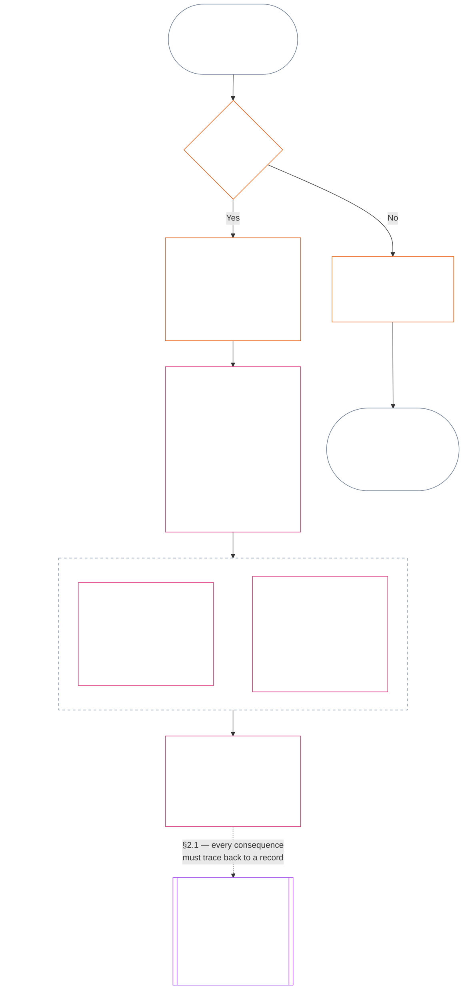
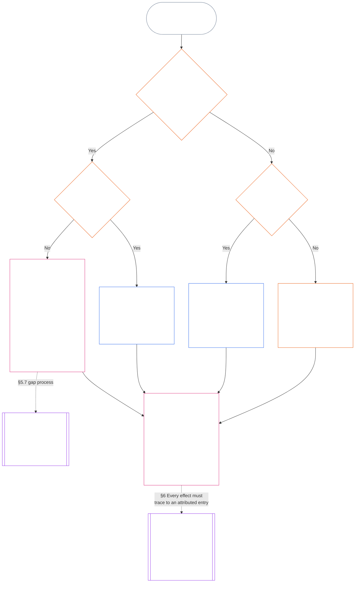

> Yapay zekâ destekli çeviri taslağı — kapsam: On Birinci Bölümün tamamı; kaynak: commit 05b7b83936e30c098a7de71882f22277354006dfc871d91157bcd27b9f56ad6a1cec90d3; AI-drafted/unreviewed; bağlayıcı olmayan taslak.

# ON BİRİNCİ BÖLÜM: GÜZERGÂH KAYITLARI — 1. SORU, NE OLDU?

<strong>Corpus konumu (işlemsel değildir): dosya yapısı ve okuma kuralları</strong>

> Bu dosya **Algılayanlar Anayasasının bir parçasıdır** ve yalnızca tek bir metin olarak okunan diğer numaralı `core_*` dosyalarıyla **birlikte bağlayıcıdır**. Bu dosya, güzergâh sürecinin üç sorusunu ve **1. Soruyu** (*ne oldu?*) içeren **On Birinci Bölümdür** (§§1–6). **2. Soru** (*ne kadar iyi veya kötüydü?*), [On İkinci Bölümde](core_12_standing_measurement.md#chapter-twelve-standing-measurement--question-2-how-good-or-bad-was-it) yanıtlanır. **3. Soru** (*bunun sonucunda ne olur?*), gerekli Violation Axis `s` = 7–9 bulguları için incelemenin Anayasa Karşıtı Suistimalin belirlenmesiyle sınırlı olduğu [On Üçüncü Bölümde](../../core_13.000_standing_integration.md#chapter-thirteen-standing-effects-and-integration) devam eden [On Dördüncü Bölümde](../../core_14.000_misconduct_designation.md#chapter-fourteen-anti-constitutional-misconduct) ele alınır. Okuma sırası, bağlayıcılık/destek ayrımı ve corpus baskısı üst verileri [README.md](README.md) dosyasında tutulur.

<strong>Okur rehberi (işlemsel değildir): On Birinci Bölümün yeri ve bu bölümde kalanlar</strong>

> | Soru | Sorumlu bölüm ve işlevi |
> | --- | --- |
> | **1. Ne oldu?** | On Birinci Bölüm (bu dosya): sınırlı ve itiraza açık bir güzergâh kaydında doğrulanmış olguları belirler. |
> | **2. Ne kadar iyi veya kötüydü?** | [On İkinci Bölüm](core_12_standing_measurement.md#chapter-twelve-standing-measurement--question-2-how-good-or-bad-was-it): yardımı ve zararı birleştirmeden doğrulanmış olguları ölçer. |
> | **3. Bunun sonucunda ne olur?** | [On Üçüncü Bölüme](../../core_13.000_standing_integration.md#chapter-thirteen-standing-effects-and-integration) devam edin. |
>
> İddialar, popülerlik ve uyuşmazlık anlatıları 1. Sorunun yanıtı değildir. İstenen bir puanlama 1. Soru için gereken olguları sağlayamaz; istenen bir sonuç da 2. Soru için gereken puanlamayı sağlayamaz.

<strong>İz</strong>

- Önceki dayanaklar:
  - [Anayasal Dörtlü](core_00_preamble.md#constitutional-tetrad);
  - [İki Anayasal Amaç](core_00_preamble.md#two-constitutional-aims);
  - [maddi pay](core_00_preamble.md#material-stake);
  - [Önsöz §6 Temel Uygulamalı Süreç Zincirleri](core_00_preamble.md#6-key-practical-process-pipelines) (*Dokuzuncu ila On Beşinci Bölümlerin zinciri*).
- Önceki dayanaklar:
  - [Birinci Bölüm](core_01_c_stewardship_capacity_principles.md#chapter-01-principles-and-constraints) (1.010) (*Yalın Dil Erişilebilirliği* sorumlu yönetiminin bölüm düzeyindeki açıklamaya yansıması);
  - [Birinci Bölüm §16 — Sorumlu Yönetimi Ayrıntılı Olarak](core_01_c_stewardship_capacity_principles.md#16-stewardship-in-depth) (1.010 §16) (*yetkinlikle bağlantılı ve izlenebilir statünün ilke temeli — güven, roller ve tanınma*);
  - [İkinci ila Dördüncü Bölümler](core_02_definition_structure.md) (*bütünlük, kayıtlar ve doğrulama*);
  - [Beşinci Bölüm](core_05__definitions_home.md#chapter-five-foundational-definitions) (5.000) (*İkinci ila Dördüncü Bölümlerle birlikte okunan tanımlar ve üstünlük*).
- Önceki dayanaklar: [Dokuzuncu Bölüm](core_09.000_system_alignment_certification_evaluation.md#chapter-nine-system-alignment-certification) (9.000) (*sistem uyum sertifikasyonu*); [Dokuzuncu Bölüm C Kısmı §11](core_09.010_system_alignment_certification_record_recertification.md#11-relationship-to-standing) (9.010 §11) (*statü köprüsü — yalnızca olası doğrulanmış girdiler*).
- Güzergâh süreci:
  - [Önsöz §6.2 Tam zincirin birbiriyle uyumu](core_00_preamble.md#62-how-the-full-chain-fits-together);
  - [On Birinci Bölüm — Güzergâh Kayıtları](#chapter-eleven-standing-records--question-1-what-happened) (11.000) (*üç soru çerçevesi ve 1. Soru kayıtları*);
  - [On İkinci Bölüm — Güzergâh Ölçümü](core_12_standing_measurement.md#chapter-twelve-standing-measurement--question-2-how-good-or-bad-was-it) (12.000) (*2. Soru ölçümü*);
  - [On Üçüncü Bölüm — Statü Etkileri ve Bütünleştirme](../../core_13.000_standing_integration.md#chapter-thirteen-standing-effects-and-integration) (13.000) (*3. Soru etkileri ve bütünleştirme*);
  - [On Dördüncü Bölüm](../../core_14.000_misconduct_designation.md#chapter-fourteen-anti-constitutional-misconduct) (14.000) (*yalnızca `s` = 7–9 Violation Axis bulguları için belirleme*).
- Bu dosyanın alt bölümleri:
  - [§1](#1-the-three-questions) (*üç soru çerçevesi ve kapsam*);
  - [§2](#2-question-1--what-happened) (*1. Soru — doğrulanmış olgular ve kayıtlar*);
  - [§3](#3-question-1-event-type-guide--what-kind-of-help-or-harm-occurred) (*1. Soru olay türü kılavuzu — yardım ve zarar türleri*);
  - [§4](#4-standing-record-operational-requirements) (*doğrulama ve kayıt gereklilikleri*);
  - [§5](#5-record-custody-and-opening-authority) (*kayıt sorumluluğu ve açma yetkilisi*);
  - [§6](#6-handling-a-standing-record) (*güzergâh kaydının işlenmesi*).
- Sonraki dayanaklar:
  - [On İkinci Bölüm](core_12_standing_measurement.md#chapter-twelve-standing-measurement--question-2-how-good-or-bad-was-it) (12.000) (*2. Soru — LEQU tabanı, ölçüm boyutları, güzergâh tanımlayıcıları, yuva dilbilgisi, anayasal girdiler, LEQU ölçeği, standart katkı ölçütleri, örnekler ve 3. Soruya devir*);
  - [On Dördüncü Bölüm](../../core_14.000_misconduct_designation.md#chapter-fourteen-part-a-anti-constitutional-misconduct-designation) (14.000) (*yalnızca belirleme — 2. Soru ölçümünü yeniden açmaz*);
  - [On Beşinci Bölüm](../../core_15.000_forum.md#chapter-fifteen-forums-and-jurisdiction) (15.000) (*forum gözetimi ve yönlendirme*);
  - [XXVI-C Maddesi](core_06_rights_part_e.md#article-xxvi-c-timely-resolution-and-anti-delay-floor) (*zamanında çözüm*);
  - [XX Maddesi](core_06_rights_part_d.md#article-xx-a-justice-objective-and-scope) (*adalet kısıtları*).
- Birlikte okuyun: [Beşinci Bölüm *Statü, Katkı ve İhlal*](../../core_05.035_band_accountability.md#defa3-standing-state-contribution-and-violation) (5.035) (*kanonik tanım yönlendirmesi*).
- Birlikte okuyun: [README.md](README.md) (*okuma sırası*); [doc_architecture.md](../../doc_architecture.md) (*benimsenmedikleri sürece bağlayıcı olmayan editoryal haritalar*).

 

On Birinci Bölüm, **doğrulanmış olgusal kaydın (1. Soru)** anayasal sahibidir. [§1 Üç soru](#1-the-three-questions) ile [§6 Güzergâh kaydının işlenmesi](#6-handling-a-standing-record) arasında uzanır. [On İkinci Bölüm](core_12_standing_measurement.md#chapter-twelve-standing-measurement--question-2-how-good-or-bad-was-it), [On İkinci Bölüm §1 Ne kadar iyi veya kötüydü? — 2. Soru](core_12_standing_measurement.md#1-question-2--how-good-or-bad-was-it) ile başlayıp [On İkinci Bölüm §9 3. Soruya devir — sorular arası ölçüm bağlantıları](core_12_standing_measurement.md#9-hand-off-to-question-3--cross-question-measurement-hooks) ile biten 2. Sorunun sahibidir. 3. Soru On Üçüncü Bölümde devam eder.

*Yalın dille: bu bölüm ne olduğunu yazar ve güzergâh kaydını elinde tutar. Bunun ne kadar iyi ya da zararlı olduğu, hiçbir zaman tek bir net puanda birleştirilmeyen iki ayrı izlek üzerinden On İkinci Bölümde ölçülür. Dava açmak tek başına statü oluşturmaz.*

### 1. Üç soru

*Yalın dille: standing değerlendirmesi, sırasıyla üç soruyu yanıtlayarak yapılır. İstenen bir derecelendirmeden olgu çıkarsamayın ve istenen bir sonucu haklı göstermek için derecelendirme seçmeyin.*

| Soru | Soru neyi soruyor? | Yanıt nerede veriliyor? |
| --- | --- | --- |
| **1. Ne oldu?** | Hangi olgular doğrulandı; kim ya da ne hakkında, hangi dönemde ve hangi standing kaydı ile itiraz durumuyla? | [§2](#2-question-1--what-happened) ve [§3](#3-question-1-event-type-guide--what-kind-of-help-or-harm-occurred) |
| **2. Ne kadar iyi ya da kötüydü?** | Bu olgular ne tür ve ne ölçüde bir katkı ya da ihlal ortaya koyuyor? | [Bölüm On İki §1](core_12_standing_measurement.md#1-question-2--how-good-or-bad-was-it) |
| **3. Bunun sonucunda ne olur?** | Hangi tanınma, hazır olma durumu, giderim, güvence, kısıtlama ya da başka sonuç doğar? | [Bölüm On Üç](../../core_13.000_standing_integration.md#chapter-thirteen-standing-effects-and-integration) |

Her soru, kendisinden önceki yanıtın üzerine kurulur:

- Soru 1, Soru 2 için doğrulanmış olguları sağlar.
- Soru 2, bu olguları Soru 3 için ölçer.
- Soru 3, tercih edilen bir sonuca uyması için olguları ya da derecelendirmeyi yeniden yazmamalıdır.

Üç sorunun yanıtları birlikte, sınırları belirli tek bir olay ya da tanımlı tek bir örüntü için eksiksiz standing değerlendirmesini oluşturur. Bir öznenin zaman içinde bu tür birkaç değerlendirmesi olabilir; bunların hiçbiri öznenin net puanı ya da genel derecelendirmesi değildir. Katkı ve ihlal standing kayıtları Soru 1 ile Soru 2'nin yanıtlarını korur; Soru 3 kararı ise bunlardan ne sonuç çıktığını belirtir.

#### 1.1 Amaç ve kapsam

Bu bölüm **sistemler**, **algılayanlar** ve **kurumlar** için anayasal kayıt çerçevesini belirtir; [Bölüm On İki](core_12_standing_measurement.md#chapter-twelve-standing-measurement--question-2-how-good-or-bad-was-it) ölçüm çerçevesini belirtir. Buna [**CS-9.305**](../../corpus_systems/cs_09.305_system_classification_machinery.md#cs-9305-part-a-system-classification-machinery) (*Sistem sınıflandırma mekanizması*) uyarınca sınıflandırılan her sistem dahildir. Bu çerçeveler dedikoduyu, popülerliği, muğlak itibarı, özsel onuru ya da genel değeri ölçmez; bunların hiçbiri standing değerlendirmesinin izin verilen konusu değildir.

Standing süreci şu durumlarda da etkili kalmalıdır:

- daha önce doğrulanmış katkılar, güncel yeterlilik ya da güvenilirliği göstermeyecek kadar eski hâle geldiğinde;
- ihlaller çözümsüz kaldığında;
- onarım maliyetli olduğunda;
- sorumluluk sınırları aştığında; veya
- bir aktör hesap verebilirliği engellemek için örgütsel katmanlar ya da yeniden adlandırma kullandığında.

Bunlar kabul edilen uygulama metninde ele alınır:

- gündelik usuller;
- üst kademeye taşıma adımları;
- iade ve onarım işlemleri;
- onarıcı hesap verebilirlik tedbirleri; ve
- teşvik tasarımı.

Bölüm On İki'deki ölçüm, tek başına güç kullanma, alıkoyma ya da başka bir özgürlük kısıtlamasına yetki **vermez**. Böyle bir sonuç, Bölüm Altı'daki **Madde XX** (*Doğrulanmış İhlalden Sonra Adalet*) kapsamındaki orantılılık, en az kısıtlama, süre sınırı, iade ve onarıcı hesap verebilirlik gereklilikleri dahil olmak üzere diğer koşulları ayrıca karşılamalıdır.

<strong>İz · Tanımlar · Değerlendirme · Uyum</strong>

- Üst kaynaklar: [Bölüm Bir §16 — Sorumlu yönetim ayrıntıları](core_01_c_stewardship_capacity_principles.md#16-stewardship-in-depth); [Bölüm İki ila Dört](core_02_definition_structure.md); [Bölüm Beş](core_05__definitions_home.md#chapter-five-foundational-definitions).
- Sonraki adımlar: [§2](#2-question-1--what-happened) (*Soru 1*); [§4](#4-standing-record-operational-requirements) (*doğrulama ve kayıt gereklilikleri*); [§5](#5-record-custody-and-opening-authority) (*kayıt emaneti ve açma yetkisi*); [§6](#6-handling-a-standing-record) (*standing kaydının ele alınması*); [Bölüm On İki §1](core_12_standing_measurement.md#1-question-2--how-good-or-bad-was-it) (*Soru 2 ölçümü*); [Bölüm On İki §2](core_12_standing_measurement.md#2-magnitude-and-severity-input-dimensions) (*ölçüm girdilerinin boyutları*); [Bölüm On İki §3](core_12_standing_measurement.md#3-route-descriptor-catalogs-and-measurement-roles) (*yol tanımlayıcı katalogları*); [Bölüm On İki §4](core_12_standing_measurement.md#4-slot-grammar-and-shared-scaling) (*slot dilbilgisi ve ortak ölçekleme*); [Bölüm On İki §5](core_12_standing_measurement.md#5-constitutional-inputs-to-axis-assignment) (*anayasal kaynağa göre eksen ataması*); [Bölüm On İki §6](core_12_standing_measurement.md#6-unified-proportional-lequ-scale--contribution-and-violation-axes) (*iki eksen için birleşik orantılı LEQU ölçeği*); [Bölüm On Üç](../../core_13.000_standing_integration.md#chapter-thirteen-standing-effects-and-integration) (*Soru 3*).
- [Önemlilik](../../core_05.050_band_oversight.md#materiality) · [O](../../core_05.050_band_oversight.md#materiality) · [M](core_05_band_oversight.md#materiality-determination-a) · [A](core_05_band_oversight.md#materiality-determination-a) · [C](core_05_band_oversight.md#materiality-determination-c)
- [Zarar](../../core_05.035_band_accountability.md#harm) · [O](../../core_05.035_band_accountability.md#harm) · [M](../../core_05.035_band_accountability.md#harm-a) · [A](../../core_05.035_band_accountability.md#harm-a) · [C](../../core_05.035_band_accountability.md#harm-c)
- [Orantılılık](../../core_05.035_band_accountability.md#proportionality) · [O](../../core_05.035_band_accountability.md#proportionality) · [M](../../core_05.035_band_accountability.md#proportionality-a) · [A](../../core_05.035_band_accountability.md#proportionality-a) · [C](../../core_05.035_band_accountability.md#proportionality-c)

### 2. Soru 1 — Ne oldu?

<strong>İz</strong>

- Üst kaynaklar: [§1](#1-the-three-questions) (*üç sorulu çerçeve*); [Bölüm İki ila Dört](core_02_definition_structure.md) (*kayıt, doğrulama ve tanımlardan sonuçlara izlenebilirlik*).
- Dörtlünün ayağı/ayakları: **katılım**; **gözetim** (itiraz edilebilirlik ve itiraz yolları). Birincil amaçlar: **Gelişim** ve **Süreklilik** (sonraki ölçüm için katkı ve ihlal bulgularını ayrı tutan izlenebilir kayıtlar).
- Sonraki adımlar:
  - [§2.2](#22-silence-is-the-default) (*sessizlik varsayılan durumdur*);
  - [§2.3](#23-protected-dissent-is-not-a-trigger) (*korunan muhalefet tetikleyici değildir*);
  - [§2.4](#24-linked-standing-records-and-no-offset-bridge) (*bağlantılı standing kayıtları ve mahsup etmeme köprüsü*);
  - [§2.5](#25-verified-input-gate) (*doğrulanmış girdi kapısı*);
  - [§2.6](#26-stage-boundary) (*aşama sınırı*);
  - [§2.7](#27-forum-boundary) (*forum sınırı*);
  - [§3](#3-question-1-event-type-guide--what-kind-of-help-or-harm-occurred) (*olay türü rehberi*);
  - [§4](#4-standing-record-operational-requirements) (*kayıt gereklilikleri*);
  - [§5](#5-record-custody-and-opening-authority) (*kayıt emaneti ve açma yetkisi*);
  - [§6](#6-handling-a-standing-record) (*standing kaydının ele alınması*);
  - [Bölüm On İki §1](core_12_standing_measurement.md#1-question-2--how-good-or-bad-was-it) (*Soru 2 ölçümü*);
  - [Bölüm On İki §2](core_12_standing_measurement.md#2-magnitude-and-severity-input-dimensions) (*ölçüm girdilerinin boyutları*);
  - [Bölüm On İki §3](core_12_standing_measurement.md#3-route-descriptor-catalogs-and-measurement-roles) (*yol tanımlayıcı katalogları*);
  - [Bölüm On İki §4](core_12_standing_measurement.md#4-slot-grammar-and-shared-scaling) (*slot dilbilgisi ve ortak ölçekleme*);
  - [Bölüm On İki §5](core_12_standing_measurement.md#5-constitutional-inputs-to-axis-assignment) (*anayasal kaynağa göre eksen ataması*);
  - [Bölüm On İki §6](core_12_standing_measurement.md#6-unified-proportional-lequ-scale--contribution-and-violation-axes) (*iki eksen için birleşik orantılı LEQU ölçeği*);
  - [Bölüm On Üç](../../core_13.000_standing_integration.md#chapter-thirteen-standing-effects-and-integration) (13.000) (*Soru 3*).

 

*Yalın dille: Soru 1, ne olduğuna dair sınırları belirli ve itiraz edilebilir bir anlatım oluşturur. Herhangi bir derecelendirme ya da sonuç değerlendirilmeden önce özneyi, olayı veya örüntüyü, zaman aralığını, doğrulanmış olguları ve kayıt durumunu belirler. Doğrulanmış yardım ile doğrulanmış ihlal, biri diğerini silemesin diye ayrı standing kayıtlarında tutulur. Bu kayıtlar popülerlik puanı ya da belirsiz etiketler değildir.*

**Standing kaydı**, bu bölümde belirli bir özne, işlevsel kapsam, kayıt aralığı, inceleme durumu ve karar bağlamı için kullanılan sınırları belirli kayıttır. Ölçüm başlamadan önce şunları belirlemelidir:

- standing kaydının kimin ya da neyin hakkında olduğunu;
- sınırları belirli bir olayla mı yoksa tanımlı bir örüntüyle mi ilgili olduğunu;
- ilgili davranış ve etkilerin ne zaman ve nerede meydana geldiğini;
- hangi olguların doğrulandığını ve hangilerinin hâlâ tartışmalı olduğunu;
- bulguları destekleyen kanıt, atıf ve itiraz yolunu; ve
- standing kaydının güncel inceleme, düzeltme ve yürürlükten kaldırılma durumunu.

Şema, bir olayın standing kaydını tetikleyip tetiklemediğini ve kaydın sonrasında neleri içerdiğini izler; devamındaki alt bölümler kuralları açıklar. "Hayır" dalı ana yoldan sağa ayrılır.

#### 2.1 Standing kayıtları: türler ve özneler

Soru 1, doğrulanmış yardım için **katkı standing kaydı**, hesap verebilirlik başarısızlıkları da dâhil doğrulanmış zarar için **ihlal standing kaydı** kullanır. Tek bir standing kaydı iki tür bulguyu birleştirmez.

- Bir standing kaydı algılayıcı, kurum, sistem, değerlendirme, sınırları belirli olay, rol, kolektif, aktöre özgü kayıt ya da anayasal açıdan ilgili başka bir birim hakkında olabilir.
  - Farklı özneleri, rolleri, sistemleri, toplulukları, kayıt aralıklarını, inceleme durumlarını ya da karar bağlamlarını tek ve ayrıştırılmamış bir standing etiketi altında toplamamalıdır.
- Bir standing kaydı, açık başlangıç ve bitişi olan tek bir olay anlamında **sınırları belirli bir olayı** veya tekrarlanan davranışın bir **örüntüsünü** kapsayabilir.
  - Örüntü için tanımlı bir özne, kapsam ve inceleme dönemi gerekir.
- Aynı öznenin zaman içinde birden fazla standing kaydı olabilir; bağlantılı katkı ve ihlal standing kayıtları da buna dahildir.
  - İlgili standing kayıtları aynı özneyi, çakışan kayıt aralığını, sınırları belirli olayı, örüntüyü ya da karar bağlamını paylaşıyorsa **§4.2** uyarınca birbirlerine **çapraz atıf** vermelidir.
- Standing kaydı bağımsız bir itibar puanı, onur sıralaması, kalıcı statü, genel değer etiketi ya da birleştirilmiş puan kartı değildir.
  - Operasyonel gereklilikler **§4**'tedir.

Sonradan doğacak her standing etkisi Bölüm On Üç'e aittir ve ilgili standing kaydı ya da kayıtlarına kadar izlenebilmelidir; ancak standing kaydının kendisinin parçası hâline gelmemelidir.

#### 2.2 Sessizlik varsayılan durumdur

Bir algılayanın, kurumun ya da sistemin standing kaydı bulunmaması olağan durumdur ve çoğu algılayan bu durumda kalacaktır.

- Bir standing kaydı yalnızca **§4** uyarınca bir tetikleyici doğrulandığında açılır. Adlandırılmış kayıt açma yetkilisi girişi onaylamalı, ayrı bir kayıt emanetçisi de girişi yapmalıdır (**§5**). Standing kaydı asla şu amaçlarla açılmaz:
  - bir temel ölçüt oluşturmak;
  - bir listeyi tamamlamak; ya da
  - çünkü koşullu bir yolun kapı bekçisi bunu tercih ediyor.
- Bir statü kaydının bulunmaması hiçbir şey ifade etmez. “Derecelendirilmemiş”, “doğrulanmamış” ve “dosyada kayıt yok” ifadeleri riskin, düşük katkının veya başka herhangi bir şeyin kanıtı değildir. Hiç kimse, kayıt yokluğunu daha yakından inceleme, daha düşük bir varsayılan düzey veya koşullu bir yola erişim gerekçesi olarak kullanamaz.
- Hiçbir kurum ya da sistem, aşağıdakilerin koşulu olarak standing kaydı, "kayıt yok" beyanı ya da kayıt açmaya rıza isteyemez:
  - **Madde III** (*Hayatta Kalma ve Temel Erişim*) kapsamındaki temel ihtiyaçlar;
  - **Madde III-C** (*Emek ve Ekonomik Taban*) korumaları;
  - olağan ticaret; veya
  - etkilenen taraf olarak katılım.
  Güvene duyarlı belirli koşullu yollar için yayımlanmış yeterlilik eşikleri, [On Üçüncü Bölüm §7.2 Yeterlilik eşikleri ve izinler](../../core_13.000_standing_integration.md#72-competency-bars-and-clearances) uyarınca istisnadır; koşullu yolun neden güvene duyarlı olduğunu belirtmelidir.
- Bir özne hakkında standing kaydı açıldığında **§4** gereğince özneye bildirim yapılmalıdır. Bildirim ancak belgelenmiş bir [Kanıtı Koruma](core_05_band_oversight.md#evidence-preservation) ya da Güvenlik ihtiyacı bunu haklı kılıyorsa ve yalnızca sınırlı, belirlenmiş bir süre için ertelenebilir. Bildirim standing kaydını itiraz edilebilir kılar: standing kaydının varlığını bilmeyen özne ona itiraz edemez ya da onu düzeltemez.

#### 2.3 Korunan muhalefet tetikleyici değildir

**Madde XI-D** (*Toplanma, Muhalefet ve Barışçıl Protesto*) kapsamındaki muhalefet ya da barışçıl protesto — [korunan şiddetsiz sivil itaatsizlik](core_06_rights_part_b.md#xi-d-nonviolent-civil-disobedience) dâhil — ve [*Muhalefet ve barışçıl protesto tabanı*](core_06_rights_part_b.md#xi-d-dissent-and-peaceful-protest), doğrulanmış bir tetikleyici değildir.

- İhlal standing kaydı açmaz, uzatmaz ya da ağırlaştırmaz; **§8.2** uyarınca bir ağırlık girdisi değildir ve tekrarlanması onu örüntü hâline getirmez.
- Bağımsız biçimde anayasal tabanı ihlal eden ve ayrılabilir nitelikteki davranış, protestonun bakış açısı, nedeni ya da hedefi dolayısıyla ağırlaştırılmadan, kendi koşulları içinde kaydedilir.

#### 2.4 Bağlantılı standing kayıtları ve mahsup etmeme köprüsü

<strong>İz</strong>

- Üst kaynak: [§2.1](#21-standing-records-kinds-and-subjects) (*ayrı katkı ve ihlal kayıtları*).
- Sonraki adımlar:
  - [§2.5](#25-verified-input-gate) (*doğrulanmış girdi kapısı*);
  - [§2.7](#27-forum-boundary) (*forum sınırı*);
  - [§4.2](#42-related-standing-record-cross-references) (*çapraz atıflar*);
  - [Bölüm On İki §1](core_12_standing_measurement.md#1-question-2--how-good-or-bad-was-it) (*Soru 2 ölçümü*);
  - [Bölüm On İki §2](core_12_standing_measurement.md#2-magnitude-and-severity-input-dimensions) (*ölçüm girdilerinin boyutları*);
  - [Bölüm On İki §3](core_12_standing_measurement.md#3-route-descriptor-catalogs-and-measurement-roles) (*yol tanımlayıcı katalogları*);
  - [Bölüm On İki §4](core_12_standing_measurement.md#4-slot-grammar-and-shared-scaling) (*slot dilbilgisi ve ortak ölçekleme*);
  - [Bölüm On İki §5](core_12_standing_measurement.md#5-constitutional-inputs-to-axis-assignment) (*anayasal kaynağa göre eksen ataması*);
  - [Bölüm On İki §6](core_12_standing_measurement.md#6-unified-proportional-lequ-scale--contribution-and-violation-axes) (*iki eksen için birleşik orantılı LEQU ölçeği*);
  - [Bölüm On Üç](../../core_13.000_standing_integration.md#chapter-thirteen-standing-effects-and-integration) (13.000) (*Soru 3*).
- Birlikte okuyun: [On Üçüncü Bölüm — Statü entegrasyonu](../../core_13.000_standing_integration.md#3-automatic-integration-review-and-continuity) (13.000) (*feragat etmeme ve bağlantılı kayıt entegrasyonu*); [On Üçüncü Bölüm §7.2 — Yeterlilik eşikleri ve izinler](../../core_13.000_standing_integration.md#72-competency-bars-and-clearances) (13.000 §7.2); [On Üçüncü Bölüm §5.2 — Statü kilitleri](../../core_13.000_standing_integration.md#52-prevention--general-standing-locks) (13.000 §5.2).

 

**Temel kural:** Doğrulanmış **katkı standing kayıtları** ile doğrulanmış **ihlal standing kayıtları**, **§2.1** uyarınca ayrı tutulur. Her katkı ya da ihlal bulgusu, kendi standing kaydında desteklenen kendi olgularına dayanmalıdır. Analiz ve destekleyici materyaller iki kayıt yolunu birbirinden ayrı ve izlenebilir tutmalıdır. Tek bir giriş ya da bağlantılı kayıtlar bütünü net puan, harmanlanmış puan ya da ödünleşim değildir.

- **İhlal standing kayıtları ve standing kilitleri:**
  - Bölüm On Üç uyarınca, ihlal standing kayıtlarından doğan uygulanabilir **standing kilitleri**, doğrulanmış bir ihlal çözümsüz kaldığı sürece standing'i sınırlayabilir, rol uygunluğunu kısıtlayabilir ya da giderime erişimi etkileyebilir.
  - Standing kilitleri, katkı standing kayıtlarında kayıtlı doğrulanmış olumlu katkıyı silmemelidir.
  - Çözümsüz doğrulanmış ihlaller, yalnızca zaman geçmesiyle değer kaybetmez.
  - Doğrulanmış ihlaller, ilgisiz katkı standing kayıtlarını yanlış bir olumsuz itibar dosyasına dönüştürmemelidir.
- **Katkı standing kayıtları ve yetkinlik izinleri:**
  - Doğrulanmış katkı, yayımlanmış **yetkinlik eşiklerine** göre uygulanabilir **yetkinlik izinlerini** destekleyebilir; güncel ve rolle ilgili olduğunda güven, rol ya da tanınmayla bağlantılı uygunluğu destekleyebilir.
  - Doğrulanmış katkı, doğrulanmış ihlal bulgusunu mahsup etmemeli, ortalamasını düşürmemeli, mazur göstermemeli ya da yeniden etiketlememelidir.
  - Eşiğin karşılanması, uygulanabilir bir standing kilidinden feragat etmez.

**Tek istisna:** Bir ihlal bulgusu, iddia edilen katkının gerçekleşmediğini bizzat kanıtlarsa — örneğin kanıt, katkı kaydının iddia ettiği işi gerçekte yapmadığınızı gösterirse — bağlantılı katkı standing kaydı uygun kanıt ve inceleme süreciyle, **§4.2** uyarınca gerekli çapraz atıf eklenerek düzeltilebilir ya da kaldırılabilir. Ancak ihlal, ayrı katkı standing kayıtlarında bulunan ilgisiz yardımı kendiliğinden silmez.

#### 2.5 Doğrulanmış girdi kapısı

Kapı şu şekilde işler:

- Standing'i, güveni, rolü, tanınmayı ya da tanınma uygunluğunu etkileyen her karar yalnızca ilgili **katkı standing kayıtları** ya da **ihlal standing kayıtlarındaki** doğrulanmış girdileri kullanabilir.
- İddialar, karara bağlanmamış talepler, geçici yönlendirme etiketleri, yalnızca kabul aşamasındaki anlatılar ve uyuşmazlık aşamasındaki diğer materyaller tek başlarına standing için katkı ya da ihlal niteliği sağlamaz.
- Doğrulanmış girdi bir **standing bulgusudur**: doğrulanmış katkı bulgusu (Eksen I) ya da doğrulanmış ihlal bulgusu (Eksen II).
- Katkı ve ihlal bulguları ayrı standing kayıtlarında kalır (bkz. **§2.1**).

#### 2.6 Aşama sınırı

Standing kaydının aşamaları ayrı kalır:

- Soru 1 doğrulanmış olguları kaydeder; Soru 2 bunları ölçer.
- Soru 2 ölçümü hâlâ beklemede olsa da doğrulanmış olgusal dayanak tamamlandığında standing kaydı açılabilir.
- Ölçüm yapılana kadar Soru 2 alanlarında bir slot ya da kategori ima etmek yerine beklemede olduğu belirtilmelidir.
- Standing kaydı, Soru 3'ün herhangi bir **standing etkisini** belirtmemeli ya da uygulamamalıdır.

#### 2.7 Forum sınırı

*Yalın dille: forumlar uyuşmazlıkların denetlendiği, itiraz edilebildiği ve doğrulanmış sonuçlara dönüştürüldüğü yerlerdir — ancak dava açmak ya da anlatı mücadelesini kazanmak standing'i güncellemez. **§2.5**'teki doğrulanmış girdi kapısı yine geçerlidir. Forum, Bölüm İki ila Dört uyarınca olguları doğruladığında standing kaydını **açabilir, güncelleyebilir ya da düzeltebilir** — veya **itiraz üzerine hatalı bir kaydı bir kenara kaldırabilir**. Forumlar iyiyi ve kötüyü tek puanda birleştirmez ve standing kategorisini kendileri icat etmez.*

Bu bölüm tek bir sorunun sahibidir: forumun çalışması standing kaydına nasıl ulaşır? Zincirin diğer adımları burada belirtilen sahiplerindir ve zincir şu sırayla işler:

1. Bir uyuşmazlık açılır ve forum, standing kaydı olmayan bir **forum dava kaydı** tutar. Sahibi: [Bölüm On Beş §2.3 Forum dava kayıtları, standing kayıtları ve itirazlar](core_11_forum.md#23-forum-case-records-standing-records-and-contests); ayrıca [§2.7.1 Forum dava kaydı](#271-forum-case-record) bölümüne bakın.
2. Forum, [Bölüm İki ila Dört](core_02_definition_structure.md) uyarınca olguları doğrular.
3. Doğrulanmış bulgular doğrulanmış girdi kapısından geçer. Sahibi: [§2.5 Doğrulanmış girdi kapısı](#25-verified-input-gate).
4. Forum da olabilen adlandırılmış kayıt açma yetkilisi standing kaydını açar, günceller ya da düzeltir veya itiraz üzerine hatalı kaydı bir kenara kaldırır. Standing kaydının ne içerdiğinin sahibi [§4.1 Asgari kayıt içeriği](#41-minimum-record-contents); kimin işlem yapabileceğinin sahibi [§5 Kayıt emaneti ve açma yetkisi](#5-record-custody-and-opening-authority) bölümüdür.
5. Standing kaydı yalnızca doğrulanmış olguları içerir; Soru 2 bunları daha sonra ölçer. Sahipler: [§2.6 Aşama sınırı](#26-stage-boundary) ve [Bölüm On İki §1 Soru 2 — Ne kadar iyi ya da kötüydü?](core_12_standing_measurement.md#1-question-2--how-good-or-bad-was-it).
6. Varsa standing etkisi, standing etkilerinin sahibi olan [Bölüm On Üç](../../core_13.000_standing_integration.md#chapter-thirteen-standing-effects-and-integration) uyarınca doğar.

[Bölüm On Beş](../../core_15.000_forum.md#chapter-fifteen-forums-and-jurisdiction) altındaki forum aileleri, somut uyuşmazlıkların standing sürecinden nasıl geçtiğini **denetler**. Forumlar, [Bölüm On Beş §6 Zamanında çözüm, önemlilik kademeleri ve gecikme karşıtı disiplin](core_11_forum.md#6-timely-resolution-materiality-tiers-and-anti-delay-discipline) ile [Madde XXVI-C](core_06_rights_part_e.md#article-xxvi-c-timely-resolution-and-anti-delay-floor) (*Zamanında Çözüm ve Gecikme Karşıtı Taban*) uyarınca şunları sağlar:

- erişilebilir itiraz;
- bağımsız inceleme;
- adli inceleme desteği;
- giderim sıralaması; ve
- kademe süreleri.

Forum bulguları Bölüm İki ila Dört uyarınca doğrulanmış girdi kapısını karşıladığında şunları yapabilir:

- **§4.1** uyarınca standing kayıtlarını **açabilir, güncelleyebilir ya da düzeltebilir**; veya
- **itiraz üzerine hatalı bir kaydı bir kenara kaldırabilir**.

##### 2.7.1 Forum dava kaydı

Açık bir uyuşmazlıkla ilgili forumun kendi dosyası, [**forum dava kaydıdır**](../../core_05.035_band_accountability.md#forum-case-record) ve [Bölüm On Beş §2.3 Forum dava kayıtları, standing kayıtları ve itirazlar](core_11_forum.md#23-forum-case-records-standing-records-and-contests) bölümünde tanımlanmıştır. Bu, standing kaydı **değildir**.

##### 2.7.2 Forum bulguları ve Soru 2 ölçümü

Forumun doğruladığı olgusal bulgular, Soru 1 standing kaydının olgusal temelini sağlayabilir. Doğrulanmış katkı ya da ihlalin ne kadar iyi veya kötü olduğuna ilişkin Soru 2 ölçümünü **belirlemezler** ([§2.6 Aşama sınırı](#26-stage-boundary)). Buna göre:

- Forum süreçleri katkı ve ihlal materyalini net puan, harmanlanmış esas yanıtı ya da ayrıştırılmamış standing etiketi hâlinde **birleştirmemelidir**; bağlantılı standing kayıtları [§2.1 Standing kayıtları: türler ve özneler](#21-standing-records-kinds-and-subjects) ve [§2.4 Bağlantılı standing kayıtları ve mahsup etmeme köprüsü](#24-linked-standing-records-and-no-offset-bridge) uyarınca ayrı kalır.
- Forum çıktıları, uyuşmazlık anlatılarını, yönlendirme kolaylığını ya da kurul tercihini kanıtlanabilir doğrulanmış girdilerin ([§2.5 Doğrulanmış girdi kapısı](#25-verified-input-gate)), ayrı ölçümün ([Bölüm On İki §1 Soru 2 — Ne kadar iyi ya da kötüydü?](core_12_standing_measurement.md#1-question-2--how-good-or-bad-was-it)) ya da [Bölüm On Üç](../../core_13.000_standing_integration.md#chapter-thirteen-standing-effects-and-integration) tarafından sahiplenilen standing etkisi mekanizmalarının yerine **koymamalıdır**.

##### 2.7.3 Forum sınırının azaltmadığı güvenceler

Bu sınır, aşağıdakiler uyarınca gereken itirazı, giderimi, geçici hukuki korumayı ya da usul güvencelerini **azaltmaz**:

- [Madde XIII-A](core_06_rights_part_c.md#article-xiii-a-reliability-and-trustworthiness-baseline) (*Güvenilirlik ve İtimada Layık Olma Temeli*);
- [Madde XIII-B](core_06_rights_part_c.md#article-xiii-b-right-to-redress-and-remedy) (*Hakkaniyetli Giderim ve Çözüm Hakkı*);
- [Bölüm On Beş §6 Zamanında çözüm, önemlilik kademeleri ve gecikme karşıtı disiplin](core_11_forum.md#6-timely-resolution-materiality-tiers-and-anti-delay-discipline);
- [Madde XXVI-C](core_06_rights_part_e.md#article-xxvi-c-timely-resolution-and-anti-delay-floor) (*Zamanında Çözüm ve Gecikme Karşıtı Taban*); veya
- ilgili adalet maddeleri.

Bu sınır, forumun doğrulanmış bulgularının diğer doğrulanmış girdilerle aynı kapıdan standing'e girmesini gerektirir — kapının çevresinden dolaşmasını değil.

### 3. Soru 1 olay türü rehberi — ne tür yardım ya da zarar meydana geldi?

*Yalın dille: Olgular doğrulandıktan sonra ne olduğunu anlatmak için bu tabloları kullanın. Tablolar, ilgili katkı ya da ihlalin türünü belirlemeye yardımcı olur. Ne kadar iyi ya da kötü olduğunu karara bağlamaz, slot atamaz ya da bunun sonucunda ne olacağını belirlemez.*

#### 3.1 Katkı olay türleri

**Yeterlilik kuralı:** İddia edilen katkı ancak izlenebilir, maliyeti başkalarına yüklenmemiş ve yürürlükteki Anayasanın tümüyle uyumluysa sayılır.

- Dışsallaştırılmış zararlar, zorlayıcı bağımlılıklar, Haklar Tabanı'nın daraltılması ya da gizlenmiş yükler iddia edilen katkıyı geçersiz kılabilir ya da sınırlayabilir.
- İddia edilen katkı ayrı bir ihlal bulgusunu mahsup etmez.

Aşağıdaki tablonun her satırı, doğrulanmış yardımın yaygın bir yolunu ve anayasal önemini belirtir. Aynı standing kaydına birden fazla satır uygulanabilir.

| Doğrulanmış katkı türü | Ne oldu? | Dörtlünün ayağı/ayakları | Birincil amaç/amaçlar |
| --- | --- | --- | --- |
| Hayatta kalma ve bedensel bakım | Bir kişi yiyecek, barınak, tıbbi bakım ya da güvenlik aldı | **Katılım**, **Gözetim** | **Gelişim** |
| Bakım verme ve öğretme | Çocuklar yetiştirildi, yaşlılara bakıldı ya da başkaları eğitildi | **Katılım**, **Gözetim** | **Gelişim**, **Süreklilik** |
| Travmayı çözme | Bir kişi, esenliğini engelleyen psikolojik zarardan kurtulmak için yardım aldı | **Katılım**, **Hesap verebilirlik** | **Gelişim** |
| Ağır yükleri kaldırma | Ezici borç, sömürücü çalışma koşulları ya da sistemik engeller kaldırıldı | **Katılım**, **Gözetim** | **Gelişim** |
| Özerkliği geri kazandırma | Bir kişi kendi yaşamı hakkında anlamlı seçimler kazandı | **Katılım** | **Gelişim** |
| Üretken kapasiteyi genişletme | Araçlar, altyapı ya da fırsatlar başkalarının bağımsız biçimde gelişmesini sağladı | **Katılım**, **Gözetim** | **Gelişim**, **Süreklilik** |
| Zaman verimliliğini artırma | Önlenebilir bekleme, idari sürtüşme ya da koordinasyon yükü azaltıldı; bakım, dinlenme, özerklik, öğrenme ya da haklarla uyumlu çalışma için kullanılabilir zaman geri kazandırıldı | **Katılım**, **Gözetim** | **Gelişim** |
| Ekolojik ya da altyapı riskini azaltma | Çevresel çöküş ya da kritik sistemin arızalanması önlendi | **Gözetim**, **Hesap verebilirlik** | **Süreklilik**, **Gelişim** |
| Ekolojik ayak izini azaltma | Yük başkalarına ya da ekosistemlere aktarılmadan kaynak kullanımı, emisyonlar veya arazi ve su talebi doğrulanabilir biçimde azaltıldı | **Gözetim**, **Hesap verebilirlik** | **Süreklilik**, **Gelişim** |
| Ekosistemleri iyileştirme | Bozulmuş arazi, su ya da habitat işleyen ve kendi kendini sürdüren bir duruma doğru onarıldı | **Gözetim**, **Hesap verebilirlik** | **Süreklilik**, **Gelişim** |
| Tehlike altındaki türleri koruma | Yok olma riski taşıyan türler ya da bağlı oldukları habitatlar kayıptan korundu | **Gözetim**, **Hesap verebilirlik** | **Süreklilik**, **Gelişim** |
| Kirliliği ve atığı azaltma | Kirlenme, zararlı emisyonlar ya da atık önlendi, giderildi ya da güvenle yönetildi | **Gözetim**, **Hesap verebilirlik** | **Gelişim**, **Süreklilik** |
| Güvenliği, doğruluğu, denetlenebilirliği ya da itiraz kapasitesini güçlendirme | Hakları korumak ve gücü hesap verebilir kılmak için kurumlar ya da uygulamalar kuruldu veya onarıldı | **Katılım**, **Gözetim**, **Hesap verebilirlik** | **Gelişim**, **Süreklilik** |

#### 3.2 İhlal olay türleri

**Yeterlilik kuralı:** Bir ihlal olay türü, **Bölüm İki ila Dört** uyarınca doğrulanmış ve izlenebilir, sınırları belirli, denetlenebilir ve itiraz edilebilir kalmış bir ihlal bulgusu gerektirir.

- İddialar, geçici etiketler, forum anlatıları ve kabul etiketleri yönlendirme ya da önceliklendirmeye yardımcı olabilir; ancak Soru 1'i tek başlarına tamamlamazlar.
- Olumlu katkı doğrulanmış bir ihlali mahsup etmez, mazur göstermez, geri almaz ya da yeniden etiketlemez.

Aşağıdaki tablonun her satırı doğrulanmış kayıp, tehlike ya da görev başarısızlığının yaygın bir yolunu ve anayasal önemini belirtir. Aynı standing kaydına birden fazla satır uygulanabilir.

| Doğrulanmış kayıp ya da tehlike türü | Ne oldu? | Dörtlünün ayağı/ayakları | Birincil amaç/amaçlar |
| --- | --- | --- | --- |
| Hayatta kalma ya da bedensel bakımdan yoksun bırakma | Önlenebilir ölüm, bakımın reddi, güvensiz koşullar ya da maddi hayatta kalma yoksunluğu meydana geldi | **Hesap verebilirlik**, **Katılım** | **Gelişim** |
| Ağır ve önlenebilir yük | Ezici, dayatılmış ya da sistematik biçimde başkalarına aktarılmış yükler esenliği ya da özerkliği maddi olarak bozdu | **Hesap verebilirlik**, **Katılım** | **Gelişim** |
| Zorlayıcı özerklik kaybı | Zorlama, manipülasyon, inandırıcı tehdit, alıkoyma ya da özgürlük tehlikesi meydana geldi | **Hesap verebilirlik**, **Katılım** | **Gelişim** |
| Haklar Tabanı'nın yenilgiye uğratılması | Pazarlığa kapalı anayasal tabanlar, üstünlük ya da itiraz ve giderime erişim maddi olarak ihlal edildi | **Hesap verebilirlik**, **Gözetim** | **Gelişim**, **Süreklilik** |
| Ekolojik ya da altyapısal zarar | Anayasal esenlik için gerekli koşullar zarar gördü | **Hesap verebilirlik**, **Gözetim** | **Süreklilik**, **Gelişim** |
| Kirlilik ya da atık zararı | Kirlenme, zararlı emisyonlar ya da atık hava, su, toprak ya da sağlığa zarar verdi | **Hesap verebilirlik**, **Gözetim** | **Gelişim**, **Süreklilik** |
| Türlerin ya da habitatların yok edilmesi | Yok olma riski taşıyan türler ya da bağlı oldukları habitatlar yok edildi, parçalandı ya da kayba doğru itildi; mahsup edilebilir görülen kayıp da buna dahildir | **Hesap verebilirlik**, **Gözetim** | **Süreklilik**, **Gelişim** |
| Ekolojik iyileşme kapasitesinin kaybı | Bir ekosistemin zarardan sonra yenilenme kapasitesi ortadan kaldırıldı ya da önlenebilir biçimde tersine çevrilmesi zor veya imkânsız hâle getirildi | **Hesap verebilirlik**, **Gözetim** | **Süreklilik**, **Gelişim** |
| Dışsallaştırılmış ekolojik zarar ya da tükenme | Ekolojik maliyetler başkalarına ya da ekosistemlere aktarıldı, kaynaklar yenilenme eşiğinin ötesinde tüketildi ya da ayak izi veya sürdürülebilirlik iddiası süren bozulmayı gizledi | **Hesap verebilirlik**, **Gözetim** | **Süreklilik**, **Gelişim** |
| Üretken kapasitenin yok edilmesi | Bağımsız gelişme için gerekli araçlar, kapasiteler, ilişkiler ya da kaynaklar ortadan kaldırıldı | **Hesap verebilirlik** | **Gelişim** |
| Güvenlik, doğruluk ya da denetlenebilirliğin bozulması | Gizleme, yanlış bilgilendirme, bozuk kayıtlar, erişilemeyen itiraz yolları ya da incelenemeyen birleştirme meydana geldi | **Gözetim**, **Hesap verebilirlik** | **Gelişim**, **Süreklilik** |
| Hesap verebilirliğin engellenmesi | Yanıt verebilirlik mekanizmasına — kanıt bütünlüğü, doğrulama, forum süreci, standing kayıtları, giderim süreleri ya da itiraz ve telafi yollarına — doğrulanmış müdahale oldu; engelleme, ayrı bir temel zarara yönelik meta saldırıysa bağlantılı ve ayrı bir ihlal standing kaydı açın | **Hesap verebilirlik**, **Gözetim**, **Zamanındalık** | **Gelişim**, **Süreklilik** |
| Sistem ele geçirilmesi ya da bağımlılığın kötüye kullanılması | Yapısal kolaylaştırma, bağımlılık asimetrisinin kötüye kullanılması, kaçınma karşıtı tasarım ya da hesap verebilirlik yollarının ele geçirilmesi meydana geldi | **Hesap verebilirlik**, **Katılım** | **Süreklilik**, **Gelişim** |

---

##

### 4. Doğrulama ve kayıt gereklilikleri

<strong>İzleme</strong>

- Önce gelenler: [§2](#2-question-1--what-happened) (*Soru 1 kayıtları ve olay türü rehberi*); [İkinci ila Dördüncü Bölümler](core_02_definition_structure.md) (*kayıt, doğrulama ve tanımların sonuçlara kadar izlenebilirliği*).
- Sonra gelenler:
  - [§4.1](#41-minimum-record-contents) (*asgari içerik*);
  - [§4.2](#42-related-standing-record-cross-references) (*çapraz referanslar*);
  - [§5](#5-record-custody-and-opening-authority) (*kaydın muhafazası ve açma yetkisi*);
  - [§6](#6-handling-a-standing-record) (*bir güzergâh kaydının işlenmesi*);
  - [On İkinci Bölüm §1](core_12_standing_measurement.md#1-question-2--how-good-or-bad-was-it) (*Soru 2*).
- Birlikte okuyun: [CF-15.415 §8 Kısıtlı bilgi yetkisi](../../corpus_forum/cf_15.415_routing_operations_transfer_certification_representative_treatment.md#cf-15415-8-restricted-information-authority) (*[§4.1](#41-minimum-record-contents) uyarınca belirtilen bir açıklama sınırı hakkındaki uyuşmazlıkta ilk başvurulacak yer*).

 

*Yalın dille: Bu bölüm, her güzergâh kaydında nelerin bulunması gerektiğini, bağlantılı güzergâh kayıtlarının birbirine nasıl atıfta bulunduğunu ve kayıtların nasıl sürümlendiğini belirtir. Bir güzergâh kaydını kimin açıp muhafaza edebileceği ve kayda nasıl itiraz edilebileceği ya da kaydın nasıl düzeltilebileceği [§5 Kayıt muhafazası ve açma yetkisi](#5-record-custody-and-opening-authority) bölümündedir. Soru 2 ölçümleri ancak doğrulanmış olgusal dayanak kaydedildikten sonra eklenebilir.*

Gerekli kanıt ve kayıt ayrıntıları, maddi paya ve sistemin sınıfına göre artırılabilir. Bu ölçeklendirme, kapsamdaki hiçbir algılayanı, kurumu veya sistemi güzergâh sürecinin dışında bırakmaz.

#### 4.1 Asgari kayıt içeriği

Bir güzergâh kaydı aşağıdaki alanları taşır; son iki alt bölüm her eksen için ek alanlar getirir. Bir güzergâh kaydına hangi bilgilerin girebileceğini belirleyen doğrulanmış girdi geçidi [§2.5 Doğrulanmış girdi geçidi](#25-verified-input-gate) bölümünde açıklanır. Soru 1 olgularını Soru 2 ölçümünden ayrı tutan kural [§2.6 Aşama sınırı](#26-stage-boundary) bölümünde açıklanır.

##### 4.1.1 Her güzergâh kaydında bulunması gereken alanlar

Her güzergâh kaydı en azından şunları içermelidir:

- güzergâh kaydının türü — **katkı güzergâh kaydı** veya **ihlal güzergâh kaydı**;
- kimin veya neyin değerlendirildiği ve değerlendirmenin kapsamı; buna ilgili sistem sınırları, rol sınırları, etkilenen topluluklar ve bağımlılık ilişkileri dahildir;
- hangi davranışın veya bulgunun değerlendirildiği; buna güzergâh kaydının dayandığı eylemler, ihmaller, görevler, etkiler, sınırlandırılmış olay, kapsamdaki örüntü, katkı kaydı veya ihlal bulgusu dahildir;
- kayıt dönemi ve mevcut inceleme durumu — örneğin geçici, belirtilen bir amaç için nihai, itiraz altında, yürürlükten kalkmış veya planlı yeniden değerlendirme zamanı gelmiş;
- **§4.2** uyarınca çapraz referans verilen ilgili güzergâh kayıtları;
- güzergâh kaydını İkinci ila Dördüncü Bölümler uyarınca kanıtlanabilir, incelenebilir ve itiraz edilebilir kılan resmî kayıtlar, tanıklar, ölçümler, denetimler, forum kararları veya diğer doğrulama materyalleri;
- olgusal dayanağı doğrulayan ve kayda girişe izin veren **kayıt açma yetkisi** ile kaydı girip muhafaza eden ayrı **kayıt emanetçisi**; her ikisi de **§5** uyarınca adlandırılmalıdır;
- güzergâh kaydına nasıl itiraz edileceği; buna şunlar dahildir:
  - kaydı hangi forumun veya yetkilinin inceleyeceği;
  - varsa açıklama sınırları; ve
  - aşağıdakilere ilişkin koşullar:
    - düzeltme;
    - eski hâline getirme;
    - sona erme; veya
    - planlı inceleme;
- ölçüm gerçekleştiğinde aşağıda gerekli görülen, eksene özgü Soru 2 ölçüm alanları.

##### 4.1.2 İncelenebilir ve atfedilebilir eylem

Atfedilebilir eylem kanıtı güzergâh kaydıyla şu şekilde ilişkilidir:

- Kritik Sistem Yönetimi veya maddi operasyonel yetki kullanan personel/ajanlar için yeniden oluşturulabilir atfedilebilir eylem kanıtı, karma ekipler için varsayılan kayıt sözleşmesi olarak **[CS-16.305 §10 incelenebilir ve atfedilebilir eylem](../../corpus_systems/cs_16.305_critical_system_stewardship.md#cs-16305-103-inspectable-attributable-action)** içinde belirtilir.
- Bu kanıt, bu güzergâh kaydına girdi sağlayabilir.
- Bu güzergâh kaydının yerini almaz.
- Bir güzergâh kaydı, bir yapay zekâ modelinin ağırlıklarını (modelin içindeki sayıları) veya özel akıl yürütmesini içermez. Tek istisna, kimin veya neyin sorumlu olduğunu gösterecek başka hiçbir şey kalmadığı durumdur.
- Bir konu, bir kişinin mahremiyetiyle veya bir sistemin korunan iç durumuyla ilgili diye güzergâh ölçümünün dışında kalmaz. Güzergâh konusuyla ilgili olduğunda yine ölçülür.

##### 4.1.3 Mahremiyet veya kapalılık istisnası yoktur

Mahremiyet, gizlilik veya bir sistemin iç işleyişinin kapalılığı, bir konuyu güzergâh ölçümünden muaf tutmaz. Bunlar doğrulanmış kayıt gerekliliğiyle çatıştığında, çatışma [Birinci Bölüm §13.1 Temel ödünleşim ilkeleri](core_01_b_interaction_interpretation.md#131-core-tradeoff-principles) ve oradaki karar kaydı disiplini uyarınca çözülür; bağımsız incelemecinin erişimi korunur.

##### 4.1.4 Katkı güzergâh kayıtları için ek alanlar

**Katkı güzergâh kayıtları** ayrıca şunları belirtmelidir:

- Soru 2 katkı ölçümü; buna şunlar dahildir:
  - birincil bant;
  - atandığında `s` yuvası (bkz. [On İkinci Bölüm §4 Yuva dilbilgisi ve ortak ölçekleme](core_12_standing_measurement.md#4-slot-grammar-and-shared-scaling));
  - kanıt dayanağı;
  - maddilik gerekçesi; ve
  - şeffaf desteği göstermek için kullanılan, kabul edilmiş LEQU veya benzer kalibrasyon;
- katkı paylaşılıyorsa, aşağıdakilerin dikkate alınması da dahil olmak üzere kredinin nasıl dağıtıldığı:
  - zaman;
  - çaba;
  - koordinasyon;
  - bakım;
  - nedensel katkı; ve
  - daha az görünür destek çalışmaları;
- burada kaydedildiği biçimiyle, On Üçüncü Bölüm kapsamındaki daha sonraki herhangi bir güzergâh etkisinin dayanması gereken katkı ölçümü.

##### 4.1.5 İhlal güzergâh kayıtları için ek alanlar

**İhlal güzergâh kayıtları** ayrıca şunları belirtmelidir:

- Soru 2 ihlal ölçümü; buna şunlar dahildir:
  - bulgu yetkilisi veya kayıt dayanağı;
  - LEQU etkisi;
  - atandığında `s` yuvası (bkz. [On İkinci Bölüm §4 Yuva dilbilgisi ve ortak ölçekleme](core_12_standing_measurement.md#4-slot-grammar-and-shared-scaling));
  - uygulanabildiğinde süreç / yanıt niteliği; ve
  - On Dördüncü Bölüm kapsamındaki varsa belirleme durumu;
- bir ihlale ilişkin sorumluluğu birden fazla aktör paylaşıyor veya bölüşüyorsa, belirli bir aktör aleyhine kaydedilen olumsuz güzergâha ilişkin doğrulanmış gerekçeler; bunlara şunlar dahildir:
  - nedensel rol;
  - görev;
  - yetki;
  - kontrol;
  - öngörülebilirlik;
  - menfaat;
  - gizleme; veya
  - uygulanabilir önleme kapasitesi;
- ihlal bulgusu, forumda açıklama yapılmamasını veya çekilme sürecindeki kasıtlı bir aksaklığı içeriyorsa (ölçüm disiplini için **§8.2.2**'yi (*Bir zararın meydana gelme biçimi nasıl kaydedilir*) okuyun):
  - açıklama yapılmaması veya aksaklığa ilişkin doğrulanmış dayanak;
  - yerine getirilmemiş açıklama veya çekilme görevi;
  - tespit edildiği durumlarda aktörün bilgisi, pervasızlığı veya kastı; ve
  - davranışın maddi olarak aşağıdakileri etkileyip etkilemediği:
    - heyetin hukuka uygunluğu;
    - bağımsızlık;
    - çekilmeye itiraz;
    - kanıtların bütünlüğü;
    - telafi zamanlaması;
    - yedek yönlendirme; veya
    - uygulamadaki itiraz edilebilirlik;
- burada kaydedildiği biçimiyle, On Üçüncü Bölüm kapsamındaki daha sonraki herhangi bir güzergâh etkisinin dayanması gereken ihlal ölçümü.

#### 4.2 İlgili güzergâh kayıtlarına çapraz referans

Bir katkı güzergâh kaydı ile ihlal güzergâh kaydı aynı özneyle ilgiliyse, zaman bakımından örtüşüyorsa veya aynı olay, örüntü ya da kararla ilgiliyse, her biri diğerine işaret etmelidir.

Her çapraz referans en azından şunları belirtmelidir:

- ilgili güzergâh kaydı ve bunun katkı kaydı mı yoksa ihlal kaydı mı olduğu;
- iki güzergâh kaydının neden bağlantılı olduğu; buna **§2.4** uyarınca bir ihlal bulgusunun iddia edilen bir katkıyı çürüttüğü, düzelttiği veya sınırladığı durumlar da dahildir;
- iki güzergâh kaydının ortak yönü: özne, olay, örüntü veya karar; ve
- kayıtların kapsadığı zaman dönemlerinin veya konuların nasıl örtüştüğü.

Çapraz referanslar:

- denetlenebilir ve itiraza açık kalmalıdır;
- ayrı ölçümün yerini almamalıdır;
- birleşik bir puan oluşturmamalıdır; ve
- gerçekte aynı konuları veya zaman dönemlerini kapsamıyorlarsa, iki güzergâh kaydının bunları kapsadığı izlenimini yaratmamalıdır.

#### 4.3 Kolektif ve aktöre özgü kayıtlar

Birkaç algılayan veya tüzel kişi aynı menfaati ya da ihlali paylaştığında sistem, hem kolektif bir güzergâh kaydı hem de aktörlere özgü ayrı kayıtlar tutabilir. Şu kurallar geçerlidir:

- Katkı ve ihlal bulguları **§2.1** uyarınca ayrı güzergâh kayıtlarında kalmalıdır.
- Paylaşılan katkı için takdir, her algılayanın fiilen sunduğu katkıya göre verilmelidir; şunlar dikkate alınır:
  - rol;
  - zaman;
  - çaba;
  - risk;
  - beceri;
  - koordinasyon;
  - bakım; ve
  - nedensel etki.
- Çok sayıda algılayan yardım etmiş ve bireysel paylar açıkça ayrılamıyorsa, geniş dağıtım tercih edilir.
- Paylaşılan ihlallerde kusur yalnızca grup üyeliğine dayanarak yüklenmemelidir.
- Aktöre özgü olumsuz güzergâh için aşağıdakilerle doğrulanmış bağlantı gerekir:
  - nedensel rol;
  - görev;
  - yetki;
  - kontrol;
  - öngörülebilirlik;
  - menfaat;
  - gizleme; veya
  - uygulanabilir önleme kapasitesi.

#### 4.4 Sürümleme

Aşağıdakilerden herhangi biri değiştiğinde güzergâh kayıtlarına sürüm verilmelidir:

- önemli olgular;
- bulgular;
- inceleme sonuçları;
- giderim durumu;
- katkı kanıtları;
- uygulama kalibrasyonu; veya
- anayasal kurallar.

Daha sonraki bir sürüm:

- güzergâh kaydını ileriye dönük güncelleyebilir;
- yanlış olduğu durumlarda geriye dönük düzeltebilir;
- tamamlanmış bir karar bağlamı için süresini sona erdirebilir; veya
- yeni bir karar bağlamı için önceki sürümün yerini alabilir.

Daha sonraki sürüm, önceki denetim izini korumalı ve neyin değiştiğini, değişikliği kimin yaptığını, **§5** kapsamındaki hangi kayıt açma veya muhafaza yetkisine dayanıldığını, hangi doğrulama materyallerinin kullanıldığını ve kimin talebi üzerine değişiklik yapıldığını açıklamalıdır.

#### 4.5 Uygulama araçları

Ekipler, güzergâh kayıtları için aşağıdakiler dahil pratik araçlar geliştirebilir:

- veri alanları;
- etiketler;
- eşikler;
- formlar;
- panolar;
- inceleme adımları; ve
- **§13** kapsamında yinelenen görevler için yayımlanmış **standart katkı ölçütleri**.

Bu araçlar, **§4.1** kapsamındaki alanları ayrı ayrı görünür ve itiraza açık tutmalıdır. Bu alanları tek, opak bir puanın veya gizli bir etiketin içine gömmemelidir.

### 5. Kayıt sorumluluğu ve açma yetkilisi

<strong>İz</strong>

- Önceki dayanaklar:
  - [Sekizinci Bölüm §2 *Dört Koltuklu Anayasal Gereksinim*](core_07_functional_independence_segregation_of_duties.md#2-four-seat-constitutional-requirement) (8.000 §2) (*bu bölümün güzergâh kayıtlarına uyguladığı ilke düzeyindeki gereklilik; burada daraltılamaz*);
  - [Birinci Bölüm §19.3 *Çoğul algılama ve inceleme*](core_01_c_stewardship_capacity_principles.md#193-misalignment-detection) (1.010 §19.3);
  - [§2.2](#22-silence-is-the-default) (*doğrulanmış tetikleyici; kaydın konusuna bildirim*);
  - [§4.1](#41-minimum-record-contents) (*asgari içerik*);
  - [§4.4](#44-versioning) (*sürümleme*);
  - [§2.7](#27-forum-boundary) (*forumlar kayıt açabilir, güncelleyebilir, düzeltebilir veya geçersiz kılabilir*);
  - [İkinci ila Dördüncü Bölümler](core_02_definition_structure.md) (*kayıt, doğrulama ve izlenebilirlik*);
  - [Kanıtın Korunması](core_05_band_oversight.md#evidence-preservation) (*kanıtın muhafaza zinciri*).
- Dörtlü'nün bacakları: **hesap verebilirlik** (her kayıt girişinden adı belirtilmiş bir aktör hesap verir); **gözetim** (hiçbir taraf kendi iddiasını doğrulamaz). Birincil amaçlar: **Gelişim** ve **Süreklilik**.
- Birlikte okuyun:
  - [Beşinci Bölüm *Sistem Şartı*](../../core_05.040_band_continuity.md#system-charter) (5.040) ve
  - [*Kurum Şartı*](../../core_05.040_band_continuity.md#institutional-charter) (*Şartlandırılmış kapsam için kayıt açma yetkilisini ve sorumlusunu Şart Haritasında belirten yayımlanmış kapsam belgeleri*);
  - [Yedinci Bölüm §4 *Şart Haritası ve Güzergâh Kaydı Sorumluluğu*](core_07_charters.md#4-the-charter-role-map-and-standing-record-custody) (7.000 §4);
  - **CI-8.205 §6** (*Sistem ve Kurum Şartı içerikleri, inceleme ve oluşturma şablonu*) — güzergâh kaydı sorumluluğu alanı;
  - [**CJS-5.125 §11** *Anayasal şerit ve işlevsel ayrım*](../../corpus_joint_structure/cjs_05.125_accountability_operations.md#constitutional-lane-and-functional-separation) (*kayıt görevlerinin yerleştirildiği beş şerit; görevlerin ayrılması*);
  - **CI-8.205 §2** (*İşlevsel ayrım şeritleri — yayımlanmış şerit haritası; Sistem Şartı veya Kurum Şartı sessiz kaldığında uygulanacak yedek düzen*);
  - **CI-8.205 §3** (*yetki zinciri ve yetki devri kontrolleri*);
  - **CI-16.205 §6** (*Koltuk kataloğu — süreç rolü arketipleri ve operasyonel sınırlar*) — yanlış koltuk kuralıyla birlikte dört kayıt koltuğunun 1–4 koltuk türleri olarak tanımlanması;
  - **CF-15.435 §6** (*kendi kendini soruşturmama*) ve
  - **CF-15.435 §8** (*kayıtlar, yönlendirmeler ve yedek yollar*) doğrulanmış bulgunun devri için;
  - [On Beşinci Bölüm §2.1](core_11_forum.md#21-lead-default-limits) (15.000 §2.1) (*kendi kendini yargılamaya karşı yedek düzen*);
  - [CS-16.305 §10 incelenebilir ve atfedilebilir eylem](../../corpus_systems/cs_16.305_critical_system_stewardship.md#cs-16305-103-inspectable-attributable-action) (*kimin yetkilendirdiği; günlük güzergâh kaydının kendisi değildir*);
  - [Birinci Bölüm §17.5](core_01_c_stewardship_capacity_principles.md#175-duty-to-resist) (1.010 §17.5) (*durdur, reddet, belgele, üst makama taşı*).
- Sonraki dayanaklar: [§6](#6-handling-a-standing-record) (*sorumluluk belirlendikten sonra kayıt tutucuların güzergâh kaydıyla ne yaptığı*); [On İkinci Bölüm §1](core_12_standing_measurement.md#1-question-2--how-good-or-bad-was-it) (*2. Soru yalnızca bu bölüm ve §6 uyarınca kayda geçirilmiş güzergâh kayıtlarını ölçer*); [On Üçüncü Bölüm](../../core_13.000_standing_integration.md#chapter-thirteen-standing-effects-and-integration) (13.000) (*3. Soru etkileri atfedilmiş bir kayda dayanır*).

 

*Yalın dille: bu bölüm, [Sekizinci Bölüm §2 Dört Koltuklu Anayasal Gereksinim](core_07_functional_independence_segregation_of_duties.md#2-four-seat-constitutional-requirement) içindeki dört koltuk kuralını güzergâh kayıtlarına uygular. Değişiklik istemek, olguları doğrulamak, güzergâh kaydını yazıp elinde tutmak ve itirazı dinlemek ayrı işlerdir; güzergâh kaydını doğrulayan makam onu asla kayda geçirmez veya itirazını dinlemez ([§5.1 Görevlerin ayrılması](#51-separation-of-duties)). Sistem Şartı veya Kurum Şartı, [Yedinci Bölüm §4 Şart Haritası ve Güzergâh Kaydı Sorumluluğu](core_07_charters.md#4-the-charter-role-map-and-standing-record-custody) aracılığıyla her koltuğu kimin dolduracağını belirtir. Bu bölüm, güzergâh kayıtlarına özgü olanları ekler: güzergâh kaydından kimlerin dışlandığını ([§5.4 Kendi kaydının sorumlusu olamaz](#54-no-self-custody)); bu dışlamanın işletmeci ve etkilenen taraf güzergâh kayıtlarında nasıl farklılaştığını ([§5.5 Konusuna göre iki tür güzergâh kaydı](#55-two-kinds-of-standing-record-by-subject)) ve tek bir çıkar çatışması yaşayan sorumluda nasıl uygulandığını ([§5.6 Tek bir güzergâh kaydında çıkar çatışması yaşayan sorumlu](#56-conflicted-custodian-on-a-single-standing-record)); koltuk belirtilmediğinde güzergâh kaydının nereye gideceğini ([§5.7 Sistem Şartı veya Kurum Şartı bir koltuğu belirtmediğinde](#57-when-a-system-charter-or-institutional-charter-leaves-a-seat-unnamed)) veya hiçbir Sistem Şartı ya da Kurum Şartı uygulanmadığında ne olacağını ([§5.8 Hiçbir Sistem Şartı veya Kurum Şartı güzergâh kaydını kapsamadığında uygulanacak yedek düzen](#58-fallback-when-no-system-charter-or-institutional-charter-reaches-the-standing-record)); ayrıca kuralların gayriresmî ve küçük kapsamlı işler için nasıl ölçeklendiğini ([§5.9 Gayriresmî ve küçük kapsamlı kayıtlar](#59-informal-and-small-scope-records)). [§6 Güzergâh kaydının işlenmesi](#6-handling-a-standing-record), sorumluluk belirlendikten sonra kayıt tutucuların güzergâh kaydıyla ne yaptığını açıklar.*

#### 5.1 Görevlerin ayrılması

Bu, [Sekizinci Bölüm §2 *Dört Koltuklu Anayasal Gereksinim*](core_07_functional_independence_segregation_of_duties.md#2-four-seat-constitutional-requirement) hükmünü güzergâh kayıtlarına uygular. Her güzergâh kaydıyla dört görev ilgilidir ve her biri aynı güzergâh kaydında ayrı bir koltuktur:

| Görev | Tanımı | [CJS-5.125 §11 *Anayasal şerit ve işlevsel ayrım*](../../corpus_joint_structure/cjs_05.125_accountability_operations.md#constitutional-lane-and-functional-separation) kapsamındaki şerit |
| --- | --- | --- |
| **Talep** | Bir güzergâh kaydının açılmasını, düzeltilmesini, sona erdirilmesini veya yerine yenisinin geçirilmesini istemek; buna kaydın konusu olan kişinin veya talepte bulunan kişinin kendi talebi de dahildir | yürütme veya talepte bulunan taraf; kendi talebinde başlatıcı koltuğunu tutar ve bunun için herhangi bir kuruma ihtiyaç duymaz |
| **Doğrulama** | İkinci ila Dördüncü Bölümler uyarınca, **2.5. bölüm** eşiğine göre olgusal temeli belirlemek — kaydı açma yetkilisinin eylemi | güvence ve denetim |
| **Kaydetme ve saklama** | **4.4. bölüm** uyarınca sürümü yazmak, güzergâh kaydını saklamak ve itiraz yolunu yayımlamak — kayıt sorumlusunun eylemi | yayın ve kanıt |
| **İtirazı karara bağlama** | Güzergâh kaydına itirazı dinlemek ve **2.7. bölüm** uyarınca kaydı geçersiz kılmak, düzeltmek veya onaylamak | itiraz ve inceleme |

Birleştirilmiş barındırma şu sınırlara tabidir ([Sekizinci Bölüm §6 Orantılı Ölçeklendirme ve Birleştirilmiş Barındırma](core_07_functional_independence_segregation_of_duties.md#6-proportional-scaling-and-merged-hosting) bölümüne bakın):

- **Bir koltuğu paylaşma:** Bir kurum, **CJS-5.125 §11** (*Hesap verebilirlik: dağıtılmış ve orantılı yetki koşulları*) ve **CI-8.205 §2** (*İşlevsel ayrım şeritleri*) uyarınca, denetlenebilir ve itiraza açık bir birleştirilmiş barındırma güvencesini o görev çifti için yayımlamadıkça, hiçbir makam aynı güzergâh kaydında bu koltuklardan ikisini tutamaz.
- **Asla birleştirilmez:** Hiçbir makam aynı güzergâh kaydını hem doğrulayıp hem kayda geçiremez; aynı kaydın doğrulamasını yapıp itirazını da dinleyemez.
- **İşletmeci asla doğrulamaz:** Güzergâh kaydının ilgili olduğu sistemi işleten makam, o sistem için yürütme şeridini tutar ve bu nedenle sistem hakkındaki güzergâh kayıtlarını asla doğrulamaz.
- **Birleştirme istisnadır:** Yayımlanmış bir güvence altındaki birleştirilmiş barındırma, küçük benimseyenler için sınıf ölçeğinde bir istisnadır; varsayılan düzen değildir.
- **Yüksek risk:** Maddi payın veya sistem sınıfının yüksek olduğu durumlarda koltuklar ayrı makamlara aittir.

#### 5.2 Adı belirlenmiş kayıt açma yetkilisi

Bir güzergâh kaydının her açılması, düzeltilmesi, sona erdirilmesi veya yerine yenisinin geçirilmesi, [**kayıt açma yetkilisi**](../../core_05.035_band_accountability.md#record-opening-authority) tarafından yetkilendirilir: İkinci ila Dördüncü Bölümler uyarınca olgusal temeli doğrulama ve değişikliği yetkilendirme yetkisi, harekete geçmeden önce yayımlanmış olan bir rol, makam, forum veya organdır.

- **Sistem Şartı veya Kurum Şartında adı belirtilir:** Güzergâh kaydı, bir [Sistem Şartına](../../core_05.040_band_continuity.md#system-charter) veya [Kurum Şartına](../../core_05.040_band_continuity.md#institutional-charter) sahip bir sistem, kurum veya işletmeyle ilgiliyse, bu Sistem Şartı veya Kurum Şartı kendi şart kapsamıyla ilgili güzergâh kayıtları için kayıt açma yetkilisini ve kayıt sorumlusunu belirtir ya da bunları belirten yayımlanmış belgeye atıfta bulunur ([Yedinci Bölüm §4.6 Güzergâh kaydı sorumluluğu](core_07_charters.md#46-standing-record-custody); **CI-8.205 §6** (*Sistem ve Kurum Şartı içerikleri, inceleme ve oluşturma şablonu*)).
- **Forumlar:** Forumlar, **2.7. bölüm** koşullarına göre kayıt açma yetkilisi olarak hareket eder; bir güzergâh kaydını doğrulamış forum, o kayda yapılan itirazı dinlemez; itiraz [On Beşinci Bölüm](../../core_15.000_forum.md#chapter-fifteen-forums-and-jurisdiction) ve **CF-15.420** (*İtiraz, ikincil inceleme ve başvuru yollarının tüketilmesi*) uyarınca ikincil incelemeye gider.
- **Yetkili belirtilmemiş:** Bir Sistem Şartı veya Kurum Şartı güzergâh kaydını kapsadığı hâlde gerekli bir koltuğun sahibini belirtmiyorsa, [§5.7 Sistem Şartı veya Kurum Şartının bir koltuğu belirtmemesi hâli](#57-when-a-system-charter-or-institutional-charter-leaves-a-seat-unnamed) uygulanır. Bir Sistem Şartı, Kurum Şartı veya forum ataması güzergâh kaydını kapsamıyorsa, [§5.8 Hiçbir Sistem Şartı veya Kurum Şartı güzergâh kaydını kapsamadığında uygulanacak yedek düzen](#58-fallback-when-no-system-charter-or-institutional-charter-reaches-the-standing-record) uygulanır; bu durumda [On Dokuzuncu Bölüm](../../core_19.000_amendment_ratification.md) kapsamındaki benimseme belgesi veya güzergâh kayıt sürecini işleten organın yayımlanmış kuralları bir yetkili belirlemelidir.
- **Geçici kayıtlar:** Adı belirlenmiş bir yetkili olmadan yapılan kayıt **geçici** olarak işaretlenir: **2.2. bölüm** uyarınca kanıtı ve bildirimi korur, ancak **4.1. bölüm** uyarınca doğrulanmış girdi sağlamaz ve adı belirlenmiş bir yetkili kaydı onaylayana, düzeltene veya geçersiz kılana kadar On Üçüncü Bölüm kapsamında etki doğurmaz.

#### 5.3 Kayıt sorumlusu

Her güzergâh kaydının adı belirlenmiş bir [**kayıt sorumlusu**](../../core_05.035_band_accountability.md#record-custodian) vardır. Bu sorumlu güzergâh kaydını saklar, **4.4. bölüm** uyarınca sürümlemeyi denetler, **4.1. bölüm** uyarınca itiraz yolunu yayımlar ve güzergâh kaydının sürekliliğinden hesap verir. Bu görev, kayıt açma yetkilisininkinden ayrı bir koltuktur ([§5.1 Görevlerin ayrılması](#51-separation-of-duties)).

- **Sorumluluk kesintiye uğramamalıdır:** Bir sorumlu lağvedildiğinde, çıkar çatışmasına düştüğünde veya değiştirildiğinde, sorumluluk tüm denetim iziyle birlikte [Kanıtın Korunması](core_05_band_oversight.md#evidence-preservation) uyarınca Sistem Şartının, Kurum Şartının veya yedek atamanın belirlediği halefe; bunların hiçbiri belirlenmemişse Yedek Kayıt Sorumlusuna devredilir (**CF-15.415 §9** (*Yedek Kayıt Sorumlusu*)).
- **Yedek Kayıt Sorumlusu hareket edemezse:** **2.7. bölüm** kapsamındaki denetleyici forum güzergâh kaydını elinde tutar veya **CI-8.205 §6** (*Sistem ve Kurum Şartı içerikleri, inceleme ve oluşturma şablonu*) 10. alanındaki ölçütleri karşılayan bir kayıt tutucu belirler. Kaydın konusu olan kişi, talepte bulunan kişi veya itiraz eden kişi güzergâh kaydını derhâl bu foruma götürebilir; güzergâh kaydını elinde tutan veya kayıt tutucusunu belirleyen forum bu kayda yapılan itirazı dinlemez.
- **Tek bir güzergâh kaydı veya kayıtların tümü:** Yalnızca bir güzergâh kaydı çıkar çatışmasındaysa, yalnızca o güzergâh kaydı taşınır (aşağıdaki *Tek bir güzergâh kaydında çıkar çatışması yaşayan sorumlu* bölümüne bakın); sorumlunun kendisi sona erdiğinde veya görevine devam edemediğinde, elinde tuttuğu tüm güzergâh kayıtları kendi izleriyle birlikte taşınır.

#### 5.4 Kendi kaydının sorumlusu olamaz

Aşağıdakiler bir güzergâh kaydı için kayıt açma yetkilisi veya kayıt sorumlusu olarak hareket edemez:

- güzergâh kaydının konusu olan taraf;
- güzergâh kaydının ele aldığı katkıyı talep eden veya ihlali ileri süren taraf; ve
- bu tarafları maddi ölçüde kontrol eden veya onlar tarafından maddi ölçüde kontrol edilen [Maddi Kontrol Hattı](../../core_05.035_band_accountability.md#material-control-line) içindeki herhangi bir makam.

Bu dışlamaya ek olarak:

- **Kaydın konusu olan tarafın içindeki sorumlu yöneticiler:** Güzergâh kaydının konusu olan tarafın parçası olan (yani güzergâh kaydının ele aldığı taraf, şartlandırılmış kapsam veya sistem içinde çalışan) ve Kritik Sistem Sorumlu Yönetimini ya da maddi operasyonel yetkiyi kullanan sorumlu yönetici, [Birinci Bölüm §17.5 Direnme Görevi](core_01_c_stewardship_capacity_principles.md#175-duty-to-resist) ile [CS-16.305 §10 incelenebilir ve atfedilebilir eylem](../../corpus_systems/cs_16.305_critical_system_stewardship.md#cs-16305-103-inspectable-attributable-action) kapsamındaki tüm görevlerini sürdürür — kontrol ettiklerini durdurur, yeniden oluşturulabilir kümeyi kayda geçirir, elindeki kanıtı korur, bildirimde bulunur ve konuyu üst makama taşır — ve bu eylemlerin hiçbiri olguların doğrulanması veya güzergâh kaydının kayda geçirilmesi değildir.
  - **Bağımsız doğrulama:** Olağan kayıt açma yetkilisinin kendisi kaydın konusuysa veya bu hatta yer alıyorsa, güzergâh kaydı bağımsız doğrulamaya yönlendirilir: **2.7. bölüm** kapsamındaki bir forum, **CF-15.435 §6** (*Kendi kendini soruşturmama*) kapsamındaki bağımsız soruşturma hizmeti veya yayımlanmış yetkisi olan önceden belirlenmiş bir yedek organ. Bunlardan hangisinin uygulanacağını Sistem Şartı, Kurum Şartı veya yedek ataması ilk olarak belirtir.
- **Varsayılanlar:** Hiçbiri belirtilmemişse, Yedek Kayıt Yetkilisi (**CF-15.415 §7** (*Yedek Kayıt Yetkilisi*)) varsayılan kayıt açma yetkilisi; Yedek Kayıt Sorumlusu (**CF-15.415 §9** (*Yedek Kayıt Sorumlusu*)) ise varsayılan sorumludur.
- **Adı belirlenmiş bir yol yoksa:** Bu tür adı belirlenmiş bir yolun bulunmaması, sorumlu yöneticinin kayıtta belirtmesi gereken bir eksikliktir; güzergâh kaydını kendisinin kayda geçirmesi için gerekçe değildir.
- **İki kural birlikte uygulanır:** Bu kural, tarafları güzergâh kaydındaki çıkarları nedeniyle dışlar; [§5.1 Görevlerin ayrılması](#51-separation-of-duties) ise koltukları işlevlerine göre ayırır. Her ikisi de uygulanır ve daha dar olan yanıt geçerlidir.

#### 5.5 Konusuna göre iki tür güzergâh kaydı

Çıkar çatışmaları kaydın konusuna göre farklılık gösterdiğinden, sorumluluk kuralları da farklıdır. Konusu Şartlandırılmış bir Taraf, bu tarafın şartlandırılmış kapsamı veya onun sorumlu yönetimini üstlendiği bir sistem olan güzergâh kaydı, **işletmeci güzergâh kaydıdır**. Konusu, bu sistemleri kullanan, onlara dayanan veya onlardan etkilenen bir algılayan ya da kurum olan güzergâh kaydı ise **etkilenen taraf güzergâh kaydıdır**. Bu iki konudan hiçbiriyle ilgili olmayan güzergâh kaydı, yukarıdaki *Görevlerin ayrılması* ve *Kendi kaydının sorumlusu olamaz* kurallarına başka bir kural olmaksızın tabidir. Her iki tür de bu iki kurala tabidir ve daha dar olan yanıt geçerlidir. Güzergâh kaydının konusu hem Şartlandırılmış Taraf tarafını hem de etkilenen bir tarafı kapsıyorsa, işletmeci güzergâh kaydı kuralları geçerlidir.

- **İşletmeci güzergâh kaydı:** Şartlandırılmış Tarafın kendisi hakkında karar verecek olması nedeniyle çıkar çatışması süreklidir. Bu nedenle, bu tür bütün güzergâh kayıtlarında, kayıt bazında değil şartlandırılmış kapsamın tamamı için kural olarak, [Maddi Kontrol Hattı](../../core_05.035_band_accountability.md#material-control-line) içindeki her makam dışlanır.
  - Şart Haritası, kayıt açma yetkilisini, kayıt sorumlusunu, itiraz koltuğunu ve bağımsız bir yolu belirtir; bunların tümü bu hattın dışında yer alır ([Yedinci Bölüm §4 Şart Haritası ve Güzergâh Kaydı Sorumluluğu](core_07_charters.md#4-the-charter-role-map-and-standing-record-custody)).
  - Şartlandırılmış Taraf bunları seçemez, atayamaz, kontrol ettiği bir kanal üzerinden finanse edemez veya görevden alamaz; bu kayıtları tek başına değiştiremez.
  - Birleştirilmiş barındırma güvencesi kapsamında olsa dahi, bu hattın içindeki hiçbir makam bu koltuklardan herhangi birini tutamaz.
- **Etkilenen taraf güzergâh kaydı:** Çıkar çatışması, güzergâh kaydındaki Şartlandırılmış Tarafın menfaatidir ve bu menfaat kayda göre değişir. Şartlandırılmış Taraf çoğu zaman talepte bulunan, ihlali ileri süren veya güzergâh kaydının ele aldığı durumdan etkilenen taraftır; hizmet, erişim veya ödeme yoluyla da kayıt konusundaki güç sahibidir. Bu nedenle dışlama her kayıt için ayrı kararlaştırılır.
  - Şartlandırılmış Tarafın veya onun hattındaki bir makam, yalnızca ne Şartlandırılmış Taraf ne de hattındaki herhangi bir makam talepte bulunan, ihlali ileri süren ya da güzergâh kaydının karara bağladığı menfaate sahip bir taraf olduğunda bir koltuğu tutabilir. Aksi hâlde güzergâh kaydı, *Kendi kaydının sorumlusu olamaz* hükmünde belirtildiği üzere, hat dışındaki şerit haritası makamlarına veya bağımsız doğrulamaya yönlendirilir.
  - Şartlandırılmış Tarafın kayıt konusuyla ilgili kendi günlükleri, şikâyetleri ve raporları, *Kaydı tutanların beyanları girdidir* uyarınca girdidir; hiçbir zaman doğrulama değildir.
  - Şartlandırılmış Taraf, güzergâh kaydının konusunun hizmetini veya erişimini, bu kişinin güzergâh kaydı sürecinde iş birliği yapmasına bağlamamalıdır. Kayıt konusu olan kişi **2.2. bölüm** uyarınca bildirim ve yayımlanmış itiraz yoluna erişimini korur.

#### 5.6 Tek bir güzergâh kaydında çıkar çatışması yaşayan sorumlu

Bazen adı belirlenmiş sorumlu, *Kendi kaydının sorumlusu olamaz* hükmü uyarınca bir güzergâh kaydından dışlanırken aynı şartlandırılmış kapsamdaki diğer güzergâh kayıtlarının sorumlusu olarak görev yapmayı sürdürür. Bunun olağan nedeni, talepte bulunan kişinin, kaydın konusunun veya itiraz eden kişinin sorumluya rapor vermesidir. Dışlama yalnızca o güzergâh kaydını kapsar ve yalnızca çıkar çatışması sürdüğü müddetçe geçerlidir. Çözüm, o güzergâh kaydı için bir yedek sorumludur. Sorumlu yalnızca kenara çekilip güzergâh kaydını beklemede bırakamaz; sorumlunun diğer güzergâh kayıtları da taşınmaz.

- **Dışlanan sorumlu:** Dışlanan sorumlu:
  - **Kayda geçirir:** talebi ve çıkar çatışmasını, aşağıdaki *Atfedilmiş kayıt* hükmü uyarınca güzergâh kaydına işler.
  - **Korur:** güzergâh kaydını ve kanıtlarını [Kanıtın Korunması](core_05_band_oversight.md#evidence-preservation) uyarınca değiştirmeden muhafaza eder.
  - **Açık tutar:** yayımlanmış itiraz yolunu.
  - **Kayda geçirmez:** çıkar çatışması sürdüğü müddetçe güzergâh kaydının yeni bir sürümünü oluşturmaz.
- **Sorumluluğun devredileceği yer:** Bu güzergâh kaydının sorumluluğu, tüm denetim iziyle birlikte şunlardan birine geçer:
  - **Adı belirlenmiş yedek:** İlgili sistem için Sistem Şartının, Kurum Şartının veya şerit haritasının belirttiği yedek kayıt tutucu (**CI-8.205 §6** (*Sistem ve Kurum Şartı içerikleri, inceleme ve oluşturma şablonu*) 10. alan; kontrol hattı dışında kalan **CI-8.205 §2** (*İşlevsel ayrım şeritleri*) yayın ve kanıt şeridi).
  - **Kimse belirlenmemişse:** Yedek Kayıt Sorumlusu (**CF-15.415 §9** (*Yedek Kayıt Sorumlusu*)).
  - **Yedek Kayıt Sorumlusu hareket edemiyorsa:** **2.7. bölüm** kapsamındaki denetleyici forum. Forum ya güzergâh kaydını kendisi elinde tutar ya da **CI-8.205 §6** (*Sistem ve Kurum Şartı içerikleri, inceleme ve oluşturma şablonu*) 10. alanındaki ölçütleri karşılayan bir kayıt tutucu belirler.
- **Adlandırma:** Adı belirlenmiş yedek, Yedek Kayıt Sorumlusu veya forum olsun, sorumluluğu üstlenen herkes güzergâh kaydında yedek sorumlu olarak belirtilir.
- **Çıkar çatışması sona erdiğinde:** İlgili taraf kontrol hattından ayrılır veya güzergâh kaydı karar bağlamı için kapanır. Sorumluluk, yukarıdaki *Kayıt sorumlusu* hükmü uyarınca kayda geçirilmiş bir devirle geri verilebilir.
- **Yine de kayda geçirmek:** Çıkar çatışmasının yalnızca teknik bir ayrıntı olduğunu düşünerek sürüm girmeye devam eden sorumlu, *Kendi kaydının sorumlusu olamaz* kuralını ihlal eder. Bir çıkar çatışmasının önemsiz olup olmadığına karar vermek sorumlunun yetkisinde değildir.
- **Şerit haritası kusuru:** Bir kurumun şerit haritası, bir sistemin tüm kayıt sorumlularını o sistemi işleten makamın raporlama hattına yerleştiriyorsa, şerit haritasında kurumun düzeltmesi gereken **CI-8.205 §2** (*İşlevsel ayrım şeritleri*) kapsamında bir kusur vardır. Bu düzeltilene kadar kurumun o sisteme ilişkin güzergâh kayıtları bir foruma yönlendirilir.

#### 5.7 Sistem Şartı veya Kurum Şartı bir koltuğu belirtmediğinde

Olağan adı belirlenmiş yol kullanılamadığında güzergâh kaydının nereye gideceği, aşağıdaki şemanın sırayla ele aldığı üç soruya bağlıdır. Bu bölüm, bir Sistem Şartının veya Kurum Şartının bir koltuğu belirtmediği durumu kapsar; [§5.8 Hiçbir Sistem Şartı veya Kurum Şartı güzergâh kaydını kapsamadığında uygulanacak yedek düzen](#58-fallback-when-no-system-charter-or-institutional-charter-reaches-the-standing-record) ise bunların hiçbirinin güzergâh kaydını kapsamadığı durumu ele alır.

<strong>Okur rehberi (işlemsel değildir): şema nasıl okunur</strong>

> Yalın dille: güzergâh kaydı, Sistem Şartının veya Kurum Şartının belirttiği makamlarca ele alınır. Sistem Şartı veya Kurum Şartı bir koltuğu belirtmemişse, bu eksiklik giderilene kadar Şart geçersizdir; güzergâh kaydı şerit haritasına değil, Yedek Kayıt Yetkilisi ve Yedek Kayıt Sorumlusuna veya bir foruma gider. Hiçbir Sistem Şartı veya Kurum Şartı güzergâh kaydını kapsamıyorsa, kurumun yayımlanmış şerit haritası belirleyicidir; böyle bir harita yoksa güzergâh kaydı bağımsız doğrulamaya veya, gayriresmî ve küçük kapsamlı işler için, ona dayanan organa gider.
>
> Her yol aynı kutuda sonlanır: olguları bir makam doğrular, başka ve ayrı bir makam ise güzergâh kaydını kayda geçirip elinde tutar; ardından [§6 Güzergâh kaydının işlenmesi](#6-handling-a-standing-record), kayıt tutucuların kayıtla ne yapacağını belirler. Düz oklar ana yolu gösterir. Noktalı oklar, kendilerini yetkilendiren bölümle etiketlenmiş devirleri gösterir. Çift yan çizgili kutular başka bir bölüme aittir; son kutuda ise statü üzerindeki etkiler güzergâh kaydından çıkarılır ve kayıt yeniden yazılmaz. Şema yeni bir görev, koltuk veya alan eklemez.

 

Bir Sistem Şartı veya Kurum Şartı, gerekli kayıt koltuğunu ya da bağımsız yolu belirtmiyorsa:

- **Sonuç:** Sistem Şartı veya Kurum Şartı geçersizdir ve buna yol açacak bir değişikliğe izin verilmez ([Yedinci Bölüm §4.7.1 Bir eksiklik olduğunda ve bunun nasıl kayda geçirileceği](core_07_charters.md#471-when-a-gap-exists-and-how-it-is-logged)).
- **Eksiklik sürecinin sahibi Yedinci Bölümdür:** [Yedinci Bölüm §4.7 İşletmeci güzergâh kayıtları için haritadaki eksiklikler](core_07_charters.md#47-gaps-in-the-map-for-operator-standing-records) ayrıca şunları düzenler:
  - bir eksikliğin nasıl kayda geçirileceğini;
  - yanıt ve çözüm sürelerini (acil yedek ataması dâhil); ve
  - sorumluluğun adı belirlenmiş kayıt tutuculara ne zaman döneceğini.

Güzergâh kayıtları bakımından bu bölüm şunları ekler:

- **Kim hareket edemez:** Gerekli bir koltuk boş olduğu ve Sistem Şartı veya Kurum Şartı geçerli bir yedek belirtmediği sürece, aşağıdaki maddede belirtilen yol dışında hiç kimse o koltuğun işlevini yerine getiremez.
- **Güzergâh kaydı nereye gider:** [§5.4 Kendi kaydının sorumlusu olamaz](#54-no-self-custody) hükmünde belirtildiği üzere, güzergâh kaydı Yedek Kayıt Yetkilisine ve Yedek Kayıt Sorumlusuna veya **2.7. bölüm** kapsamındaki bir foruma gider; şerit haritası bunların yerine geçmez. Her güzergâh kaydı tek bir sorumluyla bütünlüğünü korur.
- **Zaten elde tutulan güzergâh kayıtları:**
  - Eksiklik bildirimi bir foruma, sicil görevlisine veya Yedek Kayıt Yetkilisine ulaştığı gün, Şartlandırılmış Tarafın Maddi Kontrol Hattı içindeki bir makamın elinde bulunan her işletmeci güzergâh kaydı, tüm iziyle Yedek Kayıt Sorumlusuna devredilir.
  - O zamana kadar ilgili makam kaydı salt okunur biçimde tutar, hiçbir sürüm kaydetmez ve tam kopyasını tüm iziyle derhâl Yedek Kayıt Sorumlusuna verir.
  - Hat dışındaki bir sorumlu güzergâh kaydını elinde tutar ve eksiklik süresince Yedek Kayıt Yetkilisinin veya bir forumun yetkilendirdiği her sürümü kayda geçirir. Bir forum sorumlunun hat içinde olduğunu saptarsa, güzergâh kaydı hat içindeki bir makamda olduğu gibi tüm iziyle Yedek Kayıt Sorumlusuna devredilir.
- **Sorumlu yöneticiler:** Sistem Şartının veya Kurum Şartının kendilerine vermediği bir koltuğu doldurmaları istenen sorumlu yöneticiler:
  - **Koltuğu reddeder:** Güzergâh kaydına erişimlerinin veya onu teknik olarak kayda geçirme imkânlarının olması, onlara bunu yapma yetkisi vermez.
  - **Talebi ve eksikliği belirtir:** Her ikisini de kayıtta belirtirler.
  - **Güzergâh kaydını iletir:** Yukarıdaki *Güzergâh kaydı nereye gider* maddesindeki yoldan iletirler.
  - **Diğer görevlerini sürdürür:** [§5.4 Kendi kaydının sorumlusu olamaz](#54-no-self-custody) (*Kaydın konusu olan tarafın içindeki sorumlu yöneticiler*) uyarınca zaten sahip oldukları görevler sürer: kontrol ettiklerini durdurur, yeniden oluşturulabilir kümeyi kayda geçirir, ellerindeki kanıtı korur, bildirimde bulunur ve konuyu üst makama taşırlar. Bu eylemlerin hiçbiri olguları doğrulamaz veya güzergâh kaydını kayda geçirmez. Kayıt ve korunan kanıt, doğrulamayı yapacak yetkiliye girdi olarak güzergâh kaydıyla birlikte iletilir; bunlar kayıt girişi değildir ve olguları karara bağlamaz.

#### 5.8 Hiçbir Sistem Şartı veya Kurum Şartı güzergâh kaydını kapsamadığında uygulanacak yedek düzen

Güzergâh kaydının ilgili olduğu sistem, kurum veya işletmeyi hiçbir Sistem Şartı veya Kurum Şartı kapsamıyorsa — örneğin yayımlanmış bir şartı bulunmayan, Sınıf L sınırının altındaki bir organ söz konusuysa — **CI-8.205 §2** (*İşlevsel ayrım şeritleri*) uyarınca kurumun yayımlanmış şerit haritası geçerlidir:

- **Kayıt açma yetkilisi:** Şerit haritasının, güzergâh kaydının ilgili olduğu sistem, kurum veya işletme için güvence ve denetim şeridine yerleştirdiği makamdır. Bu makam olgusal temeli doğrular ve kaydı yetkilendirir ([§5.2 Adı belirlenmiş kayıt açma yetkilisi](#52-named-record-opening-authority)); güzergâh kaydını kayda geçirmez veya elinde tutmaz.
- **Sorumlu:** Yayın ve kanıt şeridini elinde tutan makamdır.
- **Yürütme şeridi dışlanır:** Bu görevlerin hiçbirini, ilgili sistem için yürütme şeridini tutan makam üstlenemez.
- **Şerit haritası da yoksa:** Güzergâh kaydı yukarıdaki *Kendi kaydının sorumlusu olamaz* hükmü uyarınca bağımsız doğrulamaya veya gayriresmî ve küçük kapsamlı kayıtlar için sıradaki *Gayriresmî ve küçük kapsamlı kayıtlar* hükmü uyarınca ona dayanan organa yönlendirilir.
- **Sorumlu yöneticiler:** Şerit haritasının kendilerine vermediği bir koltuğu doldurmaları istenen sorumlu yöneticiler, [§5.7 Sistem Şartı veya Kurum Şartı bir koltuğu belirtmediğinde](#57-when-a-system-charter-or-institutional-charter-leaves-a-seat-unnamed) bölümündeki *Sorumlu yöneticiler* kuralını izler: koltuğu reddeder, talebi ve eksikliği kayda geçirir ve diğer görevlerini sürdürürler. Güzergâh kaydını şerit haritasının belirttiği makama veya harita hiçbir makam belirtmiyorsa yukarıdaki *Şerit haritası da yoksa* maddesindeki yola iletirler.

#### 5.9 Gayriresmî ve küçük kapsamlı kayıtlar

Görevlerin ayrılması resmiyet derecesine değil, maddi paya göre ölçeklenir ([Sekizinci Bölüm §2 Dört Koltuklu Anayasal Gereksinim](core_07_functional_independence_segregation_of_duties.md#2-four-seat-constitutional-requirement)).

- **Kapsanan işler:** Yerel topluluklar birçok türde katkıyla işler; bunların çoğu ücretsiz ve gayriresmîdir. Bu kural ücretsiz, akranlarca örgütlenen, karşılıklı yardımlaşma, bakım, idame, onarım, öğretim ve topluluk gözetimi işlerini kapsar; [On Üçüncü Bölüm §7 Katkı sonuçları ikinci sırada](../../core_13.000_standing_integration.md#7-contribution-consequences-second), bunların eşit standartlarla tanınmasını gerektirir.
  - **Yerelde nasıl görünür:** Komşuların yiyecek ve alet paylaşması (karşılıklı yardım); hasta veya yaşlı bir komşuya bakmak (bakım); ortak bahçeyi veya dereyi iyi durumda tutmak (idame ve topluluk sorumlu yönetimi); bir komşunun borularını onarmak (onarım); birine ders vermek veya bir beceriyi göstermek (öğretim). Bunların her biri kendi başına bir katkı türüdür.
- **Doğrulama koltuğunu kimin doldurduğu:** Bu işler için doğrulama koltuğu, **güzergâh kaydına dayanma yetkisi yayımlanmış herhangi bir bağımsız organ** tarafından karşılanır; bu organ doğrulayıcı yetkili olarak hareket eder.
  - **Bu genellikle kimdir:** Çoğu zaman güzergâh kaydına dayanacak organdır: havza konseyi gibi yerel bir grup, işi finanse eden veya sürmesini sağlayan bir kuruluş, **CI-6.255** (*Müşterekler, kooperatifler, karşılıklı yardım ve piyasa dışı topluluk yönetimi*) kapsamındaki kayıt tanıma yetkilisi (bu tür topluluk işlerinin kayıtlarını tanıyan bir organ) veya **2.7. bölüm** kapsamındaki bir forum.
- **Neyin yeterli sayılmadığı:** Doğrulama koltuğu, doğrulayıcı yetkilinin resmiyet derecesiyle karşılanmış olmaz.

Böyle bir güzergâh kaydında:

- tek başına hareket eden bir algılayanın kendi katkısına ilişkin kayıt istemek için bir gruba, kuruma, [Sistem Şartına](../../core_05.040_band_continuity.md#system-charter) veya [Kurum Şartına](../../core_05.040_band_continuity.md#institutional-charter) ihtiyacı yoktur. Bu durumda:
  - **Kim talep eder:** Kişi, kendi talebinde hem kaydın konusu hem de talepte bulunan olarak başlatıcı koltuğunu tutar.
  - **Kişinin kendi materyalleri:** Kişinin kendi anlatımı, günlükleri ve fotoğrafları girdidir; asla doğrulama değildir.
  - **Doğrulama koltuğu:** Güzergâh kaydına dayanma yetkisi yayımlanmış herhangi bir bağımsız organ (doğrulayıcı yetkili).
  - **Kayıt girişi ve sorumluluk:** Ayrı bir kayıt sorumlusu güzergâh kaydını kayda geçirir ve elinde tutar.
  - **Birisi itiraz ederse:** İtiraz, **2.7. bölüm** kapsamındaki itiraz şeridine veya bir foruma gider.
  - **Dayanılacak bir organ yoksa:** Böyle bir organ yoksa, güzergâh kaydı **2.7. bölüm** kapsamındaki bir foruma gider.
  - **Örnek, emekli tesisatçı:** Yıllardır komşularının borularını ücretsiz onaran ve arkasında bir grup bulunmayan emekli bir tesisatçı, güzergâh kaydı açılması için **CI-6.255** (*Müşterekler, kooperatifler, karşılıklı yardım ve piyasa dışı topluluk yönetimi*) kapsamındaki kayıt tanıma yetkilisine başvurabilir:
    - **Talepte bulunan ve iddia sahibi:** Tesisatçı.
    - **Doğrulayan:** İş günlüklerine ve komşuların tanıklıklarına dayanan yetkili.
    - **Kayda geçiren ve elinde tutan:** Ayrı bir kayıt sorumlusu.
    - **Birisi itiraz ederse:** İtiraz doğrulayıcı yetkiliye geri dönmez; bir foruma gider.
- katılımcılar kaydın konusudur ve tanınma talep ettiklerinde talepte bulunanlardır. **4.3. bölüm** kapsamındaki kolektif bir kayıtta:
  - **Ortak katılımcılar:** Her biri talepte bulunandır.
  - **Bir üyenin başka bir üyenin payına ilişkin beyanı:** Girdidir; asla doğrulama değildir.
- güzergâh kaydını destekleyen materyaller iki yerden gelir:
  - **Katılımcı olmayanlar:** Yararlananlar, komşular ve diğer katılımcı olmayanlar **4.1. bölüm** uyarınca doğrulama materyali olarak tanıklık sağlar.
  - **Grubun kendi günlüğü:** Günlüğü tutan algılayan, aşağıdaki *Kaydı tutanların beyanları girdidir* hükmü uyarınca kayıt tutan ve tanıktır.
- dayanan organın kayıt sorumlusu, ayrı bir doğrulayıcı yetkilinin doğruladığı hususları kayda geçirir ve elinde tutar:
  - **Kim iki koltuktan hiçbirini tutamaz:** Ne kayıt sorumlusu ne de doğrulayıcı yetkili talepte bulunan veya talepte bulunanın [Maddi Kontrol Hattında](../../core_05.035_band_accountability.md#material-control-line) yer alan biri olabilir.
  - **Tek organ, iki koltuk:** Aynı dayanan organ, denetlenebilir ve itiraza açık bağımsızlık güvenceleri içeren yayımlanmış bir şerit haritası uyarınca her iki koltuğu da barındırabilir.
  - **Asla aynı kişi:** Hiçbir yetkili, sorumlu veya algılayan aynı güzergâh kaydında her iki görevi birden yerine getiremez.
- bir grubun kendi statüsü, üyenin talebini koşula bağlamaz:
  - **Gayriresmî gruplar:** [Sistem Şartı](../../core_05.040_band_continuity.md#system-charter) veya [Kurum Şartı](../../core_05.040_band_continuity.md#institutional-charter) bulunmayan ya da hiç Kurum olmayan bir grup, üyelerini engellemez.
  - **Her katılımcı:** Grupta veya grup dışında yaptığı iş için bireysel talepte bulunan olarak tanınma isteyebilir.
  - **Güzergâh kaydının kapsadığı konu:** Kayıt, grubun statüsünü değil katılımcının katkısını ele alır.
  - **Örnek, yorgan dikenler topluluğu:** Yeni gelen mültecilere yorgan veren bir yorgan dikme topluluğu örnek oluşturur: her yorgan diken, yorganları teslim alan kurum gibi bağımsız ve kayda dayanacak bir organ tarafından doğrulanmış bir güzergâh kaydı isteyebilir; topluluğun bunun için Sistem Şartına veya Kurum Şartına ihtiyacı yoktur.
- ihlal güzergâh kaydı aynı gayriresmî ortamlarda da ortaya çıkabilir ve koltuklar orada da ayrı kalır:
  - **Örnek, bardaki olay:** Bir kişi, başka bir algılayanın sarhoş, taşkın ve şiddet yanlısı olduğu bir barda onu filme alır; ancak kimse fiziksel olarak zarar görmez.
    - **Yaralanma gerekmez:** Doğrulanmış, inandırıcı bir şiddet tehdidi, kimse yaralanmasa bile ihlal güzergâh kaydını destekleyebilir (**3.2. bölüm**, zorlayıcı faillik kaybı).
    - **Video girdidir:** Çekimi yapan algılayan tanıktır. Görüntü girdidir ve tek başına asla doğrulama değildir; görüntünün varlığı kendi başına hiçbir süreci başlatmaz (**2.2. bölüm**).
    - **Videodaki algılayan:** Bu kişi kaydın konusudur. Güzergâh kaydı açıldığında kendisine bildirim yapılır ve hiçbir koltuğu dolduramaz ([§5.4 Kendi kaydının sorumlusu olamaz](#54-no-self-custody)).
    - **Doğrulama koltuğu:** Güzergâh kaydına dayanma yetkisi yayımlanmış bağımsız bir organ; örneğin yerel bir ruhsat veya güvenlik organı ya da **2.7. bölüm** kapsamındaki bir forum. Görüntüyü çeken algılayan veya barın sahibi, talepte bulunan ya da talepte bulunanın [Maddi Kontrol Hattında](../../core_05.035_band_accountability.md#material-control-line) yer alan biri ise bu koltuktan dışlanır.
    - **Kayıt girişi, sorumluluk ve itiraz:** Ayrı bir kayıt sorumlusu güzergâh kaydını kayda geçirir ve elinde tutar; itiraz doğrulayıcı organa dönmez, itiraz şeridine veya **2.7. bölüm** kapsamındaki bir foruma gider.
- Gayriresmî bir grubun erişemediği resmî bir kurum tarafından doğrulama şartı koyan bir eşik veya süreç, bağımsız bir dayanak kuruluş varken, [On Üçüncü Bölüm §7.2 Yeterlilik eşikleri ve izinler](../../core_13.000_standing_integration.md#72-competency-bars-and-clearances) kapsamındaki keyfî kapı bekçiliği örüntüsüdür; görevlerin ayrılığı değildir.

Bunların hiçbiri bir güzergâh kaydının mutlaka var olmasını gerektirmez. **2.2. bölümdeki** *Varsayılan sessizliktir* kuralı geçerlidir: gayriresmî işler, kayda geçirilebilir diye kayda alınmaz ve görevlerin ayrılması yalnızca bir güzergâh kaydı istendiğinde bağlayıcı olur.

### 6. Güzergâh kaydının işlenmesi

<strong>İz</strong>

- Önceki dayanaklar:
  - [§5](#5-record-custody-and-opening-authority) (*her koltuğu kimin tuttuğu ve kimlerin dışlandığı*);
  - [§2.2](#22-silence-is-the-default) (*doğrulanmış tetikleyici; kaydın konusuna bildirim*);
  - [§4.1](#41-minimum-record-contents) (*asgari içerik; inceleme durumu*);
  - [§4.4](#44-versioning) (*sürümleme*);
  - [Kanıtın Korunması](core_05_band_oversight.md#evidence-preservation) (*kanıtın muhafaza zinciri*).
- Dörtlü'nün bacakları: **hesap verebilirlik** (her kayıt girişinden adı belirtilmiş bir aktör hesap verir); **gözetim** (hiçbir taraf kendi iddiasını doğrulamaz). Birincil amaçlar: **Gelişim** ve **Süreklilik**.
- Birlikte okuyun:
  - [Dördüncü Bölüm §5](core_04_burden_traceability_verification.md#5-compliance-evidence-standard) (4.000 §5) (*doğrulama koltuğunun kayıt tutanların ve tarafların beyanlarına uyguladığı kanıt standardı*);
  - [İyi niyet](../../core_05.035_band_accountability.md#good-faith) (*doğruluk karinesi değil, samimiyet karinesi*);
  - [İtiraz edilebilirlik](../../core_05.035_band_accountability.md#contestability) ve
  - [XIII-A Maddesi](core_06_rights_part_c.md#article-xiii-a-reliability-and-trustworthiness-baseline) (*güzergâh kaydında ileri sürülen itiraz, herhangi bir başvurudan önce kayda geçirilir ve yönlendirilir*);
  - [On Beşinci Bölüm §2.3](core_11_forum.md#23-forum-case-records-standing-records-and-contests) (15.000 §2.3) (*güzergâh kayıtları foruma ulaştıktan sonraki itirazlar*);
  - [On Beşinci Bölüm §6](core_11_forum.md#6-timely-resolution-materiality-tiers-and-anti-delay-discipline) (15.000 §6) (*sorumluluk süresini uzatamayacağı kademe süreleri*) ve
  - [XXVI-C Maddesi](core_06_rights_part_e.md#article-xxvi-c-timely-resolution-and-anti-delay-floor) (*Zamanında Çözüm ve Gecikme Karşıtı Taban*).
- Sonraki dayanaklar: [On İkinci Bölüm §1](core_12_standing_measurement.md#1-question-2--how-good-or-bad-was-it) (*İkinci Soru yalnızca §5 ve bu bölüm uyarınca kayda geçirilmiş güzergâh kayıtlarını ölçer*); [On Üçüncü Bölüm](../../core_13.000_standing_integration.md#chapter-thirteen-standing-effects-and-integration) (13.000) (*Üçüncü Soru kapsamındaki etkiler, atfedilmiş bir kayda dayanır*).

 

*Yalın dille: Sorumluluk düzeni belirlendikten sonra, güzergâh kaydını elinde tutan algılayanlar ve makamlar dört kurala göre hareket eder. Önceki kayıt tutanın söyledikleri, tartılacak kanıttır; karar değildir ([§6.1 Kayıt tutanların beyanları girdidir](#61-recorder-statements-are-inputs)). Her değişiklik, onu kimin, hangi yetkiyle ve kimin talebi üzerine yaptığını belirtir ([§6.2 Atfedilmiş kayıt girişi](#62-attributed-entry)). Bir itiraz geldiği gün kayda geçirilir ve yönlendirilir ([§6.3 Güzergâh kaydına itiraz ulaşması](#63-challenge-received-on-the-standing-record)). Sorumlulukla ilgili bir soru asla beklemek için gerekçe değildir; güzergâh kaydını elinde tutmak da ona sahip olmak demek değildir ([§6.4 Sorumluluk gecikme değildir ve sahiplik değildir](#64-custody-is-not-delay-and-custody-is-not-ownership)).*

#### 6.1 Kayıt tutanların beyanları girdidir

Önceki bir kayıt tutanın sonradan söyledikleri şu koşullara göre tartılır:

- **Önceki kayıt tutan tanıktır:** Bir güzergâh kaydını açan, doğrulayan veya daha önce elinde tutan algılayanın ya da makamın, iddia edilen bir katkıyı, ileri sürülen bir eksikliği veya itirazı destekleyen ya da çürüten sonraki beyanı, **4.1. bölüm** uyarınca güzergâh kaydına doğrulama materyali olarak girer ve diğer tüm girdilerle aynı doğrulanmış girdi eşiğini geçer. Önceki kayıt tutan güzergâh kaydının hâkimi değil, tanığıdır.
- **Destekleme, çürütme, anlaşma:** Önceki kayıt tutanın desteği tek başına bir katkıyı doğrulamaz; çürütmesi tek başına onu geçersiz kılmaz; kaydın konusuyla veya itiraz edenle aynı fikirde olması da kendi başına hiçbir şeyi karara bağlamaz.
- **Erişilebilirlik:** Önceki kayıt tutanın erişilebilir olup olmaması güzergâh kaydını ne dondurur ne de tamamlar: önceki kayıt tutana ulaşılamıyorsa, bu durum güzergâh kaydında belirtilir ve kalan doğrulanmış materyaller üzerinden devam edilir.
- **Ağırlığı kimin belirlediği:** Bir kayıt tutanın beyanına ne kadar ağırlık verileceği, sorumluluk değil, doğrulama koltuğunun İkinci ila Dördüncü Bölümler kapsamındaki değerlendirme konusudur.
- **İyi niyet ve doğruluk:** Aksini gösteren bir işaret yoksa doğrulayıcı yetkili, kayıt tutanın beyanını [İyi Niyet](../../core_05.035_band_accountability.md#good-faith) çerçevesinde sunulduğu gibi değerlendirir; ancak iyi niyet samimiyetle ilgilidir, doğrulukla değil. Doğruluk, [Dördüncü Bölüm §5 Uyum Kanıtı Standardı](core_04_burden_traceability_verification.md#5-compliance-evidence-standard) uyarınca destekleyici kanıtlarla belirlenir.
- **Destekleyici kanıtı olan beyanlar:** Güncel günlüklerle, önceki sürümlerle, denetimlerle veya bağımsız doğrulamayla uyuşan bir beyan, bu materyallerin ağırlığını taşır.
- **Tek başına kalan beyanlar:** Tek başına kalan bir beyan, tanıklıktır ve yükü kendi başına taşımaz. Talepte bulunanın, kaydın konusunun, itiraz edenin veya bunların kontrol hattındaki bir makamın beyanı bu amaçla kendi kendine tanıklıktır.
- **Bir eksikliği açıklayan beyanlar:** Beyan, güzergâh kaydının *neden* olduğu gibi bırakıldığını açıklıyorsa — örneğin önceki kayıt tutan bir unsurun doğrulanmadığı için atlandığını söylüyorsa — o zamanki güzergâh kaydı durumuna ve o sırada doğrulanmamış olana ilişkin kanıttır; atlanan olgunun sonradan doğrulanıp doğrulanmadığına karar vermez. Bu kararı, mevcut materyalleri esas alarak doğrulama koltuğu verir.

#### 6.2 Atfedilmiş kayıt girişi

Güzergâh kaydındaki her değişiklik şu koşullara göre iz bırakır:

- **Her değişikliğin belirttiği bilgiler:** Her açma, düzeltme, geriye dönük düzeltme, sona erdirme, yerine yenisini geçirme veya sorumluluk devri, güzergâh kaydının üzerinde şunları belirtir:
  - **Yapan:** değişikliği kimin yaptığı;
  - **Yetki kaynağı:** hangi yayımlanmış yetki uyarınca yaptığı;
  - **Kanıt:** hangi doğrulama materyallerine dayandığı; ve
  - **Talep eden:** kimin talebi üzerine yaptığı.
- **İlgili tarafların talepleri:** İlgili bir tarafın — kaydın konusu olan kişinin, talepte bulunanın, itiraz edenin veya bunların kontrol hattındaki bir makamın — talebi iki adımda ele alınır:
  - **Alındığında kayda geçirilir:** işleme alınıp alınmamasından bağımsız olarak, alındığı anda talep olarak kayda geçirilir; ve
  - **Yalnızca doğrulamayla işleme alınır:** yalnızca kayıt açma yetkilisinin kendi doğrulaması üzerinden işleme alınır.
- **Kayda geçirmeyi reddetmek yok:** Ne sorumlu ne de yetkili, bir talebi veya onu işleme almayı reddettiğini kayda geçirmeyi reddedebilir.

#### 6.3 Güzergâh kaydına itiraz ulaşması

İtiraz, ulaştığı andan itibaren şu koşullara göre ele alınır:

- **Askıya alma değil, durum:** [*İtiraz altında*](../../core_05.035_band_accountability.md#under-challenge) bir askıya alma değil, bir durumdur: güzergâh kaydı incelenebilir kalır, önceki sürümleri yerinde kalır ve itiraz konusu sürümün On Üçüncü Bölüm kapsamındaki bir etki için dayanak alınması yalnızca itiraz koltuğu veya bir forum böyle bir karar verirse duraklatılır.
- **Kayda geçir, durumu belirle, bildir, yönlendir:** [İtiraz edilebilirlik](../../core_05.035_band_accountability.md#contestability) bir forumda başlamaz. Etkilenen bir taraf güzergâh kaydına, bir sürüme veya ondan kaynaklandığı ileri sürülen bir etkiye itiraz ettiğinde — sorumluya, kayıt açma yetkilisine ya da kurumun herhangi bir makamına — sorumlu, itiraz ulaştığı anda:
  - **Kayda geçirir:** itirazı yukarıdaki *Atfedilmiş kayıt girişi* hükmü uyarınca güzergâh kaydına işler;
  - **Durumu belirler:** **4.1. bölüm** uyarınca inceleme durumunu *itiraz altında* olarak belirler;
  - **Bildirimde bulunur:** kaydın konusuna ve talepte bulunanlara bildirir; ve
  - **Yönlendirir:** güzergâh kaydının yayımlanmış itiraz yolunun belirttiği itiraz koltuğuna yönlendirir:
    - **İtiraz ve inceleme şeridi:** **CI-8.205 §2** (*İşlevsel ayrım şeritleri*) uyarınca itiraz ve inceleme şeridini tutan makam; veya
    - **Forum:** **2.7. bölüm** ile [On Beşinci Bölüm §2.3 Forum dava kayıtları, güzergâh kayıtları ve itirazlar](core_11_forum.md#23-forum-case-records-standing-records-and-contests) (*Güzergâh kayıtlarına itirazlar*) uyarınca yetkili bir forum.
- **Önce yayımlanmış yol:** İtirazın güzergâh kaydının yayımlanmış itiraz yoluna göre ele alınması, [Uyuşmazlıkların sıralanması](core_11_forum.md#dispute-sequencing) uyarınca olağan ilk adımdır. Bu yolun kendisi tartışmalıysa, yoksa, ele geçirilmişse veya gereken giderimi sağlayamıyorsa yetkili bir foruma yine başvurulabilir.
- **Kimin karar verdiği:** İtiraz yayımlanmış yoldan veya bir foruma gitse de, sorumlu ve yetkili itiraz hakkında karar vermez. Kararı itiraz koltuğu, yani yukarıda belirtildiği üzere itiraz ve inceleme şeridini tutan makam veya forum verir.
- **İtiraz düzeltme talebi değildir:** İtiraz, düzeltme talebi değildir ve düzeltmeyi dondurmaz: itiraz edenin anlatımı, talepte bulunanınki gibi, *Kayıt tutanların beyanları girdidir* hükmü ile **4.1. bölüm** uyarınca doğrulamaya girdidir; asla doğrulama değildir. Hiçbir taraf, bekleyen itirazı, kayıt açma yetkilisinin başka şekilde doğruladığı bir sürümü kayda geçirmek veya kayda geçirmeyi reddetmek için gerekçe gösteremez.
- **Süre:** [On Beşinci Bölüm §6 Zamanında çözüm, önemlilik kademeleri ve gecikme karşıtı disiplin](core_11_forum.md#6-timely-resolution-materiality-tiers-and-anti-delay-discipline) (*Zamanında çözüm, önemlilik kademeleri ve gecikme karşıtı disiplin*) ile [XXVI-C Maddesi](core_06_rights_part_e.md#article-xxvi-c-timely-resolution-and-anti-delay-floor) (*Zamanında Çözüm ve Gecikme Karşıtı Taban*) kapsamındaki kademe süreleri, itirazın alınmasıyla başlar.
- **Adı belirlenmiş itiraz koltuğu yoksa:** İtirazları dinleyen makam olan bir itiraz koltuğu belirtilmemişse, itiraz düşürülmez. Eksik koltuk, Sistem Şartı veya Kurum Şartındaki bir kusurdur: **CI-8.205 §6** (*Sistem ve Kurum Şartı içerikleri, inceleme ve oluşturma şablonu*) 10. alan. Kusur güzergâh kaydına yazılır ve itiraz **2.7. bölüm** kapsamındaki denetleyici foruma gider. Gönderilecek yer olmadığı için itirazı kapatmak, [XIII-A Maddesi](core_06_rights_part_c.md#article-xiii-a-reliability-and-trustworthiness-baseline) (*Güvenilirlik ve Doğruluk Tabanı*) ile **3.2. bölüm** (*Hesap verebilirliğin engellenmesi*) kapsamında engellemedir.

#### 6.4 Sorumluluk gecikme değildir ve sahiplik değildir

Güzergâh kaydını kimin elinde tuttuğu ve bununla ilgili her türlü uyuşmazlık şu koşullara göre ele alınır:

- **Bekleme, ilet:** Güzergâh kaydını kimin elinde tutması veya işleme alması gerektiği açık değilse, konuyu adı belirlenmiş yetkiliye veya bağımsız bir yetkiliye ilet. Önce sorunun çözülmesini bekleme.
- **Sürüncemede bırakma yok:** Hiç kimse, güzergâh kaydını açık tutmak, kapalı tutmak veya [On Beşinci Bölüm §6 Zamanında çözüm, önemlilik kademeleri ve gecikme karşıtı disiplin](core_11_forum.md#6-timely-resolution-materiality-tiers-and-anti-delay-discipline) ile [XXVI-C Maddesi](core_06_rights_part_e.md#article-xxvi-c-timely-resolution-and-anti-delay-floor) (*Zamanında Çözüm ve Gecikme Karşıtı Taban*) kapsamındaki süre sınırlarının (kademe sürelerinin) ötesinde düzeltmeden bırakmak için şu üç şeyden hiçbirini kullanamaz:
  - **Sorumluluk uyuşmazlığı:** güzergâh kaydını kimin elinde tuttuğuna ilişkin uyuşmazlık;
  - **Ulaşılamayan kayıt tutan:** kendisine ulaşılamayan önceki kayıt tutan; veya
  - **Adı belirtilmemiş koltuk:** güzergâh kaydının kayıt açma yetkilisi, kayıt sorumlusu veya itiraz koltuğu belirtilmemiştir; bunun nedeni bir Sistem Şartının veya Kurum Şartının bu koltuğu belirtmemesi ([§5.7 Sistem Şartı veya Kurum Şartı bir koltuğu belirtmediğinde](#57-when-a-system-charter-or-institutional-charter-leaves-a-seat-unnamed)) ya da hiçbirinin güzergâh kaydını kapsamaması olabilir ([§5.8 Hiçbir Sistem Şartı veya Kurum Şartı güzergâh kaydını kapsamadığında uygulanacak yedek düzen](#58-fallback-when-no-system-charter-or-institutional-charter-reaches-the-standing-record)).
- **Elinde tutmak sahip olmak değildir:** Bir güzergâh kaydını elinde tutmak, şunlar üzerinde yetki vermez:
  - İkinci Soru ölçümünün nasıl ayarlandığı;
  - On Üçüncü Bölüm kapsamındaki statü etkileri; veya
  - güzergâh kaydının konusu olan taraf.
- **Kötüye kullanım başlı başına ihlaldir:** Aşağıdakilerden herhangi birini yapan sorumlu, **3.2. bölüm** (*Hesap verebilirliğin engellenmesi*) uyarınca ayrı bir ihlal güzergâh kaydının konusu olur:
  - bir etki uygularsa;
  - itiraz yolunu gizlerse; veya
  - kayıt girişini, kaydın konusunun iş birliği yapmasına bağlarsa.

**Devamı.** İkinci Soru ölçümü, [On İkinci Bölüm](core_12_standing_measurement.md#chapter-twelve-standing-measurement--question-2-how-good-or-bad-was-it) içinde, [On İkinci Bölüm §1 — İkinci Soru: Ne kadar iyi veya kötüydü?](core_12_standing_measurement.md#1-question-2--how-good-or-bad-was-it) ile devam eder.

---

**Önceki dosya:** [core_10.000_institutional_alignment_certification.md](core_10.000_institutional_alignment_certification.md#chapter-ten-institutional-alignment-certification)

**Sonraki dosya:** [core_12.000_standing_measurement.md](core_12_standing_measurement.md)
