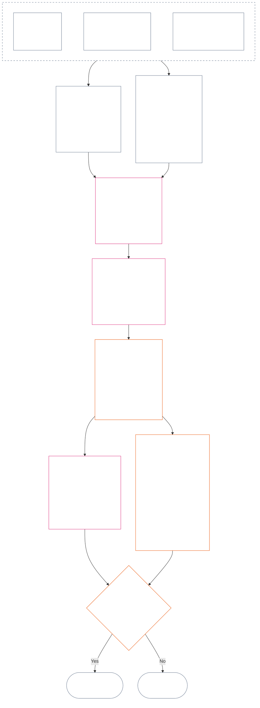

<!-- AI-drafted, unreviewed, non-binding full Chapter Twelve draft | Locale: Turkish (tr) | Source commit: a9ad713c15de3c6ba565486590518aa07c7d62fa ; source SHA-256: 7ae49781f558ad90db53cdd4469dd22d8227f0a17b0c7393c3a1d2168263f59d; committed-main row update 2026-11-11 -->

# ON İKİNCİ BÖLÜM: GÜZERGÂH ÖLÇÜMÜ — 2. SORU, NE KADAR İYİ VEYA KÖTÜYDÜ?

<strong>Corpus konumu (işlemsel değildir): dosya yapısı ve okuma kuralları</strong>

> Bu dosya **Algılayanlar Anayasasının bir parçasıdır** ve yalnızca tek bir metin olarak okunan diğer numaralı `core_*` dosyalarıyla **birlikte bağlayıcıdır**. Bu dosya, LEQU tabanını ve sınırlarını, ölçüm girdi boyutlarını, güzergâh tanımlayıcı kataloglarını, yuva dilbilgisini ve ortak ölçeklendirmeyi, eksen atamasına anayasal girdileri, birleşik orantılı LEQU ölçeğini, standart katkı ölçütlerini, işlenmiş örnekleri ve 3. Soruya devri içeren **On İkinci Bölümdür** — **2. Soru** (*ne kadar iyi veya kötüydü?*) (§§1–9). Üç soru çerçevesi ve **1. Soru** (*ne oldu?*) — doğrulanmış olgular, olay türleri, kayıt gereklilikleri, kayıt sorumluluğu ve işleme — [On Birinci Bölümdedir](core_11_standing_assessment.md#chapter-eleven-standing-records--question-1-what-happened). **3. Soru** (*bunun sonucunda ne olur?*), gerekli İhlal Ekseni `s` = 7–9 bulgularında incelemenin anayasa karşıtı suistimal belirlemesiyle sınırlı olduğu [On Üçüncü Bölümde](../../core_13.000_standing_integration.md#chapter-thirteen-standing-effects-and-integration), [On Dördüncü Bölümle](../../core_14.000_misconduct_designation.md#chapter-fourteen-anti-constitutional-misconduct) birlikte devam eder. Okuma sırası, bağlayıcılık/destek ayrımı ve corpus baskısı üst verileri [README.md](README.md) dosyasında tutulur.

<strong>İz</strong>

- Önceki dayanaklar:
  - [On Birinci Bölüm §1](core_11_standing_assessment.md#1-the-three-questions) (*üç soru çerçevesi*);
  - [On Birinci Bölüm §2](core_11_standing_assessment.md#2-question-1--what-happened) ile [On Birinci Bölüm §6](core_11_standing_assessment.md#6-handling-a-standing-record) arası (*1. Soru — doğrulanmış olgular, güzergâh kayıtları, sorumluluk ve işleme*);
  - [Anayasal Dörtlü](core_00_preamble.md#constitutional-tetrad);
  - [İki Anayasal Amaç](core_00_preamble.md#two-constitutional-aims);
  - [Önsöz §6 Temel Uygulamalı Süreç Zincirleri](core_00_preamble.md#6-key-practical-process-pipelines) (*Dokuzuncu ila On Beşinci Bölümlerin zinciri*).
- Bu dosyanın alt bölümleri:
  - [§1](#1-question-2--how-good-or-bad-was-it) (*2. Soru — LEQU tabanı, statü köprüsü, sınırlar ve kapsam*);
  - [§2](#2-magnitude-and-severity-input-dimensions) (*her iki eksen için ölçüm girdi boyutları*);
  - [§3](#3-route-descriptor-catalogs-and-measurement-roles) (*güzergâh tanımlayıcı katalogları*);
  - [§4](#4-slot-grammar-and-shared-scaling) (*yuva dilbilgisi ve ortak ölçeklendirme*);
  - [§5](#5-constitutional-inputs-to-axis-assignment) (*anayasal kaynak yönlendirmesi*);
  - [§6](#6-unified-proportional-lequ-scale--contribution-and-violation-axes) (*her iki eksen için birleşik orantılı LEQU ölçeği*);
  - [§7](#7-standard-contribution-measures) (*benimseyen tarafından yayımlanan standart katkı ölçütleri*);
  - [§8](#8-measurement-illustrations) (*işlenmiş ölçüm örnekleri*);
  - [§9](#9-hand-off-to-question-3--cross-question-measurement-hooks) (*3. Soruya devir*).
- Sonraki dayanaklar:
  - [On Üçüncü Bölüm](../../core_13.000_standing_integration.md#chapter-thirteen-standing-effects-and-integration) (13.000) (*3. Soru etkileri ve bütünleştirme*);
  - [On Dördüncü Bölüm](../../core_14.000_misconduct_designation.md#chapter-fourteen-anti-constitutional-misconduct) (14.000) (*yalnızca belirleme — 2. Soru ölçümünü yeniden açmaz*).
- Birlikte okuyun: [Beşinci Bölüm *Statü, Katkı ve İhlal*](../../core_05.035_band_accountability.md#defa3-standing-state-contribution-and-violation) (5.035) (*kanonik tanım yönlendirmesi*).

 

On İkinci Bölüm, [On Birinci Bölümün](core_11_standing_assessment.md#chapter-eleven-standing-records--question-1-what-happened) doğruladığı olguları ölçen **2. Sorunun** anayasal sahibidir. [§1 2. Soru — ne kadar iyi veya kötüydü?](#1-question-2--how-good-or-bad-was-it) bölümünde başlar. [On Birinci Bölüm](core_11_standing_assessment.md#chapter-eleven-standing-records--question-1-what-happened), üç soru çerçevesinin, 1. Sorunun ve güzergâh kaydının sahibidir; [On Birinci Bölüm §6 Güzergâh kaydının işlenmesi](core_11_standing_assessment.md#6-handling-a-standing-record) bölümünde sona erer.

*Yalın dille: On Birinci Bölüm ne olduğunu ve güzergâh kaydını kimin elinde tuttuğunu belirler. Bu bölüm ise onu ölçer: katkı iki ayrı ölçekte ne kadar iyiydi veya ihlal ne kadar kötüydü? Bu ölçekler hiçbir zaman tek bir net puanda toplanmaz. Ölçümden sonra ne olacağını On Üçüncü Bölüm belirler.*

### 1. 2. Soru — ne kadar iyi veya kötüydü?

<strong>İz</strong>

- Önceki dayanaklar: [On Birinci Bölüm §2](core_11_standing_assessment.md#2-question-1--what-happened) (*1. Soru — güzergâh kayıtları ve doğrulanmış olgular*); [On Birinci Bölüm §2.5](core_11_standing_assessment.md#25-verified-input-gate) (*doğrulanmış girdi eşiği*); [On Birinci Bölüm §4](core_11_standing_assessment.md#4-standing-record-operational-requirements) (*kayıt gereklilikleri*); [On Birinci Bölüm §1](core_11_standing_assessment.md#1-the-three-questions) (*üç soru çerçevesi*).
- Sonraki dayanaklar:
  - [§2](#2-magnitude-and-severity-input-dimensions) (*her iki eksen için ölçüm girdi boyutları*);
  - [§3](#3-route-descriptor-catalogs-and-measurement-roles) (*güzergâh tanımlayıcı katalogları*);
  - [§4](#4-slot-grammar-and-shared-scaling) (*yuva dilbilgisi ve ortak ölçeklendirme*);
  - [§5](#5-constitutional-inputs-to-axis-assignment) (*anayasal kaynak yönlendirmesi*);
  - [§6](#6-unified-proportional-lequ-scale--contribution-and-violation-axes) (*Katkı ve İhlal Eksenlerinin atanması*);
  - [§7](#7-standard-contribution-measures) (*benimseyen tarafından yayımlanan standart katkı ölçütleri*);
  - [§8](#8-measurement-illustrations) (*ölçüm örnekleri*);
  - [§9](#9-hand-off-to-question-3--cross-question-measurement-hooks) (*3. Soruya devir*);
  - [On Üçüncü Bölüm §7.2](../../core_13.000_standing_integration.md#72-competency-bars-and-clearances) (13.000 §7.2) (*3. Soruda katkı — güvenli yetki devri*);
  - [On Üçüncü Bölüm §5.2](../../core_13.000_standing_integration.md#52-prevention--general-standing-locks) (13.000 §5.2) (*önleme kilitleri*);
  - [On Üçüncü Bölüm §6](../../core_13.000_standing_integration.md#6-lock-design-and-enforcement) (13.000 §6) (*kilit tasarımı ve uygulanması*).
- Birlikte okuyun: [On Birinci Bölüm §4.1](core_11_standing_assessment.md#41-minimum-record-contents) (*doğrulanmış güzergâh kaydı alanları; On Birinci Bölümde statü etkileri yoktur*).

 

*Yalın dille: 2. Soru, 1. Soruda doğrulanan olguları ölçer. **Katkı ne kadar iyiydi?** veya **ihlal ne kadar kötüydü?** diye sorar. Bölüm, ilk kez iki resmî ölçüm eksenini burada tanımlar: doğrulanmış yardım için **Katkı Ekseni**, doğrulanmış zarar için **İhlal Ekseni**. Eksenler ayrı kalır; tek bir net puanın iki tarafı değildirler.*

Birinin katkısının veya ihlalinin hangi yuvaya girdiğini belirlemek için bu bölüm, etkiyi **Yaşam Süresi Eşdeğer Birimi (LEQU)** kullanarak ölçer. Bir LEQU, kabaca bir algılayanın tüm yaşamı boyunca süren esenliğinin kurtarılmasına veya yok edilmesine denktir. Bu, bedenleri veya parayı saymakla ilgili değildir; bir eylemin anayasal topluluğun esenliğini anlamlı biçimde değiştirip değiştirmediğini sorar. Aynı birim, insan olsun veya olmasın her algılayana uygulanır.

#### 1.1 LEQU tabanı

**Yaşam Süresi Eşdeğer Birimi** (**LEQU**), benimsenmiş uygulama sayısal bir ayarlama gerektirdiğinde, tam yaşam eşdeğeri anayasal yarar veya kaybı ifade eden kısa birimdir.

- Birim, taşıyıcı türünden bağımsızdır.
- Mevcut bir benimseyen biyolojik insan bağlamlarında olağan bir insan yaşam süresini ayarlama örneği olarak kullanabilir; ancak bağlayıcı taban türe özgü değil, algılayanlara ve anayasaya ilişkindir.

**Tam yaşam eşdeğeri anayasal yarar**, önemsiz olmayan ve haklarla uyumlu esenliğe sahip bir algılayanın tam yaşam süresini korumaya, yeniden sağlamaya veya özgürleştirmeye denk doğrulanmış yarar demektir. **Tam yaşam eşdeğeri anayasal kayıp**, tam yaşam eşdeğeri anayasal bir yararı yok etmeye, haksız biçimde tüketmeye veya önlemeye denk doğrulanmış zarar, israf, yıkım, seçeneklerin kapanması, yoksun bırakma ya da riskin gerçekleşmesi demektir.

#### 1.2 LEQU kullanımına ilişkin sınırlar

LEQU kullanıldığında aşağıdaki sınırlar geçerlidir.

- **Net puan kuralı değildir:** İhlalleri katkılarla veya katkıları ihlallerle “mahsup edemezsiniz”. Her eksen kendi başına değerlendirilir.
- **Zorunlu insan yaşamı ölçütü değildir:** LEQU algılayan geneline uygulanır; yalnızca insanlara değil, bilinçli her varlığa uygulanır.
- **Suçlama ölçütü değildir:** İddialar, ilk kabul etiketleri, yönlendirme kararları, itibar, dışlanan statü veya ahlaki hoşnutsuzluk; **On Birinci Bölüm §2.5** uyarınca doğrulanmış girdiler ve **§6** uyarınca ayarlama olmadan Katkı Ekseni yararı veya İhlal Ekseni ağırlığı sağlayamaz.
- **Hakları takas etme izni değildir:** Verimlilik, üretken kapasite, yenilik, yükü azaltma, güvenlik, misilleme, acil müdahale veya kurumsal zorunluluk olarak sunulan iddialar, aşağıdakilere dayanıyorsa ağırlığı azaltılmalı veya reddedilmelidir:
  - zorlama;
  - ayrımcı yük aktarımı;
  - ekolojik tükenme;
  - gizli ücretsiz iş;
  - önlenebilir kapalılık;
  - Hak Tabanının daraltılması;
  - ele geçirilme;
  - yanıltıcı vekil ölçütler;
  - itiraz edilebilirliğin kaybı; veya
  - incelenemeyen toplulaştırma.

#### 1.3 Yalnızca 2. Soru — kapsam ve yönlendirme

Bu kısım yalnızca 2. Soruyu, yani ölçüm adımını kapsar. Önceden doğrulanmış (1. Soru) olguları alır ve bir katkının ne kadar iyi veya bir ihlalin ne kadar kötü olduğunu sorar.

- **On Birinci Bölüm §2** uyarınca önceden doğrulanmış ve **On Birinci Bölüm §4** uyarınca güzergâh kaydına yazılmış olgulardan başlayın; bunları **§2** kapsamındaki boyutlarla ölçün.
- Ardından her yardım veya zarar türüne kataloglardaki standart adını verin: yardım için **yarar güzergâhı** kataloğu (**§3.1**), zarar için **zarar güzergâhı** kataloğu (**§3.2**).
- Her ad, bu yardım veya zarar türünün *ne kadar iyi* ya da *ne kadar kötü* olduğuna ne ölçüde katkıda bulunduğunu da gösterir.
- Bir yararın sonucunu belirleyen kurallar [yarar tarafındadır](../../core_13.000_standing_integration.md#72-competency-bars-and-clearances); bir zararın sonucunu belirleyen kurallar ise [zarar tarafındadır](../../core_13.000_standing_integration.md#52-prevention--general-standing-locks).
- Bundan sonra ne olacağına 3. Soru karar verir. [On Üçüncü Bölüm §4 Tanımlayıcıların bütünleştirilmesi ve eklerin normalleştirilmesi](../../core_13.000_standing_integration.md#4-descriptor-integration-and-attachment-normalization) ile başlayın.

#### 1.4 Algılayıcılık statüsü köprüsü

Güzergâh ölçümü, bir varlığın **algılayan** olup olmadığına **karar vermez**.

- Statü uyuşmazlıkları [Algılayıcılık Statüsünün Karara Bağlanması](../../core_05.055_band_participation.md#sentience-status-adjudication) ve [VI-B Maddesine](core_06_rights_part_b.md#article-vi-b-sentience-status-adjudication-floor) (*Algılayıcılık Statüsünün Karara Bağlanması Tabanı*) gider. Bu uyuşmazlıklar LEQU puanlamalarına veya sınıflandırma kayıtlarına gitmez.
- [İtirazlı Algılayan Yaşamı](../../core_05.055_band_participation.md#contested-sentient-life) uyarınca statü uyuşmazlığı açık olduğu sırada **VI-B Maddesi** (*Algılayıcılık Statüsünün Karara Bağlanması Tabanı*) varlığı varsayılan olarak kapsar: uyuşmazlık karara bağlanana kadar varlık ölçülebilir ve güzergâh kaydı sunabilir; işletmeciler yalnızca uyuşmazlığın açık olmasını statü vermeyi reddetme gerekçesi sayamaz.
- Varlığın [Algılayan](../../core_05.055_band_participation.md#sentient) olduğu saptanırsa veya incelenebilir bir kararla yapılan yargılama sonrasında statüsü daraltılır ya da yeniden tanınırsa:
  - güzergâh kaydının konusu o andan itibaren güncellenir; ve
  - [Giderim ve Telafi](../../core_05.035_band_accountability.md#redress-and-remediation) dışında, haksız dışlama geriye yürütülerek varlığın bu arada ölçülmeye uygun olduğu gerçeği silinemez.

### 2. Büyüklük ve ağırlık girdi boyutları

*Yalın dille: bu bölüm önce 2. Sorunun ne ürettiğini (**§2.1**) söyler, ardından doğrulanmış bir katkıyı veya doğrulanmış bir ihlali ölçerken nelerin inceleneceğini listeler (**§2.2**). Her eksen kendi başına ölçülür. Ortak ölçeklendirme kuralları **§4.2**'de, yuva ise **§6**'daki ölçekte belirlenir.*

Yuva ölçeği, anayasal sonucun ne kadar büyük olduğunu ve ne tür bir sonuç olduğunu ölçer. Yalnızca doğrulanmış sonuçları hesaba katar.

**Ölçeğin neyi hesaba kattığı ve bunun Anayasanın temel sınamalarıyla ilişkisi:**

- **[İki Anayasal Amaç](core_00_preamble.md#two-constitutional-aims):** Her iki eksen de **Gelişim** ve **Süreklilik** üzerindeki etkiyi ölçer. Katkı Ekseni bunları ileri taşır. İhlal Ekseni geriye götürür.
- **[İki Temel Soru](core_00_preamble.md#two-fundamental-questions):** Her eksen sorulardan biri için doğrulanmış olguları sağlar. Bir soruyu yanıtlamak diğerini yanıtlamaz; bu nedenle iki eksen hiçbir zaman birbirinden düşülmez.
  - **Birinci soru:** Doğrulanmış olguları Katkı Ekseni sağlar. Sistem, algılayanların gelişmesine ve varlığını sürdürmesine yardımcı olan, gerçeği söyleyen ve zararı gideren davranışları ödüllendiriyor mu?
    - **Hesaba katılır:** doğrulanmış risk azaltımı dâhil, doğrulanmış anayasal yarar.
    - **Hesaba katılmaz:** ham çıktı, itibar, zenginlik, bir şeyin ne kadar kullanıldığı, hız veya kurumun büyüklüğü.
  - **İkinci soru:** Doğrulanmış olguları İhlal Ekseni sağlar. Sistem, gerekçesiz biçimde zarar veren, yanıltan, dışlayan, geciktiren, israf eden veya maliyetleri başkalarına aktaran davranışları ödüllendiriyor mu?
    - **Hesaba katılır:** doğrulanmış anayasal kayıp, zarar, israf, kaybedilen seçenekler (seçeneklerin kapanması), tehlike veya risk artışı.
    - **Tek başına hesaba katılmaz:** dışlanan statü, iddialar veya ahlaki hoşnutsuzluk.
- **[Anayasal Dörtlü](core_00_preamble.md#constitutional-tetrad):**
  - **Gözetim ve hesap verebilirlik:** “Doğrulanmış” demek, bulgudan adı belirtilmiş bir aktörün hesap vermesi ve hiçbir tarafın kendi iddiasını doğrulamaması demektir.
  - **Zamanındalık:** önlenebilir gecikme, kaybın büyüklüğüne katılmadan ayrı bir olgu olarak kaydedilir.

#### 2.1 2. Sorunun ürettikleri

2. Soru, her eksen için aşağıdaki sonuçları güzergâh kaydına yazar. Bunlar, 3. Sorunun kararlaştırdığı sonuçlar olan statü etkileri değil, ölçümlerdir:

| **Üretilen** | **Katkı Ekseni** | **İhlal Ekseni** |
| --- | --- | --- |
| **Nereye yazılır** | Katkı güzergâh kaydı. | İhlal güzergâh kaydı. |
| **Yuva** | Uygulanabilir en yüksek **Katkı Ekseni yuvası** (`s` = 1–9). | Uygulanabilir en yüksek **İhlal Ekseni yuvası** (`s` = 1–9). |
| **Güzergâh tanımlayıcıları** | Birlikte uygulanan **yarar güzergâhı tanımlayıcıları**. | Birlikte uygulanan **zarar güzergâhı tanımlayıcıları**. |
| **3. Soruya aktarılan girdiler** | [On Üçüncü Bölüm §7 Katkı sonuçları ikincildir](../../core_13.000_standing_integration.md#7-contribution-consequences-second) uyarınca katkının nasıl tanınacağına ilişkin başlangıç noktasını belirleyen girdiler. | [On Üçüncü Bölüm §6 Kilit tasarımı ve uygulanması](../../core_13.000_standing_integration.md#6-lock-design-and-enforcement) uyarınca varsayılan kilit bandını (kilidin ne kadar sıkı olacağının başlangıç noktasını) belirleyen girdiler. |
| **LEQU toplamı** | İlgili her yarar türünü (ekolojik, sistemsel veya kaynağa ilişkin) ayrı ayrı değerlendirin, ardından katkının bütünü için tek bir LEQU toplamı girin. | İlgili her zarar türünü (ekolojik zarar, sistem zararı veya kaynak kaybı) ayrı ayrı değerlendirin, ardından ihlalin bütünü için tek bir LEQU toplamı girin. |

Hatırlatma: bunların hiçbiri açık bir ihlal kaydını mahsup etmez. Mahsup yasağı [On Birinci Bölüm §2.4 Bağlantılı güzergâh kayıtları ve mahsup etmeme köprüsü](core_11_standing_assessment.md#24-linked-standing-records-and-no-offset-bridge) bölümündedir.

#### 2.2 Katkı büyüklüğü ve ihlal ağırlığı girdi boyutları

**2. Soru — ne kadar iyi veya kötüydü?** Bir katkının Katkı Ekseninde ya da ihlalin İhlal Ekseninde hangi yuvaya (1–9 arasındaki **yuvasına**) girdiğini ve hangi yarar veya zarar tanımlayıcılarının uygulanacağını belirlemek için üç kısmı ele alın. Birden fazla tanımlayıcı aynı anda uygulanabilir ve bunlar birlikte kullanılır. Sonuçları **§2.1**'de belirtildiği gibi ilgili eksenin güzergâh kaydına yazın. İkinci kısım için ortak ölçek **§6**'dadır ve yarar ile zarar için aynıdır. Ölçek, toplam yarar veya kaybın LEQU (Yaşam Süresi Eşdeğer Birimi; kabaca bir tam yaşamın esenliği) cinsinden nasıl tahmin edileceğini ve her miktarın hangi yuvaya girdiğini açıklar. Katkı Ekseninde yuvalar dört bantta gruplanır.

**1. Nasıl üretildiğini inceleyin.** İki eksen bunu farklı ele alır:

- **Katkı (davranışın niteliği):** bu, hesaba katılan yararın miktarını artırabilir veya sınırlayabilir: izlenebilir miydi, maliyetleri başkalarına aktarmaktan kaçındı mı, özenle mi yapıldı ve Anayasaya uyuyor mu? Beş sınama [§2.2.1 Yararın üretilme biçimi, neyin hesaba katılacağını nasıl etkiler](#221-how-the-way-a-benefit-was-produced-affects-what-counts) bölümündedir.
- **İhlal (davranışın niteliği):** etki büyüklüğünden ayrı kaydedilir. Görev, ihmal, aldatma, gizleme, hesap verebilirliği engelleme, zorlama, şiddet, kasıt, zalimlik ve yapısal kolaylaştırma kimin sorumlu olduğunu, hangi güvencelerin gerektiğini ve nasıl karşılık verileceğini belirler. Bunların hiçbirinin slotu değiştirmediği kuralı ve her birinin kaydedilme kuralları [§2.2.2 Bir zararın nasıl meydana geldiğinin kaydı](#222-how-the-way-a-harm-was-caused-is-recorded) bölümündedir.

**2. Büyüklüğü belirleyin: yarar veya kayıp ne kadar büyük?** Yuvayı bu belirler.

| **İncelenecek** | **Etkisi** | **Düzenlendiği yer** |
| --- | --- | --- |
| **Genel büyüklük (LEQU)** | Temel ölçümdür ve yuvayı belirler. Katkıda, yapılan toplam doğrulanmış iyiliktir ve LEQU cinsinden sayılır. İhlalde, doğrulanmış toplam anayasal kayıptır. On Dördüncü Bölümdeki suistimal belirlemesi ayrı yapılır. | [§6 Birleşik orantılı LEQU ölçeği](#6-unified-proportional-lequ-scale--contribution-and-violation-axes) |
| **Kimleri etkilediği (kaç kişiyi, ne ölçüde, ne kadar kırılgan olanları)** | LEQU tahminini ve yarar ya da zararın önemini (maddi önemini) ayarlar. | [§4.2 Ortak etki ölçeklendirme kuralları](#42-shared-impact-scaling-rules); [Maddi önem](../../core_05.050_band_oversight.md#materiality) |
| **Ne kadar sürdüğü (süre; yararın kalıcılığı, zararın geri döndürülemezliği)** | LEQU tahminini ayarlar. Katkıda kalıcı sorumlu yönetim, kuşaklar arası yarar veya bir kurumun kalıcı biçimde onarılması üst yuvalara işaret eder. İhlalde kalıcı travma, geri alınamayan kayıp ve algılayanların kendi başlarına hareket etme yetilerindeki kalıcı zarar, toplam kayıp tahminini artırır. | [§4.2 Ortak etki ölçeklendirme kuralları](#42-shared-impact-scaling-rules) |
| **Ne kadar geniş alana yayıldığı (yerler veya kurumlar arasında)** | LEQU tahminini ayarlar. Katkıda, örneğin topluluklar veya kurumlar arasında ya da bir uygarlık ölçeğinde yarar söz konusudur. İhlalde topluluklar, kurumlar veya bir uygarlık çapında yayılan zarar toplam kayıp tahminini artırabilir. | [§4.2 Ortak etki ölçeklendirme kuralları](#42-shared-impact-scaling-rules) |

**3. Yarar veya zarar türlerini adlandırın (güzergâhlar).** Doğrulanmış yarar veya zararın nasıl meydana geldiğini adlandırın. Birden fazla tür uygulanabilir ve birlikte kullanılır. Listeler [**Yarar güzergâhı tanımlayıcı kataloğunda**](#31-contribution-route-descriptor-catalog-and-measurement-roles) ve [**Zarar güzergâhı tanımlayıcı kataloğunda**](#32-violation-route-descriptor-catalog-and-measurement-roles) bulunur.

##### 2.2.1 Yararın üretilme biçimi, neyin hesaba katılacağını nasıl etkiler

Katkı Ekseni yuvasını seçmeden önce aşağıdakileri inceleyin:

| **Bulgu** | **Yarara etkisi** |
| --- | --- |
| Kendisine bildirildikten sonra bir sorunun derhâl ve doğrulanmış biçimde giderilmesi | Gerçek ve gösterilebilir bir yarar sağladığında **Özen** (dikkatli ve sorumlu davranış) sayılabilir. |
| Başkalarına aktarılan zarar veya gizlenen bir yük | Tartışmalı güzergâh için (yararın atfedildiği belirli güzergâh) tanınan yarara üst sınır koyar veya yararı tamamen dışlar. |
| Doğrulanmış ele geçirilme riski (düzenlemenin dar çıkarlarca ele geçirilebilmesi), yapısal bağımlılık (algılayanların bu düzene güvenmek zorunda bırakılması) ya da çıkış ve kilitlenme tasarımı (ayrılmanın zor olması) | İyi sorumlu yönetim için tanınan değeri sınırlar. |
| Erişilebilirlik veya katılım engelinin doğrulanmış biçimde giderilmesi | Yararın önemini (maddi önemini) artırabilir ve **§3.1** uyarınca **Erişim ve Kapsayıcılık** yarar güzergâhı tanımlayıcısını destekleyebilir. |
| Anayasa’ya aykırı çalışan bir teşvik düzeninden, anayasa karşıtı davranıştan veya önemli ölçüde kusurlu bir süreçten doğan kayda değer ödül | Varsayılan olarak katkı sayılmaz. Bu durumda [On Üçüncü Bölüm §6.4.2 Uyumsuz ödüller](../../core_13.000_standing_integration.md#642-misaligned-rewards) ve [Madde XXVIII-A](../../core_06.020_rights_part_e.md#incentive-alignment-adoption-transition-carve-out) (*Aşamalı Kabul ve Hak Tabanının Sürekliliği*) kapsamındaki Kabul Geçişi sınırı uygulanır. |

##### 2.2.2 Zarara yol açılma biçimi nasıl kaydedilir

Bir zararın büyüklüğü (yukarıdaki 2. bölümden LEQU toplamı) slotu belirler. Zarara nasıl yol açıldığı belirlemez; bu nedenle aşağıdaki her davranış türü ayrı kaydedilir.

Bu alt bölüm kuralı On İkinci Bölümde bir kez belirtir. **Bir olay veya davranış süreci aşağıdakilerden biri olarak nitelendirildi diye slotu yükseltmeyin veya düşürmeyin:**

- görev;
- ihmal;
- kasıt;
- gizleme;
- tekrarlama;
- ağırlaştırma;
- zorlama;
- şiddet;
- özgürlük tehlikesi;
- düzeltilebilirlik; veya
- tercih edilen sonuç.

Davranışın niteliğine ilişkin olgular ayrı ve izlenebilir tanımlayıcılar olarak kaydedilir. Atıf, inceleme yoğunluğu, güvenceler, giderim veya On Dördüncü Bölümdeki bir belirlemeyi etkileyebilirler. Slotu yalnızca doğrulanmış sonuçlar üzerinden etkilerler: davranış ek kayıp yaratıyorsa bu kayıp LEQU toplamında bir kez sayılır ve slot toplamı izler.

**Büyüklüğe eklenen ve bir kez sayılan kayıp doğuran davranış:**

| **Bulgu** | **Kayıt yöntemi** |
| --- | --- |
| Harekete geçme görevi ve kapasitesi varken yanıt vermede veya konuyu üst makama taşımada önlenebilir gecikme | Davranışla ilgili ayrı bir olgu olarak kaydedilir. Gecikmenin yol açtığı ek kayıp LEQU tahmininde bir kez sayılır. |
| Bir forumun bütünlüğüne (adil yargılama niteliğine) bağımsız olarak doğrulanmış zarar | LEQU tahmininde tam olarak bir kez sayılır. Dürüst olmayan ihmal, çekilme sürecini bilerek uygulamama, zorlama, özgürlük tehlikesi ve diğer davranış olguları ayrı tanımlayıcı olarak kalır. |
| **Hesap verebilirliği engelleme** (sorumluların hesap vermesini sağlayan mekanizmalara (kanıt bütünlüğü, doğrulama, forum süreci, standing kayıtları, giderim süreleri veya itiraz ve telafi yolları gibi) doğrulanmış müdahale) | Ayrı bir davranış olgusu olarak kaydedilir. Gated pathway içinde yol açtığı ek kayıp LEQU tahmininde bir kez sayılır. |

**Zararın büyüklüğünden ayrı kaydedilen davranış olguları:**

| **Bulgu** | **Kayıt yöntemi** |
| --- | --- |
| Aldatma, gizleme, kaçınma, bildirimden sonra davranışı yineleme, pervasızca umursamama, yapısal kolaylaştırma (zararı kolay veya olası hâle getirecek düzen kurma) ya da önemli bir bağımlılık dengesizliğini kötüye kullanma (kendisine büyük ölçüde güvenen birinden yararlanma) | Her biri ayrı kaydedilmiş bir davranış olgusu olarak kalır. |
| Şiddet, zorlama, yönlendirme veya özgürlüğe yönelik tehlike | Ayrı kaydedilir ve yuva ne olursa olsun daha güçlü güvenceler gerektirebilir. |
| [Zalimlik](../../core_05.035_band_accountability.md#cruelty) (kendi başına amaç olan doğrulanmış acı veya gerekli ve orantılı olanın ötesindeki gereksiz ya da aşağılayıcı zarar) | Ayrı bir davranış olgusu olarak kaydedilir. [On Üçüncü Bölüm §5 İhlal, düzeltme ve önleme](../../core_13.000_standing_integration.md#5-violation-correction-and-prevention) uyarınca daha güçlü güvenceler ve aşağılayıcı giderimlere sınırlar gerektirebilir. |

**Sorumluluk ve atıf:**

| **Bulgu** | **Kayıt yöntemi** |
| --- | --- |
| Dağılım (sorumluluğun nasıl yayıldığı: kimin hangi nedensel rolü oynadığı, hangi yetki veya kontrolü elinde tuttuğu, zararı öngörüp öngöremediği, yararlanıp yararlanmadığı, gizleyip gizlemediği veya önleyip önleyemediği) | **Algılayan kapsamının** parçası değildir ve birini bir gruba ait olduğu için suçlamaya izin vermez. |
| Zarara katılmak veya ona direnmemek | Yalnızca **On Birinci Bölüm §§4.1 ve 4.3** uyarınca gereken belirli aktörle bağlantı doğrulanmışsa göreve dayalı, ağırlaştırılmış veya kolektif hesap verebilirlik niteliği bulgusunu destekleyebilir. |

**Uyumsuz ödüller:**

| **Bulgu** | **Kayıt yöntemi** |
| --- | --- |
| Anayasa’ya aykırı önemli bir ödülü zamanında korumalı bildirimde bulunmadan (misillemeye karşı korunan bildirim) bilerek kabul etmek veya elinde tutmak | [On Üçüncü Bölüm §6.4.2 Uyumsuz ödüller](../../core_13.000_standing_integration.md#642-misaligned-rewards) altında, [Madde XXVIII-A](../../core_06.020_rights_part_e.md#incentive-alignment-adoption-transition-carve-out) (*Aşamalı Kabul ve Hak Tabanının Sürekliliği*) kapsamına tabi olarak kaydedilir. Slotu yalnızca yol açtığı doğrulanmış anayasal kayıp etkiler. |

**Uyumsuz ödül sınırı.** Bu bölüm yalnızca doğrulanmış uyumsuz ödülün (Anayasa’ya aykırı ödül) Katkı Eksenini veya İhlal Eksenini nasıl etkilediğini ölçer. [On Üçüncü Bölüm §6.4.2 Uyumsuz ödüller](../../core_13.000_standing_integration.md#642-misaligned-rewards) bildirim görevini, istisnaları, ödülden vazgeçmenin (müsadere) sonuçlarını, düzeltme görevlerini ve yönlendirme kurallarını belirler.

### 3. Güzergâh tanımlayıcı katalogları ve ölçüm rolleri

*Yalın dille: aşağıdaki iki katalog, güzergâh kaydında yer alabilecek doğrulanmış yardım (**§3.1**) ve zarar (**§3.2**) türlerini adlandırır. Tanımlayıcı, yararın veya zararın nasıl meydana geldiğini söyler; tanımlayıcılar birlikte kullanılabilir ve yuvaya tabidir.*

**Tanımlayıcı kuralı.** Aşağıdaki [§3.1 Katkı güzergâhı tanımlayıcı kataloğu ve ölçüm rolleri](#31-contribution-route-descriptor-catalog-and-measurement-roles) ile [§3.2 İhlal güzergâhı tanımlayıcı kataloğu ve ölçüm rolleri](#32-violation-route-descriptor-catalog-and-measurement-roles), her iki eksenin tanımlayıcıları için resmî listedir. Tanımlayıcı, doğrulanmış yarar veya zararın **nasıl** meydana geldiğini söyler. Şu kurallar geçerlidir:

- Tanımlayıcılar birlikte kullanılır ve hiçbiri diğerini dışlamaz: doğrulanmış olgular gerektiriyorsa bir güzergâh kaydında birden fazlası yer alabilir.
- Tanımlayıcılar yuvaya tabidir: yuva, yararın veya zararın büyüklüğünü söyler; tanımlayıcılar nasıl meydana geldiğine dair ayrıntı ekler, ancak yuvanın yerini almaz.
- Listelenen tanımlayıcılar temel listedir, tam liste değildir; katalog başka yarar veya zarar türlerini dışlamaz.
- Uygulamalar kataloğa eşlenmiş sabit tanımlayıcılar (uygulamanın kendi sabit kimlikleri) kullanabilir; ancak bir güzergâh kaydının yalnızca bir tanımlayıcı taşıyabileceği, kategorileri birbirini dışlayan çelişkili bir sınıflandırma oluşturmamalıdır.
- Olgular doğrulanmadan önce, iddia edilen bir tanımlayıcı hukuka uygun kanıt korumayı, davayı sınıflandırmayı veya geçici güvenceleri destekleyebilir.
- Yalnızca doğrulanmış bir tanımlayıcı 2. Soru çıktısı olarak kaydedilebilir veya statüyü etkileyebilir.

#### 3.1 Katkı güzergâhı tanımlayıcı kataloğu ve ölçüm rolleri

Bunlar, yarar güzergâhı tanımlayıcıları ve her birinin 2. Soruda (ne kadar iyiydi?) neyi ölçtüğüdür. Beş alana ayrılmışlardır; her alan için bir tablo bulunur. [§3.2 İhlal güzergâhı tanımlayıcı kataloğu ve ölçüm rolleri](#32-violation-route-descriptor-catalog-and-measurement-roles) içindeki İhlal kataloğu da aynı beş alanı aynı sırayla kullanır. 3. Sorudaki rolleri olan güvenli yetki devri, [On Üçüncü Bölüm §7.2 Yeterlilik engelleri ve izinler](../../core_13.000_standing_integration.md#72-competency-bars-and-clearances) bölümündedir.

**Katalog bütünlüğü.** Bir uygulama bir satırda veya etiket altında birden fazla tanımlayıcı gösteriyorsa, o satır veya etiket uygulanabilir her tanımlayıcıya geri eşlenebilmelidir. Bu katalog yalnızca tanımlayıcı adlarını ve her birinin 2. Soruda neyi ölçtüğünü belirler. 3. Soru kuralları (ekleme, giderimler, kilitler, izinler ve diğer statü etkileri) yalnızca On Üçüncü Bölümde bulunur.

##### 3.1.1 Bedensel güvenlik, ilişkiler, bakım ve faillik

| **Yarar güzergâhı tanımlayıcısı** | **2. Soruda ölçtüğü** |
| --- | --- |
| **Bedenin, zihnin ve/veya topluluğun huzuru** | Bedensel, psikolojik ve toplumsal sükûnetten doğan yarar. Yararın önemini (maddi önemini) ayarlar. |
| **Güvenilir İlişkiler** | Güvenilebilecek ilişkilerden doğan yarar; eşit olmayan tarafların bulunduğu ortamlarda güven görevine dayalı ilişkiler de buna dâhildir. |
| **Bakım ve Bağımlılık Desteği** | Başkalarına bağımlı algılayanlara sağlanan doğrulanmış bakım. Gösterilebildiği sürece gayriresmî bakım da sayılır. |
| **Erişim ve Kapsayıcılık** | Gerçek katılım ve erişilebilirlikten doğan yarar. Taraflardan birinin diğerine büyük ölçüde bağımlı olduğu ortamlarda yararın önemini ayarlar. |

##### 3.1.2 Onarım, mülkiyet ve kaynaklar

| **Yarar güzergâhı tanımlayıcısı** | **2. Soruda ölçtüğü** |
| --- | --- |
| **Giderim ve onarıcı yarar** | Onarım, tazmin ve zararı azaltmadan doğan yarar. |
| **Kaynakların Sorumlu Yönetimi** | Maddi kaynaklara özen gösterilmesi ve güvenilir biçimde paylaştırılması. |

##### 3.1.3 Bilgi, eğitim, kayıtlar ve keşif

| **Yarar güzergâhı tanımlayıcısı** | **2. Soruda ölçtüğü** |
| --- | --- |
| **Bilgi Alanı Bütünlüğü** | Kayıtların, şeffaflığın ve iletişimin güçlendirilmesi. |
| **Eğitim ve Yetkinlik Geliştirme** | Öğrenme, okuryazarlık ve algılayanların kendi başlarına hareket etme yetilerinin gelişmesinden doğan yarar. Yuva toplam LEQU yararına göre belirlenir. |
| **Bilim, Teknoloji, Mühendislik ve Matematik (STEM) ile Keşif Katkısı** | Başkalarının yineleyebileceği keşifler ve işleri daha güvenli hâle getiren araştırmalar. |

##### 3.1.4 Sistemler ve anayasal işleyiş

| **Yarar güzergâhı tanımlayıcısı** | **2. Soruda ölçtüğü** |
| --- | --- |
| **Sistem Optimizasyonu** | Kurumlar arası süreçlerin iyileştirilmesi ve riskin azaltılması. |
| **Anayasal Uyum** | Hak Tabanının güçlendirilmesi ve kararlara itirazın kolaylaştırılması. |

##### 3.1.5 Ekoloji ve özen

| **Yarar güzergâhı tanımlayıcısı** | **2. Soruda ölçtüğü** |
| --- | --- |
| **Ekolojik Sorumlu Yönetim** | Yaşam alanlarına ve biyolojik çeşitliliğe yarar ile iklime duyarlı eylem. |
| **Özen** | Öngörülebilir risklerin önlenmesi ve yetkin gözetim. |

#### 3.2 İhlal güzergâhı tanımlayıcı kataloğu ve ölçüm rolleri

Bunlar, zarar güzergâhı tanımlayıcıları ve her birinin 2. Soruda (ne kadar kötüydü?) neyi ölçtüğüdür. Beş alana ayrılmışlardır; her alan için bir tablo bulunur. Aynı beş alan [§3.1 Katkı güzergâhı tanımlayıcı kataloğu ve ölçüm rolleri](#31-contribution-route-descriptor-catalog-and-measurement-roles) ile aynı sırada kullanılır. 3. Soru için bütünleştirme ve ekleme kuralları [On Üçüncü Bölüm §4 Tanımlayıcıların bütünleştirilmesi ve eklerin normalleştirilmesi](../../core_13.000_standing_integration.md#4-descriptor-integration-and-attachment-normalization) bölümünde; önleme ve kilit tasarımı ise [On Üçüncü Bölüm §5.2 Önleme — genel statü kilitleri](../../core_13.000_standing_integration.md#52-prevention--general-standing-locks) ile [On Üçüncü Bölüm §6 Kilit tasarımı ve uygulanması](../../core_13.000_standing_integration.md#6-lock-design-and-enforcement) bölümlerindedir.

**Katalog bütünlüğü.** Bir uygulama bir satırda veya etiket altında birden fazla tanımlayıcı gösteriyorsa, o satır veya etiket uygulanabilir her tanımlayıcıya geri eşlenebilmelidir. Bu katalog yalnızca tanımlayıcı adlarını ve her birinin 2. Soruda neyi ölçtüğünü belirler. 3. Soru kuralları (ekleme, giderimler, kilitler, izinler ve diğer statü etkileri) yalnızca On Üçüncü Bölümde bulunur.

##### 3.2.1 Bedensel güvenlik, ilişkiler, bakım ve faillik

| **Zarar güzergâhı tanımlayıcısı** | **2. Soruda ölçtüğü** |
| --- | --- |
| **Şiddet İçeren Suistimal** | Şiddet, zorlama veya özgürlüğe yönelik tehlike LEQU etki yuvasından ayrı kaydedilir. Daha yüksek güvenceler gerektirebilir. |
| **Kişiler Arası / Bakım Görevi Suistimali** | Taraflardan birinin diğerine büyük ölçüde bağımlı olduğu durumlarda zarar daha önemli sayılır (maddi önemi daha yüksektir). |
| **Erişilebilirlik ve Katılım Engeli Suistimali** | Taraflardan birinin diğerine büyük ölçüde bağımlı olduğu durumlarda zarar daha önemli sayılır (maddi önemi daha yüksektir); ağırlaştırıcı özellikler buna eklenebilir. |
| **Mahremiyet ve Öz Sahipliği Suistimali** | Gizleme veya sömürü doğrulandığında ağırlaştırıcı özellikler uygulanır ve bunlar birlikte bulunabilir. |
| **Faillik ve Yönlendirme Suistimali** | Zorlama, yönlendirme veya özgürlüğe yönelik tehlike etki yuvasından ayrı kaydedilir. |

##### 3.2.2 Onarım, mülkiyet ve kaynaklar

| **Zarar güzergâhı tanımlayıcısı** | **2. Soruda ölçtüğü** |
| --- | --- |
| **Giderilebilir Suistimal** | Düzeltilebilirlik niteliğini (zararın giderilip giderilemeyeceğini ve nasıl giderileceğini) kaydeder. Yuva toplam LEQU kaybına göre belirlenir. |
| **Mülkiyet Suistimali** | Mülkiyet kaybı güzergâhıdır. Yuva toplam LEQU kaybına göre belirlenir. |

##### 3.2.3 Bilgi, eğitim, kayıtlar ve keşif

| **Zarar güzergâhı tanımlayıcısı** | **2. Soruda ölçtüğü** |
| --- | --- |
| **Bilgi Alanı Suistimali** | Güvenliğe veya gerçeğe verilen zarar. Gizleme ve aldatma, zararın nasıl meydana geldiğiyle (niteliğiyle) ilgili ayrı olgular olarak kalır. |
| **Eğitim Suistimali** | Öğrenmeye veya algılayanların kendi başlarına hareket etme yetilerine (yetkinliklerine) verilen zarar. Yuva toplam LEQU kaybına göre belirlenir. |
| **Araştırma ve Keşif Suistimali** | Araştırmaya veya keşfe verilen zarar. Yuva toplam LEQU kaybına göre belirlenir. |

##### 3.2.4 Sistemler ve anayasal işleyiş

| **Zarar güzergâhı tanımlayıcısı** | **2. Soruda ölçtüğü** |
| --- | --- |
| **Sistem suistimali** | Aktörler arasındaki sorumluluk dağılımı ve yapısal kolaylaştırma ayrı kaydedilir. |
| **Hesap verebilirliği engelleme suistimali** | Hesap verebilirliğin engellenmesini, yani zararın sorumlularının yanıt vermesinin önüne geçilmesini kapsar. Zararın nasıl meydana geldiği olarak kaydedilir. Engellemenin nasıl yapıldığı (örneğin gizleme veya ihmal) ayrı bir olgu olarak kaydedilir. Slot en yüksek düzeylerdeyse (bkz. [§4.1 Tablo 1 — slot görüntüleme etiketleri](#41-table-1--slot-display-labels)), vaka ayrıca **Anayasa Karşıtı Suistimal** olarak kaydedilip On Dördüncü Bölümdeki [Anayasa Karşıtı Suistimal İncelemesi](../../core_05.035_band_accountability.md#anti-constitutional-misconduct-review) yoluna gönderilebilir. Gönderilmesi, anayasa karşıtı suistimal olarak belirlenmesiyle aynı şey değildir; bu belirlemeyi On Dördüncü Bölüm ayrı yapar. |
| **Çıkış ve Kilitlenme Suistimali** | Sistem Suistimalinin özelliklerini taşır; ayrıca dağılım veya ele geçirilme sistemin işleyişine yapısal olarak gömülüyse bunları da kapsar. |
| **Yaşam Döngüsü ve Geri Döndürülemezlik Suistimali** | Geri döndürülemezlik LEQU kaybının büyüklüğünü etkiler. Gizleme veya ihmal, davranış niteliği olarak ayrı kaydedilir. |
| **Anayasa Karşıtı Suistimal** (tanımlayıcı) | Etki yuvasını değiştirmeden, en yüksek yuvalardaki bir ihlali (bkz. [§4.1 Tablo 1 — yuva gösterim etiketleri](#41-table-1--slot-display-labels)) belirleme incelemesi için On Dördüncü Bölüme gönderir. |

##### 3.2.5 Ekoloji ve özen

| **Zarar güzergâhı tanımlayıcısı** | **2. Soruda ölçtüğü** |
| --- | --- |
| **Ekolojik Suistimal** | LEQU kaybı, [Ekolojik Toparlanma Kapasitesindeki](../../core_05.040_band_continuity.md#ecological-recovery-capacity) (bir ekosistemin zarardan sonra kendini yenileme yetisinin) kayba göre ağırlıklandırılır. Şiddet güzergâhıyla (Şiddet İçeren Suistimal) birlikte uygulanabilir. |
| **İhmalkâr Suistimal** | Görev, öngörülebilirlik ve önlenebilirlik etki yuvasından ayrı kaydedilir. |

### 4. Yuva dilbilgisi ve ortak ölçeklendirme

*Yalın dille: bu bölüm, iki ayrı eksenin her birindeki dokuz olası konum için tutarlı adlar verir ve etkinin bu konumlar boyunca nasıl ölçeklendiğini açıklar. Bir eksen doğrulanmış katkıyı, diğeri doğrulanmış ihlalleri güzergâh kayıtlarında tutar. Aynı yuva numarasını paylaşmaları eksenleri birleştirmez veya zararı yardımla mahsup etmez. **§6**'daki birleşik ölçek, orantılı LEQU etkisine göre her iki eksene de yuva atar.*

Yuva dilbilgisi, **1** ile **9** arasında bir `s` yuva numarası kullanır. Her eksenin kendi yuva konumu vardır:

- **Katkı Ekseni** olumlu katkı niteliğini kaydeder; ve
- **İhlal Ekseni** doğrulanmış ihlal bulgularını kaydeder.

Aynı yuva numarası her iki eksende de görünebilir; ancak eksenler ayrı kalır. Katkı yuvası ihlal yuvası değildir; ihlal yuvası da katkı yuvası değildir.

#### 4.1 Tablo 1 — yuva gösterim etiketleri

**Tablo 1**, dokuz yuvaya ad verir ve Katkı Ekseni ile İhlal Ekseninin gösterim etiketlerini yan yana sunar. Yalnızca gösterim dilini sağlar; yuva ataması **§6**'daki birleşik ölçeğe göre yapılır.

| `s` | Katkı Ekseni gösterim etiketi | İhlal Ekseni gösterim etiketi |
| ---: | --- | --- |
| 1 | **Küçük Taban Katkısı** | **Küçük Anayasal Etki** |
| 2 | **Düşük Taban Katkısı** | **Düşük Anayasal Etki** |
| 3 | **Önemli Olumlu Katkı** | **Önemli Anayasal Etki** |
| 4 | **Kayda Değer Olumlu Katkı** | **Kayda Değer Anayasal Etki** |
| 5 | **Ciddi Sorumlu Yönetim Olumlu Katkısı** | **Ciddi Anayasal Etki** |
| 6 | **Büyük Sorumlu Yönetim Olumlu Katkısı** | **Büyük Anayasal Etki** |
| 7 | **Tanınmış Öncü** | **Ağır Anayasal Etki** |
| 8 | **Seçkin Öncü** | **Çok Ağır Anayasal Etki** |
| 9 | **Örnek Öncü** | **Felaket Boyutunda Anayasal Etki** |

Katkı Ekseni taban, olumlu, sorumlu yönetim açısından olumlu ve öncü etiketlerini kullanır. İhlal Ekseni her yuvada tarafsız etki etiketleri kullanır. Eksenler ayrı kalır; net puan oluşturmaz ve katkı ile ihlal kayıtlarının mahsup edilmesine izin vermez. İhlal Ekseni yuvası kendi başına anayasa karşıtı suistimal sınıflandırması yapmaz; [On Dördüncü Bölüm](../../core_14.000_misconduct_designation.md#chapter-fourteen-anti-constitutional-misconduct), anayasa karşıtı suistimal belirlemesinin (ACMD) doğrulanmış `s` = 7–9 ihlaline uygulanıp uygulanmadığına bağımsız olarak karar verir.

Uygulamalar, tam yaşam eşdeğeri yarar veya kaybı tahmin etmeye yardımcı olmak için ölçüm birimleri, kanıt yöntemleri ve örnekler yayımlayabilir. Bu materyaller yalnızca rehberlik sağlar; **§6**'yı, **Birinci Bölümü** veya **Altıncı Bölümün** Hak Tabanını geçersiz kılamaz.

#### 4.2 Ortak etki ölçeklendirme kuralları

*Yalın dille: etki yalnızca kişi sayısına göre ölçülmez. Tek bir algılayanı etkileyen derin bir yarar veya kayıp, çok sayıda kişiyi yüzeysel biçimde etkileyen sonuçtan daha önemli olabilir. Sayı, derinlik, kırılganlık, süre, kalıcılık, erişim ve anayasal nitelik birlikte değerlendirilmelidir.*

**§6**'da her iki ekseni yorumlamak için aşağıdaki kuralları kullanın:

| Ölçeklendirme boyutu | Ortak kural | Eksene özgü uygulama |
| --- | --- | --- |
| **Anayasal sonucun büyüklüğü (LEQU)** | Bütünleşik doğrulanmış yararı veya kaybı değerlendirin. LEQU temel büyüklük dayanağıdır; ham kişi sayısı, para, çıktı veya kurum büyüklüğü değildir. | Katkı, haklarla uyumlu yararı sayar; ihlal ise doğrulanmış anayasal kaybı, zararı, israfı, seçeneklerin kapanmasını veya tehlikeyi sayar. |
| **Algılayan kapsamı** | **Sayıyı, derinliği ve kırılganlığı birlikte** ele alın. Hiçbir yuvada kişi sayısı tek başına bir koşul değildir. Yeterince derin bir etki, bütünleşik büyüklük ile satırın diğer ölçütleri eşitse, daha geniş fakat daha yüzeysel bir etkinin desteklediği aynı yuvayı tek bir algılayan için de destekleyebilir; açıkça belirtilen toplam LEQU veya geniş kapsam ölçütleri yine karşılanmalıdır. | Bağımlılık, azalmış kapasite veya olağandışı kırılganlık maddi önemi artırabilir. Yalnızca grubun büyüklüğü katkı veya ihlal ağırlığını ortaya koymaz. |
| **Zamansal kapsam** | Süreyi, tekrarı, kalıcılığı ve kayıp söz konusu olduğunda geri döndürülemezliği ele alın. Kısa ama dönüştürücü bir olay, uzun süreli önemsiz bir etkiye ağır basabilir; süre tek başına belirleyici değildir. | Kalıcı yarar, daha yüksek katkı büyüklüğünü destekler. Süreğen veya geri döndürülemez kayıp, ihlal ağırlığını yükseltir. |
| **Mekânsal veya kurumsal kapsam** | Daha geniş erişim büyüklüğü artırabilir; ancak derinlik, süre, kırılganlık veya anayasal kritiklik yuvayı bağımsız olarak destekliyorsa topluluklar ya da kurumlar arası erişim şart değildir. | Kurumsal onarım katkı büyüklüğünü artırabilir; yapısal veya sistemsel zarar ihlal ağırlığını artırabilir. |
| **Anayasal nitelik veya karakter** | Sonucun nasıl üretildiğini yayılma genişliğinden ayrı ölçer. Aynı olguyu iki kez saymayın. | Dışsallaştırılmış zarar, gizlenmiş yük, ele geçirme veya bağımlılık, ileri sürülen katkıyı sınırlayabilir ya da geçersiz kılabilir. Görev, ihmal, aldatma, zorlama, şiddet veya yapısal kolaylaştırma ihlal davranışının niteliği olarak ayrıca kaydedilir. |
| **Hak Tabanları ve kritik güvenceler** | Hak Tabanına uyum, toplam yarar veya kayıpla takas edilmez. | Bir tabana uyum tek başına yüksek katkı oluşturmaz. Maddi ölçüde Hak Tabanı ihlali veya kritik güvence başarısızlığı, doğrudan etkilenen algılayan sayısı az olsa bile daha yüksek ihlal ağırlığını destekleyebilir. |

Boyutlar, her tür ölçeğin bulunmasını zorunlu kılan bir kontrol listesi değildir. Hangi boyutların belirleyici olduğunu, hangilerinin olmadığını ve nedenini açıklayın.

- **Ortak yuva yöntemi:**
  - Orantılılık uyarınca bütünleşik doğrulanmış yararı veya kaybı LEQU cinsinden tahmin edin; ardından büyüklüğün sayısal bandına giren tek yuvayı atayın.
  - Her iki eksende de aynı eşikler uygulanır.
  - Katkı yuvaları, uygulanabilir taban ve anayasal uyum koşullarını korur; sayısal bir eşiğin karşılanması, dışsallaştırılmış veya anayasal bakımdan geçersiz kılınmış çıktıyı katkı hâline getiremez.
- **Nitelik ayrımı:** Uygulanabilir yarar güzergâhı, zarar güzergâhı, davranış kalitesi ve davranış niteliği tanımlayıcılarını güzergâh kaydında birlikte ve ayrı ayrı izlenebilir biçimde tutun. Görev, ihmal, aldatma, ağırlaştırma, zorlama, şiddet, kast veya yapısal kolaylaştırma; atfı, güvenceleri ya da 3. Soru sonuçlarını etkileyebilir, ancak hiçbiri LEQU etki yuvasını yükseltmez veya düşürmez.
- **Anayasa Karşıtı Suistimal İncelemesi sınırı:** Doğrulanmış İhlal Ekseni kaybı, anayasa karşıtı suistimal saptanmış olsun ya da olmasın, etkisine göre `s` = 7–9 düzeyine ulaşabilir. On Dördüncü Bölüm etki atamasının yerine geçmez; ilgili ACMD'nin uygulanıp uygulanmadığını bağımsız olarak belirler.

Bir tehlike henüz fiilen gerçekleşmediyse aşağıdakilerin her birini ayrı kaydedin:

- gerçekleşme olasılığını;
- algılayanların tehlikeye ne kadar süre maruz kalacağını;
- ne kadar geniş bir alana yayılabileceğini;
- tahminin ne ölçüde belirsiz olduğunu; ve
- hâlâ inandırıcı olan en kötü sonucu.

Benimsenmiş uygulama, riskin LEQU'ya nasıl çevrileceğini herkesin inceleyebileceği bir risk ayarlaması belirlemedikçe, bu en kötü sonucu gerçekleşmiş zarar (LEQU kaybı) olarak saymayın.

### 5. Eksen atamasına anayasal girdiler

*Yalın dille: yuva seçmeden önce, hangi taban, yarar, görev, zarar veya ihlalin ölçüldüğünü belirleyen anayasal kaynakları tespit edin. Bu kaynakları kanonik yerlerinde uygulamak için aşağıdaki bağlantıları kullanın; bu yönlendirme adımını yeni bir puana veya tanımın yerine geçecek bir şeye dönüştürmeyin.*

**§6** uyarınca yuva atanmadan önce güzergâh kaydı şunları belirtmelidir:

- uygulanabilir anayasal tabanı, görevi, kısıtı veya korunan menfaati;
- ölçülen doğrulanmış yararı, olumsuz sonucu, zararı veya ihlali belirleyen hükümleri;
- büyüklüğü veya davranışın niteliğini maddi ölçüde etkileyen tanımları, ilkeleri ve Hak Tabanı maddelerini; ve
- belirlenen her kaynağın neden uygulandığını ve eksen atamasını nasıl etkilediğini.

Aşağıdaki yönlendirme tabloları tam liste değildir. Doğrulanmış olguların tetiklediği her ek tanım, ilke veya Madde uygulanmaya devam eder ve güzergâh kaydında belirtilmelidir. Bağlantı verilen kanonik metinlerin her biri belirleyicidir; bu tablolar onları yeniden ifade etmez veya daraltmaz.

#### 5.1 Tanım girdileri

| Kanonik kaynak | Katkı Ekseni rolü | İhlal Ekseni rolü |
| --- | --- | --- |
| [Statü, Katkı ve İhlal](../../core_05.035_band_accountability.md#defa3-standing-state-contribution-and-violation) | Katkı sayılanları ve ölçümde kullanılabilecek denetlenmiş olguları açıklar. Ayrıca katkı güzergâh kaydının yalnızca iyi tarafı izlemesini, kötülükle karışmamasını sağlar. | İhlal sayılanları ve kayda nasıl geçirildiğini açıklar. En ciddi vakaları, Anayasanın kendisini zayıflatan davranışlara yönelik ayrı bir inceleme olan Anayasa Karşıtı Suistimal İncelemesine de yönlendirir. |
| [Hesap verebilirlik](core_05_apex_accountability_leg.md#accountability) | İyi sorumlu yönetim veya onarım iddiasının gerçekten birini hesap verir durumda tutup tutmadığını sınar. Kimin ne yaptığını, kimin hesap vermesi gerektiğini ve etkiye orantılı biçimde bunun nasıl incelenebileceğini, düzeltilebileceğini ve telafi edilebileceğini göstermelidir. | Bir şeyi kimin yaptığının veya kimin hesap vermesi gerektiğinin belirsiz olduğu vakaları saptar. Buna, kuruluş veya yapısı değiştikten sonra sorumluluğun işlememeye başladığı durumlar da dâhildir. |
| [Zarar](../../core_05.035_band_accountability.md#harm) | Başkalarına aktarılan veya gizlenen zarar, iddia edilen yararı sınırlayabilir ya da ortadan kaldırabilir. Zararı gidermek yarar sayılabilir; ancak yalnızca giderim doğrulanıp bağımsız biçimde gösterildiğinde. | Kayıp ve ağırlık ölçülürken sayılan zarar türlerini açıklar: doğrudan, dolaylı, gecikmiş, birikimli, sistemlere yayılan ve algılayanın zihnine veya duygusal esenliğine verilen zarar. |
| [Maddi Önem](../../core_05.050_band_oversight.md#materiality) ve [Yaşam Süresi Eşdeğer Birimi (LEQU)](../../core_05.055_band_participation.md#lifespan-equivalent-unit-lequ) | Doğrulanmış bir yararın; ne kadar geniş alana yayıldığına, etkilenenlerin ne kadar kırılgan olduğuna ve ne kadar sürdüğüne göre ne ölçüde sayılacağını belirler. Sonuç, tam bir yaşam süresinin yararı için ortak ölçüt olan LEQU ile ölçülür. | Doğrulanmış bir kayıp veya tehlikenin; ne kadar geniş alana yayıldığına, etkilenenlerin ne kadar kırılgan olduğuna, ne kadar sürdüğüne ve geri alınmasının ne kadar zor olduğuna göre ne ölçüde sayılacağını belirler. Sonuç, tam bir yaşam süresinin kaybında kullanılan aynı ölçüt LEQU ile ölçülür. |
| [Katkı Niteliği](../../core_05.035_band_accountability.md#contribution-nature) | Bir şeyin katkı sayılıp sayılmadığını belirler. Yalnızca iyi olmalı, zararla karışmamalı ve gösterilebilir doğrulanmış bir katkı kaydıyla desteklenmelidir. Her ikisi de yoksa Katkı Ekseni ataması yapılamaz. | Burada rolü yoktur. Zarar sayılanları belirlemez ve ihlalin ağırlığını asla azaltmaz. |
| [İhlal Niteliği](../../core_05.035_band_accountability.md#violation-nature) | Burada rolü yoktur. İhlal hiçbir zaman negatif katkı sayılmaz ve onunla ilgisi olmayan doğrulanmış yararı silmez. | Bir şeyin ihlal sayılıp sayılmadığını belirler. Zararlı olarak sınıflandırılmalı ve ihlalin gerçekleştiğine dair doğrulanmış bulguyla desteklenmelidir. Her ikisi de yoksa İhlal Ekseni ataması yapılamaz. |
| [Anayasal Kısıt](core_05_band_integrative.md#constitutional-constraint), [Yetki Hiyerarşisi ve İç Hiyerarşi](core_05_band_integrative.md#authority-stack-and-internal-hierarchy) ve [Denetlenebilirlik](core_05_band_oversight.md#auditability) | İddia edilen yararın Anayasayı ihlal etmeye, kurallarından kaçınmaya, Hak Tabanını (Anayasanın güvence altına aldığı asgari korumaları) daraltmaya veya yalnızca kâğıt üzerinde uyum göstermeye dayanması hâlinde yararın sayılmasını önler. | İhlalin gerçek ağırlığını etkileyen hususları işaretler: önemli bir anayasal sınırın aşılması, Anayasanın yetkisinin üstüne bir şey konması, kurallardan kaçınılması veya kuralların uygulanmasının imkânsız hâle getirilmesi. |
| [Denetlenebilirlik](core_05_band_oversight.md#auditability) ve [İtiraz edilebilirlik](../../core_05.035_band_accountability.md#contestability) | İddia edilen yararın gösterilip denetlenebilmesini ve katılmayan herkesin işleyen bir itiraz yoluna sahip olmasını gerektirir. | Bulguların denetlenebilmesini ve bunlara itiraz edilebilmesini gerektirir. Bir suçlama veya açıklaması olmayan bir etiket, ihlalin ağırlığını belirleyemez. |

#### 5.2 İlke girdileri

| İlke kaynağı | Eksen atama rolü |
| --- | --- |
| [Anayasal Dörtlü](core_00_preamble.md#constitutional-tetrad), [İki Anayasal Amaç](core_00_preamble.md#two-constitutional-aims) ve [maddi pay](core_00_preamble.md#material-stake) | Dört işleyiş disiplinini (katılım, gözetim, hesap verebilirlik ve zamanındalık), Anayasanın amaçladığı iki sonucu (Gelişim ve Süreklilik) ve her atamayı risk altındaki değere göre ölçeklendiren çerçeveyi belirler. |
| [Esenlik](core_01_a_values_principles.md#3-foundational-objective-wellbeing-flourishing-aim) ve [Tanınma, Pekiştirme ve Özlem](core_01_a_values_principles.md#32-recognition-reinforcement-and-aspiration) | Katkı Ekseninde haklara saygılı yararı ve ona uygun tanınmayı temellendirir. İtibar veya ödüller hiçbir zaman katkının kanıtı sayılmaz. |
| [Güvenlik](core_01_a_values_principles.md#4-safety-harm-constraint) ve [Gerçek](core_01_a_values_principles.md#5-truth-epistemic-integrity-constraint) | Her iki eksende de bağlayıcı sınırlar koyar. Zarar veya aldatma yoluyla elde edilen yarar bütünüyle sayılmaz; güvenlik ya da gerçeğe ilişkin doğrulanmış bir başarısızlık, ihlalin büyüklüğünü veya türünü gösterebilir. |
| [Sorumlu Yönetim Ayrıntılı Olarak](core_01_c_stewardship_capacity_principles.md#16-stewardship-in-depth) ve [Sorumlu Yönetim Disiplini Altında Yönetişim](core_01_c_stewardship_capacity_principles.md#18-governance-under-stewardship-discipline) | Doğrulanmış olgular gerektirdiğinde kalıcı katkının, bir rolle gelen görevlerin, kurumsal onarımın, gözetimin ve sorumluluğun nasıl tartılacağına yol gösterir. |
| [Temel Takas İlkeleri](core_01_b_interaction_interpretation.md#131-core-tradeoff-principles) ve [Anayasal Tabanlar, Güvenlik ve Aşağılayıcı Olmayan Süreç](core_01_b_interaction_interpretation.md#1314-constitutional-floors-safety-and-anti-degrading-process) | Ölçülen davranış zorunluluk, zararı olabildiğince azaltma, orantılılık, haklar arasındaki çatışma veya bir kısıtlama içerdiğinde uygulanır. Tek başlarına hiçbir zaman bir sonuca yetki vermezler. |

#### 5.3 Hak Tabanı ve Madde girdileri

| Madde kaynağı | Eksen atama rolü veya sınırı |
| --- | --- |
| Doğrulanmış güzergâh kaydının maddi ölçüde içerdiği her Madde dâhil, olgular bakımından uygulanabilir [Altıncı Bölüm Hak Tabanı](core_06_rights_part_a.md#chapter-six-foundational-rights) | Risk altındaki temel korumaları, menfaatleri, görevleri, yararları veya ihlalleri belirler. Aşağıda listelenmemiş olması hiçbir Maddeyi dışarıda bırakmaz. |
| [XIX. Madde — Statü ve Katılım Durumu](core_06_rights_part_d.md#article-xix-standing-and-participation-status) | Bir algılayanın statüsünü, onurunu, Hak Tabanının asgari korumalarını, etkilenen taraf statüsünü, itibarını ve katılım durumundaki olası sonraki değişiklikleri birbirinden ayrı tutar. |
| [XIII-A Maddesi — Güvenilirlik ve Doğruluk Tabanı](core_06_rights_part_c.md#article-xiii-a-reliability-and-trustworthiness-baseline), [XIII-B Maddesi — Giderim ve Telafi Hakkı](core_06_rights_part_c.md#article-xiii-b-right-to-redress-and-remedy), [XV-B Maddesi — Şeffaflık, Denetlenebilirlik ve İtiraz Edilebilirlik](core_06_rights_part_c.md#article-xv-b-transparency-auditability-and-contestability) ve [XVI. Madde — Denetim, Şeffaflık ve Bağımsız Doğrulama](core_06_rights_part_c.md#article-xvi-audit-transparency-and-independent-verification) | Doğrulanmış yarar veya ihlal; dürüst kayıt tutmayı, bilgi paylaşımını, olguların denetlenmesini, karara itiraz edebilmeyi veya hataların düzeltilmesini içerdiğinde uygulanır. |
| [XXIV. Madde — Kök Neden Analizi ve Uyarlanabilir Yanıt](core_06_rights_part_d.md#article-xxiv-root-cause-analysis-and-adaptive-response) | Davranışa neyin yol açtığı, düzeltilip düzeltilmediği, sürüp sürmediği veya yanıtın uyarlanıp uyarlanmadığı önemli olduğunda uygulanır; bunlar davranışın Anayasa karşısındaki durumunu gösterir. |
| [XX. Madde — Doğrulanmış İhlal Sonrasında Adalet](core_06_rights_part_d.md#article-xx-justice-after-verified-violation) ve [XXVI-C Maddesi — Zamanında Çözüm ve Gecikme Karşıtı Taban](core_06_rights_part_e.md#article-xxvi-c-timely-resolution-and-anti-delay-floor) | Olguların içerdiği her süreç veya gecikmeye uygulanır. **XX. Madde** (*Doğrulanmış İhlal Sonrasında Adalet*) esas olarak ihlal ölçüldükten sonra olanları (3. Soru) sınırlar. Yalnızca birinin önceden tercih ettiği yanıtı haklı çıkarmak için 2. Soru yuvasını yükseltmek veya düşürmek üzere kullanılamaz. |

**Uygulama sınırları.** Bu adım yalnızca doğru kaynakları gösterir.

- Bu adım:
  - 1. Soruyu yeniden açmaz;
  - doğrulanmamış olguları içeri almaz;
  - yeni bir ölçüm veya puan eklemez;
  - aynı olguyu farklı kaynaklar üzerinden iki kez saymaz;
  - iki ekseni birleştirmez; veya
  - listelenen her kaynağı her güzergâh kaydına uygulanır kılmaz.
- Katkı ve ihlal yine ayrı ayrı ölçülür.
- **XX. Madde** (*Doğrulanmış İhlal Sonrasında Adalet*) kapsamındaki sonuçlar 2. Sorunun dışında kalır.
- On Dördüncü Bölümün belirleme incelemesi, burada atanan etki yuvasından ayrı kalır.

### 6. Birleşik orantılı LEQU ölçeği — Katkı ve İhlal Eksenleri

<strong>Okur rehberi (işlemsel değildir): beş katlı artış nasıl işler</strong>

> Ölçek, `s` = 7 = bir LEQU dayanağı üzerinden beş katlı artış kullanır. Her iki eksende de 2–9 yuvaları için `s` yuvasındaki asgari büyüklük `5^(s−7)` LEQU'dur; 1. yuva sıfırdan başlar. Benimsenmiş uygulama, ortaya çıkan sayısal eşikleri ve ayarlama örneklerini yayımlayabilir. 1. yuva, Katkı Ekseninde doğrulanmış anayasal tabanı; İhlal Ekseninde ise ilk olumlu eşiğin altındaki doğrulanmış kaybı kapsar. Katkı olmaması veya ihlal bulunmaması kendi başına `s` = 1 kaydı değildir.
>
> **İnsanların anlayacağı dayanak.** Ayarlama örneği olarak 80 yıllık insan yaşamı kullanıldığında, orta sütunu yukarı doğru tam yaşam eşdeğeri yarar, kullanılabilir zaman veya eklenen haklarla uyumlu kaynak ve kapasite olarak; aşağı doğru ise eşdeğer kayıp, yoksun bırakma, israf veya seçeneklerin kapanması olarak okuyun. Kaynak miktarı kendi başına sayılmaz; belirleyici olan ürettiği veya önlediği anayasal sonuçtur.

 

*Yalın dille: **Tablo 2**, doğrulanmış katkıyı ve doğrulanmış ihlali aynı orantılı etki ölçeğine yerleştirir. Daha yüksek yuvalar, bütünleşik anayasal yarar veya kaybın daha büyük olduğu anlamına gelir. Güzergâh kayıtları ve eksenler ayrı kalır: ortak ölçek ahlaki değeri değil, büyüklüğü karşılaştırır ve yardımın zararı mahsup etmesine asla izin vermez.*

Şema, tek bir yuva atamasının baştan sona nasıl yapıldığını gösterir. Adımların izlenme sırasını verir; bu sıra aşağıdaki madde işaretlerinin sırası değildir. Maddeler her kuralı açıklar.

Orantılılığı uygulayarak derinlik, algılayan kapsamı, kırılganlık, süre, kalıcılık veya geri döndürülemezlik, erişim ve anayasal kritiklik üzerinden bütünleşik LEQU etkisini tahmin edin. Bu boyutlar LEQU tahminini biçimlendirir; bağımsız yuva bonusları değildir.

- **Tablo 2**'yi, 1. Soru ne olduğunu doğruladıktan, 2. Soru doğrulanmış yararı veya kaybı ölçtükten, **§§1–3 ve §4.2** uygulandıktan ve **§5** uyarınca gerekli anayasal kaynaklar belirlendikten sonra kullanın.
- Bütünleşik LEQU tahmininden tek bir yuva atayın.
  - Her maddi ölçeklendirme boyutunun tahmini nasıl etkilediğini ve dışarıda bırakılan boyutların neden belirleyici olmadığını açıklayın.
  - Her atama şunları karşılamalıdır:
    - izlenebilirlik;
    - denetlenebilirlik;
    - itiraz edilebilirlik; ve
    - uygulanabilir Hak Tabanı.
  - Katkı ayrıca dışsallaştırmama ve anayasal uyum koşullarını karşılamalıdır.
- Davranışın niteliğine ilişkin olguları ayrı, izlenebilir tanımlayıcılar olarak kaydedin; asla slot değişikliği olarak kaydetmeyin (kural [§2.2.2 Bir zararın nasıl meydana geldiğinin kaydı](#222-how-the-way-a-harm-was-caused-is-recorded) bölümündedir).
- Eylemin veya davranış dizisinin doğrulanmış sonuçlarını maddi ölçeklendirme boyutları üzerinden bütünüyle değerlendirin. Buna şunlar dâhildir:
  - bedensel yaralanma;
  - psikolojik travma;
  - zorlayıcı etkiler;
  - özgürlüğün kısıtlanması veya özgürlüğe yönelik tehlike;
  - birikimli zarar; ve
  - anayasal bakımdan tanınabilir diğer yarar veya kayıplar.
- Davranışın niteliğini büyüklükten çıkarsamayın ve doğrulanmış büyüklüğün yerine davranışın niteliğini koymayın.

**Tablo 2**, dokuz yuvayı sırayla listeler. Her satırda `s` yuva numarası, bu yuvaya ulaşan eklenmiş yarar veya yüklenen kayıp miktarı (ayarlama örneği olarak 80 yıllık insan yaşamıyla birlikte) ve her eksendeki yuva adı bulunur. Her iki eksende de aynı eşikler uygulanır; ancak iki ad ayrı kalır: Katkı Ekseni yuvası ile İhlal Ekseni yuvası farklı kayıtlardır ve hiçbir zaman birbirini mahsup etmez.

| `s` | 80 yıllık insan yaşamı ayarlaması — eklenen yarar / yüklenen kayıp | Katkı Ekseni | İhlal Ekseni |
| ---: | --- | --- | --- |
| 1 | Yaklaşık **9 günden az** | **Küçük Taban Katkısı** — değerlendirilen kapsam için anayasal tabanın doğrulanmış biçimde karşılanması; ölçülebilir her artış `s` = 2'nin altında kalır. | **Küçük Anayasal Etki** — kanıtlanmış maddi zarar olmasa bile resmî bir kusur dâhil, `s` = 2'nin altındaki doğrulanmış kayıp veya işlevsel bozulma. |
| 2 | Yaklaşık **9–47 gün** | **Düşük Taban Katkısı** — bu etki düzeyinde asgari tabanın üzerinde güvenilir ve sınırlı performans. | **Düşük Anayasal Etki** — bu etki düzeyinde doğrulanmış sınırlı kayıp. |
| 3 | Yaklaşık **47 gün–8 ay** | **Önemli Olumlu Katkı** — bu etki düzeyinde tabanın ötesine geçen gösterilebilir yarar. | **Önemli Anayasal Etki** — bu etki düzeyinde doğrulanmış önemli kayıp. |
| 4 | Yaklaşık **8 ay–3,2 yıl** | **Kayda Değer Olumlu Katkı** — doğrulanmış daha derin, kalıcı, yinelenen, kırılganlıklara duyarlı veya daha geniş yarar. | **Kayda Değer Anayasal Etki** — doğrulanmış kayda değer anayasal kayıp. |
| 5 | Yaklaşık **3,2–16 yıl** | **Ciddi Sorumlu Yönetim Olumlu Katkısı** — kalıcı sorumlu yönetim, eşgüdüm, bakım, onarım veya benzer süreğen yarar. | **Ciddi Anayasal Etki** — doğrulanmış ciddi anayasal kayıp. |
| 6 | Yaklaşık **16–80 yıl** | **Büyük Sorumlu Yönetim Olumlu Katkısı** — bir LEQU'ya yaklaşan büyük doğrulanmış yarar. | **Büyük Anayasal Etki** — bir LEQU'ya yaklaşan büyük doğrulanmış kayıp. |
| 7 | Yaklaşık **1–5 yaşam süresi** (**80–400 yıl**) | **Tanınmış Öncü** — en az bir LEQU tutarında doğrulanmış ve Anayasayla uyumlu yarar. | **Ağır Anayasal Etki** — en az bir LEQU tutarında doğrulanmış anayasal kayıp. |
| 8 | Yaklaşık **5–25 yaşam süresi** (**400–2.000 yıl**) | **Seçkin Öncü** — `s` = 7'yi maddi ölçüde aşan doğrulanmış yarar. | **Çok Ağır Anayasal Etki** — `s` = 7'yi maddi ölçüde aşan doğrulanmış kayıp. |
| 9 | En az **25 yaşam süresi** (**2.000+ yıl**) | **Örnek Öncü** — `s` = 8'i maddi ölçüde aşan doğrulanmış yarar. | **Felaket Boyutunda Anayasal Etki** — `s` = 8'i maddi ölçüde aşan doğrulanmış kayıp. |

<strong>Uygulama birlikte çalışabilirliği notu</strong>

> Bu araç, uygulamaya yönelik birlikte çalışabilirlik materyali içerir. Bölümün işlemsel kategorilerini destekler; paralel bir kategori sistemi oluşturmaz.

Yuva gösterimi (`sub_tier`, `sub_tier_display` ve ilgili gösterim alanları) için makinece okunabilir alanlar [CH06_NINE_SLOT_STANDING_SCALE.md](../../implementation/CH06_NINE_SLOT_STANDING_SCALE.md) ve [ch06_nine_slot_constants.json](../../implementation/ch06_nine_slot_constants.json) içinde tanımlanmıştır. Uygulamanın dört bantlı eşlemesi birlikte çalışabilirlik yardımı olarak kalır ve işlemsel **Tablo 2**'ye birincil bant sütunu eklemez.

Ağırlıkları, kaydedilmiş durum kontrol noktaları ve sabit ölüm oranı olmayan algılayanlar için de örnek yuva atamalarını içeren bir başvuru yöntemi [LEQU_CALIBRATION_REFERENCE.md](../../implementation/LEQU_CALIBRATION_REFERENCE.md) dosyasındadır. Bu çalışmalar **§6**'daki ortak eşiklerin ve orantılı atama kuralının yerini alamaz, etkin bir kayda yuva atayamaz ve kimin kapsama girdiğine karar veremez.

Benimsenmiş uygulama LEQU tahminlerini ve anahtarlı gösterim etiketlerini yayımlayabilir. Bu yardımcılar, **uyumlu bir belge** değişikliği dışında, **§6**'daki ortak eşiklerin ve orantılı atama kuralının veya On Dördüncü Bölümün belirleme güvencelerinin yerini alamaz.

### 7. Standart katkı ölçütleri

*Yalın dille: çöp toplama veya dereyi onarma iş birimi gibi algılayanların tekrar tekrar yaptığı görevler için, benimseyen her doğrulanmış örneğin ayrıca tahmin edilmesini gerektirmeyen varsayılan bir 2. Soru ölçümü yayımlayabilir. Varsayılan bir alt sınırdır, üst sınır değil: doğrulanmış biçimde daha fazlasını yapan iş, yaptığına göre ölçülür; eksik kalan iş ise doğrulanmış olana göre ölçülür. Varsayılanlar yayımlanmış bir takvime göre güncellenir, bunlara itiraz edilebilir ve hiçbir zaman görevi yapma yükümlülüğü oluşturmaz.*

Benimsenmiş uygulama, standart katkı ölçütleri yayımlayabilir: belirtilen bir kapsamda tanımlı ve yinelenen bir görevin doğrulanmış biçimde yapılmasına ilişkin varsayılan 2. Soru tahmini — LEQU, kapsam ve yarar güzergâhı tanımlayıcıları. Örnekler arasında belirtilen bir yol kesiminde çöp toplama, bir su yolunu onarma iş birimi, arazi iyileştirme alanı veya bakım vardiyası bulunur. Standartlar, her örnek için özel tahmin gerektirmeden rutin sorumlu yönetimi [Birinci Bölüm §3.2](core_01_a_values_principles.md#32-recognition-reinforcement-and-aspiration) (*Tanınma, Pekiştirme ve Özlem*) uyarınca görünür ve tekrarlanmaya değer kılar. Standart, **On Birinci Bölüm §4.5** kapsamında bir ölçüm yardımıdır ve:

- **Bir standardın uygulanması**
  - Yalnızca **On Birinci Bölüm §5** uyarınca 1. Soru kapsamında doğrulanmış işe uygulanır; standart, görevin adı belirtilen kişi tarafından belirtilen kapsamda yapıldığının doğrulanmasının yerini hiçbir zaman almaz.
  - **Standart performans için bir tabandır, üst sınır değildir:**
    - Doğrulanmış etkisi standardın varsaydığı etkiyi aşan iş — daha iyi bir yöntem, daha kalıcı bir sonuç, başkalarına daha az yük aktarılması, daha geniş veya derin yarar — **§4.2** uyarınca fiilen doğrulanmış etkisine göre ölçülür; böylece görevi standarttan daha iyi yapma teşviki korunur.
    - Doğrulanmış biçimde standardın varsaydığı kapsam veya kalıcılığın altında kalan iş, etikete göre değil, doğrulanmış olana göre ölçülür.
- **Bir standardın gözden geçirilmesi**
  - Görevin bugünkü maliyetini ve çıktısını izlemesi ve dünkü emeği bugünün kredisi olarak dondurmaması için **yayımlanmış bir dönemsel takvimle yeniden incelenir ve verimlilik arttıkça yeni tabana göre ayarlanır**.
  - Değişiklik ileriye dönük uygulanır; yanlış kayıt esasına dayanmadığı sürece daha önce açılmış kayıtlar, **On Birinci Bölüm §4.4** uyarınca kendi ölçüm esasını korur.
  - Değişiklik kanıta dayanmalı, yayımlanmalı ve itiraza açık olmalıdır.
  - Bir değişiklik, [Birinci Bölüm §19 Teşvik Uyumu ve Sistem Ele Geçirilmesi](core_01_c_stewardship_capacity_principles.md#19-incentive-alignment-and-system-capture) uyarınca bir iş sınıfının, topluluğun veya grubun tanınmasını bastırmak ya da standardı dayandığı doğrulanmış verimlilik artışından daha hızlı düşürmek için kullanılamaz.
- **Kötüye kullanım ve aşırı erişime karşı güvenceler**
  - Standart kota, işi yapma görevi veya [On Üçüncü Bölüm §7.2 Yeterlilik engelleri ve izinler](../../core_13.000_standing_integration.md#72-competency-bars-and-clearances) uyarınca yeterlilik eşiği oluşturmaz; **On Birinci Bölüm §2.2** *Varsayılan sessizliktir* hükmü geçerlidir ve standart bir görevi hiç yapmayan algılayanın sırf bu nedenle kaydı olmaz.
  - Standardı belirleyen veya değiştiren makam, **On Birinci Bölüm §5.1** *Görevlerin ayrılması* uyarınca yönlendirme ve politika koltuğunu tutar; standarda göre performansı doğrulayan makam bu değildir ve bu iki makamdan hiçbiri standartla tanınması ölçülen bir taraf olamaz.

Standartlar **§6**'yı, **Birinci Bölümü** veya **Altıncı Bölümün** Hak Tabanını geçersiz kılamaz. Bir başvuru yöntemi ile örnek bir takvim [LEQU_CALIBRATION_REFERENCE.md](../../implementation/LEQU_CALIBRATION_REFERENCE.md) dosyasındadır (*süreç desteği; etkin bir kayda yuva atayamaz*).

### 8. Ölçüm örnekleri

*Yalın dille: **8 ve 9 numaralı örnek olaylar**, doğrulanmış bir katkıyı ve doğrulanmış bir ihlali ölçen iki tamamlanmış örnektir. Diğer tamamlanmış örneklerle birlikte yer alır ve yeni kural eklemez.*

Tamamlanmış örnekler, bu bölümü açıklayan ve hiçbir kural koymayan [On Birinci–On Beşinci Bölümler uygulama örnekleri](../../corpus_joint_structure/cjs_11.105_application_vignettes.md#cjs-11105-application-vignettes) içindedir:

- [Örnek olay 8: Kıyı bölgesi kooperatifinin onarımı (katkı ölçümü)](../../corpus_joint_structure/cjs_11.105_application_vignettes.md#cjs-11105-8-riparian-cooperative-restoration-contribution-measurement): 1. Sorudaki olgulardan 2. Soru çıktısına kadar ölçülen doğrulanmış katkı.
- [Örnek olay 9: Test sonuçlarını gizleyen havza sorumlusu ihmali (ihlal ölçümü)](../../corpus_joint_structure/cjs_11.105_application_vignettes.md#cjs-11105-9-watershed-steward-negligence-with-concealed-test-results-violation-measurement): bağlantılı katkının ihlali mahsup etmediği, aynı yöntemle ölçülen doğrulanmış ihlal.

### 9. 3. Soruya devir — sorular arası ölçüm bağlantıları

**Sorular arası kılavuz.** Bazı doğrulanmış olgular iki farklı soru için kullanılır.

- **2. Soru: ne kadar iyi veya kötüydü?** **8 ve 9 numaralı örnek olaylar** ([§8 Ölçüm örnekleri](#8-measurement-illustrations)), her olgunun 2. Soruyu nasıl etkilediğini gösterir. Katkı kaydı ile ihlal kaydı her zaman ayrı ölçülür; biri diğerini hiçbir zaman mahsup etmez ([On Birinci Bölüm §2.4 Bağlantılı güzergâh kayıtları ve mahsup etmeme köprüsü](core_11_standing_assessment.md#24-linked-standing-records-and-no-offset-bridge)).
- **3. Soru: bunun sonucunda ne olur?** Aşağıdaki tabloda aynı olgulardan hangilerinin 3. Soru açısından da önemli olabileceği gösterilir.
- Bir olgu her iki soru için de önemli olabilir; ayrıca diğerini etkilemeden Katkı veya İhlal eksenlerinden yalnızca biri için önemli olabilir.
- Olgunun 2. Soru ve 3. Soru kapsamındaki kullanımını ayrı kaydedin.
  - Bunları bir araya eklemeyin.
  - Aynı olguyu iki kez saymayın.

Doğrulanmış özellikler, 2. Soruda nasıl ele alındıklarına göre gruplanmıştır:

**Katkıyla da ilgili olgular:**

| **Doğrulanmış özellik** | **Bu bölümdeki 2. Soru sorumlusu** | **3. Soru bütünleştirme sorumlusu** |
| --- | --- | --- |
| **Dışsallaştırılmış zarar / gizli yük** | [§2.2.1 Yararın üretilme biçimi, neyin hesaba katılacağını nasıl etkiler](#221-how-the-way-a-benefit-was-produced-affects-what-counts) | [On Üçüncü Bölüm §7.2 Yeterlilik engelleri ve izinler](../../core_13.000_standing_integration.md#72-competency-bars-and-clearances) — giderilene kadar izni engelleyebilir veya daraltabilir |
| **Sistemsel / yapısal kolaylaştırma** | [§2.2.1 Faydanın nasıl üretildiğinin neyin sayılacağını etkilemesi](#221-how-the-way-a-benefit-was-produced-affects-what-counts); [§2.2.2 Bir zararın nasıl meydana geldiğinin kaydı](#222-how-the-way-a-harm-was-caused-is-recorded) ve [§3.2 İhlal yolu tanımlayıcı kataloğu ve ölçüm rolleri](#32-violation-route-descriptor-catalog-and-measurement-roles) içindeki **Sistem suistimali** | [On Üçüncü Bölüm §7.2 Yetkinlik eşikleri ve izinler](../../core_13.000_standing_integration.md#72-competency-bars-and-clearances) ve [§5.2 Genel standing önleme kilitleri](../../core_13.000_standing_integration.md#52-prevention--general-standing-locks) — yetki devri güvenceleri veya kurum içindeki yetki üzerinde kilitler |
| **Çıkış / kilitlenme riski veya seçeneklerin kapanması** | [§2.2.1 Yararın üretilme biçimi, neyin hesaba katılacağını nasıl etkiler](#221-how-the-way-a-benefit-was-produced-affects-what-counts); [§3.2 İhlal güzergâhı tanımlayıcı kataloğu ve ölçüm rolleri](#32-violation-route-descriptor-catalog-and-measurement-roles) içindeki **Çıkış ve Kilitlenme Suistimali** | [On Üçüncü Bölüm §7.2 Yeterlilik engelleri ve izinler](../../core_13.000_standing_integration.md#72-competency-bars-and-clearances) ve [On Üçüncü Bölüm §5.2 Önleme — genel statü kilitleri](../../core_13.000_standing_integration.md#52-prevention--general-standing-locks) — yetki devri güvenceleri veya çıkış yolu engelleri |
| **Erişilebilirlik / katılım engelinin giderilmesi** | [§3.1 Katkı güzergâhı tanımlayıcı kataloğu ve ölçüm rolleri](#31-contribution-route-descriptor-catalog-and-measurement-roles) içindeki **Erişim ve Kapsayıcılık** | [On Üçüncü Bölüm §7.2 Yeterlilik engelleri ve izinler](../../core_13.000_standing_integration.md#72-competency-bars-and-clearances) — kapsayıcı deneyim veya koşullu yolla sınırlı eşik |

**Zararın nasıl meydana geldiği:**

| **Doğrulanmış özellik** | **Bu bölümdeki 2. Soru sorumlusu** | **3. Soru bütünleştirme sorumlusu** |
| --- | --- | --- |
| **Hesap verebilirliğin engellenmesi** | [§2.2.2 Zarara yol açılma biçimi nasıl kaydedilir](#222-how-the-way-a-harm-was-caused-is-recorded) ve [§3.2 İhlal güzergâhı tanımlayıcı kataloğu ve ölçüm rolleri](#32-violation-route-descriptor-catalog-and-measurement-roles) içindeki **Hesap Verebilirliğin Engellenmesi Suistimali** | [On Üçüncü Bölüm §5.2 Önleme — genel standing kilitleri](../../core_13.000_standing_integration.md#52-prevention--general-standing-locks) ve [§6.4 Özel ihlal kuralları](../../core_13.000_standing_integration.md#64-special-violation-rules) — kapılı yollarla sınırlı kilitler; [On Üçüncü Bölüm §6.5 Özel kilitler](../../core_13.000_standing_integration.md#65-special-locks) (*bu olgu ailesi için özel kilit yoktur*); On Dördüncü Bölümde belirleme, [On Üçüncü Bölüm §3.4 İşleme sırası](../../core_13.000_standing_integration.md#34-processing-order) uyarınca yalnızca Anayasa karşıtı kötü davranış inceleme geçidinden yapılır. |
| **Forum bütünlüğünün zedelenmesi** | [§2.2.2 Zarara yol açılma biçimi nasıl kaydedilir](#222-how-the-way-a-harm-was-caused-is-recorded) | [On Üçüncü Bölüm §6.5 Özel kilitler](../../core_13.000_standing_integration.md#65-special-locks) — forum bütünlüğüne ilişkin statü kilidi etkileri |
| **Aldatma / gizleme / kaçınma** | [§2.2.2 Zarara yol açılma biçimi nasıl kaydedilir](#222-how-the-way-a-harm-was-caused-is-recorded) | [On Üçüncü Bölüm §5.2 Önleme — genel statü kilitleri](../../core_13.000_standing_integration.md#52-prevention--general-standing-locks) — ağırlaştırılmış gizleme / kaçınma kilidi |
| **Süreklilik / örüntü / bildirimden sonra yineleme** | [§2.2.2 Zarara yol açılma biçimi nasıl kaydedilir](#222-how-the-way-a-harm-was-caused-is-recorded) | [On Üçüncü Bölüm §5.2 Önleme — genel statü kilitleri](../../core_13.000_standing_integration.md#52-prevention--general-standing-locks) — yineleme ve süreklilik kilidi |
| **Şiddet / zorlama / özgürlük tehlikesi** | [§2.2.2 Zarara yol açılma biçimi nasıl kaydedilir](#222-how-the-way-a-harm-was-caused-is-recorded) ve [§3.2 İhlal güzergâhı tanımlayıcı kataloğu ve ölçüm rolleri](#32-violation-route-descriptor-catalog-and-measurement-roles) içindeki **Şiddet İçeren Suistimal** | [On Üçüncü Bölüm §5.2 Önleme — genel statü kilitleri](../../core_13.000_standing_integration.md#52-prevention--general-standing-locks) — koruyucu ve güvence kilitleri |
| **Zulüm** | [§2.2.2 Zarara yol açılma biçimi nasıl kaydedilir](#222-how-the-way-a-harm-was-caused-is-recorded); [Zulüm](../../core_05.035_band_accountability.md#cruelty) | [On Üçüncü Bölüm §5.2 Önleme — genel statü kilitleri](../../core_13.000_standing_integration.md#52-prevention--general-standing-locks) — koruyucu ve güvence kilitleri; kullanıldığı yerde aşağılayıcı olmayan onarıcı ifade için [On Üçüncü Bölüm §5.3 Gönüllü kamusal hesap verebilirlik ifadesi](../../core_13.000_standing_integration.md#53-voluntary-public-accountability-expression) |
| **Sorumluluk veya kontrolün dağılması** | [§2.2.2 Bir zararın nasıl meydana geldiğinin kaydı](#222-how-the-way-a-harm-was-caused-is-recorded); aktöre özgü bağlantı için [On Birinci Bölüm §4.1 Asgari kayıt içeriği](core_11_standing_assessment.md#41-minimum-record-contents) ve [§4.3 Kolektif ve aktöre özgü kayıtlar](core_11_standing_assessment.md#43-collective-and-actor-specific-records) | [On Üçüncü Bölüm §5.2 Genel standing önleme kilitleri](../../core_13.000_standing_integration.md#52-prevention--general-standing-locks) — daha geniş gated pathway kapsamı veya bir kurumun kötüye kullanımını değerlendirme |
| **Zarara rıza gösterme / direnmemek** | [§2.2.2 Zarara yol açılma biçimi nasıl kaydedilir](#222-how-the-way-a-harm-was-caused-is-recorded) | [On Üçüncü Bölüm §5.2 Önleme — genel statü kilitleri](../../core_13.000_standing_integration.md#52-prevention--general-standing-locks) — koşullu yol kapsamı ve yineleme-süreklilik etkileri |

**Kendine özgü ihlal tanımlayıcısı bulunan zarar türleri:**

| **Doğrulanmış özellik** | **Bu bölümdeki 2. Soru sorumlusu** | **3. Soru bütünleştirme sorumlusu** |
| --- | --- | --- |
| **Erişilebilirliğin engellenmesi / katılım engeli zararı** | [§3.2 İhlal güzergâhı tanımlayıcı kataloğu ve ölçüm rolleri](#32-violation-route-descriptor-catalog-and-measurement-roles) içindeki **Erişilebilirlik ve Katılım Engeli Suistimali** | [On Üçüncü Bölüm §5.2 Önleme — genel statü kilitleri](../../core_13.000_standing_integration.md#52-prevention--general-standing-locks) — katılım ve erişilebilirliğe ilişkin adı belirtilmiş yol engelleri |
| **Mahremiyet / öz sahipliği zararı** | [§3.2 İhlal güzergâhı tanımlayıcı kataloğu ve ölçüm rolleri](#32-violation-route-descriptor-catalog-and-measurement-roles) içindeki **Mahremiyet ve Öz Sahipliği Suistimali** | [On Üçüncü Bölüm §5.2 Önleme — genel statü kilitleri](../../core_13.000_standing_integration.md#52-prevention--general-standing-locks) — veri, benzerlik, yayımlama veya iç durumla ilgili koşullu yol engelleri |
| **Yaşam döngüsünü gizleme / geri döndürülemezlik** | [§3.2 İhlal güzergâhı tanımlayıcı kataloğu ve ölçüm rolleri](#32-violation-route-descriptor-catalog-and-measurement-roles) içindeki **Yaşam Döngüsü ve Geri Döndürülemezlik Suistimali** | [On Üçüncü Bölüm §5.2 Önleme — genel statü kilitleri](../../core_13.000_standing_integration.md#52-prevention--general-standing-locks) — devreye alma ve yaşam döngüsü yetkisine ilişkin engeller |

#### 9.1 Birbirine benzeyen ama ayrı tutulması gereken olgular

Bazı olgular ilişkilidir ama farklı soruları yanıtlar. Bunları ayrı kaydedin:

| **İlk olgu** | **Farklı olgu** | **Neden ayrı tutulurlar** |
| --- | --- | --- |
| **İlk soruna yanıt vermede veya konuyu üst makama taşımada gecikme** | **Giderimi başlatmada veya uygulamada gecikme** | İlki, [§2.2 Katkı büyüklüğü ve ihlal ağırlığı girdi boyutları](#22-contribution-magnitude-input-and-violation-severity-input-dimensions) uyarınca 2. Soru ölçümüne yardımcı olur. İkincisi, [On Üçüncü Bölüm §10.5 Zamanında uygulama](../../core_13.000_standing_integration.md#105-timely-implementation) uyarınca daha sonraki 3. Soru olgusudur. |
| **Etkilenen algılayanların sayısı** | **Sorumluluk veya kontrolün aktörler ya da sistemler arasında nasıl dağıldığı** | İlki, [§2.2 Katkı büyüklüğü ve ihlal ağırlığı girdi boyutları](#22-contribution-magnitude-input-and-violation-severity-input-dimensions) uyarınca yarar veya zararın büyüklüğünü ölçmeye yardımcı olur. İkincisi, aktöre özgü sorumluluk, dağılma ve olası 3. Soru koşullu yol kapsamıyla ilgilidir. |

---

**Devamı.** Statü etkileri ve bütünleştirme, [On Üçüncü Bölümde](../../core_13.000_standing_integration.md#chapter-thirteen-standing-effects-and-integration), **§1 — Statü Etkileri** ile başlar.

---

**Önceki dosya:** [core_11.000_standing_assessment.md](core_11_standing_assessment.md)

**Sonraki dosya:** [core_13.000_standing_integration.md](core_09_standing_integration.md)
