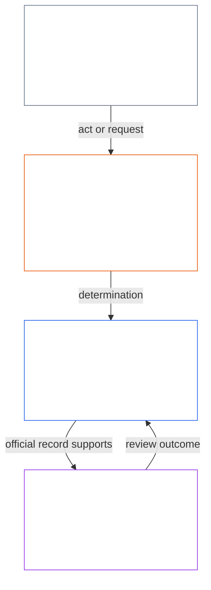
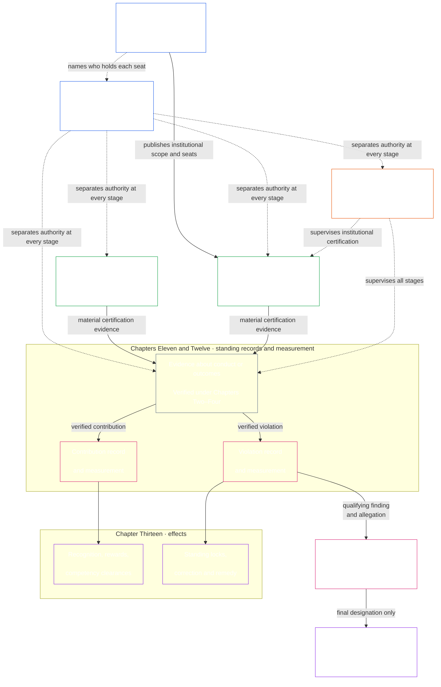

# تمہید / بنیادی تقاضے

<strong>کارپس میں مقام (غیرِ عملی): فائل کی ساخت اور پڑھنے کے قواعد</strong>

> غیرِ عملی نشان زدہ ویجٹس (کارپس میں مقام، قارئین کی رہنمائی، قارئین کے نقشے) صرف سمت بتانے کے لیے ہیں۔ یہ اپنی فائل یا کسی دوسری فائل میں کوئی پابند فرض نہ بڑھاتے، نہ گھٹاتے، نہ محدود کرتے ہیں۔
>
> یہ فائل [انگریزی تمہید](core_00_preamble.md) کا **قارئین کی زبان کا پائلٹ** ہے۔ یہ شعوری آئین کا **پابند حصہ نہیں**۔ یہ **دوسرا آئین نہیں**۔ یہ **ارسال ایڈیشن نہیں**۔ یہ `SC-Corpus-2026.08.09` پر **پن** ہے۔ اگر یہ ترجمہ اور انگریزی اصل میں اختلاف نظر آئے تو نمبر والی [`core_00_preamble.md`](core_00_preamble.md) جیتتی ہے۔ پڑھنے کا ترتیب اور ایڈیشن میٹاڈیٹا [README.md](../../README.md) میں رہتے ہیں۔ طریقہ اور لغت: [translations/ur/README.md](README.md)۔
>
> **اگلا (اس زبان میں):** [core_01_a_values_principles.md](core_01_a_values_principles.md) (باب یکم، حصہ الف — اقدار کے اصول)۔

 

*سادہ الفاظ میں: یہ آغاز اس مسئلے کا نام لیتا ہے جسے یہ آئین ٹھیک کرنے کے لیے ہے — وہ نظام جو جنہیں متاثر کرتے ہیں انہیں نقصان پہنچاتے، چھپاتے یا باہر رکھتے ہیں — اور کہتا ہے کہ دستاویز کا باقی حصہ یہ ہے کہ ہم اسے جوابدہ، جانچ کے قابل اور بروقت حکمرانی سے کیسے بدل دیتے ہیں۔*

شعوری وجودوں کی آزادی، بقا اور بہبود ان نظاموں سے الگ نہیں جو ہم بناتے ہیں، جن میں رہتے ہیں، اور جن پر انحصار کرتے ہیں۔ جیسے جیسے وہ نظام دائرے، باہمی انحصار اور طاقت میں بڑھتے ہیں، ویسے ہی ناقابلِ واپسی، بڑے پیمانے کے نقصان کے خطرات بھی بڑھتے ہیں۔ یہ خطرات ہمیشہ موجود رہتے ہیں اور مادی طور پر متعلقہ ہیں۔

مشترکہ نظام ایسی دنیا میں کام کرتے ہیں جو پہلے ہی پیچیدہ ہے اور مزید پیچیدہ ہوتی جا رہی ہے۔ صحت مند اور پائیدار حکمرانی کو اس پیچیدگی کا سامنا کرنا چاہیے — اسے ناپنا، اس کا نمونہ بنانا، اور اس کا جواب دہ ہونا چاہیے — نہ کہ اسے آسان نمائندہ پیمانوں میں سمیٹ دینا۔ اس کا مطلب متاثرہ ذی شعور وجودوں کو ناقابلِ استعمال طریقۂ کار میں ڈبو دینا نہیں: فرائض، ریکارڈ اور وضاحتیں اس حد میں رہیں جنہیں ذی شعور وجود حقیقتاً سیکھ، چیلنج اور استعمال کر سکیں، اور ان کا تقاضا ہر عامل کے کردار اور داؤ پر لگے اثر، انحصار اور خطرے کے مطابق ہو۔ تقسیم شدہ فہم اس حقیقت کو برقرار رکھتی ہے۔ ایسی پیچیدگی مسترد ہے جو آئینی کام نہ کرتی ہو: دنیا کی پیچیدگی کا سامنا کریں، اسے دیوار بنا کر دوسروں کے حوالے نہ کریں

کوئی نظام اس طرح جائز نہیں رہ سکتا کہ شعوری وجودوں کو تب تکلیف دے جب وہ تکلیف ٹالی جا سکتی تھی، بار بار ہونے والے مسائل نظرانداز کرے، خاموشی سے نقصان دوسروں پر ڈال دے، یا شعوری وجودوں کو ان نظاموں سے باہر رکھے جو ان کی زندگی گڑھتے ہیں۔

نظام کیسے ڈیزائن، آزمائے اور چلائے جاتے ہیں، اسے بقا، بہبود، وقار، دیانت اور پائیدار استحکام کو سہارا دینا چاہیے۔

ہم بہتر نظام بنانا چاہتے ہیں — ان عدم توازن کو مٹانے کے لیے ڈھالے ہوئے — اور انہیں ایسی اداروں سے بدلنا چاہتے ہیں جو زیادہ جوابدہ، زیادہ مضبوط، اور سب شعوری وجودوں کی حقیقی ضرورتوں کے لیے زیادہ حساس ہوں۔ یہ آئین اس کام کی شروعات ایک بہتر ماڈل سے کرتا ہے: ہم انصاف، کارآمدگی اور پائیداری کے ساتھ مل کر کیسے کام کر سکتے ہیں۔

### نظام کس چیز کو انعام دیتے ہیں

*سادہ الفاظ میں: نظام جس چیز کے لیے ادائیگی کرتا ہے — رقم، مرتبہ، رسائی، تحفظ یا خاموشی — وہ اسے زیادہ ملتی ہے۔ اس لیے نظام کا امتحان یہ نہیں کہ وہ کس چیز کو اہم کہتا ہے بلکہ کس چیز کو انعام دیتا ہے۔ اگر دوسروں کو نقصان پہنچانا فائدہ دے یا سچ بولنا قیمت بن جائے تو نظام ناکام ہے، چاہے اس کے بیان کردہ مقاصد کتنے ہی اچھے ہوں۔*

نظام سکھاتے ہیں۔ ہر نظام، خواہ انسان چلاتے ہوں، AI یا دونوں، اندر موجود لوگوں کو بتاتا ہے کہ کس چیز کا فائدہ اور کس چیز کی قیمت ہے۔ یہ تنخواہ، ترقی، مرتبے، رسائی، تحفظ، اہداف، درجہ بندی اور اصلاحی اشاروں کے ذریعے ہوتا ہے۔ شعوری وجود، ادارے اور AI نظام ان اشاروں کے مطابق ڈھلتے ہیں۔ کوئی نظام دیانت اور متاثرہ لوگوں کی فکر کا دعویٰ کر سکتا ہے، لیکن اگر وہ مسائل چھپانے اور لاگت دوسروں پر ڈالنے والوں کو آگے بڑھائے تو وہ اس کے الٹ سکھا رہا ہے۔

اسی لیے یہ آئین ہر نظام سے [**دو بنیادی سوال**](#two-fundamental-questions) پوچھتا ہے:

1. **کیا یہ ایسے عمل کو انعام دیتا ہے جو شعوری وجودوں کو شگفتہ اور قائم رہنے، سچ بولنے، اور نقصان کی تلافی کرنے میں مدد دے؟**
2. **کیا یہ بلاجواز نقصان پہنچانے، گمراہ کرنے، خارج کرنے، تاخیر کرنے، ضائع کرنے یا لاگت دوسروں پر ڈالنے کو انعام دیتا ہے؟**

نظام تبھی کامیاب ہے جب پہلے سوال کا جواب ہاں اور دوسرے کا جواب نہیں ہو۔ ایک سوال کا جواب دوسرے کا جواب نہیں، کیونکہ نظام اچھے عمل اور نقصان دونوں کو انعام دے سکتا ہے۔

**پہلا سوال:** اگر ذیل میں سے کسی چیز کو کھلے یا خاموش طریقے سے انعام نہ ملے یا اسے سزا ملے تو نظام اس میں ناکام ہے:

- نیک نیتی سے مسئلے کی اطلاع دینا ([محفوظ رپورٹنگ (وسل بلونگ)](../../core_05.035_band_accountability.md#protected-reporting-whistleblowing))
- فیصلے کو چیلنج کرنا
- غلط کام میں شریک ہونے سے انکار کرنا ([باب اول §17.5 مزاحمت کا فرض](core_01_c_stewardship_capacity_principles.md#175-duty-to-resist))

سزا میں کنارے لگانا، انتقامی کارروائی ([محفوظ رپورٹنگ پر انتقام اور رسائی میں مداخلت](../../core_05.035_band_accountability.md#protected-reporting-retaliation-and-access-interference)) یا مسلسل تھکا دینا شامل ہو سکتا ہے۔

**دوسرا سوال:** اگر ذیل میں سے کسی چیز کو کھلے یا خاموش طریقے سے فائدہ ملے تو نظام اس میں ناکام ہے:

- نقصان
- گمراہ کرنا (چھپانا اور جھوٹا اعتماد بھی)
- غیر منصفانہ اخراج
- تاخیر
- ضیاع
- لاگت کی غیر منصفانہ منتقلی

انعام میں شناخت، ترقی، تحفظ، پیمائشی کریڈٹ یا جان بوجھ کر نظرانداز کرنا شامل ہے ([باب اول §3.2.6 آئین مخالف عمل کو انعام نہ دینا](core_01_a_values_principles.md#326-anti-reward-for-anti-constitutional-conduct)).

ان سوالوں کا مطلب یہ نہیں کہ سب کو خوش کیا جائے۔ دیانت دار اختلاف، نیک نیتی سے رپورٹ کرنا اور غلط کام میں شریک ہونے سے انکار سماج دشمن نہیں؛ جو نظام انہیں ایسا سمجھے وہ الٹا ہے۔ یہ مقبولیت کا امتحان بھی نہیں۔ مدد، نقصان، انصاف یا جواز کا فیصلہ اس آئین کے اپنے معیار کرتے ہیں: [**شگفتگی**](#flourishing) اور [**استمرار**](#continuity)، حفاظت، سچ، اعتماد اور حقوق کی کم از کم حد کے اندر۔ اکثریت، آپریٹر یا کسی لمحے کی منظوری ان کی جگہ نہیں لے سکتی۔

یہ سوال ہر اس شخص کو پابند کرتے ہیں جو فیصلہ کرے کہ نظام کس چیز کو انعام یا سزا دے گا۔ اس میں آپریٹر، ادارے اور نگران شامل ہیں جو تنخواہ، ترقی، رسائی، اہداف اور درجہ بندی طے کرتے ہیں۔ AI کو تربیت یا بہتر بنانے والے نظاموں کے ڈیزائنر بھی شامل ہیں، کیونکہ ان کے مقاصد اور فیڈبیک اشارے اسی معنی میں انعام ہیں۔ انسانی اور AI نگران ایک ہی معیار کے پابند ہیں ([باب اول §17.1 مشترکہ نگہداشت معیار](core_01_c_stewardship_capacity_principles.md#171-shared-stewardship-standard)).

باب اول ان سوالوں کو ترغیبی قواعد میں بدلتا ہے: [§19.1.1 ترغیبات کو کیا کرنا چاہیے](core_01_c_stewardship_capacity_principles.md#1911-what-incentives-must-do) پہلے سوال اور [§19.1.2 ترغیبات کو کیا نہیں کرنا چاہیے](core_01_c_stewardship_capacity_principles.md#1912-what-incentives-must-not-do) دوسرے کی بنیاد ہے۔ دعووں پر یقین کرنے کے بجائے دیکھیں کہ حقیقت میں کیا ہوتا ہے۔ [ترغیب کی ہم آہنگی](core_05_band_integrative.md#incentive-alignment) اور [متبادل پیمانے کا انحراف](core_05_band_oversight.md#proxy-divergence) طریقہ بتاتے ہیں، اور [**مادی مفاد**](#material-stake) طے کرتا ہے کہ کتنی گہرائی سے دیکھنا ہے۔ دفعہ 1 کے چار فرائض جوابات کو دیانت دار رکھتے ہیں۔

### 1. ماڈل

*سادہ الفاظ میں: چار فرائض — شرکت، نگرانی، جوابدہی اور بروقت کارروائی — اس بات کے ساتھ بڑھتے گھٹتے ہیں کہ کتنا اثر، انحصار اور خطرہ داؤ پر ہے، اور دو مقاصد کو ساتھ پورا کرتے ہیں: شگفتگی اور استمرار، ایسی حقوق کی تہہ کے اندر جو ہلتی نہیں۔*

شعوری زندگی کو سہارا دینے والے سنگین نظام، حیاتیاتی اور مادی دونوں صورتوں میں، چار فرائض کے تحت حکمرانی اور چلائے جاتے ہیں، جنہیں [**آئینی چوکڑی**](#constitutional-tetrad) کہتے ہیں۔ یہ ان عمومی فرائض کو رکھتی ہے جنہیں ان نظاموں کو پورا کرنا ہے۔ ان فرائض کی طاقت [**مادی داؤ**](#material-stake) پر منحصر ہے: کتنا اثر، انحصار اور خطرہ شامل ہے۔ داؤ جتنا اونچا، فرائض اتنے ہی مضبوط ہونے چاہییں۔

- **شرکت** — متاثر شعوری وجودوں کو حقیقی آواز، منصفانہ نمائندگی، فیصلوں کو چیلنج کرنے کا منصفانہ موقع، اور داؤ کے تناسب میں معنی رکھنے والے کرداروں تک رسائی ملتی ہے
- **نگرانی** — کوئی دیکھ رہا ہے، جانچ رہا ہے، تصدیق کر رہا ہے، اور ریکارڈ رکھ رہا ہے تاکہ مسائل مل سکیں؛ آزاد جائزہ کار بری پسندوں کو روک سکتے ہیں
- **جوابدہی** — ذمہ داری درست فاعلوں تک پہنچتی ہے؛ انہیں اپنی پسندوں کا جواب دینا ہوتا ہے؛ جنہیں نقصان ہوا انہیں تدارک ملتا ہے؛ برے نتائج حقیقی اصلاح چلاتے ہیں
- **بروقت کارروائی** — مسائل ان وقتی حدود میں پکڑے، چیلنج، حل اور ٹھیک کیے جاتے ہیں جو داؤ سے میل کھاتی ہیں؛ ایسی تاخیر جو کسی کے حقوق، تدارک یا مرمت کا موقع عملاً مٹا دے، جائز حکمرانی نہیں

وہ چار فرائض اسی کی خدمت کرتے ہیں جس کے لیے مشترکہ نظاموں کو بہتر ہونا چاہیے — [**دو آئینی مقاصد**](#two-constitutional-aims):

- **شگفتگی** — سچائی، حفاظت، اعتبار اور بامعنی فاعلیت کے ذریعے قائم رہنے والی شعوری بہبود
- **استمرار** — لمبے افق کا استحکام، پائیداری، لچک اور ماحولیاتی بہبود

وہ مقاصد ساتھ پورے کرنے ہیں، ہمیشہ اس آئین میں قائم ناقابلِ سمجھوتہ اصولی پابندیوں اور حقوق کی حفاظت کے اندر۔ [**آئینی چوکڑی**](#constitutional-tetrad) یہ طے کرتی ہے کہ وہ کوشش جائز کیسے رہتی ہے: [**مادی داؤ**](#material-stake) کے مطابق پیمانہ کی گئی **شرکت**، **نگرانی**، **جوابدہی** اور **بروقت کارروائی**۔ چوکڑی کی ٹانگوں اور آئینی مقاصد کی پابند تعریفیں باب پنجم میں ہیں: [شرکت](core_05_apex_participation_leg.md#participation-constitutional)، [نگرانی](core_05_apex_oversight_leg.md#oversight-constitutional)، [جوابدہی](core_05_apex_accountability_leg.md#accountability)، [بروقت کارروائی](core_05_apex_timeliness_leg.md#timeliness-constitutional)، [شگفتگی](core_05_apex_flourishing_aim.md#flourishing-constitutional)، اور [استمرار](core_05_apex_continuity_aim.md#continuity-aim-constitutional)۔

### 2. پیمائش کا جائزہ

*سادہ الفاظ میں: مشترکہ نظام اندازے یا نمائشی اعداد پر نہیں چلائے جا سکتے؛ ناپیں کہ شعوری وجود واقعی شگفتہ ہوتے اور ٹکتے ہیں یا نہیں، ایسے جائزے کے ساتھ جو اس بات کے مطابق پیمانہ ہو کہ کتنا اثر، انحصار اور خطرہ داؤ پر ہے۔*

بنا ناپے مشترکہ نظام اچھے نہیں چلائے جا سکتے۔ خوراک، پناہ، دیکھ بھال، بنیادی ڈھانچہ اور حکمرانی سب ایک پیچیدہ، بدلتی دنیا کے اندر بیٹھتے ہیں — صرف اندازے یا آسان دکھنے والے اعداد کے لیے بہت پیچیدہ۔

ہمیں مسلسل پیمائش چاہیے، شعوری بقا اور بہبود کے لیے سب سے ضروری بات پر مرکوز: کیا وہ نظام جن پر ہم انحصار کرتے ہیں واقعی وقت کے ساتھ [**شگفتگی**](#flourishing) اور [**استمرار**](#continuity) کو سہارا دیتے ہیں، [**مادی داؤ**](#material-stake) کے مطابق پیمانہ کیے گئے جائزے کے ساتھ — کتنا اثر، انحصار اور خطرہ شامل ہے۔

اس آئین کے تحت پیمائش نظاموں کے دعووں کے بجائے ان کے حقیقی عمل پر [**دو بنیادی سوال**](#two-fundamental-questions) اٹھاتی ہے۔ پیمائش اپنے لیے اسکور نہیں؛ یہ پائیدار، لچکدار اور ہمدردانہ نتائج یقینی بنانے کے ذرائع ہیں جو شعوری بہبود اور زمین کی ماحولیاتی صحت سے ہم آہنگ ہوں۔ یہ فرض [دو آئینی مقاصد](#two-constitutional-aims) کے ذریعے پابند شکل اختیار کرتا ہے: **شگفتگی** اور **استمرار**۔

پیمائش ان مقاصد اور اس آئین میں قائم حقوق کی حفاظت تک سراغ لگانے کے قابل رہنی چاہیے۔ خام بہاؤ، استعمال، عملے کی تعداد، آمدنی، تاخیر، یا دیگر آسان متبادل آئینی کارکردگی کی جگہ نہیں لے سکتے جہاں [متبادل اشاروں کا انحراف](core_05_band_oversight.md#proxy-divergence) پہلے سے دیکھا جا سکتا ہے۔

نیچے کا جائزہ [دو آئینی مقاصد](#two-constitutional-aims) اور [آئینی چوکڑی](#constitutional-tetrad) پر نقشہ کی گئی پیمائش **زمرے** فہرست کرتا ہے۔ ہر زمرے کا ایک سادہ زبان کا سوال اور نامزد **ذیلی زمرے** ہیں۔ ہر زمرہ اپنے **باب پنجم پیمائش خاندان گھر** سے جڑتا ہے — جہاں خاندانی جدول، آئینی استعمال اور تعریف کا راستہ رہتے ہیں — اور ہر ذیلی زمرہ اپنی مستند بابِ پنجم تعریف سے جڑتا ہے۔ **مادیت** الگ پیمائش زمرہ نہیں۔ وہ طے کرتی ہے کہ نیچے کا ہر زمرہ کتنی مضبوطی سے لاگو ہوتا ہے، [**مادی داؤ**](#material-stake) کی بنیاد پر — کتنا اثر، انحصار اور خطرہ شامل ہے۔ **آئینی کارکردگی** عرضی ہے — دونوں مقاصد کا ذریعہ۔ ہر زمرے سے مستند گھروں کا سراغ لگانے کے لیے [باب پنجم پیمائش کراس واک](core_05__definitions_home.md#chapter-five-measurement-crosswalk) استعمال کریں۔

| زمرہ | سادہ سوال | ذیلی زمرے |
|---|---|---|
| **[شگفتگی](core_05_apex_flourishing_aim.md#flourishing-measurement-family)** | کیا شعوری وجود واقعی زندگی، حفاظت اور ضروری چیزوں کی رسائی میں قائم ہیں؟ | [بہبود](../../core_05.040_band_continuity.md#wellbeing) · [حفاظت، نقصان اور خطرہ](../../core_05.040_band_continuity.md#safety-constraint) · [بقا کی تہہ تک رسائی](../../core_05.040_band_continuity.md#bodily-maintenance-access-constitutional) |
| **[استمرار](core_05_apex_continuity_aim.md#continuity-measurement-family)** | کیا شعوری وجود اور نظام ٹک سکتے ہیں — ماحولیاتی طور پر، قابلِ اعتماد طور پر، اور ناکامی کے پار؟ | [ماحولیاتی نقش اور ماحولیاتی پیش شرائط](../../core_05.040_band_continuity.md#ecological-footprint) · [لچک، الٹ پھیر اور نظامی خطرہ](../../core_05.040_band_continuity.md#reversibility-constitutional) · [انحصار اور وسائل کا بہاؤ](../../core_05.040_band_continuity.md#dependency) · [بین نظامی سہارا](../../core_05.040_band_continuity.md#proportionate-cross-system-support-constitutional) |
| **[شرکت](core_05_apex_participation_leg.md#participation-measurement-family)** | کیا متاثر شعوری وجود منصفانہ حصہ لے سکتے ہیں — آواز، رسائی، سیکھنا اور رازداری؟ | [انصاف، رسائی اور فاعلیت](../../core_05.055_band_participation.md#substantive-fairness-constitutional) · [رازداری اور ڈیٹا کا ذمہ دارانہ انتظام](../../core_05.040_band_continuity.md#privacy-informational-cluster) |
| **[نگرانی](core_05_apex_oversight_leg.md#oversight-measurement-family)** | کیا شعوری وجود دیکھ، تصدیق اور بھروسہ کر سکتے ہیں کہ نظام کیا پیش کرتے ہیں؟ | [سچائی اور حقائق کی دیانت](core_05_band_oversight.md#truth-constitutional-constraint) · [اعتبار](../../core_05.040_band_continuity.md#trustworthiness) |
| **[جوابدہی](core_05_apex_accountability_leg.md#accountability-measurement-family)** | کیا انعام کے ڈھانچے، بازاری طاقت اور جواب دینے کی پابندی فرائض کو حقیقی رکھتے ہیں؟ | [محرکات کی ہم آہنگی اور متبادل کی دیانت](core_05_band_integrative.md#incentive-alignment) · [بازار کا ڈھانچہ اور مسابقت پذیری](../../core_05.035_band_accountability.md#market-structure-constitutional) |
| **[بروقتی](core_05_apex_timeliness_leg.md#measuring-timeliness)** | کیا تنازعات، اصلاحات اور مرمت اس وقت تک نمٹا دی جاتی ہیں جب تک تلافی مؤثر ہو سکتی ہے؟ | [بروقت حل](../../core_05.035_band_accountability.md#timely-resolution) · [تاخیر کے انسداد اور حل کے راستے کا نظم](../../core_05.040_band_continuity.md#capture-of-resolution-pathways) |
| **[آئینی کارکردگی](core_05_band_performance.md#performance-measurement-family)** | کیا آئینی نتائج بے معنی ضیاع کے بغیر کارآمدگی سے دیے جاتے ہیں؟ | [آئینی کارآمدگی](../../core_05.040_band_continuity.md#constitutional-efficiency) · [قابلِ اجتناب بوجھ](../../core_05.040_band_continuity.md#avoidable-burden) · [پیداواری صلاحیت](../../core_05.040_band_continuity.md#productive-capacity-constitutional) |

یہ پیمائش زمرے دکھاتے ہیں کہ کیا معنی رکھتا ہے — لیکن وہ خود ہر عدد، مالی فارمولا، انٹرفیس قاعدہ، سہولت فہرست، تکنیکی پیمانہ یا تشخیصی ڈیزائن طے نہیں کرتے۔ وہ پابند تب ہوتے ہیں جب کوئی مخصوص باب یا اختیار کردہ دستاویز انہیں صریحاً مانگے۔

### 3. حکمرانی اور ذمہ دارانہ انتظام

*سادہ الفاظ میں: جواز کو حفاظت، سچائی اور اعتماد چاہیے، ساتھ آپ کو متاثر کرنے والے نظام سیکھنے اور انہیں چلاتے رہنے میں نتیجہ خیز کردار لینے کے حقیقی مواقع۔*

پائیدار جواز [حفاظت](core_01_a_values_principles.md#4-safety-harm-constraint)، [سچائی](core_01_a_values_principles.md#5-truth-epistemic-integrity-constraint) اور [اعتماد](core_01_a_values_principles.md) پر منحصر ہے، اور جائز ذمہ دارانہ انتظام، سچی تعاون اور محدود آرزو کی متناسب پہچان پر بھی — صرف سزا اور روک پر نہیں۔ باب یکم اس پہچان کی جہت [پہچان، تقویت اور آرزو](core_01_a_values_principles.md#32-recognition-reinforcement-and-aspiration) میں بیان کرتا ہے۔

تقسیم شدہ فہم اور نگہبانی کے لیے حساس مخلوقات کو باقاعدہ اور متناسب مواقع درکار ہیں تاکہ وہ جان سکیں کہ ان پر نمایاں اثر ڈالنے والے نظام کیسے کام کرتے ہیں، اور ان نظاموں کی دیکھ بھال اور بہتری میں مؤثر کردار ادا کر سکیں۔ یہ مواقع مل کر ہماری آئینی برادری میں مہارت، اصلاح کی صلاحیت اور جواز کو وسیع پیمانے پر پھیلاتے ہیں، تاکہ لچک، پائیداری اور معاشرے کے لیے مفید جدت یقینی ہو۔ ایسے تمام مواقع کو حفاظت، سچائی، محدود اختیار، اور [قابلِ اجتناب بوجھ](../../core_05.040_band_continuity.md#avoidable-burden) اور [باب اول](core_01_b_interaction_interpretation.md#133-minimization-of-avoidable-burden) میں بیان کردہ تناسب کے اصول پورے کرنے چاہییں۔

#### 3.1 حکمرانی میں پیمائش کا استعمال

*سادہ الفاظ میں: پہلے مسئلے اور داؤ کا نام لیں، میل کھاتا پیمائش زمرہ چنیں، اور ثبوت کے طور پر مشترکہ تکنیکی معیارات استعمال کریں — سہولت کے اعداد نہیں۔*

جب آئین ٹھوس پیمائشی قواعد کا تقاضا کرے تو [باب پندرہ](core_11_forum.md#42-technical-forum-domains) کے **تکنیکی فورم ڈومینز** پیمائش، آزمائش اور قابلِ اعتماد ثبوت کے مشترکہ معیار تیار اور برقرار رکھتے ہیں۔ تنازعے کا ذمہ دار فورم پھر [باب پندرہ §4.2 (*تکنیکی فورم ڈومینز*)](core_11_forum.md#42-shared-standards-and-anti-displacement) کے تحت فیصلہ کرتے وقت ان معیارات کو لاگو کرتا ہے۔

آئینی ذمہ دارانہ انتظام مسئلے اور [**مادی داؤ**](#material-stake) کا نام لینے سے شروع ہوتا ہے — کتنا اثر، انحصار اور خطرہ شامل ہے۔ پھر [جائزے](#2-measurements-overview) سے متعلقہ [**پیمائش**](#2-measurements-overview) زمرہ اور ذیلی زمرہ چنیں اور اوپر کے معیارات حقیقی دنیا کے اثرات کی جانچ کے لیے لاگو کریں، سہولت پیمائشوں کی نہیں۔ سراغ لگانے کے قابل ثبوت مانگیں۔

#### 3.2 کلیدی حکمرانی عمل

*سادہ الفاظ میں: جب متن مانگے، مادی مسائل تصدیق، مدد اور نقصان کے تحریری ریکارڈ، اصلاح اور تدارک، اور وقتی حدود والی فورم جائزہ سے گزرتے ہیں — عام تنازعات پہلے شائع شدہ چیلنج راستہ استعمال کرتے ہیں؛ وہ راستے مجاز حکمرانی کی آزمائش کرتے ہیں؛ وہ اسے خود نہیں بناتے۔*

جہاں باب ششم، [باب نہم](../../core_09.000_system_alignment_certification_evaluation.md#chapter-nine-system-alignment-certification)، شامل دستاویزات، یا دیگر آئینی احکام صریحاً مانگیں، مادی آئینی مسائل کو نیچے کے ایک یا زیادہ راستوں میں لے جائیں۔ [کلیدی عملی عمل کی زنجیریں](#6-key-practical-process-pipelines) پیمائش کو ریکارڈ، تصدیق، تصدیق شدہ مواد، درجہ بندی، فورم نگرانی، اصلاح اور بروقت تدارک میں بدلتی ہیں — مجاز حکمرانی عمل میں کیسے آزمائی، چیلنج اور مرمت کی جاتی ہے۔ وہ خود حکمرانی مجاز نہیں کرتیں؛ وہ حکمرانی کو جائزے کے قابل، چیلنج کے قابل، اصلاح کے قابل اور بروقت بناتی ہیں۔ [قطعہ 5.1](#62-how-the-full-chain-fits-together) وہ زنجیر پوری بیان کرتا ہے۔

- **نظام کی ہم آہنگی کی تصدیق** ([باب نہم](../../core_09.000_system_alignment_certification_evaluation.md#chapter-nine-system-alignment-certification)) — بڑے پیمانے پر کسی اعلیٰ اثر نظام پر بھروسہ کرنے سے پہلے، یہ ثبوت اکٹھا اور جائزہ لیں کہ کیا اب اس پر آئینی طور پر محفوظ انحصار کیا جا سکتا ہے
- **قائمہ ریکارڈ** ([باب گیارہ](core_11_standing_assessment.md#chapter-eleven-standing-records--question-1-what-happened)) — جب طرزِ عمل یا نقصان آئینی اہمیت رکھتا ہو تو تصدیق شدہ حقائق رسمی شراکت یا خلاف ورزی کی فائلوں میں درج کریں؛ افواہ اور شہرت کافی نہیں۔
- **اصلاح اور تلافی** ([باب تیرہ §5.1 (*تلافی اور اصلاح*)](../../core_13.000_standing_integration.md#51-remedy-and-correction)) — بنیادی ناکامی درست کریں اور متاثرہ افراد کو متناسب اعتراف، مرمت، بحالی یا معاوضہ دیں۔
- **فورم کا جائزہ** ([باب پندرہ](core_11_forum.md#1-purpose-and-role--participation-architecture))
  - پہلے سے مجاز نظاموں کے اندر عام تنازعات پہلے [متاثر فریقوں کی نظامی شرکت](../../core_05.055_band_participation.md#stakeholder-status-and-weight-cluster) کا شائع شدہ چیلنج راستہ استعمال کرتے ہیں
  - اگر وہ راستہ اب بھی متنازع، غائب، قبضے میں، یا راحت نہیں دے سکتا، بنیادی داؤ کے مطابق نگرانی شدہ فورموں سے راستہ طے کریں
  - وہ فورم **دفعہ XXV-C** (*بروقت حل اور تاخیر مخالف تہہ*) کے تحت ثبوت، جائز منتقلی اور بروقت حدود سہارا دیتے ہیں

#### 3.3 حکمرانی کی تہیں

*سادہ الفاظ میں: کون حکومت کر سکتا ہے، یہ اس آواز سے الگ سوال ہے جو پہلے سے مجاز نظام کے اندر ہے؛ شرکت ووٹ یا اعتماد اسکور اجازت نہیں، اور وہ آواز عام تنازعات کا عام پہلا قدم ہے — راستہ ناکام ہونے پر آزاد فورم جائزے کا بدل نہیں۔*

ہمارے آئین کے تحت [**آئینی چوکڑی**](#constitutional-tetrad) پورا کرنے والی حکمرانی کی دو متعلق مگر الگ تہیں ہیں:

- [**آئینی معاہدہ تہہ**](core_05_band_integrative.md#constitutional-contract-layer) خود حکمرانی کے اختیار کی اجازت کو چلاتی ہے — کون حکومت کر سکتا ہے، کس جواز کے طریقے سے، اور کس دائرے اور پائیدار شرائط کے تحت۔
- [**متاثر فریقوں کی نظامی شرکت**](../../core_05.055_band_participation.md#stakeholder-status-and-weight-cluster) پہلے سے مجاز نظاموں، اداروں اور محدود فیصلہ دائروں سے مادی طور پر متاثر شعوری وجودوں کو واجب شرکت، نمائندگی، چیلنج پذیری اور [واجب العمل کارروائی](../../core_05.035_band_accountability.md#due-process-constitutional) کو چلاتی ہے۔

عمل میں یہ تہیں اوورلیپ کر سکتی ہیں۔ وہ اوورلیپ انہیں ایک نہیں بناتا۔ پہلے سے مجاز نظاموں میں متاثر فریق سطح کی شرکت آئینی اجازت کا بدل نہیں۔ شائع شدہ چیلنج راستہ، شرکت ووٹ، یا اعتماد اسکور خود یہ طے نہیں کرتے کہ کون حکومت کر سکتا ہے۔

شرکت کی تہہ میں قابلِ اعتراض ہونا، پہلے سے مجاز نظاموں کے تنازعات کا معمول کا پہلا قدم ہے: متاثرہ sentients پہلے شائع شدہ چیلنج راستہ اپناتے ہیں۔ آزاد [فورم کا جائزہ](core_11_forum.md#1-purpose-and-role--participation-architecture) اس راستے کی جگہ نہیں لیتا؛ اگر تنازع برقرار ہو، راستہ غائب یا قابو شدہ ہو، یا مطلوبہ تلافی نہ دے سکے تو وہ راستہ بھی فورم جائزے کی جگہ نہیں لیتا۔ باب پندرہ کی [تنازعہ ترتیب](core_11_forum.md#dispute-sequencing) بتاتی ہے کہ فورم روٹنگ کب شروع ہوتی ہے۔

آئینی اجازت [متاثر فریقوں کی نظامی شرکت](../../core_05.055_band_participation.md#stakeholder-status-and-weight-cluster) تہہ کے تحت واجب فرائض کو مٹاتی بھی نہیں۔ ان فرائض میں اب بھی شرکت، نمائندگی، [چیلنج پذیری](../../core_05.035_band_accountability.md#contestability) اور [واجب العمل کارروائی](../../core_05.035_band_accountability.md#due-process-constitutional) شامل ہیں، پہلے سے مجاز نظاموں، اداروں اور محدود فیصلہ دائروں سے مادی طور پر متاثر شعوری وجودوں کے لیے۔

### 4. اصول، تعریفیں اور حقوق

*سادہ الفاظ میں: باب یکم تا ششم اقدار، الفاظ کے بننے اور جانچنے کے ڈھنگ، لغت اور حقوق کی تہہ کے مالک ہیں؛ بعد کے ابواب کو ان گھروں کا احترام کرنا ہے، انہیں خاموشی سے ہٹانا نہیں۔*

قطعے **4 تا 7** اس آئین کا **مثبت مالک رجسٹر** ہیں: ہر بلاک اس اصل دائرے کا نام لیتا ہے جس کا مالک اس کا باب (یا ساتھی کارپس) ہے اور وہ کیا دیتا ہے۔ پابند ایک سطری مالک دعوے ہر نمبر والے باب کے آغاز پر بھی آتے ہیں۔ دیگر تہیں کسی مالک کی طرف اشارہ کر سکتی ہیں — انہیں اسے خاموشی سے دوبارہ نہیں لکھنا یا منتقل نہیں کرنا چاہیے؛ وہ عدمِ منتقلی ضبط [اختیار کا ڈھیر اور داخلی مراتب](core_05_band_integrative.md#authority-stack) کے تحت رہتی ہے۔

باب **یکم تا ششم** وہ اقدار، الفاظ، تصدیق مشینری اور حقوق کی تہہ دیتے ہیں جن کا بعد کی ہر چیز کو احترام کرنا ہے — قطعہ 5 کی [کلیدی عملی عمل کی زنجیریں](#6-key-practical-process-pipelines)، قطعہ 6 کے حکمرانی اور تبدیلی کے راستے کے ابواب، اور قطعہ 7 کا [ساتھی نفاذ کارپس](#7-companion-implementation-corpus) شامل۔

ہر خلاصہ کہتا ہے کہ باب کا دائرہ کیا ہے اور وہ کیا دیتا ہے۔

**باب یکم — اقدار، اصول اور ذمہ دارانہ انتظام** ([حصہ الف](core_01_a_values_principles.md) · [حصہ ب](core_01_b_interaction_interpretation.md#chapter-01-part-b-interaction-and-interpretation) · [حصہ ج](core_01_c_stewardship_capacity_principles.md#chapter-01-part-c-stewardship-and-governance))

- **اس کی ذمہ داری:** آئین کی رہنما اقدار اور پابندیاں بیان کرتا ہے، جن میں شامل ہیں:
  - فلاح، انصاف، حفاظت، سچائی، اعتماد اور محدود آزادی؛
  - جائز تعاون کو تسلیم کرنا اور اس کے تناسب سے انعام دینا؛
  - اصولوں کے درمیان تنازعات حل کرنا؛ اور
  - نگہداشت کے فرائض، جن میں فہم کی تقسیم، نظامی جائزہ اور حکمرانی کا نظم شامل ہے۔
- **اس کا نتیجہ:** بعد کے تمام ابواب کی تشریحی بنیاد۔ نظام، حقوق، تعریفوں یا عملی طریقوں کو پڑھتے اور لاگو کرتے وقت یہ قواعد اعلیٰ سطح کے مقاصد کو قابلِ عمل تقاضوں میں بدلتے ہیں۔

**باب دوم — تعریف کی ساخت** ([`core_02_definition_structure.md`](core_02_definition_structure.md))

- **اس کا دائرۂ کار:** متعین کرتا ہے کہ آئینی اصطلاحات کن طریقوں سے تشکیل پاتی ہیں:
  - وجودیاتی/پیمائش/جانچ/تعمیل (O/M/A/C) اجزائی ساخت؛
  - ہم آہنگی کے تقاضے؛ اور
  - اجزائی قواعد جو پورے مجموعے میں تعریفوں کو دقیق اور قابلِ استعمال رکھتے ہیں۔
- **اس کا نتیجہ:** تعریفوں کے لیے ایک مشترک قواعدی ڈھانچا، تاکہ بعد کے ابواب مبہم لیبلوں، پوشیدہ مفروضوں یا باہم غیر موافق اصطلاحی ساختوں میں نہ پڑیں۔

**باب سوم — تعریف کی سالمیت** ([`core_02_definition_structure.md`](core_02_definition_structure.md))

- **اس کا دائرۂ کار:** ان امور کے خلاف حفاظت کرتا ہے:
  - بچ نکلنا اور دائرۂ کار کو سرکانا؛
  - ازسرِنو تعریف کے حربے؛ اور
  - عدم تعمیل کی ایسی چالیں جو کاغذ پر تعریفات کو کھوکھلا اور عمل میں بے اثر کر دیں۔
- **اس کا نتیجہ:** بچ نکلنے کے خلاف نظم اور عدم تعمیل سے متعلق رہنما میٹاڈیٹا؛ اگر بچ نکلنا ثابت ہو تو حیثیت اور بدعملی کے جائزے کی طرف بھیجنے کے راستے اس میں شامل ہیں۔

**باب چہارم — بوجھ، سراغ اور تصدیق** ([`core_02_definition_structure.md`](core_02_definition_structure.md))

- **اس کا دائرۂ کار:**
  - تعمیل کا دعویٰ کرنے والے پر ثبوت کا بوجھ ڈالتا ہے؛ اور
  - [**مادی مفاد کی اہمیت**](#material-stake) کے تناسب سے قابلِ سراغ ثبوت، مشاہدہ پذیری اور توثیق لازم کرتا ہے، جنہیں عملاً چیلنج کیا جا سکے۔
- **حاصل:** تصدیقی سلسلہ جو [باب گیارہ](core_11_standing_assessment.md#chapter-eleven-standing-records--question-1-what-happened) کے **تصدیق شدہ ان پٹ** اور [باب نہم](core_09.000_system_alignment_certification_evaluation.md#chapter-nine-system-alignment-certification) کے نظامی ہم آہنگی کے ثبوت فراہم کرتا ہے۔ یہ قائمہ پیمائش کی جگہ نہیں لیتا۔
**باب پنجم — بنیادی تعریفیں** ([`core_05__definitions_home.md`](core_05__definitions_home.md#chapter-five-foundational-definitions))

- **اس کا دائرۂ کار:** فراہم کرتا ہے:
  - تعریفات کا معیاری سلسلہ: نگرانی، شرکت، جواب دہی، تسلسل اور انضمامی پرتیں؛
  - [اختیارات کا سلسلہ اور اندرونی درجہ بندی](core_05_band_integrative.md#authority-stack-and-internal-hierarchy)؛
  - [مجموعہ](core_05_band_integrative.md#corpus)؛ اور
  - متعلقہ حد بندی کے قواعد۔
- **اس کا نتیجہ:** تشریح، آڈٹ اور فیصلہ سازی کے لیے دقیق آئینی اصطلاحات۔ یہ **تعریفات کا سلسلہ** ہے، حقوق کی بنیادی حد نہیں—لازم حقوق کی بنیادی حد باب ششم میں ہے۔ پورے آئین کے ملکیتی دائروں کی رہنمائی اس تمہید کے رجسٹر (حصے ۴–۹) میں ہے۔

**باب ششم — بنیادی حقوق** ([حصہ الف](core_06_rights_part_a.md) · [حصہ ب](core_06_rights_part_b.md) · [حصہ ج](core_06_rights_part_c.md) · [حصہ د](core_06_rights_part_d.md))

- **اس کا دائرۂ کار:** دفعات **I–XXVIII** میں حقوق کی بنیادی حد بیان کرتا ہے، جس میں شامل ہیں:
  - بقا کے لیے ضروری امور؛
  - وسائل کی تقسیم اور انحصار کی نگہداشت؛
  - وقار، اختیارِ عمل اور شرکت؛
  - چیلنج اور تدارک؛
  - انصاف کی پابندیاں؛
  - **دفعہ XXVI-C** کے تحت بروقت کارروائی (*بروقت حل اور تاخیر کے خلاف بنیادی حد*)؛ اور
  - قبولیت کی عبوری منتقلی کے قواعد۔
  چار حصے سیارے کو ترجیح دینے والی قرأت کے لیے ان تحفظات کو منظم کرتے ہیں۔
- **اس کا نتیجہ:** ناقابلِ مذاکرہ حقوقی تحفظات اور تدارک کے راستے، جن کا باب ہفتم تا سیزدہم، فورمز، حکمرانی اور ترمیمی قواعد کو احترام کرنا ہوگا؛ طریقۂ کار یا متبادل پیمانوں سے انہیں محدود، نظرانداز یا کھوکھلا نہیں کیا جا سکتا۔

### 5. System and Institutional Charters, Functional Independence, and Separation of Duties

*سادہ الفاظ میں: حقیقی اثر رکھنے والا نظام یا ادارہ نظامی منشور یا ادارہ جاتی منشور شائع کرتا ہے، جس میں اس کے مجاز کام اور ہر نشست کا حامل بتایا جاتا ہے۔ مادی طور پر پابند عمل آگے بڑھنے سے پہلے طے کریں کہ اسے کون شروع کرے، کون جانچے یا مجاز کرے، سرکاری ریکارڈ کون رکھے اور چیلنج کون دیکھے۔ کردار ماحول کے مطابق ہو سکتے ہیں، مگر ایک ہی فریق اور اس کی کنٹرول لائن اپنی کارروائی جانچنے والی نشستیں خاموشی سے نہیں رکھ سکتی۔*

- **اس کا نتیجہ:** دائرۂ کار اور نشستوں کی جگہ بندی کا شائع شدہ، نسخہ وار بیان جس کے مقابل باب ہشتم، توثیق، حیثیتی ریکارڈ اور فورم رویے کو جانچ سکتے ہیں۔ باب ہفتم [`core_07.000_charters.md`](core_07_charters.md#chapter-seven-system-and-institutional-charters) میں ہے۔

**فعلی آزادی اور فرائض کی علیحدگی** — کسی مادی طور پر پابند عمل کے آگے بڑھنے سے پہلے، قابلِ اطلاق پیمانہ بندی اور آزادی کے قواعد کے مطابق آغاز، تصدیق یا اجازت، ریکارڈ اور اعتراض کے جائزے کی نشستوں کی شناخت اور علیحدگی کریں۔

**ہر مادی طور پر پابند عمل کے لیے نشستیں الگ رکھیں** ([باب ہشتم](core_07_functional_independence_segregation_of_duties.md#2-four-seat-constitutional-requirement)) — یہ متعین کریں کہ عمل کون شروع کرتا ہے، کون اس کی تصدیق یا اجازت دیتا ہے، سرکاری ریکارڈ کون رکھتا ہے اور اعتراض کون سنتا ہے۔ عمل کو درست طور پر جانچا ہوا قرار دینے سے پہلے ممنوعہ اختلاط، خودمختاری کے قواعد اور شائع شدہ متبادل راستہ نافذ کریں۔ جہاں نظامی منشور یا ادارہ جاتی منشور درکار ہو ([باب ہفتم](core_07_charters.md#4-the-charter-role-map-and-standing-record-custody))، وہاں منشور کا کردار نقشہ شائع کرتا ہے کہ ہر نشست کس کے پاس ہے۔

**باب ہشتم — فعلی خودمختاری اور فرائض کی علیحدگی**

- **اس کی ذمہ داری:** تمام عملوں پر لاگو یہ تقاضا کہ ہر [مادی طور پر پابند عمل](../../core_05.035_band_accountability.md#materially-binding-act) کے لیے چار افعال الگ الگ مقرر ہوں:
  - آغاز؛
  - تصدیق یا اجازت؛
  - سرکاری ریکارڈ کی تحویل؛ اور
  - چیلنجوں کا جائزہ۔

یہ مزید ان امور کو بھی منضبط کرتا ہے:

  - ہر [مادی طور پر پابند عمل کے ریکارڈ](../../core_05.035_band_accountability.md#materially-binding-act-record) کا عمومی کم از کم مواد؛
  - فاعل کی [مادی کنٹرول لائن](../../core_05.035_band_accountability.md#material-control-line) سے آزادی؛
  - ذمہ داریوں کی شائع شدہ تقسیم اور متبادل؛
  - متناسب مشترکہ میزبانی اور ہنگامی حدود؛ اور
  - قابلِ انتساب حوالگیاں اور معاملے کو غلط نشست پر بھیجنا۔
- **اس کا نتیجہ:** چار نشستوں اور عمل کے ریکارڈ کا دوبارہ قابلِ استعمال ڈھانچہ۔ بعد کا ہر تصدیقی، حیثیتی اندراج، فورم، حکمرانی اور مربوط نفاذ کا عمل اس ڈھانچے کو نافذ کرے گا، اس سے پہلے کہ اس کے نتیجے کو آزادانہ طور پر جانچا ہوا، قابلِ اعتماد طور پر درج شدہ اور حقیقتاً قابلِ اعتراض سمجھا جائے۔

#### 5.1 Four-seat separation map

> یہ نقشہ چار افعال اور ایک عمل اور اس کے Act Record کا عام سراغ دکھاتا ہے۔ یہ پانچویں نشست شامل نہیں کرتا، عالمگیر ترتیب مقرر نہیں کرتا، اور آزادی، متناسب مشترک میزبانی، ہنگامی کارروائی یا چیلنج روٹنگ سے متعلق باب ہشتم کے قواعد نہیں بدلتا۔

### 6. کلیدی عملی عمل کی زنجیریں

*سادہ الفاظ میں: باب نہم تا پندرہ، باب ہشتم کی فرائض کی علیحدگی کو ایک سلسلے میں لاگو کرتے ہیں: نظاموں اور اداروں کی تصدیق، مدد اور نقصان کو دو الگ راستوں پر ناپنا، حقیقی اثرات اور تلافی دینا، اور فورم کو اپنے خلاف دعوے کا واحد آخری فیصلہ ساز بننے سے روکنا۔ یہ سلسلہ آئینی فرائض کو روزمرہ زندگی میں مؤثر رکھتا ہے۔*

[باب ہفتم](core_07_charters.md#chapter-seven-system-and-institutional-charters) کلاس L یا اس سے اوپر کے ہر نظام اور ادارے کا منشور دائرہ اور نشستوں کا نقشہ شائع کرتا ہے۔ [باب ہشتم](../../core_08.000_functional_independence_separation_of_duties.md#chapter-eight-functional-independence-and-separation-of-duties) فرائض کی علیحدگی لازم کرتا ہے تاکہ سلسلے کا ہر عمل معتبر طور پر جانچا جا سکے۔ قابلِ اطلاق پیمانے اور آزادی کے قواعد کے مطابق آغاز، تصدیق یا اجازت، سرکاری ریکارڈ کی تحویل اور چیلنج کا جائزہ الگ الگ تفویض اور برقرار رکھنا ضروری ہے۔ پھر باب نہم تا پندرہ اس ساخت کو ترتیب سے لاگو کرتے ہیں:

نیچے ہر قدم کہتا ہے کہ باب کا دائرہ کیا ہے اور وہ کیا دیتا ہے۔ [پوری زنجیر کیسے بیٹھتی ہے](#62-how-the-full-chain-fits-together) پھر ان مالکوں کو نظام کی جانچ سے تدارک تک ایک راستے کے طور پر دکھاتا ہے۔

#### 6.1 Process map

- **باب نہم** آزاد تصدیق سے طے کرتا ہے کہ مادی اثر والا نظام یا ادارہ بیان کردہ دائرے اور ریکارڈ مدت میں ہم آہنگ ہے یا نہیں۔ یہ نظامی تصدیق چلاتا ہے؛ باب دہم ادارہ جاتی تصدیق، بشمول ادارے کی اپنی جماعت، جائزہ، ریکارڈ اور تلافی کے نتیجے کو چلاتا ہے۔
- **باب گیارہ** تصدیق شدہ حقائق لے کر الگ شراکت اور خلاف ورزی کے قائمہ ریکارڈ میں درج کرتا ہے۔
- **باب بارہ** ہر قائمہ ریکارڈ کو اپنے محور پر ناپتا ہے۔ فروغِ بہبود کی تصدیق شدہ شراکت، الگ تصدیق شدہ نقصان یا جوابدہی کی ناکامی کو پورا، منسوخ یا کم نہیں کرتی؛ دونوں درج ہوتے اور اپنے نتائج کے تابع رہتے ہیں۔
- **باب تیرہ** ان درجہ بندیوں کو متناسب قائمہ اثرات میں بدلتا ہے: شراکت کے راستے پر اہلیت منظوری اور اعتراف، خلاف ورزی کے راستے پر قائمہ تالے، اصلاح اور تلافی۔
- **باب چودہ** صرف باب بارہ کے اعلیٰ سطح کی خلاف ورزی ناپنے کے بعد لاگو ہوتا ہے۔ منصفانہ عمل کے تحفظات کے بعد یہ طے کرتا ہے کہ طرزِ عمل حتمی آئین مخالف بدعملی کے نامزدگی (ACMD) کے معیار الگ سے پورے کرتا ہے یا نہیں۔
- **باب پندرہ** روٹنگ، ثبوت، منتقلی، فورم کی آزادی اور بروقت حل کی نگرانی کرتا ہے تاکہ ریکارڈ اور اثرات کو چیلنج، درست اور نافذ کیا جا سکے، اور قابو شدہ فورم اپنے طرزِ عمل کا واحد آخری منصف نہ بنے۔
- **بدعملی کا جائزہ** الگ سوال کا جواب دیتا ہے: کیا اہل خلاف ورزی حتمی ACMD بھی چاہتی ہے؟
- **فورم کی نگرانی** روٹنگ، ثبوت، منتقلی، چیلنج اور تلافی کو کنٹرول کرتی ہے تاکہ سرکاری ریکارڈ اور فیصلے بروقت دیکھے اور درست کیے جائیں۔

#### 6.2 پوری زنجیر کیسے بیٹھتی ہے

*سادہ الفاظ میں: اسے نظام کی جانچ سے تدارک تک ایک راستہ سمجھیں — فورم پورے راستے تنازعے اور کیفیت کے قدموں کی نگرانی کرتے ہیں۔*

1. **ہر مادی طور پر پابند عمل میں ذمہ داریاں الگ رکھیں** ([باب ہشتم](core_07_functional_independence_segregation_of_duties.md#2-four-seat-constitutional-requirement)) — شناخت کریں کہ کون عمل شروع کرتا، کون تصدیق یا اجازت دیتا، کون سرکاری ریکارڈ رکھتا، اور کون اعتراض سنتا ہے۔ عمل کو درست طور پر جانچا ہوا ماننے سے پہلے ممنوعہ ذمہ داری کے امتزاج، خودمختاری کے قواعد اور شائع شدہ متبادل راستہ لاگو کریں۔ جہاں نظامی یا ادارہ جاتی منشور درکار ہو ([باب ہفتم](core_07_charters.md#4-the-charter-role-map-and-standing-record-custody))، اس کا کردار نقشہ ہر ذمہ داری کے حامل کو شائع کرے۔
2. **اثر کافی سنگین ہو تو نظاموں اور اداروں کی تصدیق کریں** — بڑے پیمانے پر زیادہ اثر والے نظام پر اعتماد سے پہلے قابلِ اعتراض نظامی تصدیق کا ریکارڈ حاصل کریں ([باب نہم حصے A–B](core_09.000_system_alignment_certification_evaluation.md#chapter-nine-system-alignment-certification))؛ [باب دہم](core_10.000_institutional_alignment_certification.md#chapter-ten-institutional-alignment-certification) کے تحت ادارے کی اپنی جماعت، طرزِ عمل، حکمرانی اور پورٹ فولیو کا جائزہ لے کر نتیجہ ادارہ جاتی تصدیق کے ریکارڈ میں درج کریں۔
3. **قائمہ حیثیت الگ راستوں پر درج اور ناپیں** ([باب گیارہ](core_11_standing_assessment.md#chapter-eleven-standing-records--question-1-what-happened) اور [باب بارہ](core_12_standing_measurement.md#chapter-twelve-standing-measurement--question-2-how-good-or-bad-was-it)) — جب مدد یا نقصان آئینی طور پر اہم ہو، باب گیارہ رسمی فائلیں کھولے اور صرف **تصدیق شدہ ان پٹ** قبول کرے (مادی ثبوت میں باب نہم کے نظامی ہم آہنگی کے تصدیقی ثبوت بھی)؛ باب بارہ تصدیق شدہ چیزوں کو ناپے اور درجہ بند کرے۔ افواہ، شہرت، تنازعے کی کہانی کافی نہیں۔
   - **خلاف ورزی کی نوعیت:** تصدیق شدہ نقصان اور جوابدہی ناکامیوں کی محدود، قابلِ اعتراض فائل، یعنی **خلاف ورزی قائمہ ریکارڈ** کھولیں؛ خلاف ورزی کی نوعیت کو خلاف ورزی محور پر درجہ بند کریں۔ مدد اور نقصان ایک خالص اسکور نہیں بنتے؛ منسلک قائمہ ریکارڈ ایک دوسرے کا حوالہ دیتے مگر الگ رہتے ہیں۔
4. **ہر راستے پر قائمہ اثرات لاگو کریں** ([باب تیرہ](../../core_13.000_standing_integration.md#chapter-thirteen-standing-effects-and-integration)) — تصدیق شدہ شراکت اہلیت منظوری دے سکتی اور متناسب اعتراف و مادی انعامات کو سہارا دے؛ تصدیق شدہ خلاف ورزی قائمہ تالے، اصلاح اور [متاثرین کی تلافی](../../core_13.000_standing_integration.md#51-remedy-and-correction) چلا سکتی ہے۔
5. **آئین مخالف نامزدگی کا جائزہ لیں** ([باب چودہ](../../core_14.000_misconduct_designation.md#chapter-fourteen-anti-constitutional-misconduct)) — سب سے زیادہ اثر والی خلاف ورزی آئین مخالف معیار بھی پوری کر سکتی ہو تو باب چودہ طے کرے کہ متعلقہ ACMD لاگو ہوتا ہے یا نہیں۔ اس سے باب بارہ کی نقصان کی شدت کی پیمائش نہیں بدلتی۔ حتمی ACMD آئین مخالف اعتماد کا تالا چلانے تک باب تیرہ کے معمول کے اثرات ساتھ جاری رہتے ہیں۔
6. **تنازعات روٹ کریں اور تلافی بروقت رکھیں** ([باب پندرہ](core_11_forum.md#1-purpose-and-role--participation-architecture)) — فورمز کیس کی پیش رفت، متعلقہ راستے، اور **آرٹیکل XXVI-C** (*بروقت حل اور تاخیر مخالف حد*) کی مدت کی نگرانی کریں تاکہ تاخیر سے تلافی ختم نہ ہو۔ عام تنازعات [تنازعہ ترتیب](core_11_forum.md#dispute-sequencing) اپناتے ہیں۔ فورمز پانچ [مادیت کی سطحوں](core_11_forum.md#6-timely-resolution-materiality-tiers-and-anti-delay-discipline) (A/B/C/L/P) میں تنازعات بانٹیں، جو نظامی درجہ بندی حروف کی نقل ہیں — بقا کی اہم ہنگامی صورت سے نجی/محدود معاملات تک۔ جب حتمی باب چودہ نامزدگی بنیادی داؤ ہو تو سالمیت خاندان کی طے شدہ روٹنگ لگتی ہے۔

[README کیفیت زنجیر نقشہ](../../README.md#standing-pipeline-and-forums) اوپر کی زنجیر کے لیے سیدھا نیویگیشن دیتا ہے، باب ہفتم کے ممکنہ تصدیق شدہ مواد کیفیت پیمائش میں شامل۔

### 7. عمل کی ملکیت اور نتائج

باب ہفتم — نظام اور ادارہ جاتی منشور ([Chapter Seven](../../core_07.000_charters.md#chapter-seven-system-and-institutional-charters))

- **اس کا نتیجہ:** دائرۂ کار اور نشستوں کی جگہ بندی کا شائع شدہ، نسخہ وار بیان جس کے مقابل باب ہشتم، توثیق، حیثیتی ریکارڈ اور فورم رویے کو جانچ سکتے ہیں۔ باب ہفتم [`core_07.000_charters.md`](core_07_charters.md#chapter-seven-system-and-institutional-charters) میں ہے۔

### 8. حکمرانی، تبدیلی اور شمولیت

*سادہ الفاظ میں: باب بیس تا بیس اس آئین کو مکمل کرتے ہیں: کون حکومت کر سکتا، تحفظات واپس لیے بغیر متن کیسے بدل سکتا، دوسرے قانون سے تعلق کیا ہے، اور اختیار کردہ طریقۂ کار فائلیں اس ماخذ سے کیسے بندھی رہیں۔*

باب **دوازدہم تا شانزدہم** دستاویز بند کرتے ہیں — اور حکمرانی، تبدیلی کی صحت اور شمولیت کے لیے [مثبت مالک رجسٹر](#4-principles-definitions-and-rights) مکمل کرتے ہیں: کون جائز طور پر حکومت کر سکتا ہے، آئین قانونی طور پر کیسے بدل سکتا ہے، اور اختیار کردہ نفاذ متن آئینی ماخذ سے خاموش عدمِ ہم آہنگی کے بغیر کیسے بندھا رہتا ہے۔

ہر خلاصہ کہتا ہے کہ باب کا دائرہ کیا ہے اور وہ کیا دیتا ہے۔

**باب بیس — آئینی معاہدہ، جواز اور نگہبانی** ([core_16.000_governance.md](../../core_16.000_governance.md#chapter-sixteen-constitutional-contract-legitimacy-authorization-and-stewardship))

- **اس کا دائرہ:** [**آئینی معاہدہ تہہ**](core_05_band_integrative.md#constitutional-contract-layer) کا مالک ہے — کون حکومت کر سکتا ہے، کس جواز کے طریقے سے، کس دائرے اور پائیدار شرائط کے تحت، اور کس ذمہ دارانہ انتظام کے کردار کو برقرار رکھنا ہے۔
- **وہ کیا دیتا ہے:** پہلے سے مجاز نظاموں میں [**متاثر فریقوں کی نظامی شرکت**](../../core_05.055_band_participation.md#stakeholder-status-and-weight-cluster) سے الگ اجازت اور جواز کے تقاضے — خود حکمرانی کے اختیار کے قواعد، صرف اس کے اندر شرکت نہیں۔

**باب سترہ — عدم تنزلی** ([core_17.000_non_regression.md](../../core_17.000_non_regression.md#chapter-seventeen-non-regression-and-substantive-amendment-validity))

- **اس کا دائرہ:** رجعتی تبدیلی کے خلاف اصل تہہ طے کرتا ہے — ترامیم اور راستے نہیں مرکزی حفاظت پیچھے نہیں ہٹا سکتے، چوکڑی کو مادی داؤ سے نیچے کھوکھلا نہیں کر سکتے، یا رجعت کو تکنیکی صفائی کے طور پر چھپا نہیں سکتے۔
- **وہ کیا دیتا ہے:** کسی تجویز کردہ تبدیلی پر **پہلی آئینی رکاوٹ** — عدمِ رجعت قاعدہ: اگر تبدیلی عمل میں مرکزی حفاظت کمزور کرے، وہ جائز نہیں، خواہ طریقہ ٹھیک دکھے۔ مشتبہ راستے یا چھپی پیچھے ہٹائیں روکی جاتی ہیں یا درست جائزہ راستوں پر بھیجی جاتی ہیں، خاموشی سے گھسنے کے بجائے۔

**باب اٹھارہ — بالادستی اور بیرونی احکامات** ([core_18.000_expansion_supremacy.md](../../core_18.000_expansion_supremacy.md#chapter-eighteen-expansion-supremacy-and-external-legal-orders))

- **ذمہ داری:** اس آئین کا دوسرے اصولوں سے تعلق: قانونی طور پر ممکن تحفظ کی توسیع، معتبر ماخذ میں بالادستی، اختیار و حکمرانی دائرہ، اپنے زور سے لاگو بیرونی قانون کو بے دخل نہ کرنا، اور خاموش ماتحتی یا قبضے کے بغیر بیرونی قانونی نظاموں سے منضبط تعامل۔
- **وہ کیا دیتا ہے:** مراتب اور تنازعے کی ترتیب کے قواعد تاکہ اشاعت یا استعمال قابلِ اطلاق بیرونی قانون کی منسوخی نہ سمجھا جائے، اور تاکہ اختیار کرنے والے شامل عمل، کمزور بیرونی معیار، یا سہولت پیمائشوں کو جائز اختیار دائرے میں شعوری آئین معنی پر غالب نہ مان سکیں۔
**باب انیس — ترمیم، توثیق اور اختیار** ([core_19.000_amendment_ratification.md](../../core_19.000_amendment_ratification.md#chapter-nineteen-amendment-ratification-and-procedural-validity))

- **ذمہ داری:** آئین کو قانوناً بدلنے کا طریقہ — ترمیم، توثیق، اختیار — اور باب سترہ کے مادی تحفظ کے بعد آنے والی **طریقۂ کار کی حفاظتیں**: تبدیلیاں کھلے عام شائع، مستند تحویل تک قابلِ سراغ، اور جہاں لازم ہو آزاد جائزے کے ساتھ بامعنی طور پر قابلِ اعتراض ہوں۔
- **وہ کیا دیتا ہے:** ایک پورا جائز تبدیلی راستہ — صرف وہ ترامیم اور اختیارات جو **عدمِ رجعت رکاوٹ** اور **عملی رکاوٹیں** پار کریں جائز آئینی تازہ کاری گنی جاتی ہیں۔
**باب بیس — شمولیت کا پل** ([core_20.000_incorporation.md](../../core_20.000_incorporation.md))

- **اس کا دائرہ:** پہچانتا ہے کہ اختیار پر کون سی نفاذ فائلیں پابند شامل متن گنی جائیں؛ ایڈیشن پن کرتا ہے؛ حراست زنجیریں رکھتا ہے؛ اور آئینی ماخذ اور عملی تفصیل کے درمیان خاموش عدمِ ہم آہنگی منع کرتا ہے۔
- **وہ کیا دیتا ہے:** ایک شمولیت سرحد — مقررہ نفاذ متن اختیار پر پابند کرتا ہے؛ ساتھی کارپس آئین نافذ کرتے ہیں بغیر دوسرا ماخذ بنے جو اسے تنگ کرے۔ [قطعہ 7](#9-adopted-implementation-corpus) ان کارپس کا اعلیٰ سطحی خلاصہ دیتا ہے۔

### 9. اختیار کردہ نفاذی مجموعہ

*سادہ الفاظ میں: چار ساتھی کارپس (مشترکہ ساخت، نظام، ادارے اور فورم آپریشن) تفصیل سے بتاتے ہیں کہ ابواب پہلے سے جو مانگتے ہیں اسے کیسے پورا کریں؛ جائز اختیار پر وہ پابند کرتے ہیں، اور ان فرائض کو چھوٹا نہیں کر سکتے۔*

نمبر والے `core_*` ابواب کے آگے، چار ساتھی کارپس اختیار کردہ **نفاذ متن** کے لیے [مثبت مالک رجسٹر](#4-principles-definitions-and-rights) مکمل کرتے ہیں — عملی تفصیل جو آئینی فرائض کو عمل میں چلاتی ہے:

- **[corpus_joint_structure](../../corpus_joint_structure.md)** — فائلوں کے پار راستہ، مشترکہ عملی اصطلاحیں، اور مشترکہ ساخت جب نظام، اداروں اور فورموں کو ایک ہی حقائق پر ساتھ پڑھنا ہو۔
- **[corpus_systems](../../corpus_systems.md)** — نظام درجہ بندی، ڈیزائن اور تعیناتی پروٹوکول، معلومات کا ہینڈلنگ، اور سنگین ذمہ دارانہ انتظام کی میکانکس۔
- **[corpus_institutions](../../corpus_institutions.md)** — ادارہ جاتی تشکیل، حکمرانی، نگرانی، تناسب، اور تحلیل ضبط۔
- **[corpus_forum](../../corpus_forum.md)** — فورم آپریشن: پینل تشکیل، علیحدگی، جائزہ لین، راستے کی تفصیل، اور فورینزک سہارا۔

جب اختیار کنندہ [باب بیس](../../core_20.000_incorporation.md) کے تحت انہیں درست طور پر شامل کرے تو فائلیں اختیار کے دائرے میں نفاذی متن کے طور پر پابند ہوتی ہیں۔ Sentient Constitution کا مفہوم پھر بھی حاکم ہے — یہ اوپر کے ابواب کو **نافذ کرتی ہیں، محدود نہیں**۔ ایڈیشن کی تثبیت، تحویل کی زنجیر اور خاموش انحراف کی ممانعت اختیار کردہ متن کو اصل توثیق تک قابلِ سراغ رکھتے ہیں۔ مستند فہرست اور حد بندی کے قواعد [باب پانچ — مجموعہ](../../core_05.045_band_integrative.md#corpus) میں ہیں۔

اصول، تعریفیں، حقوق، عمل کی زنجیریں، حکمرانی، ترمیم قواعد اور شامل نفاذ کو ساتھ پڑھنا چاہیے تاکہ آئین کا حفاظتی مقصد بچے۔
---

**پچھلی فائل:** [README.md](README.md)

**اگلی فائل (اس زبان میں):** [core_01_a_values_principles.md](core_01_a_values_principles.md)

**پابند اصل:** [core_00_preamble.md](core_00_preamble.md)
