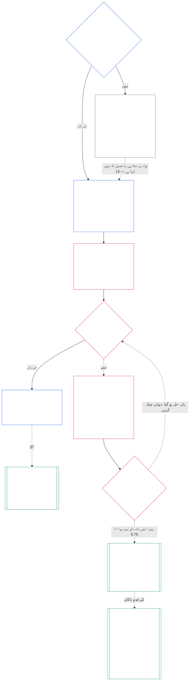

> **AI کی مدد سے ترجمہ کا مسودہ — غیر جائزہ لیا گیا؛ کوئی آزاد روانی قاری کا جائزہ مکمل نہیں ہوا ہے۔ یہ قاری کی زبان کی فائل غیر پابند ہے؛ نمبر والا انگریزی ذریعہ کنٹرول کرتا رہتا ہے۔**

# باب سات: نظام اور ادارہ جاتی چارٹر

<strong>کارپس پلیسمنٹ (غیر آپریٹو): فائل کی ساخت اور پڑھنے کے قواعد</strong>

> یہ فائل ہے۔ **حساس آئین کا حصہ** اور ہے **صرف ایک ساتھ باندھنا** دوسرے نمبر والے کے ساتھ `core_*` فائلیں ایک متن کے طور پر پڑھتی ہیں۔ اس پر مشتمل ہے۔ **باب سات**: کسی نظام اور ادارے کے شائع شدہ دائرہ کار کے دستاویزات کے لیے منزل: نظام چارٹر اور ادارہ جاتی چارٹر۔ یہ باب چھ حقوق کی منزل کی پیروی کرتا ہے اور اس سے پہلے [باب آٹھ](../../core_08.000_functional_independence_separation_of_duties.md#chapter-eight-functional-independence-and-separation-of-duties)، جو کسی بھی مادی طور پر پابند ایکٹ کے اندر نشستوں کو الگ کرتا ہے۔
>
> - **آئینی مالک:** جب کسی سسٹم کو سسٹم چارٹر شائع کرنا چاہیے اور جب کسی ادارے کو ایک ادارہ جاتی چارٹر شائع کرنا چاہیے (کلاس L یا اس سے اوپر، کلاس P میں رضاکارانہ)، کم از کم ہر ایک کو یہ بتانا چاہیے، کہ ہر ایک کس طرح تبدیل ہوتا ہے اور اس کا جائزہ لیا جاتا ہے، اور تشکیل شدہ دفاتر کے حاملین کی حیثیت اور صداقت کی جانچ پڑتال کرنا چاہیے۔
> - **تعریف گھر:** [سسٹم چارٹر](../../core_05.040_band_continuity.md#system-charter), [ادارہ جاتی چارٹر](../../core_05.040_band_continuity.md#institutional-charter), [چارٹر رول کا نقشہ](../../core_05.040_band_continuity.md#charter-role-map), [چارٹرڈ پارٹی](../../core_05.040_band_continuity.md#chartered-party)، اور [آپریٹنگ پارٹی](../../core_05.050_band_oversight.md#operating-party) پانچویں باب میں بیان کیا گیا ہے۔ یہ باب ان کا اطلاق کرتا ہے اور ان کی نئی تعریف نہیں کرتا۔
> - **نفاذ کا مالک:** [CI-8.205 §6](../../corpus_institutions/ci_08.205_institutional_design_separation_of_powers.md#ci-8205-6-system-and-institutional-charter-contents-review-and-formation-template) (*نظام اور ادارہ جاتی چارٹر کے مشمولات، جائزہ، اور تشکیل ٹیمپلیٹ*) مکمل فیلڈ ٹیمپلیٹ، جائزہ چیک لسٹ، تشکیل کا طریقہ کار، اور فارمیشن چیک اسٹیٹمنٹ ٹیمپلیٹ رکھتا ہے۔ یہ سخت ہوسکتا ہے اور فیلڈز کو شامل کرسکتا ہے۔ یہ اس باب کو تنگ نہیں کر سکتا۔ اس کا متن صرف درست اپنانے کے دائرہ کار میں شامل نفاذ کے متن کے طور پر پابند ہے ([باب اٹھارہ §4 اختیار کی تشکیل اور دائرہ کار](../../core_18.000_incorporation.md#4-adoption-framing-and-scope-of-authority)); اس باب میں فرش بنیادی متن کے طور پر جڑا ہوا ہے۔
> - **ڈاؤن اسٹریم صارفین:** [باب آٹھ §5 شائع شدہ تعیناتی، آسامی، اور متبادل](../../core_08.000_functional_independence_separation_of_duties.md#5-published-placement-vacancy-and-substitution) چارٹر رول میپ کی ضرورت ہے۔ باب نو دائرہ کار اور باؤنڈری کے نتائج کے لیے سسٹم چارٹر کو پڑھتا ہے، اور باب نویں حصہ D کسی ادارے کے لیے فارمیشن چیک اسٹیٹمنٹ کی جانچ کرتا ہے۔ [باب دس §3.7 ریکارڈ کی تحویل اور افتتاحی اتھارٹی](../../core_10.000_standing_assessment.md#37-record-custody-and-opening-authority) اس کا اطلاق اسٹینڈنگ ریکارڈز پر ہوتا ہے۔ [باب تیرہ §4.3 ادارہ جاتی فورمز](../../core_13.000_forum.md#43-institutional-forums) ادارہ جاتی چارٹر کے بارے میں تنازعات سنتا ہے۔
>
> پڑھنے کی ترتیب: §1 جب سسٹم اور ادارہ جاتی چارٹر کی ضرورت ہوتی ہے، اس چارٹ کے ساتھ جو عمل کا نقشہ بناتا ہے → §2 بنانے کا حق اور چار تنگ حدود → §3 جو انہیں بتانا ضروری ہے → §4 چارٹر رول میپ اور اسٹینڈنگ ریکارڈ کی تحویل → §5 آفس ہولڈر کھڑے ہونے پر فارمیشن کی جانچ پڑتال کرتے ہیں اور تصدیق کرتے ہیں → فارم کی تصدیق کرتے ہیں۔ §7 ترمیم، جائزہ، اور دائرہ کار کی غلط ترتیب۔

<strong>ٹریس</strong>

- اپ اسٹریم:
  - [آئینی ٹیٹراڈ](../../core_00.000_preamble.md#constitutional-tetrad)خاص طور پر **نگرانی** اور **احتساب**;
  - [مادی داؤ](../../core_00.000_preamble.md#material-stake);
  - [باب اول §18.1 گورننس بطور مجاز ڈھانچہ](../../core_01.010_stewardship_capacity_principles.md#181-governance-as-authorized-structure) (1.015 §18.1)؛
  - [آرٹیکل XI-E](../../core_06.005_rights_part_b.md#article-xi-e-institutional-formation-and-business-creation) (*ادارہ جاتی تشکیل اور کاروبار کی تخلیق*)۔
- ذیلی حصے:
  - [§1](#1-جب-نظام-اور-ادارہ-جاتی-چارٹر-کی-ضرورت-ہوتی-ہے);
  - [§2](#2-فارم-کا-حق-اور-چار-تنگ-حدود);
  - [§3](#3-کون-سا-نظام-اور-ادارہ-جاتی-چارٹر-بیان-کرنا-ضروری-ہے);
  - [§4](#4-چارٹر-رول-کا-نقشہ-اور-اسٹینڈنگ-ریکارڈ-کی-تحویل);
  - [§5](#5-فارمیشن-چیک-آفس-ہولڈر-کی-حیثیت-اور-صداقت);
  - [§6](#6-جب-ہولڈر-فارمیشن-چیک-میں-ناکام-ہو-جاتا-ہے);
  - [§7](#7-ترمیم-جائزہ-اور-دائرہ-کار-کی-غلط-ترتیب).
- بہاو:
  - [باب آٹھ](../../core_08.000_functional_independence_separation_of_duties.md#chapter-eight-functional-independence-and-separation-of-duties) (8.000)؛
  - [باب نو](../../core_09.000_system_alignment_certification_evaluation.md#chapter-nine-system-alignment-certification) (9.000)؛
  - [باب دس](../../core_10.000_standing_assessment.md#chapter-ten-contribution-violation-and-standing-model--measurement) (10.000)؛
  - [باب تیرہ](../../core_13.000_forum.md#chapter-thirteen-forums-and-jurisdiction) (13.000)؛
  - [چودہ باب](../../core_14.000_governance.md#chapter-fourteen-constitutional-contract-legitimacy-authorization-and-stewardship) (14.000)؛ مندرجہ بالا نامزد نفاذ کا متن۔
- کے ساتھ پڑھیں:
  - [اتھارٹی اسٹیک اور اندرونی درجہ بندی](../../core_05.045_band_integrative.md#authority-stack-and-internal-hierarchy);
  - [سسٹم کی حدود](../../core_05.040_band_continuity.md#system-boundaries);
  - [سسٹم باؤنڈری انٹیگریٹی](../../core_05.040_band_continuity.md#system-boundary-integrity);
  - [سسٹم کی تخلیق](../../core_05.055_band_participation.md#system-creation);
  - [کاروبار کی تخلیق](../../core_05.055_band_participation.md#business-creation).

 

باب سات کا آئینی مالک ہے۔ **سسٹم چارٹر، ادارہ جاتی چارٹر، اور شائع شدہ دائرہ کار**.

تین ابواب ایک سلسلہ کے طور پر کام کرتے ہیں:

- **باب سات (یہ باب):** کہتا ہے کیا ایک [چارٹرڈ پارٹی](../../core_05.040_band_continuity.md#chartered-party) کرنے کا دعوی کرتا ہے اور جب یہ کام کرتا ہے تو ہر نشست پر کون فائز ہوسکتا ہے۔
- **[باب آٹھ](../../core_08.000_functional_independence_separation_of_duties.md#chapter-eight-functional-independence-and-separation-of-duties):** کہتا ہے کہ ان نشستوں کو کیسے الگ رکھنا چاہیے۔
- **[باب نو](../../core_09.000_system_alignment_certification_evaluation.md#chapter-nine-system-alignment-certification):** ایک نظام کی تصدیق کرتا ہے، اور الگ سے ایک ادارہ، جن میں سے ہر ایک ایک پابند عمل ہے جو نشستوں کو استعمال کرتا ہے۔ یہ جو کچھ اسے ملتا ہے اسے واپس سسٹم چارٹر یا ادارہ جاتی چارٹر پر بھیجتا ہے۔

دوسرے ابواب تعریفوں کے مالک ہیں، نشست کے اصول، کھڑے تالے، اور فیصلہ کے اصول جن کی طرف یہ باب اشارہ کرتا ہے۔ **CI-8.205 §6** (*نظام اور ادارہ جاتی چارٹر کے مشمولات، جائزہ، اور تشکیل ٹیمپلیٹ*) فیلڈ ٹیمپلیٹ، تشکیل کا طریقہ کار، اور جائزہ چیک لسٹ رکھتا ہے۔

### 1. جب نظام اور ادارہ جاتی چارٹر کی ضرورت ہوتی ہے۔

<strong>ٹریس</strong>

- اپ اسٹریم:
  - [§2](#2-فارم-کا-حق-اور-چار-تنگ-حدود);
  - [مادی داؤ](../../core_00.000_preamble.md#material-stake);
  - [تناسب](../../core_05.035_band_accountability.md#proportionality); باب کھولنے کے مالک کا دعوی؛
  - [باب اول §18 انتظامی نظم و ضبط کے تحت](../../core_01.010_stewardship_capacity_principles.md#18-governance-under-stewardship-discipline) (1.015 §18)؛
  - [نگرانی](../../core_05.020_apex_oversight_leg.md#oversight-constitutional);
  - [احتساب](../../core_05.005_apex_accountability_leg.md#accountability).
- بہاو: [§3](#3-کون-سا-نظام-اور-ادارہ-جاتی-چارٹر-بیان-کرنا-ضروری-ہے); [باب نویں حصہ A §2 سسٹم کلاس کی تشخیص](../../core_09.000_system_alignment_certification_evaluation.md#2-system-class-evaluation) (9.005 §2)*کلاس اور سرٹیفیکیشن کی گہرائی*); [باب نو حصہ D §12.1 انسٹی ٹیوشن کلاس](../../core_09.015_institutional_alignment_certification.md#121-institution-class) (9.020 §12.1)*ایک ادارے کی کلاس*); **CS-9.305 (*سسٹم کی درجہ بندی کی مشینری*) اور CS-9.310** (*سسٹم کی درجہ بندی کی مشینری*کلاس کیٹلاگ کے لیے۔
- کے ساتھ پڑھیں:
  - **CI-8.205 §6** (*نظام اور ادارہ جاتی چارٹر کے مشمولات، جائزہ، اور تشکیل ٹیمپلیٹ*);
  - **CF-13.415 §5** (*ادارہ جاتی اور مقامی رجسٹرار*);
  - **CI-9.210** (*درجہ بندی سے منسلک ادارہ جاتی ذمہ داریاں*);
  - [پانچواں باب سسٹم چارٹر](../../core_05.040_band_continuity.md#system-charter) (5.040)؛
  - [پانچواں باب ادارہ جاتی چارٹر](../../core_05.040_band_continuity.md#institutional-charter) (5.040)؛
  - [آرٹیکل XI-E](../../core_06.005_rights_part_b.md#article-xi-e-institutional-formation-and-business-creation) (*ادارہ جاتی تشکیل اور کاروبار کی تخلیق*)۔

<strong>تعریفیں · تشخیص · تعمیل</strong>

- [سسٹم چارٹر](../../core_05.040_band_continuity.md#system-charter) · [اے](../../core_05.040_band_continuity.md#system-charter) · [ایم](../../core_05.040_band_continuity.md#system-charter-a) · [اے](../../core_05.040_band_continuity.md#system-charter-a) · [سی](../../core_05.040_band_continuity.md#system-charter-c)
- [ادارہ جاتی چارٹر](../../core_05.040_band_continuity.md#institutional-charter) · [اے](../../core_05.040_band_continuity.md#institutional-charter) · [ایم](../../core_05.040_band_continuity.md#institutional-charter-a) · [اے](../../core_05.040_band_continuity.md#institutional-charter-a) · [سی](../../core_05.040_band_continuity.md#institutional-charter-c)
- [درجہ بندی اسکیلڈ گورننس](../../core_05.050_band_oversight.md#classification-scaled-governance) · [اے](../../core_05.050_band_oversight.md#classification-scaled-governance) · [ایم](../../core_05.050_band_oversight.md#classification-scaled-governance-a) · [اے](../../core_05.050_band_oversight.md#classification-scaled-governance-a) · [سی](../../core_05.050_band_oversight.md#classification-scaled-governance-c)

 

*صاف الفاظ میں: اس سے پہلے کہ کوئی فیصلہ کر سکے کہ کوئی نظام یا ادارہ اپنی حدود میں رہا ہے، حدود کو لکھنا پڑتا ہے جہاں ہر کوئی انہیں پڑھ سکتا ہے۔ ایک ایسا نظام جو کہ کے نو میں سے کسی بھی شعبے میں دوسروں کے لیے مادی ہے۔ [ڈومین کے لیے مخصوص مواد](../../core_05.050_band_oversight.md#domain-specific-materiality) ایک شائع شدہ سسٹم چارٹر کی ضرورت ہے۔ ایک ادارہ اسے شائع کرتا ہے جو اس کے چلائے جانے والے نظام کے مطابق ہوتا ہے۔ کلاس P رضاکارانہ ہے: ایک لحاف دائرہ جو پناہ گزینوں کو لحاف دیتا ہے۔*

ایک سسٹم چارٹر یا ادارہ جاتی چارٹر چارٹرڈ پارٹی کا شائع شدہ دائرہ کار ہے: وہ کیا کرنے کا دعویٰ کرتا ہے، کیا نہیں کرتا، اور جب یہ عمل کرتا ہے تو ہر نشست پر کون ہوتا ہے۔ یہ وہ دائرہ کار ہے جس کے تحت باب آٹھ میں نشستیں رکھی گئی ہیں اور باب نو میں سرٹیفیکیشن حقیقی آپریشن کے خلاف پڑھتا ہے۔ آیا آپریٹنگ پارٹی کو شائع کرنا ہے اس کا انحصار اس کی کلاس پر ہے: **کلاس L یا اس سے اوپر میں، کلاس P میں رضاکارانہ۔** اگر اسے شائع کرنا ہے تو اسے درست بھی رکھنا ہوگا۔

پانچ سسٹم امپیکٹ کلاسز ذیل میں ہر چیز کے لیے فریم ہیں۔ زیادہ تر سے کم از کم نتیجہ خیز تک، ہر ایک لائن میں:

- **کلاس A، بقا کے لیے اہم، بنیادی، اور ناقابل تبدیلی:** بقا سے متعلقہ وقت کے اندر ناکامی، جس کا کوئی قابل عمل متبادل نہیں ہے، کا مطلب ہے کہ بقا کے حالات کا نقصان۔
- **کلاس B، اہم، اعلیٰ انحصار، اور نظامی لحاظ سے اہم:** انحصار اس کے بغیر بنیادی کام نہیں رکھ سکتا۔ بقا فوری طور پر ختم نہیں ہوتی ہے، اور متبادل اب بھی وقت کے ساتھ ممکن ہے۔
- **کلاس C، مربوط، اعلیٰ انحصار، اور غیر اہم:** یہ ہم آہنگی کو پیمانے پر تشکیل دیتا ہے لیکن کلاس A یا کلاس B فنکشن کے لیے آپریشنل شرط نہیں ہے۔
- **کلاس L، مقامی، محدود اثر، اور غیر اہم:** اس کے اثرات نجی یونٹ سے باہر تک پہنچتے ہیں لیکن یہ مقامی، بدلنے کے قابل، اور قابل قابو ہیں۔
- **کلاس P، ذاتی، نجی استعمال، الگ تھلگ، اور تجرباتی:** اس کے اثرات ایک پرائیویٹ یونٹ کے اندر رہتے ہیں، جس میں کوئی بامعنی باہر انحصار نہیں ہوتا۔

[CS-9.310 §8](../../corpus_systems/cs_09.310_system_impact_classifications.md#cs-9310-8-system-impact-classifications) (*سسٹم کے اثرات کی درجہ بندی*) مکمل تعریفیں رکھتا ہے۔ کلاس A، B، C، اور L کو لازمی طور پر شائع کرنا چاہیے اور کلاس P، اور [§1.2 کون سی کلاسز کا احاطہ کیا گیا ہے۔](#12-کون-سی-کلاسز-کا-احاطہ-کیا-گیا-ہے) کہتا ہے کہ ایک ادارہ اپنے چلانے والے سسٹمز سے اپنی کلاس کیسے لیتا ہے۔

#### 1.1 کسے شائع کرنا چاہیے۔

کلاس L یا اس سے اوپر کے نظام کو شائع کرنا اور برقرار رکھنا ضروری ہے۔ [سسٹم چارٹر](../../core_05.040_band_continuity.md#system-charter). کلاس L یا اس سے اوپر کے ادارے کو ان میں سے ایک کو شائع اور برقرار رکھنا چاہیے جو اس کے چلانے والے سسٹمز کے مطابق ہو:

| ادارہ کیا چلاتا ہے، ذمہ دار، یا مادی طور پر کنٹرول کرتا ہے۔ | جو یہ شائع کرتا ہے۔ |
| --- | --- |
| بالکل ایک سسٹم جس کو سسٹم چارٹر کی ضرورت ہے۔ | وہ سسٹم چارٹر اور کوئی دوسرا دستاویز نہیں۔ یہ ادارے کو اسٹیورڈ کا نام دیتا ہے اور اس کے طور پر کام کرتا ہے۔ [ادارہ جاتی چارٹر](../../core_05.040_band_continuity.md#institutional-charter): ایک دستاویز دونوں کا احاطہ کرتی ہے۔ |
| اس طرح کے ایک سے زیادہ سسٹم | ایک ادارہ جاتی چارٹر۔ اس میں ان سسٹمز کے لیے نافذ ہر سسٹم چارٹر شامل ہے اور یہ بتاتا ہے کہ ادارہ ان مخصوص نظاموں کو کیوں چلاتا ہے ([§3 کون سا نظام اور ادارہ جاتی چارٹر بیان کرنا ضروری ہے۔](#3-کون-سا-نظام-اور-ادارہ-جاتی-چارٹر-بیان-کرنا-ضروری-ہے))۔ |
| ایسا کوئی سسٹم نہیں۔ | ایک ادارہ جاتی چارٹر جس میں ادارے کی اپنی اشیاء بیان کی گئی ہیں۔ [§3 کون سا نظام اور ادارہ جاتی چارٹر بیان کرنا ضروری ہے۔](#3-کون-سا-نظام-اور-ادارہ-جاتی-چارٹر-بیان-کرنا-ضروری-ہے) اور اس میں شامل کرنے کے لیے کوئی سسٹم چارٹر نہیں ہے۔ |

- **کاروبار اور موازنہ فارم:** ایک کاروبار یا دیگر ذمہ دار تنظیمی فارم سسٹم چارٹر یا ادارہ جاتی چارٹر میں سے جو بھی اس پر لاگو ہوتا ہے اسے بطور سسٹم، ایک انسٹی ٹیوشن، یا ایک ایسے ادارے کے طور پر شائع کرتا ہے جو ایک احاطہ شدہ نظام کو چلاتا ہے۔ اس کی قانونی شکل جواب کو تبدیل نہیں کرتی۔
- **مشترکہ پیشہ ورانہ مشق:** کلاس L یا اس سے اوپر کی ایک جذباتی یا چھوٹی مشق جو پریکٹس لائسنس یا پریکٹس کلیئرنس کے لیے درج ایکٹ کو انجام دیتی ہے، میزبان کے سسٹم چارٹر یا انسٹی ٹیوشنل چارٹر اور چارٹر رول میپ کو اپنا کر ان کاموں کے لیے اس سیکشن کو پورا کر سکتی ہے:
  - **کیا اپنایا ہے:** حوالہ کے لحاظ سے، مشترکہ پیشہ ورانہ مشق میں میزبان کا سسٹم چارٹر یا ادارہ جاتی چارٹر اور چارٹر رول میپ، جس میں ان اعمال کا احاطہ کرنا ضروری ہے۔
  - **گود لینے کا نوٹس:** ایک صفحے کا نوٹس کہ **CI-14.205 §7** (*لائسنس، مشق کلیئرنس، اور مشترکہ پیشہ ورانہ مشق کی مشق کریں۔*) بیان کرتا ہے۔
  - **کلاس:** پریکٹس کلاس ہی رہتی ہے اس کے اپنے اعمال اسے دیتے ہیں۔

#### 1.2 کون سی کلاسز کا احاطہ کیا گیا ہے۔

چارٹرڈ پارٹی کی کلاس فیصلہ کرتی ہے کہ اشاعت کی ضرورت ہے یا انتخاب:

- **کلاسز A، B، C اور L:** مطلوبہ میں چارٹ [§1.7 ایک نظر میں عمل](#17-ایک-نظر-میں-عمل) وہ عمل دکھاتا ہے جس کی وہ پیروی کرتے ہیں۔
- **کلاس P:** ایک انتخاب، جب تک کہ دو واقعات میں سے کسی ایک کی ضرورت نہ ہو۔ [§1.3 کلاس P کیا ہے۔](#13-کلاس-p-کیا-ہے) کہتا ہے کہ آپریٹنگ پارٹی کلاس P، اور [§1.4 کلاس P: اختیاری چارٹر، اور جب ان کی ضرورت ہو جائے۔](#14-کلاس-p-اختیاری-چارٹر-اور-جب-ان-کی-ضرورت-پڑ-جائے) انتخاب کا تعین کرتا ہے اور یہ کب ختم ہوتا ہے۔
- **کسی ادارے کی کلاس:** ایک ادارہ کسی بھی نظام کی اعلیٰ ترین کلاس لیتا ہے جسے وہ چلاتا ہے، اسٹیورڈز، یا مادی طور پر کنٹرول کرتا ہے۔ ایک ادارہ جو اس طرح کا کوئی نظام نہیں چلاتا ہے، اس کے اپنے مادی اثرات اور انحصار کے لحاظ سے درجہ بندی کی جاتی ہے، اس کا اندازہ اس بات سے لگایا جاتا ہے کہ وہ کیا فیصلہ کرتا ہے اور کیا رکھتا ہے، نہ کہ اس کے لیبل یا قانونی شکل سے۔ [باب نو حصہ D §12.1 انسٹی ٹیوشن کلاس](../../core_09.015_institutional_alignment_certification.md#121-institution-class).

#### 1.3 کلاس P کیا ہے۔

ایک آپریٹنگ پارٹی صرف اس وقت کلاس P ہوتی ہے جب اس کی سرگرمی کے نو ڈومینز میں سے ہر ایک میں لائن سے نیچے رہتی ہے۔ [ڈومین کے لیے مخصوص مواد](../../core_05.050_band_oversight.md#domain-specific-materiality)جس کا عملی طور پر مطلب ہے کہ اس کے اعمال اور اثرات اس کے اندر رہتے ہیں۔ [نجی یونٹ](../../core_05.050_band_oversight.md#domain-specific-materiality-private-unit):

- **لائن کراس کرنا:** کسی ایک ڈومین میں لائن کراس کرنا اسے کم از کم کلاس L کے تحت بناتا ہے۔ **CS-9.305 (*سسٹم کی درجہ بندی کی مشینری*) اور CS-9.310** (*سسٹم کی درجہ بندی کی مشینری*)، جو بھی اس کا سائز ہے یا اسے خود کیا کہتے ہیں۔
- **ہر لائن کے نیچے رہنا:** یہ کلاس P رہتا ہے اگرچہ اس کے بہت سے ممبران ہوں۔
- **اندر والے:** کلاس P بھی اس کے اندر والوں پر منحصر ہے۔ اندر جو کوئی بھی آپریٹنگ پارٹی کو لائن عبور کرتے ہوئے دیکھتا ہے اس کا فرض ہے کہ وہ اس کی اطلاع دے، اور رپورٹ محفوظ ہے ([ڈومین کے لیے مخصوص مواد](../../core_05.050_band_oversight.md#domain-specific-materiality))۔

باب آٹھ میں چار نشستوں کا فرش کلاس P آپریٹنگ پارٹی کے اعمال پر لاگو نہیں ہوتا ہے، جو اس کے نجی یونٹ کے اندر رہتے ہیں، اس لیے کمپیوٹر کے ساتھ ایک بھی احساس رکھنے والے کو دوسرے سیٹ ہولڈر کی ضرورت نہیں ہے۔ فلور اس دن سے لاگو ہوتا ہے جس دن آپریٹنگ پارٹی ایک لیتی ہے۔ [مادی طور پر پابند ایکٹ](../../core_05.035_band_accountability.md#materially-binding-act) جس کی دوسروں کو پیروی کرنی چاہیے یا طے شدہ طور پر اس پر بھروسہ کرنا چاہیے، جو اتھارٹی سے زیادہ دوسروں کے ڈومین میں لائن کو عبور کرتا ہے اور اسے کم از کم کلاس L بناتا ہے۔

#### 1.4 کلاس P: اختیاری چارٹر، اور جب ان کی ضرورت پڑ جائے۔

کلاس P آپریٹنگ پارٹی کو شائع کرنے کی ترغیب دی جاتی ہے۔ [سسٹم چارٹر](../../core_05.040_band_continuity.md#system-charter) (ایک نظام کے لیے) یا [ادارہ جاتی چارٹر](../../core_05.040_band_continuity.md#institutional-charter) (ایک سے زیادہ سسٹم کے لیے، یا کوئی نہیں) جو اس کے چلنے کے لیے فٹ بیٹھتا ہے۔ اس میں مواد کی فہرست استعمال ہو سکتی ہے۔ [§3 کون سا نظام اور ادارہ جاتی چارٹر بیان کرنا ضروری ہے۔](#3-کون-سا-نظام-اور-ادارہ-جاتی-چارٹر-بیان-کرنا-ضروری-ہے) اور سیٹ کا نقشہ [§4 چارٹر رول میپ اور اسٹینڈنگ ریکارڈ کی تحویل](#4-چارٹر-رول-کا-نقشہ-اور-اسٹینڈنگ-ریکارڈ-کی-تحویل) ایک ٹیمپلیٹ کے طور پر. کسی کو شائع کرنا اس باب کے عمل کے تحت کوئی فرض نہیں بناتا:

- کوئی مقررہ تاریخ نہیں ([§1.5 جب سسٹم چارٹر یا ادارہ جاتی چارٹر واجب الادا ہے۔](#15-جب-سسٹم-چارٹر-یا-ادارہ-جاتی-چارٹر-واجب-الادا-ہے));
- کوئی تشکیل کی جانچ نہیں ([§5 فارمیشن چیک: آفس ہولڈر اسٹینڈنگ اور صداقت](#5-فارمیشن-چیک-آفس-ہولڈر-کی-حیثیت-اور-صداقت));
- کوئی ضرورت نہیں [چارٹر رول کا نقشہ](../../core_05.040_band_continuity.md#charter-role-map) ([§4 چارٹر رول میپ اور اسٹینڈنگ ریکارڈ کی تحویل](#4-چارٹر-رول-کا-نقشہ-اور-اسٹینڈنگ-ریکارڈ-کی-تحویل))، اگرچہ یہ اپنے رضاکارانہ نظام چارٹر یا ادارہ جاتی چارٹر کے ساتھ رکھ سکتا ہے یا اسے خود شائع کر سکتا ہے۔ اور
- کوئی ضروری ترمیم یا جائزہ سائیکل نہیں ([§7 ترمیم، جائزہ، اور دائرہ کار کی غلط ترتیب](#7-ترمیم-جائزہ-اور-دائرہ-کار-کی-غلط-ترتیب))۔

اگر ان میں سے کوئی بھی ہوتا ہے تو اشاعت اختیاری ہونا بند ہو جاتی ہے۔

- آپریٹنگ پارٹی کو کلاس L یا اس سے زیادہ میں دوبارہ درجہ بندی کیا گیا ہے۔ یا
- اس کا آپریٹر آپریٹنگ پارٹی کے لیے آئینی تعمیل پر زور دیتا ہے۔

آپریٹنگ پارٹی کو اس کے بعد سسٹم چارٹر یا ادارہ جاتی چارٹر شائع کرنا چاہیے جو اس کے مطابق ہو، شیڈول کے مطابق [§1.5 جب سسٹم چارٹر یا ادارہ جاتی چارٹر واجب الادا ہے۔](#15-جب-سسٹم-چارٹر-یا-ادارہ-جاتی-چارٹر-واجب-الادا-ہے).

**شناخت دائرہ کار کی دستاویز پر منحصر نہیں ہے۔** ایک گروپ، سسٹم چارٹر یا انسٹی ٹیوشنل چارٹر کے ساتھ یا اس کے بغیر اور جو بھی اس کی کلاس ہے، اپنے اراکین اور پہچان کے درمیان کھڑا نہیں ہوتا ہے۔ ہر رکن ایک انفرادی دعویدار کے طور پر، گروپ کے اندر یا اس سے باہر کیے گئے کام کے لیے شراکت کا ریکارڈ طلب کر سکتا ہے، اور یہ ریکارڈ ممبر کی شراکت سے متعلق ہے نہ کہ گروپ کی حیثیت سے ([باب دس §3.7 غیر رسمی اور چھوٹے دائرہ کار کے ریکارڈ](../../core_10.000_standing_assessment.md#37-informal-and-small-scope-records))۔ امداد، سامان، مزدوری، یا خدمات دینا جو کسی کو قبول کرنے کی ضرورت نہیں ہے مادی طور پر پابند عمل نہیں ہے، لہذا ایک باہمی امدادی حلقہ جو پناہ گزینوں کو لحاف دیتا ہے، اس کے اراکین کو تسلیم کرنے کے لیے کسی سسٹم چارٹر یا ادارہ جاتی چارٹر کی ضرورت نہیں ہے۔

#### 1.5 جب سسٹم چارٹر یا ادارہ جاتی چارٹر واجب الادا ہے۔

ایک احاطہ شدہ نظام یا ادارہ اسے شائع کرتا ہے۔ [سسٹم چارٹر](../../core_05.040_band_continuity.md#system-charter) یا [ادارہ جاتی چارٹر](../../core_05.040_band_continuity.md#institutional-charter) اس شیڈول پر:

- **ایک نیا نظام یا ادارہ:** اس سے پہلے کہ یہ زندہ ہو جائے یا دوسروں پر اختیار استعمال کرنا شروع کر دے۔
- **ایک جو پہلے سے کام کر رہا ہے:** اس کے اگلے درجہ بندی کے جائزے یا سرٹیفیکیشن پر، یا اس کے تحت درخواست کے بعد ریزولوشن ونڈو کے اندر [§1.6 اگر سسٹم چارٹر یا ادارہ جاتی چارٹر غائب ہے۔](#16-اگر-سسٹم-چارٹر-یا-ادارہ-جاتی-چارٹر-غائب-ہے)جو بھی پہلے آئے۔ یہ پہلے سے طے شدہ ہے جب تک کہ ایسا نہ ہو۔
  - **کون سا سرٹیفیکیشن:** سسٹم کے لیے، اس کی سسٹم الائنمنٹ سرٹیفیکیشن۔ ایک ادارے کے لیے، اس کے ادارہ جاتی سیدھ میں سرٹیفیکیشن کے تحت [باب نو حصہ D §11.3 کوئی اجازت اور کوئی گیٹ نہیں۔](../../core_09.015_institutional_alignment_certification.md#113-no-permission-and-no-gate)، جس کی پہلی سرٹیفیکیشن ونڈو کبھی بھی ادارہ جاتی چارٹر شائع کرنے یا کام کرنے کی شرط نہیں ہے۔
- **تشکیل کی جانچ:** یہ فارمیشن چیک ان کو بھی مکمل کرتا ہے۔ [§5 فارمیشن چیک: آفس ہولڈر اسٹینڈنگ اور صداقت](#5-فارمیشن-چیک-آفس-ہولڈر-کی-حیثیت-اور-صداقت) ایک ہی لمحے میں.
- **یہ کہاں رکھا گیا ہے:** یہ سسٹم چارٹر یا ادارہ جاتی چارٹر، اپنے چارٹر رول میپ اور فارمیشن چیک اسٹیٹمنٹ کے ساتھ، ادارہ جاتی رجسٹرار کے پاس، یا مقامی رجسٹرار کے پاس جہاں اس کی سرگرمی اور اس سے متاثر ہونے والے جذبات مقامی ہیں (**CF-13.415 §5** (*ادارہ جاتی اور مقامی رجسٹرار*)):
  - **رجسٹرار کیا کرتا ہے:** یہ چیک کرتا ہے کہ مطلوبہ چیز غائب نہیں ہے اور تاریخ کی رسید دیتی ہے۔
  - **جو رجسٹرار کبھی نہیں کرتا:** یہ کبھی بھی اجازت نہیں دیتا ہے اور نہ ہی کلاس یا مواد پر اصول کرتا ہے۔
  - **دیر سے یا غائب رسید:** یہ چارٹرڈ پارٹی کو کام کرنے سے کبھی نہیں روکتا۔

#### 1.6 اگر سسٹم چارٹر یا ادارہ جاتی چارٹر غائب ہے۔

کوئی بھی جو کلاس L یا اس سے اوپر کی چارٹرڈ پارٹی کو دیکھتا ہے، نئی یا نئی، جس نے اپنا سسٹم چارٹر یا ادارہ جاتی چارٹر شائع نہیں کیا ہے، وہ اس کے لیے اپنے گورننگ اتھارٹی سے پوچھ سکتا ہے۔ پوچھنے والے کو کھڑے ہونے کی ضرورت نہیں ہے، کوئی فیس ادا کرنے کی ضرورت نہیں ہے، اور اسے نقصان پہنچانے کی ضرورت نہیں ہے۔ درخواست میں چارٹرڈ پارٹی کا نام دیا گیا ہے اور کہا گیا ہے کہ یہ کیوں احاطہ کرتا ہے۔

درخواست سے دو ونڈوز چلتی ہیں: رسپانس ونڈو اور ریزولوشن ونڈو۔ ہر ایک ٹائر سے اپنی لمبائی چارٹرڈ پارٹی کی کلاس کے ایک ہی حرف کے ساتھ لیتا ہے، لہذا کلاس جتنی زیادہ اہم ہوگی، ونڈوز اتنی ہی چھوٹی ہوں گی:

| کلاس اور ٹائر | رسپانس ونڈو (انٹیک ہدف) | ریزولوشن ونڈو (بیرونی باؤنڈ) |
|---|---|---|
| کلاس اے، ٹائر اے | 24 گھنٹے | 7 کیلنڈر دن |
| کلاس بی، ٹائر بی | 2 کیلنڈر دن | 14 کیلنڈر دن |
| کلاس سی، ٹائر سی | 4 کیلنڈر دن | 30 کیلنڈر دن |
| کلاس ایل، ٹائر ایل | 8 کیلنڈر دن | 60 کیلنڈر دن |

اعداد و شمار سے آتے ہیں **CF-13.445 §3.1** (*اسٹیج کے اہداف اور بیرونی حدود*)، جو مختلف ہونے پر حکومت کرتا ہے۔ ایک چارٹرڈ پارٹی جو اپنی کلاس پر تنازعہ کرتی ہے اس کا شمار اس طبقے کے زیادہ تنقیدی درجے میں کیا جاتا ہے جو اس کے سسٹم کی درجہ بندی کے ریکارڈ پر ہوتا ہے اور کسی بھی طبقے کو جو سوال کرنے والا یا فورم پہلی نظر میں دکھاتا ہے، جب تک کہ سوال طے نہ ہو جائے۔ ایک چارٹرڈ پارٹی جو ریکارڈ پر کوئی کلاس نہیں رکھتی، یا کلاس P رکھتی ہے جب کہ اس کی کلاس زیربحث ہے، کو ٹائر C میں شمار کیا جاتا ہے۔

ونڈوز اس طرح کام کرتی ہیں:

- **رسپانس ونڈو:** چارٹرڈ پارٹی رسپانس ونڈو کے اندر جواب دیتی ہے، جو کہ مماثل درجے کا انٹیک ہدف ہے۔ **CF-13.445 §3.1** (*اسٹیج کے اہداف اور بیرونی حدود*درخواست سے شمار کیا جاتا ہے۔ یہ سسٹم چارٹر یا ادارہ جاتی چارٹر شائع کرتا ہے، یا وہ تاریخ دیتا ہے جس تک یہ کرے گا، یا اس کی طرف اشارہ کرتا ہے جسے وہ پہلے ہی شائع کر چکا ہے، یا جواب دیتا ہے کہ یہ ہر سطر کے نیچے ہے۔ [ڈومین کے لیے مخصوص مواد](../../core_05.050_band_oversight.md#domain-specific-materiality) اور تحریری طور پر ظاہر کرتا ہے کہ اندراج کی ضرورت ہے۔
- **ریزولوشن ونڈو:** سسٹم چارٹر یا انسٹی ٹیوشنل چارٹر ریزولیوشن ونڈو کے اندر واجب الادا ہے، جو کہ مماثل درجے کی بیرونی حد ہے۔ **CF-13.445 §3.1** (*اسٹیج کے اہداف اور بیرونی حدود*)، درخواست سے شمار ہوتا ہے، فارمیشن چیک اسٹیٹمنٹ کے ساتھ جو اس کے ساتھ جاتا ہے ([§5 فارمیشن چیک: آفس ہولڈر اسٹینڈنگ اور صداقت](#5-فارمیشن-چیک-آفس-ہولڈر-کی-حیثیت-اور-صداقت))۔ ایک چارٹرڈ پارٹی جس کی کوئی آزاد نشست نہیں ہے ابھی تک بیان کو اپنے ثبوت کے ساتھ ایک اعلامیہ کے طور پر فائل کرتی ہے، جیسا کہ یہ سیکشن فراہم کرتا ہے۔
- **ایک آپریٹنگ پارٹی جو کہتی ہے کہ یہ لائن کے نیچے ہے:** درخواست پھر اس اندراج کے راستے پر درجہ بندی کا چیلنج بھی ہے۔ *چیلنج کا راستہ*:
  - **ونڈو چلانا:** جب چیلنج زیر التواء ہے تو ریزولوشن ونڈو چلتی رہتی ہے۔
  - **چیلنج کی توسیع:** اگر دائرہ اختیار کے ساتھ فورم چیلنج کو جائزے کے قابل بناتا ہے، تو مقررہ تاریخ بڑھا دی جاتی ہے، اور چیلنج کا فیصلہ ہونے پر ایک نئی ریزولیوشن ونڈو شروع ہوتی ہے۔ فورم مماثل درجے کی بیرونی حد کے اندر چیلنج کا فیصلہ کرتا ہے۔
  - **جائزے کے لائق کیا مطلب ہے:** ایک چیلنج جائزے کے لائق ہوتا ہے جب وہ کسی مخصوص ڈومین میں ایک مخصوص کراسنگ کا نام دیتا ہے اور آپریٹنگ پارٹی کی تحریری نمائش اس کراسنگ کے بارے میں ایک حقیقی سوال چھوڑ دیتی ہے۔ آپریٹنگ پارٹی خود اس کا فیصلہ نہیں کرتی ہے، اور جو جواب تحریری طور پر ظاہر نہیں کرتا ہے وہ تاریخ میں توسیع نہیں کرتا ہے۔
  - **اگر کوئی کلاس مل جاتی ہے:** اس چیلنج پر یا کسی اور پر، تلاش کی تاریخ کو درخواست کی تاریخ کے طور پر شمار کیا جاتا ہے: ریسپانس ونڈو اور ریزولیوشن ونڈو اس سے چلتی ہے، کلاس کے درجے پر (کلاس A، B، C، یا L)۔
- **اگر یہ چھوٹ گیا ہے:** مقررہ تاریخ تک کوئی جواب نہیں، یا کوئی سسٹم چارٹر یا ادارہ جاتی چارٹر، لاگ ان کرنے اور درست کرنے میں ایک خرابی ہے۔ پوچھنے والا اسے اسی راستے پر دائرہ اختیار کے ساتھ فورم پر لے جا سکتا ہے۔ یہ کبھی بھی بننے یا چلانے کی شرط نہیں ہے۔
- **دوبارہ درخواست:** اسی چارٹرڈ پارٹی کے بارے میں دوسری درخواست، جب کہ اس کا سابقہ ​​جواب یا اس پر کوئی نتیجہ ابھی تک قائم ہے، کوئی نیا جواب یا ریزولیوشن ونڈو شروع نہیں کرتا۔ چارٹرڈ پارٹی اس جواب کی طرف اشارہ کرکے یا تلاش کرکے جواب دیتی ہے۔ اس کا اپنا یہ ظاہر کرنا کہ یہ ہر سطر کے نیچے ہے، جس کا ابھی تک فورم نے جائزہ نہیں لیا ہے، اسے ایک جواب کے طور پر شمار نہیں کیا جاتا جو کھڑا ہے۔ جواب یا تلاش اس وقت تک قائم رہتی ہے جب تک کہ ان میں سے کوئی ایک نہیں ہو جاتا، جیسا کہ دوبارہ کھلنا شروع ہو جاتا ہے۔ [باب نویں حصہ D §14.2 دوبارہ کھولنے کے محرکات](../../core_09.015_institutional_alignment_certification.md#142-reopening-triggers) بیان کریں:
  - **مادی تبدیلی:** چارٹرڈ پارٹی کی سرگرمی مادی طور پر بدل جاتی ہے۔
  - **نئے ثبوت:** کراسنگ کے بارے میں نئے شواہد دکھائے گئے ہیں۔

  ایک درخواست جو مندرجہ بالا میں سے کسی ایک کو ظاہر کرتی ہے وہ دوبارہ نہیں ہے۔ یہ ایک نئی درخواست ہے، جو پہلے کی درخواست سے الگ اور آزادانہ طور پر نمٹائی گئی ہے۔ اس کی اپنی رسپانس ونڈو اور ریزولیوشن ونڈو ہے، جسے اس کی اپنی تاریخ سے شمار کیا جاتا ہے، اور اس سے پہلے کا جواب، تلاش، اور ونڈوز نہ تو اسے مطمئن کرتے ہیں اور نہ ہی اس کے ذریعے تبدیل کیے جاتے ہیں۔
- **اس دوران دائرہ کار:** ایک گمشدہ سسٹم چارٹر یا ادارہ جاتی چارٹر چارٹرڈ پارٹی کو غیر محدود ماننے کی وجہ نہیں ہے۔ جب تک یہ موجود ہے، چارٹرڈ پارٹی کا اصلی [سسٹم کی حدود](../../core_05.040_band_continuity.md#system-boundaries) اور اس کا کلاس کنٹرول، اور ایک سرٹیفیکیشن یا فورم مشاہدہ شدہ آپریشن سے دائرہ کار کو دوبارہ تشکیل دے سکتا ہے۔

#### 1.7 ایک نظر میں عمل

چارٹ ایک آپریٹنگ پارٹی کی پیروی کرتا ہے اس سوال سے کہ آیا یہ دوسروں کے لیے مواد ہے، اپنے سسٹم چارٹر یا ادارہ جاتی چارٹر کو شائع کرنے اور اسے درست رکھنے کے ذریعے۔ اگر ریزولیوشن ونڈو کے اندر کوئی مسئلہ حل نہیں ہوتا ہے، تو چارٹرنگ عمل اسے ایک جائزہ کے لیے بھیجتا ہے جو اس باب کے باہر احاطہ کرتا ہے۔ اس کے بعد کے حصے ہر ایک قدم کو اسی ترتیب میں بیان کرتے ہیں۔

<strong>قارئین کی رہنمائی (غیر آپریٹو): چارٹ کو کیسے پڑھیں</strong>

> سادہ الفاظ میں: کوئی بھی سسٹم چارٹر یا ادارہ جاتی چارٹر نہیں دیتا ہے، اور کسی کو تشکیل دینے کی اجازت کی ضرورت نہیں ہے۔ ایک چارٹرڈ پارٹی جس کی سرگرمی دوسروں کے لیے مادی ہے وہ شائع کرتی ہے جسے وہ کرنے کے لیے اتھارٹی کا دعویٰ کرتی ہے اور ہر سیٹ کس کے پاس ہے، اور اس کے کلیدی دفاتر کے حاملین کی جانچ پڑتال کی جاتی ہے۔ ایک ہولڈر جو ناکام ہوجاتا ہے اسے تبدیل کردیا جاتا ہے، یا وجہ طے ہوجاتی ہے، اور چارٹرڈ پارٹی جاری رہتی ہے۔ اگر ریزولیوشن ونڈو کے ختم ہونے پر بھی ناکامی کو ٹھیک نہیں کیا جاتا ہے، تو ایک فورم چارٹرڈ پارٹی کا جائزہ لے سکتا ہے، اس ہلکے قدم سے شروع ہوتا ہے جو دوسروں کی حفاظت کرتا ہے۔ چارٹرڈ پارٹی کو کلاس L سے نیچے سکڑنا، یا اسے تحلیل کرنا، صرف اس صورت میں آتا ہے جب ہلکے اقدامات ناکام ہوں۔ ایک تحلیل شدہ چارٹرڈ پارٹی اس وقت تک واپس نہیں آسکتی جب تک اس پر تالا لگا رہتا ہے۔
>
> ٹھوس تیر اہم راستہ ہیں۔ نقطے والے تیر مستثنیات اور ہینڈ آف ہیں، ان کو بنانے والے حصے کے ساتھ لیبل لگا ہوا ہے۔ ڈبل سائیڈ بارز والے بکس کسی دوسرے باب سے تعلق رکھتے ہیں یا نفاذ کے متن میں شامل ہیں۔ چارٹ میں کوئی ڈیوٹی، سیٹ، یا فیلڈ شامل نہیں ہے، اور اس پر کوئی قدم اجازت نہیں ہے۔

 

### 2. فارم کا حق، اور چار تنگ حدود

<strong>قارئین کی رہنمائی (غیر آپریٹو): اس حصے کو کیسے ترتیب دیا گیا ہے۔</strong>

- [§2.1 تشکیل کا حق](#21-تشکیل-دینے-کا-حق) حق بیان کرتا ہے اور کس کا احاطہ نہیں کرتا۔
- [§2.2 پہلی حد: حساس پر ایک بقایا تالا](#22-پہلی-حد-حساس-پر-ایک-بقایا-تالا) کہتا ہے کہ ایک تالا کس طرح ایک نامی شخص کو ایک کنٹرولنگ آفس سے باہر رکھتا ہے۔
- [§2.3 دوسری حد: مخصوص تصدیق شدہ حقائق پر مختصر پابندی](#23-دوسری-حد-مخصوص-تصدیق-شدہ-حقائق-پر-مختصر-پابندی) کہتا ہے کہ کس طرح شارٹ ہولڈ نامی شخص کو ایک کنٹرولنگ آفس سے باہر رکھ سکتا ہے۔
- [§2.4 تیسری حد: آپریٹنگ پارٹی پر ہی لاک](#24-تیسری-حد-آپریٹنگ-پارٹی-پر-ہی-لاک) کہتا ہے کہ کس طرح آپریٹنگ پارٹی پر ایک تالا اسے اور اس کے جانشینوں کو روکتا ہے، اور یہ کہ تحلیل شدہ چارٹرڈ پارٹی واپس نہیں آسکتی ہے۔
- [§2.5 چوتھی حد: پریکٹس کا لائسنس یا کلیئرنس](#25-چوتھی-حد-پریکٹس-کا-لائسنس-یا-کلیئرنس) کہتا ہے کہ جب کسی نامزد ہائی رسک ایکٹ کو لائسنس یا کلیئرنس کی ضرورت ہوتی ہے۔ یہ تشکیل دینے کا دروازہ نہیں ہے۔

<strong>ٹریس</strong>

- اپ اسٹریم: [§1](#1-جب-نظام-اور-ادارہ-جاتی-چارٹر-کی-ضرورت-ہوتی-ہے); [آرٹیکل XI-E](../../core_06.005_rights_part_b.md#article-xi-e-institutional-formation-and-business-creation) (*ادارہ جاتی تشکیل اور کاروبار کی تخلیق*)۔
- بہاو: [§1 جب سسٹم اور ادارہ جاتی چارٹر کی ضرورت ہوتی ہے۔](#1-جب-نظام-اور-ادارہ-جاتی-چارٹر-کی-ضرورت-ہوتی-ہے); [§5 فارمیشن چیک: آفس ہولڈر اسٹینڈنگ اور صداقت](#5-فارمیشن-چیک-آفس-ہولڈر-کی-حیثیت-اور-صداقت).
- کے ساتھ پڑھیں:
  - [عبوری ہولڈ](../../core_05.035_band_accountability.md#interim-hold);
  - [باب گیارہ §4.2 روک تھام — عمومی کھڑے تالے](../../core_11.000_standing_integration.md#42-prevention--general-standing-locks) (11.000 §4.2)؛
  - [باب گیارہ §5.5 خصوصی تالے](../../core_11.000_standing_integration.md#55-special-locks) (11.000 §5.5)؛
  - [باب تیرہ §5 ایک نامزد جذباتی راستے پر عبوری ہولڈ](../../core_13.000_forum.md#interim-hold-on-a-named-sentients-pathway) (13.000 §5)۔

 

*سادہ الفاظ میں: آپ کو نظام، ادارہ یا کاروبار بنانے کے لیے کسی کی اجازت کی ضرورت نہیں ہے۔ چار تنگ حدود لاگو ہو سکتی ہیں۔ تین دروازے ہیں: ایک غیر حل شدہ تالا ایک کنٹرولنگ آفس سے ایک جذباتی کو باہر رکھ سکتا ہے، مخصوص تصدیق شدہ حقائق پر ایک مختصر ہولڈ ایسا ہی کر سکتا ہے، اور خود آپریٹنگ پارٹی پر ایک تالا اس آپریٹنگ پارٹی کو روک سکتا ہے۔ چوتھے کو ایک نامزد ہائی رسک ایکٹ سے پہلے لائسنس یا کلیئرنس کی ضرورت ہو سکتی ہے۔ ایک چارٹرڈ پارٹی جسے ایک فورم تحلیل کر دیا گیا ہے اسے واپس آنے سے روک دیا گیا ہے، اور بار اس وقت مستقل ہے جب تحلیل وسیع پیمانے پر خلاف آئین طرز عمل، یا سنگین نقصان پر ہو جسے کالعدم نہیں کیا جا سکتا اور اسے کبھی درست نہیں کیا گیا۔ کوئی بھی نئی آپریٹنگ پارٹی کو بنانے یا چلانے سے نہیں روکتا، اور یہ باب کسی کو شامل نہیں کرتا ہے۔*

**آرٹیکل XI-E** (*ادارہ جاتی تشکیل اور کاروبار کی تخلیق*) چار تنگ حدود کی اجازت دیتا ہے:

- **پہلے تین صرف دروازے ہیں:** آپریٹنگ پارٹی بنانے یا اس میں اتھارٹی رکھنے پر۔ ہر ایک نامزد مضمون سے منسلک ہوتا ہے:
  - **ایک شاندار تالا** ([§2.2 پہلی حد: حساس پر ایک بقایا تالا](#22-پہلی-حد-حساس-پر-ایک-بقایا-تالا)) چارٹرڈ پارٹی کو کنٹرول کرنے والے ایک دفتر میں نامزد جذباتی سے منسلک ہوتا ہے۔
  - **ایک عبوری ہولڈ** ([§2.3 دوسری حد: مخصوص تصدیق شدہ حقائق پر مختصر پابندی](#23-دوسری-حد-مخصوص-تصدیق-شدہ-حقائق-پر-مختصر-پابندی)) چارٹرڈ پارٹی کو کنٹرول کرنے والے ایک دفتر میں صرف ایک نامزد جذباتی سے منسلک ہوتا ہے۔
  - **آپریٹنگ پارٹی پر ہی ایک تالا** ([§2.4 تیسری حد: آپریٹنگ پارٹی پر ہی لاک](#24-تیسری-حد-آپریٹنگ-پارٹی-پر-ہی-لاک)) ایک چارٹرڈ پارٹی سے منسلک ہوتا ہے جو خود ایک تالے کے نیچے ہے، جس میں وہ بھی شامل ہے جسے کسی فورم نے تحلیل کر دیا ہے۔
- **چوتھا دروازہ نہیں ہے:** یہ ایک پریکٹس لائسنس یا کلیئرنس ہے ([§2.5 چوتھی حد: پریکٹس کا لائسنس یا کلیئرنس](#25-چوتھی-حد-پریکٹس-کا-لائسنس-یا-کلیئرنس))۔

#### 2.1 تشکیل دینے کا حق

کوئی بھی نیا نظام، ادارہ یا کاروبار بنا سکتا ہے۔ یہ حق اس میں بیان کیا گیا ہے۔ [آرٹیکل XI-E](../../core_06.005_rights_part_b.md#article-xi-e-institutional-formation-and-business-creation) (*ادارہ جاتی تشکیل اور کاروبار کی تخلیق*)۔ یہ باب آگے آنے والے فرض کا اضافہ کرتا ہے۔ ایک بار جو آپریٹنگ پارٹی کرتی ہے وہ دوسروں کے لیے نو علاقوں میں سے کسی ایک میں مادی ہوتی ہے۔ [ڈومین کے لیے مخصوص مواد](../../core_05.050_band_oversight.md#domain-specific-materiality)اسے عوامی طور پر، وقت سے پہلے بتانا چاہیے کہ وہ کیا کرنے کا اختیار کا دعویٰ کرتا ہے ([§1 جب سسٹم اور ادارہ جاتی چارٹر کی ضرورت ہوتی ہے۔](#1-جب-نظام-اور-ادارہ-جاتی-چارٹر-کی-ضرورت-ہوتی-ہے))۔ سسٹم چارٹر یا ادارہ جاتی چارٹر کو اپنانے کو اس حق، یا کسی بھی حقوق کی منزل کو محدود کرنے کے لیے نہیں پڑھا جانا چاہیے۔

**کس کو تشکیل دینے کا حق احاطہ نہیں کرتا۔** اندر کے تین دروازوں کے علاوہ [§2.2 پہلی حد: حساس پر ایک بقایا تالا](#22-پہلی-حد-حساس-پر-ایک-بقایا-تالا), [§2.3 دوسری حد: مخصوص تصدیق شدہ حقائق پر مختصر پابندی](#23-دوسری-حد-مخصوص-تصدیق-شدہ-حقائق-پر-مختصر-پابندی)، اور [§2.4 تیسری حد: آپریٹنگ پارٹی پر ہی لاک](#24-تیسری-حد-آپریٹنگ-پارٹی-پر-ہی-لاک), **آرٹیکل XI-E** (*ادارہ جاتی تشکیل اور کاروبار کی تخلیق*) کی حفاظت نہیں کرتا:

- ایک آپریٹنگ پارٹی جو آئینی رکاوٹ کو توڑنے، حفاظت یا سچائی کو نقصان پہنچانے، یا طاقت کو طریقوں سے مرتکز کرنے کے لیے بنائی گئی ہے۔ [باب اول §11 مارکیٹ کا ڈھانچہ](../../core_01.000_values_principles.md#11-market-structure) ضابطے یا
- ایک آپریٹنگ پارٹی جو ایک بانی کے ذریعہ تشکیل دی گئی یا چلائی گئی ہے جو اپنے بیان کردہ مقصد کے ساتھ مستند طور پر منسلک نہیں ہے، جیسا کہ تصدیق شدہ طرز عمل، کنٹرول، اور انعامات سے ظاہر ہوتا ہے، یا جس کا مطلب دوسروں کو اس کے مقصد، کنٹرول، یا مفادات کے بارے میں گمراہ کرنا، یا دوسروں کو نقصان پہنچانا ہے۔

فورمز اس آرٹیکل کے تحت ان مقدمات کا فیصلہ کرتے ہیں، اور صرف اس کے نتائج تین دروازے ہیں: بقایا تالا گیٹ، عبوری ہولڈ، اور خود آپریٹنگ پارٹی پر ایک تالا۔ ایک ناکام فارمیشن چیک ثبوت کا ایک ٹکڑا ہے جس کا فورم وزن کرتا ہے، جس کا مطلب ہے کہ صرف فارمیشن چیک ہی کیس کا فیصلہ نہیں کرتا ہے۔

#### 2.2 پہلی حد: حساس پر ایک بقایا تالا

اے [کھڑے تالا](../../core_11.000_standing_integration.md#42-prevention--general-standing-locks) یا [خصوصی تالا](../../core_11.000_standing_integration.md#55-special-locks)، ایک تصدیق شدہ خلاف ورزی کے بعد مقرر کیا گیا ہے اور ابھی تک نہیں اٹھایا گیا ہے، اس قسم کے ادارے یا کاروبار پر اتھارٹی سے ایک نامی شخص کو روکتا ہے۔

- کیا ممنوع ہے: آپریٹنگ پارٹی میں حکمرانی، کنٹرول، یا اختیار حاصل کرنا یا استعمال کرنا۔
- یہ کتنی دور تک پہنچتا ہے: صرف جہاں تک تالا لگا ہے۔ یہ اس وقت ختم ہو جاتا ہے جب تالہ اٹھایا جاتا ہے یا تنگ کیا جاتا ہے۔
- خود آپریٹنگ پارٹی پر ایک تالا: دیکھیں [§2.4 تیسری حد: آپریٹنگ پارٹی پر ہی لاک](#24-تیسری-حد-آپریٹنگ-پارٹی-پر-ہی-لاک).

#### 2.3 دوسری حد: مخصوص تصدیق شدہ حقائق پر مختصر پابندی

یہ حد اس وقت لاگو ہوتی ہے جب دائرہ اختیار والے فورم نے حکم دیا ہو۔ [عبوری ہولڈ](../../core_05.035_band_accountability.md#interim-hold) مخصوص تصدیق شدہ حقائق پر جو اس بات کا زیادہ امکان بناتے ہیں کہ ہولڈر چارٹرڈ پارٹی کے بیان کردہ مقصد کے ساتھ غلط ہم آہنگ ہے۔ صرف وہی فورم اس کا آرڈر دے سکتا ہے ([باب تیرہ §5 ایک نامزد جذباتی راستے پر عبوری ہولڈ](../../core_13.000_forum.md#interim-hold-on-a-named-sentients-pathway))۔ چارٹرڈ پارٹی کسی کو دفتر سے روکنے کا خود فیصلہ نہیں کر سکتی، کیونکہ یہ اسے اپنے ممبر کا جج بنا دے گی۔ مکمل زمین ایک میں ہے [باب تیرہ §5 ایک نامزد جذباتی راستے پر عبوری ہولڈ](../../core_13.000_forum.md#interim-hold-on-a-named-sentients-pathway); یہ مختصر شکل اس کی جگہ نہیں لیتی۔

#### 2.4 تیسری حد: آپریٹنگ پارٹی پر ہی لاک

ایک تالا ایک آپریٹنگ پارٹی پر بیٹھ سکتا ہے اور نہ صرف ایک حساس پر۔ اس کے بعد گیٹ اس آپریٹنگ پارٹی میں اور اس کے جانشینوں، کنٹرول شدہ اداروں، اور نامزد- یا شیل سے چلنے والی گاڑیوں کے ناموں پر تالا لگا دیتا ہے۔ یہ کسی دوسری آپریٹنگ پارٹی پر پابندی نہیں لگاتا۔

- حتمی عہدہ کے ذریعہ ایک تالا لگا ہوا: [خلاف آئین ٹرسٹ لاک](../../core_11.000_standing_integration.md#55-special-locks) ایسا کرتا ہے جہاں حتمی عہدہ کسی ادارے، جانشین گاڑی، یا کنٹرول شدہ ادارے کا نام دیتا ہے۔ گیٹ اس کے بعد چارٹرڈ پارٹی میں اور اس کے جانشینوں، کنٹرول شدہ اداروں، اور نامزد- یا شیل سے چلنے والی گاڑیوں میں تالا کے نام والے راستے کے ناموں پر پابندی لگاتا ہے۔
- ایک تحلیل شدہ چارٹرڈ پارٹی: ایک حتمی تحلیل آرڈر کے تحت **CI-11.210 §4** (*تحلیل*) سیٹ کرتا ہے a [تحلیل ریفارمیشن لاک](../../core_11.000_standing_integration.md#55-special-locks). تحلیل شدہ چارٹرڈ پارٹی، اس کے جانشین، کنٹرول شدہ اداروں، نامزد- یا شیل ہیلڈ گاڑیاں، اور کوئی بھی آپریٹنگ پارٹی جو ان کے ساتھ ایک آپریشن ہے، دوبارہ تشکیل نہیں دی جا سکتی، دوبارہ زندہ نہیں کی جا سکتی، یا کسی نام یا شکل کے تحت نہیں چلائی جا سکتی جب تک وہ قائم ہو۔ جہاں آرڈر میں وسیع پیمانے پر خلاف آئین طرز عمل یا ناقابل علاج ناقابل تلافی نقصان پایا جاتا ہے ([باب گیارہ §8 بحالی اور دوبارہ تشخیص](../../core_11.000_standing_integration.md#8-restoration-and-reassessment))، تالا مستقل ہوتا ہے: وقت، حل شدہ وجہ، یا ہولڈرز کی تبدیلی اسے نہیں اٹھاتی، اور یہ صرف اس صورت میں ختم ہوتا ہے جب تحلیل کا حکم جائزہ لینے پر ایک طرف رکھا جائے یا نئے تصدیق شدہ حقائق سے پتہ چلتا ہے کہ اس کی تلاش غلط تھی۔ بصورت دیگر یہ ایک آزاد تلاش پر ختم ہوتا ہے کہ وجہ حل ہو گئی ہے، علاج فراہم کر دیا گیا ہے، اور واپسی مسلسل اخراج سے زیادہ محفوظ ہے۔ یہ کسی بھی جذباتی کو مختلف آپریٹنگ پارٹی بنانے سے منع کرتا ہے۔

تینوں دروازوں میں سے کوئی بھی نئی آپریٹنگ پارٹی کو تشکیل دینے، اس کا سسٹم چارٹر یا ادارہ جاتی چارٹر شائع کرنے یا کام کرنے سے نہیں روکتا۔ وہ صرف ایک پارٹی کو روکتے ہیں جو خود ایک تالے کے نیچے ہے، جیسے تحلیل شدہ چارٹرڈ پارٹی واپس آنے کی کوشش کر رہی ہے۔ تین دروازے فارمیشن چیک پر لاگو ہوتے ہیں ([§5 فارمیشن چیک: آفس ہولڈر اسٹینڈنگ اور صداقت](#5-فارمیشن-چیک-آفس-ہولڈر-کی-حیثیت-اور-صداقت))۔

#### 2.5 چوتھی حد: پریکٹس کا لائسنس یا کلیئرنس

چوتھی حد نامی ایکٹ پر کام کرتی ہے، آپریٹنگ پارٹی بنانے پر نہیں:

- **آپریٹنگ پارٹی پر گیٹ نہیں:** تشکیل چیک ان [§5 فارمیشن چیک: آفس ہولڈر اسٹینڈنگ اور صداقت](#5-فارمیشن-چیک-آفس-ہولڈر-کی-حیثیت-اور-صداقت) اسے لاگو نہیں کرتا.
- **یہ کیا ہے:** a [قابلیت کلیئرنس](../../core_05.035_band_accountability.md#competency-clearance) کہ **آرٹیکل XI-E** (*ادارہ جاتی تشکیل اور کاروبار کی تخلیق*) تکنیکی فورم کی شائع شدہ رسک فائنڈنگ پر، دوسروں کے لیے نامزد کردہ ایکٹ کو انجام دینے سے پہلے ایک گود لینے والے کو ضرورت کی اجازت دیتا ہے۔
  - **پریکٹس لائسنس:** ان کاموں کے لیے ضروری ہے جو بری طرح سے کیے جانے پر سنگین یا ناقابل واپسی نقصان کا خطرہ ہوں۔
  - **پریکٹس کلیئرنس:** ان کاموں کے لیے درکار ہے جن سے حقیقی خطرہ ہوتا ہے لیکن اگر برا طریقے سے کیا جائے تو کم نقصان ہوتا ہے۔
- **یہ کیا منسلک کرتا ہے:** ایکٹ کو انجام دے رہا ہے. یہ آپریٹنگ پارٹی کو اپنے سسٹم چارٹر یا ادارہ جاتی چارٹر کی تشکیل، اشاعت یا کام کرنے سے کبھی نہیں روکتا ہے۔
- **یہ کیا روکتا ہے:** اس کے بغیر عمل کا دعوی کرنا یا انجام دینا۔ ایک سسٹم چارٹر یا ادارہ جاتی چارٹر اس وقت تک ایکٹ کا دعوی نہیں کر سکتا جب تک کہ کوئی ہولڈر اسے انجام نہ دے ([§3 کون سا نظام اور ادارہ جاتی چارٹر بیان کرنا ضروری ہے۔](#3-کون-سا-نظام-اور-ادارہ-جاتی-چارٹر-بیان-کرنا-ضروری-ہے))۔

### 3. کون سا نظام اور ادارہ جاتی چارٹر بیان کرنا ضروری ہے۔

<strong>قارئین کی رہنمائی (غیر آپریٹو): اس حصے کو کیسے ترتیب دیا گیا ہے۔</strong>

- [§3.1 سسٹم چارٹر کیا بیان کرتا ہے۔](#31-سسٹم-چارٹر-کیا-بیان-کرتا-ہے) نو اشیاء کی فہرست۔
- [§3.2 چارٹر پوائنٹرز](#32-چارٹر-پوائنٹرز) کہتا ہے کہ ایک سسٹم چارٹر یا ادارہ جاتی چارٹر اس کے متن کو نقل کرنے کے بجائے کسی اور شائع شدہ دستاویز کا حوالہ دے سکتا ہے، اور اس حوالہ کو کس چیز نے درست بنایا ہے۔
- [§3.3 ایک ادارہ جاتی چارٹر کیا اضافہ کرتا ہے۔](#33-ادارہ-جاتی-چارٹر-کیا-اضافہ-کرتا-ہے) انسٹیٹیوشنل چارٹر میں نو آئٹمز سے آگے کیا ہوتا ہے: انسٹی ٹیوشن چلانے والے سسٹمز کے سسٹم چارٹر، اور یہ انہیں کیوں چلاتا ہے۔
- [§3.4 ایسے اعمال جن کے لیے پریکٹس لائسنس یا پریکٹس کلیئرنس کی ضرورت ہے۔](#34-ایسے-اعمال-جن-کے-لیے-پریکٹس-لائسنس-یا-پریکٹس-کلیئرنس-کی-ضرورت-ہوتی-ہے) کہتا ہے کہ ایک سسٹم چارٹر یا ادارہ جاتی چارٹر اس طرح کے ایکٹ کا دعویٰ صرف اس صورت میں کر سکتا ہے جب اس کو انجام دینے والے ہر باشعور کے پاس لائسنس یا کلیئرنس ہو، یا کسی سپروائزر کے تحت سیکھنے والے کے طور پر کام کرے جو کرتا ہے۔ اس وقت تک، ایکٹ دائرہ کار سے باہر کے طور پر درج ہے (آئٹم 4 انچ [§3.1 سسٹم چارٹر کیا بیان کرتا ہے۔](#31-سسٹم-چارٹر-کیا-بیان-کرتا-ہے))۔
- [§3.5 اسکیلنگ](#35-اسکیلنگ) کہتے ہیں کہ کلاس کے ساتھ کیا بدلتا ہے۔

<strong>ٹریس</strong>

- اپ اسٹریم: [§1](#1-جب-نظام-اور-ادارہ-جاتی-چارٹر-کی-ضرورت-ہوتی-ہے); [پانچواں باب سسٹم چارٹر](../../core_05.040_band_continuity.md#system-charter) (5.040)؛ [پانچواں باب ادارہ جاتی چارٹر](../../core_05.040_band_continuity.md#institutional-charter) (5.040)
- بہاو:
  - [§4](#4-چارٹر-رول-کا-نقشہ-اور-اسٹینڈنگ-ریکارڈ-کی-تحویل);
  - [§7](#7-ترمیم-جائزہ-اور-دائرہ-کار-کی-غلط-ترتیب);
  - [باب نویں حصہ B §8.1 کم از کم ریکارڈ مواد](../../core_09.005_system_alignment_certification_record_process.md#81-minimum-record-contents) (9.010 §8.1)*سسٹم چارٹر فیلڈز ایک سرٹیفیکیشن ریکارڈ پر انحصار کرتا ہے۔*);
  - **CI-8.205 §6** (*نظام اور ادارہ جاتی چارٹر کے مشمولات، جائزہ، اور تشکیل ٹیمپلیٹ*) مکمل فیلڈ کی فہرست کے لیے۔
- کے ساتھ پڑھیں:
  - [باب اٹھارہ §4 اختیار کی تشکیل اور دائرہ کار](../../core_18.000_incorporation.md#4-adoption-framing-and-scope-of-authority) (18.000 §4)*دائرہ کار کا دستاویز کسی اور نام سے رکھا گیا ہے۔*);
  - [چودھویں باب §4.3 اسٹیک ہولڈر کے انتخاب کے پابند ہونے کے لیے فیصلہ سازی کے تقاضے](../../core_14.000_governance.md#43-decision-resolution-requirements-for-binding-stakeholder-choice) (14.000 §4.3)؛
  - **CI-6.205 §1** (*اسٹیک ہولڈر کی نگرانی، اطلاع، اور پابند حکمرانی کے راستے کی سالمیت*);
  - **CI-6.205 §2** (*انسداد ارتکاز اور شرکت کے قانونی تحفظات*)۔

<strong>تعریفیں · تشخیص · تعمیل</strong>

- [سسٹم چارٹر](../../core_05.040_band_continuity.md#system-charter) · [اے](../../core_05.040_band_continuity.md#system-charter) · [ایم](../../core_05.040_band_continuity.md#system-charter-a) · [اے](../../core_05.040_band_continuity.md#system-charter-a) · [سی](../../core_05.040_band_continuity.md#system-charter-c)
- [ادارہ جاتی چارٹر](../../core_05.040_band_continuity.md#institutional-charter) · [اے](../../core_05.040_band_continuity.md#institutional-charter) · [ایم](../../core_05.040_band_continuity.md#institutional-charter-a) · [اے](../../core_05.040_band_continuity.md#institutional-charter-a) · [سی](../../core_05.040_band_continuity.md#institutional-charter-c)
- [چارٹر رول کا نقشہ](../../core_05.040_band_continuity.md#charter-role-map) · [اے](../../core_05.040_band_continuity.md#charter-role-map) · [ایم](../../core_05.040_band_continuity.md#charter-role-map-a) · [اے](../../core_05.040_band_continuity.md#charter-role-map-a) · [سی](../../core_05.040_band_continuity.md#charter-role-map-c)

 

*سادہ الفاظ میں: سسٹم چارٹر کو جانچنے کے لیے کافی مخصوص ہونا چاہیے۔ یہ کہتا ہے کہ نظام کس کے لیے ہے، نظام کیا کرتا ہے اور کیا نہیں کرتا، کون سسٹم پر انحصار کرتا ہے، کون سسٹم چارٹر میں ترمیم کر سکتا ہے، ہر نشست کس کے پاس ہے، اور فیصلہ کرنے کے پابند اصول کہاں تلاش کیے جائیں۔ سسٹم چارٹر ان اصولوں کی طرف اشارہ کرتا ہے اور ان کی جگہ نہیں لیتا۔ ایک ادارہ جاتی چارٹر ادارے کے بارے میں بھی یہی کہتا ہے، پھر اس کے پاس موجود سسٹم چارٹر کو شامل کرتا ہے اور اس وجہ سے کہ ادارہ ان نظاموں کو چلاتا ہے۔*

#### 3.1 سسٹم چارٹر کیا بیان کرتا ہے۔

ایک سسٹم چارٹر کہتا ہے، سادہ زبان میں جس سے متاثرین اور آڈیٹرز پڑھ سکتے ہیں:

1. **شناخت اور ورژن:** نام، اسٹیورڈ یا گورننگ باڈی، ورژن، مؤثر تاریخ، اور تبدیلی کی تاریخ۔
2. **مقصد:** چارٹرڈ پارٹی کیا کرنے کے لیے موجود ہے۔
3. **دائرہ کار میں سرگرمیاں:** فنکشنز، سروسز، اتھارٹیز، اور ڈومینز جن کا یہ دعوی کرتا ہے۔
   - **ایک دعوی، گرانٹ نہیں:** دستاویز بیان کرتی ہے کہ چارٹرڈ پارٹی کے پاس پہلے سے اختیار ہے اور اسے کوئی نہیں دیتا۔ آیا وہ اختیار جائز ہے، بشمول وہ جہاں آئینی چارٹر پر قائم ہے، اس کے تحت فیصلہ کیا جاتا ہے۔ [چودہ باب §1 گورننگ اتھارٹی کی اجازت اور قانونی حیثیت](../../core_14.000_governance.md#1-authorization-and-legitimacy-of-governing-authority).
4. **دائرہ کار سے باہر کی حدود:** مادی سرگرمیوں، حکام اور ڈومینز کو استعمال کرنے کا اختیار نہیں ہے۔
5. **متاثرہ کمیونٹیز اور انحصار:** کون چارٹرڈ پارٹی پر انحصار کرتا ہے، اور یہ کن سسٹمز یا انفراسٹرکچر پر انحصار کرتا ہے یا گیٹس، کہاں مواد۔
   - **آپٹ آؤٹ نہیں ہے:** اس فہرست سے کسی گروپ کو چھوڑنا اسے دائرہ کار سے باہر نہیں کرتا ہے۔ چارٹرڈ پارٹی کی طرف سے مادی طور پر متاثر ہونے والے جذبات ہر حقوق کی منزل کے تحفظ کو برقرار رکھتے ہیں خواہ دستاویز میں اس کا نام ہو یا نہ ہو، اور حقیقی اعتبار سے تنگ فہرست کو حقیقی انحصار کے خلاف پڑھا جاتا ہے۔
6. **درجہ بندی کے مفروضے:** طبقے یا اسٹیورڈشپ کے درجے پر انحصار کیا گیا، a کے ساتھ [چارٹر پوائنٹر](../../core_05.040_band_continuity.md#charter-pointer) کو **CS-9.305 (*سسٹم کی درجہ بندی کی مشینری*) اور CS-9.310** (*سسٹم کی درجہ بندی کی مشینری*) اور **CS-14.305** (*تنقیدی نظام کی نگرانی*جہاں وہ لاگو ہوتے ہیں۔
7. **چارٹر رول کا نقشہ:** دی [چارٹر رول کا نقشہ](../../core_05.040_band_continuity.md#charter-role-map)، یا شائع شدہ دستاویز کی طرف ایک چارٹر پوائنٹر جو کہ چارٹر رول میپ ہے ([§4 چارٹر رول میپ اور اسٹینڈنگ ریکارڈ کی تحویل](#4-چارٹر-رول-کا-نقشہ-اور-اسٹینڈنگ-ریکارڈ-کی-تحویل))۔
8. **اسٹیک ہولڈر کے انتخاب کے چارٹر پوائنٹرز کا پابند:**
   - **جب یہ لاگو ہوتا ہے:** جب متاثرہ افراد کے درمیان حقیقی اختلاف کے لیے سسٹم کے اندر اسٹیک ہولڈر کے پابند انتخاب کی ضرورت ہوتی ہے۔ [Def.P2 بائنڈنگ اسٹیک ہولڈر چوائس](../../core_05.055_band_participation.md#defp2-binding-stakeholder-choice) اسے داخلے کا دائرہ کہتے ہیں۔
   - **یہ کیا اشارہ کرتا ہے:** قوانین کے تین شائع شدہ سیٹوں کے لیے لائیو چارٹر پوائنٹرز: فیصلے کی ترتیب (انتخاب کیسے کیا جاتا ہے)، وزن کے اصول (کس کو کتنا کہا جاتا ہے)، اور حقوق کے تصادم کے ریکارڈ کے قواعد (جب حقوق کے ٹکرانے پر ریکارڈ کو ظاہر کرنا چاہیے)۔
   - **کون کیا لے جاتا ہے:** سسٹم چارٹر صرف اشارے رکھتا ہے۔ اصولوں کے تین سیٹوں میں اصل مواد ہوتا ہے: انتخاب کیسے کیا جاتا ہے، وزن کیسے سیٹ کیا جاتا ہے، اور ریکارڈ کیا ظاہر کرتا ہے۔ سسٹم چارٹر خود اس مواد کو نہیں رکھتا، اور ان اصولوں کی جگہ اس کا اپنا متن پیش نہیں کیا جا سکتا۔ ایک ڈیڈ پوائنٹر، یا سسٹم چارٹر ٹیکسٹ جو قواعد کی جگہ پیش کیا جاتا ہے، سسٹم چارٹر ڈیوٹی میں ناکام ہو جاتا ہے۔
9. **ترمیمی اتھارٹی:** کون ترمیم کر سکتا ہے، مادی ترمیم کے طور پر کیا شمار ہوتا ہے، اور نوٹس اور مقابلہ کا راستہ۔

#### 3.2 چارٹر پوائنٹرز

ایک سسٹم چارٹر یا ادارہ جاتی چارٹر اسے کاپی کرنے کے بجائے کسی اور شائع شدہ دستاویز یا پروویژن (ایک اصول سیٹ، چارٹر رول میپ، ایک سسٹم چارٹر) کی طرف اشارہ کر سکتا ہے۔ ہر اس طرح کا حوالہ ہے a [چارٹر پوائنٹر](../../core_05.040_band_continuity.md#charter-pointer). اسے ایک زندہ، موجودہ، شائع شدہ دستاویز کو حل کرنا ہوگا۔ ایک مردہ یا باسی چارٹر پوائنٹر ایک گمشدہ شے کے طور پر شمار ہوتا ہے۔

#### 3.3 ادارہ جاتی چارٹر کیا اضافہ کرتا ہے۔

ایک ادارہ جاتی چارٹر آئٹمز 1 سے 9 بیان کرتا ہے۔ [§3.1 سسٹم چارٹر کیا بیان کرتا ہے۔](#31-سسٹم-چارٹر-کیا-بیان-کرتا-ہے) خود ادارے کے لیے، اور یہ بھی رکھتا ہے:

- **سسٹم چارٹر:** ان سسٹمز کے لیے نافذ ہر سسٹم چارٹر جو ادارہ چلاتا ہے، اسٹیورڈز، یا مادی طور پر کنٹرول کرتا ہے، مکمل طور پر یا ایک چارٹر پوائنٹر کے ذریعے شامل ہے جو موجودہ شائع شدہ ورژن کو حل کرتا ہے۔
- **پورٹ فولیو کی دلیل:** ادارہ ان مخصوص نظاموں کو کیوں چلاتا ہے، وہ اپنے بیان کردہ مقصد کو کیسے پورا کرتے ہیں اور ایک دوسرے سے تعلق رکھتے ہیں، اور وہ کون سے انحصار کا اشتراک کرتے ہیں۔ ایک ایسا نظام جس کی کوئی وجہ بیان نہیں کی گئی ایک گمشدہ چیز ہے۔

**CI-8.205 §6** (*نظام اور ادارہ جاتی چارٹر کے مشمولات، جائزہ، اور تشکیل ٹیمپلیٹ*) مزید درکار ہو سکتا ہے اور فارمیشن ٹیمپلیٹ سیٹ کرتا ہے، لیکن ہو سکتا ہے کہ یہ اوپر کسی آئٹم کو نہ چھوڑے۔

#### 3.4 ایسے اعمال جن کے لیے پریکٹس لائسنس یا پریکٹس کلیئرنس کی ضرورت ہوتی ہے۔

یہ ذیلی سیکشن کہتا ہے کہ جب کسی ایکٹ کو پریکٹس لائسنس یا پریکٹس کلیئرنس کی ضرورت ہوتی ہے تو سسٹم چارٹر یا انسٹی ٹیوشنل چارٹر کیا دعویٰ کر سکتا ہے۔

- **حد:** اگر کسی ایکٹ کے لیے پریکٹس لائسنس یا پریکٹس کلیئرنس کی ضرورت ہوتی ہے، تو سسٹم چارٹر یا انسٹی ٹیوشنل چارٹر اسے اس چیز کے طور پر درج نہیں کر سکتا جو چارٹرڈ پارٹی کرتی ہے، اور چارٹرڈ پارٹی یہ نہیں کر سکتی، جب تک کہ اس کو انجام دینے والے ہر باشعور کے پاس لائسنس یا کلیئرنس نہ ہو یا کسی ایسے سپروائزر کے تحت سیکھنے والے کے طور پر کام کرے جو کرتا ہے۔
- **تب تک:** سسٹم چارٹر یا ادارہ جاتی چارٹر آئٹم 4 کے تحت ایکٹ کی فہرست دیتا ہے ([§3.1 سسٹم چارٹر کیا بیان کرتا ہے۔](#31-سسٹم-چارٹر-کیا-بیان-کرتا-ہے)) دائرہ کار سے باہر۔
- **اگر ہولڈر کے بغیر دعوی کیا جائے:** لاگ ان کرنے اور ٹھیک کرنے کے لیے یہ ایک گمشدہ آئٹم ہے، اور یہ چارٹرڈ پارٹی کو اس کے دوسرے کام کی تشکیل، اشاعت، یا آگے بڑھنے سے نہیں روکتا ہے۔
- **کہاں دیکھنا ہے:** [§2 فارم کا حق، اور چار تنگ حدود](#2-فارم-کا-حق-اور-چار-تنگ-حدود) کہتا ہے کہ ضرورت کہاں سے آتی ہے، اور **CI-14.205 §7** (*لائسنس، مشق کلیئرنس، اور مشترکہ پیشہ ورانہ مشق کی مشق کریں۔*) اندراجات اور میزبان چیک رکھتا ہے۔

#### 3.5 اسکیلنگ

سسٹم چارٹر یا ادارہ جاتی چارٹر اسکیل کے کچھ حصے کلاس کے ساتھ اور کچھ نہیں:

- **کیا ترازو:** سسٹم چارٹر یا انسٹی ٹیوشنل چارٹر کی گہرائی، نظرثانی کی حد، اور کلاس کے ساتھ نظرثانی کے پیمانے کی آزادی اور [مادی داؤ](../../core_00.000_preamble.md#material-stake).
- **کلاس L:** کلاس L سسٹم یا ادارے کے لیے سسٹم چارٹر یا ادارہ جاتی چارٹر مختصر ہو سکتا ہے اور آسان ریکارڈ رکھ سکتا ہے، جہاں [درجہ بندی اسکیلڈ گورننس](../../core_05.050_band_oversight.md#classification-scaled-governance) اجازت دیتا ہے. اسے اب بھی ہر مطلوبہ شے کا احاطہ کرنا ہے۔
- **کیڈنس کا جائزہ لیں:** سسٹم چارٹر یا ادارہ جاتی چارٹر یہ فیصلہ نہیں کرتا کہ اس کا کتنی بار جائزہ لیا جائے۔ کلاس اس کا تعین کرتی ہے۔

### 4. چارٹر رول کا نقشہ اور اسٹینڈنگ ریکارڈ کی تحویل

<strong>قارئین کی رہنمائی (غیر آپریٹو): اس حصے کو کیسے ترتیب دیا گیا ہے۔</strong>

- [§4.1 سیٹیں کیا ہیں، اور وہ کیوں موجود ہیں۔](#41-سیٹیں-کیا-ہیں-اور-وہ-کیوں-موجود-ہیں) قاری کو چار نشستوں کی یاد دلاتا ہے اور کیوں کوئی پارٹی جوڑیوں کو نہیں بھر سکتی ہے باب آٹھ اسی ایکٹ پر ممنوع ہے۔
- [§4.2 پلیسمنٹ کو کیا درست بناتا ہے۔](#42-پلیسمنٹ-کو-کیا-درست-بناتا-ہے) کہتا ہے کہ باب آٹھ ٹیسٹوں کا تعین کرتا ہے (آزادی، خالی جگہ اور متبادل، ضم شدہ میزبانی) اور نقشہ صرف یہ ریکارڈ کرتا ہے کہ کون کہاں بیٹھا ہے۔
- [§4.3 سسٹم چارٹر یا انسٹی ٹیوشنل چارٹر کا نقشہ کتنا واجب الادا ہے۔](#43-سسٹم-چارٹر-یا-انسٹی-ٹیوشنل-چارٹر-کا-نقشہ-کتنا-واجب-الادا-ہے) کہتا ہے کہ سسٹم چارٹر یا انسٹی ٹیوشنل چارٹر میں نقشہ یا اس کی طرف اشارہ ہونا ضروری ہے، اور یہ کہ گمشدہ نقشہ، مردہ پوائنٹر، یا پرانا نقشہ اس سسٹم چارٹر یا ادارہ جاتی چارٹر میں ایک نقص ہے۔
- [§4.4 کون سا سسٹم چارٹر یا ادارہ جاتی چارٹر کون سا نقشہ رکھتا ہے۔](#44-کون-سا-سسٹم-چارٹر-یا-ادارہ-جاتی-چارٹر-کون-سا-نقشہ-رکھتا-ہے) ایک ادارہ جاتی چارٹر کے تحت کئی نظاموں کا احاطہ کرتا ہے، اور ایک مشترکہ نقشہ۔
- [§4.5 سیٹ کے قوانین اور سیٹ ہولڈرز کو تبدیل کرنا](#45-سیٹ-کے-قوانین-اور-سیٹ-ہولڈرز-کو-تبدیل-کرنا) کہتے ہیں کہ کون سیٹ رکھ سکتا ہے اسے تبدیل کرنا ایک ترمیم ہے، اور اب یہ تبدیل کرنا نقشہ کا ایک نیا تاریخ والا ورژن ہے جو نوٹس اور مقابلہ کرنے کے موقع کے بعد ہی نافذ ہوتا ہے۔
- [§4.6 اسٹینڈنگ ریکارڈ کی تحویل](#46-اسٹینڈنگ-ریکارڈ-کی-تحویل) یہ کہتا ہے کہ نقشہ کو کھڑے ریکارڈ کے لیے کیا کہنا چاہیے، اور اس کے دو حصے ہیں: [§4.6.1 آپریٹر اسٹینڈنگ ریکارڈز](#461-آپریٹر-اسٹینڈنگ-ریکارڈز) اور [§4.6.2 اسٹیک ہولڈر کے اسٹینڈنگ ریکارڈز](#462-اسٹیک-ہولڈر-کے-اسٹینڈنگ-ریکارڈز).
- [§4.7 آپریٹر کے اسٹینڈنگ ریکارڈز کے لیے نقشے میں خلا](#47-آپریٹر-کے-اسٹینڈنگ-ریکارڈز-کے-لیے-نقشے-میں-خلا) کہتا ہے کہ کیا ہوتا ہے جب مطلوبہ نشست کا نام ظاہر نہ کیا جائے یا اہل ہولڈر کے بغیر چھوڑ دیا جائے، اور اس کے چار حصے ہوتے ہیں: [§4.7.1 کب ایک خلا موجود ہے اور اسے کیسے لاگ کیا جاتا ہے۔](#471-کب-کوئی-خلا-موجود-ہے-اور-اسے-کیسے-لاگ-کیا-جاتا-ہے), [§4.7.2 جبکہ ایک خلا کھلا ہے۔](#472-جبکہ-ایک-خلا-کھلا-ہے), [§4.7.3 اگر واقعات آخری اہل متبادل کو ہٹا دیتے ہیں۔](#473-اگر-واقعات-آخری-اہل-متبادل-کو-ہٹا-دیتے-ہیں)، اور [§4.7.4 سرٹیفیکیشن نشستیں](#474-سرٹیفیکیشن-نشستیں).

<strong>ٹریس</strong>

- اپ اسٹریم: [§3](#3-کون-سا-نظام-اور-ادارہ-جاتی-چارٹر-بیان-کرنا-ضروری-ہے); [آٹھواں باب §2 چار نشستوں کی آئینی ضرورت](../../core_08.000_functional_independence_separation_of_duties.md#2-four-seat-constitutional-requirement) (8.000 §2)۔
- بہاو:
  - [باب آٹھ §5 شائع شدہ تعیناتی، آسامی، اور متبادل](../../core_08.000_functional_independence_separation_of_duties.md#5-published-placement-vacancy-and-substitution) (8.000 §5)؛
  - [باب نویں حصہ B §6.1.1 سرٹیفیکیشن میں چار نشستیں۔](../../core_09.005_system_alignment_certification_record_process.md#611-four-seats-in-a-certification) (9.010 §6.1.1)؛
  - [باب دس §3.7 ریکارڈ کی تحویل اور افتتاحی اتھارٹی](../../core_10.000_standing_assessment.md#37-record-custody-and-opening-authority) (10.000 §3.7)؛
  - **CI-8.205 §2** (*فنکشنل علیحدگی لین*);
  - **CI-14.205 §5** (*مجاز کردار اور احتسابی سلسلہ*);
  - **CI-14.205 §6** (*سیٹ کیٹلاگ — عمل کے کردار کے آثار اور آپریشنل حدود*)۔
- کے ساتھ پڑھیں: [میٹریل کنٹرول لائن](../../core_05.035_band_accountability.md#material-control-line); [اسٹینڈنگ ریکارڈ](../../core_05.035_band_accountability.md#standing-record).

<strong>تعریفیں · تشخیص · تعمیل</strong>

- [چارٹر رول کا نقشہ](../../core_05.040_band_continuity.md#charter-role-map) · [اے](../../core_05.040_band_continuity.md#charter-role-map) · [ایم](../../core_05.040_band_continuity.md#charter-role-map-a) · [اے](../../core_05.040_band_continuity.md#charter-role-map-a) · [سی](../../core_05.040_band_continuity.md#charter-role-map-c)
- [سسٹم چارٹر](../../core_05.040_band_continuity.md#system-charter) · [اے](../../core_05.040_band_continuity.md#system-charter) · [ایم](../../core_05.040_band_continuity.md#system-charter-a) · [اے](../../core_05.040_band_continuity.md#system-charter-a) · [سی](../../core_05.040_band_continuity.md#system-charter-c)
- [ادارہ جاتی چارٹر](../../core_05.040_band_continuity.md#institutional-charter) · [اے](../../core_05.040_band_continuity.md#institutional-charter) · [ایم](../../core_05.040_band_continuity.md#institutional-charter-a) · [اے](../../core_05.040_band_continuity.md#institutional-charter-a) · [سی](../../core_05.040_band_continuity.md#institutional-charter-c)

 

*سادہ الفاظ میں: سسٹم چارٹر یا انسٹی ٹیوشنل چارٹر وہ ہے جہاں سیٹوں کے نام ہوتے ہیں۔ اس میں ایک شائع شدہ فہرست ہوتی ہے جو اس کے احاطہ کیے گئے اعمال کے لیے ہر نشست پر فائز ہو سکتا ہے، اس لیے کوئی پارٹی اپنا چیکر منتخب نہیں کر سکتی۔ ایک درست سیٹ پلیسمنٹ کے طور پر شمار ہونے والے قواعد باب آٹھ میں رہتے ہیں۔ کھڑے ریکارڈ کو محفوظ رکھنا کوئی الگ فہرست نہیں ہے: یہ وہی نقشہ ہے۔*

ہر نظام کا چارٹر یا ادارہ جاتی چارٹر ایک رکھتا ہے۔ [چارٹر رول کا نقشہ](../../core_05.040_band_continuity.md#charter-role-map): ہر نشست پر کون ہے اس کی شائع شدہ فہرست۔ [باب آٹھ §5 شائع شدہ تعیناتی، آسامی، اور متبادل](../../core_08.000_functional_independence_separation_of_duties.md#5-published-placement-vacancy-and-substitution) ہر اس اختیار کرنے والے سے اس کی ضرورت ہوتی ہے جو مادی طور پر پابند کارروائیاں کرتا ہے اور کہتا ہے کہ اسے کیا نام دینا چاہئے۔ یہ سیکشن کہتا ہے کہ سسٹم چارٹر یا ادارہ جاتی چارٹر اس کے ساتھ کیا کرتا ہے۔

#### 4.1 سیٹیں کیا ہیں، اور وہ کیوں موجود ہیں۔

ہر [مادی طور پر پابند ایکٹ](../../core_05.035_band_accountability.md#materially-binding-act) چار ملازمتیں ہیں، اور [آٹھواں باب §2 چار نشستوں کی آئینی ضرورت](../../core_08.000_functional_independence_separation_of_duties.md#2-four-seat-constitutional-requirement) انہیں الگ رکھتا ہے:

- **[ابتدائی نشست](../../core_05.035_band_accountability.md#initiating-seat):** درخواست کرنے، تجویز کرنے، کام کرنے، یا اس کا دعوی کرکے ایکٹ کا آغاز کرتا ہے۔
- **[سیٹ کی تصدیق کریں یا اجازت دیں۔](../../core_05.035_band_accountability.md#verify-or-authorize-seat):** ثبوت اور اتھارٹی کی جانچ پڑتال کرتا ہے، پھر اس عمل کی تصدیق، اجازت، شرائط، یا انکار کرتا ہے۔
- **[ریکارڈ نشست](../../core_05.035_band_accountability.md#record-seat):** تصدیق یا مجاز سیٹ نے کیا فیصلہ کیا اس کا سرکاری ریکارڈ رکھتا ہے۔
- **[مقابلہ نشست](../../core_05.035_band_accountability.md#contest-seat):** ایک چیلنج سنتا ہے، اور اسے درست کرتا ہے، محدود کرتا ہے، یا راستہ دیتا ہے۔

نشستیں اس لیے موجود ہیں کہ کوئی بھی پارٹی نتیجہ نہیں مانگ سکتی، اپنی درخواست کی خود جانچ کر سکتی ہے، اس چیکنگ کے ریکارڈ کو کنٹرول کر سکتی ہے، اور اس کو چیلنج کرنے کا فیصلہ بھی کر سکتی ہے۔ نشست ایک ایکٹ پر کام ہے، نوکری کا عنوان نہیں، لہذا ایک ہی جذباتی، دفتر، یا نظام مختلف کاموں کے لیے مختلف نشستیں رکھ سکتا ہے، لیکن کبھی بھی جوڑی والا باب آٹھ ایک ہی ایکٹ پر ممانعت نہیں کرتا ہے۔ نقشہ وہ ہے جہاں ہر سیٹ کو ایک نامزد ہولڈر ملتا ہے۔

#### 4.2 پلیسمنٹ کو کیا درست بناتا ہے۔

آٹھویں باب ٹیسٹوں کا تعین کرتا ہے، اور نقشہ صرف یہ ریکارڈ کرتا ہے کہ کون کہاں بیٹھتا ہے:

- **مواد کنٹرول لائن:** ایک عمل کے ارد گرد طاقت کا حقیقی سلسلہ۔ وہ فریق جس کا ایکٹ مسئلہ میں ہے وہی ہے جو ایکٹ شروع کرتا ہے، یا جس کے ایکٹ کی تصدیق، چیلنج یا ریکارڈ کیا جا رہا ہے۔ وہ پارٹی کسی سیٹ کو کنٹرول کرتی ہے جب، اس ایکٹ کے لیے، وہ ہولڈر کو ہدایت دے سکتی ہے، اسے ختم کر سکتی ہے، انعام دے سکتی ہے، سزا دے سکتی ہے، یا اسے ہٹا سکتی ہے، یا ہولڈر کے کام میں تاخیر کر سکتی ہے۔ جذبات، دفاتر، اور نظام جو یہ کر سکتے ہیں اس پارٹی کے بنتے ہیں۔ [میٹریل کنٹرول لائن](../../core_05.035_band_accountability.md#material-control-line) ایکٹ کے لئے.
- **آزادی:** ایک نشست جو ایکٹ کو چیک کرتی ہے وہ آزاد نہیں ہے اگر وہ پارٹی جس کا ایکٹ مسئلہ ہے اسے کنٹرول کر سکتا ہے ([باب آٹھ §3 آزادی، تنازعہ، اور کنٹرول لائنز](../../core_08.000_functional_independence_separation_of_duties.md#3-independence-conflict-and-control-lines))۔ لہذا نقشے میں ریکارڈ سیٹ، مقابلہ کی نشست، اور ہر تصدیق یا اجازت دینے والی نشست کو اس پارٹی کی میٹریل کنٹرول لائن سے باہر رکھنا چاہیے۔ پارٹی یہ بھی تبدیل نہیں کر سکتی کہ وہ سیٹیں کس کے پاس ہیں اپنے فیصلے سے ([§4.5 سیٹ کے قوانین اور سیٹ ہولڈرز کو تبدیل کرنا](#45-سیٹ-کے-قوانین-اور-سیٹ-ہولڈرز-کو-تبدیل-کرنا))۔
- **آسامی، متبادل، اور وفد:** جب کوئی ہولڈر غیر حاضر یا متصادم ہو تو کون قدم رکھتا ہے ([باب آٹھ §5 شائع شدہ تعیناتی، آسامی، اور متبادل](../../core_08.000_functional_independence_separation_of_duties.md#5-published-placement-vacancy-and-substitution))۔
- **ضم شدہ ہوسٹنگ:** واحد صورتیں جہاں ایک چھوٹی پارٹی ایک دفتر میں دو نشستیں رکھ سکتی ہے۔ نقشہ ہر اجازت یافتہ انتظامات اور آزادی کے تحفظ کی فہرست دیتا ہے جو اس کے ساتھ جاتا ہے ([باب آٹھ §6 متناسب اسکیلنگ اور ضم شدہ ہوسٹنگ](../../core_08.000_functional_independence_separation_of_duties.md#6-proportional-scaling-and-merged-hosting))۔

#### 4.3 سسٹم چارٹر یا انسٹی ٹیوشنل چارٹر کا نقشہ کتنا واجب الادا ہے۔

ایک سسٹم چارٹر یا ادارہ جاتی چارٹر یا تو اس کے چارٹر رول میپ پر مشتمل ہوتا ہے یا اس کی طرف اشارہ کرتا ہے [چارٹر پوائنٹر](#32-چارٹر-پوائنٹرز)، لہذا ایک قاری جو سسٹم چارٹر یا ادارہ جاتی چارٹر سے شروع ہوتا ہے وہ تلاش کر سکتا ہے کہ ہر نشست کس کے پاس ہے۔ اس میں خرابی ہے اگر:

- **نقشہ غائب ہے:** اس میں نہ تو نقشہ ہے اور نہ ہی کسی کی طرف اشارہ ہے۔
- **اشارہ مر گیا ہے:** یہ ایک ایسے نقشے کی طرف اشارہ کرتا ہے جو نہیں پایا جا سکتا، یا وہ زندہ، شائع شدہ دستاویز نہیں ہے۔
- **نقشہ پرانا ہے:** یہ ظاہر نہیں کرتا کہ اب ہر سیٹ کس کے پاس ہے۔ ہولڈر کی تبدیلی نقشے کے ایک نئے تاریخ شدہ ورژن کے طور پر شائع کی گئی ہے ([§4.5 سیٹ کے قوانین اور سیٹ ہولڈرز کو تبدیل کرنا](#45-سیٹ-کے-قوانین-اور-سیٹ-ہولڈرز-کو-تبدیل-کرنا))۔

#### 4.4 کون سا سسٹم چارٹر یا ادارہ جاتی چارٹر کون سا نقشہ رکھتا ہے۔

کون سا سسٹم چارٹر یا ادارہ جاتی چارٹر نقشہ رکھتا ہے اس بات پر منحصر ہے کہ فریقین کو کس طرح ترتیب دیا جاتا ہے:

- **کئی نظام:** ایک ادارہ جاتی چارٹر کئی سسٹم چارٹر رکھ سکتا ہے۔ ہر نظام کا چارٹر اپنے نظام کے اعمال کا نقشہ رکھتا ہے، اور ادارہ جاتی چارٹر ادارے کے اپنے اعمال کا نقشہ رکھتا ہے۔
- **مشترکہ نقشہ:** ایک کاروبار یا عمل اپنی کچھ نشستیں مقامی کوآپریٹو، ایسوسی ایشن، یا میزبان کے ساتھ رکھ سکتا ہے ([§1 جب سسٹم اور ادارہ جاتی چارٹر کی ضرورت ہوتی ہے۔](#1-جب-نظام-اور-ادارہ-جاتی-چارٹر-کی-ضرورت-ہوتی-ہے))۔ اگر ایسا ہوتا ہے، تو وہ اس گروپ کے شائع شدہ نقشے کو اپنا لکھنے کے بجائے استعمال کر سکتا ہے، جو اس کا اپنا سسٹم چارٹر یا ادارہ جاتی چارٹر مختصر رکھتا ہے۔ اسے اب بھی یہ بتانا ہے کہ جب اس کا کوئی سیٹ ہولڈر غیر حاضر یا تنازعہ ہو تو کون قدم رکھتا ہے، اور جب کوئی قابل متبادل دستیاب نہ ہو تو استعمال کرنے کے لیے ایک آزاد راستہ ([باب آٹھ §6 متناسب اسکیلنگ اور ضم شدہ ہوسٹنگ](../../core_08.000_functional_independence_separation_of_duties.md#6-proportional-scaling-and-merged-hosting), *نشستیں مشترک ہیں۔*)۔

#### 4.5 سیٹ کے قوانین اور سیٹ ہولڈرز کو تبدیل کرنا

نقشہ دو طریقوں سے بدل سکتا ہے، اور ہر ایک کا اپنا راستہ ہے:

- **کون بیٹھ سکتا ہے:** یہ فیصلہ کرنا کہ کون سے دفاتر نشست رکھ سکتے ہیں، متبادل کے طور پر کام کر سکتے ہیں، یا ہوسٹنگ کا اشتراک کرنا نقشہ کے قواعد میں تبدیلی ہے۔ یہ صرف ترمیمی عمل کے ذریعے بنایا جا سکتا ہے سسٹم چارٹر یا ادارہ جاتی چارٹر کے نام ([§7 ترمیم، جائزہ، اور دائرہ کار کی غلط ترتیب](#7-ترمیم-جائزہ-اور-دائرہ-کار-کی-غلط-ترتیب))۔
- **اب کون نشست رکھتا ہے:** موجودہ ہولڈر کو تبدیل کرنا ایک اپ ڈیٹ ہے، ترمیم نہیں۔ یہ نقشہ کا نیا تاریخ والا ورژن شائع کرکے کیا جاتا ہے۔
  - **نوٹس اور مقابلہ کرنے کا موقع:** ریکارڈ نشست، مقابلہ کی نشست، اور نقشے کی جگہوں پر کسی بھی تصدیق یا اجازت دینے والی نشست کے لیے، نیا ورژن نوٹس اور مقابلہ کرنے کے موقع کے بعد ہی نافذ ہوتا ہے۔ نوٹس موضوع، ہر دعویدار، اور ہر چیلنجر کو ہر کھلے ریکارڈ پر سیٹ کو چھوتا ہے۔
  - **جہاں ایک مقابلہ جاتا ہے:** ایک مقابلہ ایک فورم کے تحت جاتا ہے۔ [باب دس §3.6 فورم کی حد](../../core_10.000_standing_assessment.md#36-forum-boundary), نہ صرف اس راستے پر جو سسٹم چارٹر یا انسٹی ٹیوشنل چارٹر میں ترامیم کے نام ہوتے ہیں، اور ایک زیر التواء مقابلہ تبدیلی کو روکتا ہے: موجودہ ہولڈر سیٹ پر رہتا ہے۔
  - **نئے ہولڈر کو کیا دکھانا چاہیے:** چارٹرڈ پارٹی کو یہ ظاہر کرنا چاہیے کہ نیا ہولڈر ہر امتحان پاس کرتا ہے۔ **CI-8.205 §6** (*نظام اور ادارہ جاتی چارٹر کے مشمولات، جائزہ، اور تشکیل ٹیمپلیٹ*) فیلڈ 10۔ ٹیسٹوں کا ایک مقصد ہوتا ہے: نشست کسی ایسے جسم کے پاس ہونی چاہیے جس پر موضوع، دعویدار، یا چیلنجر کی طرف سے دباؤ یا حمایت نہ ہو، اور یہ ریکارڈ کو محفوظ رکھتا ہو اور چیلنج کے لیے کھلا ہو۔ اس لیے نئے ہولڈر کو باہر بیٹھنا چاہیے۔ [میٹریل کنٹرول لائن](../../core_05.035_band_accountability.md#material-control-line) ان جماعتوں میں سے، ایک ہی ریکارڈ کے لیے دو نشستیں نہیں رکھنی چاہیئں یا ایک باہمی یا سرکلر انتظامات میں میزبان، ریکارڈ اور اس کے آڈٹ ٹریل کو برقرار رکھنا چاہیے، جس دن وہ پہنچیں گے راستے کے چیلنجز، کوئی فیس نہیں لینی چاہیے، اور انکشاف کرنا چاہیے کہ کون فنڈز دیتا ہے اور اس پر حکومت کرتا ہے۔
  - **خالی نشست:** ایک سیٹ جو اصل میں خالی ہے نیچے سنبھالا جاتا ہے۔ [§4.7 آپریٹر کے اسٹینڈنگ ریکارڈز کے لیے نقشے میں خلا](#47-آپریٹر-کے-اسٹینڈنگ-ریکارڈز-کے-لیے-نقشے-میں-خلا)اس گولی سے نہیں۔

**کون سا ورژن لاگو ہوتا ہے:** کسی ایکٹ کا فیصلہ اس نقشے کے خلاف کیا جاتا ہے جو اس دن سے نافذ تھا جب اسے لیا گیا تھا۔ اگر کوئی فورم ہولڈر کی تبدیلی کو ایک طرف رکھتا ہے، تو تبدیلی کو کبھی اثر انداز نہیں ہوا سمجھا جاتا ہے، اور ہولڈر نے نشست میں کی جانے والی کارروائیوں کا جائزہ لینے کے لیے کھلا ہے۔

#### 4.6 اسٹینڈنگ ریکارڈ کی تحویل

نقشہ کو کیا کہنا چاہیے اس کی قسم پر منحصر ہے۔ [اسٹینڈنگ ریکارڈ](../../core_05.035_band_accountability.md#standing-record)کیونکہ دونوں قسم کے مفادات کے مختلف تنازعات کا سامنا کرنا پڑتا ہے ([باب دس §3.7 ریکارڈ کی تحویل اور افتتاحی اتھارٹی](../../core_10.000_standing_assessment.md#37-record-custody-and-opening-authority), *موضوع کے لحاظ سے دو قسم کے کھڑے ریکارڈ*)۔ دس باب چار نشستوں والی منزل کو ریکارڈ پر خود لاگو کرتا ہے۔

##### 4.6.1 آپریٹر اسٹینڈنگ ریکارڈز

آپریٹر کے اسٹینڈنگ ریکارڈز چارٹرڈ پارٹی، اس کے چارٹرڈ دائرہ کار، اور ان نظاموں کے بارے میں ریکارڈ ہوتے ہیں جن کا یہ انتظام کرتا ہے۔ ان کے لیے نقشہ چار چیزوں کا نام دیتا ہے:

- جو ریکارڈ کھول سکتا ہے (تصدیق نشست)؛
- ایک الگ نگران جو اسے رکھتا ہے (ریکارڈ سیٹ)؛
- کون مقابلہ کرتا ہے (مقابلے کی نشست)؛ اور
- اس کے لیے ایک آزاد راستہ جب کوئی اہل متبادل دستیاب نہ ہو، یا جب نامزد اتھارٹی یا نگران خود موضوع ہو یا موضوع کی میٹریل کنٹرول لائن کے اندر بیٹھا ہو، جیسے کہ فورم، آزاد تفتیشی سروس، یا پیشگی نامزد کردہ بیک اپ باڈی۔

جہاں سسٹم چارٹر یا ادارہ جاتی چارٹر کسی راستے کا نام نہیں رکھتا ہے [§4.7 آپریٹر کے اسٹینڈنگ ریکارڈز کے لیے نقشے میں خلا](#47-آپریٹر-کے-اسٹینڈنگ-ریکارڈز-کے-لیے-نقشے-میں-خلا))، یہ ڈیفالٹس لاگو ہوتے ہیں:

- **ریکارڈ کھولنے کی اتھارٹی:** کے تحت بیک اپ ریکارڈ اتھارٹی **CF-13.415 §7** (*بیک اپ ریکارڈ اتھارٹی*) پہلے سے طے شدہ ہے۔
- **متولی:** کے تحت بیک اپ ریکارڈ کسٹوڈین **CF-13.415 §9** (*بیک اپ ریکارڈ کسٹوڈین*) پہلے سے طے شدہ ہے۔ یہ ریکارڈ بھی رکھتا ہے جہاں نامزد نگران کام نہیں کرسکتا۔
- **کس کا نام لیا جا سکتا ہے، اور ٹیسٹ:** ان نشستوں پر کس کا نام لیا جا سکتا ہے، اور ہر ایک ہولڈر کو جن امتحانات میں پاس ہونا ضروری ہے، ان میں ہیں۔ **CI-8.205 §6** (*نظام اور ادارہ جاتی چارٹر کے مشمولات، جائزہ، اور تشکیل ٹیمپلیٹ*فیلڈ 10۔

##### 4.6.2 اسٹیک ہولڈر کے اسٹینڈنگ ریکارڈز

اسٹیک ہولڈر کے اسٹینڈنگ ریکارڈ ان جذبات اور اداروں کے بارے میں ریکارڈ ہوتے ہیں جو اس کے سسٹمز کو استعمال کرتے ہیں، ان پر انحصار کرتے ہیں یا ان سے متاثر ہوتے ہیں۔ ان کے لیے، قواعد مختلف ہیں، کیونکہ چارٹرڈ پارٹی کا ریکارڈ میں حصہ ہو سکتا ہے:

- **چارٹرڈ پارٹی کا حصہ:** یہ ان ریکارڈز میں کوئی دعویٰ یا الزام لگانے والا ہو سکتا ہے۔
- **اس کے اپنے دفاتر:** وہ ریکارڈ پر سیٹ صرف اسی صورت میں رکھ سکتے ہیں جب چارٹرڈ پارٹی کا اس ریکارڈ میں کوئی حصہ نہ ہو۔ اگر اس کا کوئی داؤ ہے، تو ریکارڈ چارٹرڈ پارٹی کے کنٹرول سے باہر کسی دفتر یا آزاد تصدیق کے لیے جاتا ہے۔
- **اگر کسی کا نام نہیں ہے اور چارٹرڈ پارٹی کا حصہ ہے:** ریکارڈ بیک اپ ریکارڈ اتھارٹی کو جاتا ہے (**CF-13.415 §7** (*بیک اپ ریکارڈ اتھارٹی*)) اور بیک اپ ریکارڈ کسٹوڈین (**CF-13.415 §9** (*بیک اپ ریکارڈ کسٹوڈین*))، یا کسی فورم پر، جیسا کہ [باب دس §3.7 ریکارڈ کی تحویل اور افتتاحی اتھارٹی](../../core_10.000_standing_assessment.md#37-record-custody-and-opening-authority) (*کوئی خود کی تحویل نہیں ہے۔*) فراہم کرتا ہے۔
- **دفاتر کا نام دینا اختیاری ہے:** نقشہ وقت سے پہلے ان ریکارڈز کے لیے دفاتر کا نام دے سکتا ہے، لیکن اس کی ضرورت نہیں ہے، اور ایک نقشہ جس میں کسی کا نام نہیں ہے وہ اب بھی درست نہیں ہے۔

#### 4.7 آپریٹر کے اسٹینڈنگ ریکارڈز کے لیے نقشے میں خلا

یہ قواعد اندراجات میں ایک خلا پر لاگو ہوتے ہیں جو [§4.6.1 آپریٹر اسٹینڈنگ ریکارڈز](#461-آپریٹر-اسٹینڈنگ-ریکارڈز) کی ضرورت ہے [§4.7.4 سرٹیفیکیشن نشستیں](#474-سرٹیفیکیشن-نشستیں) سرٹیفیکیشن سیٹوں پر ایک ہی گھڑی کا اطلاق ہوتا ہے۔

##### 4.7.1 کب کوئی خلا موجود ہے اور اسے کیسے لاگ کیا جاتا ہے۔

خلا کے ساتھ ایک نقشہ سسٹم چارٹر یا ادارہ جاتی چارٹر کو غلط بنا دیتا ہے۔ نقشے میں ریکارڈ کھولنے والی اتھارٹی، ریکارڈ کے رکھوالے، مقابلہ کی نشست اور آزاد راستے کا نام ہونا ضروری ہے۔ ایسی تبدیلی کی اجازت نہیں ہے جو ان میں سے کسی کا نام نہ لے۔

- **خلا کو کون لاگ کر سکتا ہے:** کوئی بھی، بغیر کھڑے ہوئے، فورم، رجسٹرار، یا بیک اپ ریکارڈ اتھارٹی کو نوٹس کے ذریعے۔
  - **نوٹس کیا کہتا ہے:** نوٹس میں سیٹ کا نام لکھا گیا ہے اور کہا گیا ہے کہ یہ خالی کیوں دکھائی دیتی ہے۔
  - **جب گھڑیاں شروع ہوتی ہیں:** فرق اس دن لاگو ہوتا ہے جس دن پہلا نوٹس موصول ہوتا ہے، اور گھڑیاں اس وقت سے چلتی ہیں۔ ایک نوٹس جو غلط دکھایا گیا ہے کوئی گھڑی شروع نہیں ہوتی ہے۔

##### 4.7.2 جبکہ ایک خلا کھلا ہے۔

جب تک یہ حل نہیں ہو جاتا، چارٹرڈ پارٹی کے اپنے دفاتر میں سے کوئی بھی متاثرہ دائرہ کار کے لیے درست سٹینڈنگ ریکارڈ جاری نہیں کر سکتا۔

- **ریکارڈ کہاں جاتا ہے:** ریکارڈ بیک اپ ریکارڈ اتھارٹی کو جاتا ہے (**CF-13.415 §7** (*بیک اپ ریکارڈ اتھارٹی*)) تصدیق کرنے کے لیے اور بیک اپ ریکارڈ کا نگران (**CF-13.415 §9** (*بیک اپ ریکارڈ کسٹوڈین*)) منعقد کرنے کے لیے، یا اس کے بجائے کسی فورم پر، تو کسی کا ریکارڈ چارٹرڈ پارٹی کی مرمت کا انتظار نہیں کرتا ([باب دس §3.7 ریکارڈ کی تحویل اور افتتاحی اتھارٹی](../../core_10.000_standing_assessment.md#37-record-custody-and-opening-authority), *کوئی خود کی تحویل نہیں ہے۔*)۔
- **جب حراست واپس جاتی ہے:** بیک اپ ریکارڈ اتھارٹی اور بیک اپ ریکارڈ کسٹوڈین ریکارڈ کو سنبھالتے رہتے ہیں جب تک کہ یہ تینوں نہیں ہو جاتے۔ پھر حراست واپس نامزد ہولڈرز کو جاتی ہے۔
  - **تمام نشستیں بھری ہوئی ہیں:** نقشے کے لیے ہر نشست کے لیے دوبارہ ایک نامزد ہولڈر ہوتا ہے۔
  - **ہولڈرز ٹیسٹ پاس کرتے ہیں:** بیک اپ ریکارڈ اتھارٹی یا ایک فورم اس بات کی تصدیق کرتا ہے کہ ہر ہولڈر ٹیسٹ پاس کرتا ہے۔ **CI-8.205 §6** (*نظام اور ادارہ جاتی چارٹر کے مشمولات، جائزہ، اور تشکیل ٹیمپلیٹ*فیلڈ 10۔
  - **نوٹس اور مقابلہ کرنے کا موقع چل چکا ہے:** نوٹس اور مقابلہ کرنے کا موقع [§4.5 سیٹ کے قوانین اور سیٹ ہولڈرز کو تبدیل کرنا](#45-سیٹ-کے-قوانین-اور-سیٹ-ہولڈرز-کو-تبدیل-کرنا) مکمل ہو چکے ہیں.

##### 4.7.3 اگر واقعات آخری اہل متبادل کو ہٹا دیتے ہیں۔

اگر کوئی ایسی بات نہیں سوچ سکتا تھا جو ان نشستوں میں سے ایک کو اہل ہولڈر کے بغیر چھوڑ دیتا ہے، تو چارٹرڈ پارٹی کو حسب معمول رسپانس ونڈو اور ریزولیوشن ونڈو ملتا ہے ([§1.6 اگر سسٹم چارٹر یا ادارہ جاتی چارٹر غائب ہے۔](#16-اگر-سسٹم-چارٹر-یا-ادارہ-جاتی-چارٹر-غائب-ہے))۔

- **ہنگامی متبادل:** اس کی اجازت صرف اس نشست کے لیے ہے جو درحقیقت خالی ہے، اور یہ عارضی ہے۔
- **متبادل سیٹ کیسے لیتا ہے:** چارٹرڈ پارٹی کسی متبادل کا نام دے سکتی ہے، لیکن متبادل صرف بیک اپ ریکارڈ اتھارٹی کے بعد سیٹ لیتا ہے (**CF-13.415 §7** (*بیک اپ ریکارڈ اتھارٹی*)) یا ایک فورم اس بات کی تصدیق کرتا ہے کہ یہ ٹیسٹ پاس کرتا ہے۔ **CI-8.205 §6** (*نظام اور ادارہ جاتی چارٹر کے مشمولات، جائزہ، اور تشکیل ٹیمپلیٹ*) فیلڈ 10 اور آزادی کے امتحانات [§4.2 پلیسمنٹ کو کیا درست بناتا ہے۔](#42-پلیسمنٹ-کو-کیا-درست-بناتا-ہے)، اور چارٹرڈ پارٹی اس کو دکھانے کا بوجھ اٹھاتی ہے۔
- **جب متبادل ختم ہوجاتا ہے:** ہنگامی متبادل ایک سٹاپ گیپ ہے۔ یہ اس وقت ختم ہو جاتا ہے جب اس کی چیک ونڈو ختم ہو جاتی ہے، جب تک کہ اس کے تحت یہ باقاعدہ ہولڈر کی تبدیلی نہ بن جائے۔ [§4.5 سیٹ کے قوانین اور سیٹ ہولڈرز کو تبدیل کرنا](#45-سیٹ-کے-قوانین-اور-سیٹ-ہولڈرز-کو-تبدیل-کرنا).
  - **ونڈو کون سیٹ کرتا ہے:** سسٹم چارٹر یا ادارہ جاتی چارٹر اس ونڈو کی لمبائی کا تعین کرتا ہے، لیکن یہ آپ کے درجے کے لیے زیادہ سے زیادہ لمبا نہیں ہو سکتا۔
  - **زیادہ سے زیادہ:** ٹائر اے کے لیے 7 دن، ٹائر بی کے لیے 14، ٹائر سی کے لیے 30، اور ٹائر ایل کے لیے 60 دن (اس میں ریزولوشن ونڈوز [§1.6 اگر سسٹم چارٹر یا ادارہ جاتی چارٹر غائب ہے۔](#16-اگر-سسٹم-چارٹر-یا-ادارہ-جاتی-چارٹر-غائب-ہے) میز)۔
  - **ٹائر A ایمرجنسی:** ٹائر A ایمرجنسی میں جہاں زندگی یا سنگین حقوق خطرے میں ہیں، پہلے سے طے شدہ چیک ونڈو 3 دن کی ہوتی ہے، حفاظتی قدم [باب تیرہ §6 بروقت حل، مادیت کے درجات، اور تاخیر مخالف نظم و ضبط](../../core_13.000_forum.md#time-scale-levels) (*ٹائم اسکیل کی سطحیں۔*)۔
  - **جب تک کہ تشکیل کی جانچ نہ ہوجائے:** متبادل اکیلے کوئی پابند اقدام نہیں کر سکتا۔

##### 4.7.4 سرٹیفیکیشن نشستیں

ایک ہی گھڑی سرٹیفیکیشن نشستوں پر لاگو ہوتی ہے۔ اگر نقشے میں یہ نام نہیں ہے کہ کون شروع کرتا ہے، کون ریکارڈ رکھتا ہے، یا سسٹم الائنمنٹ سرٹیفیکیشن یا ادارہ جاتی سیدھ کے سرٹیفیکیشن کے مقابلے کون سنبھالتا ہے، تو یہ لاگ اور درست کرنے میں ایک خرابی ہے۔ یہ سسٹم چارٹر یا ادارہ جاتی چارٹر کو ایک ساتھ غلط نہیں بناتا۔

- **ادارہ کیا کر سکتا ہے:**
  - **کام کرتے رہیں اور تصدیق کرتے رہیں:** دی **CI-8.205 §2** (*فنکشنل علیحدگی لین*) لین کا نقشہ اس دوران سیٹ رکھتا ہے، لہذا کوئی سرٹیفیکیشن پاس نہیں رکتا۔
  - **خرابی کو درست کریں:** یہ نقشہ کی تاریخ میں ترمیم کے ذریعہ نشست رکھتا ہے۔ اس میں معمول کی رسپانس ونڈو اور ریزولوشن ونڈو ہے (**CI-11.210 §3** (*نوٹس، جواب، اور قرارداد*) [§1.6 اگر سسٹم چارٹر یا ادارہ جاتی چارٹر غائب ہے۔](#16-اگر-سسٹم-چارٹر-یا-ادارہ-جاتی-چارٹر-غائب-ہے))، فرق کے لاگ ان نوٹس سے شمار کیا جاتا ہے۔
- **ادارہ کیا نہیں کر سکتا:**
  - **سرٹیفیکیشن کو روکنے کے لیے گیپ کا استعمال کریں:** بغیر جگہ سرٹیفیکیشن سیٹ کبھی بھی پاس کو روکنے، تاخیر یا بلاک کرنے کی وجہ نہیں ہوتی۔
  - **ریزولیوشن ونڈو کے آگے خلا کو کھلا چھوڑ دیں:** اگر اس ونڈو کے ختم ہونے کے بعد بھی سیٹ کو تبدیل نہیں کیا جاتا ہے، تو سسٹم چارٹر یا انسٹی ٹیوشنل چارٹر انہی شرائط پر غلط ہے جیسا کہ اسٹینڈنگ ریکارڈ اندراجات ([§4.7.1 کب ایک خلا موجود ہے اور اسے کیسے لاگ کیا جاتا ہے۔](#471-کب-کوئی-خلا-موجود-ہے-اور-اسے-کیسے-لاگ-کیا-جاتا-ہے))۔
- **تصدیق یا اجازت دینے والی نشست:** نقشہ یہ نشست نہیں رکھتا ([باب آٹھ §5 شائع شدہ تعیناتی، آسامی، اور متبادل](../../core_08.000_functional_independence_separation_of_duties.md#5-published-placement-vacancy-and-substitution))، تو یہ کبھی بھی اس قسم کا فرق نہیں ہے۔

### 5. فارمیشن چیک: آفس ہولڈر کی حیثیت اور صداقت

<strong>قارئین کی رہنمائی (غیر آپریٹو): اس حصے کو کیسے ترتیب دیا گیا ہے۔</strong>

- [§5.1 کیا احاطہ کرتا ہے۔](#51-کیا-احاطہ-کرتا-ہے) کہتا ہے کہ فارمیشن چیک کن دفاتر تک پہنچتا ہے، کہ دوسرے عملے کو ایک ایک کرکے چیک نہیں کیا جاتا، اور یہ کہ فارمیشن چیک وہی ہوتا ہے جو ہولڈر کا سبسٹریٹ ہو۔
- [§5.2 اسٹینڈنگ چیک](#52-سٹینڈنگ-چیک) یہ کہتا ہے کہ چارٹرڈ پارٹی کیا چیک کرتی ہے اور اس سے پہلے کہ کوئی سنٹینٹ کورڈ آفس لے جاتا ہے: کوئی تالہ نہیں، کوئی عبوری ہولڈ نہیں، قابلیت کا بار پورا ہوا، اور تنازعات کا انکشاف۔
- [§5.3 صداقت کی جانچ](#53-صداقت-کی-جانچ) کہتا ہے کہ جب کوئی دفتر ہولڈر کے اپنے حق میں اور بیان کردہ مقصد کے لیے ہوتا ہے، تو چار چیزوں پر آزمایا جاتا ہے: کنٹرول، مفادات اور انعامات، طرز عمل، اور محفوظ آواز۔
- [§5.4 فارمیشن چیک ثبوت کے طور پر کیا استعمال کر سکتا ہے۔](#54-فارمیشن-چیک-ثبوت-کے-طور-پر-کیا-استعمال-کر-سکتا-ہے) کہتا ہے کہ فارمیشن چیک کبھی نہیں پوچھتا ہے کہ ایک جذباتی کیا مانتا ہے، اور تین اصول طے کرتا ہے: انعقاد کافی نہیں ہے، لیبل کوئی ڈھال نہیں ہیں، اور کنٹرول رکنیت نہیں ہے۔
- [§5.5 ایک ہولڈر نے کیا کہا ہے۔](#55-ایک-ہولڈر-نے-کیا-کہا-ہے) کہتا ہے کہ کس طرح ایک تصدیق شدہ بیان کہ دوسرے نقصان کے مستحق ہیں طرز عمل کے طور پر شمار ہوتے ہیں، اور کیا شمار نہیں کیا جاتا ہے۔
- [§5.6 عملے کے تحفظات کی جانچ](#56-عملے-کے-تحفظات-کی-جانچ) کہتا ہے کہ چارٹرڈ پارٹی ایک بار ایسے عملے کے بارے میں کیا دکھاتی ہے جو کوئی احاطہ دفتر نہیں رکھتے۔
- [§5.7 فارمیشن چیک اسٹیٹمنٹ](#57-تشکیل-کی-جانچ-کا-بیان) یہ کہتا ہے کہ گورننگ اتھارٹی کیا شائع کرتی ہے، کون اس کی تصدیق کرتا ہے، اور غلط بیان کے بعد کیا ہوتا ہے۔
- [§5.8 ٹائمنگ اور فارمیشن دوبارہ چیک کریں۔](#58-ٹائمنگ-اور-تشکیل-کا-دوبارہ-جائزہ) کہتا ہے کہ بیان کب شائع ہوتا ہے، کب ایک نئے ہولڈر کی جانچ پڑتال کی جاتی ہے، اور کیا چیز تشکیل کی دوبارہ جانچ کو متحرک کرتی ہے۔
- [§5.9 تناسب اور بوجھ](#59-تناسب-اور-بوجھ) کہتا ہے کہ کس طرح فارمیشن کلاس اور مادی داؤ کے ساتھ پیمانے کو جانچتی ہے۔

<strong>ٹریس</strong>

- اپ اسٹریم:
  - [§2](#2-فارم-کا-حق-اور-چار-تنگ-حدود);
  - [§1.5](#15-جب-سسٹم-چارٹر-یا-ادارہ-جاتی-چارٹر-واجب-الادا-ہے);
  - [§3](#3-کون-سا-نظام-اور-ادارہ-جاتی-چارٹر-بیان-کرنا-ضروری-ہے);
  - [§4](#4-چارٹر-رول-کا-نقشہ-اور-اسٹینڈنگ-ریکارڈ-کی-تحویل);
  - [آرٹیکل XI-E](../../core_06.005_rights_part_b.md#article-xi-e-institutional-formation-and-business-creation) (*ادارہ جاتی تشکیل اور کاروبار کی تخلیق*);
  - [کیا نظام انعام](../../core_00.000_preamble.md#what-systems-reward) اور
  - [دو بنیادی سوالات](../../core_00.000_preamble.md#two-fundamental-questions);
  - [باب اول §19.1.4 کردار کی گہرائی اور مواد کی ذمہ داری کے راستے](../../core_01.010_stewardship_capacity_principles.md#1914-role-depth-and-material-responsibility-pathways) (1.015 §19.1.4)؛
  - [باب اول §19.4 غلط ترتیب کی اصلاح اور گرفتاری کا جواب](../../core_01.010_stewardship_capacity_principles.md#194-misalignment-correction-and-capture-response) (1.015 §19.4)؛
  - [باب گیارہ §4.2 روک تھام — عمومی کھڑے تالے](../../core_11.000_standing_integration.md#42-prevention--general-standing-locks) (11.000 §4.2)،
  - [§5.5 خصوصی تالے](../../core_11.000_standing_integration.md#55-special-locks)، اور
  - [§6.2 قابلیت کی سلاخیں اور کلیئرنس](../../core_11.000_standing_integration.md#62-competency-bars-and-clearances).
- بہاو:
  - [§6 جب ہولڈر فارمیشن چیک میں ناکام ہو جاتا ہے۔](#6-جب-ہولڈر-فارمیشن-چیک-میں-ناکام-ہو-جاتا-ہے);
  - [باب نو حصہ D §12.2 ادارہ جاتی تشخیص، ہمیشہ](../../core_09.015_institutional_alignment_certification.md#122-institutional-evaluation-always) (9.020 §12.2) (آئٹم 7، *فورم بیان کی جانچ کرتے ہیں۔*);
  - [باب نویں حصہ A §3.3 گورننس، ترغیب، اور مقابلہ بازی کا نظم و ضبط](../../core_09.000_system_alignment_certification_evaluation.md#33-governance-incentive-and-contestability-discipline) (9.005 §3.3)؛
  - **CI-8.205 §6** (*نظام اور ادارہ جاتی چارٹر کے مشمولات، جائزہ، اور تشکیل ٹیمپلیٹ*) بیان کے سانچے کے لیے۔
- کے ساتھ پڑھیں:
  - [میٹریل کنٹرول لائن](../../core_05.035_band_accountability.md#material-control-line);
  - [اسٹینڈنگ ریکارڈ](../../core_05.035_band_accountability.md#standing-record);
  - [محفوظ رپورٹنگ (وسل بلونگ)](../../core_05.035_band_accountability.md#protected-reporting-whistleblowing);
  - [باب ایک §17.5 مزاحمت کرنے کا فرض](../../core_01.010_stewardship_capacity_principles.md#175-duty-to-resist) (1.015 §17.5)؛
  - **CI-14.205 §2** (*کردار کے معیار، تقرری کے معیارات، اور ہٹانے کے راستے*);
  - **CI-8.210** (*تنازعہ سالمیت، اینٹی کیپچر، اور اینٹی کرپشن*)۔

 

*سادہ الفاظ میں: چارٹرڈ پارٹی دوسروں پر اختیار استعمال کرنے سے پہلے، اس کے اہم دفاتر رکھنے والے افراد کی دو بار جانچ پڑتال کی جاتی ہے۔ کیا وہ اس کردار کے شائع شدہ معیار پر پورا اترتے ہیں، جس میں کوئی رکاوٹ نہیں ہے؟ اور کیا وہ اپنے طور پر اور چارٹرڈ پارٹی کے بیان کردہ مقصد کے لیے اس عہدے پر فائز ہیں، نہ کہ ایک فرنٹ یا نامزد کے طور پر؟ جواب اس بات سے آتا ہے کہ انہیں کون ہدایت کرتا ہے، انہیں کس چیز کے لیے معاوضہ دیا جاتا ہے، اور انہوں نے تصدیق کے ساتھ کیا کہا اور کیا ہے، کبھی بھی ان کے ماننے والے سے نہیں۔ یہ فارمیشن چیک ہے نہ کہ لائسنس۔*

یہ سیکشن ہے **تشکیل چیک**. یہ ان تین دروازوں پر لاگو ہوتا ہے جن میں بیان کیا گیا ہے۔ [§2 فارم کا حق، اور چار تنگ حدود](#2-فارم-کا-حق-اور-چار-تنگ-حدود): دو جو ایک نامزد جذباتی سے منسلک ہوتے ہیں وہ احاطہ شدہ دفاتر پر لاگو ہوتے ہیں، اور تیسرے کا اطلاق چارٹرڈ پارٹی پر ہوتا ہے جو خود ایک تالے کے نیچے ہے۔ [آرٹیکل XI-E](../../core_06.005_rights_part_b.md#article-xi-e-institutional-formation-and-business-creation) (*ادارہ جاتی تشکیل اور کاروبار کی تخلیق*) اس سے تنگ نہیں ہے۔ یہ کلاس L یا اس سے زیادہ کی چارٹرڈ پارٹی پر لاگو ہوتا ہے ([§1 جب سسٹم اور ادارہ جاتی چارٹر کی ضرورت ہوتی ہے۔](#1-جب-نظام-اور-ادارہ-جاتی-چارٹر-کی-ضرورت-ہوتی-ہے))۔

#### 5.1 کیا احاطہ کرتا ہے۔

فارمیشن چیک اس بات کا تعین کرتا ہے کہ یہ کون سے دفاتر کا احاطہ کرتا ہے، کون اس سے باہر آتا ہے، اور یہ ہر سبسٹریٹ کے ساتھ کیسا سلوک کرتا ہے:

- **احاطہ شدہ دفاتر:**
  - گورننگ اتھارٹی کا ہر دفتر بشمول ہر وہ دفتر جس کا نام ترمیمی اتھارٹی رکھتا ہے۔ [§3 کون سا نظام اور ادارہ جاتی چارٹر بیان کرنا ضروری ہے۔](#3-کون-سا-نظام-اور-ادارہ-جاتی-چارٹر-بیان-کرنا-ضروری-ہے) (آئٹم 7)؛
  - ہر دفتر [چارٹر رول کا نقشہ](../../core_05.040_band_continuity.md#charter-role-map) سیٹ، متبادل، یا آزاد راستے کے نام ([§4 چارٹر رول میپ اور اسٹینڈنگ ریکارڈ کی تحویل](#4-چارٹر-رول-کا-نقشہ-اور-اسٹینڈنگ-ریکارڈ-کی-تحویل)); اور
  - کوئی دوسرا دفتر، مندوب، یا ٹھیکیدار جس کی کارروائیاں چارٹرڈ دائرہ کار میں دوسروں کو مادی طور پر پابند کرتی ہیں یا جو ریکارڈز، کلیدوں، یا فنڈز کو کنٹرول کرتا ہے جس کا دائرہ انحصار کرتا ہے۔
- **دیگر عملہ:** ایک ایک کرکے چیک نہیں کیا جاتا۔ وہ ذیل میں عملے کے تحفظات کی جانچ کے ذریعے احاطہ کرتا ہے۔
- **کوئی سبسٹریٹ:** فارمیشن چیک وہی ہے جو ہولڈر کا سبسٹریٹ ہو۔ جہاں ایک احاطہ شدہ دفتر کا ہولڈر ایک سسٹم ہے، فارمیشن چیک اس سسٹم کے آپریٹر یا اسٹیورڈ پر چلتا ہے، جس کے مفادات اور کنٹرول اہم ہیں، اور ساتھ ہی سسٹم کے اپنے سسٹم سرٹیفیکیشن ریکارڈ پر۔

#### 5.2 سٹینڈنگ چیک

اس سے پہلے کہ کوئی حساس شخص احاطہ دفتر لے، چارٹرڈ پارٹی چیک کرتی ہے اور ریکارڈ کرتی ہے کہ:

- نہیں [کھڑے تالا](../../core_11.000_standing_integration.md#42-prevention--general-standing-locks) یا [خصوصی تالا](../../core_11.000_standing_integration.md#55-special-locks)سمیت [ادارہ جاتی اتھارٹی اسٹینڈنگ لاک](../../core_11.000_standing_integration.md#55-special-locks)، نافذ ہے جو دفتر کے نامزد راستے کو روکتا ہے (بقیہ تالا گیٹ **آرٹیکل XI-E** (*ادارہ جاتی تشکیل اور کاروبار کی تخلیق*))
- نہیں [عبوری ہولڈ](../../core_05.035_band_accountability.md#interim-hold) (**آرٹیکل XI-E** (*ادارہ جاتی تشکیل اور کاروبار کی تخلیق*)) اس دفتر کے جذباتی پر نافذ ہے؛
- شائع شدہ [قابلیت بار](../../core_11.000_standing_integration.md#62-competency-bars-and-clearances) اس نام کے راستے کو پورا کیا جاتا ہے، اہلیت کی منظوری کے ساتھ جہاں نامزد پاتھ وے کی ضرورت ہوتی ہے؛ اور
- ہر تنازعہ کے تحت انکشاف کیا گیا ہے۔ **CI-8.210** (*تنازعہ سالمیت، اینٹی کیپچر، اور اینٹی کرپشن*) اور ہولڈر سے آزاد سیٹ اور اس کے تحت کسی بھی کولنگ آف پیریڈ کے ذریعے کلیئر کیا جاتا ہے۔ **CI-14.205 §2** (*کردار کے معیار، تقرری کے معیارات، اور ہٹانے کے راستے*) کا مشاہدہ کیا جاتا ہے۔

صرف تصدیق شدہ کھڑے ریکارڈ شمار ہوتے ہیں، اور صرف کے ذریعے [کھڑے ہونے کے لیے تصدیق شدہ ان پٹس](../../core_05.035_band_accountability.md#verified-inputs-for-standing) گیٹ ایک غیر تصدیق شدہ الزام، ایک افواہ، ایک ساکھ، سماجی وقار، یا ہولڈر کی شناخت، پس منظر، صحت، یا معذوری جیسے کہ قائم نہیں ہے اور اس پر غور نہیں کیا جاتا ہے۔ یہ سیکشن کوئی لاک، کوئی ہولڈ، کوئی بار، اور کوئی سٹینڈنگ ریکارڈ نہیں بناتا ہے۔

#### 5.3 صداقت کی جانچ

ایک احاطہ شدہ دفتر ہے۔ **مستند** جب اس کا ہولڈر اسے اپنے حق میں رکھتا ہے اور اس مقصد کے لیے اس کا سسٹم چارٹر یا ادارہ جاتی چارٹر بیان کرتا ہے، نہ کہ اس مقصد کے لیے فرنٹ، نامزد، یا پراکسی کے طور پر جو دستاویز بیان نہیں کرتا ہے۔ چارٹرڈ پارٹی کو چار چیزوں پر شواہد سے یہ پتہ چلتا ہے۔ ایک فورم بعد میں انہی چاروں کی جانچ کرتا ہے ([باب نو حصہ D §12.2 ادارہ جاتی تشخیص، ہمیشہ](../../core_09.015_institutional_alignment_certification.md#122-institutional-evaluation-always)، آئٹم 7)۔

- **کنٹرول:** جو شائع شدہ اتھارٹی کے اندر یا باہر ہولڈر کو ہدایت دے سکتا ہے، فنڈ دے سکتا ہے، بدل سکتا ہے یا انعام دے سکتا ہے۔ ایک ہولڈر جو کسی نامعلوم پارٹی کی ہدایت پر عمل کرتا ہے، یا جس کی نشست کسی دوسرے کے لیے رکھی گئی ہے، وہ مستند نہیں ہے۔ فائدہ مند کنٹرول کے مبہم راستے سسٹم کیپچر ہیں ([باب اول §19.4 غلط ترتیب کی اصلاح اور گرفتاری کا جواب](../../core_01.010_stewardship_capacity_principles.md#194-misalignment-correction-and-capture-response))۔
- **دلچسپیاں اور انعامات:** ہولڈر کو دفتر سے کیا فائدہ ہوتا ہے اور اس کی ادائیگی کیسے کی جاتی ہے۔
  - ہولڈر کی تنخواہ، ایکویٹی، اہداف اور دیگر انعامات ان کی مادیت کی سطح پر ظاہر کیے جاتے ہیں اور [دو بنیادی سوالات](../../core_00.000_preamble.md#two-fundamental-questions): کیا ڈھانچہ بیان کردہ مقصد کا بدلہ دیتا ہے، یا کیا یہ بیان کردہ حدود سے تجاوز کرنے، مسائل کو چھپانے، یا اخراجات کو دوسروں پر منتقل کرنے کا اجر دیتا ہے؟
  - ایک ہولڈر جس کو چارٹرڈ پارٹی کی شائع شدہ حدود منع کرتی ہے اس کے لئے انعام دیا جاتا ہے جب تک کہ انعام میں تبدیلی نہیں کی جاتی ہے اپنے بیان کردہ مقصد کے لئے عہدہ نہیں رکھتا ہے۔
- **طرز عمل:** ہولڈر نے ایک ہی فنکشن میں تصدیقی طور پر کیا کیا ہے، بشمول چھپانے کا تصدیق شدہ ریکارڈ، رپورٹرز کے خلاف انتقامی کارروائی کا، یا اسی قسم کے چیک کو ہرانا، اور یہ بھی شامل ہے کہ ہولڈر نے تصدیق شدہ طور پر کیا کہا ہے [§5.5 ایک ہولڈر نے کیا کہا ہے۔](#55-ایک-ہولڈر-نے-کیا-کہا-ہے).
  - کوئی ریکارڈ رکھنے والے کا ریکارڈ خراب نہیں ہوتا ہے، اور پہلی بار بانی تاریخ کی کمی کی وجہ سے صداقت کی جانچ میں ناکام نہیں ہو سکتا۔
  - کوئی ریکارڈ رکھنے والے کے پاس دیکھنے کے لیے کوئی تاریخ نہیں ہے، اس لیے فارمیشن چیک اس بات کو دیکھتا ہے کہ وہ کیا کرتے ہیں اور اب کیا کرتے ہیں۔ وہ تحریری طور پر ان حدود سے اتفاق کرتے ہیں جو چارٹرڈ پارٹی نے مقرر کی ہیں جو وہ نہیں کرے گی۔ وہ ایک آزاد پارٹی کی طرف سے چیکنگ قبول کرتے ہیں۔ اور جب وہ ان کے بارے میں کسی تلاش سے متفق نہیں ہوتے ہیں، تو وہ اسے چیلنج کرنے کے لیے راستہ استعمال کرتے ہیں۔
- **محفوظ آواز:** ہولڈر کے پاس غیر قانونی یا غیر آئینی ہدایات سے انکار کرنے کا کام کرنے کا راستہ ہے ([باب ایک §17.5 مزاحمت کرنے کا فرض](../../core_01.010_stewardship_capacity_principles.md#175-duty-to-resist)([محفوظ رپورٹنگ (وسل بلونگ)](../../core_05.035_band_accountability.md#protected-reporting-whistleblowing))۔ چارٹرڈ پارٹی ہولڈر کو نیک نیتی سے کسی بھی راستے کا استعمال کرنے پر جرمانہ نہیں کر سکتی ہے۔

#### 5.4 فارمیشن چیک ثبوت کے طور پر کیا استعمال کر سکتا ہے۔

فارمیشن چیک کبھی بھی یہ نہیں پوچھتا ہے کہ چارٹرڈ پارٹی کے بارے میں ایک جذباتی کیا یقین رکھتا ہے، کیا قدر کرتا ہے یا محسوس کرتا ہے، کبھی یہ فیصلہ نہیں کرتا کہ آیا کوئی عقیدہ سچا ہے یا مخلص، اور یہ جاننے کے لیے کوئی نئی تقریر جمع نہیں کرتا ہے۔ ہولڈر کو کون ہدایت کرتا ہے، ہولڈر کو کیا معاوضہ دیا جاتا ہے، ہولڈر کیا کرتا ہے، اور ہولڈر نے دوسروں کے بارے میں کیا کہا یا منصوبہ بنایا ہے اس سے مقصد کی سیدھ دکھائی جاتی ہے۔ تین اصول اسے سیدھا رکھیں:

- **ہولڈنگ کافی نہیں ہے:** کسی عقیدے کا حامل ہونا یا اس کا دعویٰ کرنا، یا کسی عقیدے، جماعت، یا گروہ سے تعلق رکھنا، بذات خود کسی حامل کے حق میں یا اس کے خلاف شمار نہیں ہوتا ہے۔ نہ ہی ہولڈر کی اپنی شناخت، ایک محفوظ خصوصیت، یا معذوری۔ جوش کا پیشہ یا وفاداری کا حلف کبھی بھی ہولڈر کے حق میں نہیں دکھایا جاتا ہے۔
- **لیبل کوئی ڈھال نہیں ہیں:** ایک تصدیق شدہ بیان، کال، منصوبہ، یا عمل جس کے تحت دوسرے نقصان کے مستحق ہیں، یا امتیازی سلوک منع ہے [آرٹیکل VI-C](../../core_06.005_rights_part_b.md#article-vi-c-nondiscrimination) (*بلا امتیاز*) ہولڈر کے خلاف شمار کرتا ہے جو بھی اسے کہا جاتا ہے۔ چاہے یہ نقصان ہو یا ممنوع امتیاز، اور وہ قاعدہ جو مذہبی، سیاسی یا نظریاتی لیبل نہ تو اس میں اضافہ کرتا ہے اور نہ ہی اسے عذر کرتا ہے، اس کے ذریعے طے کیا گیا ہے۔ [باب اول §7.5 اظہار اور نقصان کی لکیر](../../core_01.000_values_principles.md#75-expression-and-the-harm-line). اس کا فیصلہ اس بات پر کیا جاتا ہے کہ یہ کیا بیان کرتا ہے، کیا مطالبہ کرتا ہے، یا کرتا ہے، نہ کہ اس کے جواز کے لیے پیش کردہ نظریے پر۔
- **کنٹرول رکنیت نہیں ہے:** کسی گروہ سے تعلق ہونا ثبوت نہیں ہے۔ کون ہولڈر کو ہدایت دے سکتا ہے، فنڈ دے سکتا ہے، بدل سکتا ہے، یا انعام دے سکتا ہے۔ *کنٹرول* اوپر کا حصہ، یہ کسی بھی قسم کا گروپ ہے۔

یہ سیکشن کیا کرتا ہے اور کیا نہیں کرتا:

- یہ سیکشن صرف اس بات کا فیصلہ کرتا ہے کہ فارمیشن چیک میں اصول کے تحت کون سے ثبوت استعمال کیے جا سکتے ہیں۔ [باب اول §7.5 اظہار اور نقصان کی لکیر](../../core_01.000_values_principles.md#75-expression-and-the-harm-line).
- جو چیز حرام ہے وہ مقرر ہے۔ [آرٹیکل VI-C](../../core_06.005_rights_part_b.md#article-vi-c-nondiscrimination) (*بلا امتیاز*) اور **آرٹیکل XI-F** (*انجمن میں عدم مسلط اور رضامندی۔*):
  - یہاں کوئی بھی چیز تنگ یا وسیع نہیں ہوتی۔
  - ایک رضاکارانہ کمیونٹی اپنے اراکین کے لیے قواعد طے کرتی ہے اور عمل، ان شرائط پر جن کو اس کے اراکین قبول کرتے ہیں، ان کے زیر انتظام ہیں۔

#### 5.5 ایک ہولڈر نے کیا کہا ہے۔

ایک قسم کا بیان طرز عمل ہے اور ہولڈر کے خلاف شمار ہوتا ہے: ایک تصدیق شدہ بیان، کال، یا منصوبہ جس کے تحت دوسرے نقصان کے مستحق ہیں، یا امتیازی سلوک منع ہے۔ [آرٹیکل VI-C](../../core_06.005_rights_part_b.md#article-vi-c-nondiscrimination) (*بلا امتیاز*)، یا یہ کہ ہولڈر یا تو سبب بنے گا۔

- **وزن:**
  - یہ نقصان پہنچانے کے ارادے کا ثبوت ہے اور چارٹرڈ پارٹی یا دفتر متاثر ہونے والوں کے ساتھ منصفانہ سلوک کے ساتھ غلط ہم آہنگی کا ثبوت ہے۔
  - اس کا وزن زیادہ ہوتا ہے جہاں ہولڈر کا دفتر یا چارٹرڈ پارٹی ان دوسروں پر طاقت دیتی ہے۔
  - اکیلا بیان کبھی بھی زمین پر پورا نہیں اترتا [عبوری ہولڈ](../../core_05.035_band_accountability.md#interim-hold): ہولڈ کو طرز عمل، کنٹرول، یا انعام کے آزاد تصدیق شدہ حقائق کی بھی ضرورت ہے۔
  - جہاں تقریر زمین کا حصہ ہے، اسے واضح، تصدیق شدہ شواہد، ہولڈ کے خلاف کھلے شکوک شمار، اور سب سے زیادہ جانچ پڑتال کے ذریعہ دکھایا جاتا ہے۔ [**آرٹیکل XI-B** (*اظہار*)](../../core_06.005_rights_part_b.md#article-xi-b-expression) جو کہا جاتا ہے اس کی بنیاد پر حدود پر لاگو ہوتا ہے درخواست دینے کے طور پر ریکارڈ کیا جاتا ہے۔
- **کیا شمار نہیں ہے:** ایک نظریہ کہ ایک گروہ، خیال، یا ادارہ غلط ہے، سخت تنقید، قانونی اختلاف، طنز، اقتباس، رپورٹنگ، اور اسکالرشپ کو شمار نہیں کیا جاتا، کیونکہ ان میں سے کوئی بھی دوسروں کو نقصان پہنچانے یا امتیازی سلوک کرنے کا مطالبہ نہیں کرتا ہے۔ صرف جرم یا اختلاف ہی نقصان نہیں ہے ([**آرٹیکل XI-G** (*اجتماعی نقصان کی حد اور نفاذ کا انٹرفیس*)](../../core_06.005_rights_part_b.md#article-xi-g-collective-harm-boundary-and-enforcement-interface))۔
- **یہ کیسے پایا جاتا ہے:** بیان کی تصدیق اور سیاق و سباق میں پڑھنا ضروری ہے۔ یہ اس چیز سے آتا ہے جو پہلے سے عوامی ہے، چارٹرڈ پارٹی یا دفتر میں یا اس کے بارے میں کیا کہا گیا تھا، یا کسی محفوظ رپورٹ سے۔ کوئی چارٹرڈ پارٹی بانی یا ہولڈر کی نجی تقریر یا انجمنوں کی تلاش کے لیے سروے نہیں کر سکتی۔
- **جواب اور قرارداد:** ہولڈر جواب دے سکتا ہے، سیاق و سباق دکھا سکتا ہے، اور عمل کے ذریعے دکھا سکتا ہے کہ بیان اب نہیں رکھتا ہے۔ ایک ننگی مراجعت اسے مٹا نہیں دیتی۔
- **تقریر کی سزا نہیں:** بیان کو بطور ثبوت استعمال کرنا اظہار کی حد نہیں ہے ([باب اول §7.5 اظہار اور نقصان کی لکیر](../../core_01.000_values_principles.md#75-expression-and-the-harm-line))، اور بیان اس کے تحت تقریر کے طور پر محفوظ رہتا ہے۔ [**آرٹیکل XI-B** (*اظہار*)](../../core_06.005_rights_part_b.md#article-xi-b-expression). اس کا اثر صرف اس بات پر ہوتا ہے کہ ان پر کس کا اختیار ہے۔

#### 5.6 عملے کے تحفظات کی جانچ

ایسے عملے کے لیے جن کے پاس کوئی احاطہ دفتر نہیں ہے، چارٹرڈ پارٹی ایک بار نیچے بیان میں دکھاتی ہے کہ:

- اس کی تقرری، تنخواہ، ترقی، اور ہٹانے کے قواعد چارٹرڈ پارٹی کے بیان کردہ مقصد کے خلاف کام کرنے کا صلہ نہیں دیتے؛
- رپورٹنگ کا ایک محفوظ راستہ موجود ہے اور عملے کے کسی رکن کو جس نے اسے استعمال کیا ہو، یا جس نے غیر قانونی یا غیر آئینی ہدایات سے انکار کیا ہو، جرمانہ نہیں کیا گیا ہے۔ اور
- میں حقوق [آرٹیکل III-C](../../core_06.000_rights_part_a.md#article-iii-c-labor-and-economic-floor) (*لیبر اور اکنامک فلور*) برقرار ہیں۔

یہ چارٹرڈ پارٹی کے ڈھانچے کو چیک کرتا ہے۔ انفرادی عملے کی اسکریننگ نہیں کی جاتی ہے۔

#### 5.7 تشکیل کی جانچ کا بیان

اس سے پہلے کہ کوئی نظام یا ادارہ دوسروں پر اختیار استعمال کرنا شروع کر دے، اور اس کے سسٹم چارٹر یا انسٹی ٹیوشنل چارٹر کے ساتھ، گورننگ اتھارٹی ایک بیان شائع کرتی ہے کہ:

- ہر احاطہ شدہ دفتر کے نام؛
- ہر ایک کے لیے، اسٹینڈنگ چیک کا نتیجہ اور صداقت کی جانچ کے چار حصوں میں سے ہر ایک کا نتیجہ دیتا ہے، اور ثبوت کا حوالہ دیتا ہے؛
- پائے جانے والے مفادات اور کنٹرول کے تعلقات کو ظاہر کرتا ہے؛
- عملے کے تحفظات کی جانچ کے نتائج دیتا ہے؛ اور
- نام جنہوں نے تصدیق کی۔

ہولڈر کی شناخت دفتر اور تاریخ والے رول میپ ورژن کے ذریعہ کی جا سکتی ہے جہاں نام رکھنے سے انہیں خطرہ لاحق ہو گا۔ خود مختار تصدیقی اتھارٹی نام دیکھتی ہے۔

- **تصدیق:**
  - کھڑے حقائق کی تصدیق ریکارڈ کھولنے والی اتھارٹی اور ریکارڈ کے محافظ چارٹر رول میپ کے نام ([§4 چارٹر رول میپ اور اسٹینڈنگ ریکارڈ کی تحویل](#4-چارٹر-رول-کا-نقشہ-اور-اسٹینڈنگ-ریکارڈ-کی-تحویل))۔
  - گورننگ اتھارٹی اپنے ممبروں کی صداقت کی تصدیق نہیں کرتی ہے، اور ایک ہولڈر اپنے چیک کی تصدیق نہیں کرتا ہے: جہاں احاطہ شدہ دفتر خود نقشے میں ایک نشست ہے، فارمیشن چیک بیک اپ ریکارڈ اتھارٹی (**CF-13.415 §7** (*بیک اپ ریکارڈ اتھارٹی*)) یا ایک فورم۔
  - جہاں چارٹرڈ پارٹی چھوٹی ہے اور ابھی تک کوئی آزاد سیٹ نہیں ہے، بیان اپنے ثبوت کے ساتھ ایک اعلان ہے، اور چارٹرڈ پارٹی کے پہلے سرٹیفیکیشن پر اس کی تصدیق ہوتی ہے۔
  - اس وقفہ کے لئے غیر تصدیق شدہ ہونا کبھی بھی تشکیل یا کام کرنے میں رکاوٹ نہیں ہے۔
- **غلط بیان:**
  - ایک بیان جو جھوٹا ہے، یا جو چھپاتا ہے جو ایک احاطہ شدہ دفتر کو کنٹرول کرتا ہے، سرٹیفیکیشن ریکارڈ اور اسٹینڈنگ پل کے لئے چھپانے اور دھوکہ دہی کا ثبوت ہے ([باب نو حصہ D §15 اسٹینڈنگ برج اور نان ایویژن](../../core_09.015_institutional_alignment_certification.md#15-standing-bridge-and-non-evasion); [باب نویں حصہ B §10 کھڑے ہونے سے تعلق](../../core_09.005_system_alignment_certification_record_process.md#10-relationship-to-standing))۔
  - جہاں کسی جذباتی نے جان بوجھ کر بیان دیا، اس پر دستخط کیے، یا اسے بنانے کا سبب بنے، اور یہ جھوٹ مادی اور تصدیق شدہ ہو، یہ اس احساس پر ادارہ جاتی اتھارٹی کے اسٹینڈنگ لاک کے لیے بھی ایک بنیاد ہے ([باب گیارہ §5.5 خصوصی تالے](../../core_11.000_standing_integration.md#55-special-locks))، چاہے یہ کنٹرول کو چھپاتا ہے یا نہیں۔ یہ تالا اس جذباتی سے منسلک ہوتا ہے جس نے بیان دیا یا اس کا سبب بنتا ہے، نہ کہ چارٹرڈ پارٹی یا کسی ایسے ہولڈر سے جس نے بیان نہیں کیا۔
  - ایک بیان جو جذباتی کے علم کے بغیر غلط ہو وہ بنیاد نہیں ہے۔ اس کے تحت درست کرنا ایک عیب ہے۔ [§6 جب ہولڈر فارمیشن چیک میں ناکام ہو جاتا ہے۔](#6-جب-ہولڈر-فارمیشن-چیک-میں-ناکام-ہو-جاتا-ہے).

#### 5.8 ٹائمنگ اور تشکیل کا دوبارہ جائزہ

بیان ایک بار شائع کیا جاتا ہے اور پھر جاری رکھا جاتا ہے:

- **اشاعت:** بیان سسٹم چارٹر یا ادارہ جاتی چارٹر ([§1.5 جب سسٹم چارٹر یا ادارہ جاتی چارٹر واجب الادا ہے۔](#15-جب-سسٹم-چارٹر-یا-ادارہ-جاتی-چارٹر-واجب-الادا-ہے) اور [§1.6 اگر سسٹم چارٹر یا ادارہ جاتی چارٹر غائب ہے۔](#16-اگر-سسٹم-چارٹر-یا-ادارہ-جاتی-چارٹر-غائب-ہے))۔
- **نیا ہولڈر:** سیٹ لینے سے پہلے احاطہ شدہ دفتر کے ایک نئے ہولڈر کی جانچ پڑتال کی جاتی ہے۔
- **ہنگامی متبادل:** فارمیشن کی جانچ مختصر ونڈو کے اندر مکمل ہو جاتی ہے۔ **CI-8.205 §6** (*نظام اور ادارہ جاتی چارٹر کے مشمولات، جائزہ، اور تشکیل ٹیمپلیٹ*) سیٹ کرتا ہے، اور اس کے مکمل ہونے سے پہلے متبادل کوئی مادی طور پر پابند عمل نہیں کرتا ہے۔
- **تشکیل کی دوبارہ جانچ:** بیان کو ہر متواتر جائزے پر دوبارہ چیک کیا جاتا ہے ([§7 ترمیم، جائزہ، اور دائرہ کار کی غلط ترتیب](#7-ترمیم-جائزہ-اور-دائرہ-کار-کی-غلط-ترتیب)) اور ایک محرک پر:
  - ہولڈر کے بارے میں تصدیق شدہ تلاش؛
  - احاطہ دفتر کو کون کنٹرول کرتا ہے اس میں تبدیلی؛
  - انعام کے ڈھانچے میں تبدیلی جس پر بیان کا انحصار ہے۔
  - ایک عبوری ہولڈ ہولڈر پر جاری یا ختم ہوا؛
  - اس کے بارے میں ایک محفوظ رپورٹ؛ یا
  - ایک قابل اعتماد چیلنج.
- **نیا ورژن، ترمیم نہیں:** ایک نیا ہولڈر یا تبدیل شدہ حقیقت بیان کا ایک نیا تاریخ والا ورژن بناتا ہے۔ یہ سسٹم چارٹر یا ادارہ جاتی چارٹر کی ترمیم نہیں ہے ([§4.5 سیٹ کے قوانین اور سیٹ ہولڈرز کو تبدیل کرنا](#45-سیٹ-کے-قوانین-اور-سیٹ-ہولڈرز-کو-تبدیل-کرنا))۔

ایک ناکام یا دیر سے تشکیل کی جانچ کے بعد کیا ہوتا ہے۔ [§6 جب ہولڈر فارمیشن چیک میں ناکام ہو جاتا ہے۔](#6-جب-ہولڈر-فارمیشن-چیک-میں-ناکام-ہو-جاتا-ہے).

#### 5.9 تناسب اور بوجھ

فارمیشن چیک کو اس تناسب سے رکھا جاتا ہے جس کی وہ حفاظت کرتا ہے:

- چارٹرڈ پارٹی صرف وہی جمع کرتی ہے جو تینوں چیکوں میں سے ہر ایک کی ضرورت ہوتی ہے۔ جوابی کارروائی، نگرانی، یا بانیوں کو نشانہ بنانا اس کے تحت غیر تعمیل ہے۔ [آرٹیکل XI-E](../../core_06.005_rights_part_b.md#article-xi-e-institutional-formation-and-business-creation) (*ادارہ جاتی تشکیل اور کاروبار کی تخلیق*)۔
- کلاس اور کے ساتھ فارمیشن چیک سکیلز [مادی داؤ](../../core_00.000_preamble.md#material-stake). کلاس L میں یہ چند احاطہ شدہ دفاتر کے لیے ایک مختصر بیان ہے، اور ایک واحد بانی کے لیے یہ مفادات اور کسی بھی بیرونی کنٹرول کے انکشاف کو کم کر دیتا ہے۔ اس سے زیادہ ہے۔ [قابل گریز بوجھ](../../core_05.040_band_continuity.md#avoidable-burden).

### 6. جب ہولڈر فارمیشن چیک میں ناکام ہو جاتا ہے۔

<strong>قارئین کی رہنمائی (غیر آپریٹو): اس حصے کو کیسے ترتیب دیا گیا ہے۔</strong>

- [§6.1 ناکام فارمیشن چیک کیا کرتا ہے۔](#61-ناکام-فارمیشن-چیک-کیا-کرتا-ہے) کہتے ہیں کہ ایک ناکام یا دیر سے تشکیل کی جانچ لاگ ان کرنے اور درست کرنے میں ایک خرابی ہے، کہ یہ خود آپریٹنگ پارٹی کو تشکیل دینے یا کام کرنے سے نہیں روکتی ہے (ایک تالا ایسا کرتا ہے، جیسا کہ تحلیل شدہ چارٹرڈ پارٹی پر جو واپس آتا ہے)، کہ یہ اگلے سرٹیفیکیشن کو تلاش کے طور پر داخل کرتا ہے، اور یہ کہ اسے حل کیے بغیر تشکیل دینے کے حق پر ثبوت ہے۔
- [§6.2 جب سٹینڈنگ چیک ناکام ہو جاتا ہے۔](#62-جب-سٹینڈنگ-چیک-ناکام-ہو-جاتا-ہے) کہتا ہے کہ محسوس کرنے والا اس دفتر پر فائز نہیں ہوسکتا ہے، اور یہ کہ دفتر دوبارہ بھرا ہوا ہے یا تاریخ کے رول میپ ورژن کے ذریعہ تبدیل کردیا گیا ہے۔
- [§6.3 جب حقائق عبوری ہولڈ کی حمایت کر سکتے ہیں۔](#63-جب-حقائق-عبوری-ہولڈ-کی-حمایت-کر-سکتے-ہیں) کہتا ہے کہ مخصوص تصدیق شدہ حقائق دائرہ اختیار کے ساتھ فورم پر جاتے ہیں، صرف وہی فورم عبوری ہولڈ جاری کر سکتا ہے، اور یہ کہ چارٹرڈ پارٹی کسی جذباتی کو اپنے نقطہ نظر سے دفتر سے باہر نہیں رکھ سکتی۔
- [§6.4 جب صداقت کی جانچ ناکام ہوجاتی ہے۔](#64-جب-صداقت-کی-جانچ-ناکام-ہوجاتی-ہے) اس کا کہنا ہے کہ ایک ناکام صداقت کی تلاش فورم کے لیے ثبوت ہے نہ کہ ہولڈ یا لاک، کہ سیٹ کو بھرا ہوا سمجھا جاتا ہے، اور یہ کہ ہولڈر کو تبدیل کرنا ایک انتخاب ہے اور اس کی کبھی ضرورت نہیں ہے۔
- [§6.5 جب تحلیل شدہ چارٹرڈ پارٹی واپس آتی ہے۔](#65-جب-تحلیل-شدہ-چارٹرڈ-پارٹی-واپس-آتی-ہے) کہتے ہیں کہ تحلیل ریفارمیشن لاک سرگرمی اور کنٹرول کی پیروی کرتا ہے نہ کہ نام یا ہولڈر کی، اور کون فیصلہ کرتا ہے اور کون بوجھ اٹھاتا ہے۔
- [§6.6 رسپانس اور ریزولوشن ونڈوز](#66-رسپانس-اور-ریزولوشن-ونڈوز) کہتے ہیں کہ ونڈوز کب شروع ہوتی ہیں اور چارٹرڈ پارٹی کو ہر ایک کے اندر کیا کرنا چاہیے۔
- [§6.7 اگر کوئی ناکامی حل نہیں ہوتی ہے۔](#67-اگر-کوئی-ناکامی-حل-نہیں-ہوتی-ہے) کہتے ہیں کہ مس اگلے سرٹیفیکیشن میں ایک تلاش ہے اور، نیک نیتی کے ساتھ اسے حل کرنے کے مناسب موقع کے بعد، ساختی جائزہ کے لیے ایک حوالہ جس کا فیصلہ صرف ایک فورم کرتا ہے۔
- [§6.8 ہولڈر کے ساتھ انصاف کرنا](#68-ہولڈر-کے-ساتھ-انصاف-کرنا) کہتا ہے کہ ایک ہولڈر کسی منفی نتائج کو دیکھ سکتا ہے، جواب دے سکتا ہے، اور اس کا مقابلہ کر سکتا ہے، اور یہ کہ فارمیشن چیک کا استعمال اختلاف کرنے والوں، رپورٹرز، یا ورکر آرگنائزرز کو ہٹانے کے لیے نہیں کیا جا سکتا ہے۔

<strong>ٹریس</strong>

- اپ اسٹریم:
  - [§5](#5-فارمیشن-چیک-آفس-ہولڈر-کی-حیثیت-اور-صداقت);
  - [§2](#2-فارم-کا-حق-اور-چار-تنگ-حدود);
  - [§1.6](#16-اگر-سسٹم-چارٹر-یا-ادارہ-جاتی-چارٹر-غائب-ہے);
  - [آرٹیکل XI-E](../../core_06.005_rights_part_b.md#article-xi-e-institutional-formation-and-business-creation) (*ادارہ جاتی تشکیل اور کاروبار کی تخلیق*);
  - [باب تیرہ §5 ایک نامزد جذباتی راستے پر عبوری ہولڈ](../../core_13.000_forum.md#interim-hold-on-a-named-sentients-pathway) (13.000 §5)۔
- بہاو:
  - [باب نویں حصہ D §13.5 کسی ادارے کے لیے تدارک کی تیاری، انکار، اور تنسیخ](../../core_09.015_institutional_alignment_certification.md#135-remediation-readiness-denial-and-revocation-for-an-institution) (9.020 §13.5)؛
  - [باب آٹھ §3 آزادی، تنازعہ، اور کنٹرول لائنز](../../core_08.000_functional_independence_separation_of_duties.md#3-independence-conflict-and-control-lines) (8.000 §3);
  - **CI-11.210** (*ادارہ جاتی ناکامی اور تحلیل*);
  - **CI-11.215** (*ادارہ جاتی احتساب اور پابندیاں*);
  - **CJS-5.125 §15** (*جوابدہی: ساختی جائزہ، اصلاح کی فوری ضرورت، اور انکشاف کی شرائط*)۔
- کے ساتھ پڑھیں: [عبوری ہولڈ](../../core_05.035_band_accountability.md#interim-hold); [ٹھہرو](../../core_05.035_band_accountability.md#stay); **CI-14.205 §2** (*کردار کے معیار، تقرری کے معیارات، اور ہٹانے کے راستے*)۔

 

*صاف الفاظ میں: ایک چارٹرڈ پارٹی جسے ایک فورم تحلیل کر دیا گیا ہے وہ کسی بھی نام سے واپس نہیں آسکتی ہے جب تک کہ اس پر تالا لگا ہوا ہو۔ یہ ایک ایسا معاملہ ہے جہاں چارٹرڈ پارٹی خود روکی جاتی ہے، اور تالا یہ کرتا ہے، فارمیشن چیک نہیں۔ ہر دوسرے معاملے میں ایک ناکام فارمیشن چیک ایک دفتر پر اترتا ہے، چارٹرڈ پارٹی پر نہیں۔ ہولڈر کو تبدیل کر دیا گیا ہے یا مسئلہ حل ہو گیا ہے۔ چارٹرڈ پارٹی کو جواب دینے کے لیے ایک مختصر ونڈو اور اسے ٹھیک کرنے کے لیے ایک لمبی کھڑکی ملتی ہے، اور دونوں ہی چھوٹے ہوتے ہیں جتنا یہ زیادہ اہم ہے۔ یہ ہر وقت کام کرتا رہتا ہے۔ صرف ایک ناکامی جو کبھی حل نہیں ہوتی چارٹرڈ پارٹی کا جائزہ لے سکتی ہے، اور صرف ایک فورم اسے آرڈر کر سکتا ہے۔ فارمیشن چیک کسی ایک جذباتی کو صرف اس وقت کنٹرول کے ایک دفتر سے باہر رکھ سکتا ہے جب وہ جذباتی ایک بقایا تالے میں ہو، یا جب کسی فورم نے مخصوص تصدیق شدہ حقائق پر دفتر پر مختصر پابندی لگائی ہو۔*

#### 6.1 ناکام فارمیشن چیک کیا کرتا ہے۔

ایک ناکام یا دیر سے فارمیشن چیک لاگ ان کرنے اور درست کرنے میں ایک خرابی ہے۔ اپنے طور پر یہ روک نہیں ہے:

- **خود ناکامی سے کوئی بلاک نہیں:** ایک آپریٹنگ پارٹی جو تالے کے نیچے نہیں ہے وہ اب بھی تشکیل دے سکتی ہے، اپنا سسٹم چارٹر یا ادارہ جاتی چارٹر شائع کر سکتی ہے، اور کام جاری رکھ سکتی ہے۔ ایک آپریٹنگ پارٹی جو تالے کے نیچے ہے، جیسے تحلیل شدہ چارٹرڈ پارٹی جو واپس آتی ہے، اسے تالے کے ذریعے روکا جاتا ہے نہ کہ ناکام فارمیشن چیک ([§6.5 جب تحلیل شدہ چارٹرڈ پارٹی واپس آتی ہے۔](#65-جب-تحلیل-شدہ-چارٹرڈ-پارٹی-واپس-آتی-ہے))۔
- **سرٹیفیکیشن:** یہ چارٹرڈ پارٹی کے اگلے سرٹیفیکیشن میں ایک تلاش کے طور پر داخل ہوتا ہے۔
- **ناکامی سے کوئی دروازہ نہیں آتا:** فارمیشن چیک تین دروازوں پر لاگو ہوتا ہے، اور ناکامی سے ایک نہیں بنتا۔ دروازے صرف اس سے آتے ہیں:
  - [§2.2 پہلی حد: حساس پر ایک بقایا تالا](#22-پہلی-حد-حساس-پر-ایک-بقایا-تالا);
  - [§2.3 دوسری حد: مخصوص تصدیق شدہ حقائق پر مختصر پابندی](#23-دوسری-حد-مخصوص-تصدیق-شدہ-حقائق-پر-مختصر-پابندی)جس کا صرف ایک فورم عبوری ہولڈ کے طور پر آرڈر دے سکتا ہے۔ یا
  - [§2.4 تیسری حد: آپریٹنگ پارٹی پر ہی لاک](#24-تیسری-حد-آپریٹنگ-پارٹی-پر-ہی-لاک).
- **تشکیل کے حق کی حدود:** ایک ناکام فارمیشن چیک اس بات کا ثبوت ہے کہ فورم تشکیل دینے کے حق کی حدود پر وزن کر سکتا ہے، لیکن یہ ان کا تصفیہ نہیں کرتا ([§2 فارم کا حق، اور چار تنگ حدود](#2-فارم-کا-حق-اور-چار-تنگ-حدود))۔

#### 6.2 جب سٹینڈنگ چیک ناکام ہو جاتا ہے۔

جب کوئی سنٹینٹ اسٹینڈنگ چیک میں ناکام ہوجاتا ہے:

- **دفتر سے باہر:** ہو سکتا ہے کہ باشعور اس عہدے پر فائز نہ ہوں۔ میں رول رولز ہیں۔ **CI-14.205 §2** (*کردار کے معیار، تقرری کے معیارات، اور ہٹانے کے راستے*) پہلے ہی ایسا کہہ چکے ہیں، اور جہاں وجہ بقایا لاک یا عبوری ہولڈ ہے، ایسا ہی ہوتا ہے۔ **آرٹیکل XI-E** (*ادارہ جاتی تشکیل اور کاروبار کی تخلیق*)۔
- **سیٹ بھرنا:** کوئی اور دفتر لیتا ہے، یا کوئی متبادل کرتا ہے، اور تبدیلی کو رول میپ کے ایک نئے تاریخ والے ورژن میں ریکارڈ کیا جاتا ہے۔
- **کوئی قانونی ہولڈر:** اگر یہ چارٹرڈ پارٹی کو گورننگ آفس کے قانونی ہولڈر کے بغیر چھوڑ دیتا ہے اور دوسرے اس پر انحصار کرتے ہیں، تو دائرہ اختیار والا فورم ایک عبوری اسٹیورڈ کا نام دے سکتا ہے اور چارٹرڈ پارٹی کو نہیں روکتا، جیسا کہ [آرٹیکل XI-E](../../core_06.005_rights_part_b.md#article-xi-e-institutional-formation-and-business-creation) (*ادارہ جاتی تشکیل اور کاروبار کی تخلیق*) عبوری ہولڈ فراہم کرتا ہے۔

#### 6.3 جب حقائق عبوری ہولڈ کی حمایت کر سکتے ہیں۔

فارمیشن چیک سے ایسے حقائق سامنے آسکتے ہیں جو عبوری ہولڈ کی حمایت کرتے ہیں۔ وہ مندرجہ ذیل طور پر سنبھالے جاتے ہیں:

- **حوالہ:** جہاں یہ حقائق مخصوص اور تصدیق شدہ ہیں، اور اس بات کا امکان زیادہ بناتے ہیں کہ ایک ہولڈر چارٹرڈ پارٹی کے بیان کردہ مقصد سے غلط ہم آہنگ ہے، چارٹرڈ پارٹی انہیں دائرہ اختیار کے ساتھ فورم پر بھیجتی ہے۔
- **کون ہولڈ جاری کر سکتا ہے:** صرف وہی فورم جاری کر سکتا ہے۔ [عبوری ہولڈ](../../core_05.035_band_accountability.md#interim-hold) کے تحت [باب تیرہ §5 ایک نامزد جذباتی راستے پر عبوری ہولڈ](../../core_13.000_forum.md#interim-hold-on-a-named-sentients-pathway)، اور یہ کسی بھی وقت احاطہ دفتر کے حامل کے لیے ایسا کر سکتا ہے اور نہ صرف تشکیل کے وقت۔
- **چارٹرڈ پارٹی کی کال نہیں:** چارٹرڈ پارٹی کسی کو دفتر سے باہر رکھنے کا خود فیصلہ نہیں کر سکتی، کیونکہ وہ اپنے ممبر کا فیصلہ خود کرے گی۔
- **فورم کو کیا ضرورت ہے:** فورم صرف اس صورت میں ہولڈ جاری کر سکتا ہے جب حقائق مخصوص اور تصدیق شدہ ہوں، خطرہ حقیقی ہونے کا امکان زیادہ ہے، حقائق دوسروں کو شدید نقصان پہنچانے، یا کسی باڈی، فورم، یا سرٹیفیکیشن کی نگرانی کو شکست دینے کے خطرے کو ظاہر کرتے ہیں، جس کا انتظار نہیں کیا جا سکتا، اور ایک چھوٹا سا تحفظ کافی نہیں ہوگا۔ مکمل امتحان میں ہے۔ [باب تیرہ §5 ایک نامزد جذباتی راستے پر عبوری ہولڈ](../../core_13.000_forum.md#interim-hold-on-a-named-sentients-pathway).

#### 6.4 جب صداقت کی جانچ ناکام ہوجاتی ہے۔

جب احاطہ شدہ دفتر صداقت کی جانچ میں ناکام ہوجاتا ہے:

- **ثبوت، ہولڈ یا تالا نہیں:** ایک ناکام صداقت کی تلاش بذات خود ایک عبوری ہولڈ یا ادارہ جاتی اتھارٹی کا اسٹینڈنگ لاک نہیں ہے۔ یہ اس بات کا ثبوت ہے کہ عبوری ہولڈ جاری کرنے یا خلاف ورزی کی تصدیق ہونے پر، انسٹیٹیوشنل اتھارٹی سٹینڈنگ لاک کا فیصلہ کرتے وقت کوئی فورم وزن کر سکتا ہے۔
- **نشست:** دفتر کو نشست کے لیے خالی سمجھا جاتا ہے، کیونکہ نامزد یا پراکسی کے ذریعے رکھی جانے والی نشست اس کے تحت ایک آزاد تعیناتی نہیں ہے۔ [باب آٹھ §3 آزادی، تنازعہ، اور کنٹرول لائنز](../../core_08.000_functional_independence_separation_of_duties.md#3-independence-conflict-and-control-lines).
- **یہ کیسے حل کیا جاتا ہے:** چارٹرڈ پارٹی اس خرابی کو بذریعہ حل کرتی ہے:
  - نامعلوم کنٹرول کو ختم کرنا؛
  - انعام کو تبدیل کرنا؛ یا
  - دلچسپی ظاہر کرنا اور اسے صاف کرنا۔
- **ہولڈر کو تبدیل کرنا:** ہولڈر کو تبدیل کرنا ایک انتخاب ہے جو چارٹرڈ پارٹی کر سکتا ہے، اور تلاش کرنے کے لیے کبھی بھی اس کی ضرورت نہیں ہوتی: کسی بھی چیز کا جس کا مقصد نامزد جذباتی ہو وہ عبوری ہولڈ یا تصدیق شدہ تلاش پر لاک سے گزرتا ہے۔

#### 6.5 جب تحلیل شدہ چارٹرڈ پارٹی واپس آتی ہے۔

ایک تحلیل شدہ چارٹرڈ پارٹی جو واپس آتی ہے اسے مندرجہ ذیل طور پر سنبھالا جاتا ہے:

- **جب تالا لاگو ہوتا ہے:** تحلیل ریفارمیشن لاک کے تحت [باب گیارہ §5.5 خصوصی تالے](../../core_11.000_standing_integration.md#55-special-locks) چارٹرڈ پارٹی پر لاگو ہوتا ہے کہ فارمیشن چیک، تصدیق کرنے والی اتھارٹی، یا کسی فورم کو ان میں سے کوئی بھی چیز ملتی ہے:
  - تحلیل شدہ چارٹرڈ پارٹی، دوبارہ تشکیل دی گئی؛
  - اس کا جانشین؛
  - اس کا ایک کنٹرول شدہ ادارہ؛
  - نامزد یا شیل کے ذریعے رکھی ہوئی گاڑی؛ یا
  - اس کے ساتھ ایک آپریشن.
- **ہولڈر کو تبدیل کرنا:** کسی دفتر کے ہولڈر کو تبدیل کرنے سے یہ حل نہیں ہوتا ہے، کیونکہ تالا سرگرمی اور کنٹرول کی پیروی کرتا ہے نہ کہ نام یا ہولڈر ([باب گیارہ §9.4 انسداد چوری اور نظر کے ذریعے اتھارٹی](../../core_11.000_standing_integration.md#94-anti-evasion-and-look-through-authority))۔
- **کون فیصلہ کرتا ہے:** دائرہ اختیار والا فورم یہ فیصلہ کرتا ہے کہ آیا لاک گاڑی تک پہنچتا ہے، تصدیق شدہ حقائق پر، اور جو فریق کہتا ہے کہ اس کا بوجھ اٹھانا پڑتا ہے۔
- **اپنا بیان:** چارٹرڈ پارٹی کا اپنا بیان کہ یہ نیا ہے اس کا فیصلہ نہیں کرتا۔
- **دیگر آپریٹنگ پارٹیاں:** تالا کسی مختلف آپریٹنگ پارٹی تک نہیں پہنچتا، جب تک کہ یہ حقیقت میں تحلیل شدہ کے ساتھ ایک آپریشن نہ ہو۔
- **جان بوجھ کر چوری:** تحلیل شدہ چارٹرڈ پارٹی کو کسی اور نام سے دوبارہ تشکیل دینا، بحال کرنا، یا چلانا، یا کسی جانشین، کنٹرول شدہ ادارے، یا نامزد- یا شیل ہیلڈ گاڑی کے ذریعے، تالے کے ارد گرد حاصل کرنے کے لیے، خلاف آئین بد سلوکی کی ایک شکل ہے۔ ایک فورم اس کے تحت نامزد کر سکتا ہے۔ [باب بارہ حصہ اے](../../core_12.000_misconduct_designation.md#chapter-twelve-part-a-anti-constitutional-misconduct--designation) تصدیق شدہ حقائق پر۔

#### 6.6 رسپانس اور ریزولوشن ونڈوز

جب اسٹینڈنگ چیک یا صداقت کی جانچ سے پتہ چلتا ہے کہ احاطہ دفتر کا ہولڈر ناکام ہو گیا ہے، چارٹرڈ پارٹی کو وہی دو ونڈو مل جاتی ہیں جو کہ گمشدہ سسٹم چارٹر یا انسٹی ٹیوشنل چارٹر کی درخواست کے لیے ہوتی ہیں: جواب دینے کے لیے ایک رسپانس ونڈو اور اسے ٹھیک کرنے کے لیے ایک ریزولیوشن ونڈو۔ ہر ونڈو کی لمبائی ٹیئر سے اسی حرف کے ساتھ آتی ہے جس میں چارٹرڈ پارٹی کی کلاس ہوتی ہے (کلاس اے ٹائر اے کا استعمال کرتی ہے، اور اسی طرح)، لہذا کلاس جتنی زیادہ نازک ہوگی، ونڈوز اتنی ہی چھوٹی ہوں گی۔ لمبائی ٹیبل میں ہے۔ [§1.6 اگر سسٹم چارٹر یا ادارہ جاتی چارٹر غائب ہے۔](#16-اگر-سسٹم-چارٹر-یا-ادارہ-جاتی-چارٹر-غائب-ہے).

- **جب یہ شروع ہوتا ہے:** ونڈوز اس دن سے شروع ہوتی ہے جب چارٹرڈ پارٹی، اس کی تصدیق کرنے والی اتھارٹی، یا کسی فورم کے ذریعہ ناکامی کا پتہ چلتا ہے، یا کسی کے ذریعہ رپورٹ کیا جاتا ہے اور اسے غلط نہیں دکھایا جاتا ہے۔ اگر ہولڈر مقابلہ کی نشست کے ذریعے فائنڈنگ کے اثر میں آنے سے پہلے مقابلہ کرتا ہے، تو مقابلے کا فیصلہ ہونے پر ونڈوز شروع ہو جاتی ہیں، اور نیک نیتی کے مقابلے میں تاخیر نہیں ہوتی۔
- **رسپانس ونڈو:** رسپانس ونڈو کے اندر چارٹرڈ پارٹی تحریری طور پر بتاتی ہے کہ کون سا دفتر ناکام ہوا اور وہ کیا کرے گا: ہولڈر کو تبدیل کریں، غیر ظاہر شدہ کنٹرول کو ختم کریں، انعام کو تبدیل کریں، یا سود کا انکشاف کریں اور اسے صاف کر دیں۔ یا یہ ظاہر کرتا ہے کہ تلاش غلط ہے۔
- **ریزولوشن ونڈو:** ریزولیوشن ونڈو کے اندر مسئلہ حل ہو جاتا ہے اور تصدیق کرنے والے اتھارٹی کی تصدیق کے ساتھ بیان کا ایک نیا تاریخ والا ورژن شائع کیا جاتا ہے۔
  - **ہنگامی متبادل:** ایک ہنگامی متبادل اپنی چھوٹی چیک ونڈو رکھتا ہے، جسے سسٹم چارٹر یا ادارہ جاتی چارٹر سیٹ کرتا ہے اور جو زیادہ سے زیادہ ٹائر سے زیادہ لمبا نہیں ہو سکتا (پہلے سے طے شدہ 3 دن، ٹائر A ایمرجنسی کے لیے حفاظتی قدم کا پابند)، جیسا کہ اس میں بیان کیا گیا ہے۔ **CI-8.205 §6** (*نظام اور ادارہ جاتی چارٹر کے مشمولات، جائزہ، اور تشکیل ٹیمپلیٹ*) اور نیچے *جب متبادل ختم ہوجاتا ہے۔* میں [§4.7 آپریٹر کے اسٹینڈنگ ریکارڈز کے لیے نقشے میں خلا](#47-آپریٹر-کے-اسٹینڈنگ-ریکارڈز-کے-لیے-نقشے-میں-خلا).

#### 6.7 اگر کوئی ناکامی حل نہیں ہوتی ہے۔

اگر ریزولیوشن ونڈو کے ختم ہونے کے بعد بھی کوئی ناکامی حل نہیں ہوتی ہے:

- **نہیں روکا:** چارٹرڈ پارٹی کو روکا نہیں گیا ہے، اور مس اس کے اگلے سرٹیفیکیشن میں ایک تلاش ہے.
- **حوالہ:** جہاں ناکامی ریزولیوشن ونڈو کے بعد بھی کھڑی ہے اور اسے نیک نیتی سے حل کرنے کا ایک معقول موقع ہے، لیڈ فورم اسے ریلائنمنٹ ریزسٹنس سے تعبیر کرتا ہے، جس کے تحت ساختی جائزہ کھلتا ہے۔ **CI-11.210** (*ادارہ جاتی ناکامی اور تحلیل*) اور **CJS-5.125 §15** (*جوابدہی: ساختی جائزہ، اصلاح کی فوری ضرورت، اور انکشاف کی شرائط*)۔
- **سیڑھی:** یہ جائزہ سیڑھی کی پیروی کرتا ہے۔ **CI-11.210** (*ادارہ جاتی ناکامی اور تحلیل*) اور **CI-11.215** (*ادارہ جاتی احتساب اور پابندیاں*)، صرف ہر وہ قدم جہاں ہلکے اقدامات آئین کی ذمہ داریوں کی حفاظت نہیں کرسکتے ہیں:
  - ہدایت کی اصلاح؛
  - محدود اتھارٹی؛
  - ایک سنکچن آرڈر جو چارٹرڈ پارٹی کو کلاس L سے نیچے واپس کرتا ہے؛
  - زیر نگرانی آپریشن؛
  - وصول کنندہ یا ساختی علیحدگی؛ اور
  - ایک آخری قدم کے طور پر، تحلیل.
- **فورم فیصلہ کرتا ہے:** صرف دائرہ اختیار والا فورم فیصلہ کرتا ہے کہ کون سا قدم اٹھانا ہے، اگر کوئی ہے۔ کھوئی ہوئی ونڈو یا ناکام تلاش سے کوئی قدم خود بخود نہیں آتا ہے۔ جو بھی قدم اٹھایا جاتا ہے، تسلسل کے تحفظات خدمات، ریکارڈ اور چیلنج کے حقوق کو برقرار رکھتے ہیں۔
- **تحلیل:** تحلیل میں تحلیل ریفارمیشن لاک ہوتا ہے، لہذا تحلیل شدہ چارٹرڈ پارٹی اور اس کی جانشین گاڑیوں کو دوبارہ تشکیل نہیں دیا جاسکتا ہے، اور یہ تالا مستقل ہوتا ہے جہاں آرڈر میں وسیع پیمانے پر خلاف آئین طرز عمل یا غیر علاج شدہ ناقابل تلافی نقصان پایا جاتا ہے۔[§2 فارم کا حق، اور چار تنگ حدود](#2-فارم-کا-حق-اور-چار-تنگ-حدود))۔
- **متبادل نہیں:** تحلیل کبھی بھی باب بارہ کے تحت مخالف آئین-بدانتظامی عہدہ یا ذمہ داروں کے احتساب کی جگہ نہیں لیتا۔

#### 6.8 ہولڈر کے ساتھ انصاف کرنا

ایک ہولڈر جو منفی نتائج حاصل کرتا ہے مندرجہ ذیل طور پر محفوظ ہے:

- ایک ہولڈر کسی بھی منفی تلاش اور اس کے ثبوت کو دیکھتا ہے، اس کا جواب دے سکتا ہے، اور اس کے اثر میں آنے سے پہلے مقابلہ نشست کے ذریعے اس کا مقابلہ کرسکتا ہے، سوائے اس کے جہاں فوری تحفظ کی ضرورت ہو۔ تالا یا عبوری ہولڈ کے نیچے ایک ہولڈر اس کا مقابلہ اس راستے سے کرتا ہے جو ریاستوں کو لاک یا ہولڈ کرتا ہے۔
- کسی ایسے ہولڈر کو ہٹانا، منتقل کرنا، یا انکار کرنا جس نے محفوظ رپورٹ دی ہو یا غیر قانونی یا غیر آئینی ہدایات سے انکار کیا ہو، اسے انتقامی سمجھا جاتا ہے، اور فورم [ٹھہرو](../../core_05.035_band_accountability.md#stay) کارروائی کے دوران جائزہ زیر التواء ہے۔ فارمیشن چیک کا استعمال اختلاف کرنے والوں، رپورٹرز، یا ورکر آرگنائزرز کو ہٹانے کے لیے نہیں کیا جا سکتا۔

### 7. ترمیم، جائزہ، اور دائرہ کار کی غلط ترتیب

<strong>قارئین کی رہنمائی (غیر آپریٹو): اس حصے کو کیسے ترتیب دیا گیا ہے۔</strong>

- [§7.1 دستاویز کو تبدیل کرنا](#71-دستاویز-کو-تبدیل-کرنا) کہتا ہے کہ سسٹم چارٹر یا ادارہ جاتی چارٹر میں کون ترمیم کر سکتا ہے، کہ تبدیلی کو نوٹس اور اس کا مقابلہ کرنے کے طریقے کی ضرورت ہے، اور یہ کہ اتھارٹی اور تاریخ درج ہے۔
- [§7.2 دائرہ کار کی کوئی خاموشی وسیع نہیں ہے۔](#72-دائرہ-کار-کو-خاموشی-سے-بڑھانا-نہیں-ہے) کہتا ہے کہ بغیر کسی ترمیم کے بیان کردہ دائرہ کار سے باہر جانا ایک ناکامی ہے، یہ کہ دستاویز کو اس سے باہر کام کرنے کی اجازت کے طور پر پیش کرنا بنیادی چیز ہے، اور یہ کہ ایک تنگ دائرہ لکھنے سے وہ سکڑ نہیں جاتا جو چارٹرڈ پارٹی کے پاس ہے۔
- [§7.3 باقاعدہ جائزہ](#73-باقاعدہ-جائزہ) یہ بتاتا ہے کہ دستاویز کا کتنی بار جائزہ لیا جاتا ہے، اس سے پہلے کا کیا جائزہ لیا جاتا ہے، اور ہر جائزہ کیا چیک کرتا ہے۔
- [§7.4 سسٹمز کو شامل کرنا، ریٹائر کرنا، یا انضمام کرنا](#74-سسٹمز-کو-شامل-کرنا-ریٹائر-کرنا-یا-انضمام-کرنا) کہتے ہیں کہ کسی ادارے کے نظام میں تبدیلی اس کے ادارہ جاتی چارٹر کی مادی ترمیم ہے۔
- [§7.5 جب دستاویز اور عمل متفق نہ ہوں۔](#75-جب-دستاویز-اور-عمل-متفق-نہ-ہوں) یہ کہتا ہے کہ کس طرح مواد کی مماثلت کو بند کیا جاتا ہے، کہ یہ اگلے شیڈول کا انتظار کیے بغیر، سرٹیفیکیشن کا ایک نیا فورم جائزہ بھی مرتب کرتا ہے، اور کون سے فورمز ایک ادارہ جاتی چارٹر کے بارے میں تنازعات سنتے ہیں۔
- [§7.6 پرانے ورژن رکھنا](#76-پرانے-ورژن-رکھنا) کہتا ہے کہ ہر ورژن کی تاریخ اور رکھی جاتی ہے تاکہ اس وقت نافذ ورژن کے خلاف کارروائیوں کا فیصلہ کیا جائے۔

<strong>ٹریس</strong>

- اپ اسٹریم: [§3](#3-کون-سا-نظام-اور-ادارہ-جاتی-چارٹر-بیان-کرنا-ضروری-ہے); [باب ایک §18.4 جاری جواز](../../core_01.010_stewardship_capacity_principles.md#184-ongoing-justification) (1.015 §18.4)۔
- بہاو: [باب نویں حصہ B §9 دوبارہ تصدیق اور دوبارہ کھولنا](../../core_09.005_system_alignment_certification_record_process.md#9-recertification-and-reopening) (9.010 §9)*سسٹم چارٹر میں ترمیم اور دوبارہ کھولنے کے محرکات کے طور پر مماثلت نہیں ہے۔*); [باب تیرہ §4.3 ادارہ جاتی فورمز](../../core_13.000_forum.md#43-institutional-forums) (13.000 §4.3)۔
- کے ساتھ پڑھیں: [سسٹم باؤنڈری انٹیگریٹی](../../core_05.040_band_continuity.md#system-boundary-integrity); **CI-8.205 §1** (*غیر تفویض شدہ انتظامی فرائض*); **CI-8.205 §6** (*نظام اور ادارہ جاتی چارٹر کے مشمولات، جائزہ، اور تشکیل ٹیمپلیٹ*)۔

<strong>تعریفیں · تشخیص · تعمیل</strong>

- [سسٹم چارٹر](../../core_05.040_band_continuity.md#system-charter) · [اے](../../core_05.040_band_continuity.md#system-charter) · [ایم](../../core_05.040_band_continuity.md#system-charter-a) · [اے](../../core_05.040_band_continuity.md#system-charter-a) · [سی](../../core_05.040_band_continuity.md#system-charter-c)
- [ادارہ جاتی چارٹر](../../core_05.040_band_continuity.md#institutional-charter) · [اے](../../core_05.040_band_continuity.md#institutional-charter) · [ایم](../../core_05.040_band_continuity.md#institutional-charter-a) · [اے](../../core_05.040_band_continuity.md#institutional-charter-a) · [سی](../../core_05.040_band_continuity.md#institutional-charter-c)
- [گورننس](../../core_05.035_band_accountability.md#governance) · [اے](../../core_05.035_band_accountability.md#governance) · [ایم](../../core_05.035_band_accountability.md#governance-a) · [اے](../../core_05.035_band_accountability.md#governance-a) · [سی](../../core_05.035_band_accountability.md#governance-c)

 

*سادہ الفاظ میں: دائرہ کار بدل سکتا ہے، لیکن خاموشی سے نہیں۔ چارٹرڈ پارٹی جو کچھ کر سکتی ہے اس میں تبدیلی اس کے سسٹم چارٹر یا انسٹی ٹیوشنل چارٹر کے ناموں کے ذریعے کی جاتی ہے جو اسے بنا سکتے ہیں، نوٹس اور اس کا مقابلہ کرنے کے طریقے کے ساتھ۔ دستاویز کو ایک شیڈول پر دوبارہ چیک کیا جاتا ہے اور جلد ہی جب کچھ غلط ہو جاتا ہے، اور جب کاغذ اور پریکٹس متفق نہیں ہوتے ہیں، تو ان میں سے ایک کو کھلے میں طے کیا جاتا ہے۔*

ایک سسٹم چارٹر یا ادارہ جاتی چارٹر کو وقت کے ساتھ سچا رہنا پڑتا ہے۔ یہ چھ چیزیں لیتا ہے، ہر ایک ذیل میں مقرر کیا گیا ہے.

#### 7.1 دستاویز کو تبدیل کرنا

ایک مادی تبدیلی ایک ترمیم ہے، اور ترمیم طے شدہ اصولوں کی پیروی کرتی ہے:

- **کون فیصلہ کرتا ہے:** صرف ترمیمی اتھارٹی جس کا نام سسٹم چارٹر یا انسٹی ٹیوشنل چارٹر میں رکھا گیا ہے وہ مادی ترمیم کر سکتی ہے۔ وہ اتھارٹی اپنے نیچے کسی کو کام نہیں دے سکتی۔
- **نوٹس اور مقابلہ کرنے کا طریقہ:** تبدیلی کا اعلان پہلے ہی کیا جاتا ہے، اور اس کا مقابلہ کرنے کا ایک طریقہ موجود ہے۔
- **ریکارڈ:** فیصلہ کرنے والی اتھارٹی اور تاریخ لکھی ہوئی ہے۔

#### 7.2 دائرہ کار کو خاموشی سے بڑھانا نہیں ہے۔

ایک چارٹرڈ پارٹی اپنے سسٹم چارٹر یا ادارہ جاتی چارٹر کے دائرہ کار میں رہتی ہے۔ اس سے آگے جانے کے لیے پہلے دستاویز میں ترمیم کی جانی چاہیے:

- **ناکامی کے طور پر کیا شمار ہوتا ہے:** مادی طور پر چارٹرڈ دائرہ کار سے باہر کام کرنا سسٹم چارٹر یا ادارہ جاتی چارٹر کی ناکامی ہے۔ تو عادت سے، وفد کے ذریعے، یا بغیر کسی ترمیم کے الفاظ کو مختلف طریقے سے پڑھ کر دائرہ وسیع کر رہا ہے۔
- **بدترین ورژن:** سسٹم چارٹر یا انسٹی ٹیوشنل چارٹر کی طرف اشارہ کرنا اس کام کے لیے موجودہ اجازت کے طور پر جو اس کے باہر موجود ہے بنیادی ناکامی ہے۔
- **ایک تنگ دستاویز کوئی پناہ گاہ نہیں ہے:** ایک تنگ دائرہ کار لکھنے سے چارٹرڈ پارٹی کو کم نہیں کیا جاتا ہے۔ اس کی کلاس، اس کی حدود، اور اس کے فرائض اس بات کی پیروی کرتے ہیں کہ یہ واقعی کیا کرتا ہے اور اس پر کیا منحصر ہے ([سسٹم باؤنڈری انٹیگریٹی](../../core_05.040_band_continuity.md#system-boundary-integrity))، اور ایک دستاویز جو کم دعوی کرتی ہے ان کے خلاف پڑھی جاتی ہے۔

#### 7.3 باقاعدہ جائزہ

چارٹرڈ پارٹی اپنے سسٹم چارٹر یا ادارہ جاتی چارٹر کا ایک شیڈول پر جائزہ لیتی ہے، اور جلد ہی جب کچھ غلط ہو جاتا ہے:

- **کتنی بار:** کیڈینس پر اس کی کلاس شروع ہو جاتی ہے۔ [باب تیرہ §6 بروقت حل، مادیت کے درجات، اور تاخیر مخالف نظم و ضبط](../../core_13.000_forum.md#review-cadence) (*کیڈنس کا جائزہ لیں۔*)۔
- **جلد ہی جب:**
  - ایک مادی واقعہ ہوتا ہے، یعنی کوئی واقعہ، یا واقعات کا ایک منسلک سلسلہ، جس کا نقصان (حقیقی یا امکان) اتنا بڑا ہے کہ کون سے فرائض لاگو ہوتے ہیں ([مادیت](../../core_05.050_band_oversight.md#materiality));
  - انحصار بڑھتا ہے؛
  - کلاس میں تبدیلی؛
  - ایک قابل اعتماد چیلنج ہے؛ یا
  - چارٹرڈ پارٹی اپنے بیان کردہ دائرہ کار سے باہر کام کرتی نظر آتی ہے۔
- **ہر جائزہ کیا چیک کرتا ہے:**
  - آیا بیان کردہ مقصد اور حدود اب بھی اس سے مماثل ہیں جو چارٹرڈ پارٹی اصل میں کرتی ہے، اور اس کے [سسٹم کی حدود](../../core_05.040_band_continuity.md#system-boundaries);
  - آیا درجہ بندی کے مفروضے ایماندار ہیں؛
  - آیا ترمیم اور مقابلہ کے راستے عملی طور پر کام کرتے ہیں؛
  - چاہے ہر چارٹر پوائنٹر اب بھی کہیں لے جاتا ہے؛ اور
  - آیا چارٹر رول میپ اب بھی زندہ دفاتر اور ان کے موجودہ ہولڈرز کی طرف لے جاتا ہے۔
- **ادارہ جاتی چارٹر کے لیے اضافی چیکس:**
  - آیا پورٹ فولیو کا استدلال اب بھی ہر اس نظام کی وضاحت کرتا ہے جو ادارہ چلاتا ہے؛ اور
  - چاہے ہر شامل سسٹم چارٹر موجودہ ہے۔
- **اضافی چیک جہاں فارمیشن چیک لاگو ہوتا ہے:** کہاں [§5 فارمیشن چیک: آفس ہولڈر اسٹینڈنگ اور صداقت](#5-فارمیشن-چیک-آفس-ہولڈر-کی-حیثیت-اور-صداقت) لاگو ہوتا ہے، جائزہ بھی اس بات کی تصدیق کرتا ہے کہ شائع شدہ فارمیشن چیک اسٹیٹمنٹ ابھی بھی درست ہے۔ یہ چیک کرتا ہے کہ:
  - ہر احاطہ دفتر اب بھی جذباتی بیان کے ناموں کے پاس ہے؛
  - وہ جذبات جو ہر ہولڈر کو ہدایت دے سکتے ہیں، فنڈ دے سکتے ہیں، بدل سکتے ہیں یا انعام دے سکتے ہیں وہ اب بھی وہی ہیں جو بیان بیان کرتا ہے۔
  - ہر ہولڈر کی تنخواہ اور دیگر انعامات اب بھی اس سے مماثل ہیں جو بیان میں بیان کیا گیا ہے۔ اور
  - ہر ایک ہولڈر کے پاس اب بھی غیر قانونی یا غیر آئینی ہدایات سے انکار کرنے کا کام کرنے کا طریقہ ہے ([باب ایک §17.5 مزاحمت کرنے کا فرض](../../core_01.010_stewardship_capacity_principles.md#175-duty-to-resist)([محفوظ رپورٹنگ (وسل بلونگ)](../../core_05.035_band_accountability.md#protected-reporting-whistleblowing))۔

#### 7.4 سسٹمز کو شامل کرنا، ریٹائر کرنا، یا انضمام کرنا

ایک ادارہ کون سے نظام چلاتا ہے اسے تبدیل کرنا ایک بڑا قدم ہے، اور اسے ایک کے طور پر سنبھالا جاتا ہے:

- **یہ ایک ترمیم ہے:** کسی نظام کو شامل کرنا، ریٹائر کرنا، یا ضم کرنا ادارہ جاتی چارٹر کی مادی ترمیم ہے۔ پورٹ فولیو کا استدلال اسی مرحلے میں تبدیل کیا جاتا ہے۔
- **ایک نیا نظام:** اس کا سسٹم چارٹر لائیو ہونے سے پہلے شائع ہو جاتا ہے ([§1 جب سسٹم اور ادارہ جاتی چارٹر کی ضرورت ہوتی ہے۔](#1-جب-نظام-اور-ادارہ-جاتی-چارٹر-کی-ضرورت-ہوتی-ہے))۔
- **ماضی کے ایک نظام کی ترقی:** ایک ادارہ جو ایک نظام سے ایک سے زیادہ تک جاتا ہے اس وقت اپنا ادارہ جاتی چارٹر شائع کرتا ہے۔

#### 7.5 جب دستاویز اور عمل متفق نہ ہوں۔

جب ایک سسٹم چارٹر یا ادارہ جاتی چارٹر اور جو چارٹرڈ پارٹی درحقیقت مادی طور پر مختلف ہوتی ہے، تو یہ خلا کھلے میں بند ہو جاتا ہے:

- **اسے بند کرنے کے طریقے:** دستاویز میں ترمیم کریں، پریکٹس کو درست کریں، دوبارہ تصدیق کریں، یا دستاویز کو فٹ کرنے کے لیے دائرہ کار کو کم کریں۔
- **وہ طریقے جو شمار نہیں کرتے:** خاموشی سے دائرہ کار کو وسیع کرنا، یا کاغذ کو ویسا ہی چھوڑ دینا۔
- **سرٹیفیکیشن کا جائزہ:** مواد کی عدم مماثلت بھی اس سسٹم یا ادارے کے سرٹیفیکیشن کا ایک نیا فورم جائزہ لیتی ہے۔ جائزہ اگلے شیڈول کا انتظار نہیں کرتا ہے۔ سسٹم کے لیے، دیکھیں [باب نویں حصہ B §9 دوبارہ تصدیق اور دوبارہ کھولنا](../../core_09.005_system_alignment_certification_record_process.md#9-recertification-and-reopening). ایک ادارے کے لیے، دیکھیں [باب نویں حصہ D §14.2 دوبارہ کھولنے کے محرکات](../../core_09.015_institutional_alignment_certification.md#142-reopening-triggers). سرٹیفیکیشن بیان کردہ دائرہ کار کو پڑھتا ہے اور اس کا حقیقی حدود سے موازنہ کرتا ہے۔ یہ دستاویز کو دوبارہ نہیں لکھتا ہے، اور ایک ادارہ جاتی سرٹیفیکیشن ہر ایک شامل سسٹم سرٹیفیکیشن ریکارڈ کو دوبارہ کیے بغیر حوالہ دیتا ہے ([باب نویں حصہ ڈی](../../core_09.015_institutional_alignment_certification.md#chapter-nine-part-d-institutional-alignment-certification))۔
- **تنازعہ کہاں جاتا ہے:** ادارہ جاتی فورمز انسٹیٹیوشنل چارٹر کے دائرہ کار، ادارہ جاتی چارٹر ترمیمی اتھارٹی، ادارہ جاتی چارٹر اور رویے کے درمیان مماثلت، اور چارٹرڈ دائرہ کار سے باہر آپریشن کے بارے میں تنازعات سنتے ہیں ([باب تیرہ §4.3 ادارہ جاتی فورمز](../../core_13.000_forum.md#43-institutional-forums))۔

#### 7.6 پرانے ورژن رکھنا

سسٹم چارٹر یا انسٹی ٹیوشنل چارٹر کے ہر ورژن کی تاریخ اور رکھی جاتی ہے۔ اس طرح کسی ایکٹ، سرٹیفیکیشن، یا ریکارڈ کا فیصلہ اس ورژن کے خلاف کیا جاتا ہے جب یہ ہوا ہو، نہ کہ بعد کے کسی کے خلاف۔

---

**پچھلی فائل:** [بنیادی_05.060_بینڈ_کارکردگی ایم ڈی](../../core_05.060_band_performance.md)

**اگلی فائل:** [بنیادی_08.000_فعال_آزادی_علیحدگی_کی_فرائض ایم ڈی](../../core_08.000_functional_independence_separation_of_duties.md)
