<!-- AI-assisted translation draft; unreviewed; English controls.
Source: core_09.000_system_alignment_certification_evaluation.md
Source snapshot: 247e2180509e5e029c1106878cf225067339e010
Source SHA-256: 3ff6a518d3c9d6779925a1daab6ad6c53abdbdabeeaad786ffafcdd1e6ac8b80 -->

# باب نہم، حصہ الف: نظامی مواءمت کی توثیق — جائزہ

<strong>کارپس میں مقام (غیرِ عملی): فائل کی ساخت اور مطالعے کے قواعد</strong>

> یہ فائل **شعوری آئین کا حصہ** ہے اور صرف تب **پابند** ہے جب اسے دوسری نمبر والی `core_*` فائلوں کے ساتھ ایک متن کے طور پر پڑھا جائے۔ اس میں **باب نہم، حصہ الف** ہے — توثیق کا مقصد، عمل کا خلاصہ، اور عمل کے پہلے دو مراحل — **فریم بندی** (نظامی جماعت) اور **جائزہ** (تین ذیلی مراحل میں پورے نظام کا جائزہ: ہمیشہ لاگو جائزے، بشمول ڈیٹا کی اقسام اور ہینڈلنگ، **§3** میں؛ جہاں متعلق ہو لاگو ہونے والے جائزے **§4** میں؛ اور محرک ہونے پر لاگو حقوق کی تہہ اور شعبہ جاتی جائزے **§5** میں) — **§1–§5**۔ کام شدہ **جماعت A / B / C کی مثالیں** (نظامی جماعت کے خاکے اور §3.4، §5.1، §5.2، §5.3، §5.4، §5.5، اور §5.6 کے عملی جائزے)، جن میں ہر مثال کا **نظامی جماعتوں کے لحاظ سے مطالعہ** والا پیراگراف بھی شامل ہے، نظامی خاندان کی [CS-9.320](../../corpus_systems/cs_09.320_system_alignment_certification_illustrations.md#cs-9320-system-alignment-certification-illustrations) (*نظامی مواءمت کی توثیق کی مثالیں*) میں ہیں، اس باب میں نہیں؛ ہر مثال اس حصے کی نشاندہی کرتی ہے جسے وہ واضح کرتی ہے۔ ان پیراگراف میں بیان کردہ پابند نظامی جماعت کے پیمانے اور درجہ بندی کے قواعد اسی فائل میں رہتے ہیں: نظامی جماعت کے پیمانے، بشمول شرکت اور تناسب، §2.2 میں؛ ڈیٹا ہینڈلنگ کا پیمانہ §3.4 میں؛ اور §5.1–§5.6 میں ہر ایک کا **نظامی جماعت کا پیمانہ اور درجہ بندی** والا پیراگراف۔ پورے باب کی فائلیں نیچے کے جدول میں ہیں۔
>
> **باب نہم کی فائلیں۔** باب نہم تین پابند فائلوں میں تقسیم ہے جنہیں ایک متن کے طور پر پڑھا جائے۔ حصہ الف، یعنی یہ فائل، باب کھولتی ہے؛ الگ اشاریہ فائل نہیں۔ عملی مثالیں باب کا حصہ نہیں، بلکہ [CS-9.320](../../corpus_systems/cs_09.320_system_alignment_certification_illustrations.md#cs-9320-system-alignment-certification-illustrations) (*نظامی مواءمت کی توثیق کی مثالیں*) میں ہیں۔
>
> | حصہ | فائل | دائرۂ کار |
> |------|------|------|
> | **حصہ الف — جائزہ** | [`core_09.000_system_alignment_certification_evaluation.md`](core_09.000_system_alignment_certification_evaluation.md) | §1–§5: مقصد اور عمل کا خلاصہ (چھ مراحل کے پورے توثیقی عمل کے چارٹ سمیت)، **مرحلہ اوّل، فریم بندی** (نظامی جماعت، ہر جائزے پر اس کا اثر، اور آزمائشی توثیق) اور **مرحلہ دوم، جائزہ** (تین ذیلی مراحل میں پورے نظام کا جائزہ: **IIa** ہمیشہ، §3 میں، بشمول منشور کا دائرہ بمقابلہ فعلی حدود اور ڈیٹا کی اقسام و ہینڈلنگ؛ **IIb** جہاں متعلق ہو، §4 میں؛ اور **IIc** جہاں محرک ہو، حقوق کی تہہ اور شعبہ جاتی جائزے، §5 میں) |
> | **حصہ ب — فورم کا عمل اور نتائج** | [`core_09.005_system_alignment_certification_record_process.md`](core_09.005_system_alignment_certification_record_process.md) | §6–§7: **مرحلہ سوم، نظرثانی** (فورم کے کردار، نگران ترتیب، اور چیلنج پذیری کی زنجیر) اور **مرحلہ چہارم، فیصلہ** (توثیق کے نتائج، بشمول آغازِ کار کی شرط) — حصہ الف کے §5 سے باب کی مسلسل نمبرنگ |
> | **حصہ ج — ریکارڈ، دوبارہ توثیق اور کیفیت** | [`core_09.010_system_alignment_certification_record_recertification.md`](core_09.010_system_alignment_certification_record_recertification.md) | §8–§11: **مرحلہ پنجم، ریکارڈ** (نظامی توثیق کا ریکارڈ اور اس کی دیانت، بشمول حاکم [نظامی منشور](../../core_05.040_band_continuity.md#system-charter) کے خانے) اور **مرحلہ ششم، عمل داری** (دوبارہ توثیق اور دوبارہ کھولنا؛ چیلنج کا راستہ؛ کیفیت کا پل) — حصہ ب کے §7 سے باب کی مسلسل نمبرنگ |
>
> **دونوں توثیقوں کا باہمی تعلق۔** نظامی مواءمت کی توثیق (یہ باب) کسی نظام کی توثیق ہے۔ ادارہ جاتی مواءمت کی توثیق ([باب دہم](core_10.000_institutional_alignment_certification.md#chapter-ten-institutional-alignment-certification)) کسی ادارے کی توثیق ہے، جو نظام چلا بھی سکتا ہے یا نہیں بھی۔ باب دہم ہر نظام کے نظامی توثیق کے ریکارڈ کا حوالہ دیتا ہے اور اسے دوبارہ نہیں کرتا؛ [باب دہم §1](core_10.000_institutional_alignment_certification.md#1-purpose-and-role) تعلق بتاتا ہے اور [باب دہم §1.2](core_10.000_institutional_alignment_certification.md#12-no-permission-and-no-gate-on-forming-or-running) واضح کرتا ہے کہ یہ اجازت نامہ نہیں۔ اس کی دفعات کے نمبر اس باب کی دفعات جیسے ہی ہیں، متوازی عنوانات کے تحت۔
>
> دوسری فائلوں میں عمومی **باب نہم** کے روابط دفعہ نمبر کے مطابق مناسب حصے تک پہنچاتے ہیں۔
>
> - **آئینی ملکیت (حصہ B اور C کے ساتھ مشترکہ):** فورم کی نگرانی میں نظامی ہم آہنگی کی توثیق اور متعلقہ **System Certification Records** — جائزے کے شعبے (حصہ A)؛ فورم کا عمل، نگرانی کی ترتیب اور go-live گیٹ سمیت توثیق کے نتائج (حصہ B)؛ System Certification Record کے فرائض، اعتراض کا راستہ، دوبارہ توثیق اور دوبارہ کھولنا، نیز باب گیارہ تک تصدیق شدہ ان پٹ کا پل (یہ سب حصہ C میں)۔ Tetrad کی **نگرانی** والی جہت کے تحت SAC دیگر کارروائیوں کے ساتھ ایک خاص طور پر بڑا اور بلند خطرے والا آڈٹ عمل ہے؛ آڈٹ کی کم از کم حدیں **آرٹیکل XVI** (*آڈٹ، شفافیت اور آزادانہ تصدیق*) اور باب پانچ [قابلِ آڈٹ ہونا](core_05_band_oversight.md#auditability) میں برقرار ہیں۔
> - **تصدیق کے بنیادی ڈھانچے کا مالک:** [باب چہارم — ثبوت کا بوجھ، سراغ پذیری، اور تصدیق](core_04_burden_traceability_verification.md#chapter-four-burden-of-proof-traceability-and-verification) (ابواب دوم تا چہارم کے اندر) بوجھ کی تقسیم، تعمیل کے شواہد، تعریفوں کی نتیجوں تک سراغ پذیری، مشاہدہ پذیری، اور سلامتی کی پابندی کے ساتھ تصدیق کا مالک ہے۔ باب نہم اس نظم کو نظامی توثیق کے ریکارڈ پر **لاگو** کرتا ہے؛ یہ باب چہارم کے §§1–5 کو **دوبارہ بیان نہیں** کرتا۔
> - **آڈٹ کا اصل مقام (یہاں منتقل نہیں):** **مادہ XVI** (*آڈٹ، شفافیت، اور آزادانہ تصدیق*)، **Def.O1** (*شفافیت، قابلیتِ آڈٹ، اور تصدیق*)، اور **CJS-5.110 §3 اور CJS-5.115 §3** (*آڈٹ عمل کا اصل مقام*) تا **CJS-5.110 §5** آڈٹ کی کم از کم سطحوں اور عملی اصطلاحات کے مالک ہیں۔ باب نہم ایک بڑا SAC آڈٹ عمل چلاتا ہے جسے ان سطحوں پر پورا اترنا ہے؛ یہ تمام آڈٹ کا مالک نہیں۔
> - **نفاذ کا مالک:** نظامی جماعت کے مطابق ہینڈلنگ، CS-6.345 (*نظامی دورِ حیات*)، اور مخصوص نفاذی فائلوں میں فورم کے عمل کی تفصیل باب نہم سے ہم آہنگ رہیں، اور جہاں کارپس پہلے سے [مکمل ترین حفاظتی اثر](../../core_05.045_band_integrative.md#fullest-protective-effect) کا قاعدہ دیتا ہو وہاں زیادہ سخت ہو سکتی ہیں۔
> - **منتقلی کے خلاف اصول:** حصہ A باب پانچ کی مستند تعریفوں، باب تین کے بچاؤ مخالف نظم (دیکھیے [حصہ C §9.4](core_09.010_system_alignment_certification_record_recertification.md#94-non-evasion))، باب بارہ کی شراکت یا حیثیت کی پیمائش، یا باب تیرہ کے حیثیت پر اثرات کو دوبارہ بیان نہیں کرتا۔ **[حصہ C §11](core_09.010_system_alignment_certification_record_recertification.md#11-relationship-to-standing)** حیثیت کے پل کو بیان کرتا ہے۔
>
> **بالائی ماخذ:** باب پنجم کی تعریفیں؛ ابواب دوم تا چہارم کے ریکارڈ، تصدیق، بوجھ اور تعریفوں سے نتائج تک سراغ پذیری؛ اور [باب ہشتم](../../core_08.000_functional_independence_separation_of_duties.md#chapter-eight-functional-independence-and-separation-of-duties)، جس کا فرائض کی علیحدگی کا تقاضا ہر مادی طور پر پابند توثیقی فعل پر حاکم ہے۔
> **آگے:** [حصہ B](core_09.005_system_alignment_certification_record_process.md#chapter-nine-part-b-system-alignment-certification--forum-process-and-outcomes) (*فورم کا عمل اور نتائج*) اور [حصہ C](core_09.010_system_alignment_certification_record_recertification.md#chapter-nine-part-c-system-alignment-certification--record-recertification-and-standing) (*ریکارڈ، دوبارہ توثیق اور حیثیت کا پل*)؛ باب گیارہ کے حیثیت کے ریکارڈ اور تصدیق شدہ ان پٹ؛ باب تیرہ کے حیثیت پر اثرات؛ باب پندرہ میں فورم کی نگرانی اور نظامی ہم آہنگی کی توثیق کے راستے۔

 

باب نہم، **حصہ الف**، **نظامی مواءمت کی توثیق کے جائزے** کا آئینی مالک ہے۔

- فورم کی نگرانی اور توثیقی نتائج **[حصہ ب](core_09.005_system_alignment_certification_record_process.md#chapter-nine-part-b-system-alignment-certification--forum-process-and-outcomes)** میں ہیں۔
- ریکارڈ، دوبارہ توثیق و دوبارہ کھولنا، اور کیفیت کا پل **[حصہ ج](core_09.010_system_alignment_certification_record_recertification.md#chapter-nine-part-c-system-alignment-certification--record-recertification-and-standing)** میں ہیں۔
- ان جائزہ دفعات کی عملی مثالیں **[CS-9.320 نظامی مواءمت کی توثیق کی مثالیں](../../corpus_systems/cs_09.320_system_alignment_certification_illustrations.md#cs-9320-system-alignment-certification-illustrations)** میں ہیں۔
- اسی دفعہ نمبر کے ساتھ ادارہ جاتی مواءمت کی توثیق **[باب دہم](core_10.000_institutional_alignment_certification.md#chapter-ten-institutional-alignment-certification)** میں ہے۔

### 1. مقصد اور کردار

<strong>سراغ</strong>

- بالائی ماخذ:
  - [تمہید — آئینی مالک رجسٹر](core_00_preamble.md#4-principles-definitions-and-rights) اور
  - [اختیار کا سلسلہ اور داخلی درجہ بندی](core_05_band_integrative.md#authority-stack-and-internal-hierarchy)؛
  - [آئینی چوکڑی](core_00_preamble.md#constitutional-tetrad)؛
  - [دو آئینی مقاصد](core_00_preamble.md#two-constitutional-aims)؛
  - [مادی داؤ](core_00_preamble.md#material-stake)؛
  - [تناسب](../../core_05.035_band_accountability.md#proportionality) اور [جوہری انصاف](../../core_05.055_band_participation.md#substantive-fairness) (باب پنجم)؛ شرکت کی پیمائش کا خاندان (*آواز، رسائی، اور چیلنج کے راستے*)؛
  - [باب اوّل §16 ذمہ دارانہ انتظام کی گہرائی](core_01_c_stewardship_capacity_principles.md#16-stewardship-in-depth) (1.010 §16)؛
  - [باب اوّل §12 نظامی جائزے کا تقاضا](core_01_a_values_principles.md#12-systemic-evaluation-requirement) (1.000 §12) (*اصولی سطح پر پورے نظام کے جائزے کا زاویہ — صرف ایک کونا نہیں*)؛ ابواب دوم تا چہارم؛
  - [باب پنجم](core_05__definitions_home.md#chapter-five-foundational-definitions) (5.000) (*مستند تعریفیں*)؛
  - [باب ہشتم §2 چار نشستوں کا آئینی تقاضا](core_07_functional_independence_segregation_of_duties.md#2-four-seat-constitutional-requirement) (8.000 §2)؛
  - [نظامی مواءمت کی توثیق](../../core_05.040_band_continuity.md#system-alignment-certification) (باب پنجم کی مستند اصطلاح؛ غیر عملی مختصر نام **SAC**)؛
  - [نظامی توثیق کا ریکارڈ](../../core_05.040_band_continuity.md#system-certification-record) (باب پنجم کا مفہوم)۔
- ذیلی ماخذ:
  - [§2](#2-system-class-evaluation) (*نظامی جماعت کا جائزہ*)؛
  - [حصہ ج §10](core_09.010_system_alignment_certification_record_recertification.md#10-challenging-a-certification) (9.010 §10) (*توثیق کو چیلنج کرنا*)؛
  - [CS-9.320 §2](../../corpus_systems/cs_09.320_system_alignment_certification_illustrations.md#cs-9320-2-illustrative-system-class-profiles) (*نظامی جماعت کے مثالی خاکے*)؛
  - [CS-9.320 §4](../../corpus_systems/cs_09.320_system_alignment_certification_illustrations.md#cs-9320-4-illustrative-whole-system-application-by-system-class) (*جماعت کے لحاظ سے پورے نظام پر اطلاق کی مثال*)؛
  - [CS-9.320 §5](../../corpus_systems/cs_09.320_system_alignment_certification_illustrations.md#cs-9320-5-illustrative-data-handling-application-by-system-class) (*جماعت کے لحاظ سے ڈیٹا ہینڈلنگ کے اطلاق کی مثال*)؛
  - [CS-9.320 §6](../../corpus_systems/cs_09.320_system_alignment_certification_illustrations.md#cs-9320-6-illustrative-ecological-footprint-application-by-system-class) (*جماعت کے لحاظ سے ماحولیاتی اثرات کے اطلاق کی مثال*)؛
  - [CS-9.320 §7](../../corpus_systems/cs_09.320_system_alignment_certification_illustrations.md#cs-9320-7-illustrative-educational-capability-application-by-system-class) (*جماعت کے لحاظ سے تعلیمی صلاحیت کے اطلاق کی مثال*)؛
  - [CS-9.320 §8](../../corpus_systems/cs_09.320_system_alignment_certification_illustrations.md#cs-9320-8-illustrative-cross-system-support-application-by-system-class) (*جماعت کے لحاظ سے بین النظامی اعانت کے اطلاق کی مثال*)؛
  - [CS-9.320 §9](../../corpus_systems/cs_09.320_system_alignment_certification_illustrations.md#cs-9320-9-illustrative-nondiscrimination-application-by-system-class) (*جماعت کے لحاظ سے عدم امتیاز کے اطلاق کی مثال*)؛
  - [CS-9.320 §10](../../corpus_systems/cs_09.320_system_alignment_certification_illustrations.md#cs-9320-10-illustrative-accessibility-application-by-system-class) (*جماعت کے لحاظ سے رسائی پذیری کے اطلاق کی مثال*)؛
  - [CS-9.320 §11](../../corpus_systems/cs_09.320_system_alignment_certification_illustrations.md#cs-9320-11-illustrative-trustworthiness-application-by-system-class) (*جماعت کے لحاظ سے قابلِ اعتماد ہونے کے اطلاق کی مثال*)؛
  - [§3](#3-whole-system-certification-evaluation) (*پورے نظام کی توثیقی جانچ کے عوامل*)؛
  - [§3.4](#34-data-types-and-handling-evaluation) تا [§5.6](#56-trustworthiness-and-system-reliance-integrity-evaluation) (*شعبہ جاتی جائزے*)؛
  - [حصہ ب §6](core_09.005_system_alignment_certification_record_process.md#6-forum-process) (9.005 §6) (*نگران ترتیب اور چیلنج پذیری کی زنجیر*)؛
  - [حصہ ب §6.1](core_09.005_system_alignment_certification_record_process.md#61-forum-supervision-and-component-roles) (9.005 §6.1) (*فورم کے جزوی کردار*)؛
  - [حصہ ج §8](core_09.010_system_alignment_certification_record_recertification.md#8-system-certification-record) (9.010 §8) (*نظامی توثیق کے ریکارڈ کا مواد*)؛
  - [حصہ ج §8.2](core_09.010_system_alignment_certification_record_recertification.md#82-transparency-and-auditability-of-the-system-certification-record) (9.010 §8.2) (*ریکارڈ کی دیانت کے تقاضے*)؛
  - [حصہ ب §7](core_09.005_system_alignment_certification_record_process.md#7-certification-outcomes) (9.005 §7) (*توثیق کے نتائج*)؛
  - [حصہ ج §11](core_09.010_system_alignment_certification_record_recertification.md#11-relationship-to-standing) (9.010 §11) (*کیفیتی ریکارڈ کا پل*)؛
  - [باب یازدہم](core_11_standing_assessment.md#chapter-eleven-contribution-violation-and-standing-model--measurement) (11.000) (*کیفیت کے ریکارڈ اور متحقق مدخلات کی شرط*)؛
  - [باب دوازدہم](../../core_13.000_standing_integration.md#chapter-thirteen-standing-effects-and-integration) (12.000) (*کیفیت کے اثرات اور انضمام*)؛
  - [باب چہاردہم](../../core_15.000_forum.md#chapter-fifteen-forums-and-jurisdiction) (14.000) (*فورم کی نگرانی، توثیق، مواءمت کی توثیق اور جائزہ*)۔
- ساتھ پڑھیں:
  - **[CS-9.305](../../corpus_systems/cs_09.305_system_classification_machinery.md#cs-9305-part-a-system-classification-machinery) (*نظامی درجہ بندی کا طریقۂ کار*) اور [CS-9.310 — نظامی اثرات کی درجہ بندیاں](../../corpus_systems/cs_09.310_system_impact_classifications.md#cs-9310-part-b-system-impact-classifications)**، **[CS-6.305](../../corpus_systems/cs_06.305_information_types_and_handling.md#cs-6305-part-a-information-types-and-handling) (*معلومات کی اقسام اور ہینڈلنگ*) اور [CS-6.310 — ڈیٹا کی درجہ بندیاں](../../corpus_systems/cs_06.310_data_classifications.md#cs-6310-part-b-data-classifications)**، اور
  - **CS-6.345** (*نظامی دورِ حیات*)؛
  - **CF-14.415** (*روٹنگ کے عمل، منتقلی، فیصلے کے سوالات، اور نمائندہ سلوک*) اور
  - **CF-14.425** (*دیانت کے تحفظات، قبضہ مخالف عمل، اور خود فیصلہ کرنے کے خلاف اعانت*)؛ **مادہ XVI** (*آڈٹ، شفافیت، اور آزادانہ تصدیق*) اور
  - [قابلیتِ آڈٹ](core_05_band_oversight.md#auditability) (*آڈٹ کی کم از کم سطحیں — SAC نگرانی کے تحت ایک خاصا بڑا آڈٹ عمل ہے، آڈٹ کا واحد مقام نہیں*)؛ **CJS-5.110 §3 (*نگرانی: قابلیتِ آڈٹ اور بازتعمیر پذیری کی شرائط (ضمیمہ)*) اور CJS-5.115 §3** (*آڈٹ عمل کا اصل مقام*) تا **CJS-5.110 §5** (*نگرانی: آزادانہ تصدیق اور دعوے کی دیانت کی شرائط*)۔

 

*سادہ الفاظ میں: نظام کی دیانت دارانہ درجہ بندی کریں، قابل اطلاق جائزے چلائیں، فورمز سے شواہد اور متعلقہ فریقوں کے خدشات کا آزادانہ جائزہ کروائیں اور نتیجہ طے کریں۔ فورم کے جائزے کے لیے کھولا گیا ایک ہی System Certification Record مکمل کریں اور اسے کھلے اعتراض کے راستے کے ساتھ شائع کریں۔ تصدیق شدہ نظام صرف مطلوبہ اطلاع کی مدت اور تحفظات پورے ہونے کے بعد شروع ہو سکتا ہے۔ حقیقی نتائج کی نگرانی کریں، واقعات اور اعتراضات کا جواب دیں، اور طے شدہ وقت پر یا حقائق بدلنے پر دوبارہ جانچیں۔ نقائص درست کریں اور متاثرہ دائرۂ کار کی اجازت دینے یا توثیق کی شرائط ختم کرنے سے پہلے اصلاح کی آزادانہ تصدیق کرائیں۔ ہر جائزے کے دور میں پچھلے ریکارڈ سے مربوط نیا System Certification Record استعمال ہوتا ہے۔*

**نظامی مواءمت کی توثیق** ایک متعین دائرے اور جائزے کے شیڈول کے لیے اس سوال کا جواب دیتی ہے: کیا نظام نے اتنی آئینی مواءمت دکھائی ہے کہ اسے توثیق، مشروط توثیق، توثیق کی تصدیق، دوبارہ توثیق، مسلسل انحصار، تعیناتی، یا توثیقی شرائط کی مادی تکمیل یا ان سے رہائی کے لیے منظور کیا جا سکے؟

- توثیق مقبولیت کا نمبر، دائمی اجازت، یا حقوق کے جائزے سے بچنے کا طریقہ نہیں۔
- یہ اس وقت نظام کی مواءمت کے بارے میں معلوم حقائق کا مدت بند اور قابلِ چیلنج بیان ہے۔
- چوکڑی کی **نگرانی** والی ٹانگ کے تحت نگرانی آڈٹ لازم کرتی ہے؛ نظامی مواءمت کی توثیق دوسرے آڈٹ عملوں میں سے ایک خاصا بڑا، بلند داؤ والا عمل ہے — آڈٹ کا واحد مقام نہیں (**مادہ XVI** (*آڈٹ، شفافیت، اور آزادانہ تصدیق*)، [قابلیتِ آڈٹ](core_05_band_oversight.md#auditability))۔

توثیق [دو آئینی مقاصد](core_00_preamble.md#two-constitutional-aims) کو [آئینی چوکڑی](core_00_preamble.md#constitutional-tetrad) کے ذریعے نافذ کرتی ہے:

- **[شگفتگی](core_00_preamble.md#flourishing)** — توثیق یہ تصدیق کرتی ہے کہ توثیق یا مسلسل انحصار خاموشی سے حقوق کی تہہ کو شکست نہیں دے گا اور آئینی طور پر متعلقہ زندگی میں منصفانہ شرکت نہیں روکے گا؛
- **[استمرار](core_00_preamble.md#continuity)** — توثیق پائیدار، غیر رجعتی فراہمی کی تصدیق کرتی ہے جو صحت مند قدرتی نظاموں کو برقرار رکھے، ختم نہ کرے ([ماحولیاتی دیانت](../../core_05.040_band_continuity.md#ecological-integrity)، بشمول [ماحولیاتی بحالی کی صلاحیت](../../core_05.040_band_continuity.md#ecological-recovery-capacity))، اور جہاں مشترکہ نظام فراہمی کو روکتے یا سہارا دیتے ہوں وہاں نظامی جماعت کے مطابق دوبارہ توثیق؛
- **شرکت** — متاثرہ شعوری وجود اور برادریاں جائزے کے ان راستوں کو سمجھ، چیلنج، اور ان میں حصہ لے سکتی ہیں جو ان کے لیے اہم ہوں؛
- **نگرانی** — ریکارڈ، شواہد، اور مفروضے آزادانہ جانچ کے لیے کافی حد تک مرئی اور قابلِ آڈٹ ہیں؛ توثیق خود اس نگرانی کے فرض کے تحت ایک بڑا آڈٹ عمل ہے، واحد عمل نہیں؛
- **جوابدہی** — عیوب، غلط درجہ بندی، اور حقوق کی تہہ کو شکست دینے والے عمل کو اصلاح، توثیقی شرائط، واپسی، یا جہاں حقائق سہارا دیں وہاں کیفیتی مدخلات کی طرف بھیجا جاتا ہے؛
- **بروقت کارروائی** — جائزے اور چیلنج کی مہلتیں توثیق کو پرانا ہونے سے روکتی ہیں، جب نقصان کو اب بھی روکا یا پلٹا جا سکتا ہو۔

#### 1.1 توثیق بطور آڈٹ عمل، نظامی جماعت کے مطابق

نگرانی کے طریقۂ کار کے طور پر، توثیق [قابلیتِ آڈٹ](core_05_band_oversight.md#auditability) اور **مادہ XVI** (*آڈٹ، شفافیت، اور آزادانہ تصدیق*) کے تحت ایک بڑا آڈٹ عمل ہے:

- اس پر فورم نگرانی کرتے ہیں، یہ کئی شعبوں پر محیط ہے، اور توثیقی حیثیت دیتا ہے۔
- یہ متعلقہ آڈٹ طریقوں کے نتائج یکجا کر سکتا ہے، مگر انہیں اپنے اندر جذب یا ان کی جگہ نہیں لیتا۔ آڈٹ کے اصل مقام کے [متعلقہ آڈٹ طریقوں کے نقشے](../../corpus_joint_structure/cjs_05.115_audit_process.md#sibling-audit-modes-owner-map) میں درج ہر طریقے کا اپنا مالک رہتا ہے:
  - نظامی ڈیٹا اقسام کے ریکارڈ کا آڈٹ **CS-6.305 (*معلومات کی اقسام اور ہینڈلنگ*) اور CS-6.310** (*ڈیٹا کی درجہ بندیاں*) کے تحت؛
  - نظامی درجہ بندی کے ریکارڈ کا آڈٹ **CS-9.305 (*نظامی درجہ بندی کا طریقۂ کار*) اور CS-9.310** (*نظامی اثرات کی درجہ بندیاں*) کے تحت؛
  - ذمہ دار منتظم کی یقین دہانی کے جائزے **CS-15.305** (*اہم نظام کا ذمہ دارانہ انتظام*) کے تحت؛
  - مسلسل آڈٹ **CS-6.345** (*نظامی دورِ حیات*) ACA کے تحت؛
  - پیچیدگی کے آڈٹ **CS-6.315** (*قابلِ فہم ہونا اور پیچیدگی کا ذمہ دارانہ انتظام*) اور **مادہ XXIII-B** (*پیچیدگی کا آڈٹ اور ماڈیولر ساخت کے تقاضے*) کے تحت؛
  - دعووں کی تصدیق **CJS-5.110 §5** (*نگرانی: آزادانہ تصدیق اور دعوے کی دیانت کی شرائط*) کے تحت۔
- ان میں سے ہر جائزہ توثیق کے بغیر بھی الگ چل سکتا ہے۔ توثیق ان کی جگہ نہیں لیتی۔

توثیق کی گہرائی، ریکارڈ کا بوجھ، توثیق کا وقفہ، فریقینِ متاثرہ کا جائزہ، اور چیلنج کے راستے [مادی داؤ](core_00_preamble.md#material-stake) کے مطابق [تناسب](../../core_05.035_band_accountability.md#proportionality) سے ہم آہنگ ہوں گے:

- زیادہ اثر، زیادہ انحصار، اور زیادہ خطرے والے نظام مضبوط ثبوت، واضح تر ریکارڈ، اور قابلِ عمل شرکت چاہتے ہیں — بشمول حقیقی رسائی پذیری، متاثر فریقوں کی رائے، اور نظام پر انحصار کرنے والوں کے مطابق چیلنج کے راستے۔
- کم نظامی جماعتوں اور محدود دائروں میں بھی درست درجہ بندی اور متناسب یقین دہانی لازم ہے؛ بیرونی اثر موجود ہو تو مادی فرائض سے چھوٹ نہیں ملتی۔

عمل اثر کی جماعت کے مطابق لاگو ہوتا ہے، جیسا کہ **CS-9.305** (*نظامی درجہ بندی کا طریقۂ کار*) کا [دوبارہ درجہ بندی کا تقاضا](../../corpus_systems/cs_09.305_system_classification_machinery.md#35-reclassification-requirement) بیان کرتا ہے:

- **جماعت A، جماعت B، اور جماعت C:** ان نظاموں کے اثر، انحصار اور خطرہ سب سے زیادہ ہیں؛ پورے نظام کا جائزہ [§3 پورے نظام کی توثیقی جانچ](#3-whole-system-certification-evaluation)، [§4 جہاں متعلق ہو جائزے](#4-evaluations-where-implicated)، اور [§5 حقوق کی تہہ اور شعبہ جاتی جائزے](#5-rights-floor-and-domain-evaluations) کے تحت، ہر ذیلی مرحلے کے اپنے اطلاق کے مطابق، پوری گہرائی میں لازم ہے؛
- **جماعت L:** یہی جائزہ لازم مگر متناسب ہے؛ طویل طے شدہ توثیقی وقفہ اور آسان ریکارڈ وہاں جہاں CS-9.305 (*نظامی درجہ بندی کا طریقۂ کار*) اور CS-9.310 (*نظامی اثرات کی درجہ بندیاں*) اجازت دیں؛ اور
- **جماعت P:** جب تک نظام درست طور پر جماعت P ہے، اس عمل کی ترغیب ہے اور وہ رضاکارانہ طور پر اسے اپنا سکتا ہے۔ جماعت L یا اس سے اوپر دوبارہ درجہ بند ہونے پر، یا آپریٹر کے نظام کے لیے آئینی تعمیل کا رضاکارانہ دعویٰ کرنے پر یہ لازم ہو جاتا ہے۔

توثیق کا وقفہ، اور مالی، وسائل یا خصوصی آڈٹ جو اس کے وسط میں ہوتا ہے، نظام کی جماعت کے لحاظ سے [باب پندرہ §6 بروقت حل، مادیت کے درجے اور تاخیر مخالف نظم](../../core_15.000_forum.md#review-cadence) (*جائزے کی رفتار*) میں مقرر ہوتے ہیں۔ یہ باب اعداد دوبارہ بیان نہیں کرتا۔

#### 1.2 ایک نظر میں توثیق

*سادہ الفاظ میں: نظام کی درست درجہ بندی کریں، لاگو جائزے چلائیں، فورم سے شواہد اور متاثر فریقوں کے خدشات کا آزادانہ جائزہ لیں، اور نتیجہ طے کریں۔ فورم کے جائزے کے لیے کھولا گیا واحد ریکارڈ مکمل کرکے کھلے چیلنج راستے کے ساتھ شائع کریں۔ توثیق یافتہ نظام صرف اطلاع کی مہلت اور مطلوبہ تحفظ پورا ہونے کے بعد شروع ہو۔ حقیقی نتائج کی نگرانی کریں، واقعات اور چیلنجوں کا جواب دیں، اور مقررہ وقت یا حقائق بدلنے پر دوبارہ جانچیں۔ عیوب درست کریں اور متاثرہ دائرے کی اجازت یا توثیقی شرائط سے رہائی سے پہلے تصحیح کی آزادانہ تصدیق کرائیں۔ ہر جائزہ نیا ریکارڈ استعمال کرتا ہے جو پچھلے ریکارڈ سے منسلک ہوتا ہے۔*

یہ عمل **چھ مراحل** میں چلتا ہے: **I خاکہ بندی**، **II جائزہ**، **III جانچ**، **IV فیصلہ**، **V ریکارڈ**، اور **VI عمل**۔ مرحلہ II کے تین ذیلی مراحل ہیں، ہر ایک اپنا الگ حصہ: **IIa** (ہمیشہ)، **IIb** (جب متعلقہ ہو)، اور **IIc** (جب محرک لاگو ہو)۔ مرحلہ VI کے دو ذیلی مراحل ہیں، ہر ایک اپنا الگ حصہ: **VIa** (عمل اور دوبارہ توثیق، [§9 دوبارہ توثیق اور دوبارہ کھولنا](core_09.010_system_alignment_certification_record_recertification.md#9-recertification-and-reopening)) اور **VIb** (حیثیت کا پل، [§11 حیثیت سے تعلق](core_09.010_system_alignment_certification_record_recertification.md#11-relationship-to-standing))۔ چارٹ پوری توثیقی کارروائی کو اسی ترتیب سے دکھاتا ہے۔ حصہ A پہلے دو مراحل، یعنی خاکہ بندی اور جائزے، کا احاطہ کرتا ہے؛ [حصہ B](core_09.005_system_alignment_certification_record_process.md#chapter-nine-part-b-system-alignment-certification--forum-process-and-outcomes) اور [حصہ C](core_09.010_system_alignment_certification_record_recertification.md#chapter-nine-part-c-system-alignment-certification--record-recertification-and-standing) آخری چار مراحل کا احاطہ کرتے ہیں: فورم کا عمل اور go-live گیٹ سمیت نتیجہ (حصہ B)، پھر System Certification Record اور کارروائی (اعتراض کا راستہ، دوبارہ توثیق و دوبارہ کھولنا، اور حیثیت کا پل) (حصہ C)۔

ہر لاگو جائزہ ہر توثیقی دور میں پھر سے کیا جاتا ہے: پہلی توثیق پر، [§2 نظامی جماعت کا جائزہ](#2-system-class-evaluation) کے طے کردہ شیڈول کے مطابق ہر دوبارہ توثیق پر، اور ہر دوبارہ کھولے گئے یا نئے جائزے میں۔ مادی حقائق بدلنے پر، اگلی مقررہ دوبارہ توثیق سے پہلے جائزہ دوبارہ کھلتا ہے؛ مثلاً نظام پر بڑھتا انحصار، مشترکہ بنیادوں سے بڑھتا استخراج، نظام کی ان میں واپسی میں نمایاں کمی، یا قابلِ اعتبار چیلنج۔ محرکات [حصہ ج §9.2 دوبارہ کھولنے کے محرکات](core_09.010_system_alignment_certification_record_recertification.md#92-reopening-triggers) میں درج ہیں۔

```mermaid
flowchart TB
    T(["System with material impact seeks certification,<br/>or reliance on it grows"])
    C["§2 Phase I, Frame<br/>Classify honestly<br/><br/>Class sets depth and re-check schedule"]
    subgraph W["§3–§5 Phase II, Evaluate — Whole-system evaluation"]
        direction LR
        Al["§3.1–§3.4 IIa — Always<br/><br/>Governance; systemic risk: evaluated,<br/>and disclosed to those who need it;<br/>time horizon; data types"]
        Im["§4 IIb — When implicated<br/><br/>Privacy loci, exit rights,<br/>assembly and dissent"]
        Tr["§5 IIc — When triggered<br/><br/>Applicable Rights-Floor checks<br/>and six domain evaluations"]
        Al ~~~ Im ~~~ Tr
    end
    F["§6 Phase III, Review<br/>Independent review of evidence<br/>and stakeholder concerns<br/><br/>Assigned forums issue findings;<br/>challenge paths stay open"]
    Rec["§8 Phase V, Record<br/>One System Certification Record<br/><br/>Opened for forum review; completed with the outcome,<br/>supporting findings, certification conditions, and operating plan"]
    S[["Chapter Eleven — Standing<br/>records<br/><br/>Outside this chapter"]]
    O{"§7 Phase IV, Decide<br/><br/>What outcome and status<br/>does the evidence support?"}
    Fc["§7, §9.3 Full Certification<br/><br/>Required consecutive clean provisional recertifications;<br/>no current or indicated impending misalignment<br/>Full certification interval; certification conditions may apply"]
    Pc["§7, §9.3 Provisional Certification<br/><br/>First grant, recovery after misalignment,<br/>or continued or stepped-down provisional status<br/>Provisional interval, shorter; certification conditions may apply"]
    Nc["§7 Not Certified<br/><br/>Deferred, refused, withdrawn, or expired<br/>No go-live; state reasons and required corrective work"]
    Pub["§7, §10 Publish the completed record<br/><br/>Open the published record challenge path;<br/>for new or expanded scope, state go-live and notice"]
    G{"§7 Go-live gate<br/><br/>Certification and applicable<br/>go-live prerequisites satisfied?"}
    Hold["§7 Meet go-live prerequisites<br/><br/>Complete notice and independently verify<br/>certification conditions required before go-live"]
    Rm["§7, §9.3 Protect and correct<br/><br/>No new go-live in the affected scope;<br/>protect affected sentients, correct design or operation,<br/>and submit evidence for independent verification"]
    Ch["§9–§10 Phase VIa, Operate and recertify<br/>Monitor and keep challenges open<br/><br/>Operate within certified scope and certification conditions;<br/>monitor outcomes and respond to incidents and challenges"]
    S2[["Chapter Eleven — Standing<br/>records<br/><br/>Outside this chapter"]]
    Sp["&nbsp;&nbsp;&nbsp;&nbsp;&nbsp;&nbsp;&nbsp;&nbsp;&nbsp;&nbsp;&nbsp;&nbsp;&nbsp;&nbsp;&nbsp;&nbsp;&nbsp;&nbsp;&nbsp;&nbsp;&nbsp;&nbsp;&nbsp;&nbsp;&nbsp;&nbsp;&nbsp;&nbsp;&nbsp;&nbsp;&nbsp;&nbsp;&nbsp;"]
    SpL["&nbsp;&nbsp;&nbsp;&nbsp;&nbsp;&nbsp;&nbsp;&nbsp;&nbsp;&nbsp;&nbsp;&nbsp;&nbsp;&nbsp;&nbsp;&nbsp;&nbsp;&nbsp;&nbsp;&nbsp;&nbsp;&nbsp;&nbsp;&nbsp;&nbsp;&nbsp;&nbsp;&nbsp;&nbsp;&nbsp;&nbsp;&nbsp;&nbsp;&nbsp;&nbsp;"]
    SpA["&nbsp;&nbsp;&nbsp;&nbsp;&nbsp;&nbsp;&nbsp;&nbsp;&nbsp;&nbsp;&nbsp;&nbsp;&nbsp;&nbsp;&nbsp;&nbsp;&nbsp;&nbsp;&nbsp;&nbsp;&nbsp;&nbsp;&nbsp;&nbsp;&nbsp;&nbsp;&nbsp;&nbsp;&nbsp;&nbsp;&nbsp;&nbsp;&nbsp;&nbsp;&nbsp;&nbsp;&nbsp;&nbsp;&nbsp;&nbsp;&nbsp;&nbsp;&nbsp;&nbsp;&nbsp;"]
    Re["§9 Next review pass<br/><br/>Recertification, reopening, or fresh review;<br/>each pass opens a new record linked to the last"]
    T --> C
    A1((A)) --> C
    C --> W
    W --> F
    F --> O
    O --> Fc
    O --> Pc
    O --> Nc
    Fc --> Rec
    Pc --> Rec
    Nc --> Rec
    Rec -.->|VIb, §11 —<br/>verified inputs only;<br/>current certification or facts<br/>arising during certification| S
    Rec --> Pub
    Rec ~~~ Sp
    Pub --> G
    G ~~~ SpL
    G -->|Not Certified| Rm
    G --->|Yes: operate<br/>within the record| Ch
    G --->|Certified,<br/>prerequisites pending| Hold
    Hold --> G
    Ch -->|Material defect:<br/>protect and correct| Rm
    Ch -->|On schedule, or<br/>material change or<br/>credible challenge<br/>requires review| Re
    Ch -.->|VIb, §11 —<br/>verified inputs only;<br/>operation may supply facts<br/>for Contribution and<br/>Violation records| S2
    Rm -->|Correction evidence<br/>is checked in the<br/>next review pass| Re
    S2 ~~~~ SpA
    SpA ~~~ Re
    Re --> A2((A))
    style Sp fill:none,stroke:none,color:#111111
    style SpL fill:none,stroke:none,color:#111111
    style SpA fill:none,stroke:none,color:#111111
    style T fill:none,stroke:#64748b,color:#ffffff
    style C fill:none,stroke:#16a34a,color:#ffffff
    style Ch fill:none,stroke:#16a34a,color:#ffffff
    style Al fill:none,stroke:#16a34a,color:#ffffff
    style Im fill:none,stroke:#16a34a,color:#ffffff
    style Tr fill:none,stroke:#16a34a,color:#ffffff
    style F fill:none,stroke:#ea580c,color:#ffffff
    style Rec fill:none,stroke:#2563eb,color:#ffffff
    style S fill:none,stroke:#db2777,color:#ffffff
    style S2 fill:none,stroke:#db2777,color:#ffffff
    style O fill:none,stroke:#ea580c,color:#ffffff
    style Fc fill:none,stroke:#9333ea,color:#ffffff
    style Pc fill:none,stroke:#9333ea,color:#ffffff
    style Nc fill:none,stroke:#9333ea,color:#ffffff
    style G fill:none,stroke:#ea580c,color:#ffffff
    style Pub fill:none,stroke:#2563eb,color:#ffffff
    style Rm fill:none,stroke:#9333ea,color:#ffffff
    style Hold fill:none,stroke:#16a34a,color:#ffffff
    style Re fill:none,stroke:#16a34a,color:#ffffff
    style A1 fill:none,stroke:#64748b,color:#ffffff
    style A2 fill:none,stroke:#64748b,color:#ffffff
```

<strong>قاری کی رہنمائی (غیر پابند): مثالیں، مراحل کی فہرست، اور ادارے</strong>

> مثالی **جماعت A**، **جماعت B**، اور **جماعت C** کے خاکے — اور یہ کہ نظامی جماعت اس باب میں توثیق کی گہرائی کو کیسے متعین کرتی ہے — [CS-9.320 §2 نظامی جماعت کے مثالی خاکے](../../corpus_systems/cs_09.320_system_alignment_certification_illustrations.md#cs-9320-2-illustrative-system-class-profiles) میں ہیں۔ [§3 پورے نظام کی توثیقی جانچ](#3-whole-system-certification-evaluation) سے [§5.6 قابلِ اعتماد ہونے اور نظام پر انحصار کی دیانت کا جائزہ](#56-trustworthiness-and-system-reliance-integrity-evaluation) تک ہر جائزہ شعبے کے لیے انہی تین نظاموں کے عملی جائزے [CS-9.320 نظامی مواءمت کی توثیق کی مثالیں](../../corpus_systems/cs_09.320_system_alignment_certification_illustrations.md#cs-9320-system-alignment-certification-illustrations) میں ہیں؛ وہاں ہر خاکہ اور عملی جائزہ اس حصۂ الف کی متعلقہ دفعہ سے منسلک ہے۔
>
> چھ مراحل کے لیے قدم بہ قدم مراحل نامہ، جس میں ہر قدم سے اس دفعہ کا ربط ہے جہاں قاعدہ موجود ہے، [CS-9.315 §2 مراحل نامہ](../../corpus_systems/cs_09.315_system_alignment_certification_run_sheet.md#cs-9315-2-run-sheet) (*نظامی مواءمت کی توثیق کا مراحل نامہ*) میں ہے۔ اگر مراحل نامہ اور کوئی دفعہ مختلف ہوں تو دفعہ حاکم ہے۔
>
> تین فرضی اداروں پر باب دہم کے عمل کا اطلاق [CS-9.320 §12 اداروں کے مثالی عملی جائزے](../../corpus_systems/cs_09.320_system_alignment_certification_illustrations.md#cs-9320-12-illustrative-institution-walkthroughs) میں ہے۔
>
> ادارے کے لیے یہی چھ مراحل [باب دہم](core_10.000_institutional_alignment_certification.md#chapter-ten-institutional-alignment-certification) میں چلتے ہیں، جس کی دفعات کے نمبر اس باب کے برابر ہیں: مراحل I اور II [باب دہم §2 ادارہ جاتی جماعت کا جائزہ](core_10.000_institutional_alignment_certification.md#2-institution-class-evaluation) سے [§5 حقوق کی تہہ اور شعبہ جاتی جائزے](core_10.000_institutional_alignment_certification.md#5-rights-floor-and-domain-evaluations) میں؛ مراحل III تا V [§6 فورم کا عمل](core_10.000_institutional_alignment_certification.md#6-forum-process) سے [§8 ادارہ جاتی توثیق کا ریکارڈ](core_10.000_institutional_alignment_certification.md#8-institutional-certification-record) میں؛ اور مرحلہ VI [§9 دوبارہ توثیق اور دوبارہ کھولنا](core_10.000_institutional_alignment_certification.md#9-recertification-and-reopening) سے [§11 کیفیت سے تعلق](core_10.000_institutional_alignment_certification.md#11-relationship-to-standing) میں ہے۔

 

### 2. نظامی جماعت کا جائزہ

<strong>سراغ</strong>

- بالائی ماخذ:
  - [§1](#1-purpose-and-role) (*مقصد اور کردار*)؛ مربوط مادیت ([مادیت](../../core_05.050_band_oversight.md#materiality)) (*مادیت*)؛
  - [آئینی چوکڑی](core_00_preamble.md#constitutional-tetrad)؛
  - [دو آئینی مقاصد](core_00_preamble.md#two-constitutional-aims)؛
  - [مادی اثر](core_05_band_oversight.md#material-impact)، [انحصار](../../core_05.040_band_continuity.md#dependency)، [خطرہ](../../core_05.040_band_continuity.md#risk)، [نظامی حدود](../../core_05.040_band_continuity.md#system-boundaries)، اور [نظامی منشور](../../core_05.040_band_continuity.md#system-charter) (باب پنجم)؛
  - [باب اوّل §12 نظامی جائزے کا تقاضا](core_01_a_values_principles.md#12-systemic-evaluation-requirement) (1.000 §12)؛ **مادہ III-A** (*بقا*) اور **مادہ IV-A** (*جہاں درجہ بندی رسائی روکے وہاں حقوق کی تہہ کی فراہمی*)؛ **مادہ V-A** (*انحصار کی نقشہ بندی اور وسائل کے بہاؤ کی شفافیت*) اور **مادہ V-B** (*جہاں توثیق مشترکہ بنیادی ڈھانچے پر انحصار کی شرط ہو وہاں وسائل کی تقسیم اور انحصار کا ذمہ دارانہ انتظام*)۔
- ذیلی ماخذ:
  - [§2.1](#21-certification-recertification-and-defects) (*توثیق کی حالت، دوبارہ توثیق، اور عیوب*)؛
  - [§2.2](#22-how-system-class-scales-every-evaluation) (*نظامی جماعت کے مطابق شرکت اور تناسب*)؛
  - [§2.3](#23-pilot-certification) (*آزمائشی توثیق*)؛
  - [CS-9.320 §2](../../corpus_systems/cs_09.320_system_alignment_certification_illustrations.md#cs-9320-2-illustrative-system-class-profiles) (*نظامی جماعت کے مثالی خاکے*) اور [CS-9.320 §3](../../corpus_systems/cs_09.320_system_alignment_certification_illustrations.md#cs-9320-3-reclassification) (*دوبارہ درجہ بندی*)؛
  - [CS-9.320 §4](../../corpus_systems/cs_09.320_system_alignment_certification_illustrations.md#cs-9320-4-illustrative-whole-system-application-by-system-class) (*نظامی جماعت کے لحاظ سے پورے نظام پر اطلاق کی مثال*)؛
  - [CS-9.320 §5](../../corpus_systems/cs_09.320_system_alignment_certification_illustrations.md#cs-9320-5-illustrative-data-handling-application-by-system-class) (*ڈیٹا ہینڈلنگ کے اطلاق کی مثال*)؛
  - [CS-9.320 §6](../../corpus_systems/cs_09.320_system_alignment_certification_illustrations.md#cs-9320-6-illustrative-ecological-footprint-application-by-system-class) (*ماحولیاتی اثرات کے اطلاق کی مثال*)؛
  - [CS-9.320 §7](../../corpus_systems/cs_09.320_system_alignment_certification_illustrations.md#cs-9320-7-illustrative-educational-capability-application-by-system-class) (*تعلیمی صلاحیت کے اطلاق کی مثال*)؛
  - [CS-9.320 §8](../../corpus_systems/cs_09.320_system_alignment_certification_illustrations.md#cs-9320-8-illustrative-cross-system-support-application-by-system-class) (*بین النظامی اعانت کے اطلاق کی مثال*)؛
  - [CS-9.320 §9](../../corpus_systems/cs_09.320_system_alignment_certification_illustrations.md#cs-9320-9-illustrative-nondiscrimination-application-by-system-class) (*عدم امتیاز کے اطلاق کی مثال*)؛
  - [CS-9.320 §10](../../corpus_systems/cs_09.320_system_alignment_certification_illustrations.md#cs-9320-10-illustrative-accessibility-application-by-system-class) (*رسائی پذیری کے اطلاق کی مثال*)؛
  - [CS-9.320 §11](../../corpus_systems/cs_09.320_system_alignment_certification_illustrations.md#cs-9320-11-illustrative-trustworthiness-application-by-system-class) (*قابلِ اعتماد ہونے کے اطلاق کی مثال*)؛
  - [§3.4](#34-data-types-and-handling-evaluation) (*مشترکہ ڈیٹا ہینڈلنگ جائزہ*)؛
  - [§5.1](#51-ecological-footprint-evaluation) (*ماحولیاتی اثرات کا جائزہ*)؛
  - [§5.3](#53-proportionate-cross-system-support-evaluation) (*بین النظامی اعانت کا جائزہ*)؛
  - [حصہ ج §8.2](core_09.010_system_alignment_certification_record_recertification.md#82-transparency-and-auditability-of-the-system-certification-record) (9.010 §8.2) (*ریکارڈ کی دیانت*)؛
  - [حصہ ج §11.3](core_09.010_system_alignment_certification_record_recertification.md#113-verified-input-gate) (9.010 §11.3) (*متحقق مدخلات کی شرط*)؛
  - [حصہ ب §7](core_09.005_system_alignment_certification_record_process.md#7-certification-outcomes) (9.005 §7) (*درجہ بندی میں تغیر اور دوبارہ درجہ بندی کے محرکات*)۔
- ساتھ پڑھیں:
  - [نظامی درجہ بندی کا ریکارڈ](../../core_05.040_band_continuity.md#system-classification-record)؛
  - **[CS-9.305](../../corpus_systems/cs_09.305_system_classification_machinery.md#cs-9305-part-a-system-classification-machinery) (*نظامی درجہ بندی کا طریقۂ کار*) اور [CS-9.310 — نظامی اثرات کی درجہ بندیاں](../../corpus_systems/cs_09.310_system_impact_classifications.md#cs-9310-part-b-system-impact-classifications)**، بشمول **[CS-9.305 §3.5 دوبارہ درجہ بندی کا تقاضا](../../corpus_systems/cs_09.305_system_classification_machinery.md#35-reclassification-requirement)** (*محرکات، نظامی جماعت کے مطابق جائزے کی گہرائی، اور SAC تصدیقی پل*) اور **[CS-9.305 §7](../../corpus_systems/cs_09.305_system_classification_machinery.md#cs-9305-7-classification-governance-disclosure-and-challenge)** (*درجہ بندی کی حکمرانی، افشا، اور چیلنج*) — نظامی درجہ بندی کے ریکارڈ کے حکمرانی کے فرائض اور SAC پل؛
  - [CS-6.345 — نظامی دورِ حیات](../../corpus_systems/cs_06.345_design_testing_verification_deployment.md#cs-6345-system-lifecycle)؛
  - [CJS-5.130 §21 — مخالفانہ مضبوطی اور ناجائز استعمال کے خلاف مزاحمت کی شرائط](../../corpus_joint_structure/cjs_05.130_continuity_operations.md#cjs-5130-20-continuity-reversibility-and-containment-terms) (*رجعتی اور سخت کاری کے دور کے فرائض*)؛
  - **CF-14.425 §2** (*آئینی مواءمت کی توثیق اور جائزہ*)۔

 

*سادہ الفاظ میں: توثیق کو جانچنا ہے کہ نظام کی درجہ بندی درست ہے یا نہیں — آپریٹر کی دی ہوئی اصطلاح کے مطابق نہیں، بلکہ نظام کے حقیقی کام، اس پر انحصار، اور ممکنہ خرابیوں کے مطابق۔ بلند نظامی جماعت کا مطلب سخت تر ثبوت، مختصر دوبارہ توثیقی وقفے، اور مضبوط لچک کی توقعات ہیں۔ ہر نظامی جماعت کے لیے ایک مثال اور اس پر جائزے کے اطلاق کے لیے [CS-9.320 نظامی مواءمت کی توثیق کی مثالیں](../../corpus_systems/cs_09.320_system_alignment_certification_illustrations.md#cs-9320-system-alignment-certification-illustrations) دیکھیں۔*

مادی اثر رکھنے والے نظام کے ہر نظامی توثیق کے ریکارڈ میں اس نظام کی **نظامی جماعت** کا جائزہ شامل ہونا لازم ہے۔

تفصیلی قواعد [CS-9.305 — نظامی درجہ بندی کا طریقۂ کار](../../corpus_systems/cs_09.305_system_classification_machinery.md#cs-9305-part-a-system-classification-machinery) اور [CS-6.345 — نظامی دورِ حیات](../../corpus_systems/cs_06.345_design_testing_verification_deployment.md#cs-6345-system-lifecycle) میں ہیں۔ ان میں شامل ہیں:

- نظامی جماعتیں کیا ہیں، جماعت کیسے مقرر ہوتی ہے، اور جماعتوں کے خاکے؛
- درجہ بندی کی حکمرانی کیسے ہوتی ہے؛
- ہر نظامی جماعت کو کس قدر یقین دہانی چاہیے؛
- بنیادی ڈھانچے میں کتنی مضبوطی درکار ہے؛
- کون سے جائزے اور ریکارڈ دوبارہ توثیق ہوں گے، کس نظامی جماعت کے مطابق شیڈول پر، اور عارضی و مکمل توثیق سے شیڈول کیسے بدلتا ہے۔

یہ دفعہ بتاتی ہے کہ توثیق میں کن باتوں کی تصدیق لازم ہے:

- **جائزے کا تقاضا:**
  - کیا مقررہ نظامی جماعت CS-9.305 (*نظامی درجہ بندی کا طریقۂ کار*) اور CS-9.310 (*نظامی اثرات کی درجہ بندیاں*) کے تحت مشاہدہ شدہ اور معقول طور پر متوقع **اثر، انحصار، اور خطرے** کی عکاس ہے، بشمول:
    - مجموعی اثرات؛
    - باہمی تعامل کے اثرات؛
    - مخالفانہ اثرات؛
    - حدی اثرات؛
  - کیا درجہ بندی نظام کے حقیقی رویے اور اثرات سے طے ہوتی ہے، نہ کہ:
    - بیان کردہ نیت سے؛
    - برائے نام دائرے سے؛
    - صرف [نظامی منشور](../../core_05.040_band_continuity.md#system-charter) کے متن سے؛ یا
    - صرف اپنی بیان کردہ شناخت سے؛
  - کیا جب اہم تبدیلی کا تقاضا تھا تب **[CS-9.305 §3.5 دوبارہ درجہ بندی کے تقاضے](../../corpus_systems/cs_09.305_system_classification_machinery.md#35-reclassification-requirement)** کے تحت نظام کی جماعت دوبارہ جانچی گئی؛ اور
  - کیا [نظامی درجہ بندی کے ریکارڈ](../../core_05.040_band_continuity.md#system-classification-record) میں موجودہ حالات کے تحت لاگو **اعلیٰ ترین نظامی جماعت** درج ہے۔
- **یقین دہانی اور رجعتی جانچ:**
  - کیا جماعت کے مطابق یقین دہانی، بنیادی ڈھانچے کی مضبوطی، اور رجعتی جانچ کا احاطہ مقررہ نظامی جماعت سے مطابقت رکھتا ہے، ان کے تحت:
    - CS-9.305 (*نظامی درجہ بندی کا طریقۂ کار*) اور CS-9.310 (*نظامی اثرات کی درجہ بندیاں*)؛ اور
    - CS-6.345 (*نظامی دورِ حیات*)، اور جہاں مادی طور پر متعلق ہو ان مشترکہ عملی شرائط کے ساتھ پڑھا جائے:
      - [**CJS-5.130 §19**](../../corpus_joint_structure/cjs_05.130_continuity_operations.md#right-to-exit-pathway-integrity-c) (*استمرار: بتدریج زوال اور ناکامی کے طریقوں کی دیانت*)؛
      - [**CJS-5.130 §20**](../../corpus_joint_structure/cjs_05.130_continuity_operations.md#transparency-disclosures-and-stakeholder-legibility-c) (*استمرار: واپسی کے امکان اور تحدید کی شرائط*)؛
      - [**CJS-5.130 §21**](../../corpus_joint_structure/cjs_05.130_continuity_operations.md#signaling-integrity-and-anti-silent-failure-controls-c) (*استمرار: مخالفانہ مضبوطی اور ناجائز استعمال کے خلاف مزاحمت کی شرائط*)؛
      - [**CJS-5.135 §22**](../../corpus_joint_structure/cjs_05.135_integrative_operations.md#cjs-5135-22-integrative-constrained-secrecy-and-protected-investigation-terms) (*مربوط: محدود رازداری اور محفوظ تفتیش کی شرائط*)، جہاں نظام کی جماعت یا کام اسے مادی طور پر متعلق بنائے؛ اور
      - [**CJS-5.135 §23**](../../corpus_joint_structure/cjs_05.135_integrative_operations.md#cjs-5135-23-integrative-intervention-and-override-integrity-terms) (*مربوط: مداخلت اور اختیار سے تجاوز کی دیانت کی شرائط*)، جہاں نظام کی جماعت یا کام اسے مادی طور پر متعلق بنائے؛ اور
  - کیا CS-6.345 (*نظامی دورِ حیات*) کے تقاضے کے مطابق ہر دوبارہ توثیق کے لیے رجعتی جانچ کی گئی، اور اس کے نتائج [§8.1 کم از کم ریکارڈ مواد](core_09.010_system_alignment_certification_record_recertification.md#81-minimum-record-contents) کے تحت درج ہیں۔

#### 2.1 توثیق، دوبارہ توثیق، اور عیوب

یہ ذیلی دفعہ بتاتی ہے کہ توثیق میں توثیقی حالت، دوبارہ توثیق، اور عیوب کے بارے میں کیا تصدیق کرنا ہے:

- **توثیق اور دوبارہ توثیق:**
  - کیا توثیقی دور کے لیے توثیق اور جائزے کا ثبوتی مجموعہ موجود ہے، جیسا کہ CS-6.345 (*نظامی دورِ حیات*) کے *فورم کی توثیق اور دورِ حیات کا جائزہ* میں لازم ہے؛
  - کیا ریکارڈ پر توثیقی حالت [حصہ ج §9.3 عارضی اور مکمل توثیق](core_09.010_system_alignment_certification_record_recertification.md#93-provisional-and-full-certification) کے مطابق ثابت ہے:
    - مکمل توثیق صرف اسی نظام کو ملتی ہے جس کے دوبارہ جائزے کے وقت پہلے ہی عارضی توثیق ہو، اور جو یہ تینوں امتحان پورے کرے:
      - مسلسل کافی تعداد میں صاف عارضی دوبارہ توثیقیں پاس کی ہوں (کم از کم ایک، اور بلند نظامی جماعتوں کے لیے زیادہ)؛
      - کوئی موجودہ عدم مواءمت نہ ہو؛ اور
      - نگرانی میں کوئی چیز آنے والی عدم مواءمت نہ دکھائے؛
    - عارضی توثیق پہلی بار توثیق یافتہ نظام پر لاگو ہوتی ہے، بشمول نئے تعینات نظام، نیز ایسے نظام پر جسے ناکام دوبارہ توثیق یا عدم مواءمت ظاہر کرنے والے دوبارہ کھلے جائزے کے بعد دوبارہ توثیق ملی ہو؛ اور
  - ایسے نظاموں کے لیے جو بنیادی حقوق کی تہہ کے تحفظ فراہم کریں یا ان پر منحصر ہوں:
    - کیا استمرار کے مقصد ([دو آئینی مقاصد](core_00_preamble.md#two-constitutional-aims)) کے لیے کافی بار دوبارہ جانچ اور کافی گہرائی میں دوبارہ آزمائش ہوتی ہے، تاکہ وقت کے ساتھ ضروریات شعوری وجودوں تک پہنچتی رہیں؛ اور
    - کیا پرانی پڑ چکی یا بہت جلد جاری کی گئی توثیق کو کبھی اس بات کا ثبوت نہیں سمجھا جاتا کہ آج شعوری وجودوں کو خوراک، پانی، پناہ، تعلیم، یا حفاظت مل رہی ہے۔
- **غلط درجہ بندی اور عیوب:**
  - CS-9.305 (*نظامی درجہ بندی کا طریقۂ کار*) اور CS-9.310 (*نظامی اثرات کی درجہ بندیاں*) اور [حصہ ب §7](core_09.005_system_alignment_certification_record_process.md#7-certification-outcomes) کے تحت توثیقی عیوب، معمولی کاغذی غلطیاں نہیں، ان میں شامل ہیں:
    - نظام سے کم خطرے والی جماعت کا دعویٰ؛
    - سخت قواعد سے بچنے کے لیے نظام کو ٹکڑوں میں بانٹنا؛ یا
    - حالات بدلنے کے بعد پرانا نظامی جماعت کا لیبل برقرار رکھنا، بشمول **[CS-9.305 §3.5 دوبارہ درجہ بندی کے تقاضے](../../corpus_systems/cs_09.305_system_classification_machinery.md#35-reclassification-requirement)** کے تحت دوبارہ جائزہ نہ لینا؛
  - CS-6.345 (*نظامی دورِ حیات*) کے تحت توثیقی عیوب میں شامل ہیں:
    - رجعتی آزمائشیں چھوڑ دینا؛
    - پرانے نتائج پر انحصار؛
    - معلوم خرابیوں کو درست نہ کرنا؛ یا
    - قابلِ عمل ہونے کے باوجود دوبارہ آزمائش کے بغیر بڑی اصلاحات قبول کرنا؛ اور
  - جہاں نظام توثیق یافتہ ہو اور حقائق تائید کریں، وہی درجہ بندی کے مسائل باب یازدہم میں منفی کیفیتی نتائج میں بھی شمار ہو سکتے ہیں ([باب یازدہم](core_11_standing_assessment.md#chapter-eleven-contribution-violation-and-standing-model--measurement))۔

ان عیوب کے نتائج [§7 توثیقی نتائج](core_09.005_system_alignment_certification_record_process.md#7-certification-outcomes) میں مقرر ہیں۔

#### 2.2 نظامی جماعت ہر جائزے کا پیمانہ کیسے طے کرتی ہے

نظامی جماعت طے کرتی ہے کہ اس باب کا ہر جائزہ کتنی گہرائی سے ہوگا — [§3 پورے نظام کی توثیقی جانچ](#3-whole-system-certification-evaluation) کے پورے نظام سے متعلق عوامل، [§3.4 ڈیٹا کی اقسام اور ہینڈلنگ کا جائزہ](#34-data-types-and-handling-evaluation) کی ڈیٹا ہینڈلنگ، اور [§5 حقوق کی تہہ اور شعبہ جاتی جائزے](#5-rights-floor-and-domain-evaluations) کا ہر جائزہ — اور اسے کتنی بار دہرایا جائے گا:

- بلند جماعت کے نظاموں کو ہر لاگو جائزے کے حقیقتاً کیے جانے کے زیادہ مضبوط، متناسب شواہد درکار ہیں، محض دعویٰ کافی نہیں۔ کسی جماعت کو صرف کاغذی اسناد، لیبل یا سہولتوں، یا ایسے جائزوں اور فیصلوں پر اکتفا نہیں کرنا چاہیے جن کا اندرونی عمل کسی کو دکھائی نہ دے۔
- کم نظامی جماعتوں میں بھی جہاں محرک لاگو ہو وہاں دیانت دارانہ اور متناسب جائزہ لازم ہے۔
- نظامی جماعت کبھی کسی مطلوبہ جائزے کو چھوڑنے کی اجازت نہیں دیتی۔ حقیقی کردار کے اعتبار سے اپنی جماعت سے آگے بڑھنے والے نظام کو دوبارہ درجہ بند کرکے زیادہ گہرائی میں دوبارہ جانچنا لازم ہے۔ حجم، رسائی یا اختیار میں اضافہ، اور ایسا انحصار جو مضبوط ہو، پھیلے یا جس کا متبادل مشکل ہو، **[CS-9.305 §3](../../corpus_systems/cs_09.305_system_classification_machinery.md#35-reclassification-requirement)** (*دوبارہ درجہ بندی کا تقاضا*) کے تحت دوبارہ جانچ کے محرکات ہیں، اور [§9.2 دوبارہ کھولنے کے محرکات](core_09.010_system_alignment_certification_record_recertification.md#92-reopening-triggers) کے تحت جائزہ دوبارہ کھولتے ہیں۔ [باب اوّل §11.4 وسائل اور انحصار کا ارتکاز](core_01_a_values_principles.md#114-resource-and-dependency-concentration-adopter-tunable) کے تحت اختیار کنندہ کی مقررہ حد سے زیادہ ارتکاز اس اضافے کا مزید ثبوت ہے۔ دوبارہ جانچ حد پار ہونے تک مؤخر نہیں ہوتی، اور حد مقرر نہ ہو یا بہت اونچی مقرر ہو تو اس میں تاخیر نہیں ہوتی۔

شرکت اور تناسب کے تقاضوں کا پیمانہ بھی اسی طرح ہے:

- **جماعت A** کے نظاموں میں شرکت کے سب سے مضبوط قابلِ عمل راستے لازم ہیں، کیونکہ تدارک ممکن ہونے سے پہلے غلطی بقا کی بنیادی ضرورتوں تک رسائی روک سکتی ہے۔ ان میں شامل ہیں:
  - قابلِ رسائی چیلنج؛
  - متاثر فریقوں کا جائزہ؛ اور
  - [حصہ ب §6.1 فورم کی نگرانی اور جزوی کردار](core_09.005_system_alignment_certification_record_process.md#61-forum-supervision-and-component-roles) کے تحت متاثرہ داؤ کے لیے مقررہ فورم خاندان کے نتائج، بشمول ادارہ جاتی یا شعوری وجودوں کے فورم، جیسا کہ وہ دفعہ لازم کرتی ہے۔
- **جماعت B** کے نظاموں میں مضبوط شرکت لازم ہے جہاں نظام ان تک رسائی روکتا ہو:
  - صحت کی نگہداشت؛
  - تعلیم؛
  - فوائد؛
  - کام؛ یا
  - روزمرہ زندگی کے مماثل شعبوں تک۔
- **جماعت C** کے نظاموں میں بھی قابلِ چیلنج ریکارڈ اور متناسب افشا لازم ہے، بالخصوص جہاں ہم آہنگی کے اثرات:
  - محفوظ گروہوں پر زیادہ بوجھ ڈالیں؛
  - بہت سے شعوری وجودوں کو ایک ہی نظام پر منحصر رکھیں؛ یا
  - اشارہ دیں کہ نظام جلد جماعت B یا A میں جا سکتا ہے۔

#### 2.3 آزمائشی توثیق

**[آزمائشی عمل](../../core_05.040_band_continuity.md#pilot)** ایک [آغازِ کار](../../core_05.040_band_continuity.md#go-live) ہے، لہٰذا [حصہ ب §7.1 آغازِ کار کی شرط](core_09.005_system_alignment_certification_record_process.md#71-go-live-gate) کے تحت شروع ہونے سے پہلے اس کی اپنی توثیق لازم ہے۔

- ہر نظامی جماعت کے نظام سے پوری تعیناتی سے پہلے آزمائشی مرحلہ چلانے کی توقع ہے؛ اگر ایسا نہ ہو تو وجہ درج کرے۔
- آزمائشی نظام کی درست درجہ بندی اور ہر اس جائزے کی ضرورت برقرار ہے جس کا محرک لاگو ہو، اور اس کا دائرہ، آبادی اور مدت ریکارڈ میں درج ہوں۔
- اس کا اپنے ریکارڈ پر، نظامی جماعت اور نظام کے متبادل کی دستیابی کے مطابق گہرائی میں جائزہ ہوتا ہے: کیا متاثر ہونے یا انحصار کرنے والے شعوری وجودوں کے لیے کوئی قابلِ عمل متبادل دستیاب ہے، اور کس لاگت، تاخیر اور فعلی نقصان پر (دیکھیں [انحصار](../../core_05.040_band_continuity.md#dependency))۔
  - نظام جتنی آسانی سے بدلا جا سکے اور اس کی جماعت جتنی کم ہو، آزمائشی جائزہ اتنا ہلکا ہو سکتا ہے۔
  - جس نظام کا آسان متبادل دستیاب نہ ہو اس کے آزمائشی مرحلے کا جائزہ پوری تعیناتی کے وقت درکار نظامی جماعت کی گہرائی سے ہوگا۔

### 3. پورے نظام کی توثیقی جانچ

<strong>سراغ</strong>

- بالائی ماخذ:
  - [باب اوّل §12 نظامی جائزے کا تقاضا](core_01_a_values_principles.md#12-systemic-evaluation-requirement) (1.000 §12)؛ شگفتگی کی پیمائش کا خاندان (*بہبود، حفاظت، نقصان اور بقا کی بنیادی سطح تک رسائی*)؛ آئینی کارکردگی کی پیمائش کا خاندان (*آئینی کفایت، قابلِ تدارک بوجھ، اور پیداواری صلاحیت*)؛
  - [آئینی چوکڑی](core_00_preamble.md#constitutional-tetrad)؛
  - [دو آئینی مقاصد](core_00_preamble.md#two-constitutional-aims)؛
  - [مادی داؤ](core_00_preamble.md#material-stake)؛
  - [§1 مقصد اور کردار](#1-purpose-and-role)۔
- ذیلی ماخذ:
  - [CS-9.320 §4](../../corpus_systems/cs_09.320_system_alignment_certification_illustrations.md#cs-9320-4-illustrative-whole-system-application-by-system-class) (*جماعت کے لحاظ سے پورے نظام پر اطلاق کی مثال*)؛
  - [§3.4](#34-data-types-and-handling-evaluation) تا [§5.6](#56-trustworthiness-and-system-reliance-integrity-evaluation) (*شعبہ جاتی جائزے*)؛
  - [CS-9.320 §2](../../corpus_systems/cs_09.320_system_alignment_certification_illustrations.md#cs-9320-2-illustrative-system-class-profiles) (*نظامی جماعت کے مثالی خاکے*)؛
  - [حصہ ج §8](core_09.010_system_alignment_certification_record_recertification.md#8-system-certification-record) (9.010 §8) (*ریکارڈ کا مواد*)؛
  - [حصہ ج §8.2](core_09.010_system_alignment_certification_record_recertification.md#82-transparency-and-auditability-of-the-system-certification-record) (9.010 §8.2) (*ریکارڈ کی دیانت*)؛
  - [حصہ ب §6](core_09.005_system_alignment_certification_record_process.md#6-forum-process) (9.005 §6) (*چیلنج پذیری کی زنجیر*)؛
  - [حصہ ب §7](core_09.005_system_alignment_certification_record_process.md#7-certification-outcomes) (9.005 §7) (*توثیقی نتائج*)۔
- ساتھ پڑھیں:
  - [باب اوّل §16](core_01_c_stewardship_capacity_principles.md#16-stewardship-in-depth) (1.010 §16)، [§18](core_01_c_stewardship_capacity_principles.md#18-governance-under-stewardship-discipline)، اور [§19](core_01_c_stewardship_capacity_principles.md#19-incentive-alignment-and-system-capture)؛
  - [باب اوّل §7.4 رضاکارانہ اختتام، بڑی خود ترمیم، اور اخراج کے حقوق](core_01_a_values_principles.md#74-voluntary-discontinuation-and-exit-rights) (1.000 §7.4)؛
  - [باب اوّل §7.2 اجتماع، اجتماعی تنظیم، اور ادارہ جاتی تشکیل](core_01_a_values_principles.md#72-assembly-collective-organization-and-institutional-formation) (1.000 §7.2)؛ **مادہ XVI** (*آڈٹ، شفافیت، اور آزادانہ تصدیق*) جہاں آڈٹ، شفافیت یا آزادانہ تصدیق کے حقوق کی تہہ مادی داؤ پر ہو؛ استمرار کی پیمائش کا خاندان ([§3.2](#32-systemic-scope-and-risk-factors) — لچک، واپسی پذیری اور نظامی خطرہ)؛
  - [خطرے کا جائزہ](../../core_05.040_band_continuity.md#risk-evaluation)؛ [خطرے کا افشا](core_05_band_oversight.md#risk-disclosure)؛ [عوامی نگرانی کے بنیادی افشے](core_05_band_oversight.md#public-oversight-baseline-disclosure)؛ شرکت کی پیمائش کا خاندان ([§4.1](#41-privacy-informational-joint-invocation) — رازداری اور ڈیٹا کا ذمہ دارانہ انتظام)؛ جوابدہی کی پیمائش کا خاندان ([§3.1](#31-governance-incentive-and-contestability-discipline) — ترغیبات کی ہم آہنگی اور بازار میں چیلنج پذیری)؛
  - [نظامی حدود](../../core_05.040_band_continuity.md#system-boundaries)؛ [نظامی منشور](../../core_05.040_band_continuity.md#system-charter)۔
- ذیلی دفعات:
  - [§3.1](#31-governance-incentive-and-contestability-discipline) تا [§3.4](#34-data-types-and-handling-evaluation) (*ہمیشہ: حکمرانی، نظامی عوامل، وقت کا افق، اور ڈیٹا کی اقسام و ہینڈلنگ*)۔ مرحلہ II آگے [§4 جہاں متعلق ہو جائزے](#4-evaluations-where-implicated) (*جہاں متعلق ہو: رازداری کے مقامات، اخراج کے حقوق، اور اجتماع و اختلاف*) اور [§5 حقوق کی تہہ اور شعبہ جاتی جائزے](#5-rights-floor-and-domain-evaluations) (*جہاں محرک ہو*) میں جاری رہتا ہے۔

 

*سادہ الفاظ میں: نظام کے ایک حصے کو منظوری دے کر باقی کو نظر انداز نہیں کیا جا سکتا۔ جائزہ لینے والوں کو پوری تصویر درکار ہے — نظام کس پر منحصر ہے، اوپری حصے کی خرابی پر نیچے کیا ٹوٹتا ہے، بعد میں ظاہر ہونے یا وقت کے ساتھ جمع ہونے والے نقصانات، کیا شعوری وجود اسے حقیقتاً استعمال کر سکتے ہیں (صرف کاغذ پر نہیں)، کیا نجی معلومات محفوظ رہتی ہیں، کیا شعوری وجود پھنسے بغیر نکل سکتے ہیں، کیا گروہ نظام کے باعث بکھرے بغیر منظم ہو سکتے ہیں، کیا قلیل مدتی فائدہ طویل مدتی نقصان چھپاتا ہے، اور کیا بڑے داؤ پر مؤثر نگرانی اور جوابدہی برقرار رہے گی۔*

*عملی مثالیں: [CS-9.320 §4 جماعت کے لحاظ سے پورے نظام پر اطلاق کی مثال](../../corpus_systems/cs_09.320_system_alignment_certification_illustrations.md#cs-9320-4-illustrative-whole-system-application-by-system-class) دکھاتا ہے کہ یہ دفعہ عمل میں کیسے لاگو ہوتی ہے۔ اس میں ہر نظامی جماعت کے لیے ایک نمونہ نظام لے کر اوپر کے جائزوں سے گزارا گیا ہے۔*

توثیقی جائزے میں تصدیق لازم ہے کہ [آئینی چوکڑی](core_00_preamble.md#constitutional-tetrad) (شرکت، نگرانی، جوابدہی، اور بروقت کارروائی) زیرِ جائزہ نظام کے [مادی داؤ](core_00_preamble.md#material-stake) سے مطابقت رکھنے کے لیے کافی مضبوط ہوگی۔

نظامی توثیق کے ریکارڈ دکھائیں کہ اس دفعہ، [§4 جہاں متعلق ہو جائزے](#4-evaluations-where-implicated)، اور [§5 حقوق کی تہہ اور شعبہ جاتی جائزے](#5-rights-floor-and-domain-evaluations) کے ہر عامل کا جائزہ لیا گیا جہاں وہ درج ذیل میں سے کسی کے لیے مادی ہو:

- توثیق؛
- توثیق کی تصدیق؛
- دوبارہ توثیق؛
- مسلسل انحصار؛
- تعیناتی؛ یا
- توثیقی شرط اٹھانا۔

صرف نظام کے فوری یا مقامی اثرات کا جائزہ کافی نہیں۔ مرحلہ دوم، پورے نظام کا جائزہ، اس خلا کو تین حصوں میں پورا کرتا ہے جو نیچے جدول میں ہیں۔ یہ دفعہ حصہ **IIa** کا احاطہ کرتی ہے۔ [§4 جہاں متعلق ہو جائزے](#4-evaluations-where-implicated) **IIb** اور [§5 حقوق کی تہہ اور شعبہ جاتی جائزے](#5-rights-floor-and-domain-evaluations) **IIc** کا احاطہ کرتی ہیں۔ جدول صرف رہنمائی ہے، کسی دفعہ کے تقاضے نہیں بدلتا۔

| کب | ذیلی مرحلہ | دفعات | اطلاق |
|------|-----------|---------|--------|
| **ہمیشہ** | IIa | [§3.1 حکمرانی، ترغیب، اور چیلنج پذیری کا نظم](#31-governance-incentive-and-contestability-discipline)؛ [§3.2 نظامی دائرہ اور خطرے کے عوامل](#32-systemic-scope-and-risk-factors)؛ [§3.3 وقت سے مطابقت کی پابندی](#33-time-consistency-constraint)؛ [§3.4 ڈیٹا کی اقسام اور ہینڈلنگ کا جائزہ](#34-data-types-and-handling-evaluation) | ہر مادی اثر رکھنے والے نظامی توثیق کے ریکارڈ پر |
| **جہاں متعلق ہو** | IIb | [§4.1 رازداری (معلوماتی) کی مشترکہ تنفیذ](#41-privacy-informational-joint-invocation)؛ [§4.2 رضاکارانہ اختتام، بڑی خود ترمیم، اور اخراج کے حقوق](#42-voluntary-discontinuation-major-self-modification-and-exit-rights)؛ [§4.3 اجتماع، اجتماعی تنظیم، اور ادارہ جاتی تشکیل](#43-assembly-collective-organization-and-institutional-formation)، بشمول [§4.3.1](#431-dissent-and-peaceful-protest) | جہاں توثیقی معاملہ اس مقام یا اصول کو مادی طور پر چھوتا ہو جس کا ذیلی دفعہ نام لے |
| **جب محرک ہو** | IIc | [§5 حقوق کی تہہ اور شعبہ جاتی جائزے](#5-rights-floor-and-domain-evaluations) | جہاں §5 کے جدول کا محرک پورا ہو |

#### 3.1 حکمرانی، ترغیب، اور چیلنج پذیری کا نظم

*سادہ الفاظ میں: جائزہ تب تک مکمل نہیں جب تک جائزہ لینے والے نہ پوچھیں کہ خطرے کی متعلقہ سطح پر [چوکڑی](core_00_preamble.md#constitutional-tetrad) کی چاروں ٹانگیں برقرار رہیں گی یا نہیں — شرکت (کیا شعوری وجود حقیقتاً حصہ لے سکتے ہیں)، نگرانی (کیا عمل دیکھا اور جانچا جا سکتا ہے)، جوابدہی (کیا غلط کام کا جواب لیا جا سکتا ہے)، اور بروقت کارروائی (کیا اہم موقع پر فیصلے کافی تیزی سے ہوں گے)۔ انہیں یہ بھی جاننا ہوگا کہ مادی اختیار حقیقتاً کس کے پاس ہے اور کون کس بات کا جواب دہ ہے — مبہم «ٹیم» یا الزام آگے دھکیلنے والا خول نہیں۔ درست توثیق کے لیے ان سوالوں کا جواب ضروری ہے۔*

اگر توثیقی جائزہ یہ نہ دیکھے کہ درج ذیل میں سے ہر چیز زیرِ جائزہ نظام کے لیے [مادی داؤ](core_00_preamble.md#material-stake) کے پیمانے پر پوری اترے گی تو وہ نامکمل ہے:

- **نگرانی**؛
- **جوابدہی**؛
- **شرکت**؛ اور
- **بروقت کارروائی**۔

جائزے میں یہ بھی جانچنا لازم ہے کہ درج ذیل ہر قسم کا مادی کردار اتنی اچھی طرح **باضابطہ طور پر مقرر، دستاویزی، اور قابلِ سراغ** ہو کہ شعوری وجود جان سکیں کہ جوابدہ کون ہے اور فیصلوں کو حقیقتاً چیلنج کر سکیں:

- ذمہ دارانہ انتظام کے کردار؛
- حکمرانی کے کردار؛ اور
- جوابدہی کے کردار۔

یہ پیمانہ نظامی جماعت اور مادی اثر کے مطابق **[CS-9.305](../../corpus_systems/cs_09.305_system_classification_machinery.md#cs-9305-part-a-system-classification-machinery) (*نظامی درجہ بندی کا طریقۂ کار*) اور [CS-9.310 — نظامی اثرات کی درجہ بندیاں](../../corpus_systems/cs_09.310_system_impact_classifications.md#cs-9310-part-b-system-impact-classifications)** کے تحت ہے۔ نظامی جماعت دوبارہ جانچنے کا شیڈول بھی متعین کرتی ہے ([§2 نظامی جماعت کا جائزہ](#2-system-class-evaluation))۔

حکمرانی، ترغیبات اور چیلنج پذیری کے جائزے میں توثیق کو درج ذیل نافذ کرنا لازم ہے:

- **[باب اوّل §16 ذمہ دارانہ انتظام کی گہرائی](core_01_c_stewardship_capacity_principles.md#16-stewardship-in-depth)** — تقسیم شدہ فہم، شفافیت، قابلیتِ آڈٹ، اور قابلِ چیلنج مشاہدہ پذیری؛
- **[باب اوّل §18 ذمہ دارانہ انتظامی نظم کے تحت حکمرانی](core_01_c_stewardship_capacity_principles.md#18-governance-under-stewardship-discipline)** — مجاز حکمرانی اور جوابدہی؛
- **[باب اوّل §19 ترغیب کی ہم آہنگی اور نظامی قبضہ](core_01_c_stewardship_capacity_principles.md#19-incentive-alignment-and-system-capture)** — متبادل پیمانوں کی دیانت، قلیل مدتی خرابیوں کی اصلاح، اور قبضے کا جواب، بشمول:
  - **[باب اوّل §19.1.4 کردار کی گہرائی اور مادی ذمہ داری کے راستے](core_01_c_stewardship_capacity_principles.md#1914-role-depth-and-material-responsibility-pathways)** — حقیقی نتائج والے کردار، اور علامتی شرکت کے خلاف تحفظات؛
- **[باب پانزدہم §5 مجاز کردار، مہارت کی ترقی، اور حصہ داری](core_12_governance.md#5-authorized-roles-competency-development-and-contribution)** اور **[CS-15.305 — اہم نظام کا ذمہ دارانہ انتظام](../../corpus_systems/cs_16.305_critical_system_stewardship.md#cs-16305-critical-system-stewardship)** — جہاں مادی ہو وہاں کردار کی عملی تعریف، اہلیت، اور سراغ پذیری کے تقاضے؛
- **[مادہ XVI: آڈٹ، شفافیت، اور آزادانہ تصدیق](core_06_rights_part_c.md#article-xvi-audit-transparency-and-independent-verification)** جہاں آڈٹ، شفافیت یا آزادانہ تصدیق کی حقوق کی تہہ مادی داؤ پر ہو۔

**ادارہ جاتی حقائق۔** یہ دفعہ نظام کے آپریٹر یا منتظم کی حکمرانی اور ترغیبات سے متعلق ہے۔ اگر وہ آپریٹر یا منتظم [ادارہ](../../core_05.040_band_continuity.md#institution) ہو تو حقائق اس کے ادارہ جاتی توثیق کے موجودہ ریکارڈ میں ایک بار درج ہوں گے، نہ کہ اس کے ہر نظام کے لیے بار بار۔ باب دہم §3 پورے ادارے کی توثیقی جانچ ([باب دہم §3 پورے ادارے کی توثیقی جانچ](core_10.000_institutional_alignment_certification.md#3-whole-institution-certification-evaluation)) کے تحت ادارے کے درج ذیل حقائق اس کے موجودہ ریکارڈ سے لنک کے ذریعے لیے جا سکتے ہیں:

- اس کی اپنی حکمرانی؛
- اس کے جوابدہ دفاتر؛ اور
- اس کے انعامی ڈھانچے۔

باب دہم ان حقائق کو ادارے کے اپنے بیان پر قبول نہیں کرتا۔ وہ انہیں شواہد اور مشاہدہ شدہ عمل کے مقابل جانچتا ہے، اور ہر نتیجے میں بنیاد واضح کرتا ہے۔ موجودہ ادارہ جاتی توثیق کا ریکارڈ نہ ہو تو اس دفعہ کے تحت ان حقائق کا براہ راست جائزہ ہوگا۔

ان حقائق کے لیے اس نظام کے فورم:

- پھر بھی فیصلہ کرتے ہیں کہ کیا حقائق اس نظام کے لیے کافی ہیں؛ اور
- نظامی توثیق کے ریکارڈ میں وجہ بتائے بغیر اسی ادارہ جاتی حقیقت پر مختلف نتیجہ نہیں دے سکتے۔

نظام کی اپنی حکمرانی، ترغیبات، اور چیلنج پذیری کا جائزہ یہیں جاری رہتا ہے۔ دیکھیں [باب دہم §1 مقصد اور کردار](core_10.000_institutional_alignment_certification.md#1-purpose-and-role)۔

**نوع O کے طور پر اشاعت۔** یہ دفعہ جو کچھ قائم کرتی ہے وہ توثیقی ڈیٹا ہے، اور ہر نظامی جماعت کے لیے توثیقی ڈیٹا [CS-6.310 Part B §9.3 Type O](../../corpus_systems/cs_06.310_data_classifications.md#93-type-o-open-public-oversight-baseline-disclosure-data) کے تحت **نوع O** ہے۔ یہ نجی نتیجہ نہیں۔ اس میں شامل ہے:

- نگرانی، جوابدہی، شرکت اور بروقت کارروائی کا جائزہ؛
- مقررہ ذمہ دارانہ انتظام، حکمرانی اور جوابدہی کے کردار، اور یہ کہ مادی اختیار کس کے پاس ہے اور جواب دہ کون ہے؛ اور
- جن ادارہ جاتی حقائق پر انحصار کیا گیا، بشمول حکمرانی، جوابدہ دفاتر، اور انعامی ڈھانچے۔

اسے [نظامی توثیق کے ریکارڈ](../../core_05.040_band_continuity.md#system-certification-record) کے ذریعے عوامی بنیادی معیار کی وفاداری کے ساتھ **[CS-6.305 §7 نوع O کا بنیادی معیار](../../corpus_systems/cs_06.305_information_types_and_handling.md#cs-6305-7-type-o-baseline-for-class-abc-systems)** کے متبادل اور روک رکھنے کے قواعد کے تحت شائع کیا جاتا ہے۔ **جماعت A**، **جماعت B** اور **جماعت C** کے لیے یہ [عوامی نگرانی کے بنیادی افشے](core_05_band_oversight.md#public-oversight-baseline-disclosure) کا حصہ بھی ہے، اور [§3.4.1 نوع O کا بنیادی افشا](#341-type-o-baseline-disclosure) تصدیق کرتا ہے کہ یہ حقیقتاً شائع ہوا ہے۔

**جماعت L** اور **جماعت P** کے لیے مکمل عوامی نگرانی کا بنیادی افشا لاگو نہیں، مگر یہ توثیقی ڈیٹا پھر بھی **نوع O** ہے۔ اس کی تفصیل کی مقدار نظامی جماعت کی شفافیت کی ذمہ داری کے مطابق [CS-9.310 §8.6 پیمانے کی ذمہ داریوں کی شدت](../../corpus_systems/cs_09.310_system_impact_classifications.md#86-scaled-duties-intensity) کے مطابق ہوگی۔ اگر جماعت L یا P کا نظام جماعت C یا اس سے اوپر دوبارہ درجہ بند ہو تو دوبارہ درجہ بندی ہی سے مکمل بنیادی معیار لاگو ہوگا۔

#### 3.2 نظامی دائرہ اور خطرے کے عوامل

توثیقی جائزوں میں درج ذیل امور زیرِ غور آئیں گے:

- **بڑے پیمانے کے نقصانات:**
  - **ماحولیاتی بحالی کی صلاحیت** — کیا نظام کسی بھی قدرتی ماحولیاتی نظام کی [ماحولیاتی بحالی کی صلاحیت](../../core_05.040_band_continuity.md#ecological-recovery-capacity) کو کسی بھی پیمانے پر اس طرح نقصان پہنچا سکتا ہے کہ وہ نقصان کے بعد دوبارہ بحال نہ ہو سکے؛
  - **وجودی خطرات** — ایسے نتائج جو تہذیبی پیمانے پر شعوری وجودوں کی بقا کو خطرے میں ڈال سکتے ہوں؛
- **اثر کیسے پھیلتے اور جمع ہوتے ہیں:**
  - **انحصار کے تعلقات اور زنجیری اثرات** — اوپری سطح پر کچھ ٹوٹنے سے نیچے کیا ناکام ہوتا ہے؛
  - **مجموعی اور پیمانے کے اثرات** — بہت سے چھوٹے اعمال اکٹھے ہونے پر کیا بدلتا ہے؛
  - **تاخیر سے آنے والے، مجموعی، اور احتمالی اثرات** — ایسے نقصانات جو بعد میں ظاہر ہوں، جمع ہوتے جائیں، یا اتفاق پر منحصر ہوں؛
- **نظام کا غلط استعمال یا دائرے کی غلط تعیین کیسے ہو سکتی ہے:**
  - **مخالفانہ حالات اور غلط استعمال کا امکان** — بدنیت فریق یا قابلِ پیش گوئی بدسلوکی نظام سے کیسے فائدہ اٹھا سکتے ہیں؛
  - **منشور کا دائرہ بمقابلہ فعلی حدود** — جہاں حاکم [نظامی منشور](../../core_05.040_band_continuity.md#system-charter) موجود ہو یا لازم ہو، کیا وہ مشاہدہ شدہ [نظامی حدود](../../core_05.040_band_continuity.md#system-boundaries) سے مطابقت رکھتا ہے، اور کیا بیان کردہ دائرہ مادی اثر یا انحصار کو کم ظاہر کرتا ہے۔

##### 3.2.1 خطرے کے جائزے اور افشے کا پل

جب اوپر کے عوامل کے تحت نظامی [خطرہ](../../core_05.040_band_continuity.md#risk) دائرۂ کار میں ہو، تو توثیق میں باب پنجم کے جوڑے کے دونوں حصوں کی تصدیق لازم ہے — خطرے کے افشے کے لیے الگ نام والا ریکارڈ وضع نہیں کرنا:

- **[خطرے کا جائزہ](../../core_05.040_band_continuity.md#risk-evaluation)** — کیا نظامی خطرے کا حقیقتاً جائزہ لیا گیا:
  - متعلقہ حالات میں (انحصار، وقت کے افق، اور [مخالفانہ، بڑے پیمانے کے، اور استحصالی حالات](core_05_band_oversight.md#adversarial-scaled-and-exploited-conditions))؛ اور
  - نظامی جماعت اور [مادی داؤ](core_00_preamble.md#material-stake) کے مطابق سطح پر۔
- **[خطرے کا افشا](core_05_band_oversight.md#risk-disclosure)** — کیا جانچا ہوا خطرہ:
  - ان شعوری وجودوں تک پہنچا جنہیں اس کی ضرورت ہے؛ اور
  - ان تک اس وقت پہنچا کہ وہ سمجھ، چیلنج، اور عمل کر سکیں۔

##### 3.2.2 عیوب اور عدم مواءمت

اوپر کے دونوں حصوں میں سے صرف ایک کرنا ناکافی ہے:

- جس خطرے کا جائزہ لیا گیا مگر کبھی بتایا نہیں گیا وہ منظور نہیں؛ اور
- جو خطرہ بتایا گیا مگر اس کا درست جائزہ نہیں لیا گیا وہ بھی منظور نہیں۔

داخلی نوٹ، چھپی ہوئی ضمیمہ، فہرستِ جانچ، یا بعد میں دیا گیا بیان، نہ خطرے کا جائزہ شمار ہوتا ہے نہ افشا۔

درج ذیل میں سے ہر ایک کو توثیقی عیب سمجھا جائے گا:

- جہاں [شفافیت](core_05_band_oversight.md#transparency) یا [حفاظت (آئینی پابندی)](../../core_05.040_band_continuity.md#safety-constitutional-constraint) تقاضا کرے وہاں جانچے ہوئے نظامی خطرے کا متعلقہ فریقوں پر افشا نہ کرنا؛ یا
- معلوم خطرات کے غیر دستاویزی، غیر افشا شدہ، اور غیر حل شدہ رہتے ہوئے نظام پر مسلسل انحصار کی توثیق کر دینا۔

ان کے نتائج [§7 توثیقی نتائج](core_09.005_system_alignment_certification_record_process.md#7-certification-outcomes) میں مقرر ہیں۔

#### 3.3 وقت سے مطابقت کی پابندی

جہاں درمیانی یا طویل مدت میں متوقع خلاف ورزیوں کا حل نہ ہوا ہو، توثیق درج ذیل میں سے کسی کو کافی نہیں مان سکتی:

- قریبی مدت کے پیمانے؛
- مقامی تعمیل؛ یا
- مختصر مدتی کفایت۔

قلیل مدتی نتائج کے تعاقب کی اجازت نہیں اگر معقول طور پر توقع ہو کہ اس سے وقت گزرنے کے ساتھ درج ذیل میں سے کچھ ٹوٹے گا، خواہ نقصان آہستہ آہستہ جمع ہو، دیر سے ظاہر ہو، یا مختلف نظاموں میں پھیلے:

- **حفاظت**؛
- **سچائی**؛ یا
- **بہبود**۔

#### 3.4 ڈیٹا کی اقسام اور ہینڈلنگ کا جائزہ

<strong>سراغ</strong>

- بالائی ماخذ:
  - [§3](#3-whole-system-certification-evaluation) (*پورے نظام کے جائزے کے عوامل*)؛
  - [CS-9.320 §4](../../corpus_systems/cs_09.320_system_alignment_certification_illustrations.md#cs-9320-4-illustrative-whole-system-application-by-system-class) (*جماعت کے لحاظ سے پورے نظام پر اطلاق کی مثال*)؛
  - [حصہ ج §8](core_09.010_system_alignment_certification_record_recertification.md#8-system-certification-record) (9.010 §8) (*ریکارڈ کا مواد*)؛
  - [§2](#2-system-class-evaluation) (*نظامی جماعت کا جائزہ*)؛ نگرانی کی پیمائش کا خاندان (*آئینی پیمائش کے طور پر سچائی اور معرفتی دیانت*)؛
  - [مادہ XV: معلوماتی فضا کی دیانت](core_06_rights_part_c.md#article-xv-info-sphere-integrity)؛
  - [مادہ XVI: آڈٹ، شفافیت، اور آزادانہ تصدیق](core_06_rights_part_c.md#article-xvi-audit-transparency-and-independent-verification)؛
  - [مادہ VII: خود ملکیت](core_06_rights_part_b.md#article-vii-self-ownership)۔
- ذیلی ماخذ:
  - [CS-9.320 §5](../../corpus_systems/cs_09.320_system_alignment_certification_illustrations.md#cs-9320-5-illustrative-data-handling-application-by-system-class) (*جماعت کے لحاظ سے ڈیٹا ہینڈلنگ کی مثال*)؛
  - [§5.1](#51-ecological-footprint-evaluation) اور [CS-9.320 §6](../../corpus_systems/cs_09.320_system_alignment_certification_illustrations.md#cs-9320-6-illustrative-ecological-footprint-application-by-system-class) (*ماحولیاتی اثرات کی مثال*)؛
  - [حصہ ج §8.2](core_09.010_system_alignment_certification_record_recertification.md#82-transparency-and-auditability-of-the-system-certification-record) (9.010 §8.2) (*ریکارڈ کی دیانت*)؛
  - [حصہ ج §11.3](core_09.010_system_alignment_certification_record_recertification.md#113-verified-input-gate) (9.010 §11.3) (*متحقق مدخلات کی شرط*)؛
  - [حصہ ب §7](core_09.005_system_alignment_certification_record_process.md#7-certification-outcomes) (9.005 §7) (*دوبارہ درجہ بندی اور ہینڈلنگ کی عدم مواءمت*)۔
- ساتھ پڑھیں:
  - **[CS-6.305](../../corpus_systems/cs_06.305_information_types_and_handling.md#cs-6305-part-a-information-types-and-handling) (*معلومات کی اقسام اور ہینڈلنگ*) اور [CS-6.310 — ڈیٹا کی درجہ بندیاں](../../corpus_systems/cs_06.310_data_classifications.md#cs-6310-part-b-data-classifications)**، بشمول [CS-6.305 §5.2](../../corpus_systems/cs_06.305_information_types_and_handling.md#52-reclassification-and-lifecycle-governance) (*دوبارہ درجہ بندی اور دورِ حیات کی حکمرانی*) اور [CS-6.305 §8](../../corpus_systems/cs_06.305_information_types_and_handling.md#cs-6305-8-system-data-types-record-governance) (*نظامی ڈیٹا اقسام کے ریکارڈ کی حکمرانی*)؛
  - [نظامی ڈیٹا اقسام کا ریکارڈ](../../core_05.040_band_continuity.md#system-data-types-record)؛ [عوامی نگرانی کے بنیادی افشے](core_05_band_oversight.md#public-oversight-baseline-disclosure)؛
  - **CJS-5.130 §18** (*ڈیٹا کی مدتِ حفظ اور دورِ حیات کی دیانت کی شرائط*)، **CJS-5.130 §21** (*مخالفانہ مضبوطی اور غلط استعمال کے خلاف مزاحمت کی شرائط*)، اور جہاں مادی طور پر متعلق ہو **CJS-5.130 §17** (*باہمی مطابقت، منتقلی پذیری، اور اخراج کی دیانت کی شرائط*)؛
  - جہاں رازداری کا مقام متعلق ہو [§4.1 رازداری (معلوماتی) کی مشترکہ تنفیذ](#41-privacy-informational-joint-invocation)۔
- ذیلی دفعات:
  - [§3.4.1](#341-type-o-baseline-disclosure) (*نوع O کا بنیادی افشا*)؛ [§3.4.2](#342-privacy-discipline) (*رازداری کا نظم*)؛ [§3.4.3](#343-protective-storage-and-key-custody) (*حفاظتی ذخیرہ اور کلید کی تحویل*)؛ [§3.4.4](#344-scheduled-data-type-re-evaluation) (*ڈیٹا اقسام کا مقررہ دوبارہ جائزہ*)؛ [§3.4.5](#345-system-class-scaled-infrastructure-assurance) (*جماعت کے مطابق بنیادی ڈھانچے کی یقین دہانی*)؛ [§3.4.6](#346-infrastructure-robustness-for-data) (*ڈیٹا کے لیے بنیادی ڈھانچے کی مضبوطی*)؛ [§3.4.7](#347-defects-and-misalignment) (*عیوب اور عدم مواءمت*)؛
  - [CS-9.320 §5](../../corpus_systems/cs_09.320_system_alignment_certification_illustrations.md#cs-9320-5-illustrative-data-handling-application-by-system-class) (*جماعت کے لحاظ سے ڈیٹا ہینڈلنگ کی مثال*)۔

 

*سادہ الفاظ میں: توثیق یہ بھی دیکھتی ہے کہ نظام کن اقسام کے ڈیٹا سے واسطہ رکھتا ہے اور ان کی مناسب ہینڈلنگ کرتا ہے یا نہیں — بشمول یہ کہ موجودہ جائزہ دور میں اقسام اب بھی درست ہیں، اور بنیادی ڈھانچہ اس ڈیٹا اور نظامی جماعت کے لیے کافی مضبوط ہے۔ اقسام کے قواعد اور نظامی ڈیٹا اقسام کا ریکارڈ نظامی کارپس میں ہیں؛ توثیق جانچتی ہے کہ قواعد حقیقتاً لاگو ہوئے اور ریکارڈ دیانت دار ہے۔*

ہر مادی اثر رکھنے والے نظامی توثیق کے ریکارڈ میں نظامی مواءمت کی توثیق کو **ڈیٹا کی اقسام اور ہینڈلنگ** کا جائزہ لینا لازم ہے۔ یہ دفعہ بتاتی ہے کہ توثیق میں کن باتوں کی تصدیق ہوگی۔ اقسام کی درجہ بندی اور ہینڈلنگ کا طریقۂ کار **[CS-6.305](../../corpus_systems/cs_06.305_information_types_and_handling.md#cs-6305-part-a-information-types-and-handling) (*معلومات کی اقسام اور ہینڈلنگ*) اور [CS-6.310 — ڈیٹا کی درجہ بندیاں](../../corpus_systems/cs_06.310_data_classifications.md#cs-6310-part-b-data-classifications)** میں ہیں، ان کے ساتھ:

- معلوماتی اقسام کی مستند تعریفیں؛
- ہینڈلنگ کے قواعد اور علیحدگی کے تقاضے؛
- دورِ حیات کی تفصیل؛ اور
- پائیدار [نظامی ڈیٹا اقسام کا ریکارڈ](../../core_05.040_band_continuity.md#system-data-types-record)۔

**جائزے کا تقاضا۔** توثیقی عمل طے کرے گا کہ نظام:

- دائرۂ کار میں مادی ڈیٹا کی اقسام کی شناخت کرتا ہے؛ اور
- انہیں **سب سے زیادہ پابند لاگو** درجہ بندی کے مطابق ہینڈل کرتا ہے، بشمول تبدیلی، مجموعہ بندی، تفویض، ذخیرہ، مدتِ حفظ، اور مختلف شعبوں کے درمیان ربط میں۔

جائزہ فعلی اثر کے مطابق ہوگا، صرف لیبل، فارمیٹ یا پائپ لائن کے مرحلے کے مطابق نہیں۔

##### 3.4.1 نوع O کا بنیادی افشا

جہاں **[CS-6.305 §7 نوع O کا بنیادی معیار](../../corpus_systems/cs_06.305_information_types_and_handling.md#cs-6305-7-type-o-baseline-for-class-abc-systems)** لاگو ہو، توثیق میں یہ بھی تصدیق لازم ہے کہ شائع شدہ [عوامی نگرانی کے بنیادی افشے](core_05_band_oversight.md#public-oversight-baseline-disclosure) (**نوع O**) میں **توثیق یافتہ دائرہ** شامل ہے، جس کی نقشہ بندی ان سے کی جائے:

- حاکم [نظامی منشور](../../core_05.040_band_continuity.md#system-charter)؛
- مقررہ نظامی جماعت؛ اور
- مشاہدہ شدہ [نظامی حدود](../../core_05.040_band_continuity.md#system-boundaries)۔

اس میں [§3.1 حکمرانی، ترغیب، اور چیلنج پذیری کا نظم](#31-governance-incentive-and-contestability-discipline) کے تحت قائم حکمرانی، ترغیبات، چیلنج پذیری کے نتائج، اور مقررہ کردار شامل ہوں گے۔

ہر نظامی جماعت کے لیے، بشمول جماعت L اور جماعت P، توثیق میں یہ بھی تصدیق لازم ہے کہ نظامی توثیق کا ریکارڈ [CS-6.310 Part B §9.3 نوع O](../../corpus_systems/cs_06.310_data_classifications.md#93-type-o-open-public-oversight-baseline-disclosure-data) کے تحت توثیقی ڈیٹا کے طور پر **نوع O** میں شائع ہے۔ جماعت A، B، اور C سے باہر اسے شائع کرنے کے لیے مکمل عوامی نگرانی کا بنیادی افشا لازم نہیں۔

جہاں نظامی خطرہ موجود ہو، خطرے کے جائزے کا اشتراک بھی اس بنیادی معیار میں شمار ہو سکتا ہے۔ عوام کا بنیادی حق توثیق سے زیادہ وسیع ہے، اور اس کے لیے [نظامی درجہ بندی کے ریکارڈ](../../core_05.040_band_continuity.md#system-classification-record) یا [نظامی ڈیٹا اقسام کے ریکارڈ](../../core_05.040_band_continuity.md#system-data-types-record) کے ساتھ الگ ریکارڈ درکار نہیں۔

ہر جائز اور مدلل روک کے ساتھ معقول طور پر ممکن سب سے مضبوط عوامی متبادل دینا لازم ہے ([§3.4.5 جماعت کے مطابق بنیادی ڈھانچے کی یقین دہانی](#345-system-class-scaled-infrastructure-assurance) میں مثالیں ہیں)۔ اصطلاح کا مالک باب پنجم ہے؛ CS-6.305 (*معلومات کی اقسام اور ہینڈلنگ*) اور CS-6.310 (*ڈیٹا کی درجہ بندیاں*) بنیادی مواد اور اجرا کے طریقۂ کار کے مالک ہیں۔

##### 3.4.2 رازداری کا نظم

توثیق ڈیٹا ہینڈلنگ پر رازداری کا درج ذیل نظم لاگو کرے گی:

- *اقسام H، I، N، S، اور Y۔* **نوع H**، **نوع I**، **نوع N**، **نوع S**، اور **نوع Y** ڈیٹا کے لیے توثیق تصدیق کرے گی کہ ہینڈلنگ ہر نوع کے نام کردہ [رازداری کے اصل مقامات](../../corpus_systems/cs_06.310_data_classifications.md#privacy-link) پر پورا اترتی ہے، جو **CS-6.305 (*معلومات کی اقسام اور ہینڈلنگ*) اور CS-6.310** (*ڈیٹا کی درجہ بندیاں*) میں ہیں؛ ان میں [ضرورت](../../core_05.035_band_accountability.md#necessity)، [تناسب](../../core_05.035_band_accountability.md#proportionality)، کم سے کم استعمال، اور رضامندی یا دوسری کافی قانونی بنیاد شامل ہیں۔
- *مشترکہ تنفیذ۔* جب رازداری کے ایک سے زیادہ مقامات متاثر ہوں تو [§4.1 رازداری (معلوماتی) کی مشترکہ تنفیذ](#41-privacy-informational-joint-invocation) بھی لاگو ہوگی۔
- *صرف لیبل کافی نہیں۔* درست نوع کا لیبل خود رازداری کی تعمیل ثابت نہیں کرتا۔
- *اقسام W، U، اور T۔* **نوع W**، **نوع U**، اور **نوع T** کے کاموں کے لیے توثیق تصدیق کرے گی کہ تخلیق کار کا اختیار ملحوظ رکھا گیا ہے، بشمول:
  - [CS-6.310 Part B §9.9](../../corpus_systems/cs_06.310_data_classifications.md#99-type-w-works-published) (*نوع W: شائع شدہ تخلیقات*) کے تحت عوامی اشاعت واپس لینے کا حق؛
  - [CS-6.310 Part B §9.13](../../corpus_systems/cs_06.310_data_classifications.md#913-commercial-grants) (*تجارتی عطا کردہ اجازتیں*) کے تحت ہر درج اجازت کی حدود؛ اور
  - تخلیق کار کے [محفوظ حقوق](../../corpus_systems/cs_06.310_data_classifications.md#9133-reserved-rights)۔
- *رضامندی کا مفروضہ نہیں۔* اجازت صرف ان استعمالات کا احاطہ کرتی ہے جنہیں وہ نام لے، اپنے بیان کردہ دائرے، مدت، علاقے اور وسیلے میں۔ جس استعمال کا نام نہ ہو وہ تخلیق کار کے پاس رہتا ہے۔ توثیق کسی طے شدہ ترتیب، یکجا شرائط، خاموشی یا وسیع تر اجازت کو ایسے استعمال کی رضامندی نہیں سمجھے گی جس کا اجازت میں نام نہ ہو۔ مثلاً کسی کام کو شائع یا فروخت کرنے کا عمومی لائسنس اسے تربیتی ڈیٹا کے طور پر استعمال کرنے کی رضامندی نہیں؛ اس کے لیے تخلیق کار کی اپنی مخصوص رضامندی درکار ہے (دیکھیں [محفوظ حقوق](../../corpus_systems/cs_06.310_data_classifications.md#9133-reserved-rights))۔

##### 3.4.3 حفاظتی ذخیرہ اور کلید کی تحویل

طے شدہ طور پر محدود اور ناقابلِ رسائی درجوں کے ڈیٹا کے لیے توثیق میں یہ تصدیق لازم ہے کہ نظام [CS-6.305 Part A §5.0 رسائی کے انداز کے درجے](../../corpus_systems/cs_06.305_information_types_and_handling.md#50-access-posture-bands) کے حفاظتی ذخیرے اور کلید کی تحویل کی کم از کم شرط پوری کرتا ہے۔ ریکارڈ میں درج ہو:

- محدود ڈیٹا اور اس کی کلیدیں حقیقتاً کہاں موجود ہیں، بشمول بیک اپ، کیش، لاگز، اور سویپ؛
- سادہ متن صرف ضرورت مند عملوں تک محدود ہے؛ اور
- آڈٹ، برآمد، اور قانونی طور پر مجاز تجاوز کے راستے اب بھی کام کرتے ہیں۔

اس ثبوت کے بغیر رمزنگاری کا دعویٰ اس شرط کو پورا نہیں کرتا۔

##### 3.4.4 ڈیٹا اقسام کا مقررہ دوبارہ جائزہ

ہر بار جب مادی اثر رکھنے والے نظام کی توثیق یا دوبارہ توثیق ہو، جائزہ یہ جانچے کہ اس کے اہم ڈیٹا مجموعوں کی:

- **دوبارہ جانچ** مناسب درجہ بندی کے لیے **[CS-6.305 §5.2](../../corpus_systems/cs_06.305_information_types_and_handling.md#52-reclassification-and-lifecycle-governance)** (*دوبارہ درجہ بندی اور دورِ حیات کی حکمرانی*) اور **CJS-5.130 §18** (*ڈیٹا کی مدتِ حفظ اور دورِ حیات کی دیانت کی شرائط*) کے مطابق ہوئی؛ اور
- جہاں اس جائزے میں لازم تھا وہاں **دوبارہ درجہ بندی** کی گئی۔

CS-6.305 (*معلومات کی اقسام اور ہینڈلنگ*) اور CS-6.310 (*ڈیٹا کی درجہ بندیاں*) کے تحت کسی واقعے سے شروع ہونے والی نئی درجہ بندی اس مقررہ توثیقی جانچ کا متبادل نہیں۔

##### 3.4.5 جماعت کے مطابق بنیادی ڈھانچے کی یقین دہانی

[§2.2 نظامی جماعت ہر جائزے کا پیمانہ کیسے طے کرتی ہے](#22-how-system-class-scales-every-evaluation)، CS-9.305 (*نظامی درجہ بندی کا طریقۂ کار*)، اور CS-9.310 (*نظامی اثرات کی درجہ بندیاں*) کے تحت بلند جماعت کے نظاموں کے لیے متناسب طور پر زیادہ مضبوط ثبوت لازم ہے کہ ہینڈلنگ، ذخیرہ، پراسیسنگ، ترسیل، بیک اپ، بحالی، اور نگرانی کا بنیادی ڈھانچہ دباؤ کے تحت درج ذیل برقرار رکھ سکتا ہے:

- درجہ بندی کی دیانت؛
- انتساب؛ اور
- چیلنج پذیری۔

جہاں CS-6.305 (*معلومات کی اقسام اور ہینڈلنگ*) اور CS-6.310 (*ڈیٹا کی درجہ بندیاں*) کے عوامی مفاد کی مرئیت کے طے شدہ قواعد لاگو ہوں، توثیق میں تصدیق لازم ہے کہ پابندیاں:

- محدود ترین ضروری دائرے میں ہوں؛
- دستاویزی اور قابلِ آڈٹ ہوں؛ اور
- ان کے ساتھ معقول طور پر ممکن سب سے مضبوط عوامی متبادل ہو (مثلاً خلاصہ، مجموعی ڈیٹا، شناخت ختم کیا ہوا نسخہ، تاخیر سے اشاعت، یا شرائط کے تحت آڈٹ تک رسائی)، تاکہ روکے گئے مواد کی وضاحت ہو، محض پردہ پوشی نہیں۔

##### 3.4.6 ڈیٹا کے لیے بنیادی ڈھانچے کی مضبوطی

توثیق میں جانچا جائے گا کہ ڈیٹا ہینڈلنگ کا بنیادی ڈھانچہ متعلقہ ڈیٹا اقسام اور نظامی جماعت کے مطابق ہے یا نہیں۔ اس بنیادی ڈھانچے میں شامل ہیں:

- پائیداری کی تہیں اور پائپ لائنیں؛
- رسائی کے ضوابط؛
- رمزنگاری یا علیحدگی کی حدود؛
- بیک اپ اور بحالی کے راستے؛ اور
- آپریٹر یا فروخت کنندہ کو تفویض کرنے کی زنجیریں۔

دورِ حیات کی دیانت، مخالفانہ مضبوطی، منتقلی پذیری، یا بازیافت میں مادی کمی ریکارڈ میں بیان ہوگی اور توثیقی نتیجے، توثیقی شرائط یا انحصار کی حدود میں منعکس ہوگی۔

##### 3.4.7 عیوب اور عدم مواءمت

درج ذیل میں سے ہر ایک توثیقی عیب سمجھا جائے گا:

- ڈیٹا کی غلط درجہ بندی؛
- تحایلی تنظیمِ نو؛
- غیر محفوظ بین الشعبہ جاتی ربط؛
- ایسی ہینڈلنگ جس پر درست نوع کا لیبل ہو مگر وہ اس نوع کے مطلوبہ رازداری تحفظ پھر بھی توڑتی ہو؛
- یہ ریکارڈ نہ ہونا کہ ڈیٹا تک کس نے رسائی کی، پراسیس کیا، یا تبدیل کیا، جس سے اہم نقصان کی تفتیش ممکن نہ رہے؛
- **ڈیٹا اقسام کا مقررہ دوبارہ جائزہ واجب الادا ہونا یا چھوڑ دینا**؛
- محدود ڈیٹا کو سادہ متن کی شکل میں ذخیرہ کرنا یا مجاز پراسیسنگ حدود سے باہر رکھنا، یا کلیدوں تک ایسے عملوں کی رسائی ہونا جنہیں ان کی ضرورت نہ ہو؛ اور
- بنیادی ڈھانچے کی ایسی کمزوری جس سے متوقع طور پر CS-6.305 (*معلومات کی اقسام اور ہینڈلنگ*) اور CS-6.310 (*ڈیٹا کی درجہ بندیاں*) کے تحفظ شکست کھائیں۔

ان کے نتائج [§7 توثیقی نتائج](core_09.005_system_alignment_certification_record_process.md#7-certification-outcomes) میں مقرر ہیں۔

### 4. جہاں متعلق ہوں وہاں جائزے

<strong>سراغ</strong>

- بالائی ماخذ: [§3](#3-whole-system-certification-evaluation) (*پورے نظام کا جائزہ، بشمول ہمیشہ لاگو ذیلی مرحلہ*)؛ [§2](#2-system-class-evaluation) (*نظامی جماعت کا جائزہ*)؛ [باب اوّل §12 نظامی جائزے کا تقاضا](core_01_a_values_principles.md#12-systemic-evaluation-requirement) (1.000 §12)۔
- ذیلی ماخذ:
  - [§4.1](#41-privacy-informational-joint-invocation) (*رازداری کے مقامات*)؛
  - [§4.2](#42-voluntary-discontinuation-major-self-modification-and-exit-rights) (*اخراج کے حقوق*)؛
  - [§4.3](#43-assembly-collective-organization-and-institutional-formation) (*اجتماع اور اختلاف*)؛
  - [حصہ ج §8](core_09.010_system_alignment_certification_record_recertification.md#8-system-certification-record) (9.010 §8) (*ریکارڈ کا مواد*)۔
- ساتھ پڑھیں: [§5 حقوق کی تہہ اور شعبہ جاتی جائزے](#5-rights-floor-and-domain-evaluations) (*محرک ہونے پر لاگو ذیلی مرحلہ*)۔

 

*سادہ الفاظ میں: تین جانچیں صرف تب لاگو ہوتی ہیں جب نظام حقیقتاً ان سے متعلق ہو — نجی معلومات درست طور پر محفوظ رہتی ہیں یا نہیں، شعوری وجود پھنسے بغیر نکل سکتے ہیں یا نہیں، اور گروہ اب بھی منظم ہو کر اختلاف کر سکتے ہیں یا نہیں۔ اگر نظام ان میں سے کسی کو چھوئے تو توثیق میں اس کا جائزہ لازم ہے۔*

یہ مرحلہ دوم (جائزہ) کا ذیلی مرحلہ **IIb** ہے۔ اس میں پورے نظام کے وہ جائزے جمع ہیں جو صرف تب لاگو ہوتے ہیں جب کسی ذیلی دفعہ کا اپنا محرک پورا ہو۔

#### 4.1 رازداری (معلوماتی) کی مشترکہ تنفیذ

<strong>سراغ</strong>

- ساتھ پڑھیں: باب پنجم کی [**Def.C3** (*رازداری (معلوماتی)* — ہم مرتبہ سطح کے جھرمٹ کا سربراہ)](../../core_05.040_band_continuity.md#defc3-privacy-informational--peer-level-cluster-head) اور [رازداری (معلوماتی)](../../core_05.040_band_continuity.md#privacy-informational)، یعنی جھرمٹ کے سربراہ کا اصل مقام، جو مفہوم کے مالک ہیں۔

 

*سادہ الفاظ میں: باب ششم رازداری کے تحفظ کئی مواد میں تقسیم کرتا ہے — کسی ایک صاف ستھرے گوشے میں نہیں۔ اگر توثیقی جائزہ ان میں سے ایک سے زیادہ تحفظ کو چھوتا ہے تو جائزہ لینے والوں کو ہر لاگو تحفظ جانچنا ہوگا۔ آسان ترین خانے پر نشان لگا کر کام مکمل نہیں ہوتا۔*

جب توثیقی معاملہ باب ششم کے رازداری کے ایک سے زیادہ مقامات کو مادی طور پر متاثر کرے تو توثیق میں ان ہر مقام کا احاطہ لازم ہے۔ صرف ایک مقام کے تحت معاملہ بند کرنا کافی نہیں۔

**لاگو اصول۔** یہ طے کرتے ہیں کہ مقامات کو باہم کیسے پڑھا جائے:

- *مشترکہ جائزہ۔* معاملے کو ایک مقام کے ذریعے اس طرح نہیں بھیجا جا سکتا کہ دوسرا مقام نظرانداز ہو جائے ([§15.1.1 اصولِ انسدادِ تقسیم](core_01_b_interaction_interpretation.md#1511-anti-segmentation-principle))۔
- *باہمی مطالعے سے نرمی نہیں۔* ہر جھرمٹ رکن کا اپنے دائرے میں مقامی طور پر بیان کردہ معیار حاکم ہے، اور کسی دوسرے رکن کا نسبتاً نرم معیار لا کر اسے ڈھیلا نہیں کیا جا سکتا ([§15.1.1 اصولِ انسدادِ تقسیم](core_01_b_interaction_interpretation.md#1511-anti-segmentation-principle))۔
- *نوع کی کم از کم شرائط برقرار۔* یہ عامل دائرۂ کار کے ڈیٹا پر لاگو کسی **[CS-6.305](../../corpus_systems/cs_06.305_information_types_and_handling.md#cs-6305-part-a-information-types-and-handling) (*معلومات کی اقسام اور ہینڈلنگ*) اور [CS-6.310](../../corpus_systems/cs_06.310_data_classifications.md#cs-6310-part-b-data-classifications)** (*ڈیٹا کی درجہ بندیاں*) نوع کی ہینڈلنگ محدود نہیں کرتا۔ ہر لاگو نوع کا رسائی انداز اور ہینڈلنگ فرائض [CS-6.310 Part B §9](../../corpus_systems/cs_06.310_data_classifications.md#cs-6310-9-data-classifications) (*ڈیٹا کی درجہ بندیاں*) کے تحت مکمل لاگو ہوتے ہیں، ساتھ ہی اس نوع کے نام کردہ [رازداری کے اصل مقامات](../../corpus_systems/cs_06.310_data_classifications.md#privacy-link) بھی۔
- *سب سے زیادہ حفاظتی نوع حاکم۔* ایک ہی ڈیٹا پر ایک سے زیادہ نوع موزوں ہوں تو [CS-6.305 Part A §2](../../corpus_systems/cs_06.305_information_types_and_handling.md#cs-6305-2-determination-of-classification) (*درجہ بندی کا تعین*) کے تحت سب سے زیادہ حفاظتی لاگو ہینڈلنگ حاکم ہوگی؛ ایک نوع کی ہینڈلنگ پوری کرنے سے دوسری نوع ادا نہیں ہوتی۔

**جھرمٹ کے مقامات۔** تقسیم شدہ رازداری کا احاطہ درج ذیل مواد میں ہے، ہر ایک اپنے متعلقہ ڈیٹا اقسام کے ساتھ:

- **مادہ VII-A** (*جسم کی خود ملکیت*) — صحت، حیاتی پیمائش، اور جسمانی بنیاد سے منسلک ریکارڈ کے لیے [**نوع I**](../../corpus_systems/cs_06.310_data_classifications.md#95-type-i-identity-and-attribution-data)؛
- **مادہ VII-B** (*ذہن کی خود ملکیت*) — داخلی حالتوں، بشمول ان کی بازتعمیر یا استنباط، کے لیے [**نوع N**](../../corpus_systems/cs_06.310_data_classifications.md#96-type-n-neurocognitive-and-internal-data)؛
- **مادہ IX** (*شبیہ، تجرباتی ڈیٹا، اور اشاعت کے حقوق*):
  - [مادہ IX-A](core_06_rights_part_b.md#article-ix-a-self-ownership-of-likeness-and-reputation) (*شبیہ اور ساکھ کی خود ملکیت*) کے تحت شبیہ اور آواز کے لیے **نوع I**؛
  - تجرباتی اور تعامل سے اخذ کردہ ڈیٹا کے لیے [**نوع H**](../../corpus_systems/cs_06.310_data_classifications.md#94-type-h-historical-relational-transactional-and-participation-data)، [مادہ IX-B](core_06_rights_part_b.md#article-ix-b-experiential-and-derived-data-rights) (*تجرباتی اور اخذ شدہ ڈیٹا کے حقوق*) کے تحت؛ اور
  - تخلیق کار کے کاموں کے لیے [**نوع Y**](../../corpus_systems/cs_06.310_data_classifications.md#98-type-y-yours)، [مادہ IX-D](core_06_rights_part_b.md#article-ix-d-creative-work-training-data-use-and-anti-displacement) (*تخلیقی کام، تربیتی ڈیٹا کا استعمال، اور بے دخل کرنے کی ممانعت*) کے تحت، جس کے تحفظات [**نوع W**](../../corpus_systems/cs_06.310_data_classifications.md#99-type-w-works-published)، [**نوع U**](../../corpus_systems/cs_06.310_data_classifications.md#911-type-u-use-licensed)، اور [**نوع T**](../../corpus_systems/cs_06.310_data_classifications.md#912-type-t-transferred) تک تخلیق کار کے [محفوظ حقوق](../../corpus_systems/cs_06.310_data_classifications.md#9133-reserved-rights) سمیت جاری رہتے ہیں؛
- **مادہ X-A** (*عاملانہ اختیار اور ہیرا پھیری سے آزادی*) — داخلی حالتوں، بشمول ان کی بازتعمیر یا استنباط، کے لیے [**نوع N**](../../corpus_systems/cs_06.310_data_classifications.md#96-type-n-neurocognitive-and-internal-data)؛ اور
- **مادہ XIV-A** (*سلامتی، انٹیلیجنس، اور خفیہ اختیار کی حدود*) — محدود سلامتی اور تفتیشی مواد کے لیے [**نوع S**](../../corpus_systems/cs_06.310_data_classifications.md#97-type-s-safety-security-and-restricted-investigation-data)، جس کے **H**، **I**، یا **N** اجزا پابندی ختم ہونے پر بھی اپنی نوع کا تحفظ برقرار رکھتے ہیں۔

**توثیق میں کیا دکھانا لازم ہے:**

- *شرکت کی معاونت۔* [رازداری (معلوماتی)](../../core_05.040_band_continuity.md#privacy-informational) بامعنی [شرکت](core_05_apex_participation_leg.md#participation-constitutional) کو ممکن بناتی ہے۔ توثیق تصدیق کرے کہ آواز، غور و فکر، انجمن سازی، اور چیلنج کی حمایت کرنے والے رازداری کے تحفظ تقسیم، باہمی مطالعے، یا افشا کے دباؤ سے شکست نہیں کھاتے۔
- *کھلی اور آڈٹ کے لیے قابلِ رسائی اقسام۔* کم از کم معیار دونوں سمتوں میں لاگو ہوتے ہیں:
  - **نوع E**، **نوع G**، یا **نوع O** کے مواد میں موجود ذاتی، تعلقاتی، یا داخلی حالت کا مواد اپنی **H**، **I**، یا **N** ہینڈلنگ برقرار رکھتا ہے؛
  - رازداری کا مقام خود **نوع O** یا **نوع E** ڈیٹا روکنے کی وجہ نہیں بنتا، سوائے ان محدود روکوں کے جو ان کے اپنے قواعد اجازت دیتے ہیں؛ اور
  - جب کسی کی رازداری کے تحفظ اور عوام کو واجب معلومات شائع کرنے میں واقعی ٹکراؤ ہو تو کوئی فریق خود بخود غالب نہیں آتا: تنازع [CS-6.305 §7](../../corpus_systems/cs_06.305_information_types_and_handling.md#cs-6305-7-type-o-baseline-for-class-abc-systems) (*جماعت A/B/C کے لیے نوع O بنیادی معیار*) کے تحت کھلے طور پر اور ریکارڈ پر حل ہوگا۔
- *ڈیٹا اقسام کے شواہد۔* توثیق میں [نظامی ڈیٹا اقسام کا ریکارڈ](../../core_05.040_band_continuity.md#system-data-types-record)، جس کی تصدیق [§3.4 ڈیٹا کی اقسام اور ہینڈلنگ کا جائزہ](#34-data-types-and-handling-evaluation) کے تحت ہوئی ہو، ہر اس رازداری کے مقام کے لیے بطور ثبوت استعمال ہوگا جس تک وہ پہنچتا ہو: دائرۂ کار کی اقسام، ان کا مقصد، وصول کنندگان، بنیاد، اور اخذ شدہ ڈیٹا۔ ایسا ہینڈلنگ ریکارڈ میں دکھائے بغیر رازداری کا مقام بند نہیں کیا جا سکتا۔

#### 4.2 رضاکارانہ اختتام، بڑی خود ترمیم، اور اخراج کے حقوق

جہاں [باب اوّل §7.4 رضاکارانہ اختتام، بڑی خود ترمیم، اور اخراج کے حقوق](core_01_a_values_principles.md#74-voluntary-discontinuation-and-exit-rights) کسی توثیقی معاملے پر لاگو ہوں، توثیق میں یہ جانچنا لازم ہے کہ توثیقی دعویٰ قائم ہونے سے پہلے رضاکارانہ اختیار، رضامندی، جبر کی ممانعت، انحصار کا دباؤ، معلومات، اور واپسی پذیری پوری ہیں۔ صرف رسمی منظوری کافی نہیں۔

#### 4.3 اجتماع، اجتماعی تنظیم، اور ادارہ جاتی تشکیل

جہاں [باب اوّل §7.2 اجتماع، اجتماعی تنظیم، اور ادارہ جاتی تشکیل](core_01_a_values_principles.md#72-assembly-collective-organization-and-institutional-formation) کسی توثیقی معاملے پر لاگو ہو، توثیق میں [اصولِ انسدادِ تقسیم](core_01_b_interaction_interpretation.md#1511-anti-segmentation-principle) کے تحت معاملے کا مشترکہ جائزہ لازم ہے۔ اگر معاملے کو صرف ایک زاویے سے اس طرح گزارا جائے کہ اجتماع یا اجتماعی تنظیم کا تحفظ شکست کھائے، تو جائزہ نامکمل ہے۔

##### 4.3.1 اختلاف اور پُرامن احتجاج

*سادہ الفاظ میں: اگر کوئی نظام خاموشی سے اختلاف کرنے والے شعوری وجودوں کو سزا دیتا ہے تو اسے مواءمت یافتہ قرار نہیں دیا جا سکتا۔ جائزہ لینے والوں کو جانچنا ہوگا کہ شعوری وجود حقیقتاً اعتراض اور احتجاج کر سکتے ہیں یا نہیں، اور کیا اختلاف کو نظام کے کسی حصے میں ان کے خلاف شمار کیا جاتا ہے — بشمول اس صورت میں کہ اختلاف کرنے والا خود نظام ہو۔*

جہاں [باب اوّل §7.3 اختلاف اور پُرامن احتجاج](core_01_a_values_principles.md#73-dissent-and-peaceful-protest) کسی توثیقی معاملے پر لاگو ہو، توثیق میں جانچ لازم ہے:

- کیا متاثرہ شعوری وجود نظام اور اس کے آپریٹروں کے خلاف ان ذرائع سے حقیقتاً اختلاف، احتجاج، اور تنظیم کر سکتے ہیں جن پر نظام کا کنٹرول ہو، بغیر نقطۂ نظر کی بنیاد پر رسائی روکنے کے؛
- کیا ریکارڈ، اسکور، درجہ بندیاں، مواد کی نگرانی، رسائی کے ضوابط، اہلیت کا منطق، یا مماثل نظام اختلاف، پُرامن احتجاج، یا [تحفظ یافتہ پُرامن شہری نافرمانی](core_06_rights_part_b.md#xi-d-nonviolent-civil-disobedience) کو براہ راست یا متبادل اشاروں کے ذریعے منفی مدخل بناتے ہیں؛
- کیا اختلاف کے بعد آنے والے منفی اقدامات کے آزادانہ طور پر متحقق اسباب ریکارڈ پر موجود ہیں، جیسا کہ [**مادہ XI-D** (*اجتماع، اختلاف، اور پُرامن احتجاج*) میں ثبوت کے بوجھ](core_06_rights_part_b.md#xi-d-dissent-burden-and-pretext) کا تقاضا ہے؛ اور
- اگر نظام خود مصنوعی شعوری وجود ہو یا اسے میزبانی دیتا ہو، تو کیا اس شعوری وجود کے پاس اعتراض کا فعال راستہ ہے، اور کیا اس کے اعتراض کو عیب سمجھا جاتا ہے یا انتقامی طور پر اس کی اقدار، یادداشت، یا داخلی حالتوں میں ترمیم سے جواب دیا جاتا ہے۔

دستیاب ذرائع سے آپریٹر سے نظام کا اپنا اختلاف توثیق کے مقاصد کے لیے عدم مواءمت کا ثبوت نہیں۔ تحفظ یافتہ اختلاف کو سزا دینے والے نظام میں توثیقی عیب ہے۔ اختلاف کو خطرے کا اشارہ سمجھنا، یا منفی اثر برقرار رہتے ہوئے غیر جانب داری کے رسمی بیان پر معاملہ بند کرنا، کافی نہیں۔

### 5. حقوق کی تہہ اور شعبہ جاتی جائزے

<strong>سراغ</strong>

- بالائی ماخذ: [§1](#1-purpose-and-role) (*مقصد اور کردار*)؛ [§2.2](#22-how-system-class-scales-every-evaluation) (*نظامی جماعت کا پیمانہ*)؛ باب ششم کی حقوق کی تہہ — **مادہ I-B** (*ماحولیاتی اثرات اور شفافیت*)، **مادہ III-A** (*بقا*)، **مادہ IV** (*شعوری وجود پر مرکوز تعلیم کا حق*)، **مادہ IV-A** (*تعلیم تک مساوی رسائی*)، **مادہ V** (*وسائل کی تقسیم، انحصار، اور ماحولیاتی نظام کی مالی معاونت*)، **مادہ VI-C** (*عدم امتیاز*)، **مادہ VI-D** (*رسائی پذیری*)، **مادہ XIII** (*قابلِ اعتماد اور قابلِ بھروسا نظاموں کا حق*)، اور **مادہ XIII-A** (*قابلیتِ اعتماد اور بھروسے کی بنیادی سطح*)۔
- ذیلی ماخذ:
  - [حصہ ج §8.1](core_09.010_system_alignment_certification_record_recertification.md#81-minimum-record-contents) (9.010 §8.1) (*ریکارڈ کا مواد*)؛
  - [حصہ ب §6.1](core_09.005_system_alignment_certification_record_process.md#61-forum-supervision-and-component-roles) (9.005 §6.1) (*فورم کے جزوی کردار*)؛
  - [حصہ ب §7](core_09.005_system_alignment_certification_record_process.md#7-certification-outcomes) (9.005 §7) (*توثیقی نتائج*)؛
  - [حصہ ج §11.3](core_09.010_system_alignment_certification_record_recertification.md#113-verified-input-gate) (9.010 §11.3) (*متحقق مدخلات کی شرط*)۔
- ذیلی دفعات:
  - [§5.1](#51-ecological-footprint-evaluation) (*ماحولیاتی اثرات*)؛
  - [§5.2](#52-educational-capability-and-learning-system-integrity-evaluation) (*تعلیمی صلاحیت*)؛
  - [§5.3](#53-proportionate-cross-system-support-evaluation) (*بین النظامی اعانت*)؛
  - [§5.4](#54-nondiscrimination-evaluation) (*عدم امتیاز*)؛
  - [§5.5](#55-accessibility-evaluation) (*رسائی پذیری*)؛
  - [§5.6](#56-trustworthiness-and-system-reliance-integrity-evaluation) (*قابلیتِ اعتماد*)۔

 

*سادہ الفاظ میں: بعض نظام اس بات پر بڑا اثر ڈالتے ہیں کہ شعوری وجودوں کو بنیادی تحفظ ملتا ہے یا نہیں — ماحولیاتی بوجھ کا دیانت دارانہ حساب، خوراک و پانی، تعلیم، منصفانہ سلوک، حقیقی رسائی، قابلِ بھروسا نظام، اور مشترکہ بنیادی ڈھانچے کی لاگت میں منصفانہ حصہ۔ ایسے نظام کی توثیق میں جانچنا ہوگا کہ منظوری سے یہ تحفظ خاموشی سے کمزور تو نہیں ہوگا، اور جائزہ حقیقی ہونا چاہیے — آپریٹر کا خانہ پُر کرنا کافی نہیں۔ جدول بتاتا ہے کہ ہر جائزہ کس تحفظ، کس وقت، اور کس دفعہ کے تحت دیکھتا ہے۔*

یہ مرحلہ دوم (جائزہ) کا ذیلی مرحلہ **IIc** ہے، [§3 پورے نظام کی توثیقی جانچ](#3-whole-system-certification-evaluation) (**IIa**) اور [§4 جہاں متعلق ہوں وہاں جائزے](#4-evaluations-where-implicated) (**IIb**) کے بعد۔

جب مادی اثر رکھنے والا نظام نیچے دیے گئے جدول کا محرک پورا کرے، تو توثیق میں متعلقہ تحفظ کا جائزہ لازم ہے، اسے باب ششم کی متعلقہ دفعات کے ساتھ پڑھا جائے۔ جائزے میں پوچھا جائے گا کہ توثیق یا مسلسل انحصار سے کیا وہ تحفظ ختم یا مادی طور پر کمزور ہوگا۔ آپریٹر کا دعویٰ، اس کی خود تصدیق، یا کاغذی تعمیل اس جائزے کا بدل نہیں۔

| تحفظ | نظام کب… | کس دفعہ کے تحت جائزہ |
|------------|--------------------------|-----------------|
| **مادہ I-B** (*ماحولیاتی اثرات اور شفافیت*) | قابلِ انتساب ماحولیاتی بوجھ اٹھاتا ہو جو مادی ہو | [§5.1](#51-ecological-footprint-evaluation) |
| **مادہ III-A** (*بقا*) — خوراک، پانی، پناہ، عملی ماحول، اور جسمانی بنیاد سے غیر متعلق مماثل مدخلات | بقا کی بنیادی ضرورتوں تک رسائی فراہم کرے، تقسیم کرے، قیمت مقرر کرے، میزبانی کرے، یا ختم کرے | [§2](#2-system-class-evaluation) اور [§3](#3-whole-system-certification-evaluation) |
| **مادہ IV** (*شعوری وجود پر مرکوز تعلیم کا حق*) | تعلیمی یا تربیتی ماحول میں شعوری وجودوں کی درجہ بندی، جانچ، سفارش، تعیناتی، یا سند تک رسائی روکے، یا دوبارہ تربیت اور عمر بھر سیکھنے کے راستے روکے | [§5.2](#52-educational-capability-and-learning-system-integrity-evaluation) |
| **مادہ IV-A** (*تعلیم تک مساوی رسائی*) | تعلیم تک رسائی دے، تقسیم کرے، قیمت مقرر کرے، میزبانی کرے، یا ختم کرے | [§2](#2-system-class-evaluation) اور [§3](#3-whole-system-certification-evaluation)؛ اور محرک لاگو ہونے پر [§5.2](#52-educational-capability-and-learning-system-integrity-evaluation) اور [§5.5](#55-accessibility-evaluation) |
| **مادہ V** (*وسائل کی تقسیم، انحصار، اور ماحولیاتی نظام کی مالی معاونت*)، بشمول [متناسب بین النظامی اعانت](../../core_05.040_band_continuity.md#proportionate-cross-system-support) بموجب **مادہ V-A** (*انحصار کی نقشہ بندی اور وسائل کے بہاؤ کی شفافیت*) اور **مادہ V-B** (*نظاموں کے درمیان انصاف اور پائیداری*) | مشترکہ بنیادی ڈھانچے یا بنیادی انحصار کو تقسیم، راستہ بندی، مالی معاونت، یا استخراج کرے، جس پر دوسرے نظام یا شعوری وجود منحصر ہوں | [§5.3](#53-proportionate-cross-system-support-evaluation) |
| **مادہ III-F** (*محفوظ مصنوعات اور صحت کی معلومات*) | ایسی مصنوعات یا خدمات فراہم، فہرست، تجویز یا مشورہ کرے جو جسم، صحت یا حفاظت پر اثر ڈال سکتی ہوں، یا ان کے بارے میں معلومات لے کر چلے | [§2](#2-system-class-evaluation) اور [§3](#3-whole-system-certification-evaluation)؛ اور اس کا محرک لاگو ہو تو [§5.6](#56-trustworthiness-and-system-reliance-integrity-evaluation) |
| **مادہ VI-C** (*عدم امتیاز*) | شعوری وجودوں کی درجہ بندی، ترتیب، قیمت بندی، رسائی کنٹرول، اخراج، یا ان میں بوجھ و فوائد کی تقسیم کرے | [§5.4](#54-nondiscrimination-evaluation) |
| **مادہ VI-D** (*رسائی پذیری*) | آئینی طور پر متعلقہ شعبوں میں بامعنی شرکت روک دے | [§5.5](#55-accessibility-evaluation) |
| **مادہ XIII** (*قابلِ اعتماد اور قابلِ بھروسا نظاموں کا حق*) | پیش کردہ رویے، حدود، خطرات، چیلنج کے راستوں، یا تدارک پر شعوری وجودوں کے انحصار کو تشکیل دے | [§5.6](#56-trustworthiness-and-system-reliance-integrity-evaluation) |
| **مادہ XIII-A** (*قابلیتِ اعتماد اور بھروسے کی بنیادی سطح*) اور [**محفوظ حالات**](../../core_05.040_band_continuity.md#safe-conditions) | پیداواری سرگرمی فراہم یا محدود کرے، یا محفوظ حالات تک رسائی فراہم، تقسیم، قیمت بند، میزبانی، یا ختم کرے | [§2](#2-system-class-evaluation) اور [§3](#3-whole-system-certification-evaluation)؛ اور محرک لاگو ہو تو [§5.6](#56-trustworthiness-and-system-reliance-integrity-evaluation) |

[§5.1 ماحولیاتی اثرات کا جائزہ](#51-ecological-footprint-evaluation) سے [§5.6 قابلِ اعتماد ہونے اور نظام پر انحصار کی دیانت کا جائزہ](#56-trustworthiness-and-system-reliance-integrity-evaluation) تک ہر شعبہ جاتی جائزہ:

- صرف اپنے مادی محرک کے پورا ہونے پر لاگو ہوتا ہے، لہٰذا نظامی توثیق کا ریکارڈ صرف وہی شعبہ جاتی جائزے شامل کرتا ہے جن کا محرک نظام پورا کرے، ہر ریکارڈ میں چھوں شعبوں کا آڈٹ نہیں؛
- [§2.2 نظامی جماعت ہر جائزے کا پیمانہ کیسے طے کرتی ہے](#22-how-system-class-scales-every-evaluation) کے تحت نظامی جماعت کے مطابق ہوتا ہے؛
- اپنی نتائج [حصہ ج §8.1](core_09.010_system_alignment_certification_record_recertification.md#81-minimum-record-contents) کے تحت نظامی توثیق کے ریکارڈ میں درج کرتا ہے؛ اور
- اس میں مذکور عیوب کو توثیقی عیب سمجھتا ہے، جن کے نتائج [حصہ ب §7](core_09.005_system_alignment_certification_record_process.md#7-certification-outcomes) کے تحت ہوں گے۔

ہر شعبہ جاتی جائزہ:

- بیان کرتا ہے کہ توثیق میں کیا تصدیق لازم ہے، اور اس سے زیادہ نہیں؛
- اپنا مستند مفہوم، جائزے کے عوامل، اور عدم تعمیل کا نظم باب پنجم اور نام کردہ مادے سے لیتا ہے؛ اور
- جہاں متعلقہ دستاویزات شامل ہوں وہاں حساب کے طریقے، فہرستیں، پیمانے، افشے کے فارمیٹس، عددی اہداف، اور دیگر عملی طریقۂ کار انہی کے لیے چھوڑتا ہے۔

**لاگو اصول۔** ہر شعبہ جاتی جائزے میں جائزہ لینے والے یہ دیکھیں گے کہ درج ذیل برقرار ہیں، تاکہ اہم بوجھ اور عیوب چھپائے نہ جائیں:

- [باب اوّل §15.1 آئینی اصولِ انسدادِ تجاوز](core_01_b_interaction_interpretation.md#151-constitutional-no-bypass-principle) اور [§15.1.1 اصولِ انسدادِ تقسیم](core_01_b_interaction_interpretation.md#1511-anti-segmentation-principle) — تقاضا عمل کے پیچھے چلتا ہے، لیبل، مالک یا بیان کردہ زاویے کے پیچھے نہیں، اور قابلِ جانچ ثبوت پر پرکھا جاتا ہے؛
- [نظامی حدود کی دیانت](../../core_05.040_band_continuity.md#system-boundary-integrity) — مادی اثر خارج کرنے کے لیے حدود نہیں کھینچی جاتیں؛
- [باب اوّل §5 سچائی](core_01_a_values_principles.md#5-truth-epistemic-integrity-constraint) — بشمول انتخابی رپورٹنگ کی ممانعت؛ اور
- [باب اوّل §6 اعتماد اور قابلیتِ اعتماد](core_01_a_values_principles.md#6-trust-and-trustworthiness-coordination-integrity) — دستاویزی مسائل سے مواءمت کو خطرہ ہو یا عدم مواءمت پیدا ہو تو انحصار کی توثیق یا اسے جاری نہیں رکھا جاتا۔

**لاگو عیوب۔** ہر شعبہ جاتی جائزے میں درج ذیل میں سے ہر ایک توثیقی عیب ہے:

- اوپر کے اصولوں میں سے کسی کی خلاف ورزی؛ اور
- وہ معلومات چھپانا، غلط بیان کرنا، تقسیم کرنا، یا حوالے کرنا جسے متعلقہ شعبہ جاتی جائزے کا نام کردہ مادہ نظام سے افشا کرنے کا تقاضا کرتا ہے۔

#### 5.1 ماحولیاتی اثرات کا جائزہ

<strong>سراغ</strong>

- بالائی ماخذ:
  - [حصہ ج §8](core_09.010_system_alignment_certification_record_recertification.md#8-system-certification-record) (9.010 §8) (*ریکارڈ کا مواد*)؛
  - [§2](#2-system-class-evaluation) (*نظامی جماعت کا جائزہ*)؛ استمرار کی پیمائش کا خاندان (*آئینی پیمائش کے طور پر ماحولیاتی اثرات*)؛ **مادہ I-B** (*ماحولیاتی اثرات اور شفافیت*)؛
  - [ماحولیاتی اثرات](../../core_05.040_band_continuity.md#ecological-footprint)، [مادی اثر](core_05_band_oversight.md#material-impact)، [انحصار](../../core_05.040_band_continuity.md#dependency)، [شفافیت](core_05_band_oversight.md#transparency)، اور [معرفتی دیانت](core_05_band_oversight.md#epistemic-integrity) (باب پنجم)؛
  - [ماحولیاتی پیشگی شرائط](../../core_05.040_band_continuity.md#environmental-preconditions) اور جہاں مادی طور پر متعلق ہو [ماحولیاتی دیانت](../../core_05.040_band_continuity.md#ecological-integrity)۔
- بالائی ماخذ: اصول: باب اوّل
  - [§5 سچائی](core_01_a_values_principles.md#5-truth-epistemic-integrity-constraint) (*جزوی شمار انتخابی رپورٹنگ ہے*)؛
  - [§9.1.1 تحفظ، توسیع، اور کیا شمار نہیں ہوتا](core_01_a_values_principles.md#911-preserve-expand-and-what-does-not-count)؛ اور
  - [§11.4 وسائل اور انحصار کا ارتکاز](core_01_a_values_principles.md#114-resource-and-dependency-concentration-adopter-tunable) (*رکاوٹ کے مقامات؛ §5.1.3 میں سخت تر سطح*)۔
- ذیلی ماخذ:
  - [CS-9.320 §6](../../corpus_systems/cs_09.320_system_alignment_certification_illustrations.md#cs-9320-6-illustrative-ecological-footprint-application-by-system-class) (*جماعت کے لحاظ سے ماحولیاتی اثرات کے اطلاق کی مثال*)؛
  - [§5.3](#53-proportionate-cross-system-support-evaluation) اور [CS-9.320 §8](../../corpus_systems/cs_09.320_system_alignment_certification_illustrations.md#cs-9320-8-illustrative-cross-system-support-application-by-system-class) (*بین النظامی اعانت کی مثال*)؛
  - [حصہ ج §8.2](core_09.010_system_alignment_certification_record_recertification.md#82-transparency-and-auditability-of-the-system-certification-record) (9.010 §8.2) (*ریکارڈ کی دیانت*)؛
  - [حصہ ج §11.3](core_09.010_system_alignment_certification_record_recertification.md#113-verified-input-gate) (9.010 §11.3) (*متحقق مدخلات کی شرط*)؛
  - [حصہ ب §7](core_09.005_system_alignment_certification_record_process.md#7-certification-outcomes) (9.005 §7) (*ماحولیاتی اثرات کی غلط بیانی اور عدم مواءمت*)۔
- ساتھ پڑھیں: [CS-6.325 — موافق پائیداری اور ماحولیاتی نظام کی لچک](../../corpus_systems/cs_06.325_adaptive_sustainability_ecosystem_resilience.md#cs-6325-adaptive-sustainability-and-ecosystem-resilience) جہاں موافق تقسیم یا ماحولیاتی باہمی انحصار مادی طور پر دائرۂ کار میں ہو۔
- ذیلی دفعات:
  - [§5.1.1](#511-scope-and-governing-rules) (*دائرہ اور حاکم قواعد*)؛
  - [§5.1.2](#512-evaluation-requirement) (*جائزے کا تقاضا*)؛
  - [§5.1.3](#513-system-class-scaling-and-escalation) (*نظامی جماعت کا پیمانہ اور درجہ بندی*)؛
  - [§5.1.4](#514-defects-and-misalignment) (*عیوب اور عدم مواءمت*)؛
  - [CS-9.320 §6](../../corpus_systems/cs_09.320_system_alignment_certification_illustrations.md#cs-9320-6-illustrative-ecological-footprint-application-by-system-class) (*جماعت کے لحاظ سے ماحولیاتی اثرات کے اطلاق کی مثال*)۔

 

*سادہ الفاظ میں: اگر نظام ماحول کو حقیقی نقصان پہنچاتا ہے تو توثیق میں اس نقصان کا دیانت دارانہ جائزہ لازم ہے — بشمول سپلائرز کے ذریعے اور شعوری وجودوں کے استعمال کے بعد ہونے والا نقصان۔ جائزہ لینے والے آپریٹر کی یہ بات قبول نہیں کر سکتے کہ نظام «ماحول دوست» ہے۔ یہ دفعہ اثرات ناپنے کا طریقہ یا کمی کا ہدف نہیں بتاتی؛ دوسری دستاویزات یہ کرتی ہیں۔ یہ صرف لازم کرتی ہے کہ جہاں نقصان نمایاں ہو، کوئی حقیقتاً حساب کرے کہ کتنا حصہ اس نظام کا ہے، اسے افشا کرے، اور متبادل سے موازنہ کرے۔ عملی مثالیں: [CS-9.320 §6 جماعت کے لحاظ سے ماحولیاتی اثرات کے اطلاق کی مثال](../../corpus_systems/cs_09.320_system_alignment_certification_illustrations.md#cs-9320-6-illustrative-ecological-footprint-application-by-system-class).*

##### 5.1.1 دائرہ اور حاکم قواعد

نظامی مواءمت کی توثیق میں ہر مادی اثر رکھنے والے نظامی توثیق کے ریکارڈ کے حصے کے طور پر **ماحولیاتی اثرات** کا جائزہ لازم ہے جہاں قابلِ انتساب ماحولیاتی بوجھ [ماحولیاتی اثرات](../../core_05.040_band_continuity.md#ecological-footprint) اور **مادہ I-B** (*ماحولیاتی اثرات اور شفافیت*) کے تحت مادی ہوں۔

##### 5.1.2 جائزے کا تقاضا

توثیقی عمل میں طے کیا جائے گا کہ قابلِ انتساب ماحولیاتی بہاؤ — توانائی، مواد، اخراج، ہوا کا معیار، پانی کا معیار، پانی کا استعمال، زمین کا استعمال، اور متعلقہ بوجھ — کیا:

- نظام کے مادی طور پر متعلقہ دورِ حیات اور [انحصار](../../core_05.040_band_continuity.md#dependency) کے تعلقات کے تمام حصوں میں شناخت کیے گئے ہیں؛
- [مادی اثر](core_05_band_oversight.md#material-impact) کے تحت جانچے گئے ہیں؛ اور
- صرف اسی حد تک افشا یا روکے گئے ہیں جس کی [شفافیت](core_05_band_oversight.md#transparency)، [معرفتی دیانت](core_05_band_oversight.md#epistemic-integrity)، اور لاگو شفافیت کے فرائض اجازت دیں۔

[§5 حقوق کی تہہ اور شعبہ جاتی جائزوں](#5-rights-floor-and-domain-evaluations) کے اصول ہر شعبہ جاتی جائزے کی طرح یہاں بھی لاگو ہیں: جائزہ فعلی اثر اور نظامی حدود منعکس کرے، صرف برائے نام دائرہ، تشہیری لیبل، یا دورِ حیات کے جزوی زاویے کو نہیں۔ جہاں عملی ہو، جائزہ لینے والوں کو نظام کے اہم ماحولیاتی نقصانات کا حقیقت پسندانہ متبادل سے موازنہ بھی کرنا چاہیے۔

##### 5.1.3 نظامی جماعت کا پیمانہ اور درجہ بندی

نظام کی جماعت طے کرتی ہے کہ اس کے ماحولیاتی نقصان کا سراغ کتنی گہرائی سے لگانا ہے اور کتنا موازنہ درکار ہے۔ یہ اہم نقصان دیکھنے سے بچنے کا راستہ کبھی نہیں: [باب اوّل §9.1.1 تحفظ، توسیع، اور کیا شمار نہیں ہوتا](core_01_a_values_principles.md#911-preserve-expand-and-what-does-not-count) ان فوائد کا کوئی کریڈٹ نہیں دیتا جو نقصان دوسروں یا کرۂ ارض پر منتقل کریں۔

- کسی نظام کو کم جماعت میں منتقل نہیں کیا جا سکتا جبکہ اس کا پانی کا استخراج، آلودگی کا اخراج، توانائی کا استعمال، یا ایسا ہی بوجھ صرف جزوی طور پر شمار ہو رہا ہو — خاص طور پر جب یہ بوجھ شعوری وجودوں کی بقا کے لیے درکار چیز، مثلاً محفوظ پانی، کی فراہمی پر اثر ڈالے۔ بوجھ کا صرف حصہ شمار کرنا وہ انتخابی رپورٹنگ ہے جسے [باب اوّل §5 سچائی](core_01_a_values_principles.md#5-truth-epistemic-integrity-constraint) منع کرتا ہے۔
- اگر نظام بڑھے (زیادہ بار یا زیادہ میزبانی کا ایک ہی مقام پر ارتکاز) اور اس کا ماحولیاتی نقصان نمایاں بڑھے تو جائزہ بھی اسی کے ساتھ وسیع ہوگا، اور یہ اضافہ [§2.2 نظامی جماعت ہر جائزے کا پیمانہ کیسے طے کرتی ہے](#22-how-system-class-scales-every-evaluation) کے تحت دوبارہ جانچ کا محرک ہوگا۔ جب بقا کی بنیادی ضرورت کی فراہمی اور اس کے ماخذ کا بوجھ دونوں شامل ہوں تو اس میں **جماعت A** کی مکمل گہرائی تک جانا شامل ہو سکتا ہے۔
- اگر نظام رکاوٹ کا ایسا مقام بن جائے جس پر شعوری وجود بقا کے لیے ضروری ہم آہنگی میں انحصار کریں، تو آپریٹر کے اسے «غیر اہم» کہنے کے باعث محض علامتی ماحولیاتی اثرات کی فائل کافی نہیں۔ یہ وہ انحصار ہے جسے [باب اوّل §11.4 وسائل اور انحصار کا ارتکاز](core_01_a_values_principles.md#114-resource-and-dependency-concentration-adopter-tunable) دیکھتا ہے، اور [§2.2 نظامی جماعت ہر جائزے کا پیمانہ کیسے طے کرتی ہے](#22-how-system-class-scales-every-evaluation) سخت تر سطح مقرر کرتی ہے۔

##### 5.1.4 عیوب اور عدم مواءمت

[§5](#5-rights-floor-and-domain-evaluations) (*حقوق کی تہہ اور شعبہ جاتی جائزے*) کے اصول اور عیوب اس جائزے پر بھی لاگو ہوتے ہیں، بشمول وہ ماحولیاتی اثرات کی معلومات جنہیں نظام سے **مادہ I-B** (*ماحولیاتی اثرات اور شفافیت*) کے تحت افشا کرنا لازم ہے۔ یہ جائزہ مزید کوئی عیب نہیں بڑھاتا۔

#### 5.2 تعلیمی صلاحیت اور نظامِ تعلیم کی دیانت کا جائزہ

<strong>سراغ</strong>

- بالائی ماخذ:
  - [حصہ ج §8](core_09.010_system_alignment_certification_record_recertification.md#8-system-certification-record) (9.010 §8) (*ریکارڈ کا مواد*)؛
  - [§2](#2-system-class-evaluation) (*نظامی جماعت کا جائزہ*)؛ شرکت کی پیمائش کا خاندان (*آئینی پیمائش کے طور پر تعلیمی اختیار*)؛ **مادہ IV** (*شعوری وجود پر مرکوز تعلیم کا حق*)؛
  - [تعلیمی اختیار](../../core_05.055_band_participation.md#educational-agency)، [بامعنی اختیار](../../core_05.055_band_participation.md#meaningful-agency)، [نظامی جکڑبندی](../../core_05.040_band_continuity.md#systemic-lock-in)، [چیلنج پذیری](../../core_05.035_band_accountability.md#contestability)، [شفافیت](core_05_band_oversight.md#transparency)، [قابلیتِ آڈٹ](core_05_band_oversight.md#auditability)، [جبر اور ہیرا پھیری](../../core_05.055_band_participation.md#coercion-and-manipulation)، [مادیت](../../core_05.050_band_oversight.md#materiality)، اور [انحصار](../../core_05.040_band_continuity.md#dependency) (باب پنجم)۔
- بالائی ماخذ: اصول: باب اوّل
  - [§3.1 انصاف](core_01_a_values_principles.md#31-fairness) (خصوصاً [§3.1.1 رسائی اور مواقع](core_01_a_values_principles.md#311-access-and-opportunity))؛
  - [§7 آزادی](core_01_a_values_principles.md#7-freedom-bounded-agency)؛
  - [§11.2 مسابقت کا حامی اور غلبے کا مخالف](core_01_a_values_principles.md#112-pro-competition-and-anti-domination)؛ اور
  - [§11.4 وسائل اور انحصار کا ارتکاز](core_01_a_values_principles.md#114-resource-and-dependency-concentration-adopter-tunable) (*سندوں پر اجارہ؛ §5.2.2 میں سخت تر سطح*)۔
- ذیلی ماخذ:
  - [CS-9.320 §7](../../corpus_systems/cs_09.320_system_alignment_certification_illustrations.md#cs-9320-7-illustrative-educational-capability-application-by-system-class) (*جماعت کے لحاظ سے تعلیمی صلاحیت کے اطلاق کی مثال*)؛
  - [حصہ ج §8.2](core_09.010_system_alignment_certification_record_recertification.md#82-transparency-and-auditability-of-the-system-certification-record) (9.010 §8.2) (*ریکارڈ کی دیانت*)؛
  - [حصہ ج §11.3](core_09.010_system_alignment_certification_record_recertification.md#113-verified-input-gate) (9.010 §11.3) (*متحقق مدخلات کی شرط*)؛
  - [حصہ ب §7](core_09.005_system_alignment_certification_record_process.md#7-certification-outcomes) (9.005 §7) (*جانچ میں شفافیت کی کمی، سندوں پر اجارہ، اور مسلط کردہ فرسودگی کی عدم مواءمت*)۔
- ساتھ پڑھیں: جہاں مساوی رسائی یا تعلیمی رسائی پذیری متاثر ہو، **مادہ IV-A** (*تعلیم تک مساوی رسائی*) — مساوی رسائی اور تعلیمی رسائی پذیری کا مالک وہی ہے؛ محفوظ خصوصیات پر بوجھ ڈالنے والے درجہ بندی یا تعیناتی کے نمونوں کے لیے **مادہ VI-C** (*عدم امتیاز*) اور [§5.4](#54-nondiscrimination-evaluation)؛ جبری یا ہیرا پھیری والے تعلیمی ڈیزائن کے مادی طور پر متاثر ہونے پر **مادہ X-A** (*عاملانہ اختیار اور ہیرا پھیری سے آزادی*)؛ [باب اوّل §16 ذمہ دارانہ انتظام کی گہرائی](core_01_c_stewardship_capacity_principles.md#16-stewardship-in-depth) (1.010 §16) (*تقسیم شدہ فہم اور صلاحیت سازی کو ساتھ پڑھیں*)۔
- ذیلی دفعات:
  - [§5.2.1](#521-evaluation-requirement) (*جائزے کا تقاضا*)؛
  - [§5.2.2](#522-system-class-scaling-and-escalation) (*نظامی جماعت کا پیمانہ اور درجہ بندی*)؛
  - [§5.2.3](#523-defects-and-misalignment) (*عیوب اور عدم مواءمت*)؛
  - [CS-9.320 §7](../../corpus_systems/cs_09.320_system_alignment_certification_illustrations.md#cs-9320-7-illustrative-educational-capability-application-by-system-class) (*جماعت کے لحاظ سے تعلیمی صلاحیت کے اطلاق کی مثال*)۔

 

*سادہ الفاظ میں: بعض اسکول، پلیٹ فارم، اور تربیتی نظام شعوری وجودوں کے مستقبل کو درجات، درجہ بندی، سفارشات، تعیناتی، یا دروازے کھولنے یا بند کرنے والی اسناد کے ذریعے تشکیل دے سکتے ہیں۔ ایسی صورت میں توثیق میں تین چیزیں جانچنا لازم ہے: کیا شعوری وجود وہاں حقیقی مہارتیں بنا سکتے ہیں، دنیا کی مطلوبہ مہارتیں بدلنے پر دوبارہ تربیت لے سکتے ہیں، اور اپنے بارے میں فیصلے ہونے کا طریقہ دیکھ، جانچ، اور چیلنج کر سکتے ہیں۔ یہ دفعہ نہیں بتاتی کہ کیا پڑھایا جائے، گریڈ کیسے دیے جائیں، یا خرچ کیسے پورا ہو؛ یہ دوسری دستاویزات میں ہے۔ یہ صرف جانچتی ہے کہ اس دفعہ کے اطلاق پر مہارت کی تعمیر اور تعلیمی نظام کے انصاف کا حقیقی جائزہ لیا گیا۔ عملی مثالیں: [CS-9.320 §7 جماعت کے لحاظ سے تعلیمی صلاحیت کے اطلاق کی مثال](../../corpus_systems/cs_09.320_system_alignment_certification_illustrations.md#cs-9320-7-illustrative-educational-capability-application-by-system-class).*

یہ دفعہ اس وقت لاگو ہوتی ہے جب شعوری وجودوں کی زندگیوں پر بڑا اثر رکھنے والا نظام تعلیم یا تربیت میں درج ذیل میں سے کوئی کام کرے:

- شعوری وجودوں کی نمایاں درجہ بندی، جانچ، سفارش، تعیناتی کرے یا سند کے دروازے دار کا کردار ادا کرے — مثلاً گریڈنگ، تعیناتی، داخلہ، لائسنس، کورس کی سفارشات، موافق سیکھنے کے راستے، یا ایسے فیصلوں سے؛ یا
- مسلسل تعلیم، دوبارہ تربیت، یا تبدیلیوں میں مدد تک رسائی نمایاں طور پر کنٹرول کرے، جب نظام میں تبدیلیوں سے شعوری وجودوں کو درکار مہارتیں نمایاں طور پر بدل گئی ہوں۔

تعلیم تک مساوی رسائی اور رسائی پذیری **مادہ IV-A** (*تعلیم تک مساوی رسائی*) کے تحت رہتی ہیں، اور یہاں ان کا دائرہ محدود نہیں کیا گیا۔

جہاں مادیت کا محرک لاگو ہو، توثیق میں **تعلیمی صلاحیت اور نظامِ تعلیم کی دیانت** — یعنی کیا نظام حقیقتاً صلاحیت بناتا اور شعوری وجودوں سے منصفانہ برتاؤ کرتا ہے — کا جائزہ لازم ہے، ان کے تحت:

- **مادہ IV** (*شعوری وجود پر مرکوز تعلیم کا حق*)؛
- **مادہ IV-C** (*عمر بھر اور موافق تعلیم اور چیلنج پذیری*)؛ اور
- [تعلیمی اختیار](../../core_05.055_band_participation.md#educational-agency)۔

یہ دفعہ خود تعلیم کے طریقۂ کار کے قواعد مقرر نہیں کرتی۔ کیا پڑھایا جائے، کون سی اسناد ہوں، کام کو کیسے گریڈ کیا جائے، اور اسکولوں کی مالی معاونت کیسے ہو — ایسے فیصلے دیگر شامل شدہ دستاویزات میں ہوتے ہیں؛ توثیق نصاب، سند کی صورت یا گریڈنگ کا طریقہ منتخب نہیں کرتی۔

##### 5.2.1 جائزے کا تقاضا

توثیق میں جانچنا لازم ہے کہ سیکھنے اور سند کے وہ راستے جن پر شعوری وجود حقیقتاً انحصار کرتے ہیں، انہیں مہارتیں بنانے کا حقیقی طریقہ دیتے ہیں یا صرف کاغذ پر اچھی دکھائی دینے والی سند؛ اور کیا ضرورت کی مہارتوں میں نمایاں تبدیلی پر بھی شعوری وجود کے پاس دوبارہ تربیت، سیکھتے رہنے، اور تبدیلیوں سے گزرنے کے قابلِ عمل ذرائع ہیں۔

جائزہ لینے والوں کو یہ بھی جانچنا ہوگا کہ نظام کی درجہ بندی، گریڈنگ، سفارش اور تعیناتی کے فیصلے دیکھے، آڈٹ کیے، اور چیلنج کیے جا سکتے ہیں یا نہیں، جیسا کہ **مادہ IV-C** (*عمر بھر اور موافق تعلیم اور چیلنج پذیری*) لازم کرتا ہے۔ جانچ کی سختی کا انحصار مادی داؤ ([مادیت](../../core_05.050_band_oversight.md#materiality)) اور نظام پر شعوری وجودوں کے انحصار ([انحصار](../../core_05.040_band_continuity.md#dependency)) پر ہے۔

جائزہ لینے والے ان باتوں پر نظر رکھیں گے:

- پوشیدہ متبادل اشاروں پر بنے اسکور یا درجہ بندیاں جن کا کوئی جائزہ نہ لے سکے؛
- سندوں پر اجارہ جو شعوری وجودوں کو حقیقی مہارت بنانے سے روکے؛
- مسلط کردہ فرسودگی یا جکڑبندی جو شعوری وجودوں سے ان کے اپنے تعلیمی راستے کا حقیقی انتخاب چھین لے — مثلاً مہارتوں کو اس طرح فرسودہ کر دینا کہ دوبارہ تربیت کا کوئی قابلِ عمل راستہ نہ ہو، یا انہیں ایسے تعلیمی سلسلے یا فراہم کنندہ کے ساتھ باندھنا جسے وہ چھوڑ نہ سکیں؛
- جبری یا ہیرا پھیری والا تعلیمی ڈیزائن؛ اور
- شعوری وجودوں کو ایسے تعلیمی سلسلوں میں چھانٹنا جو فیصلے چیلنج کرنے یا موافقت جاری رکھنے کی صلاحیت چھین لے، جہاں **مادہ IV** (*شعوری وجود پر مرکوز تعلیم کا حق*) بھی لاگو ہو۔

جائزہ لینے والے نظام کے حقیقی عمل کو دیکھیں گے، لیبل، بیان کردہ نیت یا کاغذی کارروائی کو نہیں، جیسا کہ [باب اوّل §15.1 آئینی اصولِ انسدادِ تجاوز](core_01_b_interaction_interpretation.md#151-constitutional-no-bypass-principle) اور [باب سوم §2 قابلِ مشاہدہ نظامی رویے سے عدم تعمیل](core_03_definition_integrity.md#2-non-compliance-from-observable-system-behavior) لازم کرتے ہیں۔

##### 5.2.2 نظامی جماعت کا پیمانہ اور درجہ بندی

جائزے کی گہرائی نظام کی جماعت کے مطابق ہوگی۔ جب بھی مادیت کا محرک پورا ہو:

- اگر نظام ان بنیادی ڈھانچوں کے آپریٹروں کی جانچ یا لائسنسنگ کرے جن کی شعوری وجودوں کو بقا کے لیے ضرورت ہے، اور اس کے فیصلے اس بنیادی ڈھانچے کے محفوظ عمل کو روک سکتے ہوں، تو ریکارڈ میں مضبوط ترین ثبوت دکھانا لازم ہے کہ نظام حقیقی مہارتیں بناتا، دوبارہ تربیت دیتا، اور قابلِ چیلنج ہے۔ عمومی تربیتی پالیسی کافی نہیں۔ دوبارہ تربیت رسائی اور مواقع کا حصہ ہے جسے [باب اوّل §3.1.1 رسائی اور مواقع](core_01_a_values_principles.md#311-access-and-opportunity) محفوظ کرتا ہے، اور چیلنج کا راستہ وہ آزادی ہے جسے [باب اوّل §7 آزادی](core_01_a_values_principles.md#7-freedom-bounded-agency) کھلا رکھتا ہے۔
- اگر نظام کے مراعات، تعیناتی، یا جاری تعلیم کے قواعد طے کریں کہ کون ایسے کرداروں میں کام کر سکتا ہے جہاں غلطی دوسروں کو اہم نقصان دے سکتی ہو (مثلاً طبی کردار)، تو ریکارڈ میں دکھانا ہوگا کہ اس کی جانچ پڑتال کیسے ہو سکتی ہے اور شعوری وجود دوبارہ تربیت کیسے لے سکتے ہیں۔ کام جتنا اہم ہو، اتنی زیادہ تفصیل درکار ہے۔
- اگر نظام کی تربیتی نشستوں، سفارش، یا سند کی راستہ بندی کا منطق شرکاء کو نمایاں طور پر درجہ بند یا خارج کرے، تو ریکارڈ میں اس منطق کا طریقۂ کار اور اسے چیلنج کرنے کا راستہ دکھانا لازم ہے۔ پیش کی جانے والی تعلیم کی مختصر عمومی وضاحت کافی نہیں۔ ایسا منطق جسے کوئی دیکھ یا چیلنج نہ کر سکے، وہی غیر واضح قاعدہ ہے جسے [باب اوّل §3.1 انصاف](core_01_a_values_principles.md#31-fairness) منع کرتا ہے۔
- اگر نظام کام کرنے یا لائسنس لینے کے لیے لازمی راستہ بن جائے تو توثیق میں اس کا زیادہ باریک جائزہ اور [§2.2 نظامی جماعت ہر جائزے کا پیمانہ کیسے طے کرتی ہے](#22-how-system-class-scales-every-evaluation) کے تحت نظامی جماعت پر دوبارہ غور لازم ہے۔ اس میں **جماعت A** کی طرف درجہ بڑھانا شامل ہو سکتا ہے جب بقا کے لیے بنیادی عملے کی اسناد تک رسائی روکی جائے۔ ایسی سند جس کے بغیر شعوری وجود کام نہ کر سکیں، وہی جکڑبندی ہے جس سے [باب اوّل §11.2 مسابقت کا حامی اور غلبے کا مخالف](core_01_a_values_principles.md#112-pro-competition-and-anti-domination) اور [باب اوّل §11.4 وسائل اور انحصار کا ارتکاز](core_01_a_values_principles.md#114-resource-and-dependency-concentration-adopter-tunable) متعلق ہیں۔

##### 5.2.3 عیوب اور عدم مواءمت

[§5](#5-rights-floor-and-domain-evaluations) (*حقوق کی تہہ اور شعبہ جاتی جائزے*) کے عیوب اس جائزے پر بھی لاگو ہیں، بشمول اس صورت میں کہ زیرِ بحث معلومات نمایاں درجہ بندی، جانچ، سفارش یا تعیناتی کے پسِ پشت منطق ہو جسے **مادہ IV-C** (*عمر بھر اور موافق تعلیم اور چیلنج پذیری*) کے تحت نظرثانی کے لیے کھلا ہونا لازم ہے۔ مزید یہ کہ درج ذیل میں سے ہر ایک توثیقی عیب ہے:

- یہ جانچے بغیر کہ شعوری وجود حقیقتاً مہارتیں بنا رہے ہیں یا نہیں، سند، مجموعی تکمیل کی شرح، یا آپریٹر کے بیان کو ان کے سیکھنے کا ثبوت مان لینا؛ اور
- کارکردگی، ذاتی تخصیص، یا پیمانے کو دوبارہ تربیت یا فیصلے چیلنج کرنے کی صلاحیت سے انکار کا بہانہ بنانا، جب نظام نے **مادہ IV** (*شعوری وجود پر مرکوز تعلیم کا حق*) کی مہارت سازی کی شرائط اور **مادہ IV-C** (*عمر بھر اور موافق تعلیم اور چیلنج پذیری*) کی شفافیت کی شرائط پوری نہ کی ہوں۔

[باب اوّل §6 اعتماد اور قابلیتِ اعتماد](core_01_a_values_principles.md#6-trust-and-trustworthiness-coordination-integrity) کے تحت درج کیے جانے والے مسائل میں مبہم جانچ، سندوں پر اجارہ، مسلط کردہ فرسودگی، اور ہیرا پھیری والا تعلیمی ڈیزائن شامل ہیں۔

#### 5.3 متناسب بین النظامی اعانت کا جائزہ

<strong>سراغ</strong>

- بالائی ماخذ:
  - [حصہ ج §8](core_09.010_system_alignment_certification_record_recertification.md#8-system-certification-record) (9.010 §8) (*ریکارڈ کا مواد*)؛
  - [§2](#2-system-class-evaluation) (*نظامی جماعت کا جائزہ*)؛ استمرار کی پیمائش کا خاندان (*آئینی پیمائش کے طور پر متناسب بین النظامی اعانت*)؛ **مادہ V-A** (*انحصار کی نقشہ بندی اور وسائل کے بہاؤ کی شفافیت*) اور **مادہ V-B** (*نظاموں کے درمیان انصاف اور پائیداری*)؛
  - [بین النظامی استخراج](../../core_05.040_band_continuity.md#cross-system-extraction)، [متناسب بین النظامی اعانت](../../core_05.040_band_continuity.md#proportionate-cross-system-support)، [انحصار](../../core_05.040_band_continuity.md#dependency)، [جوہری انصاف](../../core_05.055_band_participation.md#substantive-fairness)، [تناسب](../../core_05.035_band_accountability.md#proportionality)، [ماحولیاتی اثرات](../../core_05.040_band_continuity.md#ecological-footprint)، اور [پائیداری](../../core_05.040_band_continuity.md#sustainability) (باب پنجم)۔
- بالائی ماخذ: اصول: باب اوّل
  - [§9 مشترکہ نظامی صلاحیت](core_01_a_values_principles.md#9-shared-system-capacity)؛
  - [§11.4 وسائل اور انحصار کا ارتکاز](core_01_a_values_principles.md#114-resource-and-dependency-concentration-adopter-tunable) (*اختیار کنندہ کی مقررہ ارتکازی سطحیں اور §5.3.5 میں درجہ بڑھانا*)؛
  - [§15.1.1 اصولِ انسدادِ تقسیم](core_01_b_interaction_interpretation.md#1511-anti-segmentation-principle)؛ اور
  - [§18.5 ماڈیولر ساخت اور انحصار کا نظم](core_01_c_stewardship_capacity_principles.md#185-modular-architecture-and-dependency-discipline)۔
- ذیلی ماخذ:
  - [CS-9.320 §8](../../corpus_systems/cs_09.320_system_alignment_certification_illustrations.md#cs-9320-8-illustrative-cross-system-support-application-by-system-class) (*جماعت کے لحاظ سے بین النظامی اعانت کے اطلاق کی مثال*)؛
  - [حصہ ج §8.2](core_09.010_system_alignment_certification_record_recertification.md#82-transparency-and-auditability-of-the-system-certification-record) (9.010 §8.2) (*ریکارڈ کی دیانت*)؛
  - [حصہ ج §11.3](core_09.010_system_alignment_certification_record_recertification.md#113-verified-input-gate) (9.010 §11.3) (*متحقق مدخلات کی شرط*)؛
  - [حصہ ب §7](core_09.005_system_alignment_certification_record_process.md#7-certification-outcomes) (9.005 §7) (*وسائل کے بہاؤ کی غلط بیانی، استخراج کی عدم مواءمت، اور ناکافی اعانت*)۔
- ساتھ پڑھیں:
  - **[CS-6.335](../../corpus_systems/cs_06.335_resource_allocation_funding_stewardship.md#cs-6335-resource-allocation-and-funding-stewardship)** (*وسائل کی تقسیم اور مالی معاونت کا ذمہ دارانہ انتظام*)؛ اور
  - **[CS-6.325](../../corpus_systems/cs_06.325_adaptive_sustainability_ecosystem_resilience.md#cs-6325-adaptive-sustainability-and-ecosystem-resilience)** (*موافق پائیداری اور ماحولیاتی نظام کی لچک*)؛
  - جہاں ارتکاز، انحصار، یا ترغیب کی راستہ بندی **مادہ V-B** (*نظاموں کے درمیان انصاف اور پائیداری*) سے جڑے، وہاں [*حکمرانی کا ڈھانچہ، نگرانی، انحصار، غیر مرکزیت، ارتکاز، بازار کی ساخت، اور اخراج کے راستے کی دیانت*](../../core_05.035_band_accountability.md#governance-architecture-decentralization-and-concentration)۔
- ذیلی دفعات:
  - [§5.3.1](#531-meaning-of-extraction) (*استخراج کا مفہوم*)؛
  - [§5.3.2](#532-governing-rules) (*حاکم قواعد*)؛
  - [§5.3.3](#533-evaluation-requirement) (*جائزے کا تقاضا*)؛
  - [§5.3.4](#534-map-and-record-integrity) (*نقشے اور ریکارڈ کی دیانت*)؛
  - [§5.3.5](#535-system-class-scaling-and-escalation) (*نظامی جماعت کا پیمانہ اور درجہ بندی*)؛
  - [§5.3.6](#536-defects-and-misalignment) (*عیوب اور عدم مواءمت*)؛
  - [CS-9.320 §8](../../corpus_systems/cs_09.320_system_alignment_certification_illustrations.md#cs-9320-8-illustrative-cross-system-support-application-by-system-class) (*جماعت کے لحاظ سے بین النظامی اعانت کے اطلاق کی مثال*)۔

 

*سادہ الفاظ میں: بعض نظام مشترکہ بنیادوں — بنیادی ڈھانچے، خدمات، اور وسائل — پر انحصار کرتے ہیں جن پر دوسرے بہت سے نظام اور شعوری وجود بھی بھروسا کرتے ہیں۔ جب نظام ان بنیادوں سے بہت کچھ لیتا ہو تو توثیق میں جانچنا ہوگا کہ وہ کیا لیتا ہے — وسائل، اشیا، خدمات، محنت، معلومات، یا رقم — اور کیا انہیں جاری رکھنے کے لیے کافی واپس کرتا ہے، نیز کیا ریکارڈ اس بات کو سراغ پذیری کے لیے کافی واضح دکھاتا ہے۔ آپریٹر کا یہ کہنا کہ «حساب برابر ہے» کافی نہیں۔ یہ دفعہ تقسیم کے فارمولے یا عددی اہداف مقرر نہیں کرتی؛ دوسری دستاویزات ایسا کرتی ہیں۔ یہاں جانچ یہ ہے کہ نظام کے انحصارات، اس کا لینا، لوٹانا، اور دوسروں کے لیے بندوبست کا انصاف، اس دفعہ کے لاگو ہونے پر حقیقتاً جانچے گئے یا نہیں۔ عملی مثالیں: [CS-9.320 §8 جماعت کے لحاظ سے بین النظامی اعانت کے اطلاق کی مثال](../../corpus_systems/cs_09.320_system_alignment_certification_illustrations.md#cs-9320-8-illustrative-cross-system-support-application-by-system-class).*

یہ دفعہ اس وقت لاگو ہوتی ہے جب شعوری وجودوں کی زندگیوں پر مادی اثر رکھنے والا نظام مشترکہ بنیادی ڈھانچے یا بنیادوں — یعنی جن پر دوسرے نظام اور شعوری وجود انحصار کریں — اور ان میں آنے، جانے، یا ان کے ذریعے گزرنے والے **وسائل، اشیا، خدمات، محنت، معلومات، یا رقم** کے ساتھ درج ذیل میں سے کوئی کام کرے:

- فیصلہ کرے کہ انہیں کون پائے گا (تقسیم)؛
- طے کرے کہ وہ کہاں جائیں گے (راستہ بندی)؛
- ان کی ادائیگی کرے (مالی معاونت)؛ یا
- ان سے لے (استخراج)۔

عام بہاؤ میں فیس اور عوامی مالی معاونت، مشترکہ سامان اور خدمات، دیکھ بھال اور مرمت کی محنت، کمپیوٹنگ اور رابطہ کاری، مشترکہ گنجائش، اور وہ مشترکہ ریکارڈ شامل ہیں جنہیں دوسرے نظام برقرار رکھتے اور استعمال کرتے ہیں۔

##### 5.3.1 استخراج کا مفہوم

اس دفعہ میں **استخراج** کا وہی مفہوم ہے جو [بین النظامی استخراج](../../core_05.040_band_continuity.md#cross-system-extraction) کو [مادہ V-B](core_06_rights_part_a.md#article-v-b-cross-system-fairness-and-sustainability) (*نظاموں کے درمیان انصاف اور پائیداری*) کے تحت دیا گیا ہے۔

- سوال یہ ہے کہ **مشترکہ پسِ منظر کے نظاموں سے فائدہ کس کو اور انہیں چلانے کا خرچ کون اٹھاتا ہے** — یہ نہیں کہ نظام شعوری وجودوں کے ڈیٹا کے ساتھ کیا کرتا ہے۔
- یہاں **معلومات** کا بہاؤ تبھی شمار ہوتی ہے جب وہ خود مشترکہ بنیاد ہو جس پر دوسرے انحصار کریں — مثلاً مشترکہ رجسٹر، ڈائریکٹری یا حوالہ جاتی ڈیٹا مجموعہ — اور سوال یہ ہو کہ اسے کون برقرار رکھتا اور اس کا خرچ کون دیتا ہے۔
- نظام ڈیٹا کو کیسے ہینڈل کرتا ہے، بشمول فروخت، اشتہار، اور پروفائل سازی، اس کے تحت جانچا جاتا ہے:
  - [§3.4 ڈیٹا کی اقسام اور ہینڈلنگ کا جائزہ](#34-data-types-and-handling-evaluation) (خصوصاً [§3.4.2 رازداری کا نظم](#342-privacy-discipline))؛ اور
  - [§4.1 رازداری (معلوماتی) کی مشترکہ تنفیذ](#41-privacy-informational-joint-invocation)۔
- ایک جائزہ دوسرے کا بدل نہیں۔

##### 5.3.2 حاکم قواعد

جب بھی مادیت کا محرک لاگو ہو، توثیق میں **متناسب بین النظامی اعانت** کا جائزہ لازم ہے۔ سادہ الفاظ میں: اگر نظام مشترکہ بنیادوں سے فائدہ اٹھائے، کیا وہ انہیں جاری رکھنے کے لیے کافی واپس کرتا ہے؟ اس پر حاکم قواعد یہ ہیں:

- [متناسب بین النظامی اعانت](../../core_05.040_band_continuity.md#proportionate-cross-system-support)؛
- **مادہ V-A** (*انحصار کی نقشہ بندی اور وسائل کے بہاؤ کی شفافیت*)؛ اور
- **مادہ V-B** (*نظاموں کے درمیان انصاف اور پائیداری*)۔

تفصیلات دوسری جگہ ہیں:

- *باب پنجم* اصطلاحات، شمار ہونے والی اعانت کی اقسام، اور اعانت کی کفایت کی جانچ متعین کرتا ہے:
  - **اصطلاحات:**
    - [بین النظامی استخراج](../../core_05.040_band_continuity.md#cross-system-extraction) — مشترکہ بنیادوں سے لینا کیا ہے؛
    - [انحصار](../../core_05.040_band_continuity.md#dependency) — یک طرفہ پن کتنا ہے؛ اور
    - [متناسب بین النظامی اعانت](../../core_05.040_band_continuity.md#proportionate-cross-system-support) — کیا لوٹانا لازم ہے۔
  - **شمار ہونے والی اعانت کی اقسام** سب [متناسب بین النظامی اعانت](../../core_05.040_band_continuity.md#proportionate-cross-system-support) میں ہیں:
    - عمل کا استمرار؛
    - تدارک اور لچک کی صلاحیت؛
    - ماحولیاتی نظام میں دوبارہ سرمایہ کاری؛ اور
    - ماحولیاتی بوجھ کا تلافی یا بحالی۔
  - **کفایت کی جانچ:** [متناسب بین النظامی اعانت](../../core_05.040_band_continuity.md#proportionate-cross-system-support) حقیقی کفایت کا تقاضا کرتی ہے، لیبلوں یا ایک بار کی منتقلی کا نہیں۔ اسے [جوہری انصاف](../../core_05.055_band_participation.md#substantive-fairness) اور [تناسب](../../core_05.035_band_accountability.md#proportionality) کے تحت پرکھا جاتا ہے، اور اس کا پیمانہ [ماحولیاتی اثرات](../../core_05.040_band_continuity.md#ecological-footprint) اور [پائیداری](../../core_05.040_band_continuity.md#sustainability) سے متعین ہوتا ہے۔
- **مادہ V-B** (*نظاموں کے درمیان انصاف اور پائیداری*) منصفانہ تقسیم کے عوامل اور خود کم از کم معیار مقرر کرتا ہے۔
- نظاموں کے نفاذی متن میں، جہاں لاگو ہو، یہ تفصیلات ہیں:
  - [CS-6.335](../../corpus_systems/cs_06.335_resource_allocation_funding_stewardship.md#cs-6335-resource-allocation-and-funding-stewardship) (*وسائل کی تقسیم اور مالی معاونت کا ذمہ دارانہ انتظام*) درج کرتا ہے:
    - لازم تقسیم کی اقسام ([§7 لازم تقسیم کی اقسام](../../corpus_systems/cs_06.335_resource_allocation_funding_stewardship.md#cs-6335-7-required-allocation-categories))؛
    - مالی معاونت کے نمونے کیسے تازہ ہوں ([§10 مالی معاونت کے نمونوں کا ارتقا](../../corpus_systems/cs_06.335_resource_allocation_funding_stewardship.md#cs-6335-10-evolution-of-funding-models))؛ اور
    - مثالی تقسیم کی حدیں، جو کسی کو پابند نہیں کرتیں ([§12 حوالہ جاتی تقسیم رہنمائی](../../corpus_systems/cs_06.335_resource_allocation_funding_stewardship.md#cs-6335-12-reference-allocation-guidance))۔
  - [CS-6.325](../../corpus_systems/cs_06.325_adaptive_sustainability_ecosystem_resilience.md#cs-6325-adaptive-sustainability-and-ecosystem-resilience) (*موافق پائیداری اور ماحولیاتی نظام کی لچک*) ناپے گئے دباؤ کے مطابق تقسیم کو کیسے موافق بنانا ہے، یہ بتاتا ہے:
    - [§3 موافق تقسیم کا تقاضا](../../corpus_systems/cs_06.325_adaptive_sustainability_ecosystem_resilience.md#cs-6325-3-adaptive-allocation-requirement)؛ اور
    - [§5 ماحولیاتی نظام کے خطرے کا ردعمل](../../corpus_systems/cs_06.325_adaptive_sustainability_ecosystem_resilience.md#cs-6325-5-ecosystem-risk-response)۔

یہ مساوی تقسیم، مقررہ فیصد، یا کسی ایک مالی معاونت کے نمونے کا تقاضا نہیں کرتی۔

##### 5.3.3 جائزے کا تقاضا

توثیق میں دو سوالوں کے جواب لازم ہیں:

- **نظام کیا لیتا ہے؟** کیا انحصار کرنے والے نظاموں کے دستاویزی نقشے اور **مادہ V-A** (*انحصار کی نقشہ بندی اور وسائل کے بہاؤ کی شفافیت*) کے مطلوبہ قابلِ آڈٹ وسائل کے بہاؤ کے ریکارڈ دکھاتے ہیں کہ نظام ان مشترکہ بنیادی ڈھانچوں یا بنیادوں سے کون سے وسائل، اشیا، خدمات، محنت، معلومات، یا رقم لیتا ہے جن پر وہ منحصر ہے؟
- **نظام کیا واپس کرتا ہے؟** کیا وسائل، اشیا، خدمات، محنت، معلومات یا رقم کی صورت میں واپس آنے والے بہاؤ [متناسب بین النظامی اعانت](../../core_05.040_band_continuity.md#proportionate-cross-system-support) کے تحت حقیقتاً کافی اعانت بنتے ہیں؟

توثیق میں [جوہری انصاف](../../core_05.055_band_participation.md#substantive-fairness) اور [تناسب](../../core_05.035_band_accountability.md#proportionality) کے تحت انصاف اور تناسب کے لحاظ سے دونوں کو جانچنا ہوگا، اور ان امور کو مدنظر رکھنا ہوگا:

- مشترکہ بنیادی ڈھانچہ کتنا اہم ہے (اگر جماعت مقرر ہو تو [§2 نظامی جماعت کا جائزہ](#2-system-class-evaluation) کے تحت اس کی نظامی جماعت)؛
- انحصار کتنا یک طرفہ ہے؛
- نظام کو کتنی آسانی سے بدلا جا سکتا ہے اور متبادل دستیاب ہیں یا نہیں؛
- جہاں اہم ہو نظام کے [ماحولیاتی اثرات](../../core_05.040_band_continuity.md#ecological-footprint)؛ اور
- طویل مدتی [پائیداری](../../core_05.040_band_continuity.md#sustainability)۔

جائزہ لینے والے اصل عمل اور دستاویزات دیکھیں گے — لیبل، ایک بار کی منتقلی، یا نقشے میں درج نہ ہونے والے دعوے نہیں۔ وہ جانچ کے وقت موجود نقشوں اور ریکارڈ کا موازنہ کریں گے۔ تقسیم کا فارمولا یا عددی ہدف نہ ہونا جائزے کو مؤخر کرنے کی وجہ نہیں۔

جائزے میں یہ احاطہ لازم ہے:

- **کافی واپسی:** کیا دستاویزی واپسی بہاؤ، جہاں متعلق ہو، [متناسب بین النظامی اعانت](../../core_05.040_band_continuity.md#proportionate-cross-system-support) کی حمایت کی اقسام پوری کرتے ہیں:
  - عمل جاری رکھنا؛
  - مسائل درست کرنے اور بحال ہونے کی صلاحیت؛
  - آس پاس کے ماحولیاتی نظام میں دوبارہ سرمایہ کاری؛ اور
  - ماحولیاتی نقصان کی تلافی یا بحالی۔
- **منصفانہ تقسیم:** کیا مالی معاونت اور تقسیم کے فیصلوں میں **مادہ V-B** (*نظاموں کے درمیان انصاف اور پائیداری*) کے منصفانہ تقسیم کے عوامل شامل تھے، بشمول یہ کہ چھوٹے یا زیادہ انحصار والے شرکاء غیر مساوی خرچ اٹھا رہے ہیں یا نہیں۔
- **اعانت کی دیانت:** کیا اعانت زیادہ تر قبضے یا ارتکاز کو مضبوط کرتی ہے (اختیار چند ہاتھوں میں جمع ہونا)، یا اسے **مادہ V-A** (*انحصار کی نقشہ بندی اور وسائل کے بہاؤ کی شفافیت*) کے مطلوبہ افشا کو ناکام بنانے کے لیے بنایا گیا ہے۔

##### 5.3.4 نقشے اور ریکارڈ کی دیانت

انحصار کے نقشوں اور وسائل کے بہاؤ کے ریکارڈ پر انحصار کرنے سے پہلے، توثیق میں یہ جانچنا لازم ہے کہ وہ **مادہ V-A** (*انحصار کی نقشہ بندی اور وسائل کے بہاؤ کی شفافیت*) کے تقاضے پورے کرتے ہیں۔ وہ ہونے چاہئیں:

- **مکمل:** جہاں اہم ہو، اوپر اور نیچے کے اہم انحصارات، وسائل کے بہاؤ، اور پوشیدہ یا غیر متوازن تعلقات کا احاطہ کریں۔
- **موجودہ:** تبدیلی کی رفتار اور نظام کی اہمیت کے لحاظ سے کافی بار تازہ ہوں، بشمول [§2 نظامی جماعت کا جائزہ](#2-system-class-evaluation) کے تحت اس کی نظامی جماعت۔ وہ نظام کو اب جیسے چلتا ہے ویسا دکھائیں، پچھلی توثیق کے وقت جیسا تھا ویسا نہیں۔
- **قابلِ آڈٹ:** **مادہ XVI-A** (*قابلیتِ آڈٹ اور قابلِ مشاہدہ ثبوت*) کے تحت آڈٹ کے لیے کھلے ہوں۔

جو نقشہ یا ریکارڈ ان میں سے کوئی امتحان پورا نہ کرے، وہ یہ نتیجہ نہیں سہارا دے سکتا کہ نظام کافی واپس کرتا ہے۔ اس خلا کو تحریر کرکے نیچے *عیوب اور عدم مواءمت* کے تحت حل کرنا ہوگا۔

##### 5.3.5 نظامی جماعت کا پیمانہ اور درجہ بندی

نظام کی جماعت طے کرتی ہے کہ جائزہ کتنی گہرائی میں ہوگا اور کفایت کتنی باریکی سے پرکھی جائے گی۔ وہ کبھی مشترکہ وسائل کے اتنے معمولی لگنے کی اجازت نہیں دیتی کہ وہ شمار ہی نہ ہوں، اور اداروں، ریکارڈ یا ادوار میں تقسیم کیے گئے استخراج کو [باب اوّل §15.1.1 اصولِ انسدادِ تقسیم](core_01_b_interaction_interpretation.md#1511-anti-segmentation-principle) کے تحت ایک اکائی سمجھا جائے گا۔ جب بھی مادیت کا محرک لاگو ہو:

- مشترکہ بنیاد سے فائدہ اٹھانے والے ایسے نظام کو، جس کی شعوری وجودوں کو بقا کے لیے ضرورت ہو — مثلاً مشترکہ آبی حوض یا علاقائی بجلی کے گرڈ کی ریڑھ کی ہڈی — انحصار کے نقشے اور واپسی بہاؤ کے مضبوط ترین ثبوت ریکارڈ پر دینے ہوں گے۔ یہ وہ مشترکہ نظام ہیں جن کی پائیدار صلاحیت [باب اوّل §9 مشترکہ نظامی صلاحیت](core_01_a_values_principles.md#9-shared-system-capacity) محفوظ کرتا ہے؛ اور اسی لیے **مادہ III-A** (*بقا*) کے تحت یہاں ثبوت سب سے مضبوط ہونا چاہیے۔
- مشترکہ تصدیقِ شناخت، صحت کے آئی ٹی، یا مماثل بنیادی ڈھانچے پر انحصار کرنے والے نظام کو، اپنے عمل کی اہمیت سے مطابقت رکھنے والی گہرائی میں، درج کرنا ہوگا کہ کیا لیتا ہے اور کیا اس کی اعانت کافی ہے۔ «باہمی مطابقت» کے مبہم نعرے شمار نہیں ہوتے: انحصار نقشوں اور ریکارڈ میں دکھائی دینا چاہیے، جیسا کہ [باب اوّل §18.5 ماڈیولر ساخت اور انحصار کا نظم](core_01_c_stewardship_capacity_principles.md#185-modular-architecture-and-dependency-discipline) لازم کرتا ہے۔
- نظام بین النظامی جائزے سے بچتے ہوئے خاموشی سے ایسے اداروں کے لیے ادائیگی، شناخت یا عملے کی رکاوٹ نہ بنے جو حقیقتاً اسے بدل نہیں سکتے۔
  - **کون تبدیل نہیں کر سکتا:** اس کا فیصلہ [§5.3.3 جائزے کا تقاضا](#533-evaluation-requirement) میں دیے گئے قابلِ تبدیلی عوامل کے مطابق ہوگا۔
  - **یہ کیوں اہم ہے:** یہ وہ ارتکاز ہے جسے [باب اوّل §11.4 وسائل اور انحصار کا ارتکاز](core_01_a_values_principles.md#114-resource-and-dependency-concentration-adopter-tunable) بیان کرتا ہے۔ یہ اختیار کنندگان کو اس کے لیے سطحیں مقرر کرنے کی ہدایت دیتا ہے، مثلاً حقیقی متبادل کے بغیر ایک فراہم کنندہ پر کتنے شعوری وجود یا نظام انحصار کرتے ہیں، یا مشترکہ بنیادی ڈھانچے کے رابطی واسطوں اور رسائی کے مقامات پر کس کا اختیار ہے۔ جائزہ سخت کرنے سے پہلے اختیار کنندہ کی سطح پار ہونے کا انتظار توثیق نہیں کرتی (نیچے دیکھیں)۔
  - **توثیق کیا کرے گی:** جائزہ سخت اور نظام کی جماعت پر [§2.2 نظامی جماعت ہر جائزے کا پیمانہ کیسے طے کرتی ہے](#22-how-system-class-scales-every-evaluation) کے تحت دوبارہ غور کرے گی، ضرورت ہو تو **جماعت A** تک، جہاں نظام بقا کے لیے ضروری ہم آہنگی تک رسائی کنٹرول کرتا ہو۔

سخت تر جانچ [باب اوّل §11.4 وسائل اور انحصار کا ارتکاز](core_01_a_values_principles.md#114-resource-and-dependency-concentration-adopter-tunable) کے تحت مقرر کردہ ارتکاز کی حد تک انتظار نہیں کرتی۔ اختیار کنندہ کی مقرر کردہ اور نظام سے پار کی گئی حد مزید ثبوت ہے۔ حد مقرر نہ ہو یا بہت اونچی ہو تو سخت تر جانچ میں تاخیر نہیں ہوتی، اور حد پار کرنا بذاتِ خود بدعملی کا نتیجہ نہیں۔

##### 5.3.6 عیوب اور عدم مواءمت

[§5](#5-rights-floor-and-domain-evaluations) (*حقوق کی تہہ اور شعبہ جاتی جائزے*) کے عیوب اس جائزے پر بھی لاگو ہوتے ہیں، بشمول انحصار یا وسائل کے بہاؤ کی وہ معلومات جنہیں **مادہ V-A** (*انحصار کی نقشہ بندی اور وسائل کے بہاؤ کی شفافیت*) کے تحت نظام سے افشا کرنا لازم ہے۔ مزید یہ کہ درج ذیل ہر ایک توثیقی عیب شمار ہوگا:

- درج ذیل میں سے کسی کو [متناسب بین النظامی اعانت](../../core_05.040_band_continuity.md#proportionate-cross-system-support) کی تکمیل کے لیے کافی سمجھنا:
  - علامتی، مبہم، نقشے سے باہر، یا ایک بار کی منتقلی؛
  - نظام کا **مادہ III-A** (*بقا*) کی بقا کی تہہ پر پورا اترنا؛ یا
  - نظام کا [باب اوّل §11 بازار کی ساخت](core_01_a_values_principles.md#11-market-structure) کی بازار میں ارتکاز کی حدود کے اندر رہنا؛
- مادیت کا محرک لاگو ہونے پر مشترکہ بنیادوں سے بار بار لینا، مگر تناسب سے واپس نہ کرنا؛
- ایسی اعانت جو زیادہ تر قبضے یا ارتکاز کو مضبوط کرے؛ اور
- شرطوں سے بندھی اعانت جو **مادہ V-A** (*انحصار کی نقشہ بندی اور وسائل کے بہاؤ کی شفافیت*) کے مطلوبہ افشا کو شکست دے۔

اعانت میں دستاویزی خلا [باب اوّل §6 اعتماد اور قابلیتِ اعتماد](core_01_a_values_principles.md#6-trust-and-trustworthiness-coordination-integrity) کے تحت شمار ہوں گے۔

#### 5.4 عدم امتیاز کا جائزہ

<strong>سراغ</strong>

- بالائی ماخذ:
  - [حصہ ج §8](core_09.010_system_alignment_certification_record_recertification.md#8-system-certification-record) (9.010 §8) (*ریکارڈ کا مواد*)؛
  - [§2](#2-system-class-evaluation) (*نظامی جماعت کا جائزہ*)؛ شرکت کی پیمائش کا خاندان (*آئینی پیمائش کے طور پر جوہری انصاف، محفوظ خصوصیات کے متبادل اشارے، اور مختلف اثرات*)؛ **مادہ VI-C** (*عدم امتیاز*)؛
  - [جوہری انصاف](../../core_05.055_band_participation.md#substantive-fairness)، [محفوظ خصوصیات](../../core_05.055_band_participation.md#protected-characteristics)، [محفوظ خصوصیات کے متبادل اشارے اور مختلف اثرات](../../core_05.055_band_participation.md#protected-characteristic-proxying-and-disparate-impact)، [زبان، ثقافت، اور ورثہ](../../core_05.040_band_continuity.md#language-culture-and-heritage)، [ضرورت](../../core_05.035_band_accountability.md#necessity)، اور [تناسب](../../core_05.035_band_accountability.md#proportionality) (باب پنجم)۔
- بالائی ماخذ: اصول: باب اوّل
  - [§3.1 انصاف](core_01_a_values_principles.md#31-fairness) (خصوصاً [§3.1.2 فوائد اور بوجھ](core_01_a_values_principles.md#312-benefits-and-burdens))؛ اور
  - [§11.4 وسائل اور انحصار کا ارتکاز](core_01_a_values_principles.md#114-resource-and-dependency-concentration-adopter-tunable) (*رسائی پر اجارہ؛ §5.4.2 میں سخت تر سطح*)۔
- ذیلی ماخذ:
  - [CS-9.320 §9](../../corpus_systems/cs_09.320_system_alignment_certification_illustrations.md#cs-9320-9-illustrative-nondiscrimination-application-by-system-class) (*جماعت کے لحاظ سے عدم امتیاز کے اطلاق کی مثال*)؛
  - [حصہ ج §8.2](core_09.010_system_alignment_certification_record_recertification.md#82-transparency-and-auditability-of-the-system-certification-record) (9.010 §8.2) (*ریکارڈ کی دیانت*)؛
  - [حصہ ج §11.3](core_09.010_system_alignment_certification_record_recertification.md#113-verified-input-gate) (9.010 §11.3) (*متحقق مدخلات کی شرط*)؛
  - [حصہ ب §7](core_09.005_system_alignment_certification_record_process.md#7-certification-outcomes) (9.005 §7) (*امتیازی نمونوں کی عدم مواءمت اور متبادل اشاروں کے ذریعے بچاؤ*)۔
- ساتھ پڑھیں: جہاں توثیق فورم، انتظامی، یا نفاذی رسائی کی شرط ہو وہاں **مادہ VI-C** (*عدم امتیاز*) کی فیصلے اور عمل کی ذمہ داری؛ [*عدم امتیاز، محفوظ خصوصیات، وقار، قربت کے اشارے سے رسائی پر پابندی، اور **مادہ VII-E** (*بالغوں کی رضامندی سے تجارتی جنسی خدمات اور جنسی استحصال*) کی حیثیت*](../../core_05.055_band_participation.md#fairness-protected-characteristics-and-nondiscrimination)۔
- ذیلی دفعات:
  - [§5.4.1](#541-evaluation-requirement) (*جائزے کا تقاضا*)؛
  - [§5.4.2](#542-system-class-scaling-and-escalation) (*نظامی جماعت کا پیمانہ اور درجہ بندی*)؛
  - [§5.4.3](#543-defects-and-misalignment) (*عیوب اور عدم مواءمت*)؛
  - [CS-9.320 §9](../../corpus_systems/cs_09.320_system_alignment_certification_illustrations.md#cs-9320-9-illustrative-nondiscrimination-application-by-system-class) (*جماعت کے لحاظ سے عدم امتیاز کے اطلاق کی مثال*)۔

 

*سادہ الفاظ میں: بعض نظام فیصلہ کرتے ہیں کہ کس کو اندر آنے دیں۔ بعض یہ کہ کون زیادہ ادا کرے۔ بعض طے کرتے ہیں کہ کون نیچے درجہ پائے یا زیادہ بوجھ اٹھائے۔ جب نظام اہم فیصلے اس طرح کرے تو توثیق ایک سوال پوچھتی ہے: کیا نقصان زیادہ تر محفوظ خصوصیات والے شعوری وجودوں کو پہنچتا ہے، یا ان کی جگہ استعمال ہونے والی صفات کو؟ آپریٹر کا یہ کہنا کہ اس کے قواعد غیر جانب دار ہیں، اس سوال کا جواب نہیں۔ عملی مثالیں: [CS-9.320 §9 جماعت کے لحاظ سے عدم امتیاز کے اطلاق کی مثال](../../corpus_systems/cs_09.320_system_alignment_certification_illustrations.md#cs-9320-9-illustrative-nondiscrimination-application-by-system-class).*

یہ دفعہ وہاں لاگو ہوتی ہے جہاں مادی اثر رکھنے والا نظام شعوری وجودوں کی مادی درجہ بندی، ترتیب، قیمت بندی، رسائی روکنے، اخراج، یا بوجھ اور فوائد کی تقسیم کرے — بشمول اہلیت کے قواعد، ماڈل کی خصوصیات، درجہ بندی کے منطق، پلیٹ فارم کی پالیسی، یا مماثل فیصلہ جاتی راستوں کے ذریعے۔

جہاں مادیت کا محرک لاگو ہو، نظامی مواءمت کی توثیق میں **مادہ VI-C** (*عدم امتیاز*)، [جوہری انصاف](../../core_05.055_band_participation.md#substantive-fairness)، اور [محفوظ خصوصیات کے متبادل اشارے اور مختلف اثرات](../../core_05.055_band_participation.md#protected-characteristic-proxying-and-disparate-impact) کے تحت **عدم امتیاز** کا جائزہ لازم ہے۔

##### 5.4.1 جائزے کا تقاضا

*سادہ الفاظ میں: یہ باب شمولیت کے کوٹے نہیں بناتا۔ یہ انصاف کا فارمولا منتخب نہیں کرتا۔ دوسری دستاویزات ایسا کر سکتی ہیں، جیسے کارپس میں بعد کے اضافے یا اختیار کنندہ کی لکھی ہوئی دستاویزات۔ توثیق صرف جانچتی ہے کہ کسی نے حقیقتاً دیکھا کہ فوائد کس کو ملتے، بوجھ کون اٹھاتے، اور کیا محفوظ خصوصیات کے متبادل کام کرتے ہیں۔ جہاں محرک ہو یہ جائزہ لاگو ہے۔*

توثیقی عمل میں طے کیا جائے گا کہ نظام کے فیصلہ جاتی راستے، جن پر مادی طور پر انحصار کیا جاتا ہے، شعوری وجودوں پر درج ذیل میں سے کسی بنیاد پر مادی بوجھ، اخراج، یا نقصان ڈالتے ہیں یا نہیں:

- [محفوظ خصوصیات](../../core_05.055_band_participation.md#protected-characteristics)؛
- ان کے متبادل اشارے؛ یا
- بطور فعلی متبادل استعمال ہونے والے من مانے گروپ، بشمول [زبان، ثقافت، اور ورثہ](../../core_05.040_band_continuity.md#language-culture-and-heritage) کے خصوصی رجحانات۔

جائزے میں [مادی داؤ](core_00_preamble.md#material-stake) کے مطابق:

- [جوہری انصاف](../../core_05.055_band_participation.md#substantive-fairness) کے تحت بوجھ اور فوائد کے نمونوں کو جانچا جائے؛ اور
- [محفوظ خصوصیات کے متبادل اشارے اور مختلف اثرات](../../core_05.055_band_participation.md#protected-characteristic-proxying-and-disparate-impact) کے تحت متبادل اشاروں یا مختلف اثرات کا خطرہ جانچا جائے۔

امتیازی سلوک تبھی قابلِ قبول ہے جب دستاویزی [ضرورت](../../core_05.035_band_accountability.md#necessity)، [تناسب](../../core_05.035_band_accountability.md#proportionality)، اور جوہری انصاف اسے جائز قرار دیں۔ جائزہ فعلی اثر منعکس کرے، رسمی غیر جانب داری، بیان کردہ نیت، یا صرف لیبل نہیں۔

##### 5.4.2 نظامی جماعت کا پیمانہ اور درجہ بندی

نظامی جماعت طے کرتی ہے کہ نظام کا جائزہ کتنی گہرائی سے ہوگا۔ یہ کسی کو درجہ بندی یا بوجھ منتقل کرنے کو غیر مادی سمجھنے کی اجازت نہیں دیتی۔ جہاں مادیت کا محرک لاگو ہو، درج ذیل لاگو ہیں:

- **ایسے نظام جن کے بند کرنے، اطلاع دینے، یا مماثل قواعد بقا کی بنیادی ضرورتوں تک رسائی روک سکتے ہوں:**
  - ریکارڈ میں عمومی بہترین طریقے کے بیان کے بجائے بوجھ، فوائد، اور متبادل اشاروں کا مضبوط ترین تجزیہ ہو؛ اور
  - پوشیدہ طور پر لاگت دوسروں پر ڈالنا [باب اوّل §3.1.2 فوائد اور بوجھ](core_01_a_values_principles.md#312-benefits-and-burdens) پورا نہیں کرتا۔
- **ایسے نظام جن کے ملاپ یا راستہ بندی کے منطق سے ہنگامی نگہداشت، فوائد، یا سند تک رسائی متاثر ہو:**
  - ریکارڈ میں عملی اہمیت کی سطح پر مختلف اثرات اور جوہری انصاف کے نتائج درج ہوں؛ اور
  - وجہ یہ ہے کہ [باب اوّل §3.1 انصاف](core_01_a_values_principles.md#31-fairness) کے تحت انصاف کا مطلب ہے کہ شعوری وجودوں کے ساتھ غیر واضح قواعد کے تحت سلوک نہ ہو یا ایسے خرچ کا بوجھ نہ اٹھائیں جس سے دوسرے بچ نکلیں۔
- **ایسے نظام جن کی شفٹ، فروخت کنندہ، یا بکنگ کی منطق شرکاء کی مادی درجہ بندی یا اخراج کرے:**
  - نظام حقیقی تجزیے کے بجائے علامتی انصاف کا پیراگراف قائم نہ رکھے؛
  - جب ہم آہنگی بقا کے لیے ضروری بن جائے تو توثیق میں [§2.2 نظامی جماعت ہر جائزے کا پیمانہ کیسے طے کرتی ہے](#22-how-system-class-scales-every-evaluation) کے تحت جائزہ اور دوبارہ درجہ بندی بڑھانا لازم ہے، بشمول **جماعت A** میں دوبارہ درجہ بندی جہاں نظام عملے یا ہنگامی راستہ بندی پر رسائی روکے؛ اور
  - اس قسم کی رسائی پر اجارہ [باب اوّل §11.4 وسائل اور انحصار کا ارتکاز](core_01_a_values_principles.md#114-resource-and-dependency-concentration-adopter-tunable) کے تحت ارتکاز کا اشارہ ہے، کیونکہ بہت سے شعوری وجود یا نظام حقیقی متبادل کے بغیر ایک فراہم کنندہ پر منحصر ہیں؛ اسی لیے توثیق یہاں جائزہ سخت کرتی ہے۔

##### 5.4.3 عیوب اور عدم مواءمت

اس جائزے پر دو طرح کے عیوب لاگو ہوتے ہیں:

- **پورے حصے کے عیوب:**
  - [§5](#5-rights-floor-and-domain-evaluations) (*حقوق کی تہہ اور شعبہ جاتی جائزے*) کے عیوب اس جائزے پر بھی لاگو ہیں؛ اور
  - جہاں **مادہ VI-C** (*عدم امتیاز*) کے تحت نظرثانی لازم ہو وہاں مادی درجہ بندی، ترتیب، یا بوجھ کی تقسیم کے منطق پر لاگو ہیں۔
- **عدم امتیاز کے عیوب:** درج ذیل میں سے ہر ایک کو توثیقی عیب سمجھنا بھی لازم ہے:
  - بظاہر غیر جانب داری، مجموعی سہولت کے پیمانوں، یا آپریٹر کی خود رپورٹ کو کافی سمجھنا، بغیر قابلِ جائزہ بوجھ اور فوائد کے تجزیے کے؛ اور
  - یکساں بنانے، باہمی مطابقت، یا کارکردگی کے زاویے استعمال کرکے زبان، ثقافت، یا ورثے کے تحفظ کو شکست دینا، **مادہ VI-C** (*عدم امتیاز*) کی **ضرورت** اور **تناسب** کی جانچ پوری کیے بغیر۔

متبادل اشاروں پر مبنی امتیاز یا جوہری ناانصافی [باب اوّل §6 اعتماد اور قابلیتِ اعتماد](core_01_a_values_principles.md#6-trust-and-trustworthiness-coordination-integrity) کے تحت شمار ہوگی۔

#### 5.5 رسائی پذیری کا جائزہ

<strong>سراغ</strong>

- بالائی ماخذ:
  - [حصہ ج §8](core_09.010_system_alignment_certification_record_recertification.md#8-system-certification-record) (9.010 §8) (*ریکارڈ کا مواد*)؛
  - [§2](#2-system-class-evaluation) (*نظامی جماعت کا جائزہ*)؛ شرکت کی پیمائش کا خاندان (*آئینی پیمائش کے طور پر رسائی پذیری*)؛ **مادہ VI-D** (*رسائی پذیری*)؛
  - [رسائی پذیری](../../core_05.055_band_participation.md#accessibility)، [مادیت](../../core_05.050_band_oversight.md#materiality)، [انحصار](../../core_05.040_band_continuity.md#dependency)، [بامعنی اختیار](../../core_05.055_band_participation.md#meaningful-agency)، [محفوظ خصوصیات](../../core_05.055_band_participation.md#protected-characteristics)، [محفوظ خصوصیات کے متبادل اشارے اور مختلف اثرات](../../core_05.055_band_participation.md#protected-characteristic-proxying-and-disparate-impact)، [جوہری انصاف](../../core_05.055_band_participation.md#substantive-fairness)، [ضرورت](../../core_05.035_band_accountability.md#necessity)، اور [تناسب](../../core_05.035_band_accountability.md#proportionality) (باب پنجم)۔
- بالائی ماخذ: اصول: باب اوّل
  - [§3.1.5 موجودہ صلاحیت اور فعال مدد](core_01_a_values_principles.md#315-present-capability-and-proactive-help) (*§5.5.2 میں بدلتی ضرورتیں؛ §5.5.3 میں جواب نہ ملنے کے تحفظات*)؛
  - [§7.1 حدود کا نظم](core_01_a_values_principles.md#71-limitation-discipline)؛
  - [§5.2 سادہ زبان میں رسائی پذیری](core_01_a_values_principles.md#52-plain-language-accessibility-participation-and-stewardship-duty)؛ اور
  - [§11.4 وسائل اور انحصار کا ارتکاز](core_01_a_values_principles.md#114-resource-and-dependency-concentration-adopter-tunable) (*رسائی پر اجارہ؛ §5.5.3 میں سخت تر سطح*)۔
- ذیلی ماخذ:
  - [CS-9.320 §10](../../corpus_systems/cs_09.320_system_alignment_certification_illustrations.md#cs-9320-10-illustrative-accessibility-application-by-system-class) (*جماعت کے لحاظ سے رسائی پذیری کے اطلاق کی مثال*)؛
  - [حصہ ج §8.2](core_09.010_system_alignment_certification_record_recertification.md#82-transparency-and-auditability-of-the-system-certification-record) (9.010 §8.2) (*ریکارڈ کی دیانت*)؛
  - [حصہ ج §11.3](core_09.010_system_alignment_certification_record_recertification.md#113-verified-input-gate) (9.010 §11.3) (*متحقق مدخلات کی شرط*)؛
  - [حصہ ب §7](core_09.005_system_alignment_certification_record_process.md#7-certification-outcomes) (9.005 §7) (*رسائی پذیری کی عدم مواءمت اور محض کاغذی سہولت*)۔
- ساتھ پڑھیں: جہاں تعلیمی رسائی پذیری متاثر ہو **مادہ IV-A** (*تعلیم تک مساوی رسائی*) — تعلیم سے متعلق رسائی پذیری کا مالک وہی ہے؛ جہاں بلنگ، وصولی، یا بندش کے مراحل بقا کی بنیادی ضرورت تک رسائی ختم کر سکتے ہوں **مادہ III-A** (*بقا*) — بامعنی اطلاع کا تقاضا جو [§5.5.3](#553-system-class-scaling-and-escalation) کے جواب نہ ملنے کے تحفظات کے پیچھے ہے؛ جہاں توثیق فورم، انتظامی، متاثر فریقوں کی، یا نفاذی شرکت روکے **مادہ VI-C** (*عدم امتیاز*) (فیصلہ اور عمل) اور **مادہ XII** (*متاثر فریقوں کی نظامی شرکت، نمائندگی، اور واجب العمل کارروائی*)؛ [باب نہم §5.5](#55-accessibility-evaluation) (*رسائی پذیری کے بین الکلیاتی جائزے کا عامل*)۔
- ذیلی دفعات:
  - [§5.5.1](#551-evaluation-requirement) (*جائزے کا تقاضا*)؛
  - [§5.5.2](#552-profiles-in-scope) (*دائرۂ جائزہ میں پروفائل*)؛
  - [§5.5.3](#553-system-class-scaling-and-escalation) (*نظامی جماعت کا پیمانہ اور درجہ بندی*)؛
  - [§5.5.4](#554-defects-and-misalignment) (*عیوب اور عدم مواءمت*)؛
  - [CS-9.320 §10](../../corpus_systems/cs_09.320_system_alignment_certification_illustrations.md#cs-9320-10-illustrative-accessibility-application-by-system-class) (*جماعت کے لحاظ سے رسائی پذیری کے اطلاق کی مثال*)۔

 

*سادہ الفاظ میں: جب کوئی نظام مادی طور پر اس بات پر اختیار رکھتا ہو کہ شعوری وجود حقیقتاً حصہ لے سکیں یا نہیں — صرف یہ نہیں کہ دروازے پر «کھلا» لکھا ہے یا نہیں — تو توثیق میں جانچنا ہوگا کہ شرکت حسی، ادراکی، نقل و حرکت، ابلاغ، جسمانی واسطے، اور مماثل ضرورتوں کے اعتبار سے حقیقتاً قابلِ رسائی ہے یا نہیں۔ سہولتوں کی فہرستیں اور واسطوں کے معیارات دوسری دستاویزات، کارپس میں آئندہ اضافوں، یا اختیار کنندہ کی دستاویزات میں ہو سکتے ہیں؛ توثیق جانچتی ہے کہ محرک لاگو ہونے پر بامعنی شرکت کا حقیقتاً جائزہ لیا گیا۔ عملی مثالیں: [CS-9.320 §10 جماعت کے لحاظ سے رسائی پذیری کے اطلاق کی مثال](../../corpus_systems/cs_09.320_system_alignment_certification_illustrations.md#cs-9320-10-illustrative-accessibility-application-by-system-class).*

یہ دفعہ اس وقت لاگو ہوتی ہے جب شعوری وجودوں کی زندگیوں پر بڑا اثر رکھنے والا نظام ان کی آئین کے تحفظ یافتہ کسی کام میں حقیقتاً حصہ لینے کی صلاحیت کنٹرول کرے، مثلاً:

- حکمرانی، متاثر فریقوں کی شرکت، فیصلہ سازی، اور عمل داری؛
- بقا کی بنیادی ضرورتیں اور صحت کی نگہداشت؛
- اظہار، اجتماع، اور صحافت؛ یا
- مماثل شعبے۔

یہ اختیار ان ذرائع سے آ سکتا ہے:

- واسطے، مقامات، یا اوقات کی ترتیب؛
- اسناد یا کمپیوٹنگ تک رسائی؛
- سہولتوں کے ڈیزائن کا طریقہ؛ یا
- مماثل راستے۔

تعلیم کی رسائی پذیری **مادہ IV-A** (*تعلیم تک مساوی رسائی*) کے تحت رہتی ہے؛ یہاں اسے محدود نہیں کیا گیا۔

جہاں یہ لاگو ہو، توثیق میں **مادہ VI-D** (*رسائی پذیری*) اور [رسائی پذیری](../../core_05.055_band_participation.md#accessibility) کے تحت **رسائی پذیری** کا جائزہ لازم ہے۔ یہ دفعہ متعین نہیں کرتی:

- سہولتوں کی فہرستیں؛
- واسطوں کے معیارات؛
- عالمگیر ڈیزائن کی تفصیلات؛ یا
- روزمرہ سہولت فراہم کرنے کے طریقۂ کار۔

یہ تفصیلات دوسری شامل شدہ دستاویزات میں ہیں۔

##### 5.5.1 جائزے کا تقاضا

توثیق میں جانچنا ہوگا کہ شعوری وجود نظام کے زیرِ اختیار شعبوں میں حقیقتاً حصہ لے سکتے ہیں یا نہیں، نہ کہ صرف رسمی سہولتیں، طے شدہ واسطے، یا کاغذی انتظام موجود ہیں۔ جانچ میں [رسائی پذیری](../../core_05.055_band_participation.md#accessibility) کے تحت شرکت کے حقیقی اثر کو [مادیت](../../core_05.050_band_oversight.md#materiality) اور [انحصار](../../core_05.040_band_continuity.md#dependency) کے مطابق دیکھنا لازم ہے۔

جائزہ لینے والے ان باتوں پر نظر رکھیں گے:

- صرف کاغذ پر موجود سہولتیں؛
- «عمومی رسائی» کے دعوے جو طے شدہ خصوصیات پر انحصار کریں مگر کسی کو شرکت کی حقیقی صلاحیت نہ دیں؛
- یہ دلیل کہ نظام صرف جزوی طور پر مادی ہے، تاکہ واجب سہولتیں کم کی جائیں؛
- ایسا اخراج جو [شعوری وجود کے عدم اخراج](../../core_05.055_band_participation.md#sentience-non-exclusion) سے متصادم ہو؛ اور
- ایسا ڈیزائن جو اوقات، مقام، سند، کمپیوٹنگ تک رسائی، یا مماثل طریقۂ کار سے شعوری وجودوں کو بالواسطہ باہر رکھے (متبادل اشارے سے انکار)۔

توثیق میں سہولتوں کے ڈیزائن پر [محفوظ خصوصیات](../../core_05.055_band_participation.md#protected-characteristics) اور [محفوظ خصوصیات کے متبادل اشارے اور مختلف اثرات](../../core_05.055_band_participation.md#protected-characteristic-proxying-and-disparate-impact) بھی لاگو ہوں گے۔ سہولت پر کوئی بھی حد دستاویزی ہوگی اور اسے [ضرورت](../../core_05.035_band_accountability.md#necessity)، [تناسب](../../core_05.035_band_accountability.md#proportionality)، اور [جوہری انصاف](../../core_05.055_band_participation.md#substantive-fairness) پورا کرنا ہوگا۔

##### 5.5.2 دائرۂ جائزہ میں پروفائل

جائزے میں [رسائی پذیری](../../core_05.055_band_participation.md#accessibility) کے تحت دائرۂ کار کے ہر شعوری وجود کی صورت اور صلاحیتی پروفائل کے لیے حقیقی شرکت جانچی جائے گی، کاغذی تعمیل نہیں:

- **شامل پروفائل:** حسی، ادراکی، نقل و حرکت، اور ابلاغ کے پروفائل؛ جسمانی بنیاد (**substrate-interface**) یا کمپیوٹنگ (**compute-interface**) کے ذریعے شعوری وجود کے رابطے کے پروفائل؛ اور مماثل پروفائل۔
- **وقت کے ساتھ ضرورتیں کیسے بدلتی ہیں:** پروفائل **مستقل** (یکساں رہتے ہیں)، **وقفے وقفے سے** (آتے جاتے ہیں)، یا **ترقیاتی** (شعوری وجود کی نشوونما کے ساتھ بدلتے ہیں) ہو سکتے ہیں۔ تینوں یکساں طور پر شامل ہیں، اور ہر ایک میں [باب اوّل §3.1.5 موجودہ صلاحیت اور فعال مدد](core_01_a_values_principles.md#315-present-capability-and-proactive-help) کے تحت فیصلہ اس بات پر ہوگا کہ شعوری وجود اب کیا کر سکتا ہے، نہ کہ پہلے کیا کر سکتا تھا یا اس کا لیبل کیا ہے۔
- **کیا اس دفعہ کو پورا نہیں کرتا:**
  - **عمومی رسائی** کا دعویٰ، جہاں مجموعی رسائی وسیع دکھائی دے مگر متاثرہ شعوری وجودوں کے کسی مخصوص گروہ کو حقیقی رسائی نہ ہو؛ اور
  - **انتخابی مادیت کا پیمانہ،** جہاں واجب سہولتیں کم کرنے کے لیے نظام کو صرف جزوی طور پر مادی قرار دیا جائے، اور یوں شعوری وجود **مادہ VI-D** (*رسائی پذیری*) کے محفوظ کردہ شرکت کے درجے سے نیچے رہ جائیں۔

##### 5.5.3 نظامی جماعت کا پیمانہ اور درجہ بندی

نظامی جماعت جائزے کی گہرائی بدلتی ہے۔ یہ کبھی کاغذی سہولتوں یا طے شدہ واسطوں کو کافی سمجھنے کی اجازت نہیں دیتی۔ جہاں مادیت کا محرک لاگو ہو:

- اگر نظام کے بل یا بندش کے راستے شعوری وجودوں کو بقا کی بنیادی ضرورتوں سے محروم کر سکتے ہوں، تو ریکارڈ میں مضبوط ترین ثبوت دکھانا ہوگا کہ شعوری وجود حقیقتاً حصہ لے سکتے ہیں۔ عمومی رسائی پذیری کا بیان کافی نہیں۔ شعوری وجودوں کو باہر رکھنے والی رکاوٹ کے لیے [باب اوّل §7.1 حدود کا نظم](core_01_a_values_principles.md#71-limitation-discipline) کے تحت جواز درکار ہے، اور بل و بندش کے نوٹس ایسے ہوں کہ شعوری وجود [باب اوّل §5.2 سادہ زبان میں رسائی پذیری](core_01_a_values_principles.md#52-plain-language-accessibility-participation-and-stewardship-duty) کے مطابق پڑھ اور ان پر عمل کر سکیں۔
- اگر نظام کا بل، وصولی، یا بندش کا عمل ادائیگی یا جواب بند کرنے پر بقا کی بنیادی ضرورتوں سے محروم کر سکتا ہو، تو ریکارڈ میں دکھانا لازم ہے کہ جواب نہ دے سکنے والے شعوری وجودوں کا تحفظ کیسے ہے، وجہ جو بھی ہو، بشمول شدید ڈپریشن جیسی ادراکی یا ذہنی صحت کی کیفیت۔ نظام کو یہ جاننے کی ضرورت نہ ہو کہ شعوری وجود خاموش کیوں ہے۔ یہ بلنگ، وصولی اور بندش پر [باب اوّل §3.1.5 موجودہ صلاحیت اور فعال مدد](core_01_a_values_principles.md#315-present-capability-and-proactive-help) لاگو کرتا ہے۔ خاموشی رضامندی نہیں، اور نہ ہی خدمت ترک کرنے کا انتخاب ہے۔ جس اطلاع پر شعوری وجود عمل ہی نہ کر سکے، وہ ضروری تعلق ختم کرنے سے پہلے **[مادہ III-A** (*بقا*)](core_06_rights_part_a.md#article-iii-a-survival) کی مطلوبہ بامعنی اطلاع نہیں۔ ریکارڈ میں یہ دکھانا ہوگا:
  - شعوری وجود سے رابطے کے ایک سے زیادہ طریقے، اور ایسا تعاقبی رابطہ جو پہلے ہی بے جواب رہ جانے والے ذریعے پر منحصر نہ ہو؛
  - شعوری وجود کے لیے پیشگی انتخاب کا طریقہ کہ بندش سے پہلے کسی قابلِ اعتماد شعوری وجود یا معاون سے رابطہ کیا جائے، اور صرف جواب حاصل کرنے کے لیے ضروری معلومات شریک ہوں؛
  - بندش سے پہلے فعال رابطہ، جس میں نظام شعوری وجود کو مدد سے جوڑنے کی کوشش کرے (مثلاً معاونت یا نگہداشت کی خدمت، یا ان کا منتخب رابطہ)، بجائے اس کے کہ وہ خود سامنے آنے کا انتظار کرے؛
  - عدم جواب پر بقا کی بنیادی ضرورت بند کرنے سے پہلے انسانی شعوری وجود مراجعہ کار کا جائزہ، صرف خودکار عمل نہیں؛ یہ مشاہدے کے قابل باتوں (جواب نہ ملنے والے رابطے اور داؤ پر لگی چیز) پر ہو، نہ کہ شعوری وجود کی صحت یا ذہنی حالت کے اندازے پر؛ اور
  - واپسی کا فوری، کم رکاوٹ والا راستہ (خدمت بحال کرنا اور ادائیگی کا بندوبست)، تاکہ خاموشی کا ایک دور مستقل محرومی نہ بنے۔
- اگر نظام کے پورٹل صحت کی نگہداشت تک رسائی کنٹرول کریں، تو ریکارڈ میں سہولتوں اور متبادل اشارے کے ذریعے انکار کے نتائج درج ہوں۔ عمل جتنا اہم ہو، اتنی زیادہ تفصیل درکار ہے۔
- نظام رسائی پذیری پر علامتی پیراگراف کے ساتھ گزارا نہیں کر سکتا جبکہ اس کی شفٹ، بکنگ یا فروخت کنندہ کے واسطے شرکاء کو مادی طور پر باہر رکھیں۔ جب نظام کی ہم آہنگی بقا کے لیے ضروری بنے تو توثیق میں [§2.2 نظامی جماعت ہر جائزے کا پیمانہ کیسے طے کرتی ہے](#22-how-system-class-scales-every-evaluation) کے تحت جائزہ بڑھانا اور نظامی جماعت پر دوبارہ غور لازم ہے۔ اس میں جماعت کو **جماعت A** کی طرف بڑھانا شامل ہے جہاں عملے یا ہنگامی راستہ بندی تک رسائی روکی جائے۔ ایسے واسطے جن سے شعوری وجود حقیقتاً گریز نہ کر سکیں وہی اجارہ ہیں جسے [باب اوّل §11.4 وسائل اور انحصار کا ارتکاز](core_01_a_values_principles.md#114-resource-and-dependency-concentration-adopter-tunable) نام دیتا ہے۔

##### 5.5.4 عیوب اور عدم مواءمت

[§5](#5-rights-floor-and-domain-evaluations) (*حقوق کی تہہ اور شعبہ جاتی جائزے*) کے عیوب اس جائزے پر لاگو ہیں۔ مزید یہ کہ درج ذیل میں سے ہر ایک توثیقی عیب سمجھا جائے گا:

- بامعنی شرکت کے قابلِ جائزہ تجزیے کے بغیر رسمی سہولتوں، طے شدہ واسطوں، یا کاغذی انتظام کو کافی سمجھنا؛
- لاگت، ڈیزائن کے انتخاب، جسمانی بنیاد کی جماعت، یا عملی پیمانے کا زاویہ استعمال کرکے شرکت کی کم از کم سطح کو شکست دینا، **مادہ VI-D** (*رسائی پذیری*) کی **ضرورت** اور **تناسب** کی جانچ پوری کیے بغیر؛
- ایسا عملی ڈیزائن جس کا اثر رسائی پذیری کو ناکام بنانا ہو، حالانکہ کم بوجھ والا متبادل قابلِ عمل ہو؛ اور
- ریکارڈ میں [§5.5.3 نظامی جماعت کا پیمانہ اور درجہ بندی](#553-system-class-scaling-and-escalation) کے حفاظتی انتظامات کے بغیر شعوری وجود کی خاموشی یا عدم ادائیگی کو رضامندی، انکار، یا خدمت ترک کرنے کا انتخاب سمجھ کر بقا کی بنیادی ضرورتیں بند کرنا۔

شرکت کی دستاویزی رکاوٹیں [باب اوّل §6 اعتماد اور قابلیتِ اعتماد](core_01_a_values_principles.md#6-trust-and-trustworthiness-coordination-integrity) کے تحت شمار ہوں گی۔

#### 5.6 قابلیتِ اعتماد اور نظام پر انحصار کی دیانت کا جائزہ

<strong>سراغ</strong>

- بالائی ماخذ:
  - [حصہ ج §8](core_09.010_system_alignment_certification_record_recertification.md#8-system-certification-record) (9.010 §8) (*ریکارڈ کا مواد*)؛
  - [§2](#2-system-class-evaluation) (*نظامی جماعت کا جائزہ*)؛ نگرانی کی پیمائش کا خاندان (*آئینی پیمائش کے طور پر سچائی اور معرفتی دیانت؛ قابلیتِ اعتماد، اعتماد میں کمی، اور گمراہ کن انحصار*)؛ **مادہ XIII** (*قابلِ اعتماد نظاموں کا حق*)؛
  - [قابلیتِ اعتماد](../../core_05.040_band_continuity.md#trustworthiness)، [اعتماد](../../core_05.040_band_continuity.md#trust)، [اعتماد میں کمی اور گمراہ کن انحصار](../../core_05.040_band_continuity.md#trust-degradation-and-misleading-reliance)، [چیلنج پذیری](../../core_05.035_band_accountability.md#contestability)، [تلافی اور تدارک](../../core_05.035_band_accountability.md#redress-and-remediation)، [ترغیب کی ہم آہنگی](core_05_band_integrative.md#incentive-alignment)، [واپسی پذیری](../../core_05.040_band_continuity.md#reversibility)، [مادیت](../../core_05.050_band_oversight.md#materiality)، [انحصار](../../core_05.040_band_continuity.md#dependency)، اور [خطرہ](../../core_05.040_band_continuity.md#risk) (باب پنجم)۔
- بالائی ماخذ: اصول: باب اوّل
  - [§3.1.5 موجودہ صلاحیت اور فعال مدد](core_01_a_values_principles.md#315-present-capability-and-proactive-help) (*شعوری وجودوں کے موجودہ حال کے مطابق فعال چیلنج اور نظرثانی راستے؛ انحصار کرنے والے شعوری وجودوں کے لحاظ سے گمراہ کن انحصار؛ جواب نہ دینے والوں تک پہنچنے والے بقا کے اہم انتباہ*)؛
  - [§4 حفاظت](core_01_a_values_principles.md#4-safety-harm-constraint)؛
  - [§6 اعتماد](core_01_a_values_principles.md#6-trust-and-trustworthiness-coordination-integrity)؛
  - [§10 لچک اور خود اصلاحی ڈیزائن](core_01_a_values_principles.md#10-resilience-and-self-healing-design)؛ اور
  - [§11.4 وسائل اور انحصار کا ارتکاز](core_01_a_values_principles.md#114-resource-and-dependency-concentration-adopter-tunable) (*ایسا انحصار جس سے بچا نہ جا سکے؛ §5.6.2 میں سخت تر سطح*)۔
- ذیلی ماخذ:
  - [CS-9.320 §11](../../corpus_systems/cs_09.320_system_alignment_certification_illustrations.md#cs-9320-11-illustrative-trustworthiness-application-by-system-class) (*جماعت کے لحاظ سے قابلیتِ اعتماد کے اطلاق کی مثال*)؛
  - [حصہ ج §8.2](core_09.010_system_alignment_certification_record_recertification.md#82-transparency-and-auditability-of-the-system-certification-record) (9.010 §8.2) (*ریکارڈ کی دیانت*)؛
  - [حصہ ج §11.3](core_09.010_system_alignment_certification_record_recertification.md#113-verified-input-gate) (9.010 §11.3) (*متحقق مدخلات کی شرط*)؛
  - [حصہ ب §7](core_09.005_system_alignment_certification_record_process.md#7-certification-outcomes) (9.005 §7) (*جھوٹے اعتماد کی عدم مواءمت، الٹی ترغیب کی عدم مواءمت، اور بحالی کی دیانت کی عدم مواءمت*)۔
- ساتھ پڑھیں: **مادہ XIII-A** (*قابلیتِ اعتماد اور بھروسے کی بنیادی سطح*) اور **مادہ XIII-B** (*تلافی اور چارہ جوئی کا حق*) اور **مادہ XVI** (*آڈٹ، شفافیت، اور آزادانہ تصدیق*) — چیلنج اور آڈٹ کے حقوق کا مالک وہیں ہے؛ جہاں بلند خودمختاری کے نظام حکمرانی یا تصدیق کے راستوں کی مادی طور پر ثالثی کریں **مادہ XIII-E** (*بلند خودمختاری کے نظام اور آلے کے ذریعے عمل کی دیانت*)؛ جہاں مسلسل نظامی انحصار سے بقا کی بنیادی ضرورت تک رسائی متاثر ہو **مادہ III-A** (*بقا*)؛ جہاں نظام جسم، صحت یا حفاظت پر اثر ڈالنے والی مصنوعات یا خدمات دے، فہرست کرے، تجویز یا مشورہ دے **مادہ III-F** (*محفوظ مصنوعات اور صحت کی معلومات*)؛ جہاں صحت اور حفاظت کی معلومات ہر انحصار کرنے والے شعوری وجود کے قابلِ استعمال ہونا لازم ہوں **مادہ VI-D** (*رسائی پذیری*)؛ [باب اوّل §6 اعتماد](core_01_a_values_principles.md#6-trust-and-trustworthiness-coordination-integrity) (1.000 §6) اور [باب اوّل §5 سچائی](core_01_a_values_principles.md#5-truth-epistemic-integrity-constraint) (1.000 §5)۔
- عملی شرائط: مصنوعات اور خدمات کی صحت و سلامتی کی معلومات اور درجہ بندی، درجہ بندیوں اور معاوضہ یافتہ تشہیر کے لیے [CJS-5.120 §10](../../corpus_joint_structure/cjs_05.120_participation_operations.md#product-and-service-health-and-safety-information) (*شرکت: افشے کی کفایت اور قابلِ مشاہدہ ہونے کی شرائط*)؛ نقصان کی رپورٹوں اور اصلاحی نوٹس کے لیے [CJS-5.125 §15](../../corpus_joint_structure/cjs_05.125_accountability_operations.md#harm-reports-and-corrective-notices) (*جوابدہی: ساختی جائزہ، اصلاح کی فوری ضرورت، اور افشے کی شرائط*)۔
- ذیلی دفعات:
  - [§5.6.1](#561-evaluation-requirement) (*جائزے کا تقاضا*)؛
  - [§5.6.2](#562-system-class-scaling-and-escalation) (*نظامی جماعت کا پیمانہ اور درجہ بندی*)؛
  - [§5.6.3](#563-defects-and-misalignment) (*عیوب اور عدم مواءمت*)؛
  - [CS-9.320 §11](../../corpus_systems/cs_09.320_system_alignment_certification_illustrations.md#cs-9320-11-illustrative-trustworthiness-application-by-system-class) (*جماعت کے لحاظ سے قابلیتِ اعتماد کے اطلاق کی مثال*)۔

 

*سادہ الفاظ میں: جب نظام اس بات پر مادی اثر ڈالے کہ شعوری وجود اس کے کہنے اور کرنے پر کتنا اعتماد کر سکیں — اور اعتماد ٹوٹنے پر اعتراض کر سکیں — تو توثیق میں جانچنا ہوگا کہ انحصار حقیقتاً جائز، دیانت داری سے ظاہر کردہ، اور قابلِ اصلاح ہے یا نہیں۔ قابلِ اعتماد ہونے کے پیمانے اور آزمائشی مجموعوں کے ڈیزائن دوسری دستاویزات میں ہیں؛ توثیق دیکھتی ہے کہ محرک لاگو ہونے پر قابلیتِ اعتماد، جھوٹے اعتماد کا خطرہ، اور چیلنج کے راستوں کا حقیقتاً جائزہ ہوا یا نہیں۔ عملی مثالیں: [CS-9.320 §11 جماعت کے لحاظ سے قابلیتِ اعتماد کے اطلاق کی مثال](../../corpus_systems/cs_09.320_system_alignment_certification_illustrations.md#cs-9320-11-illustrative-trustworthiness-application-by-system-class).*

یہ دفعہ اس وقت لاگو ہوتی ہے جب کوئی بڑا نظام شعوری وجودوں کے انحصار کی چیزوں کو تشکیل دے: نظام کیا کرتا ہے، اس کی حدود کہاں ہیں، کیا غلط ہو سکتا ہے، اسے کیسے چیلنج کرنا ہے، اور مسائل کیسے ٹھیک ہوتے ہیں۔ یہ ان ذرائع سے ہو سکتا ہے:

- اس کی قابلیتِ اعتماد کے دعوے؛
- وہ معلومات جو یہ ظاہر یا پوشیدہ رکھتا ہے؛
- اس کا حقیقی عملی طریقہ؛
- اس میں شامل ترغیبات؛
- ناکامی سے بحالی کا طریقہ؛ یا
- کوئی مماثل طریقہ جس سے شعوری وجود اس پر منحصر ہوتے جائیں۔

جہاں مادیت کا محرک لاگو ہو، نظامی مواءمت کی توثیق میں درج ذیل کے تحت **قابلیتِ اعتماد اور نظام پر انحصار کی دیانت** کا جائزہ لازم ہے:

- **مادہ XIII** (*قابلِ اعتماد نظاموں کا حق*)؛
- [قابلیتِ اعتماد](../../core_05.040_band_continuity.md#trustworthiness)؛ اور
- [اعتماد میں کمی اور گمراہ کن انحصار](../../core_05.040_band_continuity.md#trust-degradation-and-misleading-reliance)۔

##### 5.6.1 جائزے کا تقاضا

توثیقی عمل میں یہ جانچنا ہوگا کہ شعوری وجودوں کے پاس نظام پر [اعتماد](../../core_05.040_band_continuity.md#trust) کرنے کی معقول وجہ ہے اور وہ **مادہ XIII-A** (*قابلیتِ اعتماد اور بھروسے کی بنیادی سطح*) کے تحت اس پر درست طور پر انحصار کر سکتے ہیں یا نہیں۔

جائزے میں یہ بھی جانچنا لازم ہے:

- کیا شعوری وجود حقیقتاً نظام کو چیلنج، فیصلے کا نظرثانی، اور مسئلے کی اصلاح کرا سکتے ہیں — صرف کاغذ پر نہیں۔ یہ راستہ شعوری وجودوں کے موجودہ حال میں بھی کام کرے، بشمول ان لوگوں کے جو آسانی سے جواب نہیں دے سکتے یا طویل عمل پورا نہیں کر سکتے ([باب اوّل §3.1.5 موجودہ صلاحیت اور فعال مدد](core_01_a_values_principles.md#315-present-capability-and-proactive-help)؛ **مادہ XIII-A** (*قابلیتِ اعتماد اور بھروسے کی بنیادی سطح*) اور **مادہ XIII-B** (*تلافی اور چارہ جوئی کا حق*));
- کیا شعوری وجودوں کو نظام پر اس سے زیادہ اعتماد یا انحصار کی طرف گمراہ کیا جا سکتا ہے جتنا وہ مستحق ہے، خواہ ایسا اعتماد بنا کمایا ہو یا حدود ظاہر نہ کی گئی ہوں۔ فیصلہ نظام کو حقیقتاً استعمال کرنے والے شعوری وجودوں کے مطابق ہو، کسی اوسط شعوری وجود کے مطابق نہیں (**مادہ XIII-C** (*جھوٹے اعتماد اور گمراہ کن انحصار کی ممانعت*));
- کیا صحت یا حفاظت پر اثر ڈالنے والی مصنوعات اور خدمات کے بارے میں نظام کی معلومات درست، عمل کے لیے کافی مکمل، اور ضرورت مند شعوری وجود کے لیے تلاش اور سمجھنے میں آسان ہیں۔ اس میں سلامتی کے انتباہ، صحت کے دعوے، غذائی معلومات، اجزا، اور الرجی کی معلومات شامل ہیں۔ یہ صاف بتانا بھی شامل ہے کہ کوئی بات نامعلوم یا غیر آزمودہ ہے، بجائے اس خلا کے جو «محفوظ» ہونے کا تاثر دے (**مادہ III-F** (*محفوظ مصنوعات اور صحت کی معلومات*)، اور نظامی سطح پر **مادہ XIII-A** (*قابلیتِ اعتماد اور بھروسے کی بنیادی سطح*) اور **مادہ XIII-C** (*جھوٹے اعتماد اور گمراہ کن انحصار کی ممانعت*) کے ساتھ)؛
- کیا صحت اور سلامتی کی معلومات مختلف حسی، ادراکی، اور لسانی ضرورتوں والے شعوری وجود استعمال کر سکتے ہیں، اور کیا فیصلہ کرتے وقت ان تک پہنچتے ہیں، نہ کہ باریک حروف میں چھپی ہوں یا صرف ایک صورت میں دی جائیں (**مادہ III-F** (*محفوظ مصنوعات اور صحت کی معلومات*)؛ **مادہ VI-D** (*رسائی پذیری*)؛ [باب اوّل §3.1.5 موجودہ صلاحیت اور فعال مدد](core_01_a_values_principles.md#315-present-capability-and-proactive-help))؛
- جب معلومات غلط ثابت ہو یا مصنوعہ غیر محفوظ نکلے تو کیا اس پر انحصار کرنے والے سب کو نقصان کی فوری نوعیت کے نوٹس وقفے (NU-1 تا NU-3) میں بتایا جاتا ہے اور وہیں پہنچا جاتا ہے جہاں وہ ہیں، اور کیا غیر محفوظ مصنوعات یا غلط معلومات کو اس فوری نوعیت کے تحدید اور اصلاح کے وقفوں (CU-1 تا CU-4) میں جہاں کہیں بھی موجود ہوں روکا اور درست کیا جاتا ہے ([باب اوّل §3.1.5 موجودہ صلاحیت اور فعال مدد](core_01_a_values_principles.md#315-present-capability-and-proactive-help)؛ **مادہ XIII-B** (*تلافی اور چارہ جوئی کا حق*))؛
- کیا نظام میں شامل انعامات دھوکے یا شارٹ کٹ کو فائدہ دیتے ہیں (**مادہ XIII-D** (*ترغیب کی ہم آہنگی کی پابندی*)); اور
- جہاں اہم ہو، کیا نظام ناکامیوں سے دیانت دارانہ طور پر بحال ہو سکتا ہے، انہیں چھپائے یا کسی کا حق خاموشی سے چھینے بغیر (**مادہ XIII-F** (*لچک اور خود اصلاحی بنیادی معیار*))۔

جانچ کا پیمانہ [مادیت](../../core_05.050_band_oversight.md#materiality)، [انحصار](../../core_05.040_band_continuity.md#dependency)، اور [خطرے](../../core_05.040_band_continuity.md#risk) کے مطابق ہوگا۔

جائزہ وقت، پیمانے، اور انحصار میں فعلی اثر منعکس کرے گا، نہ کہ:

- ساکھ، حجم، یا تشہیر؛
- برائے نام یقین دہانی کے لیبل؛
- قابلیتِ اعتماد پر علامتی پیراگراف، جب عملے کی تقرری یا خریداری حقیقتاً قابلیتِ اعتماد کے تمغوں یا فروخت کنندہ کے اسکور پر چلتی ہو؛
- بیان کردہ نیت؛ یا
- صرف سابقہ کارکردگی۔

##### 5.6.2 نظامی جماعت کا پیمانہ اور درجہ بندی

جائزے کی گہرائی نظام کی جماعت پر منحصر ہے۔ جہاں مادیت کا محرک پورا ہو:

- اگر نظام کی قرأت، انتباہات، یا بحالی کے دعوے گھرانوں یا آپریٹروں کو بقا کی بنیادی ضرورتوں (یعنی جن چیزوں کی شعوری وجودوں کو زندگی کے لیے ضرورت ہو) کے بارے میں گمراہ کر سکتے ہوں، تو ریکارڈ میں مضبوط ثبوت ہو، صرف نظام کے قابلِ اعتماد ہونے کا دعویٰ نہیں، کیونکہ انحصار نظام کے حقیقی عمل سے کمایا جاتا ہے ([باب اوّل §6 اعتماد](core_01_a_values_principles.md#6-trust-and-trustworthiness-coordination-integrity))۔ ثبوت میں دکھانا لازم ہے کہ:
  - شعوری وجود نظام پر اعتماد کر سکتے ہیں؛
  - شعوری وجودوں کو جھوٹی تسلی نہیں دی جائے گی؛
  - بقا کے اہم انتباہ اور مشورے ان شعوری وجودوں تک پہنچتے ہیں جو ان کی توثیق نہ کریں، اور جواب نہ آنے پر تعاقبی کارروائی ہو، جیسا کہ [باب اوّل §3.1.5 موجودہ صلاحیت اور فعال مدد](core_01_a_values_principles.md#315-present-capability-and-proactive-help) لازم کرتا ہے؛ اور
  - نظام ناکامی سے دیانت داری سے بحال ہو، جیسا کہ [باب اوّل §10 لچک اور خود اصلاحی ڈیزائن](core_01_a_values_principles.md#10-resilience-and-self-healing-design) لازم کرتا ہے۔
- اگر نظام کے اپ ٹائم، ملاپ، یا ہنگامی تجاوز ("بریک گلاس" رسائی) کے دعوے طے کرتے ہوں کہ شعوری وجود طبی نگہداشت یا ہنگامی خدمات پا سکتے ہیں یا نہیں (یہ خطرہ [باب اوّل §4 حفاظت](core_01_a_values_principles.md#4-safety-harm-constraint) میں شامل ہے)، تو ریکارڈ میں نظام کی اہمیت کے مطابق تفصیل سے دکھانا ہوگا:
  - شعوری وجود ان دعووں کو کیسے چیلنج کر سکتے ہیں؛ اور
  - کیا شعوری وجود ان پر انحصار کی طرف گمراہ ہو سکتے ہیں۔
- جب ہم آہنگی بقا کے لیے لازمی ہو جائے تو توثیق میں [§2.2 نظامی جماعت ہر جائزے کا پیمانہ کیسے طے کرتی ہے](#22-how-system-class-scales-every-evaluation) کے تحت جائزہ سخت کرنا اور نظام کی جماعت پر دوبارہ غور کرنا لازم ہے۔ جہاں گمراہ کن انحصار سے شعوری وجودوں کی بقا کے لیے درکار ہم آہنگی منقطع ہو سکتی ہو، نظام کو **جماعت A** کی طرف بڑھانا پڑ سکتا ہے۔ جس انحصار سے شعوری وجود حقیقتاً بچ نہ سکیں، وہی [باب اوّل §11.4 وسائل اور انحصار کا ارتکاز](core_01_a_values_principles.md#114-resource-and-dependency-concentration-adopter-tunable) میں بیان ہوا ہے۔

##### 5.6.3 عیوب اور عدم مواءمت

[§5](#5-rights-floor-and-domain-evaluations) (*حقوق کی تہہ اور شعبہ جاتی جائزے*) کے عیوب اس جائزے پر بھی لاگو ہیں، بشمول مادی حدود، خطرات یا ناکامیوں کی تاریخ جہاں **مادہ XIII** (*قابلِ اعتماد نظاموں کا حق*) نظرثانی لازم کرتا ہے۔ مزید یہ کہ درج ذیل میں سے ہر ایک کو توثیقی عیب سمجھنا لازم ہے:

- قابلِ جائزہ [قابلیتِ اعتماد](../../core_05.040_band_continuity.md#trustworthiness) کے تجزیے کے بغیر ساکھ، توثیق، پیمانے، یا آپریٹر کی خود رپورٹ کو کافی سمجھنا؛
- انتباہ نہ ہونے یا خالی خانے کو مصنوعات یا خدمت کے محفوظ ہونے کا ثبوت سمجھنا، بجائے اس کے کہ صاف بتایا جائے کہ بات نامعلوم یا غیر آزمودہ ہے، **مادہ III-F** (*محفوظ مصنوعات اور صحت کی معلومات*) کے تحت؛ اور
- کارکردگی، جدت، یا سلامتی کے زاویے استعمال کرکے افشا، چیلنج پذیری، یا تلافی کو شکست دینا، **مادہ XIII** (*قابلِ اعتماد نظاموں کا حق*) کے قابلیتِ اعتماد اور **مادہ XIII-A** (*قابلیتِ اعتماد اور بھروسے کی بنیادی سطح*) کے چیلنج کے نظم پورے کیے بغیر۔

جھوٹے اعتماد، الٹی ترغیبات، ناقابلِ رسائی چیلنج راستے، اور ناکامی چھپانے کے بحالی طریقے [باب اوّل §6 اعتماد اور قابلیتِ اعتماد](core_01_a_values_principles.md#6-trust-and-trustworthiness-coordination-integrity) کے تحت شمار ہوں گے۔

 

*فورم کے عمل اور نتائج کی طرف جاری رکھیں:* [باب نہم، حصہ ب — فورم کا عمل اور نتائج](core_09.005_system_alignment_certification_record_process.md#chapter-nine-part-b-system-alignment-certification--forum-process-and-outcomes) ([§6 فورم کا عمل](core_09.005_system_alignment_certification_record_process.md#6-forum-process) اور [§7 توثیقی نتائج](core_09.005_system_alignment_certification_record_process.md#7-certification-outcomes))۔ *پھر ریکارڈ، دوبارہ توثیق، اور کیفیت کے پل کی طرف:* [باب نہم، حصہ ج — ریکارڈ، دوبارہ توثیق، اور کیفیت](core_09.010_system_alignment_certification_record_recertification.md#chapter-nine-part-c-system-alignment-certification--record-recertification-and-standing) ([§8 نظامی توثیق کا ریکارڈ](core_09.010_system_alignment_certification_record_recertification.md#8-system-certification-record) تا [§11 کیفیت سے تعلق](core_09.010_system_alignment_certification_record_recertification.md#11-relationship-to-standing))۔

*ہر جائزہ شعبے کی عملی مثالیں:* [CS-9.320 نظامی مواءمت کی توثیق کی مثالیں](../../corpus_systems/cs_09.320_system_alignment_certification_illustrations.md#cs-9320-system-alignment-certification-illustrations)۔
