<!-- AI-assisted translation draft; unreviewed. Complete current-source Chapter Nine Part B, lines 1–775; source SHA-256 c35fb170bf1d5c5feb22099772a0262ae5e7cf22c15f407d9a9103cfa0e5213f. Draft only; do not synchronize into translations/. -->

# باب نہم، حصہ B: نظامی ہم آہنگی کی تصدیق — فورم کا طریقۂ کار اور نتائج

<strong>کارپس میں مقام (غیر عملی): فائل کی ساخت اور مطالعے کے قواعد</strong>

> یہ فائل **سینٹینٹ آئین کا حصہ** ہے اور دیگر نمبر شدہ `core_*` فائلوں کے ساتھ ایک ہی متن کے طور پر پڑھے جانے پر ہی **مل کر پابند** ہوتی ہے۔ اس میں **باب نہم، حصہ B** شامل ہے — **فورم کا طریقۂ کار** (اجزائے کار کے کردار، نگرانی کی ترتیب، اور قابلِ اعتراض ہونے کا سلسلہ) اور براہِ راست آغاز کے دروازے سمیت تصدیق کے **نتائج** (**§6–§7**، حصہ A §§1–5 سے آگے)۔ **حصہ A** — مقصد، فریم (نظامی جماعت)، اور جائزے کے تقاضے — [`core_09.000_system_alignment_certification_evaluation.md`](core_09.000_system_alignment_certification_evaluation.md) میں ہے۔ **حصہ C** — تصدیق کا **ریکارڈ** اور اس کی سالمیت، دوبارہ تصدیق اور دوبارہ کھولنے سمیت **چیلنج کا راستہ**، اور **اسٹینڈنگ کا رابطہ** (**§8–§10**) — [`core_09.010_system_alignment_certification_record_recertification.md`](core_09.010_system_alignment_certification_record_recertification.md) میں ہے۔
>
> - **آئینی ذمہ دار (حصہ A اور C کے ساتھ مشترکہ):** فورم کی نگرانی میں نظامی ہم آہنگی کی تصدیق اور متعلقہ ریکارڈ۔ **نگرانی** والی ٹیٹراڈ ٹانگ کے تحت SAC متعدد آڈٹ عملوں میں ایک خاصا بڑا اور بلند خطرے والا عمل ہے؛ آڈٹ کے بنیادی تقاضے **Article XVI** (*آڈٹ، شفافیت، اور آزادانہ توثیق*) اور باب پنجم [قابلِ آڈٹ ہونا](core_05_band_oversight.md#auditability) میں برقرار ہیں۔
> - **جائزے کے اِن پٹ:** [حصہ A §2](core_09.000_system_alignment_certification_evaluation.md#2-system-class-evaluation) تا [§5](core_09.000_system_alignment_certification_evaluation.md#5-rights-floor-and-domain-evaluations) وہ جائزہ نتائج فراہم کرتے ہیں جن کا فورمز جائزہ لیتے ہیں اور جن پر نتیجہ قائم ہوتا ہے۔
> - **ذمہ داری کی منتقلی کے خلاف اصول:** حصہ B، حصہ A کے جائزے کے طریقۂ کار، باب پنجم کی معیاری تعریفیں، باب دہم کی اسٹینڈنگ پیمائش، یا باب یازدہم کے اسٹینڈنگ اثرات کو دوبارہ بیان نہیں کرتا۔ اسٹینڈنگ رابطے کی حد [حصہ C §10](core_09.010_system_alignment_certification_record_recertification.md#11-relationship-to-standing) میں بیان ہے۔ حصہ B آڈٹ کی ملکیت **Article XVI** (*آڈٹ، شفافیت، اور آزادانہ توثیق*) / **Def.O1** / **CJS-5.110 §3 اور CJS-5.115 §3** (*آڈٹ عمل کا مرکز*)–**CJS-5.110 §5** سے منتقل بھی نہیں کرتا۔
>
> **پیش رو:** [حصہ A](core_09.000_system_alignment_certification_evaluation.md#chapter-nine-part-a-system-alignment-certification--evaluation)؛ [باب ہشتم](../../core_08.000_functional_independence_separation_of_duties.md#chapter-eight-functional-independence-and-separation-of-duties) فعلی آزادی اور فرائض کی علیحدگی؛ باب سیزدہم کی فورم نگرانی؛ ابواب دوم تا چہارم کا توثیقی نظم۔
> **بعد کے مراحل:** [حصہ C](core_09.010_system_alignment_certification_record_recertification.md#chapter-nine-part-c-system-alignment-certification--record-recertification-and-standing)؛ باب دہم کے اسٹینڈنگ ریکارڈ اور توثیق شدہ اِن پٹ؛ باب یازدہم کے اسٹینڈنگ اثرات۔

<strong>سراغ</strong>

- پیش رو:
  - [حصہ A §1](core_09.000_system_alignment_certification_evaluation.md#1-purpose-and-role) (9.000 §1) (*تصدیق کا مقصد اور طریقۂ کار کا جائزہ*);
  - [حصہ A §2](core_09.000_system_alignment_certification_evaluation.md#2-system-class-evaluation) (9.000 §2) تا
  - [§5](core_09.000_system_alignment_certification_evaluation.md#5-rights-floor-and-domain-evaluations) (*ریکارڈ کے لیے جائزے کے نتائج*);
  - [باب ہشتم §2 چار نشستوں کا آئینی تقاضا](core_07_functional_independence_segregation_of_duties.md#2-four-seat-constitutional-requirement) (8.000 §2)؛
  - [آئینی ٹیٹراڈ](core_00_preamble.md#constitutional-tetrad)؛
  - [دو آئینی مقاصد](core_00_preamble.md#two-constitutional-aims)۔
- بعد کے مراحل:
  - [§6](#6-forum-process) اور
  - [§7](#7-certification-outcomes)؛
  - [حصہ C §8](core_09.010_system_alignment_certification_record_recertification.md#8-system-certification-record) تا
  - [§10](core_09.010_system_alignment_certification_record_recertification.md#11-relationship-to-standing) (*ریکارڈ، دوبارہ تصدیق، اور اسٹینڈنگ رابطہ*)؛
  - [باب دہم](core_11_standing_assessment.md#chapter-eleven-contribution-violation-and-standing-model--measurement) (10.000)؛
  - [باب سیزدہم](../../core_15.000_forum.md#chapter-fifteen-forums-and-jurisdiction) (13.000)۔
- ان کے ساتھ پڑھیں: **[CF-13.415](../../corpus_forum/cf_15.415_routing_operations_transfer_certification_representative_treatment.md#cf-15415-routing-operations-transfer-questions-for-ruling-and-representative-treatment)** (*آپریشنز کی روٹنگ، منتقلی، تصدیق، اور نمائندہ سلوک*) اور **[CF-13.425](../../corpus_forum/cf_15.425_integrity_safeguards_anti_capture_anti_self_judging.md#cf-15425-integrity-safeguards-anti-capture-operations-and-anti-self-judging-support)** (*سالمیت کے تحفظات، قبضے کے خلاف کارروائیاں، اور خود فیصلہ کرنے کے خلاف معاونت*)۔

 

باب نہم، **حصہ B**، نظامی ہم آہنگی کی تصدیق کے ان حصوں کا آئینی ذمہ دار ہے:

- **مرحلہ III، جائزہ:** **فورم کی نگرانی میں عمل** ([§6 فورم کا طریقۂ کار](#6-forum-process))؛ اور
- **مرحلہ IV، فیصلہ:** **نتائج** ([§7 تصدیقی نتائج](#7-certification-outcomes))۔

**حصہ C**، **مرحلہ V، ریکارڈ** اور **مرحلہ VI، آپریشن** (دوبارہ تصدیق اور دوبارہ کھولنا، نیز اسٹینڈنگ رابطہ) کے ساتھ جاری رہتا ہے: [حصہ C §8 نظامی تصدیق کا ریکارڈ](core_09.010_system_alignment_certification_record_recertification.md#8-system-certification-record)، [§9 دوبارہ تصدیق اور دوبارہ کھولنا](core_09.010_system_alignment_certification_record_recertification.md#9-recertification-and-reopening)، اور [§10 اسٹینڈنگ سے تعلق](core_09.010_system_alignment_certification_record_recertification.md#11-relationship-to-standing)۔

جائزے کے تقاضے **[حصہ A](core_09.000_system_alignment_certification_evaluation.md#chapter-nine-part-a-system-alignment-certification--evaluation)** (**مرحلہ I، فریم** اور **مرحلہ II، جائزہ**) میں ہیں، جو [§5 حقوق کی کم از کم حد اور شعبہ جاتی جائزے](core_09.000_system_alignment_certification_evaluation.md#5-rights-floor-and-domain-evaluations) پر ختم ہوتا ہے۔ یہ حصہ باب کو **§6** (*فورم کا طریقۂ کار*) سے جاری رکھتا ہے، اور حصہ C اسے **§8** (*نظامی تصدیق کا ریکارڈ*) سے جاری رکھتا ہے۔ [حصہ A §1.2 تصدیق ایک نظر میں](core_09.000_system_alignment_certification_evaluation.md#12-certification-at-a-glance) پورا عمل دکھاتا ہے۔

*سادہ الفاظ میں: حصہ A بتاتا ہے کہ نظام کو کیسے **فریم** اور **جانچا** جائے۔ حصہ B بتاتا ہے کہ اس کے بعد کیا ہوتا ہے۔ فورمز نتائج کا جائزہ لے کر **نتیجہ** اخذ کرتے ہیں، اور نظام کی تصدیق ہونے تک کوئی چیز براہِ راست شروع نہیں ہوتی۔ حصہ C فیصلے کے بعد کے امور بیان کرتا ہے: **ریکارڈ**، **چیلنج** کا راستہ، تصدیق کو موجودہ رکھنا، اور **اسٹینڈنگ** سے تعلق۔*

اس حصے کے تحت تصدیق:

- [§6 فورم کا طریقۂ کار](#6-forum-process) کے تحت فورمز کی نگرانی میں ہوتی ہے اور اسے چیلنج کیا جا سکتا ہے؛ شائع شدہ ریکارڈ کا چیلنج راستہ [حصہ C §9.1 تصدیق کو چیلنج کرنا](core_09.010_system_alignment_certification_record_recertification.md#10-challenging-a-certification) کے تحت کھلتا ہے؛ اور
- [§7 تصدیقی نتائج](#7-certification-outcomes) کے تحت بیان کردہ نتیجے پر پہنچتی ہے، اور تصدیق سے پہلے کوئی نظام براہِ راست شروع نہیں ہوتا۔

نتیجہ [حصہ C §8 نظامی تصدیق کا ریکارڈ](core_09.010_system_alignment_certification_record_recertification.md#8-system-certification-record) کے تحت ایک محدود **نظامی تصدیق کے ریکارڈ** میں درج ہوتا ہے، [حصہ C §9 دوبارہ تصدیق اور دوبارہ کھولنا](core_09.010_system_alignment_certification_record_recertification.md#9-recertification-and-reopening) کے تحت موجودہ رکھا جاتا ہے، اور باب دہم کو توثیق شدہ اِن پٹ صرف [حصہ C §10 اسٹینڈنگ سے تعلق](core_09.010_system_alignment_certification_record_recertification.md#11-relationship-to-standing) کے ذریعے فراہم کر سکتا ہے۔

نیچے دیا گیا چارٹ [حصہ A §1.2 تصدیق ایک نظر میں](core_09.000_system_alignment_certification_evaluation.md#12-certification-at-a-glance) کے عمل کے چارٹ میں حصہ B اور C کا حصہ ہے: **مرحلہ III جائزہ** سے **مرحلہ VI آپریشن** تک ([§6 فورم کا طریقۂ کار](#6-forum-process) تا [حصہ C §10 اسٹینڈنگ سے تعلق](core_09.010_system_alignment_certification_record_recertification.md#11-relationship-to-standing))۔ جائزے اور فیصلے کے نوڈز حصہ B کی ملکیت ہیں ([§6 فورم کا طریقۂ کار](#6-forum-process)، [§7 تصدیقی نتائج](#7-certification-outcomes))۔ ریکارڈ، دوبارہ تصدیق، اور اسٹینڈنگ رابطے کے نوڈز حصہ C کی ملکیت ہیں ([§8 نظامی تصدیق کا ریکارڈ](core_09.010_system_alignment_certification_record_recertification.md#8-system-certification-record) تا [§10 اسٹینڈنگ سے تعلق](core_09.010_system_alignment_certification_record_recertification.md#11-relationship-to-standing))۔ چارٹ حصہ A کے فریم اور جائزے کے کام سے شروع ہوتا ہے، اور ہر نیا جائزہ چکر کنیکٹر A کے ذریعے وہاں واپس جاتا ہے۔

```mermaid
flowchart TB
    PA["§2–§5 حصہ A — مراحل I–II<br/><br/>نظام کی درجہ بندی اور جانچ مکمل؛<br/>جائزے کے نتائج آگے منتقل"]
    F["§6 مرحلہ III، جائزہ<br/>شواہد اور متعلقہ فریقوں کے خدشات کا<br/>آزادانہ جائزہ<br/><br/>مقررہ فورمز نتائج جاری کرتے ہیں؛<br/>چیلنج کے راستے کھلے رہتے ہیں"]
    Rec["§8 مرحلہ V، ریکارڈ<br/>ایک نظامی تصدیق کا ریکارڈ<br/><br/>فورم کے جائزے کے لیے کھلا؛ نتیجے، معاون نتائج،<br/>شرائط اور عملی منصوبے کے ساتھ مکمل"]
    S[["باب دہم — اسٹینڈنگ<br/>ریکارڈز<br/><br/>اس باب سے باہر"]]
    O{"§7 مرحلہ IV، فیصلہ<br/><br/>شواہد کس نتیجے اور حیثیت<br/>کی تائید کرتے ہیں؟"}
    Fc["§7, §9.2 مکمل تصدیق<br/><br/>مسلسل صاف عبوری دوبارہ تصدیقات درکار؛<br/>موجودہ یا متوقع عدم مطابقت نہ ہو<br/>مکمل تصدیق کی مدت؛ شرائط لاگو ہو سکتی ہیں"]
    Pc["§7, §9.2 عبوری تصدیق<br/><br/>پہلی منظوری، عدم مطابقت کے بعد بحالی،<br/>یا عبوری حیثیت کا تسلسل یا کم درجہ<br/>مختصر عبوری مدت؛ شرائط لاگو ہو سکتی ہیں"]
    Nc["§7 غیر مصدقہ<br/><br/>ملتوی، مسترد، واپس لی گئی یا میعاد ختم<br/>براہِ راست آغاز نہیں؛ وجوہ اور مطلوبہ اصلاحی کام بتائیں"]
    Pub["§7, §9.1 مکمل شدہ ریکارڈ شائع کریں<br/><br/>شائع شدہ ریکارڈ کا چیلنج راستہ کھولیں؛<br/>نئے یا وسیع دائرے کے لیے آغاز اور اطلاع بیان کریں"]
    G{"§7 براہِ راست آغاز کا دروازہ<br/><br/>تصدیق اور قابلِ اطلاق آغاز سے پہلے کے<br/>تقاضے پورے ہیں؟"}
    Hold["§7 براہِ راست آغاز سے پہلے کے تقاضے پورے کریں<br/><br/>اطلاع مکمل کریں اور براہِ راست آغاز سے پہلے لازم<br/>شرائط کی آزادانہ توثیق کریں"]
    Rm["تحفظ اور اصلاح کریں<br/><br/>متاثرہ دائرے میں نیا براہِ راست آغاز نہیں؛<br/>متاثرہ sentients کا تحفظ، ڈیزائن یا آپریشن کی اصلاح،<br/>اور آزادانہ توثیق کے لیے شواہد جمع کرائیں"]
    Ch["§9–§9.2 مرحلہ VIa، آپریشن اور دوبارہ تصدیق<br/>نگرانی کریں اور چیلنج کھلے رکھیں<br/><br/>مصدقہ دائرے اور شرائط کے اندر آپریشن کریں؛<br/>نتائج کی نگرانی اور واقعات و چیلنجز کا جواب دیں"]
    S2[["باب دہم — اسٹینڈنگ<br/>ریکارڈز<br/><br/>اس باب سے باہر"]]
    Re["§9 اگلا جائزہ چکر<br/><br/>دوبارہ تصدیق، دوبارہ کھولنا یا نیا جائزہ؛<br/>ہر چکر گزشتہ سے منسلک نیا ریکارڈ کھولتا ہے"]
    Sp["&nbsp;&nbsp;&nbsp;&nbsp;&nbsp;&nbsp;&nbsp;&nbsp;&nbsp;&nbsp;&nbsp;&nbsp;&nbsp;&nbsp;&nbsp;&nbsp;&nbsp;&nbsp;&nbsp;&nbsp;&nbsp;&nbsp;&nbsp;&nbsp;&nbsp;&nbsp;&nbsp;&nbsp;&nbsp;&nbsp;&nbsp;&nbsp;&nbsp;"]
    SpL["&nbsp;&nbsp;&nbsp;&nbsp;&nbsp;&nbsp;&nbsp;&nbsp;&nbsp;&nbsp;&nbsp;&nbsp;&nbsp;&nbsp;&nbsp;&nbsp;&nbsp;&nbsp;&nbsp;&nbsp;&nbsp;&nbsp;&nbsp;&nbsp;&nbsp;&nbsp;&nbsp;&nbsp;&nbsp;&nbsp;&nbsp;&nbsp;&nbsp;&nbsp;&nbsp;"]
    SpA["&nbsp;&nbsp;&nbsp;&nbsp;&nbsp;&nbsp;&nbsp;&nbsp;&nbsp;&nbsp;&nbsp;&nbsp;&nbsp;&nbsp;&nbsp;&nbsp;&nbsp;&nbsp;&nbsp;&nbsp;&nbsp;&nbsp;&nbsp;&nbsp;&nbsp;&nbsp;&nbsp;&nbsp;&nbsp;&nbsp;&nbsp;&nbsp;&nbsp;&nbsp;&nbsp;&nbsp;&nbsp;&nbsp;&nbsp;&nbsp;&nbsp;&nbsp;&nbsp;&nbsp;&nbsp;"]
    A1((A)) --> PA
    PA --> F
    F --> O
    O --> Fc
    O --> Pc
    O --> Nc
    Fc --> Rec
    Pc --> Rec
    Nc --> Rec
    Rec -.->|VIb, §10 —<br/>توثیق شدہ اِن پٹ ہی؛<br/>موجودہ تصدیق یا تصدیق کے دوران<br/>سامنے آنے والے حقائق| S
    Rec --> Pub
    Rec ~~~ Sp
    Pub --> G
    G ~~~ SpL
    G -->|غیر مصدقہ| Rm
    G --->|ہاں: ریکارڈ کے<br/>دائرے میں آپریشن| Ch
    G --->|مصدقہ، مگر<br/>پیشگی تقاضے زیر التوا| Hold
    Hold --> G
    Ch -->|اہم نقص:<br/>تحفظ اور اصلاح| Rm
    Ch -->|طے شدہ وقت پر، یا<br/>اہم تبدیلی یا<br/>قابلِ اعتبار چیلنج<br/>جائزے کا تقاضا کرے| Re
    Ch -.->|VIb, §10 —<br/>توثیق شدہ اِن پٹ ہی؛<br/>آپریشن سے شراکت اور<br/>خلاف ورزی کے ریکارڈز کے<br/>لیے حقائق مل سکتے ہیں| S2
    Rm -->|اصلاح کے شواہد<br/>اگلے جائزہ چکر میں<br/>جانچے جائیں گے| Re
    S2 ~~~~ SpA
    SpA ~~~ Re
    Re --> A2((A))
    style Sp fill:none,stroke:none,color:#111111
    style SpL fill:none,stroke:none,color:#111111
    style SpA fill:none,stroke:none,color:#111111
    style PA fill:none,stroke:#16a34a,color:#ffffff
    style Ch fill:none,stroke:#16a34a,color:#ffffff
    style F fill:none,stroke:#ea580c,color:#ffffff
    style Rec fill:none,stroke:#2563eb,color:#ffffff
    style S fill:none,stroke:#db2777,color:#ffffff
    style S2 fill:none,stroke:#db2777,color:#ffffff
    style O fill:none,stroke:#ea580c,color:#ffffff
    style Fc fill:none,stroke:#9333ea,color:#ffffff
    style Pc fill:none,stroke:#9333ea,color:#ffffff
    style Nc fill:none,stroke:#9333ea,color:#ffffff
    style G fill:none,stroke:#ea580c,color:#ffffff
    style Pub fill:none,stroke:#2563eb,color:#ffffff
    style Rm fill:none,stroke:#9333ea,color:#ffffff
    style Hold fill:none,stroke:#16a34a,color:#ffffff
    style Re fill:none,stroke:#16a34a,color:#ffffff
    style A1 fill:none,stroke:#64748b,color:#ffffff
    style A2 fill:none,stroke:#64748b,color:#ffffff
```

### 6. فورم کا طریقۂ کار

<strong>سراغ</strong>

- بالائی سلسلہ:
  - [حصہ A §3 پورے نظام کی تصدیق کا جائزہ](core_09.000_system_alignment_certification_evaluation.md#3-whole-system-certification-evaluation) (9.000 §3)،
  - [§4 جہاں متعلق ہو وہاں جائزے](core_09.000_system_alignment_certification_evaluation.md#4-evaluations-where-implicated)، اور
  - [§5 حقوقی حد اور شعبہ جاتی جائزے](core_09.000_system_alignment_certification_evaluation.md#5-rights-floor-and-domain-evaluations) (*جائزے کے وہ نتائج جن پر فورم غور کرتے ہیں*)؛
  - [باب ہشتم §2 چار نشستوں کی آئینی شرط](core_07_functional_independence_segregation_of_duties.md#2-four-seat-constitutional-requirement) (8.000 §2) اور
  - [§9 بعد کے عمل سے تعلق](core_07_functional_independence_segregation_of_duties.md#9-relationship-to-later-processes) (*چار نشستیں، اور یہ بتانے کی ذمہ داری کہ تصدیق انہیں کیسے استعمال کرتی ہے؛ اس کا اطلاق
  - [§6.1.1](#611-four-seats-in-a-certification)* میں ہوتا ہے)؛
  - [چارٹر کردار کا نقشہ](../../core_05.040_band_continuity.md#charter-role-map) (*تصدیق کے لیے نشستیں کہاں رکھی گئی ہیں*)؛
  - [باب سیزدہم §4](core_11_forum.md#4-forum-family-definitions--accountability-through-adjudication) (13.000 §4) (*فورم خاندان، سالمیت کی قیادت میں ہم آہنگی کی تصدیق، جزو کو حوالہ دینا، اور توثیق*)؛
  - [باب سیزدہم §3](core_11_forum.md#3-transfer-consolidation-and-coordination--continuity-and-anti-capture) (13.000 §3) (*سالمیت کی قیادت میں ہم آہنگی اور خود فیصلہ کرنے کی ممانعت*)؛ بروقتی کی پیمائش کا خاندان (*بروقت حل اور تاخیر کے خلاف نظم*)؛
  - [آئینی چارگانہ](core_00_preamble.md#constitutional-tetrad) — **شرکت**، **نگرانی**، **جوابدہی**، اور **بروقتی**؛
  - [قابلِ اعتراض ہونا](../../core_05.035_band_accountability.md#contestability)۔
- زیریں سلسلہ:
  - [§7](#7-certification-outcomes) (*نتائج اور براہِ راست آغاز کا دروازہ*)؛
  - [حصہ C §8](core_09.010_system_alignment_certification_record_recertification.md#8-system-certification-record) (*ریکارڈ کا مواد اور سالمیت*)؛
  - [حصہ C §9](core_09.010_system_alignment_certification_record_recertification.md#9-recertification-and-reopening) (*دوبارہ تصدیق، دوبارہ کھولنا، اور اعتراض کا راستہ*)؛
  - [حصہ C §10](core_09.010_system_alignment_certification_record_recertification.md#11-relationship-to-standing) (*تصدیق شدہ اِن پٹ کی حد*)؛
  - [باب سیزدہم §5](../../core_15.000_forum.md#5-escalation-and-questions-for-ruling) (13.000 §5) (*خاندانوں کے درمیان درجہ بڑھانا اور آئینی تصدیق*)۔
- ساتھ پڑھیں:
  - باب سیزدہم §1 کے تحت [تنازع کی ترتیب](core_11_forum.md#dispute-sequencing)؛
  - [تمہید §3.3](core_00_preamble.md#33-governance-layers)؛
  - **CF-13.415** (*کارروائیوں کی راہ بندی، منتقلی، تصدیق، اور نمائندہ برتاؤ*)،
  - **CF-13.425** (*سالمیت کے تحفظات، قبضے کے خلاف اقدامات، اور خود فیصلہ کرنے کے خلاف معاونت*)، اور
  - **CF-13.440** (*تکنیکی ماہر فورم اور اختصاصی چیمبر*)؛
  - [آرٹیکل XIII-A](core_06_rights_part_c.md#article-xiii-a-reliability-and-trustworthiness-baseline) (*قابلِ اعتماد ہونے اور بھروسا مندی کی بنیاد*) اور
  - [آرٹیکل XIII-B](core_06_rights_part_c.md#article-xiii-b-right-to-redress-and-remedy) (*ازالے اور تدارک کا حق*)۔
- ذیلی حصے:
  - [§6.1](#61-forum-supervision-and-component-roles) (*فورم کے اجزائی کردار*، جن میں
  - [§6.1.1 تصدیق میں چار نشستیں](#611-four-seats-in-a-certification) اور
  - [§6.1.2 تکنیکی فورم](#612-technical-forums) سے لے کر
  - [§6.1.7 آئینی اور دیگر باقاعدہ فورم خاندان](#617-constitutional-and-other-regular-forum-families) تک، ہر فورم خاندان کے لیے ایک حصہ شامل ہے)؛
  - [§6.2](#62-supervisory-sequence) (*نگرانی کی ترتیب*، جس میں
  - [§6.2.1 پہلے اعتراض کا راستہ](#621-challenge-path-first)،
  - [§6.2.2 طے شدہ ترتیب](#622-default-sequence)،
  - [§6.2.3 فوری تحفظ](#623-urgent-protection)، اور
  - [§6.2.4 جائزے کے دوران شرکت](#624-participation-during-review) شامل ہیں)؛
  - [§6.3](#63-contestability-chain) (*قابلِ اعتراض ہونے کی زنجیر*)؛
  - [§6.4](#64-anti-bypass) (*بائی پاس کی ممانعت*)؛ ساتھ پڑھیں
  - [حصہ C §9.1](core_09.010_system_alignment_certification_record_recertification.md#10-challenging-a-certification) (*تصدیق پر اعتراض*) اور
  - [حصہ C §9.1.1](core_09.010_system_alignment_certification_record_recertification.md#102-contestability-paths) (*اعتراض کے راستے*)۔

 

*سادہ الفاظ میں: تصدیق مختلف گوشوں سے آنے والی آرا کا ڈھیر نہیں۔ جائزے کا کام بیک وقت چل سکتا ہے، مگر یہاں سے ریکارڈ ترتیب سے آگے بڑھتا ہے: پہلے جائزہ، پھر فیصلہ، پھر شائع شدہ ریکارڈ۔ ہر قسم کا فورم جائزے کا ایک متعین حصہ سنبھالتا ہے، اور ایک سربراہ فورم ان حصوں کو یکجا کرتا ہے۔ متاثرہ فریق اندرونی دفتری الجھن میں کھوئے یا فورموں کے درمیان ادھر اُدھر بھیجے بغیر، اسی سطح پر اعتراض کر سکتے ہیں جہاں تنازع موجود ہو۔*

یہ حصہ **مرحلہ III، جائزہ** ہے۔ یہ آئینی **نگرانی کی ترتیب** (وہ ترتیب جس میں فورم تصدیقی ریکارڈ کی نگرانی کرتے ہیں) اور **قابلِ اعتراض ہونے کی زنجیر** (تنازع کے مقام سے مطابقت رکھنے والے اعتراض کے راستے) بیان کرتا ہے۔

مادی اثر رکھنے والے نظاموں کے لیے، جہاں بھی کوئی فورم تصدیق پر کارروائی کرے وہاں باب سیزدہم کے تحت فورم کی نگرانی والا عمل لازم ہے۔ یہ کام درج ذیل مراحل میں ہوتا ہے:

- **مرحلہ III، جائزہ** (یہ حصہ): ہر دور میں شواہد اور متعلقہ فریقوں کے خدشات کا آزادانہ جائزہ؛
- **مرحلہ IV، فیصلہ** ([§7 تصدیق کے نتائج](#7-certification-outcomes)): نتیجہ۔ یہ سرکاری آئینی ہم آہنگی کی **تصدیق** (عارضی یا مکمل، شرائط کے ساتھ یا بغیر)، التوا، **تصدیق نہ کرنا**، **واپس لینا**، یا شرائط سے رہائی ہو سکتی ہے؛
- **مرحلہ V، ریکارڈ** ([حصہ C §8 نظام کی تصدیق کا ریکارڈ](core_09.010_system_alignment_certification_record_recertification.md#8-system-certification-record)): ایک نظام کی تصدیق کا ریکارڈ مکمل کرکے شائع کرنا؛ اور
- **مرحلہ VIa، آپریشن اور دوبارہ تصدیق** ([حصہ C §9 دوبارہ تصدیق اور دوبارہ کھولنا](core_09.010_system_alignment_certification_record_recertification.md#9-recertification-and-reopening)): **دوبارہ تصدیق**، موجودہ نظام کی **توثیق**، اور دوبارہ کھولا گیا یا نیا جائزہ۔ ہر ایک نیا دور شروع کرتا ہے جو مرحلہ I پر واپس جاتا ہے۔

مدت پوری ہونے پر تصدیق وقت کے باعث ختم ہو جاتی ہے۔ اس کے لیے فورم کی کارروائی درکار نہیں، لیکن [حصہ C §8 نظام کی تصدیق کا ریکارڈ](core_09.010_system_alignment_certification_record_recertification.md#8-system-certification-record) کے تحت اسے ریکارڈ میں درج کیا جاتا ہے۔

[آئینی چارگانہ](core_00_preamble.md#constitutional-tetrad) کے تحت:

- نگرانی کی ترتیب فورم خاندانوں میں **نگرانی** اور **جوابدہی** کو عملی جامہ پہناتی ہے؛ اور
- قابلِ اعتراض ہونے کی زنجیر **شرکت** اور **بروقتی** کو عملی جامہ پہناتی ہے، تاکہ بقا کی بنیادی ضروریات، تعلیم، یا سلامتی پر اختیار رکھنے والے نظاموں پر انحصار ناقابلِ واپسی ہونے سے پہلے متاثرہ sentients تصدیق کو چیلنج کر سکیں۔

فورم کا تفصیلی عمل **فورم اور دائرۂ اختیار** کی مالک پرت میں رہتا ہے ([باب سیزدہم](../../core_15.000_forum.md#chapter-fifteen-forums-and-jurisdiction))۔ عملی تفصیل **[CS-9.315](../../corpus_systems/cs_09.315_system_alignment_certification_run_sheet.md#cs-9315-system-alignment-certification-run-sheet)** (*نظام کی ہم آہنگی کی تصدیق کا عملی شیٹ*) اور اس کے بتائے ہوئے نظامی قواعد کے تحت بھیجی جاتی ہے، جیسا کہ [تمہید — آئینی مالکوں کا اندراج](core_00_preamble.md#4-principles-definitions-and-rights) اور [اختیارات کی ترتیب اور داخلی درجہ بندی](core_05_band_integrative.md#owner-non-relocation) میں ہے۔

#### 6.1 فورم کی نگرانی اور اجزائی کردار

*سادہ الفاظ میں: کسی نظام کے آئینی ہم آہنگ ہونے کی تصدیق کے لیے شواہد اور متعلقہ فریقوں کے خدشات کا آزادانہ جائزہ ضروری ہے۔ مختلف اقسام کے فورم اس کام کا اپنا متعین حصہ سنبھالتے ہیں۔ متاثرہ sentients نتیجہ شائع ہونے سے پہلے اجزائی اور سالمیت کے اعتراض کے راستوں کے ذریعے شواہد شامل کر سکتے اور جائزے کو چیلنج کر سکتے ہیں۔ کوئی ایک تخصص پورا عمل تنہا نہیں چلا سکتا، حتیٰ کہ تکنیکی جائزہ یا Integrity کی تنظیم بھی نہیں۔*

یہ حصہ نظام کی ہم آہنگی کی تصدیق میں ہر فورم خاندان کا **اجزائی کردار** متعین کرتا ہے۔ اس میں تصدیق، توثیق، یا دوبارہ تصدیق کا ہر دور شامل ہے، خواہ وہ واپسی یا تصدیق نہ ہونے پر ختم ہو؛ متعلقہ ریکارڈ [حصہ C §8 نظام کی تصدیق کا ریکارڈ](core_09.010_system_alignment_certification_record_recertification.md#8-system-certification-record) کے تحت ہیں۔ یہ کردار [§6.2 نگرانی کی ترتیب](#62-supervisory-sequence) کو بنیاد فراہم کرتے ہیں۔ فورم کی مکمل تعریفیں اور حوالہ دینے کی تفصیل [باب سیزدہم](../../core_15.000_forum.md#chapter-fifteen-forums-and-jurisdiction)، [CF-13.405](../../corpus_forum/cf_15.405_forum_formation_chamber_structure.md#cf-15405-forum-formation-forum-structure-mapping-and-chamber-structure) (*فورم کی تشکیل، فورم ساخت کی نقشہ بندی، اور چیمبر کی ساخت*) اور [CF-13.415](../../corpus_forum/cf_15.415_routing_operations_transfer_certification_representative_treatment.md#cf-15415-routing-operations-transfer-questions-for-ruling-and-representative-treatment) (*کارروائیوں کی راہ بندی، منتقلی، تصدیق، اور نمائندہ برتاؤ*) میں رہتی ہے۔ یہاں ہر خاندان کو تصدیقی ریکارڈ بنانے، اس کی نگرانی کرنے یا اسے چیلنج کرنے میں صرف محدود کردار ملتا ہے؛ کوئی خاندان دوسرے کا کام اپنے ذمے نہیں لیتا۔

##### 6.1.1 تصدیق میں چار نشستیں

یہ ذیلی حصہ بیان کرتا ہے کہ باب نہم [باب ہشتم §2 کی چار نشستوں کی آئینی شرط](core_07_functional_independence_segregation_of_duties.md#2-four-seat-constitutional-requirement) کیسے لاگو کرتا ہے۔ [باب ہشتم §9 بعد کے عمل سے تعلق](core_07_functional_independence_segregation_of_duties.md#9-relationship-to-later-processes) ہر بعد کے عمل کو چاروں نشستوں کی تفویض اور استعمال کا طریقہ بیان کرنے کا پابند کرتا ہے؛ یہ ذیلی حصہ تصدیق کے لیے یہی بیان ہے۔ تصدیق ایک [مادی طور پر پابند عمل](../../core_05.035_band_accountability.md#materially-binding-act) ہے، اس لیے ہر دور میں باب ہشتم کی متعین کردہ چار نشستیں، اسی باب کے دیے ہوئے ناموں کے مطابق ہوتی ہیں۔ یہ ذیلی حصہ کوئی نشست شامل نہیں کرتا اور باب ہشتم کے کسی اصول کو نرم نہیں کرتا۔ اس باب کے دیگر اصول زیادہ سخت ہو سکتے ہیں، کم سخت کبھی نہیں۔

تصدیقی عمل کے لیے نشستیں یوں رکھی جاتی ہیں:

- **[آغاز کنندہ نشست](../../core_05.035_band_accountability.md#initiating-seat):** نظام چلانے والا، نگہبان، فروخت کنندہ یا تصدیق کا خواہاں کوئی اور پیش کار۔ یہی درخواست دیتا، نظام چلاتا یا ہم آہنگی کا دعویٰ کرتا ہے۔
- **[تصدیق یا اجازت دینے والی نشست](../../core_05.035_band_accountability.md#verify-or-authorize-seat):** فورم یا محدود دائرۂ اختیار رکھنے والی اجزائی اتھارٹی جو حکمران معیار کے مطابق شواہد اور اختیار کی جانچ کرکے اپنے اختیار کے اندر نتیجہ جاری کرتی ہے۔
- **[ریکارڈ نشست](../../core_05.035_band_accountability.md#record-seat):** وہ دفتر جو مربوط نظامی تصدیقی ریکارڈ کھولتا، درج کرتا، ترمیم کرتا، محفوظ رکھتا اور شائع کرتا ہے۔ یہی ریکارڈ تصدیقی عمل کا ایکٹ ریکارڈ ہے (دیکھیں [حصہ C §8.1 کم از کم ریکارڈ مواد](core_09.010_system_alignment_certification_record_recertification.md#81-minimum-record-contents))۔
- **[اعتراض نشست](../../core_05.035_band_accountability.md#contest-seat):** شائع شدہ ریکارڈ کے اعتراض کا راستہ، اور ساتھ ہی چیلنج شدہ عمل کے لیے مجاز جائزہ یا متبادل فورم (دیکھیں [حصہ C §9.1.1 اعتراض کے راستے](core_09.010_system_alignment_certification_record_recertification.md#102-contestability-paths))۔

**نشستوں کی جگہ:**

- نظام کا [چارٹر کردار نقشہ](../../core_05.040_band_continuity.md#charter-role-map) تصدیق کے آغاز کنندہ، ریکارڈ اور اعتراض کی نشستوں کی جگہ مقرر کرتا ہے۔ ہر نشست کے لیے یہ اہل دفاتر، اس وقت اسے سنبھالنے کے مجاز نگہبان، اور متبادل درج کرتا ہے۔
- اس میں نامزد ریکارڈ اور اعتراض نشستیں آپریٹر اور پیش کار کی [مادی کنٹرول لائن](../../core_05.035_band_accountability.md#material-control-line) سے باہر ہوتی ہیں۔
- نقشہ تصدیق یا اجازت دینے والی نشست مقرر نہیں کرتا۔ [§6.2 نگرانی کی ترتیب](#62-supervisory-sequence) اور باب سیزدہم کے تحت سربراہ فورم اور اجزائی اتھارٹیاں مقرر ہوتے ہیں، تاکہ آپریٹر اپنا تصدیقی اختیار خود منتخب نہ کر سکے۔
- نظام کی تصدیق کا ریکارڈ ہر دور پر نافذ چارٹر کردار نقشے کا نسخہ درج کرتا ہے (دیکھیں [حصہ C §8.1 کم از کم ریکارڈ مواد](core_09.010_system_alignment_certification_record_recertification.md#81-minimum-record-contents))۔
- جس نشست کی جگہ نقشے میں مقرر نہیں، وہ نظامی چارٹر کا ایسا نقص ہے جسے درج کرکے درست کرنا لازم ہے؛ یہ دور [باب ہشتم §5 شائع شدہ جگہ، خالی نشست، اور متبادل](core_07_functional_independence_segregation_of_duties.md#5-published-placement-vacancy-and-substitution) کے مطابق چلے گا۔

**آپریٹر سے باہر۔** تصدیق میں تصدیق یا اجازت کی نشست رکھنے والا ہر فرد آپریٹر اور پیش کار کی [مادی کنٹرول لائن](../../core_05.035_band_accountability.md#material-control-line) سے باہر ہو اور اس کا کوئی ایسا مفاد نہ ہو جس کا فیصلہ نتیجہ کرے۔ خاص طور پر:

- آپریٹر، نگہبان، فروخت کنندہ یا کوئی اور پیش کار اسے جانچنے والے فورم یا اجزائی اتھارٹی کو منتخب، مقرر، اپنے قابو کے ذریعے مالی اعانت، یا برطرف نہیں کر سکتا۔
- اس کے لیے کام کرنے والا، اس کی ملکیت میں یا اس کے تابع کوئی شخص اس کی تصدیق کی نشست نہیں رکھ سکتا۔
- جو sentient یہ شرط پوری نہ کر سکے اسے اس دور سے الگ ہونا ہوگا (باب سیزدہم کے تحت علیحدگی)۔
- اس شرط کے خلاف تقرری باطل ہے، چارٹر کردار نقشہ کچھ بھی کہے ([باب ہشتم §3 آزادی، مفادات کا ٹکراؤ، اور کنٹرول لائنیں](core_07_functional_independence_segregation_of_duties.md#3-independence-conflict-and-control-lines))۔

ایک فورم خاندان مختلف اعمال میں مختلف نشستیں رکھ سکتا ہے۔ لیکن ایک ہی عمل میں [باب ہشتم §2 چار نشستوں کی آئینی شرط](core_07_functional_independence_segregation_of_duties.md#2-four-seat-constitutional-requirement) کے ممنوعہ امتزاج کو اپنے خاندانی نام سے جائز نہیں بنا سکتا۔

**سربراہ فورم اور ریکارڈ رکھنے والا:**

- نتیجے کے لیے تصدیق یا اجازت کی نشست سربراہ فورم رکھتا ہے؛ ہر وہ فورم یا اتھارٹی جو اجزائی نتیجہ دے، اس نتیجے کے لیے یہی نشست رکھتی ہے۔
- سربراہ فورم ترتیب کی ہدایت دیتا ہے، مگر اسی عمل میں ریکارڈ نشست نہیں رکھتا۔
- چارٹر کردار نقشے میں نامزد ریکارڈ رکھنے والا ریکارڈ کھولتا، ترمیم کرتا، محفوظ رکھتا اور شائع کرتا ہے۔ وہ فیصلہ کرنے والے فورموں کے طے کردہ امور درج کرتا ہے، خود کوئی فیصلہ نہیں کرتا۔
- باب سیزدہم کی “ایک مربوط ریکارڈ” کی ذمہ داری، سربراہ فورم کی ریکارڈ مربوط کرنے کی ذمہ داری ہے، ریکارڈ اپنے پاس رکھنے کی نہیں۔

##### 6.1.2 تکنیکی فورم

**تکنیکی حصہ:**

- اپنے قانونی دائرے میں تکنیکی وضاحتیں، پیمائش کے طریقے، آزمائشی پروٹوکول، ماہرین کے شواہد کے معیار، غیر یقینی پن کم کرنے کے طریقے، اور تکنیکی کفایت کے نتائج برقرار رکھنا اور لاگو کرنا؛
- تصدیقی ریکارڈ کے لیے **اجزائی نتائج** دینا۔ ان میں [§2 نظامی طبقے کا جائزہ](core_09.000_system_alignment_certification_evaluation.md#2-system-class-evaluation) اور [§3.4 ڈیٹا کی اقسام اور ہینڈلنگ کا جائزہ](core_09.000_system_alignment_certification_evaluation.md#34-data-types-and-handling-evaluation) کے تحت نظامی طبقے کے مطابق یقین دہانی اور ڈیٹا ہینڈلنگ کے بنیادی ڈھانچے کے نتائج شامل ہیں؛
- [باب سیزدہم §4.2 تکنیکی فورم کے دائرے](core_11_forum.md#42-technical-forum-domains) کی اجازت کے مطابق، تصدیقی ریکارڈ کے لیے سربراہ فورم کے بھیجے ہوئے تکنیکی سوالات کے جواب دینا؛
- صحت اور سلامتی کی معلومات پر اجزائی نتائج دینا، جب نظام ایسے سامان یا خدمات فراہم، فہرست، تجویز یا ان کے بارے میں مشورہ دیتا ہو جو جسم، صحت یا سلامتی کو متاثر کر سکتے ہوں۔ [§5.6 قابلِ اعتماد ہونے اور نظام پر انحصار کی سالمیت کا جائزہ](core_09.000_system_alignment_certification_evaluation.md#56-trustworthiness-and-system-reliance-integrity-evaluation) اسے **آرٹیکل III-F** (*محفوظ مصنوعات اور صحت کی معلومات*) کے تحت جانچتا ہے۔ تکنیکی نتیجہ دیکھتا ہے کہ انتباہات، صحت کے دعوے، غذائیت کے حقائق، اجزا اور الرجی کی معلومات درست، شواہد پر مبنی اور تازہ ہیں یا نہیں، اور کیا وہ نامعلوم یا غیر آزمودہ بات واضح کرتی ہیں؛ اور
- [سینٹینس حیثیت کے فیصلے](../../core_05.055_band_participation.md#sentience-status-adjudication) کا اجزائی کردار ادا کرنا (اشاریوں کا جائزہ، ماہرین کے شواہد، اور محدود غیر یقینی):
  - جہاں تصدیق اس بات پر مادی اثر ڈالتی ہو کہ حقوق، حیثیت یا تحفظ کے مقاصد کے لیے کون **sentient** شمار ہوگا، وہاں [آرٹیکل VI-B](core_06_rights_part_b.md#article-vi-b-sentience-status-adjudication-floor) (*سینٹینس حیثیت کے فیصلے کی حد*) کے مطابق یہ لاگو ہوتا ہے۔
  - [باب سیزدہم §4.2 تکنیکی فورم کے دائرے](core_11_forum.md#42-technical-forum-domains) اور [باب سیزدہم §5 درجہ بڑھانا اور تصدیق](../../core_15.000_forum.md#5-escalation-and-questions-for-ruling) (*سینٹینس حیثیت کے فیصلے* کے نکتے) کے تحت تکنیکی فورم طے شدہ سربراہ ہوتا ہے۔
  - جہاں باب سیزدہم تقاضا کرے وہاں معاملہ مذکورہ نکتے کے تحت Integrity، ادارہ جاتی یا آئینی خصوصی راستوں کو بھیجا جاتا ہے۔

##### 6.1.3 سالمیت کے فورم

**طے شدہ سربراہانہ تنظیم:**

- سرکاری آئینی نظامی ہم آہنگی کی تصدیق اور جاری ہم آہنگی کی توثیق کی قیادت کرنا، الا یہ کہ باب سیزدہم کوئی دوسرا بنیادی مفاد مقرر کرے؛
- جہاں تکنیکی فورم کے معیارات مادی طور پر لاگو ہوں، انہیں استعمال کرنا؛ اور
- [§6.2 نگرانی کی ترتیب](#62-supervisory-sequence) کے مطابق، اجزائی سوالات جو دوسرے فورم خاندانوں کے ہیں، ان کا حوالہ دینا، تصدیق کرنا یا ان پر [وقفہ](../../core_05.035_band_accountability.md#stay) (عارضی روک) لگانا۔

##### 6.1.4 ماحولیات کے فورم

**جہاں ماحولیات اہم ہو وہاں ماحولیاتی ہم آہنگی:**

- جہاں مادی ماحولیاتی تعرض، ماحولیاتی پیشگی شرائط پر انحصار، زندگی کے دورانیے کا بوجھ، بحالی کی ذمہ داری یا قابلِ پیش بینی ماحولیاتی خطرہ ہو وہاں ماحولیاتی ہم آہنگی کا اجزائی کردار رکھنا؛ اور
- جہاں قابلِ انتساب ماحولیاتی بوجھ مادی ہوں وہاں [§5.1 ماحولیاتی نقشِ قدم کا جائزہ](core_09.000_system_alignment_certification_evaluation.md#51-ecological-footprint-evaluation) کے تحت [ماحولیاتی نقشِ قدم](../../core_05.040_band_continuity.md#ecological-footprint) کی نسبت، افشا اور موازنہ شامل کرنا۔

##### 6.1.5 sentient فورم

جہاں نظام کسی برادری کے خود حکمرانی کرنے کے طریقے پر مادی اثر ڈالے، sentient فورم:

- **برادری کی حکمرانی کے نتائج** دیتے ہیں کہ آیا نظام کے فیصلے برادری کے شائع شدہ عمل کی پیروی کرتے ہیں، متاثرہ اراکین کو سنا جانے اور اعتراض کرنے دیتے ہیں، اور حصہ A کے قابل اطلاق امتحانات پر پورا اترتے ہیں ([§4.3 اجتماع، اجتماعی تنظیم، اور ادارہ جاتی تشکیل](core_09.000_system_alignment_certification_evaluation.md#43-assembly-collective-organization-and-institutional-formation)، [§5.3 متناسب بین النظامی معاونت کا جائزہ](core_09.000_system_alignment_certification_evaluation.md#53-proportionate-cross-system-support-evaluation)، اور [§5.4 عدمِ امتیاز کا جائزہ](core_09.000_system_alignment_certification_evaluation.md#54-nondiscrimination-evaluation))۔ اس میں رکنیت، اخراج، اعتدال، مشترکہ برادری کے عمل تک رسائی، شرکت کے اِن پٹ اور مشترکہ وسائل کا استعمال شامل ہے، خواہ نظام کوئی بھی چلاتا ہو ([باب سیزدہم §4.1 sentient فورم](core_11_forum.md#41-sentient-forums) ان امور کی وضاحت کرتا ہے)؛
- برادری کی سطح کے مفادات، مثلاً اخراج، مشترکہ برادری کے عمل تک رسائی یا مشترکہ وسائل کے استعمال، کے لیے حقوقی حد کا جزو سنبھالتے ہیں۔ حقوقی حد کے وسیع سوالات [§6.1.6 ادارہ جاتی فورم](#616-institutional-forums) کے تحت ادارہ جاتی فورم کے پاس ہیں۔ اگر کوئی خاندان یہ جزو نہ سنبھالے تو Integrity سربراہ دیگر اجزائی نتائج استعمال کرکے حقوقی حد لاگو کرتا ہے؛
- اگر ان کے حقوقی حد کے نتائج میں تصادم ہو تو ادارہ جاتی فورم کے فیصلے کے تابع ہوتے ہیں، جس کی اس دور میں آخری بات ہوتی ہے۔ دونوں نتائج [§6.2 نگرانی کی ترتیب](#62-supervisory-sequence) کے تحت ریکارڈ میں رہتے ہیں، اور اختلاف [§6.3 قابلِ اعتراض ہونے کی زنجیر](#63-contestability-chain) کے تحت اعتراض کے لیے کھلا رہتا ہے؛
- صرف برادری کی حکمرانی کے نتیجے تک محدود اعتراضات سنتے ہیں ( [§6.3 قابلِ اعتراض ہونے کی زنجیر](#63-contestability-chain) کے تحت اجزائی فورم کا راستہ) اور جائزے کے دوران متاثرہ اراکین سے برادری کی سطح کے شواہد اور خدشات وصول کرتے ہیں؛ یہ [§6.2 نگرانی کی ترتیب](#62-supervisory-sequence) کے تحت مقرر فورموں کی شرکت کی ذمہ داری کا حصہ ہے؛ اور
- ایک دور میں برادری کے اراکین کو نقصان ملنے کے بعد sentients کے درمیان ازالے اور بحالی پر غور کرتے ہیں، [باب سیزدہم §4.1 sentient فورم](core_11_forum.md#41-sentient-forums) کے تحت۔ یہ دور کے بعد ہوتا ہے اور کوئی دوسرا میرٹ ٹریک نہیں بناتا۔

##### 6.1.6 ادارہ جاتی فورم

جہاں کوئی ادارہ شامل ہو، ادارہ جاتی فورم:

- تصدیق میں ایسے سوالات اٹھنے پر جزوی نتائج دیتے ہیں کہ ادارے کو کیا کرنے کی اجازت اور ذمہ داری ہے، وہ کس نگرانی کے دائرے میں ہے، اس کی درجہ بندی کیسے ہوئی، اور آیا وہ اپنے فرائض پورے کر رہا ہے؛ اور
- فیصلہ کرتے ہیں کہ تصدیق آئینی طور پر محفوظ حدود کو برقرار رکھے گی یا ناکام کرے گی۔ یہ اس وقت لاگو ہوتا ہے جب یہ حدود مادی طور پر شامل ہوں اور درج ذیل میں سے کوئی بات درست ہو: ادارہ لازمی فریق ہو؛ آپریٹر یا نگہبان ادارہ جاتی ہو؛ یا ادارہ جاتی مینڈیٹ یا زیرِ نگرانی تعمیل بنیادی مفاد ہو۔ یہ حدود [حصہ A §5 حقوقی حد اور شعبہ جاتی جائزوں](core_09.000_system_alignment_certification_evaluation.md#5-rights-floor-and-domain-evaluations) کے جدول میں باب ششم کی حقوقی حدود ہیں۔ جہاں اس کا محرک لاگو ہو، فیصلے میں وہاں کے متعلقہ شعبے کے حصے کے مطابق جائزہ شامل ہے۔ حدود یہ ہیں:
  - **آرٹیکل III-A** (*بقا*)؛
  - **آرٹیکل IV-A** (*تعلیم تک مساوی رسائی*)؛
  - **آرٹیکل IV** (*sentient-مرکوز تعلیم کا حق*)؛
  - **آرٹیکل V** (*وسائل کی تقسیم، انحصار، اور ماحولیاتی نظام کی مالی اعانت*)؛
  - **آرٹیکل VI-C** (*عدمِ امتیاز*)؛
  - **آرٹیکل VI-D** (*رسائی پذیری*)؛
  - **آرٹیکل XIII** (*قابلِ اعتماد اور بھروسا مند نظاموں کا حق*)؛ اور
  - **آرٹیکل XIII-A** (*قابلِ اعتماد ہونے اور بھروسا مندی کی بنیاد*)، [**محفوظ حالات**](../../core_05.040_band_continuity.md#safe-conditions) کے ساتھ۔

##### 6.1.7 آئینی اور دوسرے باقاعدہ فورم خاندان

**آئینی اور باقی ماندہ مفادات:**

- وہ سوالات سنبھالیں جو باب سیزدہم انہیں دیتا ہے: کیا آئینی متن معتبر ہے، اس کا مطلب کیا ہے، اور کیا پوری جماعت کے لیے اصلاح کو حکمرانی کی ازسرِنو تشکیل درکار ہے؛ ساتھ ہی کوئی دوسرا سوال جس کا بنیادی مفاد باب سیزدہم اوپر نامزد نہ کیے گئے خاندان کو دیتا ہو؛
- [باب سیزدہم §5 درجہ بڑھانا اور تصدیق](../../core_15.000_forum.md#5-escalation-and-questions-for-ruling) کے تحت سربراہ فورم کی طرف سے بھیجے گئے آئینی سوالات کا جواب دیں: اعتبار کا سوال، حکمرانی کی ازسرِنو تشکیل سے متعلق ساختی سوال، یا آئینی نکتے پر نچلے پینلز کے درمیان اختلاف۔ جواب آنے تک سربراہ فورم اس نکتے کو حتمی طور پر حل شدہ نہیں سمجھ سکتا ([§6.2 نگرانی کی ترتیب](#62-supervisory-sequence)، مرحلہ 5)؛ اور
- تکنیکی مہارت اور Integrity کی تنظیم کو ان سوالات پر قبضہ نہیں کرنا چاہیے۔

#### 6.2 نگرانی کی ترتیب

*سادہ الفاظ میں: **روک** ایک عارضی وقفہ ہے۔ درست فورم کا جائزہ مکمل ہونے تک یہ حتمی منظوری، انحصار، یا جائزے کے اگلے مرحلے کو مؤخر کرتا ہے۔ روک حتمی ہاں یا نہیں نہیں ہے۔*

##### 6.2.1 پہلے اعتراض کا راستہ

کسی فورم کے تصدیقی ریکارڈ کی منظوری سے پہلے، ریکارڈ میں [حصہ C §9.1 تصدیق کو چیلنج کرنا](core_09.010_system_alignment_certification_record_recertification.md#10-challenging-a-certification) کے تحت [شائع شدہ ریکارڈ اعتراض راستہ](core_09.010_system_alignment_certification_record_recertification.md#102-contestability-paths) نامزد ہونا لازم ہے۔ اس کا مطلب ہے کہ واضح کیا جائے کہ اعتراضات کون وصول کرے گا، انہیں کیسے دائر کیا جائے گا، اور اوقات یا مہلتیں کیا ہیں۔ نتیجہ شائع ہونے پر راستہ کھلتا ہے۔ نظام اگر پہلے ہی چل رہا ہے تو راستہ پہلے سے کھلا ہے (دیکھیں [حصہ C §9.1.1 قابلِ اعتراض راستے](core_09.010_system_alignment_certification_record_recertification.md#102-contestability-paths))۔ جو ریکارڈ یہ راستہ نامزد نہ کرے اسے منظور نہیں کیا جا سکتا۔ متعلقہ فریقوں والا نظام تصدیق برقرار نہیں رکھ سکتا جب اس کا کوئی کھلا، قابلِ اعتراض راستہ نہ ہو، اجزائی نتائج کچھ بھی کہیں۔

##### 6.2.2 طے شدہ ترتیب

**نگرانی کی ترتیب** وہ مرحلہ وار سلسلہ ہے جس میں فورم تصدیقی ریکارڈ کی نگرانی کرتے ہیں۔ بنیادی مفادات، خود فیصلہ کرنے کے خلاف تحفظ، یا تصدیقی راہ بندی لاگو ہونے پر باب سیزدہم کوئی دوسرا قانونی سلسلہ لازم کر سکتا ہے۔ بصورتِ دیگر طے شدہ ترتیب یہ ہے:

1. **سربراہانہ تنظیم:** ہر سرکاری آئینی ہم آہنگی کی تصدیق، توثیق یا دوبارہ تصدیق کے دور کی قیادت **Integrity** فورم کرتا ہے، بشمول وہ دور جو واپسی یا تصدیق نہ ہونے پر ختم ہو۔ وہ ریکارڈ نشست رکھنے والے کو اس دور کے لیے ایک مربوط تصدیقی ریکارڈ کھولنے کی ہدایت کرتا ہے (دیکھیں [§6.1 فورم کی نگرانی اور اجزائی کردار](#61-forum-supervision-and-component-roles))؛ اس ریکارڈ کو برقرار ریکارڈ نشست رکھنے والا کرتا ہے۔ یہاں کھولا گیا ریکارڈ مرحلہ پنجم میں مکمل ہوگا (مرحلہ 6 دیکھیں)۔ استثنا وہاں ہے جہاں باب سیزدہم بنیادی مفاد کے لیے کوئی دوسرا قانونی سربراہ مقرر کرے۔
2. **اجزائی نتائج:** تکنیکی، ماحولیاتی، ادارہ جاتی، sentient، آئینی اور مقررہ دیگر فورم خاندان اپنے قانونی دائرۂ اختیار کے اندر محدود اجزائی نتائج تیار کرتے ہیں:
   - **تکنیکی فورم** وضاحتیں، طریقے، آزمائشیں اور تکنیکی کفایت کے نتائج دیتے ہیں۔ جہاں [§6.1 فورم کی نگرانی اور اجزائی کردار](#61-forum-supervision-and-component-roles) یہ مفاد انہیں دیتا ہے، وہاں [سینٹینس حیثیت کا فیصلہ](../../core_05.055_band_participation.md#sentience-status-adjudication) اجزائی نتائج بھی شامل ہیں؛
   - مادی ماحولیاتی تعرض کی صورت میں **ماحولیاتی فورم** مطلوبہ ماحولیاتی ہم آہنگی کے اجزائی نتائج دیتے ہیں۔ قابلِ انتساب ماحولیاتی بوجھ مادی ہوں تو [§5.1 ماحولیاتی نقشِ قدم کا جائزہ](core_09.000_system_alignment_certification_evaluation.md#51-ecological-footprint-evaluation) کے تحت [ماحولیاتی نقشِ قدم](../../core_05.040_band_continuity.md#ecological-footprint) کی جانچ بھی شامل ہے؛
   - جہاں [§6.1 فورم کی نگرانی اور اجزائی کردار](#61-forum-supervision-and-component-roles) یہ مفادات مقرر کرتا ہے وہاں **ادارہ جاتی فورم** مطلوبہ ادارہ جاتی مینڈیٹ اور حقوقی حد کے اجزائی نتائج دیتے ہیں؛
   - جہاں نظام کسی برادری کے خود حکمرانی کے طریقے پر مادی اثر ڈالے، **sentient فورم** برادری کی حکمرانی کے نتائج اور برادری کی سطح کے مفادات کے لیے حقوقی حد کے اجزائی نتائج دیتے ہیں؛ دونوں کے اختلاف پر ادارہ جاتی فورم آخری فیصلہ کرتا ہے ([§6.1.5 sentient فورم](#615-sentient-forums))؛ اور
   - **آئینی** اور مقرر کردہ دوسرے فورم خاندان ان مفادات کے اجزائی نتائج دیتے ہیں جو باب سیزدہم انہیں سونپتا ہے۔
3. **حوالہ، تصدیق، اور روک:** سربراہ فورم کو اجزائی سوال دوسرے فورم خاندان کو بھیجنا، اس کی تصدیق کرنا، یا اس پر [روک](../../core_05.035_band_accountability.md#stay) لگانا لازم ہے اگر وہ سوال بنیادی طور پر اسی خاندان کا ہو۔ اجازت کی بنیاد بننے والا لازمی اجزائی کام مکمل ہونے تک سربراہ فورم متاثرہ دائرے کو اجازت نہیں دے سکتا، نہ ہی اس کی شرائط ختم یا نمایاں طور پر نرم کر سکتا ہے۔ لازمی اجزائی کام میں شامل ہیں:
   - ہر وہ نتیجہ جو اجزائی فورم کے لیے دینا لازم ہے؛
   - ہر مادی اعتراض پر فیصلہ (جو نتیجے کو متاثر کر سکتا ہو)؛
   - اس بات کی توثیق کہ اجازت سے پہلے درکار ہر شرط پوری ہو چکی ہے؛ اور
   - دوسرے فورم کو بھیجے گئے سوال کا جواب (تصدیق شدہ سوال)، اگر اجازت اس جواب پر منحصر ہو۔

   اس عمل کو بائی پاس ہونے یا رک جانے سے بچانے کے لیے دو اصول ہیں:
   - **محدود آپریشن کے لیے مکمل نتیجہ درکار ہے:** اجزائی اتھارٹی مقررہ حدود کے اندر آپریشن کی حمایت کرنے والا مکمل نتیجہ جاری کر سکتی ہے، جس کے ساتھ جاری شرائط یا اصلاحی کام واضح کیا گیا ہو (دیکھیں [§7.1 براہِ راست آغاز کا دروازہ](#71-go-live-gate))۔ نتیجہ بتائے کہ اجازت یافتہ دائرہ متعلقہ حقوقی حدود کو کیوں محفوظ رکھتا ہے اور ابھی کس چیز کی توثیق باقی ہے۔
   - **خاموشی منظوری نہیں:** جواب نہ ملنے والا اعتراض، غائب نتیجہ، یا کسی جزو کی خاموشی کبھی اجازت نہیں بنتی۔
4. **فیصلے کے لیے یکجائی:** سربراہ فورم فیصلے کے لیے اجزائی نتائج یکجا کرتا ہے۔ ریکارڈ نشست رکھنے والا انہیں مرحلہ 1 میں کھولے گئے واحد تصدیقی ریکارڈ میں درج کرتا ہے۔ پھر ریکارڈ، فیصلہ کرتے وقت کی حالت کے مطابق بتاتا ہے کہ ہر اجزائی نتیجہ کس فورم یا اتھارٹی نے دیا، ہر نتیجہ کیا کہتا ہے، کون سا معاملہ ابھی حل طلب ہے، ہر شرط کیا ہے، اور انحصار پر کون سی حد ہے۔
5. **آئینی تصفیہ:** اگر آئینی معنی، صحت، یا پوری جماعت کے لیے ساختی تدارک مادی طور پر زیرِ بحث ہو تو اس نکتے کو حتمی طور پر حل شدہ سمجھنے سے پہلے سربراہ فورم باب سیزدہم کے تحت سوال کی تصدیق یا درجہ بلند کرے گا۔
6. **مرحلہ چہارم اور پنجم کو حوالگی:** سربراہ فورم [§7 تصدیق کے نتائج](#7-certification-outcomes) کے تحت نتیجہ بیان کرتا ہے (مرحلہ چہارم، فیصلہ)۔ پھر ریکارڈ نشست رکھنے والا نتیجہ اور اس تک پہنچتے وقت اٹھائے گئے خدشات درج کرکے [حصہ C §8 نظام کی تصدیق کا ریکارڈ](core_09.010_system_alignment_certification_record_recertification.md#8-system-certification-record) کے تحت ریکارڈ مکمل کرتا ہے (مرحلہ پنجم، ریکارڈ)۔ فیصلے کے لیے دوسرا ریکارڈ نہیں کھولا جاتا۔

##### 6.2.3 فوری تحفظ

فوری تحفظ اس ترتیب کے ختم ہونے کا انتظار نہیں کرتا۔ روک، عبوری تحفظ، یا انحصار کی حد ترتیب مکمل ہونے سے پہلے بھی لگائی جا سکتی ہے، بشمول واپسی کے فیصلے سے پہلے۔ ان اقدامات پر یہ حصے لاگو ہیں:

- [§7 تصدیق کے نتائج](#7-certification-outcomes)؛
- [§6.3 قابلِ اعتراض ہونے کی زنجیر](#63-contestability-chain)؛
- باب سیزدہم [عبوری تحفظ](core_11_forum.md#interim-protection)؛ اور
- باب سیزدہم [§6.1 ہنگامی اقدامات اور جاری رکھنے کا بوجھ](../../core_15.000_forum.md#61-emergency-measures-and-continuation-burden)۔

ترتیب جاری رہتی ہے اور اقدام ریکارڈ میں درج ہوتا ہے۔

##### 6.2.4 جائزے کے دوران شرکت

مقرر فورموں کو جائزے اور فورم کے جائزے کے دوران متاثرہ sentients کو شواہد اور خدشات پیش کرنے کے قابلِ عمل، قابلِ رسائی طریقے فراہم کرنا ہوں گے؛ ان کا پیمانہ نظامی طبقے اور مادی اثر کے مطابق ہوگا۔

- جائزہ حقیقی اور معقول طور پر متوقع اثرات اور انحصار کی بنیاد پر متاثرہ sentients کی شناخت کرتا ہے، تعیناتی سے پہلے بھی۔ نظام کا ابھی نہ چلنا یہ نہیں دکھاتا کہ کوئی متاثر نہیں۔
- [§6.3 قابلِ اعتراض ہونے کی زنجیر](#63-contestability-chain) کے تحت اجزائی، سربراہ Integrity اور درجہ بڑھانے کے راستے پورے جائزے میں دستیاب رہتے ہیں۔
- نتیجے کے ساتھ معمول کا شائع شدہ ریکارڈ اعتراض راستہ کھولنا شرکت اور جائزے کے ان راستوں کو مؤخر نہیں کرتا۔

جائزے کے دوران کی گئی ہر عرض ایک **جائزہ عرضی لاگ** میں درج ہوتی ہے، جسے ریکارڈ نشست رکھنے والا نظام کی تصدیق کے ریکارڈ کے حصے کے طور پر رکھتا ہے۔ لاگ یوں کام کرتا ہے:

- **عرضی کہاں بھیجیں:** ریکارڈ نشست رکھنے والے یا کسی مقرر فورم کو۔ اسے وصول کرنے والا فورم، نظامی طبقے سے مطابقت رکھنے والے Tier کے وصولی ہدف کے اندر، ریکارڈ نشست رکھنے والے کو بھیجتا ہے ([CF-13.445 §3.1](../../corpus_forum/cf_15.445_performance_backlog_publication_accessibility.md#cf-15445-31-stage-targets-and-outer-bounds) (*مرحلہ اہداف اور بیرونی حدود*)).
- **ریکارڈ نشست رکھنے والا کیا کرتا ہے:** عرض کو تاریخ، ماخذ اور متعلقہ فورم کے ساتھ لاگ کرتا ہے۔ عرضی گزار کو وصولی بتاتا، اسے متعلقہ فورم کو بھیجتا، اور بعد میں فورم کی کارروائی درج کرتا ہے۔
- **دروازہ بندی نہیں:** ریکارڈ نشست رکھنے والا عرض کی مناسبت یا وزن کا فیصلہ نہیں کرتا، اور اسے مسترد، حذف یا مؤخر نہیں کر سکتا۔
- **گمنام اور خفیہ عرضیاں:** عرضی گزار گمنام یا خفیہ رہنے کی درخواست کر سکتا ہے۔ سربراہ فورم کے فیصلے تک عرضی گزار کی شناخت اور عرض میں شناخت ظاہر کرنے والی کوئی بھی بات آپریٹر سمیت سب سے پوشیدہ رکھی جائے گی۔ اگر سربراہ فورم [محفوظ رپورٹنگ (وسل بلوئنگ)](../../core_05.035_band_accountability.md#protected-reporting-whistleblowing) کی طرح رازداری کو ضروری سمجھے تو شناخت پوشیدہ رہے گی اور عرض پھر بھی لاگ ہو کر آگے بھیجی جائے گی۔ اگر رازداری ضروری نہ سمجھے تو کچھ بھی ظاہر کرنے سے پہلے عرضی گزار کو بتایا جائے گا، جو عرض واپس لے سکتا ہے۔ عرضی گزار کے خلاف انتقامی کارروائی یا عرض دینے میں رکاوٹ [محفوظ رپورٹنگ کے خلاف انتقام اور رسائی میں مداخلت](../../core_05.035_band_accountability.md#protected-reporting-retaliation-and-access-interference) ہے۔
- **لاگ کون دیکھ سکتا ہے:** ہر کوئی۔ لاگ ریکارڈ کے ساتھ شائع ہوتا ہے اور [حصہ C §8.2 ریکارڈ کی شفافیت اور آڈٹ پذیری](core_09.010_system_alignment_certification_record_recertification.md#82-transparency-and-auditability-of-the-system-certification-record) کے افشا کے قواعد لاگو ہوتے ہیں؛ لہٰذا صرف سلامتی یا تحفظ کی جائز وجہ ہی کسی اندراج کو نظروں سے اوجھل رکھنے کی اجازت دے سکتی ہے۔

#### 6.3 قابلِ اعتراض ہونے کی زنجیر

**قابلِ اعتراض ہونے کی زنجیر** بتاتی ہے کہ متاثرہ فریق تصدیقی ریکارڈ کو کیسے چیلنج کر سکتے ہیں۔

- **دو سمتیں:** یہ نگرانی کی ترتیب کی عکاسی کرتی ہے: نگرانی اوپر سے ریکارڈ کی جانچ کرتی ہے، اور اعتراض متاثرہ فریقوں کو نیچے سے جواب دینے دیتا ہے۔
- **درست سطح:** اعتراض اسی سطح پر جاتا ہے جہاں تنازع حقیقتاً موجود ہو۔
- **معمول کا پہلا قدم:** باب سیزدہم §1 کے تحت [تنازع کی ترتیب](core_11_forum.md#dispute-sequencing) (*مقصد اور کردار — شرکت کا ڈھانچہ*) معمول کا پہلا قدم اور یہ واضح کرتی ہے کہ تنازعات سننے والا رسمی ادارہ، یعنی فورم، کب ذمہ داری لیتا ہے۔
- **ہنگامی راستے:** ضرورت کے وقت باب سیزدہم کے وسیع تر ذرائع دستیاب رہتے ہیں: منتقلی، تصدیق، متبادل راہ بندی، اور ایک فورم خاندان سے دوسرے تک درجہ بڑھانا۔ ان سے آغاز نہ کریں۔ پہلے اوپر کا معمول کا پہلا قدم اپنائیں؛ یہ تنازع حل نہ کر سکے تو ہی یہ ذرائع استعمال کریں۔

ریکارڈ کے لیے [حصہ C §9.1.1 قابلِ اعتراض راستے](core_09.010_system_alignment_certification_record_recertification.md#102-contestability-paths) چار راستوں کے نام بتاتا ہے:

1. **شائع شدہ ریکارڈ اعتراض راستہ:** متاثرہ فریق تصدیقی ریکارڈ کے مواد، دائرے، درجہ بندی کے مفروضوں، شواہد پر انحصار، نتیجے، انحصار کی حدود، یا نگرانی کی سالمیت کو چیلنج کر سکتے ہیں۔ دیکھیں [حصہ C §9.1 تصدیق کو چیلنج کرنا](core_09.010_system_alignment_certification_record_recertification.md#10-challenging-a-certification)۔ جو نظام ابھی زیرِ عمل نہیں، اس کے لیے نتیجے کے ساتھ یہ راستہ کھلتا ہے (دیکھیں [حصہ C §9.1.1 قابلِ اعتراض راستے](core_09.010_system_alignment_certification_record_recertification.md#102-contestability-paths))۔
2. **اجزائی فورم کا راستہ:** ایک اجزائی نتیجے تک محدود اعتراض اس جزو پر اختیار رکھنے والے فورم خاندان کو جاتا ہے۔ بروقت جائزہ زیرِ التوا ہو تو سربراہ فورم چیلنج شدہ جزو پر انحصار کو [روک](../../core_05.035_band_accountability.md#stay) سکتا ہے۔
3. **سربراہ-سالمیت کا راستہ:** سربراہ فورم کے طریقۂ کار پر اعتراض [باب سیزدہم](../../core_15.000_forum.md#chapter-fifteen-forums-and-jurisdiction) کے سالمیت اور خود فیصلہ کرنے کی ممانعت کے اصولوں کے تابع ہے۔ اس میں شامل ہیں:
   - قبضہ؛
   - چھپی ہوئی معلومات؛
   - اپنا جائزہ خود لینا؛
   - مراحل کی توہین آمیز ترتیب؛
   - تصدیق کو بہت جلد مکمل قرار دینا؛ اور
   - سربراہ فورم کی سالمیت کے دیگر مسائل۔

   جب اعتراض خود سربراہ فورم کے تعصب، قبضے، مفادات کے ٹکراؤ، یا طریقۂ کار کے ناجائز استعمال پر ہو تو باب سیزدہم کے متبادل راہ بندی کے اصول لاگو ہوتے ہیں۔ یہ قواعد اعتراض کو آزاد متبادل فورم خاندان یا بیرونی جائزے کے راستے پر بھیج سکتے ہیں، تاکہ جائزہ صرف اسی سربراہ فورم کے سپرد نہ رہے۔
4. **درجہ بڑھانے کا راستہ:** جہاں بنیادی مفادات، آئینی صحت، ساختی تدارک، خاندانوں کے درمیان تعطل یا خود فیصلہ کرنے کے خلاف تحفظ درکار ہو، وہاں اعتراض کی راہ بندی باب سیزدہم کے تحت منتقلی، تصدیق، متبادل راہ بندی اور خاندان بہ خاندان درجہ بڑھانے کے ذریعے جاری رہتی ہے۔

**راستے باہم کیسے جڑتے ہیں:**

- **راستہ 1 سے آغاز کریں:** پہلے شائع شدہ ریکارڈ اعتراض راستہ اختیار کریں۔
- **راستہ 1 ناکافی ہو تو:** اگر ریکارڈ اعتراض راستہ اب بھی متنازع ہو، موجود نہ ہو، قبضے میں ہو، یا مطلوبہ تدارک نہ دے سکے تو باب سیزدہم بنیادی مفاد کے مطابق اعتراض کی راہ بندی کرتا ہے۔
- **مناسب راستہ چنیں:** راستے 2 تا 4 مخصوص قسم کے مسائل کے لیے ہیں اور جائزے کے پورے عرصے میں کھلے رہتے ہیں۔
- **تاخیر خطرناک ہو تو براہِ راست جائیں:** اگر انتظار حقوق، شواہد، آزادی، یا عملی طور پر معاملات درست کرنے کی صلاحیت کو مادی خطرے میں ڈالے تو [حصہ C §9.1.1 قابلِ اعتراض راستے](core_09.010_system_alignment_certification_record_recertification.md#102-contestability-paths) کے تحت براہِ راست فورم کے راستے پر جا سکتے ہیں۔

**اعتراض کے دوران انحصار کی حدود۔** ایک مادی اور بروقت اعتراض، تصدیقی ریکارڈ پر انحصار کو صرف اتنی حد تک محدود یا روک سکتا ہے جتنی ضرورت ہو:

- قابلِ پیش بینی نقصان روکنے کے لیے؛
- شواہد محفوظ رکھنے کے لیے؛ یا
- چیلنج شدہ نتیجے پر ناقابلِ واپسی انحصار روکنے کے لیے۔

جائزہ **فوری جائزے کی مدت** کے اندر شروع ہوتا ہے ([باب سیزدہم §6 بروقت حل، مادی اہمیت کی سطحیں، اور تاخیر مخالف نظم](../../core_15.000_forum.md#prompt-review) (*فوری جائزہ*))، [آرٹیکل XXVI-C](core_06_rights_part_e.md#article-xxvi-c-timely-resolution-and-anti-delay-floor) (*بروقت حل اور تاخیر مخالف حد*) کے تحت۔

#### 6.4 بائی پاس کی ممانعت

عاملین درج ذیل طریقوں سے نگرانی کی ترتیب یا قابلِ اعتراض ہونے کی زنجیر کو ناکام نہیں بنا سکتے:

- ایک تصدیق کو پوشیدہ ذیلی ریکارڈوں میں بانٹنا؛
- اعتراضات کو صرف قبضے میں لیے گئے اندرونی اداروں کی طرف بھیجنا؛
- اعتراض کو انتظامی سطح کے سب سے نچلے درجے پر ختم ہونے دینا؛ یا
- جب لازمی اجزائی نتیجہ قانونی طور پر کبھی جاری ہی نہ ہوا ہو تو اجزا کی خاموشی کو حتمی منظوری سمجھنا۔

جہاں فورم کی نگرانی والا اعتراض لازم ہو، اندرونی آپریٹر جائزہ، فروخت کنندہ کی توثیق یا تکنیکی منظوری اس کا بدل نہیں ہو سکتی۔ متاثرہ فریقوں کو [تنازع کی ترتیب](core_11_forum.md#dispute-sequencing) اور نامزد [قابلِ اعتراض راستوں](core_09.010_system_alignment_certification_record_recertification.md#102-contestability-paths) کے تحت حقیقی فورم راستہ دستیاب رہنا چاہیے۔

### 7. تصدیق کے نتائج

<strong>سراغ</strong>

- بالائی سلسلہ:
  - [§6](#6-forum-process) (*فورم کا عمل اور قابلِ اعتبار اعتراض*)؛
  - [حصہ A §2 نظامی طبقے کا جائزہ](core_09.000_system_alignment_certification_evaluation.md#2-system-class-evaluation) (9.000 §2) سے
  - [§5 حقوقی حد اور شعبہ جاتی جائزے](core_09.000_system_alignment_certification_evaluation.md#5-rights-floor-and-domain-evaluations) تک (*جائزے میں پائی گئی غلط درجہ بندی، عدمِ ہم آہنگی، اور نقائص*)؛
  - [آئینی مقاصدِ دوگانہ](core_00_preamble.md#two-constitutional-aims)؛
  - [باب سوم §1](core_03_definition_integrity.md#1-definition-integrity-and-anti-evasion-constraints) (3.000 §1)
  - [§2](core_03_definition_integrity.md#2-non-compliance-from-observable-system-behavior) (*تعریف کی سالمیت اور بچ نکلنا*)؛
  - [باب سوم §2.1 بچ نکلنے کے عام طریقے](core_03_definition_integrity.md#21-common-evasion-patterns) (3.000 §2.1) (*دائرے اور حد سے بچ نکلنا*)؛
  - [نظامی چارٹر](../../core_05.040_band_continuity.md#system-charter) (*نظامی چارٹر اور رویے میں عدم مطابقت، نیز تاخیر سے جائزہ*).
- زیریں سلسلہ:
  - [حصہ C §8](core_09.010_system_alignment_certification_record_recertification.md#8-system-certification-record) (*نتیجہ ریکارڈ میں درج ہوتا ہے*)؛
  - [حصہ C §9.1](core_09.010_system_alignment_certification_record_recertification.md#10-challenging-a-certification) (*نتیجے کے ساتھ اعتراض کا راستہ کھلتا ہے*)؛
  - [حصہ C §9](core_09.010_system_alignment_certification_record_recertification.md#9-recertification-and-reopening) (*دوبارہ تصدیق اور دوبارہ کھولنا*)؛
  - [حصہ C §10](core_09.010_system_alignment_certification_record_recertification.md#11-relationship-to-standing) (*جہاں حقائق منفی نتائج کی حمایت کریں، تصدیق شدہ اِن پٹ کی حد*)؛
  - [باب سیزدہم](../../core_15.000_forum.md#chapter-fifteen-forums-and-jurisdiction) (13.000) (*فورم کی نگرانی*)؛
  - [باب دہم](core_11_standing_assessment.md#chapter-eleven-contribution-violation-and-standing-model--measurement) (10.000).
- ساتھ پڑھیں: مقررہ وقت پر ڈیٹا کی قسموں کے دوبارہ جائزے کے لیے **[CS-6.305 §5](../../corpus_systems/cs_06.305_information_types_and_handling.md#52-reclassification-and-lifecycle-governance)** (*دوبارہ درجہ بندی اور لائف سائیکل کی حکمرانی*)، اور نظامی طبقے کے دوبارہ جائزے کے محرکات و SAC توثیق کے لیے **[CS-9.305 §3](../../corpus_systems/cs_09.305_system_classification_machinery.md#35-reclassification-requirement)** (*دوبارہ درجہ بندی کی شرط*)۔
- ذیلی حصے:
  - [§7.1](#71-go-live-gate) (*براہِ راست آغاز کی حد*، بشمول
    - [§7.1.1 پہلے سے چلتے نظام](#711-systems-already-operating)، اور
    - [§7.1.2 آزمائشی منصوبے](#712-pilots))؛
  - [§7.2](#72-certification-defects-and-correction) (*تصدیقی نقائص اور اصلاح*)؛
  - [§7.3](#73-remediation-readiness-willingness-and-capacity-to-correct) (*اصلاح کی تیاری: اصلاح کا ارادہ اور استعداد*، بشمول
    - [§7.3.1 ارادہ](#731-willingness)،
    - [§7.3.2 استعداد](#732-capacity)،
    - [§7.3.3 ثبوت کا مرحلہ](#733-proof-step)،
    - [§7.3.4 نتائج](#734-findings)، اور
    - [§7.3.5 ہر آپریٹر کے لیے یکساں شرائط](#735-same-terms-for-every-operator))؛
  - [§7.4](#74-denial-and-revocation) (*انکار اور منسوخی*، بشمول
    - [§7.4.1 انکار اور منسوخی کیا ہیں](#741-what-denial-and-revocation-are)،
    - [§7.4.2 انکار یا منسوخی کب لازم ہے](#742-when-denial-or-revocation-is-required)،
    - [§7.4.3 پہلے تحفظ](#743-protection-first)،
    - [§7.4.4 عمل](#744-process)،
  - [§7.5 انکار اور منسوخی کے اثرات](#75-effects-of-denial-and-revocation),
    - [§7.4.5 مستقل پابندی نہیں](#745-not-a-permanent-bar))۔

 

*سادہ الفاظ میں: تصدیق کا ہر جائزہ ایک واضح نتیجے پر ختم ہوتا ہے جس کی تائید شواہد اور عمل کے دوران اٹھائے گئے خدشات کرتے ہیں۔ کوئی چیز اس وقت تک براہِ راست شروع نہیں ہوتی جب تک اس کی تصدیق نہ ہو، شائع شدہ نتیجے کو متاثرہ sentients کے لیے قابلِ عمل طور پر چیلنج کرنے کا موقع نہ ملے، اور براہِ راست آغاز سے پہلے درکار تحفظات کی جانچ نہ ہو جائے۔*

یہ حصہ [§6 فورم کے عمل](#6-forum-process) (**مرحلہ سوم، جائزہ**) کے بعد آنے والا **مرحلہ چہارم، فیصلہ** ہے۔ یہ فورموں کے طے کردہ نتیجے کا احاطہ کرتا ہے۔ [§7.1 براہِ راست آغاز کی حد](#71-go-live-gate) آغاز کی حد بتاتا ہے، اور نقص ملنے کے بعد کیا ہوگا یہ [§7.2 تصدیقی نقائص اور اصلاح](#72-certification-defects-and-correction) بیان کرتا ہے۔

تصدیقی فیصلہ، اور اس تک پہنچتے ہوئے اٹھائے گئے خدشات، [حصہ C §8.1 ریکارڈ کے کم از کم مندرجات](core_09.010_system_alignment_certification_record_recertification.md#81-minimum-record-contents) کے تحت ریکارڈ میں درج ہوں گے۔ نتیجہ ان میں سے ایک ہوگا:

- عارضی تصدیق؛
- مکمل تصدیق؛
- مشروط تصدیق؛
- مؤخر تصدیق؛
- تصدیق نہ کرنا؛
- واپس لینا؛
- میعاد ختم ہونا؛ یا
- شرائط سے رہائی۔

جس نظام کے پاس نہ عارضی نہ مکمل تصدیق ہو وہ **غیر مصدقہ** ہے۔ تصدیق ان صورتوں میں ایسی ہے:

- مؤخر؛
- مسترد؛
- واپس لی گئی؛ یا
- میعاد ختم۔

عارضی اور مکمل تصدیق، تصدیق کی دو **حیثیتیں** ہیں۔ [حصہ C §9.2 عارضی اور مکمل تصدیق](core_09.010_system_alignment_certification_record_recertification.md#93-provisional-and-full-certification) بتاتا ہے کہ نظام ہر حیثیت کیسے حاصل، برقرار اور کھوتا ہے۔ مشروط تصدیق کی شرائط ان دونوں میں سے کسی حیثیت کے ساتھ منسلک ہو سکتی ہیں۔

#### 7.1 براہِ راست آغاز کی حد

*سادہ الفاظ میں: براہِ راست آغاز اجازت ہے، الگ کام کا مرحلہ نہیں۔ اجازت تب ملتی ہے جب نظام کی تصدیق ہو، اطلاع کی مدت پوری ہو، اور براہِ راست آغاز سے پہلے درکار شرائط کی آزادانہ توثیق ہو جائے۔ شرائط بتاتی ہیں کہ آپریشن سے پہلے کیا کرنا ہے، آپریشن کے دوران کیا برقرار رہنا چاہیے، اور محدود دائرے میں بعد میں کون سا اصلاحی کام ہو سکتا ہے۔*

**تصدیق سے پہلے [براہِ راست آغاز](../../core_05.040_band_continuity.md#go-live) نہیں۔** ایسا نظام جو sentients پر مادی اثر ڈالے یا جس پر sentients مادی طور پر انحصار کریں، درج ذیل تمام باتیں پوری ہونے تک براہِ راست شروع نہیں ہوتا:

- **تصدیق شدہ:** نظام کی تصدیق کے ریکارڈ میں عارضی یا مکمل تصدیق ہو، شرائط کے ساتھ یا بغیر؛
- **شائع شدہ، اعتراض کا راستہ کھلا:** مکمل نتیجہ قابلِ رسائی انداز میں شائع ہو اور [حصہ C §9.1 تصدیق کو چیلنج کرنا](core_09.010_system_alignment_certification_record_recertification.md#10-challenging-a-certification) کے تحت شائع شدہ ریکارڈ اعتراض راستہ کھلا ہو۔ براہِ راست آغاز نتیجے کے بعد ہوگا۔ لہٰذا نتیجہ شائع ہوتے ہی راستہ کھلے، تاکہ نظام شروع ہونے سے پہلے اعتراض دائر کرنے اور انحصار روکنے کا وقت ہو؛
- **اطلاع کی مدت ختم:** نیچے بیان کردہ ریکارڈ میں مقررہ اطلاع کی مدت پوری ہو؛
- **شرائط کی توثیق:** براہِ راست آغاز سے پہلے درکار ہر شرط کی آزادانہ توثیق ہو؛ اور
- **روک یا حد کی رکاوٹ نہیں:** قابلِ اطلاق روک یا انحصار کی حد پوری ہو۔

جس نظام کی تصدیق نہ ہوئی ہو، اس میں مؤخر یا مسترد تصدیق بھی شامل ہے، اسے براہِ راست آغاز کی اجازت نہیں۔

**اشاعت اور اعتراض کا موقع۔** پہلی بار براہِ راست آغاز یا مادی توسیع سے پہلے فیصلہ کرنے والا فورم ریکارڈ میں دو باتیں مقرر کرے:

- براہِ راست آغاز کا سب سے پہلا مجاز وقت؛ اور
- مکمل نتیجے کی قابلِ رسائی اشاعت سے اس وقت تک اطلاع کی مدت۔

اطلاع کی مدت پر یہ اصول لاگو ہیں:

- مدت نظامی طبقے، مادی اثر اور انحصار کے مطابق ہونی چاہیے۔ اس میں وہ مناسب وقت بھی شامل ہو جس کی متاثرہ sentients کو نتیجہ سمجھنے، اعتراض دائر کرنے اور انحصار ناقابلِ واپسی ہونے سے پہلے عبوری تحفظ مانگنے کے لیے ضرورت ہو۔
- فورم مدت کی وجوہ بیان کرے۔ **فوری جائزے کی مدت** کے اندر اعتراض وصول کرنے والی اتھارٹی اور انحصار روکنے یا محدود کرنے والی اتھارٹی کی شناخت کرے ([باب سیزدہم §6 بروقت حل، مادی اہمیت کی سطحیں، اور تاخیر مخالف نظم](../../core_15.000_forum.md#prompt-review) (*فوری جائزہ*))۔ [§6.3 قابلِ اعتراض ہونے کی زنجیر](#63-contestability-chain) کے تحت لاگو Tier اوقات بھی بتائے۔
- اعتراض دائر کرنے سے خودکار روک عائد نہیں ہوتی۔ عبوری تحفظ کا فیصلہ قابلِ اطلاق فورم عمل کے تحت ہوتا ہے۔
- اطلاع کی مدت [آرٹیکل XXVI-C](core_06_rights_part_e.md#article-xxvi-c-timely-resolution-and-anti-delay-floor) (*بروقت حل اور تاخیر مخالف حد*) کے تحت اعتراض کے جواب یا جائزے کی مہلتوں کو نہیں بڑھاتی۔

**شرائط اور محدود اجازت۔** مشروط تصدیق کو تین طرح کے تقاضے الگ دکھانے ہوں گے:

- **براہِ راست آغاز سے پہلے کی شرائط:** متاثرہ دائرے کے چلنے سے پہلے آزادانہ طور پر توثیق کیے جانے والے نتائج، اصلاحی اقدامات اور تحفظات؛
- **مسلسل عملی شرائط:** اجازت یافتہ آپریشن کے دوران قائم رہنے والی حدود اور تحفظات، جن کے ساتھ نگرانی اور خلاف ورزی پر بیان کردہ جواب بھی ہو؛ اور
- **اجازت کے بعد اصلاحی کام:** وہ کام جو نظام کے چلتے ہوئے جاری رہ سکتا ہے، لیکن صرف واضح طور پر محدود دائرے میں جس کے تحفظات کی توثیق ہو چکی ہو۔ مقررہ اجزائی اتھارٹی بتائے کہ اصلاح زیرِ التوا ہونے کے دوران یہ دائرہ قابلِ اطلاق حقوقی حدود کو کیسے محفوظ رکھتا ہے۔

ہر شرط یا اصلاحی کام کے لیے ریکارڈ میں یہ نامزد ہوں:

- ذمہ دار مالک؛
- تکمیل کی مہلت یا جاری رہنے کی ترتیب؛
- مطلوبہ شواہد؛
- آزادانہ توثیق کرنے والی اتھارٹی؛ اور
- عدمِ تکمیل یا خلاف ورزی کا نتیجہ۔

کوئی شرط اس تحفظ کو مؤخر نہیں کر سکتی جو مجاز دائرے کو حقوقی حد محفوظ رکھنے کے لیے درکار ہو۔ شرط سے رہائی کے لیے رہائی کے حق میں شواہد کی آزادانہ توثیق [باب ہشتم](core_07_functional_independence_segregation_of_duties.md#2-four-seat-constitutional-requirement) اور [§6.2 نگرانی کی ترتیب](#62-supervisory-sequence) کے تحت ضروری ہے۔

##### 7.1.1 پہلے سے چلتے نظام

اگر کسی ادارے کے اس دستور کو اپنانے کے وقت نظام پہلے سے چل رہا تھا تو شائع شدہ مہلت جاری رہنے تک وہ “براہِ راست آغاز سے پہلے تصدیق” کے اصول کی خلاف ورزی نہیں کرتا۔

- [آرٹیکل XXVIII-A](../../core_06.020_rights_part_e.md#xxviii-a-existing-instantiations-adoption-transition-window) (*مرحلہ وار اپنانا اور حقوقی حد کا تسلسل*) نظامی طبقے کے مطابق پیمانہ کردہ وہ انتقالی مدت مقرر کرتا ہے جس میں نظام کو اس باب کے مطابق لانا ہے۔
- اس آرٹیکل کے ضبطی فرائض مؤثر تاریخ سے لاگو ہوتے ہیں۔ مہلت صرف تعمیراتی کام، مثلاً تصدیق حاصل کرنے، کو مؤخر کرتی ہے۔ یہ “نہیں کرنا” کے قواعد یا ممکنہ طور پر sentient نظام کو حذف یا تباہ کرنے کی ممانعت مؤخر نہیں کرتی۔
- یہ استثنا صرف انتقالی مدتِ اپنانا تک محدود ہے۔
- نئے نظام یا پہلے سے چلتے نظام کی مادی توسیع کو کوئی مہلت نہیں ملتی۔ ہر دوسرے نئے نظام کی طرح اسے براہِ راست آغاز سے پہلے تصدیق درکار ہے (اوپر براہِ راست آغاز کی حد)۔
- اگر نظام کی انتقالی مدتِ اپنانا ختم ہو اور اس کے پاس عارضی یا مکمل تصدیق نہ ہو تو اس نے آخری مہلت کھو دی۔ [آرٹیکل XXVIII-B](../../core_06.020_rights_part_e.md#article-xxviii-b-adoption-transition-authority-limits-and-reauthorization) (*انتقالی اختیار کی حدود اور دوبارہ اجازت*) کے تحت دستاویزی دوبارہ اجازت نہ ہو تو یہ انتقالی سنگِ میل کی ناکامی ہے اور [باب دہم](core_11_standing_assessment.md#chapter-eleven-contribution-violation-and-standing-model--measurement) کا معمول کا تعمیل اور خلاف ورزی کا راستہ کھلتا ہے۔ کمی کے جاری رہنے سے وہ نیا معمول نہیں بن جاتی۔

##### 7.1.2 آزمائشی منصوبے

براہِ راست آغاز کا اصول ایک [پائلٹ](../../core_05.040_band_continuity.md#pilot) پر بھی اسی طرح لاگو ہے جیسے مکمل تعیناتی پر۔ [حصہ A §2.3 پائلٹ کی تصدیق](core_09.000_system_alignment_certification_evaluation.md#23-pilot-certification) کے تحت پائلٹ اپنے ریکارڈ پر، مناسب پیمانے سے تصدیق شدہ ہوتا ہے۔ اس کی تصدیق صرف اسی دائرے، آبادی اور مدت تک ہے جو ریکارڈ میں درج ہو۔ مکمل تعیناتی کے لیے الگ تصدیق درکار ہے، جو پائلٹ کے ریکارڈ سے فائدہ اٹھا سکتی ہے۔

#### 7.2 تصدیقی نقائص اور اصلاح

*سادہ الفاظ میں: نقائص شرائط، التوا، انکار، واپسی یا نئے جائزے کا باعث بن سکتے ہیں۔ اجازت یا شرائط سے رہائی کی بنیاد بننے سے پہلے اصلاح کی آزادانہ توثیق ضروری ہے۔ آپریٹر کی اصلاح کے لیے آمادگی اور صلاحیت طے کرتی ہے کہ فورم ان میں سے کس راستے کا انتخاب کرے ([§7.3 تدارک کی تیاری: اصلاح کی آمادگی اور صلاحیت](#73-remediation-readiness-willingness-and-capacity-to-correct)، [§7.4 انکار اور منسوخی](#74-denial-and-revocation))۔*

حصہ A کے کسی بھی جائزے میں پائے جانے والے تصدیقی نقائص معمولی کاغذی کارروائی کی غلطیاں نہیں۔ ان میں شامل ہیں:

- [§2 نظامی زمرے کے جائزے](core_09.000_system_alignment_certification_evaluation.md#2-system-class-evaluation) کے تحت غلط درجہ بندی؛
- [§3.2.2 نقائص اور عدم مطابقت](core_09.000_system_alignment_certification_evaluation.md#322-defects-and-misalignment) کے تحت خطرے کی جانچ اور خطرے کے انکشاف کے نقائص؛
- [§3.4 ڈیٹا کی اقسام اور ہینڈلنگ کے جائزے](core_09.000_system_alignment_certification_evaluation.md#34-data-types-and-handling-evaluation) کے تحت ڈیٹا ہینڈلنگ کے نقائص؛ اور
- [§5.1 ماحولیاتی اثرات کے جائزے](core_09.000_system_alignment_certification_evaluation.md#51-ecological-footprint-evaluation) سے [§5.6 قابلِ اعتماد ہونے اور نظام پر انحصار کی سالمیت کے جائزے](core_09.000_system_alignment_certification_evaluation.md#56-trustworthiness-and-system-reliance-integrity-evaluation) تک بیان کردہ شعبہ جاتی نقائص۔

ایسا نقص پائے جانے پر فورمز یہ کر سکتے ہیں:

- شرائط کے ساتھ تصدیق کرنا؛
- تصدیق ملتوی کرنا؛
- تصدیق سے انکار کرنا؛
- تصدیق واپس لینا؛
- تصدیقی وقفہ تبدیل کرنا؛ یا
- [حصہ C §9 دوبارہ تصدیق اور دوبارہ کھولنا](core_09.010_system_alignment_certification_record_recertification.md#9-recertification-and-reopening) کے تحت جائزہ دوبارہ کھولنا یا نئے جائزے کا حکم دینا۔

فورم ان میں سے کس راستے کا انتخاب کرتا ہے، اس کا انحصار اس بات پر ہے کہ آپریٹر یا نگران نقص درست کرنے کے لیے آمادہ اور اہل ہے یا نہیں۔ [§7.3 تدارک کی تیاری: اصلاح کی آمادگی اور صلاحیت](#73-remediation-readiness-willingness-and-capacity-to-correct) یہ جانچ بیان کرتا ہے، اور [§7.4 انکار اور منسوخی](#74-denial-and-revocation) بتاتا ہے کہ انکار یا واپسی کب لازم ہے۔

**تحفظ، اصلاح اور توثیق۔** نقص پائے جانے پر فورم کو یہ بتانا ہوگا:

- متاثرہ دائرۂ کار؛
- عبوری تحفظ اور انحصار کی حدود؛ اور
- مطلوبہ اصلاحی کام۔

یہ [حصہ C §9.2 عارضی اور مکمل تصدیق](core_09.010_system_alignment_certification_record_recertification.md#93-provisional-and-full-certification) میں سبب کی شناخت اور درجہ وار مدتوں کو استعمال کرتا ہے۔

آپریٹر یا نگران اصلاح کے شواہد فراہم کرتا ہے۔ مقررہ اتھارٹی ان شواہد کی آزادانہ توثیق کرتی ہے، اس سے پہلے کہ انہیں اس دائرۂ کار کی اجازت یا اس کی شرائط سے رہائی کے لیے استعمال کیا جائے۔ اصلاح کو لازماً:

- نقص اور اس کی شناخت شدہ وجہ کا ازالہ کرنا ہوگا؛ اور
- یہ دکھانا ہوگا کہ متاثرہ حفاظتی اقدامات برقرار ہیں، جس میں جہاں [CS-6.345 §10 دوبارہ تصدیق، ریگریشن ٹیسٹنگ، اور تصدیقی نقائص](../../corpus_systems/cs_06.345_design_testing_verification_deployment.md#cs-6345-10-recertification-regression-testing-and-certification-defects) لازم کرے وہاں ریگریشن کی تصدیق بھی شامل ہے۔

اصلاح کا وعدہ یا آپریٹر کا یہ اعلان کہ کام مکمل ہے، کافی نہیں۔ آپریٹر کو تصدیق شدہ شواہد پیش کرنے ہوں گے کہ ہر اصلاح براہِ راست شناخت شدہ مخصوص مسئلے کا ازالہ کرتی ہے۔ آپریٹر کے کام کرنے یا نظام کے اب چلنے کا ثبوت کافی نہیں، جب تک وہ یہ نہ دکھائے کہ شناخت شدہ مسئلہ واقعی حل ہو گیا ہے۔

غیر مصدقہ نظام نیا آپریشن شروع نہیں کر سکتا۔ اگر اس دوران چلتے ہوئے نظام پر انحصار جاری رہتا ہے تو اس کا فیصلہ قابلِ اطلاق فورم کے طریقۂ کار اور [حصہ C §9.2 عارضی اور مکمل تصدیق](core_09.010_system_alignment_certification_record_recertification.md#93-provisional-and-full-certification) میں بقا کے لیے ضروری تحفظ کے تحت الگ سے کیا جاتا ہے۔

#### 7.3 تدارک کی تیاری: اصلاح کی آمادگی اور صلاحیت

*سادہ الفاظ میں: جب جائزے میں عدم مطابقت سامنے آئے تو اگلا سوال یہ ہے کہ آیا آپریٹر اسے درست کرے گا اور کر سکتا ہے۔ وعدہ جواب نہیں ہوتا۔ فورمز دیکھتے ہیں کہ اطلاع ملنے کے بعد آپریٹر نے حقیقتاً کیا کیا، کیا وہ مسئلے کی وجہ بننے والی چیز کو بدل رہا ہے، اور کیا اس کے پاس کام کرنے کا اختیار، مہارت، پیسہ اور وقت ہے۔ اگر دیانت دارانہ جواب نہیں ہے تو نتیجہ انکار یا واپسی ہے۔ شرائط کی فہرست کو مزید لمبا کرنا نہیں۔*

یہ **تدارک کی تیاری کی جانچ** ہے۔ مرحلہ III کے جزوی نتائج آ جانے کے بعد، فیصلہ مرحلہ IV میں یہ ہوتی ہے۔ جب بھی کسی جائزے، دوبارہ تصدیق، یا دوبارہ کھولے گئے یا نئے جائزے میں عدم مطابقت یا تصدیقی نقص سامنے آئے، یہ جانچ کی جاتی ہے؛ اور صرف اس وقت جب وجہ معلوم ہو چکی ہو یا [حصہ C §9.2 عارضی اور مکمل تصدیق](core_09.010_system_alignment_certification_record_recertification.md#93-provisional-and-full-certification) کے تحت اسے “ابھی تک متعین نہیں” نشان زد کیا گیا ہو۔ یہ ایک سوال پوچھتی ہے: **کیا آپریٹر یا نگران درجے کی مدت کے اندر اسے درست کرنے کے لیے آمادہ بھی ہے اور اہل بھی؟** اس کا جواب طرزِ عمل اور شواہد سے دیا جاتا ہے، کبھی محض بیان کردہ ارادے سے نہیں۔

کون کیا کرتا ہے:

- **آپریٹر یا نگران:** تجویز پیش کرنے والا فریق۔ شواہد فراہم کرتا ہے۔ اپنی تیاری کا فیصلہ خود نہیں کرتا ([§6.1.1 تصدیق میں چار نشستیں](#611-four-seats-in-a-certification))۔
- **سرکردہ فورم:** نتیجے کا فیصلہ کرتا ہے۔
- **تکنیکی فورمز:** صلاحیت کے شواہد اپنے پاس رکھتے ہیں۔
- **ادارہ جاتی فورمز:** جہاں وجہ وہاں ہو، حکمرانی اور ترغیبات کے شواہد اپنے پاس رکھتے ہیں۔ کسی ادارے کے لیے یہ جانچ ویسے ہوتی ہے جیسے [§7 توثیق کے نتائج](core_10.000_institutional_alignment_certification.md#7-certification-outcomes) بیان کرتا ہے۔
- **متاثرہ sentients:** [§6.2 نگرانی کی ترتیب](#62-supervisory-sequence) میں دیے گئے راستے سے شواہد جمع کرا سکتے ہیں۔

##### 7.3.1 آمادگی

فورم ریکارڈ سے یہ طے کرتا ہے:

- **اطلاع کے بعد کا طرزِ عمل:** آیا آپریٹر نے نقصان روکا یا محدود کیا، عبوری تحفظ نافذ کیا، شواہد محفوظ کیے، اور [حصہ C §9.2 عارضی اور مکمل تصدیق](core_09.010_system_alignment_certification_record_recertification.md#93-provisional-and-full-certification) کی مدتوں کے اندر متاثرہ sentients کو بتایا؛ یا اس کے بجائے تاخیر کی، معاملے کو کم اہم دکھایا، یا چھپایا۔
- **اصلاح اور وجہ میں مطابقت:** آیا مجوزہ اصلاح وجہ کے نتیجے کو حل کرتی ہے، یا صرف علامت، پیمانے، یا اصلاح کے ظاہری تاثر کو ([پراکسی انحراف](core_05_band_oversight.md#proxy-divergence))۔
- **ترغیبات:** آیا عدم مطابقت پیدا کرنے والا انعامی ڈھانچہ بدلا جا رہا ہے یا اب بھی اسے انعام دیتا ہے۔ ایسی اصلاح جو آپریٹر سے اس چیز کی قیمت وصول کرے جس کی اس کا اپنا ڈھانچہ حوصلہ افزائی کرتا ہے، مگر اس ڈھانچے کو جوں کا توں چھوڑ دے، قابلِ اعتبار نہیں ([دو بنیادی سوالات](core_00_preamble.md#two-fundamental-questions))۔
- **سابقہ ریکارڈ:** آیا اس نظام یا مشترکہ کنٹرول کے تحت دوسرے نظاموں کے بارے میں سابقہ نتائج درست اور توثیق کیے گئے، یا دوبارہ سامنے آئے۔
- **تعاون:** آیا آپریٹر آزادانہ توثیق قبول کرتا ہے، طلب کیے جانے پر ریکارڈ فراہم کرتا ہے، اعتراض کا راستہ کھلا رکھتا ہے، اور آیا مسئلہ رپورٹ کرنے والے کسی شخص کو سزا دی گئی۔

نیک نیتی سے کیا گیا اختلاف آمادگی کی کمی نہیں۔ جو آپریٹر شائع شدہ طریقے سے کسی نتیجے کو چیلنج کرتا ہے اور ایسا کرتے ہوئے عبوری تحفظ برقرار رکھتا ہے، اسے تحفظ حاصل ہے ([§6.3 قابلِ اعتراض ہونے کا سلسلہ](#63-contestability-chain))۔

##### 7.3.2 صلاحیت

فورم یہ طے کرتا ہے کہ آیا:

- **اختیار:** اصلاح کے لیے نامزد مالکان وجہ کو کنٹرول کرتے ہیں، خواہ وہ ڈیزائن، ڈیٹا، فنڈنگ، تعیناتی یا حکمرانی کا فیصلہ ہو۔ جو مالک وجہ بدل نہیں سکتا وہ منصوبہ نہیں ہے۔
- **مہارت:** اہل sentients متبادل مدد کے ساتھ کام سنبھالتے ہیں، تاکہ اصلاح صرف ایک فرد پر منحصر نہ ہو ([باب اول §17.6 قابلِ انتقال مہارت](core_01_c_stewardship_capacity_principles.md#176-portable-competence); **CI-14.205 §1** (*مشترکہ عملے اور اہلیت کی ضرورت*))۔
- **وسائل:** کام کے لیے مالی اعانت اور نظام الاوقات موجود ہیں، اور اس کی لاگت متاثرہ sentients پر نہیں ڈالی جاتی ([باب گیارہ §9.1 تدارک کی صلاحیت اور فنڈنگ](../../core_13.000_standing_integration.md#101-remediation-capacity-and-funding); **CI-11.205** (*ازالے کے نظام اور ادارہ جاتی داد رسی کی صلاحیت*))۔
- **انحصارات:** اگر وجہ کسی تیسرے فریق، مثلاً وینڈر، بالائی نظام یا مرکزی ادارے کے پاس ہے، تو کیا کوئی اسے پابند کر سکتا یا اس کی جگہ متبادل لا سکتا ہے، اور کب تک۔
- **قابلِ توثیق ہونا:** آزاد توثیق کرنے والی اتھارٹی دی گئی رسائی اور وقت کے اندر اصلاح کی جانچ کر سکتی ہے۔ ایسی اصلاح جس کی کوئی توثیق نہ کر سکے، صلاحیت نہیں۔
- **وقت:** منصوبہ [حصہ C §9.2 عارضی اور مکمل تصدیق](core_09.010_system_alignment_certification_record_recertification.md#93-provisional-and-full-certification) میں مقررہ درجے کی مدت کے اندر ہے۔

##### 7.3.3 ثبوت کا مرحلہ

تیاری **ثبوت کے مرحلے** سے ظاہر ہوتی ہے: اصلاح کا پہلا حصہ یا عبوری تحفظ، جو [حصہ C §9.2 عارضی اور مکمل تصدیق](core_09.010_system_alignment_certification_record_recertification.md#93-provisional-and-full-certification) میں درج درجے کی بنیاد پر فورم کی مقرر کردہ مدت کے اندر مکمل اور آزادانہ طور پر توثیق شدہ ہو۔ کسی منصوبے کو کس حد تک شمار کیا جا سکتا ہے، اس کا انحصار نظام کی جماعت پر ہے:

- **جماعت A اور جماعت B کے نظام:** تیار ہونے کا کوئی نتیجہ صرف منصوبے پر مبنی نہیں ہو سکتا۔
- **جماعت C اور جماعت L کے نظام:** فورم تاریخ والا ایسا منصوبہ قبول کر سکتا ہے جس کا پہلا قابلِ توثیق مرحلہ اس کی مدت کے اندر ہو۔

##### 7.3.4 نتائج

فورم ان میں سے ایک بیان کرتا ہے:

- **تیار:** آمادہ بھی اور اہل بھی۔ شرائط اور محدود اجازت اسی طرح آگے بڑھتی ہیں جیسے [§7.1 براہِ راست آغاز کی حد](#71-go-live-gate) بیان کرتا ہے۔
- **مدد کے ساتھ تیار:** آمادہ ہے، مگر ایک ایسی صلاحیت کم ہے جسے بیرونی مدد پورا کر سکتی ہے۔ شرائط میں مدد، مدد دینے والا اور وقت درج ہوتا ہے۔
- **آمادہ، اہل نہیں:** آمادہ ہے، مگر وجہ آپریٹر کے اختیار سے باہر ہونے یا ذرائع موجود نہ ہونے کی وجہ سے اصلاح مقررہ وقت کے اندر یا بالکل نہیں ہو سکتی۔ یہ بدعملی نہیں اور خلاف ورزی کے لیے کوئی اِن پٹ فراہم نہیں کرتی۔ [§7.4 انکار اور منسوخی](#74-denial-and-revocation) تک پہنچنے سے پہلے فورم دائرۂ کار محدود کرنے، اہل نگران کو حوالگی، یا مرحلہ وار کمی پر غور کرتا ہے۔
- **اہل، آمادہ نہیں:** صلاحیت رکھتا ہے مگر اصلاح سے انکار کرتا، تاخیر کرتا یا اس کے خلاف کام کرتا ہے۔
- **نہ آمادہ نہ اہل:** آپریٹر نہ چاہتا ہے نہ کر سکتا ہے۔
- **ابھی ثابت نہیں ہوا:** شواہد ابھی فیصلہ نہیں کرتے۔ فورم جماعت کے لحاظ سے مقررہ محدود مدت کے لیے ایک بار التوا دے سکتا ہے، اور عبوری تحفظ برقرار رہے گا۔ پھر معاملہ [§7.4 انکار اور منسوخی](#74-denial-and-revocation) کو واپس جاتا ہے۔

مشروط تصدیق ایسے منصوبے پر قائم نہیں ہو سکتی جسے جانچ نے تیار یا مدد کے ساتھ تیار نہ پایا ہو۔

##### 7.3.5 ہر آپریٹر کے لیے یکساں شرائط

تیاری کی جانچ مطلوبہ اصلاح کو ناپتی ہے۔ یہ آپریٹر کے حجم، عمر یا دولت کو نہیں ناپتی۔ لہٰذا:

- **چھوٹے، نئے یا مسابقت کرنے والے آپریٹرز:** یہ جانچ کسی ایسے آپریٹر کو رد کرنے کے لیے استعمال نہیں ہو سکتی جو آمادہ ہو اور جسے مدد دی جا سکے ([آرٹیکل XI-E](core_06_rights_part_b.md#article-xi-e-institutional-formation-and-business-creation) (*ادارہ جاتی تشکیل اور کاروبار کی تخلیق*))۔
- **قائم شدہ آپریٹرز:** جانچ ان پر بھی انہی شرائط کے تحت لاگو ہوتی ہے۔

#### 7.4 انکار اور منسوخی

*سادہ الفاظ میں: انکار اور منسوخی حقیقی نتائج ہیں، دھمکیاں نہیں۔ اگر کسی نظام کی ابھی تصدیق نہیں ہوئی اور اس کا آپریٹر مسئلہ درست کرنے کے لیے نہ آمادہ ہے نہ اہل، تو تصدیق سے انکار کیا جاتا ہے۔ اگر نظام تصدیق رکھتا ہے اور اس کا آپریٹر مسئلہ درست کرنے کے لیے نہ آمادہ ہے نہ اہل، تو تصدیق واپس لے لی جاتی ہے۔ دونوں صورتوں میں متاثرہ sentients کو بتایا جاتا ہے، انحصار محدود کیا جاتا ہے، اور متبادل موجود ہونے سے پہلے کسی کو بقا کے لیے ضروری چیزوں سے محروم نہیں کیا جاتا۔*

##### 7.4.1 انکار اور منسوخی کیا ہیں

**انکار** ([تصدیق سے انکار](../../core_05.040_band_continuity.md#certification-denial)) عدمِ تصدیق کا نتیجہ ہے ([§7 تصدیقی نتائج](#7-certification-outcomes))، جو تصدیق سے انکار کے ذریعے حاصل ہوتا ہے۔ **منسوخی** ([تصدیق کی منسوخی](../../core_05.040_band_continuity.md#certification-revocation)) واپسی کا نتیجہ ہے، جو پہلے سے حاصل شدہ تصدیق واپس لینے سے حاصل ہوتا ہے۔ یہ [§7 تصدیقی نتائج](#7-certification-outcomes) میں پہلے سے درج نتائج کے سادہ نام ہیں۔

##### 7.4.2 انکار یا منسوخی کب لازم ہے

پہلی تصدیق، نئے جائزے، یا ایسی حیثیت نہ رکھنے والے نظام کے جائزے میں، ان صورتوں میں **انکار لازم ہے**:

1. جانچ پائے کہ آپریٹر اہل مگر آمادہ نہیں، یا نہ آمادہ ہے نہ اہل؛
2. جانچ پائے کہ آپریٹر آمادہ مگر اہل نہیں، اور جماعت کی اجازت کردہ طویل ترین مدت کے اندر دائرۂ کار محدود کرنے، مدد یا حوالگی سے خلا پُر نہ ہو؛ یا
3. [§7.3 تدارک کی تیاری: اصلاح کی آمادگی اور صلاحیت](#73-remediation-readiness-willingness-and-capacity-to-correct) کے تحت ایک بار دی گئی مہلت ختم ہو جائے اور نتیجہ اب بھی ثابت نہ ہو۔

تصدیق رکھنے والے نظام کے لیے، دوبارہ تصدیق یا دوبارہ کھولے گئے جائزے میں، ان صورتوں میں **منسوخی لازم ہے**:

1. اطلاع اور جواب دینے کا موقع دینے کے بعد جانچ پائے کہ آپریٹر اہل مگر آمادہ نہیں، یا نہ آمادہ ہے نہ اہل؛
2. کسی شرط کی آخری تاریخ پوری کیے بغیر دو بار گزر چکی ہو، یا جاری شرط کی مادی خلاف ورزی ہوئی ہو، اور آپریٹر اپنے اختیار سے باہر کی تصدیق شدہ وجہ نہ دکھا سکے؛
3. تیاری، اصلاح یا شرط سے رہائی کے لیے پیش کیے گئے شواہد جھوٹے، گھڑے ہوئے یا چھپائے گئے ثابت ہوں؛
4. عدم مطابقت برقرار ہونے کے دوران فورم کا لازم کردہ ثبوتی مرحلہ اپنی مدت کے اندر نہ کیا گیا ہو؛ یا
5. جانچ پائے کہ آپریٹر آمادہ مگر اہل نہیں، اور عبوری تحفظ نافذ ہونے کے بعد فورم کی مقررہ مدت میں خلا پُر نہ ہو۔

فورم ان میں سے کسی صورت کو شرائط کے ساتھ تصدیق دے کر یا تصدیق جاری رکھ کر پورا نہیں کر سکتا۔

##### 7.4.3 پہلے تحفظ

انکار اور منسوخی تصدیق کی حیثیت پر اثر انداز ہوتے ہیں۔ یہ بذاتِ خود نظام بند نہیں کرتے۔

- **ان میں سے کسی کے نافذ ہونے سے پہلے:** فورم عبوری تحفظ اور انحصار کی حدود بیان کرتا ہے ([§7.2 تصدیقی نقائص اور اصلاح](#72-certification-defects-and-correction)، *تحفظ، اصلاح اور توثیق*)۔
- **ایسا جماعت A نظام جس کی بندش متبادل آنے سے پہلے بقا کے لیے ضروری چیزیں روک دے:** حیثیت فوراً بدل جاتی ہے۔ آپریشن صرف [حصہ C §9.2 عارضی اور مکمل تصدیق](core_09.010_system_alignment_certification_record_recertification.md#93-provisional-and-full-certification) (*جماعت A کا انحصار*) کے تحت الگ سے مجاز عبوری انحصار کی صورت جاری رہ سکتا ہے، جس کے ساتھ متبادل یا اہل نگران کے لیے تاریخ والا منصوبہ ہو۔

##### 7.4.4 طریقۂ کار

انکار یا منسوخی سے پہلے آپریٹر کو یہ دیا جائے گا:

- نتیجے اور شواہد کی اطلاع؛
- جواب دینے یا ثبوتی مرحلہ دکھانے کے لیے متعین مختصر مدت ([حصہ C §9.2 عارضی اور مکمل تصدیق](core_09.010_system_alignment_certification_record_recertification.md#93-provisional-and-full-certification) میں درجے کی بنیاد پر مقرر)؛ اور
- [قابلِ اعتراض ہونے کے سلسلے](#63-contestability-chain) کے ذریعے نتیجے کو چیلنج کرنے کا موقع، جو تصدیقی ریکارڈ کو چیلنج کرنے کے راستے ہیں۔

فیصلہ اپنی وجوہ ریکارڈ میں بیان کرتا ہے، جن میں آمادگی اور صلاحیت کے نتائج بھی شامل ہیں ([حصہ C §8.1 ریکارڈ کے کم از کم مندرجات](core_09.010_system_alignment_certification_record_recertification.md#81-minimum-record-contents))۔ فوری تحفظ ان میں سے کسی چیز کا انتظار نہیں کرتا ([§6.2 نگرانی کی ترتیب](#62-supervisory-sequence))۔

##### 7.4.5 مستقل پابندی نہیں

جس آپریٹر کو انکار کیا گیا یا جس کی تصدیق منسوخ ہوئی، وہ دوبارہ درخواست دے سکتا ہے۔

- **نئی درخواست میں کیا دکھانا لازم ہے:** کیا بدلا ہے۔
  - تیاری کا نیا مظاہرہ، جس میں ثبوتی مرحلہ پہلے ہی مکمل اور توثیق شدہ ہو؛ اور
  - اگر وجہ حکمرانی یا ترغیبات تھی تو تبدیل شدہ ڈھانچہ عملی طور پر نافذ ہو۔
- **کیا چیز نئی نہیں ہے:** ایسا جانشین، نام بدلا ہوا، تقسیم شدہ یا منتقل شدہ ادارہ جو وہی آپریٹر، کنٹرول یا نظام رکھتا ہو ([حصہ C §9.4 عدمِ گریز](core_09.010_system_alignment_certification_record_recertification.md#94-non-evasion)؛ [باب تین §2.1 گریز کے عام نمونے](core_03_definition_integrity.md#21-common-evasion-patterns)).
- **انتظار کی مدت:** فورم محض اپنے مقصد کے لیے انتظار کی مدت مقرر نہیں کر سکتا۔

#### 7.5 انکار اور منسوخی کے اثرات

*سادہ الفاظ میں: انکار یا منسوخی یہ بدلتی ہے کہ آپریٹر اپنے نظام کے بارے میں کیا کہہ سکتا ہے، کس کو اطلاع دی جاتی ہے، اس کے بعد نظام پر انحصار کیسے سنبھالا جاتا ہے، اور معاملہ آگے کہاں جاتا ہے۔ یہ بذاتِ خود نظام بند نہیں کرتی اور نہ ہی کسی کی حیثیت بدلتی ہے۔*

- **حیثیت:** نظام غیر مصدقہ ہے۔ وہ براہِ راست شروع نہیں ہو سکتا، مادی طور پر پھیل نہیں سکتا، اور خود کو مصدقہ نہیں کہہ سکتا۔
- **اطلاع:** نظام پر انحصار کرنے والوں اور اسے چلانے یا اس کی نگرانی کرنے والے ہر ادارے کو اطلاع دی جاتی ہے۔
- **آپریشن:** انحصار جاری رکھنے کا فیصلہ [Part C §9.3.5 کلاس A پر انحصار](core_09.010_system_alignment_certification_record_recertification.md#935-class-a-reliance) میں بقا کے لیے ضروری تحفظ کے تحت الگ سے ہوتا ہے۔
- **ادارہ:** کسی ادارے کے حوالے کردہ تصدیق کی منسوخی، [باب گیارہ §9.5 نظامی تصدیقات سے سلسلہ وار اثر](core_10.000_institutional_alignment_certification.md#95-cascade-from-system-certifications) کے لیے واپس لی گئی تصدیق ہے۔
- **حوالگی:** مرکزی فورم معاملہ تصدیق کے شناخت شدہ مسئلے کی قسم پر اختیار رکھنے والے فورم کو بھیجتا ہے۔ یہ باب اس فورم کے فیصلوں میں سے کسی کا فیصلہ نہیں کرتا۔
  - - **نامزد sentient کے بارے میں مجاز فورم کو:** اگر تصدیقی نتیجہ اس بات پر مبنی ہو کہ کسی sentient نے خلاف ورزی کرنے کے لیے نظام استعمال کیا، تو مرکزی فورم حقائق اس sentient کے بارے میں دائرۂ اختیار رکھنے والے فورم کو بھیجتا ہے۔
  - **لاک یا عارضی روک کی طرف:** خلاف ورزی کی توثیق شدہ finding پر معاملہ [باب تیرہ](../../core_13.000_standing_integration.md#6-lock-design-and-enforcement) کے فراہم کردہ standing lock کو بھیجا جاتا ہے۔ جہاں صرف [عارضی روک](../../core_05.035_band_accountability.md#interim-hold) کی بنیاد پوری ہو، معاملہ [باب پندرہ §5 نامزد sentient کے راستے پر عارضی روک](../../core_15.000_forum.md#interim-hold-on-a-named-sentients-pathway) کے تحت عارضی روک کو بھیجا جاتا ہے۔
- **قانونی حیثیت:** انکار یا منسوخی بذاتِ خود کسی کی حیثیت نہیں بدلتی۔ صرف [باب گیارہ](core_11_standing_assessment.md#chapter-eleven-contribution-violation-and-standing-model--measurement) اور [باب تیرہ](../../core_13.000_standing_integration.md#chapter-thirteen-standing-effects-and-integration) ہی اس کا فیصلہ کرتے ہیں۔ اس کے پیچھے کے حقائق خلاف ورزی کی حیثیت کے ریکارڈ میں شامل ہو سکتے ہیں، مگر صرف [Part C §11 Relationship to Standing](core_09.010_system_alignment_certification_record_recertification.md#11-relationship-to-standing) اور اس کے توثیق شدہ اِن پٹ گیٹ کے ذریعے:
  - چھپانے، دھوکے پر مبنی شواہد، مادی شرط کی خلاف ورزی، یا مصدقہ دائرۂ کار سے باہر آپریشن کے لیے منسوخی یہ اِن پٹ فراہم کر سکتی ہے۔
  - آمادہ مگر اہل نہیں ہونے کا نتیجہ کوئی اِن پٹ فراہم نہیں کرتا۔
  - ایسے نظام کا انکار جسے کبھی تصدیق نہیں ملی، اس باب کے ذریعے کوئی اِن پٹ فراہم نہیں کرتا۔

---

**پچھلی فائل:** [core_09.000_system_alignment_certification_evaluation.md](core_09.000_system_alignment_certification_evaluation.md#chapter-nine-part-a-certification-evaluation)

**اگلی فائل:** [core_09.010_system_alignment_certification_record_recertification.md](core_09.010_system_alignment_certification_record_recertification.md#chapter-nine-part-c-certification-record-recertification-and-standing)
