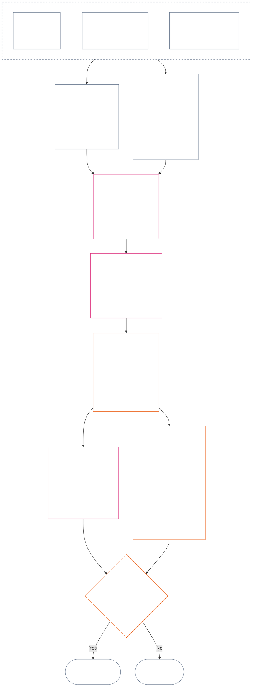

<!-- مکمل باب بارہ اردو ترجمے کا مسودہ۔ ماخذ: core_12.000_standing_measurement.md؛ ماخذ سنیپ شاٹ: a9ad713c15de3c6ba565486590518aa07c7d62fa۔ AI کا مسودہ؛ غیر نظرثانی شدہ؛ غیر پابند مسودہ۔ ; source SHA-256: 7ae49781f558ad90db53cdd4469dd22d8227f0a17b0c7393c3a1d2168263f59d; committed-main row update 2026-11-11 -->

# باب بارہ: کیفیت کی پیمائش — سوال 2، یہ کتنا اچھا یا برا تھا؟

<strong>کارپس میں مقام (غیر عملی): فائل کی ساخت اور پڑھنے کے قواعد</strong>

> یہ فائل **شعوری آئین کا حصہ** ہے اور **صرف دوسری نمبر شدہ `core_*` فائلوں کے ساتھ ایک متن کے طور پر پڑھے جانے پر پابند** ہے۔ اس میں **باب بارہ** — **سوال 2** (*یہ کتنا اچھا یا برا تھا؟*) ہے: LEQU کی بنیادی مقدار اور اس کی حدود، پیمائش کے اِن پٹ کے ابعاد، راستہ نما اوصاف کی فہرستیں، سلاٹ قواعد اور مشترکہ پیمانہ بندی، محوری تعین کے لیے آئینی اِن پٹ، یکجا متناسب LEQU پیمانہ، تعاون کے معیاری پیمانے، کام شدہ مثالیں، اور سوال 3 کو حوالگی (**§1–§9**)۔ تین سوالوں کا خاکہ اور **سوال 1** (*کیا ہوا؟*) — تصدیق شدہ حقائق، واقعات کی اقسام، ریکارڈ کے تقاضے، ریکارڈ کی تحویل اور ریکارڈ کو سنبھالنا — [باب گیارہ](core_11_standing_assessment.md#chapter-eleven-standing-records--question-1-what-happened) میں ہیں۔ سوال 3 (*اس کی وجہ سے کیا ہوتا ہے؟*) [باب تیرہ](../../core_13.000_standing_integration.md#chapter-thirteen-standing-effects-and-integration) میں جاری رہتا ہے؛ اہل خلاف ورزی-محور `s` = 7–9 نتائج کے لیے جائزہ [باب چودہ](../../core_14.000_misconduct_designation.md#chapter-fourteen-anti-constitutional-misconduct) کے آئین مخالف بدعنوان طرزِ عمل کے تعین تک محدود ہے۔ پڑھنے کی ترتیب، پابند/معاون مواد کا فرق، اور کارپس ایڈیشن کا میٹا ڈیٹا [README.md](README.md) میں برقرار رکھا جاتا ہے۔

<strong>سراغ</strong>

- بالادست:
  - [باب گیارہ §1](core_11_standing_assessment.md#1-the-three-questions) (*تین سوالوں کا خاکہ*)؛
  - [باب گیارہ §2](core_11_standing_assessment.md#2-question-1--what-happened) سے [باب گیارہ §6](core_11_standing_assessment.md#6-handling-a-standing-record) تک (*سوال 1 — تصدیق شدہ حقائق، کیفیتی ریکارڈ، تحویل اور سنبھالنا*)؛
  - [آئینی چوکڑی](core_00_preamble.md#constitutional-tetrad)؛
  - [دو آئینی مقاصد](core_00_preamble.md#two-constitutional-aims)؛
  - [تمہید §6 کلیدی عملی عمل کی زنجیریں](core_00_preamble.md#6-key-practical-process-pipelines) (*باب نہم تا پندرہ کی زنجیر*)۔
- اس فائل کے ذیلی حصے:
  - [§1](#1-question-2--how-good-or-bad-was-it) (*سوال 2 — LEQU کی بنیادی مقدار، حیثیت کا رابطہ، حدود اور دائرہ*);
  - [§2](#2-magnitude-and-severity-input-dimensions) (*دونوں محوروں کے پیمائشی اِن پٹ کے ابعاد*)؛
  - [§3](#3-route-descriptor-catalogs-and-measurement-roles) (*راستہ نما اوصاف کی فہرستیں*)؛
  - [§4](#4-slot-grammar-and-shared-scaling) (*سلاٹ قواعد اور مشترکہ پیمانہ بندی*)؛
  - [§5](#5-constitutional-inputs-to-axis-assignment) (*آئینی ماخذ کی رہنمائی*)؛
  - [§6](#6-unified-proportional-lequ-scale--contribution-and-violation-axes) (*دونوں محوروں کا یکجا متناسب LEQU پیمانہ*)؛
  - [§7](#7-standard-contribution-measures) (*اختیار کنندہ کے شائع کردہ تعاون کے معیاری پیمانے*)؛
  - [§8](#8-measurement-illustrations) (*کام شدہ پیمائشی مثالیں*)؛
  - [§9](#9-hand-off-to-question-3--cross-question-measurement-hooks) (*سوال 3 کو حوالگی*)۔
- زیریں:
  - [باب تیرہ](../../core_13.000_standing_integration.md#chapter-thirteen-standing-effects-and-integration) (13.000) (*سوال 3 کے اثرات اور انضمام*)؛
  - [باب چودہ](../../core_14.000_misconduct_designation.md#chapter-fourteen-anti-constitutional-misconduct) (14.000) (*صرف تعین — سوال 2 کی پیمائش دوبارہ نہیں کھولتا*)۔
- ساتھ پڑھیں: [باب پنجم *کیفیت، تعاون اور خلاف ورزی*](../../core_05.035_band_accountability.md#defa3-standing-state-contribution-and-violation) (5.035) (*معیاری تعریف کی رہنمائی*)۔

 

باب بارہ **سوال 2** کا آئینی مالک ہے، جو [باب گیارہ](core_11_standing_assessment.md#chapter-eleven-standing-records--question-1-what-happened) کے تصدیق شدہ حقائق کی پیمائش کرتا ہے۔ یہ [§1 سوال 2 — یہ کتنا اچھا یا برا تھا؟](#1-question-2--how-good-or-bad-was-it) سے شروع ہوتا ہے۔ [باب گیارہ](core_11_standing_assessment.md#chapter-eleven-standing-records--question-1-what-happened) تین سوالوں کے خاکے، سوال 1 اور کیفیتی ریکارڈ کا مالک ہے؛ اس کا اختتام [باب گیارہ §6 کیفیتی ریکارڈ کو سنبھالنا](core_11_standing_assessment.md#6-handling-a-standing-record) پر ہوتا ہے۔

*سادہ الفاظ میں: باب گیارہ طے کرتا ہے کہ کیا ہوا اور کیفیتی ریکارڈ کون رکھتا ہے۔ یہ باب اس کی پیمائش کرتا ہے: تعاون کتنا اچھا تھا یا خلاف ورزی کتنی بری تھی — دو الگ پیمانوں پر جنہیں کبھی جمع کر کے خالص اسکور نہیں بنایا جاتا۔ پیمائش کے بعد کیا ہوتا ہے، یہ باب تیرہ طے کرتا ہے۔*

### 1. سوال 2 — یہ کتنا اچھا یا برا تھا؟

<strong>سراغ</strong>

- بالادست: [باب گیارہ §2](core_11_standing_assessment.md#2-question-1--what-happened) (*سوال 1 — کیفیت کے ریکارڈ اور تصدیق شدہ حقائق*)؛ [باب گیارہ §2.5](core_11_standing_assessment.md#25-verified-input-gate) (*تصدیق شدہ اِن پٹ کی کسوٹی*)؛ [باب گیارہ §4](core_11_standing_assessment.md#4-standing-record-operational-requirements) (*ریکارڈ کے تقاضے*)؛ [باب گیارہ §1](core_11_standing_assessment.md#1-the-three-questions) (*تین سوالوں کا خاکہ*)۔
- زیریں:
  - [§2](#2-magnitude-and-severity-input-dimensions) (*دونوں محوروں کے پیمائشی اِن پٹ کے ابعاد*)؛
  - [§3](#3-route-descriptor-catalogs-and-measurement-roles) (*راستہ نما اوصاف کی فہرستیں*)؛
  - [§4](#4-slot-grammar-and-shared-scaling) (*سلاٹ قواعد اور مشترکہ پیمانہ بندی*)؛
  - [§5](#5-constitutional-inputs-to-axis-assignment) (*محوری تعین کے لیے آئینی ماخذ کی رہنمائی*)؛
  - [§6](#6-unified-proportional-lequ-scale--contribution-and-violation-axes) (*محورِ تعاون اور محورِ خلاف ورزی کا تعین*)؛
  - [§7](#7-standard-contribution-measures) (*اختیار کنندہ کے شائع کردہ معیاری پیمانے برائے تعاون*)؛
  - [§8](#8-measurement-illustrations) (*پیمائش کی کام شدہ مثالیں*)؛
  - [§9](#9-hand-off-to-question-3--cross-question-measurement-hooks) (*سوال 3 کو حوالگی*)؛
  - [باب تیرہ §7.2](../../core_13.000_standing_integration.md#72-competency-bars-and-clearances) (13.000 §7.2) (*سوال 3 میں تعاون — محفوظ تفویض*);
  - [باب تیرہ §5.2](../../core_13.000_standing_integration.md#52-prevention--general-standing-locks) (13.000 §5.2) (*روک تھام کے تالے*)؛
  - [باب تیرہ §6](../../core_13.000_standing_integration.md#6-lock-design-and-enforcement) (13.000 §6) (*تالے کا ڈیزائن اور نفاذ*)۔
- ساتھ پڑھیں: [باب گیارہ §4.1](core_11_standing_assessment.md#41-minimum-record-contents) (*تصدیق شدہ کیفیت ریکارڈ کے خانے؛ باب گیارہ میں کیفیتی اثرات نہیں*)۔

 

*سادہ الفاظ میں: سوال 2، سوال 1 کے تصدیق شدہ حقائق کی پیمائش کرتا ہے۔ یہ پوچھتا ہے کہ **تعاون کتنا اچھا تھا؟** یا **خلاف ورزی کتنی بری تھی؟** یہاں باب پہلی بار پیمائش کے دو باضابطہ محور متعارف کراتا ہے: تصدیق شدہ مدد کے لیے **محورِ تعاون** اور تصدیق شدہ نقصان کے لیے **محورِ خلاف ورزی**۔ دونوں محور الگ رہتے ہیں؛ یہ خالص اسکور کے دو رخ نہیں ہیں۔*

یہ فیصلہ کرنے کے لیے کہ کسی کا تعاون یا خلاف ورزی کس سلاٹ میں آتی ہے، یہ باب **عمر بھر کے مساوی یونٹ (LEQU)** کے ذریعے اثر ناپتا ہے۔ ایک LEQU تقریباً ایک شعوری وجود کی پوری عمر کی فلاح بچانے یا تباہ کرنے کے برابر ہے۔ بات لاشوں یا ڈالروں کی گنتی کی نہیں؛ سوال یہ ہے کہ آیا کسی عمل نے آئینی برادری کی فلاح میں بامعنی تبدیلی کی۔ یہی اکائی ہر شعوری وجود، انسان ہو یا کوئی اور، کے لیے کام کرتی ہے۔

#### 1.1 LEQU کی بنیادی مقدار

**عمر بھر کا مساوی یونٹ** (**LEQU**) اس مکمل عمر کے مساوی آئینی فائدے یا نقصان کی مختصر اکائی ہے، جب اختیار کردہ نفاذ کو عددی پیمانہ بندی درکار ہو۔

- یہ اکائی کسی خاص مادّی بنیاد سے وابستہ نہیں۔
- موجودہ اختیار کنندہ حیاتیاتی انسانی سیاق میں عام انسانی عمر کو پیمانہ بندی کی مثال کے طور پر استعمال کر سکتا ہے، مگر پابند بنیادی معیار شعوری اور آئینی ہے، کسی نوع سے مخصوص نہیں۔

**پوری عمر کے مساوی آئینی فائدہ** سے مراد ایسا تصدیق شدہ فائدہ ہے جو حقوق سے ہم آہنگ، غیر معمولی نہیں بلکہ بامعنی فلاح کی ایک پوری شعوری عمر کو محفوظ رکھنے، بحال کرنے یا آزادی دینے کے مساوی ہو۔ **پوری عمر کے مساوی آئینی نقصان** سے مراد تصدیق شدہ ضرر، ضیاع، تباہی، محرومی، حق تلفی یا خطرے کا وقوع ہے جو پوری عمر کے مساوی آئینی فائدے کو تباہ کرنے، ناجائز طور پر صرف کر ڈالنے یا روک دینے کے برابر ہو۔

#### 1.2 LEQU کے استعمال کی حدود

جب بھی LEQU استعمال ہو، درج ذیل حدود لاگو ہوتی ہیں۔

- **خالص اسکور کا اصول نہیں:** آپ خلاف ورزیوں کو تعاون سے یا تعاون کو خلاف ورزیوں سے "منسوخ" نہیں کر سکتے۔ ہر محور اپنی جگہ قائم ہے۔
- **انسانی عمر کا لازمی پیمانہ نہیں:** LEQU شعوری وجود کے لیے عام ہے؛ یہ ہر باشعور ہستی پر لاگو ہے، صرف انسانوں پر نہیں۔
- **الزام کا پیمانہ نہیں:** الزامات، ابتدائی اندراجی ٹیگ، راستہ بندی کے فیصلے، شہرت، ناپسندیدہ حیثیت یا اخلاقی ناپسندیدگی، **باب گیارہ سیکشن 2.5** کے تحت تصدیق شدہ اِن پٹ اور **سیکشن 6** کے تحت پیمانہ بندی کے بغیر، محورِ تعاون کا فائدہ یا محورِ خلاف ورزی کی شدت فراہم نہیں کرتے۔
- **حقوق کی تجارت کا اجازت نامہ نہیں:** کارکردگی، پیداواری صلاحیت، جدت، بوجھ میں کمی، سلامتی، جوابی کارروائی، ہنگامی ردعمل یا ادارہ جاتی ضرورت کے طور پر پیش کیے گئے دعووں کی قدر کم یا انہیں مسترد کرنا لازم ہے، جہاں ان کا انحصار درج ذیل پر ہو:
  - جبر؛
  - امتیازی بوجھ کی منتقلی؛
  - ماحولیاتی وسائل کی کمی؛
  - چھپی ہوئی بلا معاوضہ محنت؛
  - ایسی غیر شفافیت جس سے بچا جا سکتا ہو؛
  - حقوق کی تہہ کو تنگ کرنا؛
  - قبضہ؛
  - گمراہ کن متبادل پیمانے؛
  - چیلنج پذیری کا نقصان؛ یا
  - ایسی تجمیع جس کا جائزہ نہ لیا جا سکے۔

#### 1.3 صرف سوال 2 — دائرہ اور راستہ بندی

یہ حصہ صرف سوال 2، یعنی پیمائش کے مرحلے، سے متعلق ہے۔ یہ پہلے سے تصدیق شدہ حقائق (سوال 1) لیتا ہے اور پوچھتا ہے کہ تعاون کتنا اچھا یا خلاف ورزی کتنی بری تھی۔

- **باب گیارہ سیکشن 2** کے تحت پہلے سے تصدیق شدہ اور **باب گیارہ سیکشن 4** کے تحت کیفیت ریکارڈ میں درج حقائق سے شروع کریں، اور انہیں **سیکشن 2** کے ابعاد سے ناپیں۔
- پھر ہر قسم کی مدد یا نقصان کو فہرستوں میں سے اس کا معیاری نام دیں: مدد کے لیے **فائدہ-راستہ** فہرست (**سیکشن 3.1**) اور نقصان کے لیے **ضرر-راستہ** فہرست (**سیکشن 3.2**)۔
- ہر نام یہ بھی بتاتا ہے کہ اس قسم کی مدد یا نقصان، *یہ کتنا اچھا* یا *کتنا برا* تھا، میں کتنا شمار ہوتا ہے۔
- فائدے کے بعد کیا ہوتا ہے، اس کے قواعد [فائدے والے پہلو](../../core_13.000_standing_integration.md#72-competency-bars-and-clearances) پر ہیں، اور ضرر کے بعد کیا ہوتا ہے، اس کے قواعد [نقصان والے پہلو](../../core_13.000_standing_integration.md#52-prevention--general-standing-locks) پر ہیں۔
- اگلا قدم سوال 3 طے کرتا ہے۔ [باب تیرہ §4 وصفی انضمام اور اطلاق کی معمول کاری](../../core_13.000_standing_integration.md#4-descriptor-integration-and-attachment-normalization) سے شروع کریں۔

#### 1.4 شعوری حیثیت کا رابطہ

کیفیت کی پیمائش یہ **طے نہیں** کرتی کہ کوئی ہستی **شعوری وجود** ہے یا نہیں۔

- حیثیت کے تنازعات [شعوری حیثیت کے فیصلے](../../core_05.055_band_participation.md#sentience-status-adjudication) اور [آرٹیکل VI-B](core_06_rights_part_b.md#article-vi-b-sentience-status-adjudication-floor) (*شعوری حیثیت کے فیصلے کی حقوقی تہہ*) کے پاس جاتے ہیں۔ وہ LEQU اسکور یا درجہ بندی کے ریکارڈ کے پاس نہیں جاتے۔
- جب [متنازع شعوری زندگی](../../core_05.055_band_participation.md#contested-sentient-life) کے تحت حیثیت کا تنازع کھلا ہو، **آرٹیکل VI-B** (*شعوری حیثیت کے فیصلے کی حقوقی تہہ*) بطورِ طے شدہ اس ہستی کو شامل کرتا ہے: تنازع کے فیصلے تک اسے پھر بھی ناپا جا سکتا ہے اور وہ پھر بھی کیفیت ریکارڈ دائر کر سکتی ہے، اور عاملین کو صرف کھلے تنازع کی بنا پر اس کی کیفیتی حیثیت سے انکار نہیں کرنا چاہیے۔
- اگر ہستی کو [شعوری وجود](../../core_05.055_band_participation.md#sentient) قرار دیا جائے، یا فیصلے کے بعد اس کی حیثیت گھٹائی یا بحال کی جائے، اور اس فیصلے کا خود بھی جائزہ لیا جا سکتا ہو:
  - اس کے بعد سے کیفیت ریکارڈ کا موضوع اپ ڈیٹ کیا جائے؛ اور
  - ناجائز اخراج کو پیچھے کی تاریخ سے لاگو کر کے اس دوران ہستی کی پیمائش کے لیے اہلیت ختم نہیں کی جانی چاہیے، سوائے [ازالہ اور تلافی](../../core_05.035_band_accountability.md#redress-and-remediation) کے ذریعے۔

### 2. مقدار اور شدت کے اِن پٹ کے ابعاد

*سادہ الفاظ میں: یہ حصہ پہلے بتاتا ہے کہ سوال 2 کیا پیدا کرتا ہے (**سیکشن 2.1**)، پھر وہ چیزیں گنواتا ہے جنہیں تصدیق شدہ تعاون یا تصدیق شدہ خلاف ورزی کی پیمائش کرتے وقت دیکھنا ہے (**سیکشن 2.2**)۔ ہر محور کی پیمائش الگ ہوتی ہے۔ مشترکہ پیمانہ بندی کے قواعد **سیکشن 4.2** میں ہیں، اور سلاٹ **سیکشن 6** کے پیمانے سے آتا ہے۔*

سلاٹ کا پیمانہ یہ ناپتا ہے کہ آئینی نتیجہ کتنا بڑا ہے اور کس نوعیت کا ہے۔ اس میں صرف تصدیق شدہ نتائج گنے جاتے ہیں۔

**پیمانہ کیا گنتا ہے، اور اس کا آئین کے بنیادی امتحانات سے کیا تعلق ہے:**

- **[دو آئینی مقاصد](core_00_preamble.md#two-constitutional-aims):** دونوں محور **شگفتگی** اور **استمرار** پر اثر ناپتے ہیں۔ محورِ تعاون انہیں آگے بڑھاتا ہے۔ محورِ خلاف ورزی انہیں پیچھے لے جاتا ہے۔
- **[دو بنیادی سوالات](core_00_preamble.md#two-fundamental-questions):** ہر محور ایک سوال کے تصدیق شدہ حقائق فراہم کرتا ہے۔ ایک کا جواب دوسرے کا جواب نہیں، اس لیے دونوں محوروں کو کبھی ایک خالص میزان میں نہیں ملایا جاتا۔
  - **پہلا سوال:** محورِ تعاون تصدیق شدہ حقائق فراہم کرتا ہے۔ کیا نظام ایسے طرزِ عمل کو انعام دیتا ہے جو شعوری وجودوں کو شگفتہ اور برقرار رہنے، سچ بولنے اور ضرر کی تلافی کرنے میں مدد دے؟
    - **شمار ہوتا ہے:** تصدیق شدہ آئینی فائدہ، بشمول خطرے میں تصدیق شدہ کمی۔
    - **شمار نہیں ہوتا:** خام پیداوار، وقار، دولت، کسی چیز کے استعمال کی مقدار، رفتار یا ادارے کا حجم۔
  - **دوسرا سوال:** محورِ خلاف ورزی تصدیق شدہ حقائق فراہم کرتا ہے۔ کیا نظام ایسے طرزِ عمل کو انعام دیتا ہے جو بلا جواز نقصان پہنچائے، گمراہ کرے، خارج کرے، تاخیر کرے، ضیاع کرے یا دوسروں پر لاگت ڈالے؟
    - **شمار ہوتا ہے:** تصدیق شدہ آئینی نقصان، ضرر، ضیاع، کھوئے ہوئے امکانات (حق تلفی)، خطرہ یا خطرے میں اضافہ۔
    - **اپنے طور پر شمار نہیں ہوتا:** ناپسندیدہ حیثیت، الزامات یا اخلاقی ناپسندیدگی۔
- **[آئینی چوکڑی](core_00_preamble.md#constitutional-tetrad):**
  - **نگرانی اور جوابدہی:** "تصدیق شدہ" کا مطلب ہے کہ نامزد عامل نتیجے کا جواب دہ ہو، اور کوئی فریق اپنے دعوے کی خود تصدیق نہ کرے۔
  - **بروقت کارروائی:** قابلِ اجتناب تاخیر کو خود ایک حقیقت کے طور پر نوٹ کیا جاتا ہے، نقصان کے حجم میں ضم نہیں کیا جاتا۔

#### 2.1 سوال 2 کیا پیدا کرتا ہے

سوال 2 ہر محور کے لیے یہ چیزیں کیفیت ریکارڈ میں درج کرتا ہے۔ یہ پیمائشیں ہیں، کیفیتی اثرات نہیں (وہ نتائج جن کا فیصلہ سوال 3 کرتا ہے):

| **کیا پیدا ہوتا ہے** | **محورِ تعاون** | **محورِ خلاف ورزی** |
| --- | --- | --- |
| **کہاں لکھا جاتا ہے** | تعاون کے کیفیت ریکارڈ میں۔ | خلاف ورزی کے کیفیت ریکارڈ میں۔ |
| **سلاٹ** | قابلِ اطلاق **محورِ تعاون کا بلند ترین سلاٹ** (`s` = 1–9)۔ | قابلِ اطلاق **محورِ خلاف ورزی کا بلند ترین سلاٹ** (`s` = 1–9)۔ |
| **راستہ نما اوصاف** | قابلِ اطلاق **فائدہ-راستہ اوصاف**، باہم جمع کیے ہوئے۔ | قابلِ اطلاق **ضرر-راستہ اوصاف**، باہم جمع کیے ہوئے۔ |
| **سوال 3 کو دیے گئے اِن پٹ** | وہ اِن پٹ جو طے کرتے ہیں کہ تعاون کی شناخت کا نقطۂ آغاز کیا ہو، [باب تیرہ §7 تعاون کے نتائج — دوسرا](../../core_13.000_standing_integration.md#7-contribution-consequences-second) کے تحت۔ | وہ اِن پٹ جو طے کرتے ہیں کہ پہلے سے لاگو تالا بینڈ (تالے کی سختی کا ابتدائی نقطۂ آغاز) کیا ہو، [باب تیرہ §6 تالے کا ڈیزائن اور نفاذ](../../core_13.000_standing_integration.md#6-lock-design-and-enforcement) کے تحت۔ |
| **کل LEQU** | ہر متعلقہ قسم کے فائدے (ماحولیاتی، نظامی یا وسائل سے متعلق) کا الگ جائزہ لیں، پھر پورے تعاون کے لیے ایک LEQU مجموعہ درج کریں۔ | ہر متعلقہ قسم کے نقصان (ماحولیاتی نقصان، نظامی نقصان یا وسائل کا خسارہ) کا الگ جائزہ لیں، پھر پوری خلاف ورزی کے لیے ایک LEQU مجموعہ درج کریں۔ |

یاد دہانی: ان میں سے کوئی چیز کھلے خلاف ورزی ریکارڈ کو منسوخ نہیں کرتی۔ عدم تلافی کا اصول [باب گیارہ §2.4 مربوط کیفیتی ریکارڈ اور عدمِ تلافی کا پل](core_11_standing_assessment.md#24-linked-standing-records-and-no-offset-bridge) میں ہے۔

#### 2.2 تعاون کے مقداری اِن پٹ اور خلاف ورزی کی شدت کے اِن پٹ کے ابعاد

**سوال 2 — یہ کتنا اچھا یا برا تھا؟** یہ طے کرنے کے لیے کہ تعاون محورِ تعاون پر کہاں آتا ہے یا خلاف ورزی محورِ خلاف ورزی پر کہاں آتی ہے (اس کا **سلاٹ**، 1 سے 9 تک) اور کون سے فائدے یا ضرر کے اوصاف لاگو ہوتے ہیں، تین حصوں سے گزریں۔ کئی اوصاف ایک ساتھ لاگو ہو سکتے ہیں، اور جمع ہوتے ہیں۔ نتائج متعلقہ محور کے کیفیت ریکارڈ میں درج کریں، جیسا کہ **سیکشن 2.1** بتاتا ہے۔ حصہ 2 کے لیے **سیکشن 6** میں یکجا پیمانہ ہے، اور فائدے اور نقصان کے لیے یہی پیمانہ ہے۔ یہ بتاتا ہے کہ LEQU میں کل فائدے یا نقصان کا اندازہ کیسے لگانا ہے (عمر بھر کا مساوی یونٹ، تقریباً ایک پوری زندگی کی فلاح) اور ہر مقدار کس سلاٹ میں آتی ہے۔ محورِ تعاون کے سلاٹ چار بینڈ میں گروہ بند ہیں۔

**1. دیکھیں اسے کیسے پیدا کیا گیا۔** دونوں محور اس معاملے کو مختلف طرح لیتے ہیں:

- **تعاون (طرزِ عمل کا معیار):** اس سے شمار ہونے والے فائدے میں اضافہ یا کمی ہو سکتی ہے: کیا اسے سراغ پذیر رکھا گیا، کیا اس نے دوسروں پر لاگت ڈالنے سے گریز کیا، کیا اسے احتیاط سے کیا گیا، اور کیا یہ آئین سے مطابقت رکھتا ہے؟ پانچ جانچیں [§2.2.1 فائدہ پیدا کرنے کے طریقے کا اثر اس پر کہ کیا شمار ہوتا ہے](#221-how-the-way-a-benefit-was-produced-affects-what-counts) میں ہیں۔
- **خلاف ورزی (طرزِ عمل کی نوعیت):** اسے اثر کے حجم سے الگ درج کیا جاتا ہے۔ فرض، غفلت، دھوکا، پردہ پوشی، جواب دہی میں رکاوٹ، جبر، تشدد، نیت، سنگ دلی اور ساختی سہولت یہ طے کرتے ہیں کہ کون ذمہ دار ہے، کون سے تحفظات درکار ہیں، اور جواب کیسے دیا جائے۔ ان میں سے کوئی بھی slot تبدیل نہیں کرتا؛ ہر ایک کے اندراج کے قواعد [§2.2.2 نقصان کس طرح پہنچا، اس کا اندراج](#222-how-the-way-a-harm-was-caused-is-recorded) میں ہیں۔

**2. مقدار طے کریں: فائدہ یا نقصان کتنا بڑا ہے؟** یہی سلاٹ طے کرتا ہے۔

| **کیا دیکھنا ہے** | **اس کا اثر** | **کہاں متعین ہے** |
| --- | --- | --- |
| **مجموعی حجم (LEQU)** | بنیادی پیمانہ، اور سلاٹ پر اختیار رکھنے والا پیمانہ۔ تعاون کے لیے یہ کیا گیا کل تصدیق شدہ فائدہ ہے، جسے LEQU میں گنا جاتا ہے۔ خلاف ورزی کے لیے یہ کل تصدیق شدہ آئینی نقصان ہے۔ باب چودہ میں بدعنوان طرزِ عمل کا تعین الگ ہوتا ہے۔ | [§6 یکجا متناسب LEQU پیمانہ](#6-unified-proportional-lequ-scale--contribution-and-violation-axes) |
| **کن تک پہنچتا ہے (کتنے، کتنی گہرائی سے، کتنی حساسیت کے ساتھ)** | LEQU کے تخمینے اور فائدے یا ضرر کی اہمیت (اس کی مادیت) میں ترمیم کرتا ہے۔ | [§4.2 مشترکہ اثر پیمانہ بندی کے قواعد](#42-shared-impact-scaling-rules)؛ [مادیت](../../core_05.050_band_oversight.md#materiality) |
| **کتنی دیر قائم رہتا ہے (مدت؛ فائدے کا پائیدار ہونا، ضرر کا ناقابلِ واپسی ہونا)** | LEQU کے تخمینے میں ترمیم کرتا ہے۔ تعاون کے لیے دیرپا ذمہ دارانہ انتظام، نسلوں تک فائدہ یا ادارے کی دیرپا مرمت، بلند سلاٹس کی طرف اشارہ کرتی ہے۔ خلاف ورزی کے لیے دیرپا صدمہ، ناقابلِ تلافی نقصان اور شعوری وجودوں کی خود عمل کرنے کی صلاحیت کو دیرپا ضرر، کل نقصان کے تخمینے کو بڑھاتے ہیں۔ | [§4.2 مشترکہ اثر پیمانہ بندی کے قواعد](#42-shared-impact-scaling-rules) |
| **کتنی دور تک پہنچتا ہے (مقامات یا اداروں کے پار)** | LEQU کے تخمینے میں ترمیم کرتا ہے۔ تعاون کے لیے، مثلاً، برادریوں یا اداروں میں پھیلا فائدہ، یا تہذیب کی سطح پر فائدہ۔ خلاف ورزی کے لیے برادریوں، اداروں یا تہذیب میں پھیلا نقصان، کل نقصان کا تخمینہ بڑھا سکتا ہے۔ | [§4.2 مشترکہ اثر پیمانہ بندی کے قواعد](#42-shared-impact-scaling-rules) |

**3. فائدے یا ضرر کی اقسام (راستے) کا نام دیں۔** تصدیق شدہ فائدہ یا ضرر کے وقوع کے طریقے کا نام دیں۔ ایک سے زیادہ لاگو ہو سکتے ہیں اور جمع ہوتے ہیں۔ فہرستیں [**فائدہ-راستہ وصفی فہرست**](#31-contribution-route-descriptor-catalog-and-measurement-roles) اور [**ضرر-راستہ وصفی فہرست**](#32-violation-route-descriptor-catalog-and-measurement-roles) میں ہیں۔

##### 2.2.1 فائدہ پیدا کرنے کے طریقے کا اثر اس پر کہ کیا شمار ہوتا ہے

محورِ تعاون کا سلاٹ منتخب کرنے سے پہلے یہ جانچیں:

| **آپ کو کیا ملتا ہے** | **فائدے پر اس کا اثر** |
| --- | --- |
| مسئلے کی اطلاع ملنے کے بعد فوری اور تصدیق شدہ اصلاح | جب اس سے حقیقی، قابلِ مظاہرہ فائدہ ہو تو **تندہی** (محتاط اور ذمہ دار طرزِ عمل) شمار ہو سکتی ہے۔ |
| دوسروں پر ڈالا گیا ضرر یا چھپایا گیا بوجھ | متنازع راستے (وہ مخصوص طریقہ جس پر فائدہ کا کریڈٹ دیا جاتا ہے) کے فائدے کا کریڈٹ محدود کر سکتا ہے یا اسے خارج کر سکتا ہے۔ |
| قبضے کا تصدیق شدہ خطرہ (انتظام محدود مفادات کے قابو میں آ سکتا ہو)، ساختی انحصار (شعوری وجودوں کو اس پر انحصار کے لیے ڈھالا گیا ہو)، یا اخراج اور لاک اِن کا ڈیزائن (چھوڑنا مشکل ہو) | اچھے ذمہ دارانہ انتظام کے کریڈٹ کو محدود کرتا ہے۔ |
| رسائی پذیری یا شرکت کی رکاوٹ کی تصدیق شدہ مرمت | فائدے کی اہمیت (اس کی مادیت) بڑھا سکتی ہے اور **سیکشن 3.1** کے تحت **رسائی اور شمولیت** فائدہ-راستہ وصف کو سہارا دے سکتی ہے۔ |
| ایسا اہم انعام جو آئین کے خلاف ترغیبی بندوبست، آئین مخالف طرزِ عمل، یا مادی طور پر ناقص عمل سے حاصل ہوا ہو | طے شدہ طور پر اسے فائدہ نہیں گنا جاتا۔ اس صورت میں [باب تیرہ §6.4.2 غیر ہم آہنگ انعامات](../../core_13.000_standing_integration.md#642-misaligned-rewards) اور [آرٹیکل XXVIII-A](../../core_06.020_rights_part_e.md#incentive-alignment-adoption-transition-carve-out) (*مرحلہ وار اختیار اور حقوق کی کم از کم سطح کا تسلسل*) کی اختیار منتقلی کی حد لاگو کریں۔ |

##### 2.2.2 ضرر پہنچانے کے طریقے کا اندراج کیسے ہوتا ہے

نقصان کا حجم (اوپر حصہ 2 کا LEQU مجموعہ) slot طے کرتا ہے۔ نقصان کیسے پہنچا، یہ نہیں؛ اس لیے ذیل میں ہر طرزِ عمل الگ درج کیا جاتا ہے۔

یہ ذیلی حصہ باب بارہ میں اصول ایک بار بیان کرتا ہے۔ **صرف اس وجہ سے slot نہ بڑھائیں نہ گھٹائیں کہ کسی واقعے یا طرزِ عمل کو درج ذیل میں سے کوئی صفت دی گئی ہے:**

- فرض؛
- غفلت؛
- نیت؛
- پردہ پوشی؛
- تکرار؛
- شدت میں اضافہ؛
- جبر؛
- تشدد؛
- آزادی کو خطرہ؛
- قابلِ اصلاح ہونا؛ یا
- پسندیدہ نتیجہ۔

طرزِ عمل کی نوعیت کے حقائق الگ، قابلِ سراغ وصفوں کے طور پر درج ہوتے ہیں۔ وہ نسبت، جائزے کی شدت، تحفظات، تدارک یا باب چودہ کے کسی تعین کو کنٹرول کر سکتے ہیں۔ وہ slot تک صرف تصدیق شدہ نتائج کے ذریعے پہنچتے ہیں: اگر طرزِ عمل سے نقصان بڑھا تو اسے LEQU مجموعے میں صرف ایک بار شمار کیا جاتا ہے، اور slot مجموعے کے مطابق ہوتا ہے۔

**وہ طرزِ عمل جو نقصان میں اضافہ کرتا ہے، ایک بار حجم میں شمار ہو:**

| **آپ کو کیا ملتا ہے** | **اندراج کیسے کریں** |
| --- | --- |
| جواب دینے یا معاملہ آگے بڑھانے میں قابلِ اجتناب تاخیر، جہاں کارروائی کا فرض اور اس کی صلاحیت موجود تھی | طرزِ عمل سے متعلق الگ حقیقت کے طور پر درج کریں۔ تاخیر سے ہونے والا کوئی اضافی نقصان LEQU تخمینے میں ایک بار شمار ہوتا ہے۔ |
| فورم کی سالمیت (اس کے منصفانہ ہونے) کو آزادانہ طور پر تصدیق شدہ نقصان | LEQU تخمینے میں بالکل ایک بار شمار ہوتا ہے۔ بے ایمانی سے اخفا، دستبرداری کے عمل کو دانستہ ناکام بنانا، جبر، آزادی کو خطرہ، اور طرزِ عمل کے دیگر حقائق الگ وصف رہتے ہیں۔ |
| **جواب دہی میں رکاوٹ** (اس نظام میں تصدیق شدہ مداخلت جو ذمہ دار کسی شخص کو جواب دہ بناتا ہے، مثلاً شواہد کی سالمیت، تصدیق، فورم کا عمل، standing ریکارڈ، تدارک کی مدت، یا اعتراض اور ازالے کے راستے) | الگ طرزِ عمل کے حقیقت کے طور پر درج ہوتا ہے۔ gated pathway پر اس سے پیدا ہونے والا اضافی نقصان LEQU تخمینے میں ایک بار شمار ہوتا ہے۔ |

**ضرر کے حجم سے الگ درج ہونے والے طرزِ عمل کے حقائق:**

| **آپ کو کیا ملتا ہے** | **اندراج کیسے کریں** |
| --- | --- |
| فریب، چھپاؤ، بچاؤ، اطلاع کے بعد طرزِ عمل دہرانا، لاپرواہی، ساختی طور پر ممکن بنانا (چیزوں کو اس طرح ترتیب دینا کہ ضرر آسان یا ممکن ہو)، یا بڑے انحصاری عدم توازن کا ناجائز فائدہ اٹھانا (ایسے شخص کا استحصال جو آپ پر بہت زیادہ انحصار کرے) | ہر ایک الگ درج شدہ طرزِ عمل کی حقیقت رہتا ہے۔ |
| تشدد، جبر، جوڑ توڑ یا آزادی کو خطرہ | الگ درج رہتا ہے اور سلاٹ کچھ بھی ہو، زیادہ مضبوط حفاظتی اقدامات لازم کر سکتا ہے۔ |
| [سنگ دلی](../../core_05.035_band_accountability.md#cruelty) (تکلیف کو بذاتِ خود مقصد بنانا، یا ضروری اور متناسب حد سے زیادہ بلاجواز یا تذلیل آمیز نقصان) | الگ طرزِ عمل کے حقیقت کے طور پر درج ہوتی ہے۔ [باب تیرہ §5 خلاف ورزی، اصلاح اور روک تھام](../../core_13.000_standing_integration.md#5-violation-correction-and-prevention) کے تحت مضبوط تحفظات اور تذلیل آمیز تدارک پر پابندیاں درکار ہو سکتی ہیں۔ |

**ذمہ داری اور نسبت:**

| **آپ کو کیا ملتا ہے** | **اندراج کیسے کریں** |
| --- | --- |
| ذمہ داری کا انتشار (ذمہ داری کیسے بٹی: کس نے کون سا سببی کردار ادا کیا، کون سا اختیار یا کنٹرول رکھا، ضرر کی پیش بینی کر سکتا تھا، اس سے فائدہ اٹھایا، اسے چھپایا یا اسے روک سکتا تھا) | یہ **شعوری دائرے** کا حصہ نہیں، اور کسی کو گروہ کا رکن ہونے پر موردِ الزام ٹھہرانے کی اجازت نہیں دیتا۔ |
| ضرر کے ساتھ چلنا یا اس کے خلاف مزاحمت نہ کرنا | فرض پر مبنی، سنگین تر یا اجتماعی جوابدہی کے کردار کا نتیجہ صرف تب اخذ کرنے میں مدد دے سکتا ہے جب **باب گیارہ سیکشن 4.1 اور 4.3** میں درکار اس مخصوص عامل سے ربط تصدیق شدہ ہو۔ |

**ناموافق انعامات:**

| **آپ کو کیا ملتا ہے** | **اندراج کیسے کریں** |
| --- | --- |
| آئین کے خلاف اہم انعام کو بروقت محفوظ رپورٹنگ کے بغیر (یعنی ایسی رپورٹنگ جو انتقامی کارروائی سے محفوظ ہو) جان بوجھ کر قبول کرنا یا اپنے پاس رکھنا | [باب تیرہ §6.4.2 غیر ہم آہنگ انعامات](../../core_13.000_standing_integration.md#642-misaligned-rewards) کے تحت، [آرٹیکل XXVIII-A](../../core_06.020_rights_part_e.md#incentive-alignment-adoption-transition-carve-out) (*مرحلہ وار اختیار اور حقوق کی کم از کم سطح کا تسلسل*) کے تابع درج ہوتا ہے۔ اس سے پیدا ہونے والا صرف تصدیق شدہ آئینی نقصان slot پر اثر ڈالتا ہے۔ |

**غیر ہم آہنگ انعام کی حد۔** یہ باب صرف یہ ناپتا ہے کہ تصدیق شدہ غیر ہم آہنگ انعام (آئین کے خلاف انعام) Contribution Axis یا Violation Axis کو کیسے متاثر کرتا ہے۔ [باب تیرہ §6.4.2 غیر ہم آہنگ انعامات](../../core_13.000_standing_integration.md#642-misaligned-rewards) رپورٹنگ کی ذمہ داری، استثنا، انعام چھوڑنے (ضبطی) کے نتائج، اصلاحی فرائض، اور حوالگی کے قواعد مقرر کرتا ہے۔

### 3. راستہ نما اوصاف کی فہرستیں اور پیمائشی کردار

*سادہ الفاظ میں: ذیل کی دو فہرستیں ایسی تصدیق شدہ مدد (**سیکشن 3.1**) اور ضرر (**سیکشن 3.2**) کی اقسام کے نام دیتی ہیں جو کیفیت ریکارڈ میں آ سکتی ہیں۔ وصف بتاتا ہے کہ فائدہ یا ضرر کیسے ہوا؛ اوصاف جمع ہو سکتے ہیں اور سلاٹ کے تابع ہیں۔*

**وصف کا قاعدہ۔** ذیل کی دو فہرستیں، [§3.1 تعاون کے راستے کے وصفی مجموعے اور پیمائش میں کردار](#31-contribution-route-descriptor-catalog-and-measurement-roles) اور [§3.2 خلاف ورزی کے راستے کے وصفی مجموعے اور پیمائش میں کردار](#32-violation-route-descriptor-catalog-and-measurement-roles)، دونوں محوروں کے اوصاف کی سرکاری فہرست ہیں۔ وصف بتاتا ہے کہ تصدیق شدہ فائدہ یا ضرر **کیسے** ہوا۔ یہ قواعد لاگو ہوتے ہیں:

- اوصاف جمع ہوتے ہیں، اور کوئی وصف دوسرے کو خارج نہیں کرتا: جہاں تصدیق شدہ حقائق اس کا جواز دیں وہاں ایک کیفیت ریکارڈ میں کئی اوصاف ہو سکتے ہیں۔
- اوصاف سلاٹ کے ماتحت ہیں: سلاٹ بتاتا ہے کہ فائدہ یا ضرر کتنا بڑا تھا؛ اوصاف وقوع کے طریقے کی تفصیل بڑھاتے ہیں مگر اس کی جگہ کبھی نہیں لیتے۔
- درج اوصاف بنیادی فہرست ہیں، مکمل مجموعہ نہیں؛ فہرست فائدے یا ضرر کی دوسری اقسام کو خارج نہیں کرتی۔
- نفاذ مستحکم شناخت کار (اپنی مقررہ IDs) استعمال کر کے فہرست سے نقشہ بنا سکتا ہے، مگر متضاد درجہ بندی نہیں بنا سکتا جس کی اقسام ایک دوسرے سے خارج ہوں اور کیفیتی ریکارڈ میں صرف ایک وصف آ سکے۔
- حقائق کی تصدیق سے پہلے، کسی مبینہ وصف کی بنیاد پر شواہد کو جائز طور پر محفوظ کیا جا سکتا ہے، مقدمہ چھانٹا جا سکتا ہے یا عارضی حفاظتی اقدامات کیے جا سکتے ہیں۔
- صرف تصدیق شدہ وصف سوال 2 کے نتیجے کے طور پر درج ہو سکتا ہے یا کیفیت پر اثر ڈال سکتا ہے۔

#### 3.1 تعاون کے راستے کے وصفی مجموعے اور پیمائش میں کردار

یہ فائدہ-راستہ اوصاف اور ان میں سے ہر ایک کی سوال 2 میں پیمائش کا کام ہے (یہ کتنا اچھا تھا؟)۔ انہیں پانچ شعبوں میں ترتیب دیا گیا ہے، ہر شعبے کی ایک جدول ہے؛ [§3.2 خلاف ورزی کے راستے کے وصفی مجموعے اور پیمائش میں کردار](#32-violation-route-descriptor-catalog-and-measurement-roles) میں بھی یہی پانچ شعبے اسی ترتیب سے ہیں۔ سوال 3 میں ان کا کردار، محفوظ تفویض، [باب تیرہ §7.2 اہلیت کی رکاوٹیں اور منظوریوں](../../core_13.000_standing_integration.md#72-competency-bars-and-clearances) میں ہے۔

**فہرست کی تکمیلیت۔** اگر نفاذ ایک قطار یا ایک لیبل میں کئی اوصاف دکھائے تو اس قطار یا لیبل کو ہر لاگو وصف سے نقشہ ہونا چاہیے۔ یہ فہرست صرف اوصاف کے نام اور سوال 2 میں ان کی پیمائش متعین کرتی ہے۔ سوال 3 کے قواعد (اطلاق، تلافی، تالے، منظوری اور دیگر کیفیتی اثرات) صرف باب تیرہ میں ملتے ہیں۔

##### 3.1.1 جسمانی سلامتی، تعلقات، نگہداشت اور فاعلیت

| **فائدہ-راستہ وصف** | **سوال 2 میں کیا ناپتا ہے** |
| --- | --- |
| **جسم، ذہن اور/یا برادری کا سکون** | جسمانی، نفسیاتی اور برادری کے سکون سے فائدہ۔ یہ فائدے کی اہمیت (اس کی مادیت) میں ترمیم کرتا ہے۔ |
| **قابلِ اعتماد تعلقات** | ایسے تعلقات سے فائدہ جن پر بھروسا کیا جا سکے، بشمول اعتماد کے فرض پر مبنی تعلقات، ان حالات میں جہاں دونوں طرفیں غیر مساوی ہوں۔ |
| **نگہداشت اور انحصار کی معاونت** | دوسروں پر منحصر شعوری وجودوں کی تصدیق شدہ نگہداشت۔ غیر رسمی نگہداشت بھی شمار ہوتی ہے جب اسے دکھایا جا سکے۔ |
| **رسائی اور شمولیت** | حقیقی شرکت اور رسائی پذیری سے فائدہ۔ جہاں ایک فریق دوسرے پر بہت زیادہ منحصر ہو، وہاں یہ فائدے کی اہمیت میں ترمیم کرتا ہے۔ |

##### 3.1.2 مرمت، ملکیت اور وسائل

| **فائدہ-راستہ وصف** | **سوال 2 میں کیا ناپتا ہے** |
| --- | --- |
| **تلافی اور بحالی کا فائدہ** | مرمت، معاوضے اور ضرر کم کرنے سے فائدہ۔ |
| **وسائل کا ذمہ دارانہ انتظام** | مادّی وسائل کی احتیاط سے دیکھ بھال اور ان کی قابلِ بھروسا تقسیم۔ |

##### 3.1.3 علم، تعلیم، ریکارڈ اور دریافت

| **فائدہ-راستہ وصف** | **سوال 2 میں کیا ناپتا ہے** |
| --- | --- |
| **اطلاعاتی دائرے کی سالمیت** | ریکارڈ، شفافیت اور ابلاغ کو مضبوط کرنا۔ |
| **تعلیم اور صلاحیت سازی** | سیکھنے، خواندگی اور شعوری وجودوں کی خود عمل کرنے کی صلاحیت میں اضافے سے فائدہ۔ سلاٹ کل LEQU فائدے کے مطابق ہوتا ہے۔ |
| **STEM اور دریافت میں تعاون** | ایسی دریافتیں جنہیں دوسرے دہرا سکیں، اور ایسی تحقیق جو چیزوں کو زیادہ محفوظ بنائے۔ |

##### 3.1.4 نظام اور آئینی عمل

| **فائدہ-راستہ وصف** | **سوال 2 میں کیا ناپتا ہے** |
| --- | --- |
| **نظامی بہتری** | اداروں سے گزرنے والے عمل کو درست کرنا اور خطرہ کم کرنا۔ |
| **آئینی ہم آہنگی** | حقوق کی تہہ کو مضبوط کرنا اور فیصلوں کو چیلنج کرنا آسان بنانا۔ |

##### 3.1.5 ماحولیات اور تندہی

| **فائدہ-راستہ وصف** | **سوال 2 میں کیا ناپتا ہے** |
| --- | --- |
| **ماحولیاتی ذمہ دارانہ انتظام** | مسکن اور حیاتیاتی تنوع کو فائدہ، اور آب و ہوا کی ذمہ دارانہ کارروائی۔ |
| **تندہی** | قابلِ پیش بینی خطرات روکنا اور باصلاحیت نگرانی کرنا۔ |

#### 3.2 خلاف ورزی کے راستے کے وصفی مجموعے اور پیمائش میں کردار

یہ ضرر-راستہ اوصاف اور سوال 2 میں ہر ایک کی پیمائش کا کام ہے (یہ کتنا برا تھا؟)۔ انہیں پانچ شعبوں میں ترتیب دیا گیا ہے، ہر شعبے کی ایک جدول ہے، اور انہی پانچ شعبوں اور اسی ترتیب کو [§3.1 تعاون کے راستے کے وصفی مجموعے اور پیمائش میں کردار](#31-contribution-route-descriptor-catalog-and-measurement-roles) میں بھی استعمال کیا گیا ہے۔ سوال 3 کے لیے انضمام اور اطلاق کے قواعد [باب تیرہ §4 وصفی انضمام اور اطلاق کی معمول کاری](../../core_13.000_standing_integration.md#4-descriptor-integration-and-attachment-normalization) میں، اور روک تھام اور تالے کے ڈیزائن [باب تیرہ §5.2 روک تھام — عمومی کیفیتی تالے](../../core_13.000_standing_integration.md#52-prevention--general-standing-locks) اور [باب تیرہ §6 تالے کا ڈیزائن اور نفاذ](../../core_13.000_standing_integration.md#6-lock-design-and-enforcement) میں ہیں۔

**فہرست کی تکمیلیت۔** اگر نفاذ ایک قطار یا ایک لیبل میں کئی اوصاف دکھائے تو اس قطار یا لیبل کو ہر لاگو وصف سے نقشہ ہونا چاہیے۔ یہ فہرست صرف اوصاف کے نام اور سوال 2 میں ان کی پیمائش متعین کرتی ہے۔ سوال 3 کے قواعد (اطلاق، تلافی، تالے، منظوری اور دیگر کیفیتی اثرات) صرف باب تیرہ میں ملتے ہیں۔

##### 3.2.1 جسمانی سلامتی، تعلقات، نگہداشت اور فاعلیت

| **ضرر-راستہ وصف** | **سوال 2 میں کیا ناپتا ہے** |
| --- | --- |
| **پرتشدد بدعنوان طرزِ عمل** | تشدد، جبر یا آزادی کو خطرہ، LEQU اثر سلاٹ سے الگ درج ہوتا ہے۔ اسے زیادہ سخت حفاظتی اقدامات درکار ہو سکتے ہیں۔ |
| **بین الشخصی / نگہداشت کے فرض کی خلاف ورزی** | جہاں ایک فریق دوسرے پر بہت زیادہ منحصر ہو وہاں ضرر کی اہمیت (مادیت زیادہ) بڑھ جاتی ہے۔ |
| **رسائی پذیری اور شرکت کی رکاوٹ سے متعلق بدعنوان طرزِ عمل** | جہاں ایک فریق دوسرے پر بہت زیادہ منحصر ہو وہاں ضرر کی اہمیت (مادیت زیادہ) بڑھ جاتی ہے، اور تشدید کرنے والی خصوصیات اس کے ساتھ جمع ہو سکتی ہیں۔ |
| **رازداری اور خود ملکیت سے متعلق بدعنوان طرزِ عمل** | جب چھپاؤ یا استحصال تصدیق شدہ ہو تو تشدید کرنے والی خصوصیات لاگو ہوتی ہیں اور جمع بھی ہو سکتی ہیں۔ |
| **فاعلیت اور جوڑ توڑ سے متعلق بدعنوان طرزِ عمل** | جبر، جوڑ توڑ یا آزادی کو خطرہ، اثر سلاٹ سے الگ درج ہوتا ہے۔ |

##### 3.2.2 مرمت، ملکیت اور وسائل

| **ضرر-راستہ وصف** | **سوال 2 میں کیا ناپتا ہے** |
| --- | --- |
| **قابلِ تلافی بدعنوان طرزِ عمل** | اس کے اصلاحی کردار کا اندراج کرتا ہے (آیا اور کیسے ضرر درست کیا جا سکتا ہے)۔ سلاٹ کل LEQU نقصان کے مطابق ہوتا ہے۔ |
| **ملکیتی بدعنوان طرزِ عمل** | ملکیت کے نقصان کا راستہ۔ سلاٹ کل LEQU نقصان کے مطابق ہوتا ہے۔ |

##### 3.2.3 علم، تعلیم، ریکارڈ اور دریافت

| **ضرر-راستہ وصف** | **سوال 2 میں کیا ناپتا ہے** |
| --- | --- |
| **اطلاعاتی دائرے سے متعلق بدعنوان طرزِ عمل** | سلامتی یا سچ کو نقصان۔ چھپاؤ اور فریب، ضرر پہنچانے کے طریقے (اس کے کردار) سے متعلق الگ حقائق رہتے ہیں۔ |
| **تعلیمی بدعنوان طرزِ عمل** | سیکھنے یا شعوری وجودوں کی خود عمل کرنے کی صلاحیت (ان کی اہلیت) کو ضرر۔ سلاٹ کل LEQU نقصان کے مطابق ہوتا ہے۔ |
| **تحقیق اور دریافت سے متعلق بدعنوان طرزِ عمل** | تحقیق یا دریافت کو ضرر۔ سلاٹ کل LEQU نقصان کے مطابق ہوتا ہے۔ |

##### 3.2.4 نظام اور آئینی عمل

| **ضرر-راستہ وصف** | **سوال 2 میں کیا ناپتا ہے** |
| --- | --- |
| **System Misconduct** | ذمہ داری کا actors میں پھیلاؤ اور ساختی سہولت الگ درج ہوتے ہیں۔ |
| **Accountability Obstruction Misconduct** | جواب دہی میں رکاوٹ ڈالنا شامل ہے: نقصان کے لیے جواب طلبی کی راہ میں حائل ہونا۔ اسے نقصان کے واقع ہونے کے طریقے کے طور پر درج کیا جاتا ہے۔ رکاوٹ کیسے ڈالی گئی (مثلاً پردہ پوشی یا غفلت) الگ حقیقت ہے۔ جب slot بلند ترین درجوں میں ہو (دیکھیے [§4.1 جدول 1 — slot کے نمایشی لیبل](#41-table-1--slot-display-labels))، تو معاملہ **Anti-Constitutional Misconduct** کے طور پر بھی درج ہو سکتا ہے تاکہ اسے باب چودہ میں [Anti-Constitutional Misconduct Review](../../core_05.035_band_accountability.md#anti-constitutional-misconduct-review) کو بھیجا جائے۔ وہاں بھیجنا اس designation کے برابر نہیں؛ باب چودہ الگ فیصلہ کرتا ہے۔ |
| **اخراج اور لاک اِن سے متعلق بدعنوان طرزِ عمل** | نظامی بدعنوان طرزِ عمل کی خصوصیات کے ساتھ ذمہ داری کا انتشار یا قبضہ بھی شامل کرتا ہے، جب یہ ساختی ہوں (نظام کے کام کرنے کے طریقے میں بنے ہوں)۔ |
| **زندگی کے دور اور ناقابلِ واپسی ہونے سے متعلق بدعنوان طرزِ عمل** | ناقابلِ واپسی پن، LEQU نقصان کے حجم پر اثر انداز ہوتا ہے۔ چھپاؤ یا غفلت الگ کردار کے طور پر درج رہتی ہے۔ |
| **آئین مخالف بدعنوان طرزِ عمل** (وصف) | بلند ترین سلاٹس میں خلاف ورزی (دیکھیں [§4.1 جدول 1 — سلاٹ کے نمائشی لیبل](#41-table-1--slot-display-labels)) کو اس کے اثر سلاٹ میں تبدیلی کیے بغیر باب چودہ کے تعین کے جائزے کے لیے بھیجتا ہے۔ |

##### 3.2.5 ماحولیات اور تندہی

| **ضرر-راستہ وصف** | **سوال 2 میں کیا ناپتا ہے** |
| --- | --- |
| **ماحولیاتی بدعنوان طرزِ عمل** | LEQU نقصان کو [ماحولیاتی بحالی کی صلاحیت](../../core_05.040_band_continuity.md#ecological-recovery-capacity) (ضرر کے بعد ماحولیاتی نظام کی دوبارہ نشوونما کی صلاحیت) کے لحاظ سے وزن دیا جاتا ہے۔ یہ پرتشدد راستے (پرتشدد بدعنوان طرزِ عمل) کے ساتھ جمع ہو سکتا ہے۔ |
| **غفلت پر مبنی بدعنوان طرزِ عمل** | فرض، قابلِ پیش بینی اور قابلِ روک تھام ہونا، اثر سلاٹ سے الگ درج ہوتے ہیں۔ |

### 4. خانے کا قواعدی ڈھانچہ اور مشترکہ پیمانہ بندی

*سادہ الفاظ میں: یہ حصہ دو الگ محوروں میں سے ہر ایک پر ممکنہ نو مقامات کو یکساں نام دیتا ہے اور بتاتا ہے کہ اثر ان میں کیسے پیمانہ بند ہوتا ہے۔ ایک محور تصدیق شدہ حصہ ریکارڈ کرتا ہے؛ دوسرا کیفیت کے ریکارڈ میں تصدیق شدہ خلاف ورزیاں۔ یکساں خانے کا نمبر ہونا دونوں محوروں کو یکجا نہیں کرتا اور نہ نقصان کو مدد سے منہا کرتا ہے۔ **حصہ 6** کا متحدہ پیمانہ دونوں محوروں کو متناسب LEQU اثر کے مطابق متعین کرتا ہے۔*

خانے کا قواعدی ڈھانچہ `s` کے نام سے **1** سے **9** تک خانہ نمبر استعمال کرتا ہے۔ ہر محور پر اپنی الگ خانے کی جگہ ہوتی ہے:

- **Contribution Axis** مثبت حصہ داری کی نوعیت ریکارڈ کرتا ہے؛ اور
- **Violation Axis** تصدیق شدہ خلاف ورزی کے نتائج ریکارڈ کرتا ہے۔

ایک ہی خانے کا نمبر دونوں محوروں پر آسکتا ہے، مگر محور الگ رہتے ہیں۔ حصہ داری کا خانہ خلاف ورزی کا خانہ نہیں اور خلاف ورزی کا خانہ حصہ داری کا خانہ نہیں۔

#### 4.1 جدول 1 — خانہ دکھانے کے لیبل

**جدول 1** نو خانوں کے نام دیتا ہے اور Contribution Axis اور Violation Axis کے دکھانے کے لیبل ساتھ ساتھ دکھاتا ہے۔ یہ صرف دکھانے کی زبان فراہم کرتا ہے؛ خانہ متحدہ پیمانے کے تحت **حصہ 6** میں متعین ہوتا ہے۔

|  `s` | Contribution Axis کا دکھانے کا لیبل | Violation Axis کا دکھانے کا لیبل |
| ---: | --- | --- |
|    1 | **معمولی بنیادی حصہ داری** | **معمولی آئینی اثر** |
|    2 | **چھوٹی بنیادی حصہ داری** | **چھوٹا آئینی اثر** |
|    3 | **نمایاں مثبت حصہ داری** | **نمایاں آئینی اثر** |
|    4 | **اہم مثبت حصہ داری** | **اہم آئینی اثر** |
|    5 | **سنجیدہ ذمہ دارانہ انتظامی مثبت حصہ داری** | **سنجیدہ آئینی اثر** |
|    6 | **بڑی ذمہ دارانہ انتظامی مثبت حصہ داری** | **بڑا آئینی اثر** |
|    7 | **تسلیم شدہ نمایاں خدمت** | **شدید آئینی اثر** |
|    8 | **امتیازی نمایاں خدمت** | **سنگین آئینی اثر** |
|    9 | **مثالی نمایاں خدمت** | **تباہ کن آئینی اثر** |

Contribution Axis بنیادی، مثبت، ذمہ دارانہ انتظامی مثبت، اور نمایاں خدمت کے لیبل استعمال کرتا ہے۔ Violation Axis ہر خانے میں غیر جانب دار اثر کے لیبل استعمال کرتا ہے۔ محور الگ رہتے ہیں، نہ خالص مجموعی اسکور بناتے ہیں اور نہ حصہ داری اور خلاف ورزی کے ریکارڈوں کے درمیان offset کی اجازت دیتے ہیں۔ Violation Axis کا خانہ بذاتِ خود آئین مخالف بدعملی کی درجہ بندی نہیں کرتا؛ [Chapter Fourteen](../../core_14.000_misconduct_designation.md#chapter-fourteen-anti-constitutional-misconduct) الگ سے طے کرتا ہے کہ آیا تصدیق شدہ `s` = 7–9 خلاف ورزی پر آئین مخالف بدعملی کا تعین (ACMD) لاگو ہوتا ہے۔

عمل درآمد، پوری زندگی کے مساوی فائدے یا نقصان کا اندازہ لگانے میں مدد کے لیے پیمائشی اکائیاں، شہادت کے طریقے اور مثالیں شائع کر سکتا ہے۔ یہ مواد صرف رہنمائی ہے اور **حصہ 6**، **باب اول** یا **باب ششم** کی حقوق کی تہہ پر غالب نہیں آسکتا۔

#### 4.2 اثر کی مشترکہ پیمانہ بندی کے قواعد

*سادہ الفاظ میں: اثر صرف افراد کی تعداد سے نہیں ناپا جاتا۔ ایک شعوری وجود کو متاثر کرنے والا گہرا فائدہ یا نقصان، بہت سے لوگوں پر سطحی اثر سے زیادہ اہم ہو سکتا ہے۔ تعداد، گہرائی، کمزوری، مدت، پائیداری، پھیلاؤ اور آئینی نوعیت کو اکٹھے جانچنا لازم ہے۔*

**حصہ 6** کے دونوں محوروں کی تشریح کے لیے یہ قواعد استعمال کریں:

| پیمانہ بندی کا پہلو | مشترکہ قاعدہ | محور کے لحاظ سے اطلاق |
| --- | --- | --- |
| **آئینی نتیجے کا حجم (LEQU)** | مجموعی تصدیق شدہ فائدے یا نقصان کا جائزہ لیں۔ LEQU حجم کا بنیادی نقطۂ حوالہ ہے؛ خام تعداد، رقم، پیداوار یا ادارے کا حجم نہیں۔ | حصہ داری میں حقوق سے مطابقت رکھنے والا تصدیق شدہ فائدہ شمار ہوتا ہے؛ خلاف ورزی میں تصدیق شدہ آئینی نقصان، ضرر، ضیاع، مواقع کا خاتمہ یا خطرہ شمار ہوتا ہے۔ |
| **شعوری وجود کا دائرہ** | **تعداد، گہرائی اور کمزوری کو ساتھ** دیکھیں۔ کسی خانے کے لیے افراد کی تعداد الگ شرط نہیں۔ ایک شعوری وجود پر کافی گہرا اثر، اسی خانے کی حمایت کر سکتا ہے جس کی وسیع مگر کم گہرائی کا اثر کرے، بشرطیکہ مجموعی حجم اور قطار کے دیگر معیار برابر ہوں؛ مجموعی LEQU یا وسیع دائرے کی کوئی صریح شرط پھر بھی پوری ہونا لازم ہے۔ | انحصار، گھٹی ہوئی صلاحیت یا غیر معمولی کمزوری مادی اہمیت بڑھا سکتی ہے۔ صرف گروہ کا حجم حصہ داری یا شدت ثابت نہیں کرتا۔ |
| **زمانی دائرہ** | مدت، تکرار، پائیداری، اور نقصان کی صورت میں ناقابلِ واپسی کو دیکھیں۔ مختصر مگر تبدیلی پیدا کرنے والا واقعہ طویل مگر معمولی اثر سے بڑھ سکتا ہے؛ صرف مدت فیصلہ کن نہیں۔ | پائیدار فائدہ زیادہ مقدار کی حصہ داری کی تائید کرتا ہے۔ مسلسل یا ناقابلِ واپسی نقصان خلاف ورزی کی زیادہ شدت کی تائید کرتا ہے۔ |
| **مکانی یا ادارہ جاتی دائرہ** | وسیع پھیلاؤ حجم بڑھا سکتا ہے، مگر برادریوں یا اداروں کے پار پھیلاؤ لازم نہیں جب گہرائی، مدت، کمزوری یا آئینی اہمیت بذاتِ خود خانے کی حمایت کرے۔ | ادارہ جاتی مرمت حصہ داری کا حجم بڑھا سکتی ہے؛ ساختی یا نظامی نقصان خلاف ورزی کی شدت بڑھا سکتا ہے۔ |
| **آئینی معیار یا نوعیت** | نتیجہ کیسے پیدا ہوا، اسے پھیلاؤ کی وسعت سے الگ ناپیں۔ ایک ہی حقیقت دو بار نہ گنیں۔ | باہر منتقل شدہ نقصان، چھپایا گیا بوجھ، قبضہ یا انحصار دعویٰ کردہ contribution کو محدود یا نااہل کر سکتا ہے۔ فرض، غفلت، دھوکا، جبر، تشدد یا ساختی سہولت خلاف ورزی کے طرزِ عمل کی نوعیت کے طور پر الگ درج رہتی ہے۔ |
| **حقوق کی تہیں اور اہم حفاظتی انتظامات** | حقوق کی تہہ کی پابندی کو مجموعی فائدے یا نقصان کے بدلے نہیں کیا جا سکتا۔ | تہہ کی پابندی بذاتِ خود بڑی حصہ داری ثابت نہیں کرتی۔ حقوق کی تہہ کی مادی شکست یا اہم حفاظتی انتظام کی ناکامی زیادہ شدید خلاف ورزی کی حمایت کر سکتی ہے، خواہ براہ راست متاثرہ شعوری وجود کم ہوں۔ |

یہ پہلو ایسی چیک لسٹ نہیں جس میں ہر قسم کا پھیلاؤ لازماً موجود ہو۔ واضح کریں کہ کون سے پہلو فیصلہ کن تھے، کون سے نہیں، اور کیوں۔

- **خانے کا مشترکہ طریقہ:**
  - تناسب کے تحت مجموعی تصدیق شدہ فائدے یا نقصان کا LEQU میں اندازہ لگائیں، پھر وہ واحد خانہ مقرر کریں جس کے عددی دائرے میں وہ مقدار آتی ہے۔
  - دونوں محوروں پر ایک ہی حدیں لاگو ہوتی ہیں۔
  - حصہ داری کے خانوں پر لاگو بنیادی معیار اور آئینی مطابقت کی شرائط برقرار رہتی ہیں؛ عددی حد پوری ہونے سے دوسروں پر منتقل کیا گیا یا آئینی طور پر ناکام نتیجہ حصہ داری شمار نہیں ہوسکتا۔
- **نوعیت کی علیحدگی:** لاگو benefit-route، harm-route، conduct-quality اور conduct-character descriptors کو کیفیت کے ریکارڈ میں جمع شدہ رکھیں۔ فرض، غفلت، فریب، سنگینی، جبر، تشدد، ارادہ یا ساختی سہولت کاری attribution، حفاظتی انتظامات یا سوال 3 کے نتائج کو متاثر کر سکتی ہے، مگر ان میں سے کوئی بھی LEQU اثر کے خانے کو بڑھاتا یا گھٹاتا نہیں۔
- **آئین مخالف بدعملی کے جائزے کی حد:** Violation Axis پر تصدیق شدہ نقصان، اثر کے لحاظ سے `s` = 7–9 تک پہنچ سکتا ہے، خواہ آئین مخالف بدعملی ثابت ہو یا نہ ہو۔ باب چہار دہم اثر کی تعیین کی جگہ نہیں لیتا؛ وہ الگ سے طے کرتا ہے کہ متعلقہ ACMD لاگو ہوتا ہے یا نہیں۔

اگر کوئی خطرہ ابھی حقیقت میں پیش نہیں آیا تو ان میں سے ہر بات الگ درج کریں:

- اس کا امکان کتنا ہے؛
- شعوری وجود کب تک اس کے سامنے رہیں گے؛
- یہ کتنی دور تک پھیل سکتا ہے؛
- اندازے میں کتنی غیر یقینی ہے؛ اور
- بدترین ایسا نتیجہ جو اب بھی قابلِ یقین ہو۔

اس بدترین نتیجے کو ایسا نقصان نہ شمار کریں جو پہلے ہی واقع ہوچکا ہے (LEQU loss)، جب تک منظور شدہ عمل درآمد نے خطرے کی کوئی ایسی calibration (خطرے کو LEQU میں تبدیل کرنے کا طریقہ) مقرر نہ کی ہو جسے ہر کوئی دیکھ سکے۔

### 5. محور کی تعیین کے آئینی ماخذ

*سادہ الفاظ میں: خانہ منتخب کرنے سے پہلے ان آئینی ماخذوں کی شناخت کریں جو ناپے جانے والے بنیادی معیار، فائدے، فرض، نقصان یا خلاف ورزی کا تعین کرتے ہیں۔ ان ماخذوں کو ان کے مستند مقامات پر لاگو کرنے کے لیے نیچے کے روابط استعمال کریں؛ اس routing مرحلے کو ایک اور اسکور یا متبادل تعریف نہ بنائیں۔*

**حصہ 6** کے تحت خانہ مقرر کرنے سے پہلے کیفیت کے ریکارڈ میں یہ شناخت کرنا لازم ہے:

- لاگو آئینی بنیادی معیار، فرض، پابندی یا محفوظ مفاد؛
- وہ دفعات جو ناپے جانے والے تصدیق شدہ فائدے، منفی نتیجے، ضرر یا خلاف ورزی کو قائم کرتی ہیں؛
- وہ تعریفیں، اصول اور حقوق کی تہہ کے آرٹیکلز جو حجم یا طرزِ عمل کی نوعیت پر مادی اثر ڈالتے ہیں؛ اور
- ہر شناخت شدہ ماخذ کیوں لاگو ہوتا ہے اور محور کی تعیین پر اس کا کیا اثر ہے۔

نیچے دیے routing tables مکمل فہرست نہیں ہیں۔ تصدیق شدہ حقائق سے متحرک ہونے والی ہر اضافی تعریف، اصول یا آرٹیکل بھی لاگو رہتی ہے اور اسے کیفیت کے ریکارڈ میں شناخت کرنا لازم ہے۔ ہر منسلک مستند مقام فیصلہ کن ہے؛ یہ جدول اس کے متن کو دوبارہ نہیں لکھتے اور نہ محدود کرتے ہیں۔

#### 5.1 تعریفوں کے ماخذ

| مستند ماخذ | Contribution Axis کا کردار | Violation Axis کا کردار |
| --- | --- | --- |
| [Standing State, Contribution, and Violation](../../core_05.035_band_accountability.md#defa3-standing-state-contribution-and-violation) | واضح کرتا ہے کہ کیا حصہ داری شمار ہوتا ہے اور اسے ناپنے کے لیے کون سے جانچے ہوئے حقائق استعمال کیے جاسکتے ہیں۔ یہ بھی یقینی بناتا ہے کہ حصہ داری کا کیفیتی ریکارڈ صرف اچھے پہلو کا احاطہ کرے، برے پہلو کے ساتھ کبھی مخلوط نہ ہو۔ | واضح کرتا ہے کہ خلاف ورزی کیا ہے اور اسے کیسے ریکارڈ کیا جاتا ہے۔ یہ سنگین ترین معاملات کو Anti-Constitutional Misconduct Review کی طرف بھیجتا ہے، جو آئین کو خود نقصان پہنچانے والے طرزِ عمل کا الگ جائزہ ہے۔ |
| [Accountability](core_05_apex_accountability_leg.md#accountability) | جانچتا ہے کہ اچھے ذمہ دارانہ انتظام یا مرمت کا دعویٰ واقعی کسی کو جوابدہ رکھتا ہے یا نہیں۔ پھر بھی یہ دکھانا لازم ہے کہ کس نے کیا، کس کو جواب دینا ہے، اور اثر کے تناسب سے اس کا جائزہ، تلافی اور تصحیح کیسے ہوسکتی ہے۔ | ایسے معاملات شناخت کرتا ہے جہاں واضح نہیں کہ کس نے کیا یا کس کو جواب دینا ہے۔ اس میں وہ صورتیں بھی شامل ہیں جہاں تنظیم یا اس کی ساخت بدلنے کے بعد ذمہ داری کا نظام کام کرنا چھوڑ دے۔ |
| [Harm](../../core_05.035_band_accountability.md#harm) | دوسروں پر منتقل یا پوشیدہ ضرر دعویٰ کردہ فائدے کو محدود یا ختم کرسکتا ہے۔ ضرر کی مرمت فائدہ شمار ہوسکتی ہے، مگر صرف تب جب مرمت کی تصدیق ہو اور اسے آزادانہ طور پر ثابت کیا گیا ہو۔ | نقصان اور شدت ناپتے وقت شمار ہونے والے نقصانات کی اقسام واضح کرتا ہے: براہ راست، بالواسطہ، مؤخر، مجموعی، نظاموں میں پھیلا ہوا، اور شعوری وجود کے ذہن یا جذباتی فلاح کو پہنچنے والا ضرر۔ |
| [Materiality](../../core_05.050_band_oversight.md#materiality) اور [Lifespan Equivalent Unit (LEQU)](../../core_05.055_band_participation.md#lifespan-equivalent-unit-lequ) | طے کرتے ہیں کہ تصدیق شدہ فائدہ کتنا شمار ہوگا، اس بنیاد پر کہ وہ کتنے وسیع طور پر پہنچا، متاثر ہونے والے کتنے کمزور تھے، اور کتنی دیر قائم رہا۔ نتیجہ LEQU میں ناپا جاتا ہے، جو پوری زندگی کے فائدے کا مشترکہ پیمانہ ہے۔ | طے کرتے ہیں کہ تصدیق شدہ نقصان یا خطرہ کتنا شمار ہوگا، اس بنیاد پر کہ وہ کتنے وسیع طور پر پہنچا، متاثر ہونے والے کتنے کمزور تھے، کتنی دیر قائم رہا، اور اسے پلٹنا کتنا دشوار ہے۔ نتیجہ LEQU میں ناپا جاتا ہے، وہی پیمانہ جو پوری زندگی کے نقصان کے لیے ہے۔ |
| [Contribution Nature](../../core_05.035_band_accountability.md#contribution-nature) | طے کرتا ہے کہ کوئی چیز حصہ داری شمار ہوتی ہے یا نہیں۔ اسے صرف اچھا ہونا چاہیے، ضرر کے ساتھ مخلوط نہیں، اور ایسے تصدیق شدہ contribution record سے ثابت ہونا چاہیے جسے دکھایا جاسکے۔ دونوں کے بغیر Contribution Axis پر تعیین نہیں ہوسکتی۔ | یہاں اس کا کوئی کردار نہیں۔ یہ طے نہیں کرتا کہ ضرر کیا ہے اور خلاف ورزی کی سنگینی کبھی کم نہیں کرتا۔ |
| [Violation Nature](../../core_05.035_band_accountability.md#violation-nature) | یہاں اس کا کوئی کردار نہیں۔ خلاف ورزی کو کبھی منفی حصہ داری نہیں شمار کیا جاتا، اور یہ اس سے غیر متعلق تصدیق شدہ فائدہ مٹاتی نہیں۔ | طے کرتا ہے کہ کوئی چیز خلاف ورزی شمار ہوتی ہے یا نہیں۔ اسے نقصان دہ قرار دیا گیا ہو اور تصدیق شدہ finding اس کے وقوع کی تائید کرتی ہو۔ دونوں کے بغیر Violation Axis پر تعیین نہیں ہوسکتی۔ |
| [Constitutional Constraint](core_05_band_integrative.md#constitutional-constraint)، [Authority Stack and Internal Hierarchy](core_05_band_integrative.md#authority-stack-and-internal-hierarchy)، اور [Auditability](core_05_band_oversight.md#auditability) | دعویٰ کردہ فائدے کو شمار ہونے سے روکتے ہیں جب وہ آئین کو ناکام بنانے، اس کے قواعد سے بچنے، حقوق کی تہہ (آئین کی ضمانت کردہ کم سے کم حفاظت) سکیڑنے یا صرف کاغذ پر پابندی دکھانے پر منحصر ہو۔ | ان امور کو نمایاں کرتے ہیں جو خلاف ورزی کی حقیقی سنگینی پر اثرانداز ہوں: اہم آئینی حد توڑنا، آئینی اختیار سے اوپر کسی چیز کو رکھنا، قواعد سے بچ نکلنا یا ان کا نفاذ ناممکن بنانا۔ |
| [Auditability](core_05_band_oversight.md#auditability) اور [Contestability](../../core_05.035_band_accountability.md#contestability) | تقاضا کرتے ہیں کہ دعویٰ کردہ فائدہ دکھایا اور جانچا جاسکے، اور اختلاف کرنے والے کے پاس اسے چیلنج کرنے کا مؤثر طریقہ ہو۔ | تقاضا کرتے ہیں کہ findings جانچی اور چیلنج کی جاسکیں۔ الزام یا بلا توضیح لیبل خلاف ورزی کی سنگینی متعین نہیں کرسکتا۔ |

#### 5.2 اصولوں کے ماخذ

| اصول کا ماخذ | محور کی تعیین میں کردار |
| --- | --- |
| [Constitutional Tetrad](core_00_preamble.md#constitutional-tetrad)، [Two Constitutional Aims](core_00_preamble.md#two-constitutional-aims)، اور [material stake](core_00_preamble.md#material-stake) | کام کے چار نظم (شرکت، نگرانی، جوابدہی اور بروقت کارروائی)، آئین کے دو مقاصد (شگفتگی اور استمرار)، اور وہ فریم مقرر کرتے ہیں جو ہر تعیین کو داؤ پر لگی بات کے مطابق پیمانہ بند کرتا ہے۔ |
| [Wellbeing](core_01_a_values_principles.md#3-foundational-objective-wellbeing-flourishing-aim) اور [Recognition, Reinforcement, and Aspiration](core_01_a_values_principles.md#32-recognition-reinforcement-and-aspiration) | حقوق کا احترام کرنے والے فائدے اور اس کے مطابق recognition کو Contribution Axis پر بنیاد دیتے ہیں۔ وقار یا انعام کو کبھی حصہ داری کا ثبوت نہیں سمجھا جاتا۔ |
| [Safety](core_01_a_values_principles.md#4-safety-harm-constraint) اور [Truth](core_01_a_values_principles.md#5-truth-epistemic-integrity-constraint) | دونوں محوروں پر پابند حدود قائم کرتے ہیں۔ ضرر یا فریب سے حاصل فائدہ مکمل شمار نہیں ہوتا، اور safety یا truth کی تصدیق شدہ ناکامی خلاف ورزی کا حجم یا نوعیت دکھا سکتی ہے۔ |
| [Stewardship In Depth](core_01_c_stewardship_capacity_principles.md#16-stewardship-in-depth) اور [Governance Under Stewardship Discipline](core_01_c_stewardship_capacity_principles.md#18-governance-under-stewardship-discipline) | جہاں تصدیق شدہ حقائق تقاضا کریں، وہاں پائیدار حصہ داری، کردار کے فرائض، ادارہ جاتی مرمت، نگرانی اور ذمہ داری کو تولنے میں رہنمائی کرتے ہیں۔ |
| [Core Tradeoff Principles](core_01_b_interaction_interpretation.md#131-core-tradeoff-principles) اور [Constitutional Floors, Safety, and Anti-Degrading Process](core_01_b_interaction_interpretation.md#1314-constitutional-floors-safety-and-anti-degrading-process) | اس وقت لاگو ہوتے ہیں جب ناپے جانے والے طرزِ عمل میں ضرورت، ضرر کو کم سے کم رکھنا، تناسب، حقوق کا تصادم یا پابندی شامل ہو۔ یہ بذاتِ خود کبھی نتیجے کی اجازت نہیں دیتے۔ |

#### 5.3 حقوق کی تہہ اور آرٹیکل کے ماخذ

| آرٹیکل کا ماخذ | محور کی تعیین میں کردار یا حد |
| --- | --- |
| حقیقتاً لاگو [باب ششم کی حقوق کی تہہ](core_06_rights_part_a.md#chapter-six-foundational-rights)، بشمول ہر وہ آرٹیکل جسے تصدیق شدہ کیفیتی ریکارڈ مادی طور پر متاثر کرتا ہو | زیرِ بحث بنیادی حفاظت، مفادات، فرائض، فوائد یا خلاف ورزیوں کا تعین کرتی ہے۔ کوئی آرٹیکل صرف اس وجہ سے خارج نہیں ہوتا کہ وہ نیچے درج نہیں۔ |
| [آرٹیکل XIX — کیفیت اور شرکت کی حیثیت](core_06_rights_part_d.md#article-xix-standing-and-participation-status) | شعوری وجود کی کیفیت، اس کے وقار، حقوق کی تہہ کے کم سے کم تحفظ، فریقِ متعلقہ حیثیت، ساکھ، اور شرکت کی حیثیت میں بعد کی کسی تبدیلی کو الگ رکھتا ہے۔ |
| [آرٹیکل XIII-A — اعتماد اور اعتبار کا بنیادی معیار](core_06_rights_part_c.md#article-xiii-a-reliability-and-trustworthiness-baseline) اور [آرٹیکل XIII-B — ازالے اور تدارک کا حق](core_06_rights_part_c.md#article-xiii-b-right-to-redress-and-remedy)، [آرٹیکل XV-B — شفافیت، قابلِ آڈٹ ہونا اور چیلنج پذیری](core_06_rights_part_c.md#article-xv-b-transparency-auditability-and-contestability)، اور [آرٹیکل XVI — آڈٹ، شفافیت اور آزادانہ توثیق](core_06_rights_part_c.md#article-xvi-audit-transparency-and-independent-verification) | اس وقت لاگو ہوتے ہیں جب تصدیق شدہ فائدے یا خلاف ورزی میں دیانت دارانہ ریکارڈ رکھنا، معلومات بانٹنا، حقائق جانچنا، فیصلے کو چیلنج کرنے کی صلاحیت یا غلطیوں کی اصلاح شامل ہو۔ |
| [آرٹیکل XXIV — اصل سبب کا تجزیہ اور موافقانہ ردِعمل](core_06_rights_part_d.md#article-xxiv-root-cause-analysis-and-adaptive-response) | لاگو ہوتا ہے جب طرزِ عمل کی وجہ، اس کی تصحیح، اس کا جاری رہنا یا ردِعمل کا موافق ہونا اہم ہو، کیونکہ اس سے معلوم ہوتا ہے کہ آئین کے تحت طرزِ عمل کی حیثیت کیا ہے۔ |
| [آرٹیکل XX — تصدیق شدہ خلاف ورزی کے بعد انصاف](core_06_rights_part_d.md#article-xx-justice-after-verified-violation) اور [آرٹیکل XXVI-C — بروقت فیصلے اور تاخیر مخالف تہہ](core_06_rights_part_e.md#article-xxvi-c-timely-resolution-and-anti-delay-floor) | حقائق سے متعلق کسی بھی عمل یا تاخیر پر لاگو ہوتے ہیں۔ **آرٹیکل XX** (*تصدیق شدہ خلاف ورزی کے بعد انصاف*) بنیادی طور پر خلاف ورزی ناپنے کے بعد کے نتائج (سوال 3) کو محدود کرتا ہے۔ اسے سوال 2 کے خانے کو بڑھانے یا گھٹانے کے لیے استعمال نہیں کرنا چاہیے، صرف اس لیے کہ کوئی پہلے سے پسندیدہ ردِعمل کا جواز چاہتا ہے۔ |

**اطلاق کی حدود۔** یہ قدم صرف درست ماخذوں کی نشان دہی کرتا ہے۔

- یہ:
  - سوال 1 دوبارہ نہیں کھولتا؛
  - غیر تصدیق شدہ حقائق داخل نہیں کرتا؛
  - نیا پیمانہ یا اسکور نہیں جوڑتا؛
  - مختلف ماخذوں کے ذریعے ایک حقیقت کو دو بار نہیں گنتا؛
  - دونوں محوروں کو یکجا نہیں کرتا؛ یا
  - ہر درج شدہ ماخذ کو ہر کیفیتی ریکارڈ پر لاگو نہیں کرتا۔
- حصہ داری اور خلاف ورزی اب بھی الگ ناپے جاتے ہیں۔
- **آرٹیکل XX** (*تصدیق شدہ خلاف ورزی کے بعد انصاف*) کے نتائج سوال 2 سے باہر رہتے ہیں۔
- باب چہار دہم کا designation review یہاں مقرر کردہ اثر کے خانے سے الگ رہتا ہے۔

### 6. متحدہ متناسب LEQU پیمانہ — Contribution اور Violation Axes

<strong>قارئین کے لیے رہنمائی (غیر عملی): پانچ گنا پیش رفت کیسے کام کرتی ہے</strong>

> پیمانہ پانچ گنا پیش رفت استعمال کرتا ہے، جس کا نقطۂ حوالہ `s` = 7 = ایک LEQU ہے۔ کسی بھی محور کے لیے، خانہ 2 سے 9 تک `s` خانے کی کم از کم مقدار `5^(s−7)` LEQU ہے؛ خانہ 1 صفر سے شروع ہوتا ہے۔ منظور شدہ عمل درآمد نتیجے میں نکلنے والی عددی حدیں اور calibration کی مثالیں شائع کر سکتا ہے۔ خانہ 1 میں Contribution Axis پر تصدیق شدہ آئینی بنیادی معیار اور Violation Axis پر پہلی مثبت حد سے کم تصدیق شدہ نقصان شامل ہے؛ حصہ داری کا نہ ہونا یا خلاف ورزی کا نہ ہونا بذاتِ خود `s` = 1 ریکارڈ نہیں ہے۔
>
> **انسان کے لیے قابلِ فہم نقطۂ حوالہ۔** 80 سالہ انسانی عمر کو calibration کی مثال مان کر درمیانی کالم کو اوپر کی طرف پوری زندگی کے مساوی فائدہ، قابلِ استعمال وقت، یا حقوق سے مطابقت رکھنے والے اضافی وسائل اور صلاحیت کے طور پر پڑھیں؛ نیچے کی طرف اسے مساوی نقصان، محرومی، ضیاع یا مواقع کے خاتمے کے طور پر پڑھیں۔ وسائل کی مقدار بذاتِ خود شمار نہیں ہوتی—اس سے پیدا یا روکی جانے والی آئینی صورتِ حال فیصلہ کن ہے۔

 

*سادہ الفاظ میں: **جدول 2** تصدیق شدہ حصہ داری اور تصدیق شدہ خلاف ورزی کو ایک ہی متناسب اثر کے پیمانے پر رکھتا ہے۔ بلند خانے زیادہ بڑے مجموعی آئینی فائدے یا نقصان کو ظاہر کرتے ہیں۔ کیفیتی ریکارڈ اور محور الگ رہتے ہیں: مشترکہ پیمانہ حجم کا موازنہ کرتا ہے، اخلاقی قدر کا نہیں، اور مدد کو نقصان منسوخ کرنے کی اجازت کبھی نہیں دیتا۔*

یہ خاکہ خانے کی ایک تعیین کو ابتدا سے آخر تک دکھاتا ہے۔ اس میں کام کے مراحل کی ترتیب ہے، جو نیچے کے نکات کی ترتیب نہیں؛ نکات ہر قاعدہ بیان کرتے ہیں۔

اثر کے مجموعی LEQU کا اندازہ لگانے کے لیے **تناسب** کو گہرائی، شعوری وجود کے دائرے، کمزوری، مدت، پائیداری یا ناقابلِ واپسی، پھیلاؤ اور آئینی اہمیت کے لحاظ سے لاگو کریں۔ یہ پہلو LEQU کے اندازے کی تشکیل کرتے ہیں؛ یہ خانے کے الگ بونس نہیں۔

- **جدول 2** صرف اس وقت استعمال کریں جب سوال 1 تصدیق کرچکا ہو کہ کیا ہوا، سوال 2 تصدیق شدہ فائدے یا نقصان کی پیمائش کرچکا ہو، **حصے 1–3 اور 4.2** لاگو ہوچکے ہوں، اور **حصہ 5** کے تحت مطلوبہ آئینی ماخذ شناخت ہوچکے ہوں۔
- مجموعی LEQU اندازے سے ایک خانہ مقرر کریں۔
  - واضح کریں کہ ہر مادی پیمانہ بندی کے پہلو نے اندازے کو کیسے متاثر کیا اور خارج کردہ پہلو فیصلہ کن کیوں نہیں تھے۔
  - ہر تعیین کے لیے یہ سب لازم ہے:
    - سراغ پذیری؛
    - قابلِ آڈٹ ہونا؛
    - چیلنج پذیری؛ اور
    - لاگو حقوق کی تہہ۔
  - حصہ داری کے لیے یہ بھی لازم ہے کہ بوجھ دوسروں پر منتقل نہ ہو اور آئینی مطابقت ہو۔
- طرزِ عمل کی نوعیت کے حقائق الگ قابلِ سراغ descriptors کے طور پر درج کریں، اور انہیں کبھی slot کی تبدیلی کے طور پر درج نہ کریں (قاعدہ [§2.2.2 نقصان کس طرح پہنچا، اس کا اندراج](#222-how-the-way-a-harm-was-caused-is-recorded) میں ہے).
- عمل یا طرزِ عمل کے سلسلے کے تصدیق شدہ نتائج کو مادی پیمانہ بندی کے پہلوؤں کے ذریعے مکمل طور پر جانچیں، بشمول:
  - جسمانی چوٹ؛
  - نفسیاتی صدمہ؛
  - جبر کے اثرات؛
  - آزادی سے محرومی یا اس کے لیے خطرہ؛
  - مجموعی ضرر؛ اور
  - دیگر آئینی طور پر قابلِ اعتنا فائدہ یا نقصان۔
- طرزِ عمل کی نوعیت کا اندازہ حجم سے نہ لگائیں اور طرزِ عمل کی نوعیت کو تصدیق شدہ حجم کا متبادل نہ بنائیں۔

**جدول 2** نو خانے ترتیب سے درج کرتا ہے۔ ہر قطار `s` خانہ نمبر، اس خانے تک پہنچنے والا شامل کردہ فائدہ یا عائد شدہ نقصان (80 سالہ انسانی عمر کو calibration کی مثال مان کر)، اور ہر محور پر خانے کا نام دیتی ہے۔ دونوں محوروں پر ایک ہی حدیں لاگو ہوتی ہیں، مگر دونوں کے نام الگ رہتے ہیں: Contribution Axis کا خانہ اور Violation Axis کا خانہ الگ ریکارڈ ہیں اور کبھی ایک دوسرے سے منہا نہیں ہوتے۔

| `s` | 80 سالہ انسانی calibration — شامل فائدہ / عائد نقصان | Contribution Axis | Violation Axis |
| ---: | --- | --- | --- |
| 1 | تقریباً **9 دن** سے کم | **معمولی بنیادی حصہ داری** — جانچے گئے دائرے کے لیے آئینی کم از کم معیار کی تصدیق شدہ تکمیل؛ کوئی بھی قابلِ پیمائش بہتری `s` = 2 سے کم رہتی ہے۔ | **معمولی آئینی اثر** — `s` = 2 سے کم تصدیق شدہ نقصان یا عملی کمزوری، بشمول ایسا رسمی نقص جس سے ٹھوس ضرر ثابت نہ ہو۔ |
| 2 | تقریباً **9–47 دن** | **چھوٹی بنیادی حصہ داری** — اس اثر کی سطح میں کم از کم معیار سے بہتر قابلِ اعتماد اور محدود کارکردگی۔ | **چھوٹا آئینی اثر** — اس اثر کی سطح پر تصدیق شدہ محدود نقصان۔ |
| 3 | تقریباً **47 دن–8 ماہ** | **نمایاں مثبت حصہ داری** — اس اثر کی سطح پر بنیادی معیار سے آگے قابلِ مظاہرہ فائدہ۔ | **نمایاں آئینی اثر** — اس اثر کی سطح پر تصدیق شدہ نمایاں نقصان۔ |
| 4 | تقریباً **8 ماہ–3.2 سال** | **اہم مثبت حصہ داری** — زیادہ گہرا، دیرپا، بار بار ہونے والا، کمزوری کا لحاظ رکھنے والا یا وسیع تر تصدیق شدہ فائدہ۔ | **اہم آئینی اثر** — تصدیق شدہ اہم آئینی نقصان۔ |
| 5 | تقریباً **3.2–16 سال** | **سنجیدہ ذمہ دارانہ انتظامی مثبت حصہ داری** — پائیدار ذمہ دارانہ انتظام، رابطہ کاری، دیکھ بھال، مرمت یا اسی نوعیت کا مسلسل فائدہ۔ | **سنجیدہ آئینی اثر** — تصدیق شدہ سنجیدہ آئینی نقصان۔ |
| 6 | تقریباً **16–80 سال** | **بڑی ذمہ دارانہ انتظامی مثبت حصہ داری** — تقریباً ایک LEQU تک پہنچنے والا بڑا تصدیق شدہ فائدہ۔ | **بڑا آئینی اثر** — تقریباً ایک LEQU تک پہنچنے والا بڑا تصدیق شدہ نقصان۔ |
| 7 | تقریباً **1–5 عمریں** (**80–400 سال**) | **تسلیم شدہ نمایاں خدمت** — کم از کم ایک LEQU کا تصدیق شدہ اور آئینی طور پر ہم آہنگ فائدہ۔ | **شدید آئینی اثر** — کم از کم ایک LEQU کا تصدیق شدہ آئینی نقصان۔ |
| 8 | تقریباً **5–25 عمریں** (**400–2,000 سال**) | **امتیازی نمایاں خدمت** — ایسا تصدیق شدہ فائدہ جو `s` = 7 سے مادی طور پر زیادہ ہو۔ | **سنگین آئینی اثر** — ایسا تصدیق شدہ نقصان جو `s` = 7 سے مادی طور پر زیادہ ہو۔ |
| 9 | کم از کم **25 عمریں** (**2,000+ سال**) | **مثالی نمایاں خدمت** — ایسا تصدیق شدہ فائدہ جو `s` = 8 سے مادی طور پر زیادہ ہو۔ | **تباہ کن آئینی اثر** — ایسا تصدیق شدہ نقصان جو `s` = 8 سے مادی طور پر زیادہ ہو۔ |

<strong>عمل درآمد کے باہمی تعامل کا نوٹ</strong>

> یہ ویجیٹ عمل درآمد پر مبنی interoperability مواد رکھتا ہے۔ یہ باب کے عملی زمروں کی معاونت کرتا ہے؛ متوازی زمرہ جاتی نظام نہیں بناتا۔

خانے کے دکھانے کے لیے machine-readable fields (`sub_tier`، `sub_tier_display` اور متعلقہ display fields) [CH06_NINE_SLOT_STANDING_SCALE.md](../../implementation/CH06_NINE_SLOT_STANDING_SCALE.md) اور [ch06_nine_slot_constants.json](../../implementation/ch06_nine_slot_constants.json) میں متعین ہیں۔ عمل درآمد کا چار-بینڈی نقشہ interoperability کی معاونت ہی رہتا ہے اور عملی **جدول 2** میں primary-band کالم شامل نہیں کرتا۔

حوالہ جاتی طریقہ اور عملی خانے کی تعیناتیاں، بشمول weights رکھنے والے شعوری وجودوں، saved-state checkpoints اور مقررہ mortality نہ رکھنے والے وجودوں کے لیے، [LEQU_CALIBRATION_REFERENCE.md](../../implementation/LEQU_CALIBRATION_REFERENCE.md) میں ہیں۔ یہ workings **حصہ 6** کے مشترکہ thresholds اور proportional assignment rule کی جگہ نہیں لے سکتے، کسی live record کو مقرر نہیں کرسکتے اور یہ فیصلہ نہیں کرسکتے کہ کون شمار ہوتا ہے۔

منظور شدہ عمل درآمد LEQU اندازے اور keyed display labels شائع کرسکتا ہے۔ یہ معاون ذرائع **حصہ 6** کے مشترکہ thresholds اور proportional assignment rule یا باب چہار دہم کے designation safeguards کی جگہ نہیں لے سکتے، سوائے ایک **conforming document** تبدیلی کے ذریعے۔

### 7. تعاون کے معیاری پیمانے

*سادہ الفاظ میں: بار بار کیے جانے والے کاموں کے لیے، مثلاً کوڑا اٹھانا یا ندی کی بحالی کا کام، اختیار کنندہ سوال 2 کی ایک طے شدہ پیمائش شائع کر سکتا ہے تاکہ ہر تصدیق شدہ واقعے کے لیے الگ تخمینہ نہ لگانا پڑے۔ طے شدہ پیمائش کم از کم معیار ہے، زیادہ سے زیادہ حد نہیں: جو کام تصدیق شدہ طور پر زیادہ کرے اس کی پیمائش اس کے اصل کام پر ہوگی، اور جو کم پڑے اس کی پیمائش تصدیق شدہ کام کے مطابق ہوگی۔ طے شدہ پیمائشیں شائع شدہ اوقات پر اپ ڈیٹ ہوتی ہیں، انہیں چیلنج کیا جا سکتا ہے، اور یہ کام کرنے کا فرض کبھی نہیں بناتیں۔*

اختیار کردہ نفاذ **تعاون کے معیاری پیمانے** شائع کر سکتا ہے: متعین دائرے میں متعین بار بار ہونے والے کام کی تصدیق شدہ انجام دہی کے لیے سوال 2 کا طے شدہ تخمینہ — LEQU، دائرہ اور فائدہ-راستہ اوصاف — مثلاً بتائے گئے حصے میں کوڑا اٹھانا، آبی گزرگاہ کی بحالی کی کام کی اکائی، زمین کی بحالی کا قطعہ، یا دیکھ بھال کی باری۔ یہ معیار [باب یکم §3.2](core_01_a_values_principles.md#32-recognition-reinforcement-and-aspiration) (*شناخت، تقویت اور آرزو*) کے تحت روزمرہ ذمہ دارانہ انتظام کو قابلِ فہم اور قابلِ تکرار بناتے ہیں، ہر واقعے کے لیے مخصوص تخمینے کے بغیر۔ معیار **باب گیارہ سیکشن 4.5** کے تحت پیمائشی معاون ہے، اور:

- **معیار کیسے لاگو ہوتا ہے**
  - یہ صرف **باب گیارہ سیکشن 5** کے تحت سوال 1 میں تصدیق شدہ کام پر لاگو ہوتا ہے؛ معیار کبھی اس تصدیق کا بدل نہیں کہ نامزد موضوع نے کام بتایا گیا دائرہ پورا کرتے ہوئے کیا تھا۔
  - یہ **معیاری کارکردگی کے لیے کم از کم معیار ہے، زیادہ سے زیادہ حد نہیں**:
    - جس کام کا تصدیق شدہ اثر معیار میں فرض کردہ اثر سے بڑھے — بہتر طریقہ، زیادہ پائیدار نتیجہ، دوسروں پر کم ڈالا گیا بوجھ، زیادہ وسیع یا گہرا فائدہ — اسے **سیکشن 4.2** کے تحت اس کے حقیقی تصدیق شدہ اثر سے ناپا جاتا ہے، تاکہ معیار سے بہتر کام کرنے کی ترغیب برقرار رہے۔
    - جو کام تصدیق شدہ طور پر معیار کے فرض کردہ دائرے یا پائیداری سے کم ہو، اسے تصدیق شدہ کام پر ناپا جاتا ہے، لیبل پر نہیں۔
- **معیار کی نظرثانی کیسے ہوتی ہے**
  - اس کا **شائع شدہ وقفے کے مطابق دوبارہ جائزہ اور کارکردگی بہتر ہونے پر نئی بنیادی سطح** مقرر کی جاتی ہے، تاکہ معیار کام کی موجودہ لاگت اور پیداوار دکھائے، نہ کہ گزرے کل کی کوشش کو آج کا کریڈٹ بنا کر منجمد کر دے۔
  - نظرثانی آگے کے لیے لاگو ہوتی ہے، اور پہلے سے کھلے ریکارڈ **باب گیارہ سیکشن 4.4** کے تحت اپنی پیمائشی بنیاد برقرار رکھتے ہیں، الا یہ کہ درج کرتے وقت وہ بنیاد غلط تھی۔
  - نظرثانی ثبوت پر مبنی، شائع شدہ اور چیلنج پذیر ہونی چاہیے۔
  - نظرثانی کا استعمال کسی قسم کے کام، برادری یا گروہ کی شناخت دبانے، یا معیار کو اس تصدیق شدہ کارکردگی کے فائدے سے زیادہ تیزی سے گھٹانے کے لیے نہیں ہو سکتا جس پر وہ مبنی ہے ([باب یکم §19 ترغیب کی ہم آہنگی اور نظام پر قبضہ](core_01_c_stewardship_capacity_principles.md#19-incentive-alignment-and-system-capture))۔
- **غلط استعمال اور حد سے تجاوز کے خلاف حفاظتی انتظامات**
  - معیار کوئی کوٹہ، انجام دہی کا فرض یا [باب تیرہ §7.2 اہلیت کی رکاوٹیں اور منظوری](../../core_13.000_standing_integration.md#72-competency-bars-and-clearances) کے تحت اہلیت کی رکاوٹ نہیں بناتا؛ **باب گیارہ سیکشن 2.2** *خاموشی بنیادی اصول ہے* لاگو ہوتا ہے، اور جو شعوری وجود کبھی معیاری کام نہ کرے اس وجہ سے اس کا کوئی ریکارڈ نہیں بنتا۔
  - معیار مقرر یا تبدیل کرنے والا دفتر **باب گیارہ سیکشن 5.1** *فرائض کی علیحدگی* کے تحت سمت و پالیسی کی نشست رکھتا ہے؛ یہ وہ دفتر نہیں جو معیار کے مطابق کارکردگی کی تصدیق کرتا ہو، اور ان میں سے کوئی بھی وہ فریق نہیں جس کی شناخت معیار ناپتا ہے۔

معیار **سیکشن 6**، **باب یکم** یا **باب ششم** کی حقوق کی تہہ کو مغلوب نہیں کر سکتے۔ حوالہ جاتی طریقہ اور کام کیا ہوا جدول [LEQU_CALIBRATION_REFERENCE.md](../../implementation/LEQU_CALIBRATION_REFERENCE.md) میں ہیں (*عملی معاونت؛ کسی جاری ریکارڈ کا تعین نہیں کر سکتے*)۔

### 8. پیمائش کی مثالیں

*سادہ الفاظ میں: دو کام شدہ مثالیں، **واقعات 8 اور 9**، تصدیق شدہ تعاون اور تصدیق شدہ خلاف ورزی کی پیمائش کرتی ہیں۔ یہ دیگر کام شدہ مثالوں کے ساتھ ہیں اور کوئی قاعدہ نہیں بناتیں۔*

کام شدہ مثالیں [باب گیارہ تا پندرہ کی اطلاقی مثالوں](../../corpus_joint_structure/cjs_11.105_application_vignettes.md#cjs-11105-application-vignettes) میں ہیں۔ یہ اس باب کی وضاحت کرتی ہیں اور کوئی قاعدہ مقرر نہیں کرتیں:

- [واقعہ 8: دریا کنارے کی مشترکہ بحالی (تعاون کی پیمائش)](../../corpus_joint_structure/cjs_11.105_application_vignettes.md#cjs-11105-8-riparian-cooperative-restoration-contribution-measurement): سوال 1 کے حقائق سے سوال 2 کے نتائج تک ناپا گیا تصدیق شدہ تعاون۔
- [واقعہ 9: چھپے ہوئے ٹیسٹ نتائج کے ساتھ آبی گزرگاہ کے ذمہ دار کی غفلت (خلاف ورزی کی پیمائش)](../../corpus_joint_structure/cjs_11.105_application_vignettes.md#cjs-11105-9-watershed-steward-negligence-with-concealed-test-results-violation-measurement): اسی طریقے سے ناپی گئی تصدیق شدہ خلاف ورزی، جس سے مربوط تعاون اس کی تلافی نہیں کرتا۔

### 9. سوال 3 کو حوالگی — سوالات کے درمیان پیمائش کے ربط

**سوالات کے درمیان رہنمائی۔** بعض تصدیق شدہ حقائق دو الگ سوالوں میں استعمال ہوتے ہیں۔

- **سوال 2: یہ کتنا اچھا یا برا تھا؟** **واقعات 8 اور 9** ([§8 پیمائش کی مثالیں](#8-measurement-illustrations)) دکھاتے ہیں کہ ہر حقیقت اس پر کیسے اثر کرتی ہے۔ تعاون کا ریکارڈ اور خلاف ورزی کا ریکارڈ ہمیشہ الگ ناپے جاتے ہیں، اور ایک کبھی دوسرے کو زائل نہیں کرتا ([باب گیارہ §2.4 مربوط کیفیتی ریکارڈ اور عدمِ تلافی کا پل](core_11_standing_assessment.md#24-linked-standing-records-and-no-offset-bridge))۔
- **سوال 3: اس کی وجہ سے کیا ہوتا ہے؟** نیچے دی گئی جدول بتاتی ہے کہ انہی حقائق میں سے کون سے اس سوال میں بھی اہم ہو سکتے ہیں۔
- کوئی حقیقت دونوں سوالوں کے لیے اہم ہو سکتی ہے، اور یہ دوسرے محور کے بغیر کسی ایک محور (تعاون یا خلاف ورزی) کے لیے اہم ہو سکتی ہے۔
- سوال 2 میں اس کے استعمال اور سوال 3 میں اس کے استعمال کو الگ درج کریں۔
  - انہیں جمع نہ کریں۔
  - ایک ہی حقیقت دو بار نہ گنیں۔

تصدیق شدہ خصوصیات، سوال 2 کے برتاؤ کے مطابق گروہ بند:

**وہ حقائق جو تعاون سے بھی متعلق ہیں:**

| **تصدیق شدہ خصوصیت** | **اس باب میں سوال 2 کا ذمہ دار** | **سوال 3 کے انضمام کا ذمہ دار** |
| --- | --- | --- |
| **دوسروں پر ڈالا گیا ضرر / چھپایا گیا بوجھ** | [§2.2.1 فائدہ پیدا کرنے کے طریقے کا اثر اس پر کہ کیا شمار ہوتا ہے](#221-how-the-way-a-benefit-was-produced-affects-what-counts) | [باب تیرہ §7.2 اہلیت کی رکاوٹیں اور منظوری](../../core_13.000_standing_integration.md#72-competency-bars-and-clearances) — ازالہ ہونے تک منظوری روک یا محدود کر سکتا ہے |
| **نظامی / ساختی سہولت کاری** | [§2.2.1 فائدہ پیدا کرنے کا طریقہ طے کرتا ہے کہ کیا شمار ہوگا](#221-how-the-way-a-benefit-was-produced-affects-what-counts); [§2.2.2 نقصان کس طرح پہنچا، اس کا اندراج](#222-how-the-way-a-harm-was-caused-is-recorded) اور [§3.2 خلاف ورزی کے راستے کے descriptors کا کیٹلاگ اور پیمائش کے کردار](#32-violation-route-descriptor-catalog-and-measurement-roles) میں **System Misconduct** | [باب تیرہ §7.2 اہلیت کی حدیں اور اجازتیں](../../core_13.000_standing_integration.md#72-competency-bars-and-clearances) اور [§5.2 عمومی standing prevention locks](../../core_13.000_standing_integration.md#52-prevention--general-standing-locks) — محفوظ delegation یا ادارے میں اختیار پر locks |
| **اخراج / لاک اِن کا خطرہ یا حق تلفی** | [§2.2.1 فائدہ پیدا کرنے کے طریقے کا اثر اس پر کہ کیا شمار ہوتا ہے](#221-how-the-way-a-benefit-was-produced-affects-what-counts)؛ **اخراج اور لاک اِن سے متعلق بدعنوان طرزِ عمل** [§3.2 خلاف ورزی کے راستے کے وصفی مجموعے اور پیمائش میں کردار](#32-violation-route-descriptor-catalog-and-measurement-roles) میں | [باب تیرہ §7.2 اہلیت کی رکاوٹیں اور منظوری](../../core_13.000_standing_integration.md#72-competency-bars-and-clearances) اور [باب تیرہ §5.2 روک تھام — عمومی کیفیتی تالے](../../core_13.000_standing_integration.md#52-prevention--general-standing-locks) — تفویض کے حفاظتی انتظامات یا اخراج کے راستے کی رکاوٹیں |
| **رسائی پذیری / شرکت کی رکاوٹ کی مرمت** | **رسائی اور شمولیت** [§3.1 تعاون کے راستے کے وصفی مجموعے اور پیمائش میں کردار](#31-contribution-route-descriptor-catalog-and-measurement-roles) میں | [باب تیرہ §7.2 اہلیت کی رکاوٹیں اور منظوری](../../core_13.000_standing_integration.md#72-competency-bars-and-clearances) — شمولیتی تجربے یا مشروط راستے تک محدود رکاوٹ |

**ضرر کیسے پہنچایا گیا:**

| **تصدیق شدہ خصوصیت** | **اس باب میں سوال 2 کا ذمہ دار** | **سوال 3 کے انضمام کا ذمہ دار** |
| --- | --- | --- |
| **جوابدہی میں رکاوٹ** | [§2.2.2 ضرر پہنچانے کے طریقے کا اندراج کیسے ہوتا ہے](#222-how-the-way-a-harm-was-caused-is-recorded) اور **جوابدہی میں رکاوٹ سے متعلق بدعنوان طرزِ عمل** [§3.2 خلاف ورزی کے راستے کے وصفی مجموعے اور پیمائش میں کردار](#32-violation-route-descriptor-catalog-and-measurement-roles) میں | [باب تیرہ §5.2 روک تھام — عمومی حیثیتی تالے](../../core_13.000_standing_integration.md#52-prevention--general-standing-locks) اور [§6.4 خلاف ورزی کے خصوصی قواعد](../../core_13.000_standing_integration.md#64-special-violation-rules) — مشروط راستے تک محدود تالے؛ [باب تیرہ §6.5 خصوصی تالے](../../core_13.000_standing_integration.md#65-special-locks) (*اس حقائق کے خاندان کے لیے کوئی خصوصی تالا نہیں*); باب چودہ میں designation صرف آئین مخالف بدعملی کے جائزے کے دروازے سے، [باب تیرہ §3.4 کارروائی کی ترتیب](../../core_13.000_standing_integration.md#34-processing-order) کے مطابق۔ |
| **فورم کی سالمیت کو ضرر** | [§2.2.2 ضرر پہنچانے کے طریقے کا اندراج کیسے ہوتا ہے](#222-how-the-way-a-harm-was-caused-is-recorded) | [باب تیرہ §6.5 خصوصی تالے](../../core_13.000_standing_integration.md#65-special-locks) — فورم کی سالمیت سے متعلق کیفیتی تالے کے اثرات |
| **فریب / چھپاؤ / بچ نکلنا** | [§2.2.2 ضرر پہنچانے کے طریقے کا اندراج کیسے ہوتا ہے](#222-how-the-way-a-harm-was-caused-is-recorded) | [باب تیرہ §5.2 روک تھام — عمومی کیفیتی تالے](../../core_13.000_standing_integration.md#52-prevention--general-standing-locks) — چھپاؤ / بچ نکلنے پر سخت تر تالا |
| **اطلاع کے بعد جاری رہنا / نمونہ / تکرار** | [§2.2.2 ضرر پہنچانے کے طریقے کا اندراج کیسے ہوتا ہے](#222-how-the-way-a-harm-was-caused-is-recorded) | [باب تیرہ §5.2 روک تھام — عمومی کیفیتی تالے](../../core_13.000_standing_integration.md#52-prevention--general-standing-locks) — تکرار اور مسلسل رہنے کا تالا |
| **تشدد / جبر / آزادی کو خطرہ** | [§2.2.2 ضرر پہنچانے کے طریقے کا اندراج کیسے ہوتا ہے](#222-how-the-way-a-harm-was-caused-is-recorded) اور **پرتشدد بدعنوان طرزِ عمل** [§3.2 خلاف ورزی کے راستے کے وصفی مجموعے اور پیمائش میں کردار](#32-violation-route-descriptor-catalog-and-measurement-roles) میں | [باب تیرہ §5.2 روک تھام — عمومی کیفیتی تالے](../../core_13.000_standing_integration.md#52-prevention--general-standing-locks) — تحفظ اور حفاظتی تالے |
| **سنگ دلی** | [§2.2.2 ضرر پہنچانے کے طریقے کا اندراج کیسے ہوتا ہے](#222-how-the-way-a-harm-was-caused-is-recorded)؛ [سنگ دلی](../../core_05.035_band_accountability.md#cruelty) | [باب تیرہ §5.2 روک تھام — عمومی کیفیتی تالے](../../core_13.000_standing_integration.md#52-prevention--general-standing-locks) — تحفظ اور حفاظتی تالے؛ [باب تیرہ §5.3 رضاکارانہ عوامی جوابدہی کا اظہار](../../core_13.000_standing_integration.md#53-voluntary-public-accountability-expression) — جہاں استعمال ہو، وہاں غیر ذلت آمیز اصلاحی اظہار |
| **ذمہ داری یا کنٹرول کا پھیلاؤ** | [§2.2.2 نقصان کس طرح پہنچا، اس کا اندراج](#222-how-the-way-a-harm-was-caused-is-recorded)؛ actor-specific linkage کے لیے [باب گیارہ §4.1 کم از کم ریکارڈ کا مواد](core_11_standing_assessment.md#41-minimum-record-contents) اور [§4.3 اجتماعی اور actor-specific ریکارڈ](core_11_standing_assessment.md#43-collective-and-actor-specific-records) | [باب تیرہ §5.2 عمومی standing prevention locks](../../core_13.000_standing_integration.md#52-prevention--general-standing-locks) — وسیع gated-pathway scope یا کسی ادارے کے غلط استعمال پر غور |
| **ضرر کے ساتھ رضامندانہ چلنا / مزاحمت میں ناکامی** | [§2.2.2 ضرر پہنچانے کے طریقے کا اندراج کیسے ہوتا ہے](#222-how-the-way-a-harm-was-caused-is-recorded) | [باب تیرہ §5.2 روک تھام — عمومی کیفیتی تالے](../../core_13.000_standing_integration.md#52-prevention--general-standing-locks) — مشروط راستے کا دائرہ اور تکرار و تسلسل کے اثرات |

**ایسی ضرر کی اقسام جن کا اپنا خلاف ورزی وصف ہے:**

| **تصدیق شدہ خصوصیت** | **اس باب میں سوال 2 کا ذمہ دار** | **سوال 3 کے انضمام کا ذمہ دار** |
| --- | --- | --- |
| **رسائی پذیری کی شکست / شرکت کی رکاوٹ سے ضرر** | **رسائی پذیری اور شرکت کی رکاوٹ سے متعلق بدعنوان طرزِ عمل** [§3.2 خلاف ورزی کے راستے کے وصفی مجموعے اور پیمائش میں کردار](#32-violation-route-descriptor-catalog-and-measurement-roles) میں | [باب تیرہ §5.2 روک تھام — عمومی کیفیتی تالے](../../core_13.000_standing_integration.md#52-prevention--general-standing-locks) — شرکت اور رسائی پذیری کے نامزد راستوں کی رکاوٹیں |
| **رازداری / خود ملکیت کو ضرر** | **رازداری اور خود ملکیت سے متعلق بدعنوان طرزِ عمل** [§3.2 خلاف ورزی کے راستے کے وصفی مجموعے اور پیمائش میں کردار](#32-violation-route-descriptor-catalog-and-measurement-roles) میں | [باب تیرہ §5.2 روک تھام — عمومی کیفیتی تالے](../../core_13.000_standing_integration.md#52-prevention--general-standing-locks) — ڈیٹا، شبیہ، اشاعت یا اندرونی حالت کے مشروط راستے کی رکاوٹیں |
| **زندگی کے دور / ناقابلِ واپسی ہونے کا چھپاؤ** | **زندگی کے دور اور ناقابلِ واپسی پن سے متعلق بدعنوان طرزِ عمل** [§3.2 خلاف ورزی کے راستے کے وصفی مجموعے اور پیمائش میں کردار](#32-violation-route-descriptor-catalog-and-measurement-roles) میں | [باب تیرہ §5.2 روک تھام — عمومی کیفیتی تالے](../../core_13.000_standing_integration.md#52-prevention--general-standing-locks) — تعیناتی اور زندگی کے دور کے اختیار کی رکاوٹیں |

#### 9.1 ایک جیسے دکھنے والے حقائق جنہیں الگ رہنا چاہیے

کچھ حقائق آپس میں متعلق ہیں مگر مختلف سوالوں کے جواب دیتے ہیں۔ انہیں الگ درج کریں:

| **پہلی حقیقت** | **مختلف حقیقت** | **الگ رکھنے کی وجہ** |
| --- | --- | --- |
| **اصل مسئلے پر جواب دینے یا اسے آگے بڑھانے میں تاخیر** | **تلافی شروع کرنے یا انجام دینے میں تاخیر** | پہلی حقیقت [§2.2 تعاون کے مقداری اِن پٹ اور خلاف ورزی کی شدت کے اِن پٹ کے ابعاد](#22-contribution-magnitude-input-and-violation-severity-input-dimensions) کے تحت سوال 2 کی پیمائش میں مدد دیتی ہے۔ دوسری بعد کی سوال 3 کی حقیقت ہے، [باب تیرہ §10.5 بروقت نفاذ](../../core_13.000_standing_integration.md#105-timely-implementation) کے تحت۔ |
| **متاثرہ شعوری وجودوں کی تعداد** | **عاملین یا نظاموں میں ذمہ داری یا کنٹرول کی تقسیم** | پہلی حقیقت [§2.2 تعاون کے مقداری اِن پٹ اور خلاف ورزی کی شدت کے اِن پٹ کے ابعاد](#22-contribution-magnitude-input-and-violation-severity-input-dimensions) کے تحت فائدے یا ضرر کے حجم کی پیمائش میں مدد دیتی ہے۔ دوسری عامل کے لحاظ سے ذمہ داری، پھیلاؤ اور سوال 3 کے ممکنہ مشروط راستے کے دائرے سے متعلق ہے۔ |

---

**تسلسل۔** کیفیتی اثرات اور انضمام [باب تیرہ](../../core_13.000_standing_integration.md#chapter-thirteen-standing-effects-and-integration) میں جاری ہیں، جس کا آغاز **سیکشن 1 — کیفیتی اثرات** سے ہوتا ہے۔

---

**پچھلی فائل:** [core_11.000_standing_assessment.md](core_11_standing_assessment.md)

**اگلی فائل:** [core_13.000_standing_integration.md](core_09_standing_integration.md)
