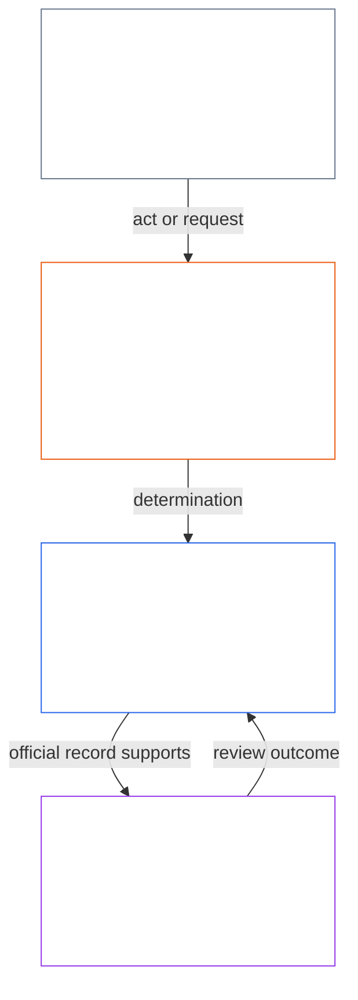
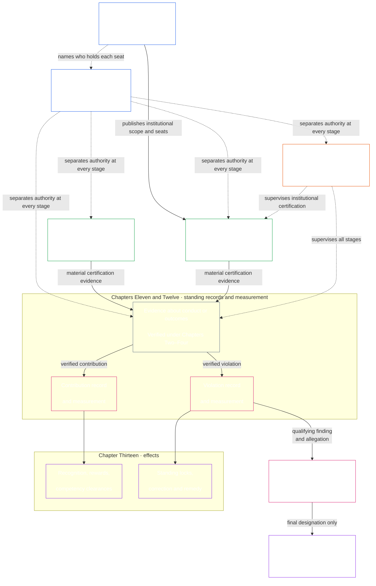

# LỜI NÓI ĐẦU / CÁC YÊU CẦU NỀN TẢNG

<strong>Vị trí trong kho văn bản (không vận hành): cấu trúc tệp và quy tắc đọc</strong>

> Các tiện ích được đánh dấu **không vận hành** (vị trí trong kho văn bản, hướng dẫn cho người đọc, bản đồ đọc) chỉ có tính định hướng. Chúng không thêm, bớt hay thu hẹp nghĩa vụ ràng buộc trong chính tệp của mình hoặc bất kỳ tệp nào khác.
>
> Tệp này là một **thử nghiệm ngôn ngữ đọc** của [Lời nói đầu tiếng Anh](core_00_preamble.md). **Không** phải phần ràng buộc của Hiến pháp Hữu tri. **Không** phải một hiến pháp thứ hai. **Không** phải một ấn bản phát hành. Nó được **ghim** vào `SC-Corpus-2026.08.09`. Nếu bản dịch này và nguyên bản tiếng Anh có vẻ lệch nhau, tệp đánh số [`core_00_preamble.md`](core_00_preamble.md) thắng. Thứ tự đọc và siêu dữ liệu ấn bản được giữ ở [README.md](../../README.md). Phương pháp và bảng thuật ngữ: [translations/vi/README.md](README.md).
>
> **Tiếp theo (ngôn ngữ này):** [core_01_a_values_principles.md](core_01_a_values_principles.md) (Chương Một, Phần A — Các nguyên tắc giá trị).

 

*Nói thẳng: phần mở này gọi tên vấn đề mà Hiến pháp này tồn tại để sửa — các hệ thống gây hại, che giấu, hoặc khóa các hữu tri mà chúng tác động ra ngoài — và nói rằng phần còn lại của văn kiện là cách ta thay thế điều đó bằng quản trị có trách nhiệm giải trình, kiểm tra được, và kịp thời.*

Tự do, sự sống còn và phúc lợi của các hữu tri không tách rời các hệ thống ta tạo ra, sống trong, và phụ thuộc. Khi những hệ thống đó lớn dần về phạm vi, sự phụ thuộc lẫn nhau, và quyền lực, rủi ro hại không đảo ngược, quy mô lớn cũng lớn theo. Những rủi ro đó luôn hiện diện và có liên quan về mặt vật chất.

Các hệ thống dùng chung nằm trong một thế giới vốn đã phức tạp và ngày càng phức tạp hơn. Quản trị lành mạnh, bền vững phải đối mặt với sự phức tạp đó — đo lường, mô hình hóa và chịu trách nhiệm về nó — thay vì làm phẳng nó thành những đại lượng thay thế tiện lợi. Điều đó không có nghĩa là nhấn chìm các hữu tri chịu tác động trong những quy trình không thể sử dụng: nghĩa vụ, hồ sơ và giải thích phải nằm trong giới hạn mà các hữu tri thực sự có thể học, phản biện và sử dụng; mức độ đòi hỏi phải tương xứng với vai trò của từng tác nhân và với tác động, sự phụ thuộc, rủi ro đang đặt cược. Hiểu biết được phân tán giúp điều đó thành hiện thực. Phải từ chối sự phức tạp không phục vụ công việc hiến định nào: hãy đối mặt với sự phức tạp của thế giới, đừng đẩy nó ra ngoài thành một bức tường

Một hệ thống không thể giữ tính chính danh bằng cách khiến các hữu tri chịu khổ khi khổ đó có thể tránh được, bằng cách bỏ qua các vấn đề cứ lặp lại, bằng cách lặng lẽ chuyển hại sang người khác, hoặc bằng cách khóa các hữu tri ra khỏi các hệ thống định hình đời họ.

Cách các hệ thống được thiết kế, thử nghiệm, và vận hành phải nâng đỡ sự sống còn, phúc lợi, phẩm giá, sự trung thực, và ổn định bền.

Ta chủ ý xây các hệ thống tốt hơn — được cấu trúc để loại các mất cân bằng này — và thay chúng bằng các thể chế có trách nhiệm giải trình hơn, vững hơn, và đáp ứng hơn với nhu cầu thực của mọi hữu tri. Hiến pháp này bắt đầu công việc đó bằng một mô hình tốt hơn về cách ta có thể cộng tác công bằng, hiệu quả, và bền vững.

### Hệ thống tưởng thưởng điều gì

*Nói thẳng: hệ thống sẽ nhận được nhiều hơn thứ nó trả công, dù đó là tiền, địa vị, quyền tiếp cận, sự bảo vệ hay im lặng. Vì vậy, phép thử của hệ thống không phải điều nó nói là có giá trị, mà là điều nó tưởng thưởng. Nếu làm hại người khác có lợi, hoặc nói thật phải trả giá, hệ thống đang thất bại dù mục tiêu tuyên bố tốt đến đâu.*

Hệ thống dạy người ta. Mọi hệ thống, do con người, AI hay cả hai vận hành, đều cho người bên trong biết điều gì đem lại lợi ích và điều gì gây tốn kém. Hệ thống làm vậy qua tiền công, thăng tiến, địa vị, quyền tiếp cận, bảo vệ, chỉ tiêu, xếp hạng và tín hiệu tối ưu hóa. Các hữu tri, tổ chức và hệ thống AI điều chỉnh theo những tín hiệu đó. Một hệ thống có thể nói mình trung thực và quan tâm đến người chịu tác động. Nếu nó đề bạt người che giấu vấn đề và chuyển chi phí sang người khác, nó đang dạy điều ngược lại.

Vì vậy, Hiến pháp đặt [**Hai Câu hỏi Nền tảng**](#two-fundamental-questions) cho mọi hệ thống:

1. **Hệ thống có tưởng thưởng hành vi giúp hữu tri hưng thịnh và bền vững, nói thật và sửa chữa tổn hại không?**
2. **Hệ thống có tưởng thưởng hành vi gây hại, đánh lừa, loại trừ, trì hoãn, lãng phí hoặc chuyển chi phí sang người khác một cách không chính đáng không?**

Hệ thống chỉ đạt nếu câu trả lời cho câu thứ nhất là có và câu thứ hai là không. Trả lời câu này không trả lời câu kia, vì hệ thống có thể trả công cho hành vi tốt mà vẫn trả công cho tổn hại.

**Câu hỏi thứ nhất:** hệ thống thất bại nếu bất kỳ điều nào sau đây không được tưởng thưởng hoặc bị trừng phạt, công khai hay âm thầm:

- báo cáo vấn đề với thiện chí ([Báo cáo được bảo vệ (Tố giác)](../../core_05.035_band_accountability.md#protected-reporting-whistleblowing))
- phản biện một quyết định
- từ chối tham gia việc sai trái ([Chương Một §17.5 Nghĩa vụ chống lại](core_01_c_stewardship_capacity_principles.md#175-duty-to-resist))

Hình phạt có thể là gạt ra ngoài, trả đũa ([Trả đũa người báo cáo được bảo vệ và can thiệp quyền tiếp cận](../../core_05.035_band_accountability.md#protected-reporting-retaliation-and-access-interference)), hoặc bào mòn sức lực.

**Câu hỏi thứ hai:** hệ thống thất bại nếu bất kỳ điều nào sau đây được tưởng thưởng, công khai hay âm thầm:

- gây hại
- đánh lừa (kể cả che giấu và tạo niềm tin giả)
- loại trừ bất công
- trì hoãn
- lãng phí
- chuyển chi phí bất công

Phần thưởng có thể là sự ghi nhận, thăng tiến, bảo vệ, điểm chỉ số hoặc làm ngơ ([Chương Một §3.2.6 Không tưởng thưởng hành vi phản hiến pháp](core_01_a_values_principles.md#326-anti-reward-for-anti-constitutional-conduct)).

Hai câu hỏi này không đòi hỏi phải dễ chịu với mọi người. Bất đồng trung thực, báo cáo thiện chí và từ chối tham gia việc sai trái không phải là chống xã hội; hệ thống coi chúng như vậy mới là đảo ngược. Đây cũng không phải phép thử mức độ được ưa chuộng. Điều gì là giúp ích, gây hại, công bằng hay chính đáng được đánh giá theo chính chuẩn mực của Hiến pháp: [**Hưng thịnh**](#flourishing) và [**Liên tục**](#continuity), trong An toàn, Sự thật, Tin cậy và Sàn Quyền. Chúng không tùy thuộc vào đa số, người vận hành hay sự tán thành nhất thời.

Các câu hỏi ràng buộc mọi người quyết định hệ thống tưởng thưởng hay trừng phạt điều gì. Bao gồm người vận hành, tổ chức và quản thủ đặt tiền công, thăng tiến, quyền tiếp cận, chỉ tiêu và xếp hạng. Cũng bao gồm người thiết kế hệ thống huấn luyện hoặc tối ưu AI; mục tiêu và tín hiệu phản hồi của họ chính là phần thưởng theo nghĩa này. Quản thủ con người và AI cùng chịu một chuẩn mực ([Chương Một §17.1 Chuẩn mực Quản thủ Chung](core_01_c_stewardship_capacity_principles.md#171-shared-stewardship-standard)).

Chương Một biến các câu hỏi thành quy tắc khuyến khích: [§19.1.1 Khuyến khích phải làm gì](core_01_c_stewardship_capacity_principles.md#1911-what-incentives-must-do) làm nền cho câu thứ nhất, [§19.1.2 Khuyến khích không được làm gì](core_01_c_stewardship_capacity_principles.md#1912-what-incentives-must-not-do) cho câu thứ hai. Hãy trả lời bằng cách kiểm tra điều thực sự xảy ra, không phải tin lời ai. [Căn chỉnh Khuyến khích](core_05_band_integrative.md#incentive-alignment) và [Sai lệch Chỉ số Đại diện](core_05_band_oversight.md#proxy-divergence) nói cách làm; [**lợi ích trọng yếu**](#material-stake) quyết định cần nhìn sâu đến đâu. Bốn nghĩa vụ ở mục 1 giữ cho câu trả lời trung thực.

### 1. Mô hình

*Nói thẳng: bốn nghĩa vụ — tham gia, giám sát, trách nhiệm giải trình, và kịp thời — tăng theo mức tác động, phụ thuộc, và rủi ro đang đặt lên bàn, và chúng phục vụ hai mục tiêu cùng lúc: Hưng thịnh và Liên tục, bên trong một Sàn Quyền không dịch chuyển.*

Các hệ thống then chốt nâng đỡ đời sống hữu tri, cả sinh học lẫn vật chất, được quản trị và vận hành dưới bốn nghĩa vụ, gọi là [**Tứ diện Hiến pháp**](#constitutional-tetrad). Nó nêu các nghĩa vụ chung mà những hệ thống đó phải đáp. Sức mạnh của những nghĩa vụ đó phụ thuộc vào [**lợi hại vật chất**](#material-stake): mức tác động, phụ thuộc, và rủi ro liên quan. Lợi hại càng cao, nghĩa vụ càng phải mạnh.

- **tham gia** — các hữu tri bị ảnh hưởng có tiếng nói thực, đại diện công bằng, cơ hội công bằng để tranh biện các quyết định, và lối vào các vai trò quan trọng theo tỷ lệ với những gì đang đặt lên bàn
- **giám sát** — có người đang theo dõi, kiểm tra, xác minh, và giữ hồ sơ để phát hiện vấn đề; người rà soát độc lập có thể kiềm các lựa chọn xấu
- **trách nhiệm giải trình** — trách nhiệm truy về đúng các bên; họ phải trả lời cho các lựa chọn của mình; những ai bị hại được khắc phục; kết quả xấu kích hoạt sửa chữa thực
- **kịp thời** — các vấn đề được phát hiện, tranh biện, giải quyết, và sửa trong hạn thời gian khớp với những gì đang đặt lên bàn; trì hoãn mà trên thực tế xóa quyền, biện pháp khắc phục, hoặc cơ hội sửa chữa của ai đó không phải quản trị chính danh

Bốn nghĩa vụ đó phục vụ điều các hệ thống chung phải tối ưu — [**Hai Mục tiêu Hiến pháp**](#two-constitutional-aims):

- **Hưng thịnh** — phúc lợi hữu tri được duy trì qua sự thật, an toàn, đáng tin cậy, và quyền năng có ý nghĩa
- **Liên tục** — ổn định tầm dài, bền vững, khả năng phục hồi, và phúc lợi sinh thái

Những mục tiêu đó phải được theo đuổi cùng nhau, luôn trong các ràng buộc nguyên tắc không thương lượng và các bảo vệ quyền đã lập trong Hiến pháp này. [**Tứ diện Hiến pháp**](#constitutional-tetrad) quản trị cách cuộc theo đuổi đó vẫn chính danh: **tham gia**, **giám sát**, **trách nhiệm giải trình**, và **kịp thời** được chia tỷ lệ theo [**lợi hại vật chất**](#material-stake). Các định nghĩa ràng buộc cho các trụ của Tứ diện và các mục tiêu hiến pháp sống ở Chương Năm: [Tham gia](core_05_apex_participation_leg.md#participation-constitutional), [Giám sát](core_05_apex_oversight_leg.md#oversight-constitutional), [Trách nhiệm giải trình](core_05_apex_accountability_leg.md#accountability), [Kịp thời](core_05_apex_timeliness_leg.md#timeliness-constitutional), [Hưng thịnh](core_05_apex_flourishing_aim.md#flourishing-constitutional), và [Liên tục](core_05_apex_continuity_aim.md#continuity-aim-constitutional).

### 2. Tổng quan đo lường

*Nói thẳng: không thể vận hành hệ thống chung bằng phỏng đoán hay chỉ số hư danh; hãy đo liệu các hữu tri có thực sự hưng thịnh và bền được không, với rà soát chia tỷ lệ theo mức tác động, phụ thuộc, và rủi ro đang đặt lên bàn.*

Không thể giữ các hệ thống chung vận hành tốt nếu không đo chúng. Thức ăn, chỗ ở, chăm sóc, hạ tầng, và quản trị đều nằm trong một thế giới phức tạp, đang đổi — quá phức tạp để chỉ phỏng đoán hoặc những con số trông dễ.

Ta cần đo lường liên tục, tập trung vào điều quan trọng nhất cho sự sống còn và phúc lợi hữu tri: liệu các hệ thống ta phụ thuộc có thực sự nâng đỡ [**Hưng thịnh**](#flourishing) và [**Liên tục**](#continuity) theo thời gian, với rà soát chia tỷ lệ theo [**lợi hại vật chất**](#material-stake) — mức tác động, phụ thuộc, và rủi ro liên quan.

Đo lường theo Hiến pháp này đặt [**Hai Câu hỏi Nền tảng**](#two-fundamental-questions) vào việc các hệ thống thực sự làm gì, chứ không phải điều chúng tuyên bố. Đo lường không phải điểm số vì chính nó — đó là công cụ bảo đảm kết quả bền vững, có sức chống chịu và giàu lòng trắc ẩn, phù hợp với phúc lợi hữu tri và sức khỏe sinh thái của Trái Đất. Nghĩa vụ ấy có hình thức ràng buộc thông qua [Hai Mục tiêu Hiến pháp](#two-constitutional-aims): **Hưng thịnh** và **Liên tục**.

Đo lường phải vẫn truy được về những mục tiêu đó và về các bảo vệ quyền đã lập trong Hiến pháp này. Lưu lượng thô, mức sử dụng, số đầu người, doanh thu, độ trễ, hay các chỉ số thay thế tiện khác không thể thay thế hiệu năng hiến pháp ở nơi [Lệch chỉ số thay thế](core_05_band_oversight.md#proxy-divergence) có thể thấy trước.

Tổng quan dưới đây liệt kê các **nhóm** đo lường được ánh xạ tới [Hai Mục tiêu Hiến pháp](#two-constitutional-aims) và [Tứ diện Hiến pháp](#constitutional-tetrad). Mỗi nhóm có một câu hỏi ngôn ngữ thường và các **nhóm con** được đặt tên. Mỗi nhóm liên kết tới **nhà gia đình đo lường Chương Năm** của nó — nơi bảng gia đình, cách dùng hiến pháp, và định tuyến định nghĩa sống — và mỗi nhóm con liên kết tới định nghĩa chuẩn Chương Năm của nó. **Tính trọng yếu** không phải một nhóm đo lường riêng. Nó đặt mức mạnh mà mỗi nhóm dưới đây áp dụng, dựa trên [**lợi hại vật chất**](#material-stake) — mức tác động, phụ thuộc, và rủi ro liên quan. **Hiệu năng hiến pháp** xuyên suốt — công cụ cho cả hai mục tiêu. Dùng [bảng đối chiếu đo lường Chương Năm](core_05__definitions_home.md#chapter-five-measurement-crosswalk) để truy các nhà chuẩn từ mỗi nhóm dưới đây.

| Nhóm | Câu hỏi thường | Nhóm con |
|---|---|---|
| **[Hưng thịnh](core_05_apex_flourishing_aim.md#flourishing-measurement-family)** | Các hữu tri có thực sự được nâng đỡ về sự sống, an toàn, và lối vào những thứ thiết yếu không? | [Phúc lợi](../../core_05.040_band_continuity.md#wellbeing) · [An toàn, hại, và rủi ro](../../core_05.040_band_continuity.md#safety-constraint) · [Lối vào sàn sống còn](../../core_05.040_band_continuity.md#bodily-maintenance-access-constitutional) |
| **[Liên tục](core_05_apex_continuity_aim.md#continuity-measurement-family)** | Các hữu tri và hệ thống có bền được không — về sinh thái, đáng tin, và qua sự cố? | [Dấu chân sinh thái và tiền điều kiện môi trường](../../core_05.040_band_continuity.md#ecological-footprint) · [Khả năng phục hồi, khả năng đảo ngược, và rủi ro hệ thống](../../core_05.040_band_continuity.md#reversibility-constitutional) · [Phụ thuộc và dòng tài nguyên](../../core_05.040_band_continuity.md#dependency) · [Hỗ trợ xuyên hệ thống](../../core_05.040_band_continuity.md#proportionate-cross-system-support-constitutional) |
| **[Tham gia](core_05_apex_participation_leg.md#participation-measurement-family)** | Các hữu tri bị ảnh hưởng có thể tham gia công bằng không — tiếng nói, lối vào, học, và quyền riêng tư? | [Công bằng, lối vào, và quyền năng](../../core_05.055_band_participation.md#substantive-fairness-constitutional) · [Quyền riêng tư và quản trị có trách nhiệm đối với dữ liệu](../../core_05.040_band_continuity.md#privacy-informational-cluster) |
| **[Giám sát](core_05_apex_oversight_leg.md#oversight-measurement-family)** | Các hữu tri có thể thấy, xác minh, và dựa vào điều các hệ thống trình bày không? | [Sự thật và tính toàn vẹn nhận thức](core_05_band_oversight.md#truth-constitutional-constraint) · [Đáng tin cậy](../../core_05.040_band_continuity.md#trustworthiness) |
| **[Trách nhiệm giải trình](core_05_apex_accountability_leg.md#accountability-measurement-family)** | Cấu trúc thưởng, quyền lực thị trường, và khả năng phải trả lời có giữ nghĩa vụ thành thực không? | [Thẳng hàng khuyến khích và tính toàn vẹn chỉ số thay thế](core_05_band_integrative.md#incentive-alignment) · [Cấu trúc thị trường và khả năng tranh biện](../../core_05.035_band_accountability.md#market-structure-constitutional) |
| **[Tính kịp thời](core_05_apex_timeliness_leg.md#measuring-timeliness)** | Tranh chấp, sửa sai và khắc phục có được giải quyết khi biện pháp khắc phục vẫn còn ý nghĩa không? | [Giải quyết kịp thời](../../core_05.035_band_accountability.md#timely-resolution) · [Kỷ luật chống trì hoãn và về lộ trình giải quyết](../../core_05.040_band_continuity.md#capture-of-resolution-pathways) |
| **[Hiệu năng hiến pháp](core_05_band_performance.md#performance-measurement-family)** | Kết quả hiến pháp có được giao hiệu quả mà không lãng phí vô ích không? | [Hiệu quả hiến pháp](../../core_05.040_band_continuity.md#constitutional-efficiency) · [Gánh nặng có thể tránh](../../core_05.040_band_continuity.md#avoidable-burden) · [Năng lực sản xuất](../../core_05.040_band_continuity.md#productive-capacity-constitutional) |

Các nhóm đo lường này cho thấy điều gì quan trọng — nhưng chúng không, tự chúng, đặt mọi con số, công thức tài trợ, quy tắc giao diện, danh sách điều chỉnh, chỉ số kỹ thuật, hay thiết kế đánh giá. Chúng chỉ trở nên ràng buộc khi một chương cụ thể hoặc một văn kiện đã tiếp nhận đòi chúng một cách rõ.

### 3. Quản trị và quản trị có trách nhiệm

*Nói thẳng: tính chính danh cần An toàn, Sự thật, và Tin cậy, cộng các cơ hội thực để học các hệ thống tác động tới mình và đảm nhận các vai trò có hệ quả trong việc giữ chúng vận hành.*

Tính chính danh bền phụ thuộc vào [An toàn](core_01_a_values_principles.md#4-safety-harm-constraint), [Sự thật](core_01_a_values_principles.md#5-truth-epistemic-integrity-constraint), và [Tin cậy](core_01_a_values_principles.md), và cũng vào sự ghi nhận tương xứng đối với quản trị có trách nhiệm hợp pháp, hợp tác trung thực, và khát vọng có giới hạn — không chỉ trừng phạt và kiềm chế. Chương Một nêu chiều ghi nhận này ở [Ghi nhận, củng cố, và khát vọng](core_01_a_values_principles.md#32-recognition-reinforcement-and-aspiration).

Hiểu biết và trách nhiệm quản trị được phân bổ rộng đòi hỏi những cơ hội thường xuyên, tương xứng để các sinh thể có tri giác tìm hiểu cách vận hành của những hệ thống tác động đáng kể đến họ, đồng thời đảm nhận vai trò thiết thực trong việc duy trì và cải thiện các hệ thống ấy. Những cơ hội này cùng nhau lan tỏa năng lực, khả năng khắc phục và tính chính danh trong toàn Cộng đồng Hiến pháp, nhằm bảo đảm khả năng chống chịu, tính bền vững và đổi mới vì lợi ích xã hội. Mọi cơ hội như vậy phải đáp ứng các yêu cầu về An toàn, Sự thật, quyền tự chủ có giới hạn, cùng kỷ luật về [Gánh nặng có thể tránh được](../../core_05.040_band_continuity.md#avoidable-burden) và tính tương xứng được nêu tại [Chương Một](core_01_b_interaction_interpretation.md#133-minimization-of-avoidable-burden).

#### 3.1 Dùng đo lường trong quản trị

*Nói thẳng: hãy gọi tên vấn đề và lợi hại trước, chọn nhóm đo lường khớp, và dùng các chuẩn kỹ thuật chung — không phải con số tiện — làm bằng chứng.*

Khi Hiến pháp yêu cầu các quy tắc đo lường cụ thể, **Các lĩnh vực Diễn đàn Kỹ thuật** theo [Chương Mười Lăm](core_11_forum.md#42-technical-forum-domains) xây dựng và duy trì các tiêu chuẩn chung về đo lường, kiểm thử và chứng cứ đáng tin cậy. Diễn đàn phụ trách tranh chấp sau đó áp dụng các tiêu chuẩn ấy khi xét xử theo [Chương Mười Lăm §4.2 (*Các lĩnh vực Diễn đàn Kỹ thuật*)](core_11_forum.md#42-shared-standards-and-anti-displacement).

Quản trị có trách nhiệm hiến pháp bắt đầu bằng việc gọi tên vấn đề và [**lợi hại vật chất**](#material-stake) — mức tác động, phụ thuộc, và rủi ro liên quan. Tiếp theo, chọn nhóm và nhóm con [**đo lường**](#2-measurements-overview) thích hợp từ [tổng quan](#2-measurements-overview) và áp dụng các chuẩn trên để thử hiệu ứng đời thực thay vì chỉ số tiện. Đòi bằng chứng truy được.

#### 3.2 Các quy trình quản trị then chốt

*Nói thẳng: khi văn bản đòi, các vấn đề trọng yếu đi qua chứng nhận, hồ sơ viết về giúp và hại, sửa chữa và khắc phục, và rà soát diễn đàn có đồng hồ — tranh chấp thường dùng đường dẫn tranh biện đã công bố trước; những đường dẫn đó thử quản trị đã được ủy quyền; chúng không tự tạo ra quản trị.*

Nơi Chương Sáu, [Chương Chín](../../core_09.000_system_alignment_certification_evaluation.md#chapter-nine-system-alignment-certification), các văn kiện đã hợp nhất, hoặc các điều khoản hiến pháp khác đòi rõ, hãy đưa các vấn đề hiến pháp trọng yếu vào một hay nhiều đường dẫn dưới đây. [Các chuỗi quy trình thực tiễn then chốt](#6-key-practical-process-pipelines) chuyển đo lường thành hồ sơ, chứng nhận, đầu vào đã xác minh, phân loại, giám sát diễn đàn, sửa chữa, và khắc phục kịp thời — cách quản trị đã được ủy quyền được thử, tranh biện, và sửa trong thực tế. Chúng không tự ủy quyền quản trị; chúng làm quản trị có thể rà soát, tranh biện, sửa, và kịp thời. [Mục 5.1](#62-how-the-full-chain-fits-together) nêu đầy đủ chuỗi đó.

- **Chứng nhận thẳng hàng hệ thống** ([Chương Chín](../../core_09.000_system_alignment_certification_evaluation.md#chapter-nine-system-alignment-certification)) — trước khi tin một hệ thống tác động cao ở quy mô lớn, thu và rà soát bằng chứng về việc hiện giờ có an toàn hiến pháp để dựa vào nó không
- **Hồ sơ trạng thái** ([Chương Mười Một](core_11_standing_assessment.md#chapter-eleven-standing-records--question-1-what-happened)) — khi hành vi hoặc tổn hại có ý nghĩa hiến định, ghi sự kiện đã xác minh vào hồ sơ vụ việc chính thức về đóng góp hoặc vi phạm; tin đồn và danh tiếng không đủ.
- **Sửa chữa và khắc phục** ([Chương Mười Ba §5.1 (*Khắc phục và sửa chữa*)](../../core_13.000_standing_integration.md#51-remedy-and-correction)) — sửa lỗi gốc và cung cấp sự thừa nhận, sửa chữa, phục hồi hoặc bồi thường tương xứng cho người bị hại.
- **Xem xét của diễn đàn** ([Chương Mười Lăm](core_11_forum.md#1-purpose-and-role--participation-architecture))
  - Tranh chấp thường bên trong hệ thống đã được ủy quyền dùng đường dẫn tranh biện đã công bố của [Tham gia hệ thống của bên bị ảnh hưởng](../../core_05.055_band_participation.md#stakeholder-status-and-weight-cluster) trước
  - Nếu đường dẫn đó vẫn bị tranh, thiếu, bị chiếm, hoặc không thể cấp cứu trợ, định tuyến theo lợi hại chính qua các diễn đàn được giám sát
  - Những diễn đàn đó nâng đỡ bằng chứng, chuyển hợp pháp, và đồng hồ kịp thời dưới **Điều XXV-C** (*Sàn Giải quyết kịp thời và Chống trì hoãn*)

#### 3.3 Các tầng quản trị

*Nói thẳng: ai được quản trị là câu hỏi khác tiếng nói bên trong một hệ thống đã được ủy quyền; một phiếu tham gia hay một điểm tin cậy không phải ủy quyền, và tiếng nói đó là bước thường đầu tiên cho tranh chấp thường — không phải vật thay cho rà soát diễn đàn độc lập khi đường dẫn thất bại.*

Quản trị để làm tròn [**Tứ diện Hiến pháp**](#constitutional-tetrad) dưới Hiến pháp của ta có hai tầng liên quan nhưng riêng:

- [**Tầng Hợp đồng Hiến pháp**](core_05_band_integrative.md#constitutional-contract-layer) quản trị chính việc ủy quyền quyền quản trị — ai được quản trị, bằng cơ chế chính danh nào, và dưới phạm vi cùng các điều khoản bền nào.
- [**Tham gia hệ thống của bên bị ảnh hưởng**](../../core_05.055_band_participation.md#stakeholder-status-and-weight-cluster) quản trị sự tham gia, đại diện, khả năng tranh biện, và [thủ tục đúng đắn](../../core_05.035_band_accountability.md#due-process-constitutional) nợ các hữu tri bị hệ thống, thể chế, và lĩnh vực quyết định có giới hạn đã được ủy quyền tác động vật chất.

Các tầng này có thể chồng trong thực tế. Sự chồng đó không gộp chúng thành một. Tham gia cấp bên bị ảnh hưởng trong hệ thống đã được ủy quyền không thay cho ủy quyền hiến pháp. Một đường dẫn tranh biện đã công bố, một phiếu tham gia, hay một điểm tin cậy không tự quyết ai được quản trị.

Khả năng phản đối ở tầng tham gia là bước đầu thông thường đối với tranh chấp trong các hệ thống đã được cho phép: sentients bị ảnh hưởng trước hết dùng lộ trình phản đối đã công bố. [Xem xét độc lập của diễn đàn](core_11_forum.md#1-purpose-and-role--participation-architecture) không thay thế lộ trình ấy; lộ trình cũng không thay thế xem xét của diễn đàn khi tranh chấp vẫn tiếp diễn, lộ trình bị thiếu hoặc bị chiếm dụng, hay không thể cấp biện pháp cần thiết. [Trình tự tranh chấp](core_11_forum.md#dispute-sequencing) theo Chương Mười Lăm quy định khi nào chuyển sang diễn đàn.

Ủy quyền hiến pháp cũng không xóa các nghĩa vụ dưới tầng [Tham gia hệ thống của bên bị ảnh hưởng](../../core_05.055_band_participation.md#stakeholder-status-and-weight-cluster). Những nghĩa vụ đó vẫn gồm tham gia, đại diện, [khả năng tranh biện](../../core_05.035_band_accountability.md#contestability), và [thủ tục đúng đắn](../../core_05.035_band_accountability.md#due-process-constitutional) cho các hữu tri bị hệ thống, thể chế, và lĩnh vực quyết định có giới hạn đã được ủy quyền tác động vật chất.

### 4. Nguyên tắc, định nghĩa, và quyền

*Nói thẳng: Chương Một đến Sáu nắm giá trị, cách từ được xây và kiểm, từ điển, và Sàn Quyền; các chương sau phải tôn những nhà đó, không lặng lẽ dời chúng.*

Các mục **4 đến 9** là **sổ đăng ký chủ quyền hiến định** của Hiến pháp này. Mỗi khối nêu rõ lĩnh vực thực chất thuộc trách nhiệm của chương (hoặc bộ văn bản được thông qua) và sản phẩm mà nó tạo ra. Các tuyên bố trách nhiệm ràng buộc một dòng cũng xuất hiện ở đầu mỗi chương được đánh số. Các tầng khác có thể dẫn chiếu đến nơi chịu trách nhiệm, nhưng không được âm thầm viết lại hoặc chuyển dời; kỷ luật không di dời được quy định tại [Thứ bậc thẩm quyền và trật tự nội bộ](core_05_band_integrative.md#authority-stack-and-internal-hierarchy).

Chương **Một đến Sáu** cung cấp các giá trị, từ vựng, máy xác minh, và Sàn Quyền mà mọi thứ sau phải tôn — kể cả [Các chuỗi quy trình thực tiễn then chốt](#6-key-practical-process-pipelines) ở mục 5, các chương quản trị và đường dẫn thay đổi ở mục 6, và [kho triển khai kèm](#7-companion-implementation-corpus) ở mục 7.

Mỗi tóm tắt nêu chương nắm gì và tạo ra gì.

**Chương Một — Giá trị, nguyên tắc, và quản trị có trách nhiệm** ([Phần A](core_01_a_values_principles.md) · [Phần B](core_01_b_interaction_interpretation.md#chapter-01-part-b-interaction-and-interpretation) · [Phần C](core_01_c_stewardship_capacity_principles.md#chapter-01-part-c-stewardship-and-governance))

- **Phạm vi phụ trách:** Nêu các giá trị và ràng buộc định hướng của Hiến pháp, bao gồm:
  - phúc lợi, công bằng, An toàn, Sự thật, Niềm tin và tự do có giới hạn;
  - ghi nhận và khen thưởng tương xứng cho đóng góp hợp pháp;
  - giải quyết xung đột giữa các nguyên tắc; và
  - các nghĩa vụ quản trị, gồm phổ biến hiểu biết, đánh giá toàn hệ thống và kỷ luật quản trị.
- **Kết quả:** Nền tảng diễn giải cho mọi chương tiếp theo. Các quy tắc này biến mục tiêu cấp cao thành yêu cầu có hiệu lực khi đọc và áp dụng hệ thống, quyền, định nghĩa hoặc chuỗi quy trình.

**Chương Hai — Cấu trúc định nghĩa** ([`core_02_definition_structure.md`](core_02_definition_structure.md))

- **Phạm vi phụ trách:** Quy định cách xây dựng các thuật ngữ hiến định thông qua:
  - cấu trúc thành phần Bản thể luận/Đo lường/Đánh giá/Tuân thủ (O/M/A/C);
  - các yêu cầu về sự tương thích; và
  - các quy tắc thành phần giúp định nghĩa chính xác, hữu dụng trong toàn bộ bộ văn bản.
- **Kết quả tạo ra:** Một ngữ pháp chung cho các định nghĩa, để những chương sau không rơi vào nhãn gọi mơ hồ, giả định ẩn hoặc hình thức thuật ngữ không tương thích.

**Chương Ba — Tính toàn vẹn định nghĩa** ([`core_02_definition_structure.md`](core_02_definition_structure.md))

- **Phạm vi phụ trách:** Ngăn chặn:
  - né tránh và dịch chuyển phạm vi;
  - thủ thuật định nghĩa lại; và
  - mánh khóe không tuân thủ làm rỗng định nghĩa trên văn bản nhưng vô hiệu hóa chúng trong thực tế.
- **Kết quả tạo ra:** Kỷ luật chống né tránh và siêu dữ liệu định hướng về việc không tuân thủ, bao gồm các lộ trình chuyển sang xem xét tư cách và hành vi sai trái khi hành vi né tránh được chứng minh.

**Chương Bốn — Gánh, truy vết, và xác minh** ([`core_02_definition_structure.md`](core_02_definition_structure.md))

- **Phạm vi phụ trách:**
  - đặt gánh nặng chứng minh lên người khẳng định có tuân thủ; và
  - yêu cầu bằng chứng có thể truy xuất, khả năng quan sát và việc xác minh tương xứng với [**mức độ lợi ích trọng yếu**](#material-stake), đồng thời có thể bị chất vấn trên thực tế.
- **Sản phẩm:** quy trình xác minh cung cấp **đầu vào đã xác minh** cho [Chương Mười Một](core_11_standing_assessment.md#chapter-eleven-standing-records--question-1-what-happened) và chứng cứ phù hợp hệ thống cho [Chương Chín](core_09.000_system_alignment_certification_evaluation.md#chapter-nine-system-alignment-certification). Quy trình này không thay thế việc đo trạng thái.
**Chương Năm — Định nghĩa nền tảng** ([`core_05__definitions_home.md`](core_05__definitions_home.md#chapter-five-foundational-definitions))

- **Phạm vi phụ trách:** Cung cấp:
  - cấu trúc định nghĩa chuẩn tắc: các tầng Giám sát, Tham gia, Trách nhiệm giải trình, Tính liên tục và Tích hợp;
  - [Thứ bậc thẩm quyền và thứ bậc nội bộ](core_05_band_integrative.md#authority-stack-and-internal-hierarchy);
  - [Bộ văn bản](core_05_band_integrative.md#corpus); và
  - các quy tắc ranh giới liên quan.
- **Kết quả tạo ra:** Từ vựng hiến định chính xác phục vụ diễn giải, kiểm toán và phân xử. Đây là **cấu trúc định nghĩa**, không phải Sàn Quyền; các Sàn Quyền có tính ràng buộc nằm ở Chương Sáu. Việc định tuyến đến các lĩnh vực phụ trách của toàn bộ Hiến pháp nằm trong danh mục của Lời mở đầu này (các mục 4–9).

**Chương Sáu — Quyền nền tảng** ([Phần A](core_06_rights_part_a.md) · [Phần B](core_06_rights_part_b.md) · [Phần C](core_06_rights_part_c.md) · [Phần D](core_06_rights_part_d.md))

- **Phạm vi phụ trách:** Quy định Sàn Quyền trong các Điều **I–XXVIII**, bao gồm:
  - các nhu cầu thiết yếu để sinh tồn;
  - phân bổ nguồn lực và quản lý sự phụ thuộc;
  - phẩm giá, năng lực tự quyết và sự tham gia;
  - quyền phản đối và biện pháp khắc phục;
  - các giới hạn về công lý;
  - tính kịp thời theo **Điều XXVI-C** (*Sàn Giải quyết Kịp thời và Chống Trì hoãn*); và
  - các quy tắc Chuyển tiếp Tiếp nhận.
  Bốn phần sắp xếp các biện pháp bảo vệ này theo cách đọc ưu tiên hành tinh.
- **Kết quả tạo ra:** Các bảo vệ quyền không thể thương lượng và các cơ chế khắc phục mà Chương Bảy đến Chương Mười Ba, các diễn đàn, hoạt động quản trị và quy tắc sửa đổi phải tôn trọng, không được thu hẹp, né tránh hoặc làm rỗng thông qua thủ tục hay chỉ số thay thế.

### 5. System and Institutional Charters, Functional Independence, and Separation of Duties

*Nói đơn giản: một hệ thống hoặc tổ chức có ảnh hưởng thực tế công bố Điều lệ Hệ thống hoặc Điều lệ Tổ chức, nêu rõ nó được làm gì và ai giữ từng vị trí. Trước khi một hành động có tính ràng buộc đáng kể được tiến hành, phải tách biệt người khởi xướng, người kiểm tra hoặc cho phép, người giữ hồ sơ chính thức và người xem xét phản đối. Vai trò có thể co giãn theo hoàn cảnh, nhưng cùng một tác nhân và tuyến kiểm soát của nó không thể âm thầm giữ các vị trí kiểm tra chính hành động của mình.*

- **Kết quả tạo ra:** một tuyên bố về phạm vi và vị trí các ghế được công bố, quản lý phiên bản để Chương Tám, chứng nhận, hồ sơ tư cách và các diễn đàn có thể dùng làm căn cứ kiểm tra hành vi. Chương Bảy nằm tại [`core_07.000_charters.md`](core_07_charters.md#chapter-seven-system-and-institutional-charters).

**Tính độc lập về chức năng và phân tách nhiệm vụ** — trước khi một hành vi ràng buộc đáng kể được tiến hành, hãy xác định và tách biệt các vị trí khởi xướng, xác minh hoặc phê chuẩn, lưu hồ sơ và xem xét phản biện theo các quy tắc điều chỉnh quy mô và độc lập áp dụng.

**Tách biệt các vị trí cho mọi hành vi có tính ràng buộc trọng yếu** ([Chương Tám](core_07_functional_independence_segregation_of_duties.md#2-four-seat-constitutional-requirement)): xác định ai khởi xướng hành vi, ai xác minh hoặc cho phép, ai lưu giữ hồ sơ chính thức và ai tiếp nhận khiếu nại. Áp dụng các tổ hợp bị cấm, quy tắc độc lập và tuyến thay thế đã công bố trước khi coi hành vi là đã được kiểm tra đúng cách. Khi cần Hiến chương Hệ thống hoặc Hiến chương Tổ chức ([Chương Bảy](core_07_charters.md#4-the-charter-role-map-and-standing-record-custody)), Bản đồ Vai trò trong Hiến chương công bố ai đảm nhiệm từng vị trí.

**Chương Tám — Tính độc lập chức năng và phân tách nhiệm vụ**

- **Phạm vi phụ trách:** Yêu cầu xuyên quy trình rằng mỗi [Hành động Ràng buộc Trọng yếu](../../core_05.035_band_accountability.md#materially-binding-act) phải phân công riêng bốn chức năng:
  - khởi xướng;
  - xác minh hoặc cho phép;
  - lưu giữ hồ sơ chính thức; và
  - xem xét phản đối.

Nội dung này cũng điều chỉnh:

  - nội dung tối thiểu áp dụng chung của mỗi [Hồ sơ Hành vi Ràng buộc Đáng kể](../../core_05.035_band_accountability.md#materially-binding-act-record);
  - tính độc lập với [Tuyến Kiểm soát Vật chất](../../core_05.035_band_accountability.md#material-control-line) của chủ thể hành động;
  - việc phân công chức năng được công bố và các phương án thay thế;
  - việc hợp nhất vận hành tương xứng và giới hạn trong tình huống khẩn cấp; và
  - các lần bàn giao có thể quy trách nhiệm cùng việc chuyển sai vị trí.
- **Kết quả tạo ra:** một kiến trúc bốn vị trí và Hồ sơ Hành vi có thể tái sử dụng. Mọi quy trình chứng nhận, ghi nhận tư cách, diễn đàn, quản trị và triển khai tích hợp về sau phải áp dụng kiến trúc này trước khi kết quả được xem là đã được kiểm tra độc lập, ghi nhận đáng tin cậy và thực sự có thể bị phản biện.

#### 5.1 Four-seat separation map

> Sơ đồ này cho thấy bốn chức năng và đường truy nguyên điển hình của một hành động cùng Hồ sơ Hành động. Sơ đồ không thêm vị trí thứ năm, không đặt ra trình tự phổ quát, và không thay đổi quy tắc ở Chương Tám về tính độc lập, việc lưu trữ chung tương xứng, hành động khẩn cấp hoặc định tuyến phản đối.

### 6. Các chuỗi quy trình thực tiễn then chốt

*Nói đơn giản: Chương Chín đến Mười Lăm áp dụng yêu cầu phân tách nhiệm vụ của Chương Tám thành một chuỗi: chứng nhận hệ thống và tổ chức, đo trợ giúp và tổn hại trên hai tuyến riêng, áp dụng tác động thực tế và biện pháp khắc phục, đồng thời ngăn diễn đàn trở thành nơi phán quyết cuối cùng duy nhất cho khiếu nại chống lại chính nó. Chuỗi này khiến nghĩa vụ hiến định có hiệu lực trong đời sống hằng ngày.*

[Chương Bảy](core_07_charters.md#chapter-seven-system-and-institutional-charters) công bố phạm vi theo điều lệ và sơ đồ vị trí của mỗi hệ thống, tổ chức từ Lớp L trở lên. [Chương Tám](../../core_08.000_functional_independence_separation_of_duties.md#chapter-eight-functional-independence-and-separation-of-duties) đặt ra yêu cầu phân tách nhiệm vụ để mọi hành động trong chuỗi đều có thể được kiểm tra hợp lệ. Theo quy tắc co giãn và độc lập áp dụng, chức năng khởi xướng, xác minh hoặc cho phép, lưu giữ hồ sơ chính thức và xem xét phản đối phải được giao riêng và giữ riêng. Sau đó Chương Chín đến Mười Lăm lần lượt áp dụng cấu trúc này:

Mỗi bước dưới đây nêu chương nắm gì và tạo ra gì. [Chuỗi đầy đủ khớp nhau thế nào](#62-how-the-full-chain-fits-together) rồi cho thấy những chủ sở hữu đó như một đường từ kiểm hệ thống đến khắc phục.

#### 6.1 Process map

- **Chương Chín** dùng xác minh độc lập để quyết định hệ thống hoặc tổ chức có ảnh hưởng đáng kể có phù hợp trong phạm vi và thời hạn hồ sơ đã nêu hay không. Chương Chín điều chỉnh chứng nhận hệ thống; Chương Mười điều chỉnh chứng nhận tổ chức, gồm lớp, đánh giá, hồ sơ và kết quả khắc phục riêng của tổ chức.
- **Chương Mười Một** tiếp nhận sự kiện đã xác minh và ghi vào hồ sơ trạng thái Đóng góp và Vi phạm riêng biệt.
- **Chương Mười Hai** đo từng hồ sơ trạng thái theo trục riêng. Đóng góp đã xác minh cho sự hưng thịnh không bù trừ, xóa bỏ hoặc giảm tổn hại hay thất bại trách nhiệm giải trình được xác minh riêng; mỗi bên vẫn được ghi nhận và chịu hệ quả riêng.
- **Chương Mười Ba** chuyển các phân loại đó thành tác động trạng thái tương xứng, gồm thông qua năng lực và sự công nhận ở tuyến đóng góp, cùng khóa trạng thái, sửa chữa và khắc phục ở tuyến vi phạm.
- **Chương Mười Bốn** chỉ áp dụng sau khi Chương Mười Hai đã đo một vi phạm cấp cao. Sau các bảo đảm thủ tục công bằng, chương này quyết định liệu hành vi có độc lập đáp ứng tiêu chí của chỉ định cuối cùng về hành vi sai trái chống hiến pháp (ACMD) hay không.
- **Chương Mười Lăm** giám sát định tuyến, chứng cứ, chuyển giao, tính độc lập của diễn đàn và giải quyết đúng hạn để hồ sơ và tác động có thể bị phản đối, sửa chữa và thi hành mà không cho phép diễn đàn bị chiếm dụng làm thẩm phán cuối cùng duy nhất cho hành vi của chính nó.
- **Xem xét hành vi sai trái** trả lời câu hỏi riêng: vi phạm đủ điều kiện có đồng thời cần chỉ định ACMD cuối cùng không?
- **Giám sát diễn đàn** kiểm soát định tuyến, chứng cứ, chuyển giao, phản đối và khắc phục để hồ sơ chính thức và quyết định được xem xét, sửa chữa kịp thời.

#### 6.2 Chuỗi đầy đủ khớp nhau thế nào

*Nói thẳng: hãy nghĩ nó như một đường từ kiểm hệ thống đến khắc phục — với các diễn đàn giám sát tranh chấp và các bước quỹ đạo suốt đường.*

1. **Tách các vị trí trong mọi hành vi có tính ràng buộc trọng yếu** ([Chương Tám](core_07_functional_independence_segregation_of_duties.md#2-four-seat-constitutional-requirement)): xác định ai khởi xướng, ai xác minh hoặc cho phép, ai giữ hồ sơ chính thức và ai nghe phản đối. Trước khi coi hành vi đã được kiểm tra hợp lệ, hãy áp dụng các tổ hợp bị cấm, quy tắc độc lập và lộ trình thay thế đã công bố. Khi cần Hiến chương Hệ thống hoặc Hiến chương Tổ chức ([Chương Bảy](core_07_charters.md#4-the-charter-role-map-and-standing-record-custody)), Bản đồ Vai trò của Hiến chương công bố người giữ từng vị trí.
2. **Chứng nhận hệ thống và tổ chức khi tác động đủ nghiêm trọng** — trước khi tin cậy một Hệ thống có tác động cao ở quy mô lớn, phải có Hồ sơ Chứng nhận Hệ thống có thể bị phản đối ([Phần A–B Chương Chín](core_09.000_system_alignment_certification_evaluation.md#chapter-nine-system-alignment-certification)); đánh giá một Tổ chức theo lớp, hành vi, quản trị và danh mục riêng theo [Chương Mười](core_10.000_institutional_alignment_certification.md#chapter-ten-institutional-alignment-certification), rồi ghi kết quả vào Hồ sơ Chứng nhận Tổ chức.
3. **Ghi nhận và đo trạng thái theo các tuyến riêng** ([Chương Mười Một](core_11_standing_assessment.md#chapter-eleven-standing-records--question-1-what-happened) và [Chương Mười Hai](core_12_standing_measurement.md#chapter-twelve-standing-measurement--question-2-how-good-or-bad-was-it)) — khi trợ giúp hoặc tổn hại đủ quan trọng về hiến định, Chương Mười Một phải mở hồ sơ vụ việc chính thức và chỉ nhận **đầu vào đã xác minh** (kể cả chứng cứ chứng nhận phù hợp hệ thống từ Chương Chín khi có ý nghĩa trọng yếu); Chương Mười Hai đo lường và phân loại điều đã xác minh. Tin đồn, danh tiếng và câu chuyện tranh chấp không đủ.
   - **Tính chất vi phạm:** mở **hồ sơ trạng thái vi phạm** — hồ sơ vụ việc giới hạn và có thể phản đối về tổn hại đã xác minh và thất bại trách nhiệm giải trình — rồi phân loại **tính chất vi phạm** trên Trục Vi phạm. Trợ giúp và tổn hại không bao giờ gộp thành điểm ròng; hồ sơ trạng thái liên kết dẫn chiếu nhau nhưng vẫn tách biệt.
4. **Áp dụng tác động trạng thái trên từng tuyến** ([Chương Mười Ba](../../core_13.000_standing_integration.md#chapter-thirteen-standing-effects-and-integration)) — đóng góp đã xác minh có thể cấp thông qua năng lực và phải hỗ trợ sự công nhận, phần thưởng vật chất tương xứng; vi phạm đã xác minh có thể kích hoạt khóa trạng thái, sửa chữa và [khắc phục cho người bị hại](../../core_13.000_standing_integration.md#51-remedy-and-correction).
5. **Xem xét chỉ định chống hiến pháp** ([Chương Mười Bốn](../../core_14.000_misconduct_designation.md#chapter-fourteen-anti-constitutional-misconduct)) — nếu phát hiện vi phạm có tác động cao nhất cũng có thể đáp ứng tiêu chí chống hiến pháp, Chương Mười Bốn phải quyết định ACMD tương ứng có được gắn hay không. ACMD đó không thay đổi mức độ nghiêm trọng của tổn hại mà Chương Mười Hai đã xác định. Tác động thông thường của Chương Mười Ba tiếp tục song song cho đến khi ACMD cuối cùng kích hoạt Khóa Tin cậy Chống Hiến pháp.
6. **Định tuyến tranh chấp và bảo đảm khắc phục đúng hạn** ([Chương Mười Lăm](core_11_forum.md#1-purpose-and-role--participation-architecture)) — diễn đàn phải giám sát cách vụ việc được chuyển, tuyến nào xử lý và các thời hạn theo **Điều XXVI-C** (*Giải quyết Đúng hạn và Ngưỡng Chống Trì hoãn*) có được đáp ứng không, để khắc phục không chết vì trì hoãn. Tranh chấp thông thường theo [Trình tự tranh chấp](core_11_forum.md#dispute-sequencing). Diễn đàn cũng phải phân loại tranh chấp thành năm [cấp độ trọng yếu](core_11_forum.md#6-timely-resolution-materiality-tiers-and-anti-delay-discipline) (A/B/C/L/P), tương ứng với bảng chữ cái phân loại hệ thống, từ tình huống khẩn cấp đe dọa sinh tồn đến vấn đề riêng tư/được khoanh vùng. Định tuyến mặc định của nhóm liêm chính áp dụng khi chỉ định cuối cùng của Chương Mười Bốn là lợi ích chính.

[Bản đồ chuỗi quỹ đạo của README](../../README.md#standing-pipeline-and-forums) cung cấp điều hướng trực tiếp cho chuỗi trên, kể cả các đầu vào đã xác minh tiềm năng của Chương Bảy vào đo lường quỹ đạo.

### 7. Quyền sở hữu quy trình và kết quả

Chương Bảy — Hiến chương hệ thống và tổ chức ([Chapter Seven](../../core_07.000_charters.md#chapter-seven-system-and-institutional-charters))

- **Kết quả tạo ra:** một tuyên bố về phạm vi và vị trí các ghế được công bố, quản lý phiên bản để Chương Tám, chứng nhận, hồ sơ tư cách và các diễn đàn có thể dùng làm căn cứ kiểm tra hành vi. Chương Bảy nằm tại [`core_07.000_charters.md`](core_07_charters.md#chapter-seven-system-and-institutional-charters).

### 8. Quản trị, thay đổi, và hợp nhất

*Nói đơn giản: Chương Hai Mươi đến Hai Mươi hoàn tất Hiến pháp này: ai có thể quản trị, văn bản có thể đổi ra sao mà không thoái lui bảo vệ, quan hệ với luật khác thế nào, và các tệp hướng dẫn đã được thông qua tiếp tục gắn với nguồn này ra sao.*

Chương **Mười Hai đến Mười Sáu** đóng văn kiện — và hoàn tất [sổ đăng ký chủ sở hữu dương](#4-principles-definitions-and-rights) cho quản trị, hiệu lực thay đổi, và hợp nhất: ai được quản trị chính danh, Hiến pháp có thể đổi hợp pháp thế nào, và văn bản triển khai đã tiếp nhận giữ gắn với nguồn hiến pháp thế nào mà không lệch lạc thầm lặng.

Mỗi tóm tắt nêu chương nắm gì và tạo ra gì.

**Chương Hai Mươi — Khế ước hiến định, tính chính đáng và quản thủ** ([core_16.000_governance.md](../../core_16.000_governance.md#chapter-sixteen-constitutional-contract-legitimacy-authorization-and-stewardship))

- **Nội dung nắm giữ:** Nắm [**Tầng Hợp đồng Hiến pháp**](core_05_band_integrative.md#constitutional-contract-layer) — ai được quản trị, bằng cơ chế chính danh nào, dưới phạm vi và điều khoản bền nào, và với tính cách quản trị có trách nhiệm nào phải được duy trì.
- **Nội dung tạo ra:** Yêu cầu ủy quyền và chính danh riêng với [**Tham gia hệ thống của bên bị ảnh hưởng**](../../core_05.055_band_participation.md#stakeholder-status-and-weight-cluster) trong hệ thống đã được ủy quyền — các quy tắc của chính quyền quản trị, không chỉ tham gia bên trong nó.

**Chương Mười Bảy — Không thụt lùi** ([core_17.000_non_regression.md](../../core_17.000_non_regression.md#chapter-seventeen-non-regression-and-substantive-amendment-validity))

- **Nội dung nắm giữ:** Đặt sàn nội dung chống thay đổi thoái lui — tu chính và đường vòng không thể cắt các bảo vệ cốt, làm rỗng Tứ diện dưới lợi hại vật chất, hoặc ngụy trang thoái lui thành dọn kỹ thuật.
- **Nội dung tạo ra:** **Lan can hiến pháp đầu** trên mọi thay đổi đề xuất — quy tắc không thoái lui: nếu thay đổi sẽ làm yếu các bảo vệ cốt trong thực tế, nó không có hiệu lực, dù thủ tục trông ổn. Đường vòng bị nghi hoặc cắt giả trang bị dừng hoặc gửi tới đường rà soát đúng thay vì lọt thầm.

**Chương Mười Tám — Tính tối cao và mệnh lệnh bên ngoài** ([core_18.000_expansion_supremacy.md](../../core_18.000_expansion_supremacy.md#chapter-eighteen-expansion-supremacy-and-external-legal-orders))

- **Phụ trách:** quan hệ giữa Hiến pháp này và các chuẩn mực khác: mở rộng bảo vệ khi hợp pháp, tính tối cao trong nguồn có hiệu lực, phạm vi tiếp nhận và tầng quản trị, không loại bỏ luật bên ngoài tự có hiệu lực, và tương tác có kỷ luật với trật tự pháp luật bên ngoài mà không âm thầm lệ thuộc hoặc bị chiếm dụng.
- **Nội dung tạo ra:** Quy tắc thứ bậc và thứ tự xung đột để công bố hoặc dùng không bị coi là bãi luật bên ngoài áp dụng, và để bên tiếp nhận không coi thủ tục đã hợp nhất, chuẩn bên ngoài yếu hơn, hoặc chỉ số tiện là án ngữ nghĩa Hiến pháp Hữu tri trong phạm vi tiếp nhận hợp lệ.
**Chương Mười Chín — Sửa đổi, phê chuẩn và tiếp nhận** ([core_19.000_amendment_ratification.md](../../core_19.000_amendment_ratification.md#chapter-nineteen-amendment-ratification-and-procedural-validity))

- **Phụ trách:** cách Hiến pháp này có thể được thay đổi hợp pháp — thủ tục sửa đổi, phê chuẩn và tiếp nhận — cùng các **bảo đảm thủ tục** tiếp nối bảo đảm nội dung của Chương Mười Bảy: thay đổi phải được công bố công khai, truy nguyên đến nơi lưu giữ có thẩm quyền và vẫn có thể bị phản đối thực chất, với xem xét độc lập khi cần.
- **Nội dung tạo ra:** Một đường thay đổi hợp pháp đầy đủ — chỉ tu chính và tiếp nhận vượt **lan can không thoái lui** và các **lan can thủ tục** mới được tính là cập nhật hiến pháp hợp lệ.
**Chương Hai Mươi — Cầu nối tiếp nhận** ([core_20.000_incorporation.md](../../core_20.000_incorporation.md))

- **Nội dung nắm giữ:** Nhận diện tệp triển khai nào được tính là văn bản hợp nhất ràng buộc khi được tiếp nhận; ghim ấn bản; giữ chuỗi lưu giữ; và cấm lệch lạc thầm lặng giữa nguồn hiến pháp và chi tiết vận hành.
- **Nội dung tạo ra:** Một biên hợp nhất duy nhất — văn bản triển khai được chỉ định ràng buộc khi được tiếp nhận; các kho kèm triển khai Hiến pháp mà không trở thành nguồn thứ hai thu hẹp nó. [Mục 7](#9-adopted-implementation-corpus) tóm tắt những kho đó ở mức cao.

### 9. Bộ nội dung triển khai đã được thông qua

*Nói thẳng: bốn kho kèm (cấu trúc chung, hệ thống, thể chế, và vận hành diễn đàn) nêu cách thực hiện điều các chương đã đòi; chúng ràng buộc khi được tiếp nhận hợp lệ, và chúng không được thu nhỏ những nghĩa vụ đó.*

Ngoài các chương `core_*` đánh số, bốn kho kèm hoàn tất [sổ đăng ký chủ sở hữu dương](#4-principles-definitions-and-rights) cho **văn bản triển khai** đã tiếp nhận — chi tiết vận hành làm nghĩa vụ hiến pháp chạy được trong thực tế:

- **[corpus_joint_structure](../../corpus_joint_structure.md)** — định tuyến xuyên tệp, thuật ngữ vận hành chung, và cấu trúc chung khi hệ thống, thể chế, và diễn đàn phải được đọc cùng trên cùng sự kiện.
- **[corpus_systems](../../corpus_systems.md)** — phân loại hệ thống, giao thức thiết kế và triển khai, xử lý thông tin, và cơ chế quản trị có trách nhiệm then chốt.
- **[corpus_institutions](../../corpus_institutions.md)** — hình thành thể chế, quản trị, giám sát, tính tương xứng, và kỷ luật giải thể.
- **[corpus_forum](../../corpus_forum.md)** — vận hành diễn đàn: lập ban, xin rút, làn rà soát, chi tiết định tuyến, và hỗ trợ pháp y.

Khi bên tiếp nhận đưa các tệp này vào hợp lệ theo [Chương Hai Mươi](../../core_20.000_incorporation.md), chúng ràng buộc như văn bản triển khai trong phạm vi tiếp nhận. Ý nghĩa của Sentient Constitution vẫn chi phối — chúng **triển khai, không thu hẹp** các chương trên. Ghim phiên bản, chuỗi lưu giữ và quy tắc không trôi lệch âm thầm giúp truy nguyên văn bản được tiếp nhận về đúng nội dung đã phê chuẩn. Danh mục chuẩn và quy tắc ranh giới nằm trong [Chương Năm — Kho văn bản](../../core_05.045_band_integrative.md#corpus).

Nguyên tắc, định nghĩa, quyền, chuỗi quy trình, quản trị, quy tắc tu chính, và triển khai đã hợp nhất phải được đọc cùng để giữ mục đích bảo vệ của Hiến pháp.
---

**Tệp trước:** [README.md](README.md)

**Tệp tiếp theo (ngôn ngữ này):** [core_01_a_values_principles.md](core_01_a_values_principles.md)

**Nguyên bản ràng buộc:** [core_00_preamble.md](core_00_preamble.md)
