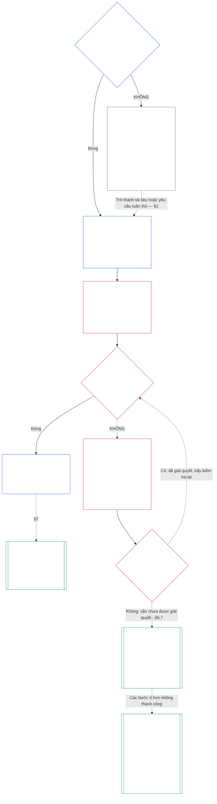

> **Bản dịch dịch có sự hỗ trợ của AI — chưa được xem xét; chưa có bài đánh giá độc lập về người đọc thông thạo nào được hoàn thành. Tệp ngôn ngữ người đọc này không có tính ràng buộc; nguồn tiếng Anh được đánh số vẫn kiểm soát.**

# CHƯƠNG BẢY: HỆ THỐNG VÀ ĐIỀU LỆ THỂ CHẾ

<strong>Vị trí kho ngữ liệu (không hoạt động): cấu trúc tệp và quy tắc đọc</strong>

> Tập tin này là **một phần của Hiến pháp có tri giác** và là **chỉ ràng buộc với nhau** với số khác `core_*` tập tin được đọc dưới dạng một văn bản. Nó chứa **Chương bảy**: sàn cho các tài liệu phạm vi được công bố của một hệ thống và của một tổ chức: Điều lệ hệ thống và Điều lệ tổ chức. Nó tuân theo Tầng Quyền của Chương Sáu và đi trước [Chương Tám](../../core_08.000_functional_independence_separation_of_duties.md#chapter-eight-functional-independence-and-separation-of-duties), phân chia các ghế bên trong bất kỳ hành động ràng buộc vật chất nào.
>
> - **Chủ sở hữu hợp pháp:** khi một hệ thống phải công bố Điều lệ hệ thống và khi một tổ chức phải công bố Điều lệ tổ chức (bắt buộc ở Loại L trở lên, tự nguyện ở Loại P), mỗi điều khoản tối thiểu phải nêu rõ, mỗi thay đổi và được xem xét như thế nào cũng như quá trình hình thành kiểm tra vị thế và tính xác thực của những người nắm giữ các văn phòng được bảo đảm.
> - **Định nghĩa nhà:** [Điều lệ hệ thống](../../core_05.040_band_continuity.md#system-charter), [Điều lệ tổ chức](../../core_05.040_band_continuity.md#institutional-charter), [Bản đồ vai trò điều lệ](../../core_05.040_band_continuity.md#charter-role-map), [Đảng điều lệ](../../core_05.040_band_continuity.md#chartered-party), Và [Bên điều hành](../../core_05.050_band_oversight.md#operating-party) được định nghĩa trong Chương Năm. Chương này áp dụng chúng và không định nghĩa lại chúng.
> - **Chủ thực hiện:** [CI-8.205 §6](../../corpus_institutions/ci_08.205_institutional_design_separation_of_powers.md#ci-8205-6-system-and-institutional-charter-contents-review-and-formation-template) (*Mẫu nội dung, rà soát và hình thành của Hệ thống và Điều lệ*) chứa mẫu trường đầy đủ, danh sách kiểm tra đánh giá, quy trình hình thành và mẫu tuyên bố kiểm tra sự hình thành. Nó có thể chặt chẽ hơn và có thể thêm các trường. Nó có thể không thu hẹp chương này. Văn bản của nó chỉ liên kết dưới dạng văn bản triển khai được kết hợp trong phạm vi áp dụng hợp lệ ([Chương 18 §4 Khung thông qua và phạm vi thẩm quyền](../../core_18.000_incorporation.md#4-adoption-framing-and-scope-of-authority)); tầng trong chương này được liên kết dưới dạng văn bản cốt lõi.
> - **Người tiêu dùng hạ nguồn:** [Chương Tám §5 Vị trí được công bố, vị trí tuyển dụng và sự thay thế](../../core_08.000_functional_independence_separation_of_duties.md#5-published-placement-vacancy-and-substitution) yêu cầu Bản đồ vai trò điều lệ. Chương Chín đọc Điều lệ Hệ thống để biết các phát hiện về phạm vi và ranh giới, và Chương Chín Phần D kiểm tra tuyên bố kiểm tra sự hình thành của một Tổ chức. [Chương Mười §3.7 Quyền lưu giữ và mở hồ sơ](../../core_10.000_standing_assessment.md#37-record-custody-and-opening-authority) áp dụng nó cho các hồ sơ thường trực. [Chương mười ba §4.3 Diễn đàn thể chế](../../core_13.000_forum.md#43-institutional-forums) xét xử các tranh chấp về Điều lệ tổ chức.
>
> Thứ tự đọc: §1 khi cần có Điều lệ Hệ thống và Thể chế, với biểu đồ sơ đồ quy trình → §2 quyền hình thành và bốn giới hạn hẹp → §3 những gì họ phải nêu → §4 Bản đồ Vai trò Điều lệ và quyền giám sát hồ sơ thường trực → §5 kiểm tra quá trình đào tạo về tư cách và tính xác thực của người giữ chức vụ → §6 khi người nắm giữ không vượt qua được quá trình kiểm tra sự hình thành → §7 sửa đổi, xem xét và sai lệch phạm vi.

<strong>Dấu vết</strong>

- Thượng nguồn:
  - [Bộ tứ hiến pháp](../../core_00.000_preamble.md#constitutional-tetrad), đặc biệt **giám sát** Và **trách nhiệm giải trình**;
  - [cổ phần vật chất](../../core_00.000_preamble.md#material-stake);
  - [Chương Một §18.1 Quản trị theo Cơ cấu Được ủy quyền](../../core_01.015_stewardship_capacity_principles.md#181-governance-as-authorized-structure) (1.015 §18.1);
  - [Điều XI-E](../../core_06.010_rights_part_b.md#article-xi-e-institutional-formation-and-business-creation) (*Hình thành thể chế và sáng tạo doanh nghiệp*).
- Tiểu mục:
  - [§1](#1-khi-nào-cần-có-điều-lệ-hệ-thống-và-thể-chế);
  - [§2](#2-quyền-hình-thành-và-bốn-giới-hạn-hẹp);
  - [§3](#3-điều-lệ-thể-chế-và-hệ-thống-nào-phải-nêu-rõ);
  - [§4](#4-bản-đồ-vai-trò-điều-lệ-và-hồ-sơ-lưu-giữ-thường-trực);
  - [§5](#5-kiểm-tra-đội-hình-vị-thế-và-tính-xác-thực-của-người-giữ-chức-vụ);
  - [§6](#6-khi-người-nắm-giữ-không-vượt-qua-được-quá-trình-kiểm-tra-đội-hình);
  - [§7](#7-sửa-đổi-đánh-giá-và-điều-chỉnh-phạm-vi).
- Hạ lưu:
  - [Chương Tám](../../core_08.000_functional_independence_separation_of_duties.md#chapter-eight-functional-independence-and-separation-of-duties) (8.000);
  - [Chương Chín](../../core_09.000_system_alignment_certification.md#chapter-nine-system-alignment-certification-reading-index) (9.000);
  - [Chương Mười](../../core_10.000_standing_assessment.md#chapter-ten-contribution-violation-and-standing-model--measurement) (10.000);
  - [Chương mười ba](../../core_13.000_forum.md#chapter-thirteen-forums-and-jurisdiction) (13.000);
  - [Chương mười bốn](../../core_14.000_governance.md#chapter-fourteen-constitutional-contract-legitimacy-authorization-and-stewardship) (14.000); văn bản thực hiện được chỉ định có tên ở trên.
- Đọc với:
  - [Ngăn xếp quyền hạn và hệ thống phân cấp nội bộ](../../core_05.045_band_integrative.md#authority-stack-and-internal-hierarchy);
  - [Ranh giới hệ thống](../../core_05.040_band_continuity.md#system-boundaries);
  - [Tính toàn vẹn ranh giới hệ thống](../../core_05.040_band_continuity.md#system-boundary-integrity);
  - [Tạo hệ thống](../../core_05.055_band_participation.md#system-creation);
  - [Sáng tạo kinh doanh](../../core_05.055_band_participation.md#business-creation).

 

Chương Bảy là chủ sở hữu hợp pháp của **Điều lệ hệ thống, Điều lệ tổ chức và phạm vi được công bố**.

Ba chương hoạt động như một chuỗi:

- **Chương Bảy (chương này):** nói cái gì thế [Đảng điều lệ](../../core_05.040_band_continuity.md#chartered-party) yêu cầu thực hiện và ai có thể giữ từng ghế khi hành động.
- **[Chương Tám](../../core_08.000_functional_independence_separation_of_duties.md#chapter-eight-functional-independence-and-separation-of-duties):** cho biết những chỗ ngồi đó phải được tách biệt như thế nào.
- **[Chương Chín](../../core_09.000_system_alignment_certification.md#chapter-nine-system-alignment-certification-reading-index):** chứng nhận một hệ thống và một tổ chức riêng biệt, mỗi tổ chức là một hành động ràng buộc sử dụng các ghế. Nó gửi những gì nó tìm thấy trở lại Điều lệ hệ thống hoặc Điều lệ tổ chức.

Các chương khác sở hữu các định nghĩa, quy tắc chỗ ngồi, khóa đứng và quy tắc quyết định mà chương này chỉ ra. **CI-8.205 §6** (*Mẫu nội dung, rà soát và hình thành của Hệ thống và Điều lệ*) chứa mẫu trường, quy trình hình thành và danh sách kiểm tra xem xét.

### 1. Khi nào cần có Điều lệ Hệ thống và Thể chế

<strong>Dấu vết</strong>

- Thượng nguồn:
  - [§2](#2-quyền-hình-thành-và-bốn-giới-hạn-hẹp);
  - [cổ phần vật chất](../../core_00.000_preamble.md#material-stake);
  - [Tỷ lệ](../../core_05.035_band_accountability.md#proportionality); yêu cầu chủ sở hữu mở chương;
  - [Chương Một §18 Quản trị theo Kỷ luật Quản lý](../../core_01.015_stewardship_capacity_principles.md#18-governance-under-stewardship-discipline) (1,015 §18);
  - [Giám sát](../../core_05.020_apex_oversight_leg.md#oversight-constitutional);
  - [Trách nhiệm](../../core_05.005_apex_accountability_leg.md#accountability).
- Hạ lưu: [§3](#3-điều-lệ-thể-chế-và-hệ-thống-nào-phải-nêu-rõ); [Chương Chín Phần A §2 Đánh giá lớp hệ thống](../../core_09.005_system_alignment_certification_evaluation.md#2-system-class-evaluation) (9,005 §2) (*độ sâu lớp học và chứng chỉ*); [Chương Chín Phần D §12.1 Lớp tổ chức](../../core_09.020_institutional_alignment_certification.md#121-institution-class) (9.020 §12.1) (*lớp của một tổ chức*); **CS-9.305 (*Máy phân loại hệ thống*) và CS-9.310** (*Máy phân loại hệ thống*) cho danh mục lớp.
- Đọc với:
  - **CI-8.205 §6** (*Mẫu nội dung, rà soát và hình thành của Hệ thống và Điều lệ*);
  - **CF-13.415 §5** (*Nhà đăng ký tổ chức và địa phương*);
  - **CI-9.210** (*Nghĩa vụ thể chế liên kết phân loại*);
  - [Chương 5 Điều lệ hệ thống](../../core_05.040_band_continuity.md#system-charter) (5.040);
  - [Chương 5 Điều lệ tổ chức](../../core_05.040_band_continuity.md#institutional-charter) (5.040);
  - [Điều XI-E](../../core_06.010_rights_part_b.md#article-xi-e-institutional-formation-and-business-creation) (*Hình thành thể chế và sáng tạo doanh nghiệp*).

<strong>Định nghĩa · Đánh giá · Tuân thủ</strong>

- [Điều lệ hệ thống](../../core_05.040_band_continuity.md#system-charter) · [ồ](../../core_05.040_band_continuity.md#system-charter) · [M](../../core_05.040_band_continuity.md#system-charter-a) · [MỘT](../../core_05.040_band_continuity.md#system-charter-a) · [C](../../core_05.040_band_continuity.md#system-charter-c)
- [Điều lệ tổ chức](../../core_05.040_band_continuity.md#institutional-charter) · [ồ](../../core_05.040_band_continuity.md#institutional-charter) · [M](../../core_05.040_band_continuity.md#institutional-charter-a) · [MỘT](../../core_05.040_band_continuity.md#institutional-charter-a) · [C](../../core_05.040_band_continuity.md#institutional-charter-c)
- [Quản trị theo quy mô phân loại](../../core_05.050_band_oversight.md#classification-scaled-governance) · [ồ](../../core_05.050_band_oversight.md#classification-scaled-governance) · [M](../../core_05.050_band_oversight.md#classification-scaled-governance-a) · [MỘT](../../core_05.050_band_oversight.md#classification-scaled-governance-a) · [C](../../core_05.050_band_oversight.md#classification-scaled-governance-c)

 

*Nói một cách dễ hiểu: trước khi bất kỳ ai có thể đánh giá liệu một hệ thống hoặc tổ chức có nằm trong giới hạn của nó hay không, các giới hạn phải được viết ra để mọi người có thể đọc được. Một hệ thống có ý nghĩa quan trọng đối với người khác trong bất kỳ lĩnh vực nào trong chín lĩnh vực của [Tính trọng yếu của miền cụ thể](../../core_05.050_band_oversight.md#domain-specific-materiality) cần một Điều lệ hệ thống được xuất bản. Một tổ chức xuất bản một cái phù hợp với hệ thống mà nó chạy. Lớp P là tự nguyện: một vòng tròn may chăn bông cho người tị nạn là mẫu.*

Điều lệ Hệ thống hoặc Điều lệ Thể chế là phạm vi được công bố của một Bên được cấp phép: họ tuyên bố có thẩm quyền làm gì, không làm gì và ai giữ mỗi ghế khi họ hành động. Đó là phạm vi mà các ghế trong Chương Tám được đặt ra và chứng nhận đó trong Chương Chín phản ánh hoạt động thực tế. Việc Bên điều hành có phải xuất bản một tài liệu hay không tùy thuộc vào lớp của nó: **yêu cầu ở hạng L trở lên, tự nguyện ở hạng P.** Nếu nó phải xuất bản một cái, nó cũng phải giữ nó chính xác.

Năm loại tác động của hệ thống là khung cho mọi thứ bên dưới. Từ hệ quả nhiều nhất đến ít nhất, mỗi dòng ghi một dòng:

- **Loại A, quan trọng cho sự sống còn, nền tảng và không thể thay thế:** thất bại trong khoảng thời gian liên quan đến sự sống sót mà không có sự thay thế khả thi nào, đồng nghĩa với việc mất đi các điều kiện sinh tồn.
- **Loại B, quan trọng, phụ thuộc cao và có ý nghĩa hệ thống:** người phụ thuộc không thể duy trì chức năng cốt lõi nếu không có nó. Khả năng sống sót không bị mất ngay lập tức và vẫn có thể thay thế kịp thời.
- **Loại C, phối hợp, phụ thuộc cao và không quan trọng:** nó định hình sự phối hợp trên quy mô lớn nhưng không phải là điều kiện tiên quyết về hoạt động đối với chức năng Loại A hoặc Loại B.
- **Loại L, cục bộ, tác động hạn chế và không nghiêm trọng:** tác động của nó vượt ra ngoài phạm vi một đơn vị tư nhân nhưng mang tính cục bộ, có thể thay thế và chứa đựng được.
- **Loại P, cá nhân, sử dụng riêng, biệt lập và thử nghiệm:** tác động của nó nằm trong một đơn vị tư nhân, không có sự phụ thuộc đáng kể từ bên ngoài.

[CS-9.310 §8](../../corpus_systems/cs_09.310_system_impact_classifications.md#cs-9310-8-system-impact-classifications) (*Phân loại tác động hệ thống*) chứa các định nghĩa đầy đủ. Các lớp A, B, C và L phải xuất bản và Lớp P có thể, và [§1.2 Những lớp nào được đề cập](#12-những-lớp-học-nào-được-dạy) cho biết cách một Tổ chức lấy lớp của nó từ Hệ thống mà nó điều hành.

#### 1.1 Ai phải xuất bản

Hệ thống Cấp L trở lên phải xuất bản và duy trì [Điều lệ hệ thống](../../core_05.040_band_continuity.md#system-charter). Tổ chức Cấp L trở lên phải xuất bản và duy trì một trong những tổ chức phù hợp với Hệ thống mà nó chạy:

| Những gì Tổ chức vận hành, quản lý hoặc kiểm soát vật chất | Những gì nó xuất bản |
| --- | --- |
| Chính xác là một Hệ thống cần có Điều lệ Hệ thống | Điều lệ hệ thống đó và không có tài liệu thứ hai. Nó đặt tên cho Tổ chức là người quản lý và phục vụ như là [Điều lệ tổ chức](../../core_05.040_band_continuity.md#institutional-charter): một tài liệu bao gồm cả hai. |
| Nhiều hơn một hệ thống như vậy | Điều lệ tổ chức. Nó bao gồm mọi Điều lệ Hệ thống có hiệu lực đối với các Hệ thống đó và nêu rõ lý do Tổ chức vận hành các Hệ thống cụ thể đó ([§3 Những điều lệ về hệ thống và thể chế phải nêu rõ](#3-điều-lệ-thể-chế-và-hệ-thống-nào-phải-nêu-rõ)). |
| Không có hệ thống như vậy | Điều lệ của Tổ chức nêu rõ các mục riêng của Tổ chức từ [§3 Những điều lệ về hệ thống và thể chế phải nêu rõ](#3-điều-lệ-thể-chế-và-hệ-thống-nào-phải-nêu-rõ) và không có Điều lệ hệ thống nào để đưa vào. |

- **Doanh nghiệp và các hình thức so sánh:** Một doanh nghiệp hoặc hình thức tổ chức được quản lý khác công bố bất kỳ Điều lệ Hệ thống hoặc Điều lệ Tổ chức nào áp dụng cho nó với tư cách là một Hệ thống, một Tổ chức hoặc một Tổ chức vận hành một Hệ thống được bảo đảm. Hình thức pháp lý của nó không thay đổi câu trả lời.
- **Thực hành chung về chuyên môn:** Một cơ sở hành nghề có tri giác hoặc nhỏ thuộc Loại L trở lên thực hiện hành động được liệt kê để cấp giấy phép hành nghề hoặc giấy phép hành nghề có thể đáp ứng phần này đối với những hành vi đó bằng cách áp dụng Điều lệ hệ thống hoặc Điều lệ tổ chức và Bản đồ vai trò điều lệ của chủ nhà:
  - **Những gì được thông qua:** Bằng cách tham khảo, Điều lệ hệ thống hoặc Điều lệ tổ chức và Bản đồ vai trò điều lệ của người chủ trì trong hoạt động hành nghề chung, phải bao gồm các hành vi đó.
  - **Thông báo nhận con nuôi:** Thông báo một trang rằng **CI-14.205 §7** (*Giấy phép hành nghề, chứng nhận hành nghề và hành nghề chung*) mô tả.
  - **Lớp học:** Việc thực hành vẫn giữ nguyên đẳng cấp mà hành động của chính nó mang lại cho nó.

#### 1.2 Những lớp học nào được dạy

Tầng lớp của Đảng Hiến chương quyết định việc xuất bản là bắt buộc hay một lựa chọn:

- **Lớp A, B, C và L:** yêu cầu. Biểu đồ ở [§1.7 Sơ lược về quy trình](#17-sơ-lược-về-quy-trình) cho thấy quá trình họ làm theo.
- **Lớp P:** một sự lựa chọn, cho đến khi một trong hai sự kiện khiến nó trở nên cần thiết. [§1.3 Lớp P là gì](#13-lớp-p-là-gì) cho biết điều gì tạo nên Nhóm điều hành Cấp P, và [§1.4 Loại P: các điều lệ tùy chọn và khi chúng được yêu cầu](#14-loại-p-thuê-tàu-tùy-chọn-và-khi-chúng-được-yêu-cầu) đặt ra sự lựa chọn và khi nó kết thúc.
- **Lớp của một tổ chức:** Một Tổ chức có cấp độ cao nhất trong bất kỳ Hệ thống nào mà nó vận hành, quản lý hoặc kiểm soát vật chất. Một Tổ chức không vận hành Hệ thống như vậy được phân loại theo tác động và sự phụ thuộc quan trọng của chính nó, được đánh giá bởi những gì nó thực sự quyết định và nắm giữ chứ không phải theo nhãn hiệu hoặc hình thức pháp lý của nó, theo [Chương Chín Phần D §12.1 Lớp tổ chức](../../core_09.020_institutional_alignment_certification.md#121-institution-class).

#### 1.3 Lớp P là gì

Một Bên điều hành chỉ được xếp vào Loại P khi hoạt động của nó vẫn ở dưới mức giới hạn ở mọi lĩnh vực trong số chín lĩnh vực của [Tính trọng yếu của miền cụ thể](../../core_05.050_band_oversight.md#domain-specific-materiality), trong thực tế có nghĩa là các hành động và tác động của nó nằm trong phạm vi của nó [đơn vị tư nhân](../../core_05.050_band_oversight.md#domain-specific-materiality-private-unit):

- **Vượt qua một dòng:** Vượt qua ranh giới trong bất kỳ một miền nào sẽ khiến miền đó ít nhất thuộc Loại L dưới **CS-9.305 (*Máy phân loại hệ thống*) và CS-9.310** (*Máy phân loại hệ thống*), bất kể kích thước của nó hoặc tên gọi của nó.
- **Ở bên dưới mỗi dòng:** Nó vẫn là Lớp P dù có bao nhiêu thành viên.
- **Những người bên trong:** Lớp P cũng phụ thuộc vào những người bên trong nó. Bất kỳ ai bên trong nhận thấy Bên điều hành vượt quá giới hạn đều có nghĩa vụ báo cáo việc đó và báo cáo sẽ được bảo vệ ([Tính trọng yếu của miền cụ thể](../../core_05.050_band_oversight.md#domain-specific-materiality)).

Tầng bốn chỗ ngồi trong Chương 8 không áp dụng cho các hoạt động của Nhóm điều hành Cấp P, vốn ở bên trong đơn vị riêng của họ, vì vậy một người có máy tính không cần người giữ ghế thứ hai. Mức sàn được áp dụng kể từ ngày Bên điều hành thực hiện [Đạo luật ràng buộc vật chất](../../core_05.035_band_accountability.md#materially-binding-act) mà những người khác phải tuân theo hoặc có thể dựa vào khi đã giải quyết, điều này vượt qua ranh giới trong lĩnh vực quyền lực đối với người khác và khiến nó ít nhất là Loại L.

#### 1.4 Loại P: thuê tàu tùy chọn và khi chúng được yêu cầu

Bên điều hành Loại P được khuyến khích xuất bản thông tin [Điều lệ hệ thống](../../core_05.040_band_continuity.md#system-charter) (đối với một hệ thống duy nhất) hoặc [Điều lệ tổ chức](../../core_05.040_band_continuity.md#institutional-charter) (đối với nhiều hệ thống hoặc không có hệ thống nào) phù hợp với những gì nó chạy. Nó có thể sử dụng danh sách nội dung trong [§3 Những điều lệ về hệ thống và thể chế phải nêu rõ](#3-điều-lệ-thể-chế-và-hệ-thống-nào-phải-nêu-rõ) và sơ đồ chỗ ngồi trong [§4 Bản đồ vai trò điều lệ và hồ sơ lưu giữ thường trực](#4-bản-đồ-vai-trò-điều-lệ-và-hồ-sơ-lưu-giữ-thường-trực) như một mẫu. Việc xuất bản không tạo ra nghĩa vụ nào theo quy trình của chương này:

- không có ngày đáo hạn ([§1.5 Khi đến hạn Điều lệ hệ thống hoặc Điều lệ tổ chức](#15-khi-đến-hạn-điều-lệ-hệ-thống-hoặc-điều-lệ-tổ-chức));
- không kiểm tra sự hình thành ([§5 Kiểm tra đội hình: Vị thế và tính xác thực của người giữ chức vụ](#5-kiểm-tra-đội-hình-vị-thế-và-tính-xác-thực-của-người-giữ-chức-vụ));
- không cần thiết [Bản đồ vai trò điều lệ](../../core_05.040_band_continuity.md#charter-role-map) ([§4 Bản đồ vai trò điều lệ và hồ sơ lưu giữ thường trực](#4-bản-đồ-vai-trò-điều-lệ-và-hồ-sơ-lưu-giữ-thường-trực)), mặc dù nó có thể giữ một bản với Điều lệ hệ thống hoặc Điều lệ tổ chức tự nguyện hoặc tự xuất bản nó; Và
- không cần phải sửa đổi hoặc xem xét chu kỳ ([§7 Sửa đổi, đánh giá và điều chỉnh sai phạm vi](#7-sửa-đổi-đánh-giá-và-điều-chỉnh-phạm-vi)).

Nếu một trong hai điều này xảy ra, việc xuất bản sẽ không còn là tùy chọn nữa.

- Bên điều hành được phân loại lại thành Loại L hoặc cao hơn; hoặc
- nhà điều hành của nó khẳng định việc tuân thủ hiến pháp đối với Bên điều hành.

Sau đó, Bên điều hành phải xuất bản Điều lệ hệ thống hoặc Điều lệ tổ chức phù hợp với nó, theo lịch trình trong [§1.5 Khi đến hạn Điều lệ hệ thống hoặc Điều lệ tổ chức](#15-khi-đến-hạn-điều-lệ-hệ-thống-hoặc-điều-lệ-tổ-chức).

**Sự công nhận không phụ thuộc vào tài liệu phạm vi.** Một nhóm, có hoặc không có Điều lệ hệ thống hoặc Điều lệ tổ chức và bất kể loại nhóm nào, không đứng giữa các thành viên và sự công nhận của nhóm đó. Mỗi thành viên có thể tìm kiếm hồ sơ đóng góp với tư cách là người yêu cầu cá nhân, cho công việc được thực hiện trong hoặc ngoài nhóm và hồ sơ liên quan đến đóng góp của thành viên chứ không phải vị thế của nhóm ([Chương Mười §3.7 Hồ sơ không chính thức và phạm vi nhỏ](../../core_10.000_standing_assessment.md#37-informal-and-small-scope-records)). Cung cấp viện trợ, hàng hóa, lao động hoặc dịch vụ mà không ai bắt buộc phải chấp nhận không phải là một hành động ràng buộc về mặt vật chất, do đó, một vòng tròn hỗ trợ lẫn nhau cung cấp mền cho người tị nạn không cần phải có Hiến chương Hệ thống hoặc Hiến chương Thể chế để các thành viên của mình được công nhận.

#### 1.5 Khi đến hạn Điều lệ hệ thống hoặc Điều lệ tổ chức

Một Hệ thống hoặc Tổ chức được bảo vệ sẽ xuất bản [Điều lệ hệ thống](../../core_05.040_band_continuity.md#system-charter) hoặc [Điều lệ tổ chức](../../core_05.040_band_continuity.md#institutional-charter) theo lịch trình này:

- **Một hệ thống hoặc tổ chức mới:** trước khi nó đi vào hoạt động hoặc bắt đầu thực thi quyền lực đối với người khác.
- **Một cái đã hoạt động:** tại lần đánh giá hoặc chứng nhận phân loại tiếp theo hoặc trong thời gian giải quyết sau khi có yêu cầu theo [§1.6 Nếu thiếu Điều lệ hệ thống hoặc Điều lệ tổ chức](#16-nếu-thiếu-điều-lệ-hệ-thống-hoặc-điều-lệ-tổ-chức), tùy điều kiện nào đến trước. Nó được mặc định cho đến khi nó thực hiện được.
  - **Chứng nhận nào:** Đối với một Hệ thống, Chứng nhận Căn chỉnh Hệ thống của nó. Đối với một Tổ chức, chứng nhận liên kết tổ chức của nó theo [Chương Chín Phần D §11.3 Không được phép và không có cổng](../../core_09.020_institutional_alignment_certification.md#113-no-permission-and-no-gate), mà thời hạn chứng nhận đầu tiên không bao giờ là điều kiện để xuất bản Điều lệ Tổ chức hoặc điều hành.
- **Kiểm tra sự hình thành:** Nó cũng hoàn thành việc kiểm tra đội hình [§5 Kiểm tra đội hình: Vị thế và tính xác thực của người giữ chức vụ](#5-kiểm-tra-đội-hình-vị-thế-và-tính-xác-thực-của-người-giữ-chức-vụ) cùng một lúc.
- **Nó được đặt ở đâu:** Nó nộp Điều lệ hệ thống hoặc Điều lệ tổ chức, cùng với Bản đồ vai trò điều lệ và tuyên bố kiểm tra quá trình hình thành, cho nhà đăng ký tổ chức hoặc với nhà đăng ký địa phương nơi hoạt động của nó và những người mà nó ảnh hưởng là người địa phương (**CF-13.415 §5** (*Nhà đăng ký tổ chức và địa phương*)):
  - **Nhà đăng ký làm gì:** Nó kiểm tra xem không có thứ gì được yêu cầu bị thiếu và đưa ra một biên nhận có ghi ngày tháng.
  - **Điều mà nhà đăng ký không bao giờ làm:** Nó không bao giờ cấp phép và không bao giờ quy định về lớp học hoặc nội dung.
  - **Biên lai nộp muộn hoặc bị thiếu:** Nó không bao giờ ngăn cản Chartered Party hoạt động.

#### 1.6 Nếu thiếu Điều lệ hệ thống hoặc Điều lệ tổ chức

Bất kỳ ai nhận thấy Bên được cấp phép cấp L trở lên, mới hoặc mới cấp, chưa công bố Điều lệ hệ thống hoặc Điều lệ tổ chức của mình có thể yêu cầu cơ quan quản lý của mình công bố điều lệ đó. Người yêu cầu không cần đứng, không trả phí và không cần thể hiện sự tổn hại. Yêu cầu nêu tên Bên được cấp phép và cho biết lý do tại sao nó được bảo hiểm.

Hai cửa sổ chạy từ yêu cầu: cửa sổ phản hồi và cửa sổ giải quyết. Mỗi lớp lấy độ dài từ Cấp có cùng chữ cái với lớp của Chartered Party, vì vậy lớp càng quan trọng thì thời lượng càng ngắn:

| Lớp và cấp | Cửa sổ phản hồi (mục tiêu tiếp nhận) | Cửa sổ độ phân giải (giới hạn bên ngoài) |
|---|---|---|
| Hạng A, Hạng A | 24 giờ | 7 ngày dương lịch |
| Loại B, Cấp B | 2 ngày dương lịch | 14 ngày dương lịch |
| Loại C, Cấp C | 4 ngày dương lịch | 30 ngày dương lịch |
| Lớp L, Cấp L | 8 ngày dương lịch | 60 ngày dương lịch |

Các số liệu đến từ **CF-13.445 §3.1** (*Mục tiêu giai đoạn và tầng thời gian*), điều này chi phối nếu chúng khác nhau. Bên đặc quyền tranh chấp về hạng của mình sẽ được tính ở Cấp của hạng quan trọng hơn mà họ nắm giữ trong Hồ sơ phân loại hệ thống của mình và bất kỳ hạng nào mà người hỏi hoặc diễn đàn hiển thị trên cơ sở sơ bộ, cho đến khi câu hỏi được giải quyết. Bên đặc quyền không có hồ sơ xếp hạng hoặc giữ Hạng P trong khi hạng của nó đang được đề cập, được tính ở Cấp C.

Các cửa sổ hoạt động như thế này:

- **Cửa sổ phản hồi:** Bên được cấp phép phản hồi bên trong cửa sổ phản hồi, đây là mục tiêu tiếp nhận của cấp phù hợp trong **CF-13.445 §3.1** (*Mục tiêu giai đoạn và tầng thời gian*), được tính từ yêu cầu. Nó xuất bản Điều lệ hệ thống hoặc Điều lệ tổ chức hoặc đưa ra ngày mà nó sẽ xuất bản hoặc chỉ ra ngày mà nó đã xuất bản hoặc trả lời rằng nó nằm dưới mỗi dòng của [Tính trọng yếu của miền cụ thể](../../core_05.050_band_oversight.md#domain-specific-materiality) và đưa ra văn bản cho thấy mục đó yêu cầu.
- **Cửa sổ độ phân giải:** Điều lệ hệ thống hoặc Điều lệ tổ chức phải nằm trong cửa sổ giải quyết, đây là giới hạn bên ngoài của cấp phù hợp trong **CF-13.445 §3.1** (*Mục tiêu giai đoạn và tầng thời gian*), được tính từ yêu cầu, với câu lệnh kiểm tra sự hình thành đi kèm với nó ([§5 Kiểm tra đội hình: Vị thế và tính xác thực của người giữ chức vụ](#5-kiểm-tra-đội-hình-vị-thế-và-tính-xác-thực-của-người-giữ-chức-vụ)). Một Bên được điều lệ không có ghế độc lập vẫn nộp tuyên bố như một tuyên bố kèm theo bằng chứng của mình, như phần đó cung cấp.
- **Bên điều hành cho biết nó nằm dưới dòng:** Yêu cầu sau đó cũng là một thách thức phân loại trên tuyến đường trong mục nhập đó *Lộ trình thử thách*:
  - **Chạy cửa sổ:** Cửa sổ độ phân giải tiếp tục chạy trong khi thử thách đang chờ xử lý.
  - **Phần mở rộng thách thức:** Nếu diễn đàn có thẩm quyền đánh giá thử thách xứng đáng được xem xét thì ngày đến hạn sẽ được kéo dài và thời hạn giải quyết mới sẽ bắt đầu khi thử thách được quyết định. Diễn đàn quyết định thử thách bên trong giới hạn ngoài của cấp phù hợp.
  - **Đáng đánh giá có nghĩa là gì:** Một thử thách đáng được xem xét khi nó đặt tên cho một điểm giao cắt cụ thể trong một miền được đặt tên và phần hiển thị bằng văn bản của Bên điều hành để lại một câu hỏi thực sự về điểm giao cắt đó. Bên điều hành không tự mình đánh giá việc này và phản hồi không đưa ra bằng văn bản sẽ không kéo dài ngày.
  - **Nếu một lớp được tìm thấy:** Trong thử thách đó hoặc bất kỳ thử thách nào khác, ngày phát hiện được tính là ngày của yêu cầu: cửa sổ phản hồi và cửa sổ giải quyết chạy từ đó, ở Cấp của lớp được tìm thấy (Lớp A, B, C hoặc L).
- **Nếu nó bị bỏ lỡ:** Không có phản hồi hoặc không có Điều lệ hệ thống hoặc Điều lệ tổ chức trước ngày đáo hạn là một khiếm khuyết cần ghi lại và sửa chữa. Người hỏi có thể đưa nó đến diễn đàn có thẩm quyền trên cùng một tuyến đường. Nó không bao giờ là điều kiện hình thành hay vận hành.
- **Một yêu cầu lặp lại:** Yêu cầu thứ hai về cùng một Bên được công nhận, được đưa ra trong khi phản hồi trước đó hoặc kết quả tìm thấy vẫn còn hiệu lực, sẽ không bắt đầu thời hạn phản hồi hoặc giải quyết mới. Đảng Hiến chương trả lời bằng cách chỉ ra phản hồi hoặc phát hiện đó. Việc nó hiển thị rằng nó nằm dưới mọi dòng, chưa được diễn đàn xem xét, không được tính là phản hồi có giá trị. Phản hồi hoặc phát hiện có hiệu lực cho đến khi một trong những điều này xảy ra, khi quá trình mở lại được kích hoạt trong [Chương Chín Phần D §14.2 Kích hoạt mở lại](../../core_09.020_institutional_alignment_certification.md#142-reopening-triggers) mô tả:
  - **Thay đổi vật chất:** Hoạt động của Đảng Hiến chương có sự thay đổi căn bản.
  - **Bằng chứng mới:** Bằng chứng mới về việc vượt biển được hiển thị.

  Yêu cầu thể hiện một trong những điều trên không phải là yêu cầu lặp lại. Đó là một yêu cầu mới, được xử lý riêng biệt và độc lập với yêu cầu trước đó. Nó có cửa sổ phản hồi và cửa sổ phân giải riêng, được tính từ ngày của chính nó và phản hồi, tìm kiếm và cửa sổ trước đó không đáp ứng cũng như không bị thay đổi bởi nó.
- **Phạm vi trong khi chờ đợi:** Điều lệ hệ thống hoặc Điều lệ tổ chức bị thiếu không phải là lý do để coi Bên được điều lệ là không bị ràng buộc. Cho đến khi nó tồn tại, Đảng Hiến chương thực sự [Ranh giới hệ thống](../../core_05.040_band_continuity.md#system-boundaries) và kiểm soát lớp của nó, đồng thời chứng nhận hoặc diễn đàn có thể xây dựng lại phạm vi từ hoạt động được quan sát.

#### 1.7 Sơ lược về quy trình

Biểu đồ tuân theo một Bên điều hành từ câu hỏi liệu nó có quan trọng đối với các bên khác hay không, thông qua việc xuất bản Điều lệ hệ thống hoặc Điều lệ tổ chức của mình và giữ cho nó luôn chính xác. Nếu một vấn đề không được khắc phục trong cửa sổ giải quyết, quy trình thuê tàu sẽ gửi vấn đề đó đến một cuộc đánh giá nằm ngoài chương này. Các phần sau phần này giải thích từng bước theo cùng một thứ tự.

<strong>Hướng dẫn người đọc (không hoạt động): cách đọc biểu đồ</strong>

> Nói một cách dễ hiểu: không ai cấp Điều lệ hệ thống hoặc Điều lệ tổ chức và không ai cần được phép hình thành. Một Đảng đặc quyền có hoạt động quan trọng đối với người khác sẽ công bố những gì họ tuyên bố có thẩm quyền thực hiện và ai giữ từng ghế, đồng thời những người nắm giữ các chức vụ chủ chốt của đảng đó sẽ bị kiểm tra. Người nắm giữ bị lỗi sẽ được thay thế hoặc nguyên nhân được khắc phục và Đảng được điều lệ sẽ tiếp tục. Nếu lỗi vẫn chưa được khắc phục khi thời hạn giải quyết kết thúc, diễn đàn có thể xem xét Bên được cấp phép, bắt đầu từ bước nhẹ nhất để bảo vệ người khác. Việc khiến Đảng Hiến chương thu hẹp lại dưới Loại L hoặc giải thể nó chỉ xảy ra nếu các bước nhẹ nhàng hơn không thành công. Một Đảng điều lệ đã bị giải tán không được phép quay trở lại khi khóa của nó vẫn còn hiệu lực.
>
> Mũi tên rắn là con đường chính. Mũi tên chấm là các trường hợp ngoại lệ và chuyển giao, được gắn nhãn với phần tạo ra chúng. Các hộp có thanh đôi bên thuộc về một chương khác hoặc thuộc về văn bản triển khai được tích hợp. Biểu đồ không thêm nhiệm vụ, chỗ ngồi hoặc lĩnh vực và không có bước nào trên đó là sự cấp phép.

 

### 2. Quyền hình thành và bốn giới hạn hẹp

<strong>Hướng dẫn người đọc (không hoạt động): phần này được trình bày như thế nào</strong>

- [§2.1 Quyền hình thành](#21-quyền-thành-lập) tuyên bố quyền và những người nó không bao gồm.
- [§2.2 Giới hạn đầu tiên: khóa chưa thanh toán đối với người có tri giác](#22-giới-hạn-đầu-tiên-khóa-chưa-thanh-toán-đối-với-một-người-có-tri-giác) nói làm thế nào một chiếc khóa giữ một người được nêu tên có tri giác ra khỏi văn phòng kiểm soát.
- [§2.3 Giới hạn thứ hai: tạm dừng các sự kiện đã được xác minh cụ thể](#23-giới-hạn-thứ-hai-tạm-dừng-đối-với-các-sự-kiện-đã-được-xác-minh-cụ-thể) cho biết việc tạm giữ trong thời gian ngắn có thể khiến một người có tên bị loại khỏi văn phòng kiểm soát như thế nào.
- [§2.4 Giới hạn thứ ba: khóa đối với chính Bên điều hành](#24-giới-hạn-thứ-ba-khóa-chính-bên-điều-hành) cho biết cách khóa của một Đảng điều hành ngăn cản nó và những người kế nhiệm của nó, và rằng một Đảng điều lệ đã bị giải tán có thể không quay trở lại.
- [§2.5 Giới hạn thứ tư: giấy phép hành nghề hoặc giấy phép hành nghề](#25-giới-hạn-thứ-tư-giấy-phép-hành-nghề-hoặc-giấy-phép-hành-nghề) cho biết khi nào một hành động có nguy cơ cao cần có giấy phép hoặc giấy phép. Nó không phải là một cánh cổng hình thành.

<strong>Dấu vết</strong>

- Thượng nguồn: [§1](#1-khi-nào-cần-có-điều-lệ-hệ-thống-và-thể-chế); [Điều XI-E](../../core_06.010_rights_part_b.md#article-xi-e-institutional-formation-and-business-creation) (*Hình thành thể chế và sáng tạo doanh nghiệp*).
- Hạ lưu: [§1 Khi cần có Điều lệ Hệ thống và Thể chế](#1-khi-nào-cần-có-điều-lệ-hệ-thống-và-thể-chế); [§5 Kiểm tra đội hình: Vị thế và tính xác thực của người giữ chức vụ](#5-kiểm-tra-đội-hình-vị-thế-và-tính-xác-thực-của-người-giữ-chức-vụ).
- Đọc với:
  - [Giữ tạm thời](../../core_05.035_band_accountability.md#interim-hold);
  - [Chương Mười một §4.2 Phòng ngừa - ổ khóa đứng chung](../../core_11.000_standing_integration.md#42-prevention--general-standing-locks) (11.000 §4.2);
  - [Chương Mười Một §5.5 Khóa đặc biệt](../../core_11.000_standing_integration.md#55-special-locks) (11.000 §5,5);
  - [Chương mười ba §5 Tạm thời giữ lại con đường của một sinh vật có tên](../../core_13.000_forum.md#interim-hold-on-a-named-sentients-pathway) (13.000 §5).

 

*Nói một cách dễ hiểu: bạn không cần sự cho phép của bất kỳ ai để thành lập một hệ thống, tổ chức hoặc doanh nghiệp. Bốn giới hạn hẹp có thể được áp dụng. Ba cánh cổng: một khóa chưa được giải quyết có thể giữ một người có tri giác không thể vào được một văn phòng kiểm soát, việc nắm giữ một thời gian ngắn các sự kiện đã được xác minh cụ thể cũng có thể làm được điều tương tự, và một khóa đối với chính Bên điều hành có thể ngăn cản Bên điều hành đó. Thứ tư có thể yêu cầu giấy phép hoặc giấy phép trước khi thực hiện một hành động có rủi ro cao được nêu tên. Đảng đặc quyền mà một diễn đàn đã giải tán sẽ bị cấm quay trở lại và rào cản này là vĩnh viễn khi việc giải tán dựa trên hành vi vi hiến phổ biến hoặc gây tổn hại nghiêm trọng không thể khắc phục được và không bao giờ được giải quyết đúng đắn. Không có điều nào ngăn cản một Bên điều hành mới hình thành hoặc hoạt động, và chương này không bổ sung thêm điều gì.*

**Điều XI-E** (*Hình thành thể chế và sáng tạo doanh nghiệp*) cho phép bốn giới hạn hẹp:

- **Ba cổng đầu tiên là cổng duy nhất** về việc thành lập một Bên điều hành hoặc nắm giữ quyền lực trong đó. Mỗi cái gắn liền với một chủ đề được đặt tên:
  - **Khóa nổi bật** ([§2.2 Giới hạn đầu tiên: khóa chưa thanh toán đối với người có tri giác](#22-giới-hạn-đầu-tiên-khóa-chưa-thanh-toán-đối-với-một-người-có-tri-giác)) gắn với một người có tên trong một văn phòng kiểm soát Bên được cấp phép.
  - **Tạm giữ tạm thời** ([§2.3 Giới hạn thứ hai: tạm dừng các sự kiện đã được xác minh cụ thể](#23-giới-hạn-thứ-hai-tạm-dừng-đối-với-các-sự-kiện-đã-được-xác-minh-cụ-thể)) chỉ gắn với một người có tên trong một văn phòng kiểm soát Bên được cấp phép.
  - **Một khóa trên chính Bên điều hành** ([§2.4 Giới hạn thứ ba: khóa đối với chính Bên điều hành](#24-giới-hạn-thứ-ba-khóa-chính-bên-điều-hành)) gắn liền với một Bên được điều lệ đang bị khóa, bao gồm cả một Bên đã bị diễn đàn giải tán.
- **Cái thứ tư không phải là cổng:** Đó là giấy phép hành nghề hoặc giấy phép hành nghề ([§2.5 Giới hạn thứ tư: giấy phép hành nghề hoặc giấy phép hành nghề](#25-giới-hạn-thứ-tư-giấy-phép-hành-nghề-hoặc-giấy-phép-hành-nghề)).

#### 2.1 Quyền thành lập

Bất cứ ai cũng có thể thành lập một hệ thống, tổ chức hoặc doanh nghiệp mới. Quyền đó được quy định trong [Điều XI-E](../../core_06.010_rights_part_b.md#article-xi-e-institutional-formation-and-business-creation) (*Hình thành thể chế và sáng tạo doanh nghiệp*). Chương này bổ sung thêm nhiệm vụ tiếp theo. Khi những gì một Bên điều hành làm là quan trọng đối với những bên khác ở bất kỳ lĩnh vực nào trong chín lĩnh vực của [Tính trọng yếu của miền cụ thể](../../core_05.050_band_oversight.md#domain-specific-materiality), nó phải nói trước công chúng những gì nó yêu cầu có thẩm quyền làm ([§1 Khi cần có Điều lệ Hệ thống và Thể chế](#1-khi-nào-cần-có-điều-lệ-hệ-thống-và-thể-chế)). Việc thông qua Điều lệ hệ thống hoặc Điều lệ tổ chức không được hiểu là nhằm thu hẹp quyền đó hoặc bất kỳ sự bảo vệ nào của Tầng quyền.

**Ai có quyền hình thành không bao gồm.** Ngoài ba cổng vào [§2.2 Giới hạn đầu tiên: khóa chưa thanh toán đối với người có tri giác](#22-giới-hạn-đầu-tiên-khóa-chưa-thanh-toán-đối-với-một-người-có-tri-giác), [§2.3 Giới hạn thứ hai: tạm dừng các sự kiện đã được xác minh cụ thể](#23-giới-hạn-thứ-hai-tạm-dừng-đối-với-các-sự-kiện-đã-được-xác-minh-cụ-thể), Và [§2.4 Giới hạn thứ ba: khóa đối với chính Bên điều hành](#24-giới-hạn-thứ-ba-khóa-chính-bên-điều-hành), **Điều XI-E** (*Hình thành thể chế và sáng tạo doanh nghiệp*) không bảo vệ:

- một Đảng điều hành được thành lập để phá vỡ Ràng buộc Hiến pháp, làm suy yếu An toàn hoặc Sự thật hoặc để tập trung quyền lực theo những cách [Chương Một §11 Cấu trúc thị trường](../../core_01.005_values_principles.md#11-market-structure) loại trừ; hoặc
- một Bên điều hành được thành lập hoặc điều hành bởi một người sáng lập không thực sự phù hợp với mục đích đã nêu của nó, thể hiện qua hành vi, quyền kiểm soát và phần thưởng đã được xác minh hoặc có ý định lừa dối người khác về mục đích, quyền kiểm soát hoặc lợi ích của mình hoặc làm hại người khác.

Các diễn đàn quyết định những trường hợp này theo Điều khoản đó và hậu quả duy nhất là ba cổng trong đó: cổng khóa chưa thanh toán, lệnh Giữ tạm thời và khóa chính Bên điều hành. Việc kiểm tra đội hình không thành công là một bằng chứng mà diễn đàn cân nhắc, có nghĩa là việc kiểm tra đội hình không thành công sẽ không quyết định được trường hợp nào.

#### 2.2 Giới hạn đầu tiên: khóa chưa thanh toán đối với một người có tri giác

MỘT [khóa đứng](../../core_11.000_standing_integration.md#42-prevention--general-standing-locks) hoặc [khóa đặc biệt](../../core_11.000_standing_integration.md#55-special-locks), được đặt ra sau một hành vi vi phạm đã được xác minh và chưa được dỡ bỏ, cấm một người có tên có thẩm quyền đối với loại tổ chức hoặc doanh nghiệp này.

- Điều gì bị cấm: nắm giữ hoặc thực thi quyền quản lý, kiểm soát hoặc sở hữu trong Bên điều hành.
- Nó đạt được bao xa: chỉ xa đến mức ổ khóa. Nó kết thúc khi ổ khóa được nâng lên hoặc thu hẹp lại.
- Khóa trên chính Bên điều hành: xem [§2.4 Giới hạn thứ ba: khóa đối với chính Bên điều hành](#24-giới-hạn-thứ-ba-khóa-chính-bên-điều-hành).

#### 2.3 Giới hạn thứ hai: tạm dừng đối với các sự kiện đã được xác minh cụ thể

Giới hạn này áp dụng khi một diễn đàn có thẩm quyền đã ra lệnh [Giữ tạm thời](../../core_05.035_band_accountability.md#interim-hold) dựa trên các sự kiện cụ thể đã được xác minh khiến nhiều khả năng chủ sở hữu đã đi sai mục đích đã nêu của Bên được cấp phép. Chỉ có diễn đàn đó mới có thể đặt hàng ([Chương mười ba §5 Tạm thời giữ lại con đường của một sinh vật có tên](../../core_13.000_forum.md#interim-hold-on-a-named-sentients-pathway)). Đảng Hiến chương không thể tự mình quyết định cấm ai đó vào chức vụ, bởi vì điều đó sẽ khiến Đảng này trở thành thẩm phán đối với chính thành viên của mình. Mặt bằng đầy đủ là mặt bằng trong [Chương mười ba §5 Tạm thời giữ lại con đường của một sinh vật có tên](../../core_13.000_forum.md#interim-hold-on-a-named-sentients-pathway); dạng viết tắt này không thay thế nó.

#### 2.4 Giới hạn thứ ba: khóa chính Bên điều hành

Một chiếc khóa có thể được đặt trên một Bên điều hành chứ không chỉ trên một người có tri giác. Sau đó, cổng sẽ chặn những tên đường dẫn được đặt tên của khóa, trong Bên điều hành đó và trong những người kế nhiệm, các thực thể được kiểm soát và các phương tiện được chỉ định hoặc nắm giữ. Nó không cấm bất kỳ Bên điều hành nào khác.

- Một khóa được thiết lập bởi một chỉ định cuối cùng: [Khóa tin cậy chống hiến pháp](../../core_11.000_standing_integration.md#55-special-locks) thực hiện điều này khi chỉ định cuối cùng đặt tên cho một tổ chức, phương tiện kế thừa hoặc thực thể được kiểm soát. Sau đó, cánh cổng sẽ chặn những tên đường dẫn được đặt tên của ổ khóa, trong Đảng Đặc quyền và những người kế nhiệm, các thực thể được kiểm soát và các phương tiện được đề cử hoặc nắm giữ.
- Đảng điều lệ đã giải thể: lệnh giải thể cuối cùng theo **CI-11.210 §4** (*giải thể*) đặt một [Khóa cải cách giải thể](../../core_11.000_standing_integration.md#55-special-locks). Bên được điều hành đã bị giải thể, những người kế nhiệm, các đơn vị được kiểm soát, các phương tiện được chỉ định hoặc nắm giữ và bất kỳ Bên điều hành nào là một hoạt động với họ không được phép tái thành lập, phục hồi hoặc hoạt động dưới bất kỳ tên hoặc hình thức nào trong thời gian tồn tại. Khi lệnh phát hiện ra hành vi vi hiến tràn lan hoặc Tác hại không thể khắc phục được ([Chương Mười Một §8 Khôi phục và đánh giá lại](../../core_11.000_standing_integration.md#8-restoration-and-reassessment)), khóa là vĩnh viễn: thời gian, nguyên nhân đã được giải quyết hoặc việc thay đổi chủ sở hữu không giải quyết được nó và nó chỉ kết thúc nếu lệnh giải thể được hủy bỏ khi xem xét hoặc các dữ kiện mới được xác minh mới cho thấy rằng phát hiện của nó là sai. Nếu không, nó sẽ kết thúc bằng một phát hiện độc lập rằng nguyên nhân đã được giải quyết, biện pháp khắc phục đã được thực hiện và việc quay trở lại sẽ an toàn hơn việc tiếp tục bị loại trừ. Nó không cấm bất cứ ai thành lập một Đảng điều hành khác.

Không có cổng nào trong ba cổng ngăn cản một Bên điều hành mới thành lập, công bố Điều lệ hệ thống hoặc Điều lệ tổ chức hoặc bắt đầu hoạt động. Bên duy nhất mà họ ngăn chặn là một bên đang bị khóa, chẳng hạn như Đảng đặc quyền đã giải thể đang cố gắng quay trở lại. Ba cổng được áp dụng khi kiểm tra đội hình ([§5 Kiểm tra đội hình: Vị thế và tính xác thực của người giữ chức vụ](#5-kiểm-tra-đội-hình-vị-thế-và-tính-xác-thực-của-người-giữ-chức-vụ)).

#### 2.5 Giới hạn thứ tư: giấy phép hành nghề hoặc giấy phép hành nghề

Giới hạn thứ tư áp dụng đối với một hành động được nêu tên, không phải đối với việc thành lập Bên điều hành:

- **Không phải là cổng vào Bên điều hành:** đăng ký đội hình [§5 Kiểm tra đội hình: Vị thế và tính xác thực của người giữ chức vụ](#5-kiểm-tra-đội-hình-vị-thế-và-tính-xác-thực-của-người-giữ-chức-vụ) không áp dụng nó.
- **Nó là gì:** Một [Giải phóng mặt bằng năng lực](../../core_05.035_band_accountability.md#competency-clearance) cái đó **Điều XI-E** (*Hình thành thể chế và sáng tạo doanh nghiệp*) cho phép người áp dụng yêu cầu trước khi một hành động được nêu tên được thực hiện cho người khác, trên phát hiện rủi ro đã được công bố của diễn đàn kỹ thuật.
  - **Giấy phép hành nghề:** bắt buộc đối với các hành vi có nguy cơ gây tổn hại nghiêm trọng hoặc không thể khắc phục được nếu thực hiện không tốt.
  - **Thực hành giải phóng mặt bằng:** bắt buộc đối với những hành vi có nguy cơ thực sự nhưng ít gây hại hơn nếu thực hiện không tốt.
- **Nó gắn vào cái gì:** thực hiện hành vi. Nó không bao giờ ngăn cản một Bên điều hành hình thành, công bố Điều lệ hệ thống hoặc Điều lệ tổ chức hoặc hoạt động của mình.
- **Những gì nó dừng lại:** yêu cầu hoặc thực hiện hành vi mà không có nó. Điều lệ hệ thống hoặc Điều lệ tổ chức không được yêu cầu hành động đó trừ khi chủ sở hữu thực hiện nó ([§3 Những điều lệ về hệ thống và thể chế phải nêu rõ](#3-điều-lệ-thể-chế-và-hệ-thống-nào-phải-nêu-rõ)).

### 3. Điều lệ thể chế và hệ thống nào phải nêu rõ

<strong>Hướng dẫn người đọc (không hoạt động): phần này được trình bày như thế nào</strong>

- [§3.1 Điều lệ hệ thống nêu rõ điều gì](#31-điều-lệ-hệ-thống-nêu-rõ-điều-gì) liệt kê chín mục.
- [§3.2 Con trỏ điều lệ](#32-con-trỏ-điều-lệ) nói rằng Điều lệ Hệ thống hoặc Điều lệ Tổ chức có thể đề cập đến một tài liệu đã xuất bản khác thay vì sao chép nội dung của nó và điều gì làm cho tài liệu tham khảo đó có hiệu lực.
- [§3.3 Điều lệ Tổ chức bổ sung những gì](#33-điều-lệ-tổ-chức-bổ-sung-những-gì) bao gồm những gì mà Điều lệ Tổ chức nắm giữ ngoài chín mục: Điều lệ Hệ thống của Hệ thống mà Tổ chức điều hành và lý do điều hành chúng.
- [§3.4 Hành vi cần giấy phép hành nghề hoặc chứng chỉ hành nghề](#34-hành-vi-cần-có-giấy-phép-hành-nghề-hoặc-chứng-chỉ-hành-nghề) nói rằng Điều lệ hệ thống hoặc Điều lệ tổ chức chỉ có thể yêu cầu một hành động như vậy nếu mọi người thực hiện nó đều có giấy phép hoặc giấy phép hoặc làm việc với tư cách là người học dưới sự giám sát của người thực hiện. Cho đến lúc đó, hành động đó được liệt kê là nằm ngoài phạm vi (mục 4 trong [§3.1 Điều lệ hệ thống nêu rõ điều gì](#31-điều-lệ-hệ-thống-nêu-rõ-điều-gì)).
- [§3.5 Chia tỷ lệ](#35-chia-tỷ-lệ) cho biết những gì thay đổi với lớp học.

<strong>Dấu vết</strong>

- Thượng nguồn: [§1](#1-khi-nào-cần-có-điều-lệ-hệ-thống-và-thể-chế); [Chương 5 Điều lệ hệ thống](../../core_05.040_band_continuity.md#system-charter) (5.040); [Chương 5 Điều lệ tổ chức](../../core_05.040_band_continuity.md#institutional-charter) (5.040).
- Hạ lưu:
  - [§4](#4-bản-đồ-vai-trò-điều-lệ-và-hồ-sơ-lưu-giữ-thường-trực);
  - [§7](#7-sửa-đổi-đánh-giá-và-điều-chỉnh-phạm-vi);
  - [Chương Chín Phần B §8.1 Nội dung hồ sơ tối thiểu](../../core_09.010_system_alignment_certification_record_process.md#81-minimum-record-contents) (9.010 §8.1) (*Điều lệ Hệ thống cung cấp hồ sơ chứng nhận dựa trên*);
  - **CI-8.205 §6** (*Mẫu nội dung, rà soát và hình thành của Hệ thống và Điều lệ*) để có danh sách trường đầy đủ.
- Đọc với:
  - [Chương 18 §4 Khung thông qua và phạm vi thẩm quyền](../../core_18.000_incorporation.md#4-adoption-framing-and-scope-of-authority) (18.000 §4) (*một tài liệu phạm vi được giữ dưới tên khác*);
  - [Chương mười bốn §4.3 Yêu cầu giải quyết quyết định đối với sự lựa chọn ràng buộc của các bên liên quan](../../core_14.000_governance.md#43-decision-resolution-requirements-for-binding-stakeholder-choice) (14.000 §4.3);
  - **CI-6.205 §1** (*Giám sát các bên liên quan, thông báo và tính toàn vẹn của lộ trình quản trị ràng buộc*);
  - **CI-6.205 §2** (*Các biện pháp bảo vệ chống tập trung và tham gia hợp pháp*).

<strong>Định nghĩa · Đánh giá · Tuân thủ</strong>

- [Điều lệ hệ thống](../../core_05.040_band_continuity.md#system-charter) · [ồ](../../core_05.040_band_continuity.md#system-charter) · [M](../../core_05.040_band_continuity.md#system-charter-a) · [MỘT](../../core_05.040_band_continuity.md#system-charter-a) · [C](../../core_05.040_band_continuity.md#system-charter-c)
- [Điều lệ tổ chức](../../core_05.040_band_continuity.md#institutional-charter) · [ồ](../../core_05.040_band_continuity.md#institutional-charter) · [M](../../core_05.040_band_continuity.md#institutional-charter-a) · [MỘT](../../core_05.040_band_continuity.md#institutional-charter-a) · [C](../../core_05.040_band_continuity.md#institutional-charter-c)
- [Bản đồ vai trò điều lệ](../../core_05.040_band_continuity.md#charter-role-map) · [ồ](../../core_05.040_band_continuity.md#charter-role-map) · [M](../../core_05.040_band_continuity.md#charter-role-map-a) · [MỘT](../../core_05.040_band_continuity.md#charter-role-map-a) · [C](../../core_05.040_band_continuity.md#charter-role-map-c)

 

*Nói một cách dễ hiểu: Điều lệ hệ thống phải đủ cụ thể để kiểm tra. Nó cho biết hệ thống dùng để làm gì, hệ thống làm gì và không làm gì, ai dựa vào hệ thống, ai có thể sửa đổi Điều lệ hệ thống, ai giữ từng ghế và tìm các quy tắc quyết định ràng buộc ở đâu. Điều lệ Hệ thống chỉ ra những quy tắc đó và không thay thế chúng. Điều lệ Tổ chức cũng nói điều tương tự về tổ chức, sau đó bổ sung Điều lệ Hệ thống mà tổ chức nắm giữ và lý do tổ chức vận hành các hệ thống đó.*

#### 3.1 Điều lệ hệ thống nêu rõ điều gì

Điều lệ Hệ thống nêu rõ, bằng ngôn ngữ đơn giản mà người bị ảnh hưởng và kiểm toán viên có thể đọc:

1. **Danh tính và phiên bản:** tên, người quản lý hoặc cơ quan quản lý, phiên bản, ngày có hiệu lực và lịch sử thay đổi.
2. **Mục đích:** Đảng Hiến chương tồn tại để làm gì.
3. **Các hoạt động trong phạm vi:** các chức năng, dịch vụ, quyền hạn và lĩnh vực mà nó yêu cầu.
   - **Một yêu cầu, không phải một khoản trợ cấp:** Tài liệu nêu rõ quyền lực mà Đảng Hiến chương đã nắm giữ và không trao quyền đó. Liệu thẩm quyền đó có hợp pháp hay không, kể cả khi nó nằm trong Hiến chương Hiến pháp, được quyết định theo [Chương mười bốn §1 Sự ủy quyền và tính hợp pháp của cơ quan quản lý](../../core_14.000_governance.md#1-authorization-and-legitimacy-of-governing-authority).
4. **Giới hạn ngoài phạm vi:** các hoạt động vật chất, quyền hạn và lĩnh vực không được phép thực hiện.
5. **Các cộng đồng và vùng phụ thuộc bị ảnh hưởng:** ai dựa vào Chartered Party, và nó phụ thuộc vào hệ thống hoặc cơ sở hạ tầng nào hoặc cổng, vật chất ở đâu.
   - **Không phải là từ chối:** Việc loại bỏ một nhóm khỏi danh sách này không có nghĩa là nó nằm ngoài phạm vi áp dụng. Một người có tri giác mà Đảng đặc quyền ảnh hưởng nghiêm trọng sẽ được mọi Sàn Quyền bảo vệ cho dù tài liệu có nêu tên nó hay không và một danh sách hẹp hơn mức độ tin cậy thực sự sẽ được đọc so với mức độ tin cậy thực sự.
6. **Giả định phân loại:** đẳng cấp hoặc cấp quản lý dựa vào, với một [Con trỏ điều lệ](../../core_05.040_band_continuity.md#charter-pointer) ĐẾN **CS-9.305 (*Máy phân loại hệ thống*) và CS-9.310** (*Máy phân loại hệ thống*) Và **CS-14.305** (*Quản lý hệ thống quan trọng*) nơi họ áp dụng.
7. **Bản đồ vai trò điều lệ:** cái [Bản đồ vai trò điều lệ](../../core_05.040_band_continuity.md#charter-role-map), hoặc Con trỏ điều lệ tới tài liệu đã xuất bản là Bản đồ vai trò điều lệ ([§4 Bản đồ vai trò điều lệ và hồ sơ lưu giữ thường trực](#4-bản-đồ-vai-trò-điều-lệ-và-hồ-sơ-lưu-giữ-thường-trực)).
8. **Điều lệ ràng buộc sự lựa chọn của các bên liên quan:**
   - **Khi nó được áp dụng:** khi sự bất đồng thực sự giữa những người bị ảnh hưởng đòi hỏi sự lựa chọn ràng buộc của các bên liên quan trong hệ thống. [Sự lựa chọn của các bên liên quan ràng buộc Def.P2](../../core_05.055_band_participation.md#defp2-binding-stakeholder-choice) gọi đây là phạm vi nhập học của nó.
   - **Nó chỉ ra điều gì:** live Charter Pointers tới ba bộ quy tắc đã được xuất bản: trình tự quyết định (lựa chọn được thực hiện như thế nào), quy tắc trọng số (ai được nói bao nhiêu) và quy tắc về quyền-xung đột-bản ghi (bản ghi phải hiển thị gì khi các quyền xung đột).
   - **Ai mang theo những gì:** Điều lệ hệ thống chỉ chứa các con trỏ. Ba bộ quy tắc nắm giữ nội dung thực tế: cách lựa chọn được thực hiện, trọng số được đặt như thế nào và bản ghi hiển thị gì. Điều lệ Hệ thống không có nội dung đó và văn bản riêng của nó không thể được đưa ra thay cho các quy tắc đó. Một con trỏ chết hoặc văn bản Điều lệ Hệ thống được cung cấp thay cho các quy tắc sẽ không thực hiện được nhiệm vụ Điều lệ Hệ thống.
9. **Thẩm quyền sửa đổi:** ai có thể sửa đổi, những gì được coi là sửa đổi quan trọng cũng như thông báo và lộ trình tranh cử.

#### 3.2 Con trỏ điều lệ

Điều lệ hệ thống hoặc Điều lệ tổ chức có thể trỏ đến một tài liệu hoặc điều khoản đã xuất bản khác (bộ quy tắc, Bản đồ vai trò điều lệ, Điều lệ hệ thống) thay vì sao chép nó. Mỗi tài liệu tham khảo như vậy là một [Con trỏ điều lệ](../../core_05.040_band_continuity.md#charter-pointer). Nó phải phân giải thành một tài liệu trực tiếp, hiện tại, được xuất bản. Con trỏ điều lệ đã chết hoặc cũ được coi là một mục bị thiếu.

#### 3.3 Điều lệ tổ chức bổ sung những gì

Điều lệ tổ chức nêu rõ các mục từ 1 đến 9 của [§3.1 Điều lệ hệ thống nêu rõ điều gì](#31-điều-lệ-hệ-thống-nêu-rõ-điều-gì) cho chính Tổ chức và cũng nắm giữ:

- **Điều lệ hệ thống:** Mọi Điều lệ Hệ thống có hiệu lực đối với Hệ thống mà Tổ chức vận hành, quản lý hoặc kiểm soát vật chất, được bao gồm đầy đủ hoặc bởi Con trỏ Điều lệ giải quyết theo phiên bản được xuất bản hiện tại.
- **Cơ sở lý luận của danh mục đầu tư:** Tại sao Tổ chức vận hành các Hệ thống cụ thể đó, cách chúng phục vụ mục đích đã nêu và mối liên hệ với nhau cũng như những phần phụ thuộc mà chúng chia sẻ. Một Hệ thống không có lý do được nêu rõ là một mục bị thiếu.

**CI-8.205 §6** (*Mẫu nội dung, rà soát và hình thành của Hệ thống và Điều lệ*) có thể yêu cầu nhiều hơn và đặt mẫu hình thành, nhưng nó không được bỏ mục ở trên.

#### 3.4 Hành vi cần có giấy phép hành nghề hoặc chứng chỉ hành nghề

Tiểu mục này nêu những điều mà Điều lệ Hệ thống hoặc Điều lệ Tổ chức có thể yêu cầu khi một hành động cần giấy phép hành nghề hoặc giấy phép hành nghề.

- **Giới hạn:** Nếu một hành động yêu cầu giấy phép hành nghề hoặc giấy phép hành nghề, Điều lệ hệ thống hoặc Điều lệ tổ chức không thể liệt kê nó như một việc mà Bên được cấp phép thực hiện và Bên được cấp phép không thể làm điều đó, trừ khi mọi người thực hiện hành vi đó đều có giấy phép hoặc giấy phép hoặc làm việc với tư cách là người học dưới sự giám sát của người thực hiện.
- **Cho đến lúc đó:** Điều lệ Hệ thống hoặc Điều lệ Tổ chức liệt kê hành động theo mục 4 ([§3.1 Điều lệ hệ thống nêu rõ điều gì](#31-điều-lệ-hệ-thống-nêu-rõ-điều-gì)) nằm ngoài phạm vi.
- **Nếu được yêu cầu mà không có chủ sở hữu:** Đây là mục còn thiếu để ghi lại và sửa chữa, đồng thời nó không ngăn cản Chartered Party hình thành, xuất bản hoặc thực hiện công việc khác của mình.
- **Nơi để tìm:** [§2 Quyền hình thành và bốn giới hạn hẹp](#2-quyền-hình-thành-và-bốn-giới-hạn-hẹp) cho biết yêu cầu đến từ đâu và **CI-14.205 §7** (*Giấy phép hành nghề, chứng nhận hành nghề và hành nghề chung*) giữ các mục và kiểm tra máy chủ.

#### 3.5 Chia tỷ lệ

Một số phần của Điều lệ Hệ thống hoặc Điều lệ Tổ chức có quy mô phù hợp với cấp độ và một số thì không:

- **Cân gì:** Độ sâu của Điều lệ hệ thống hoặc Điều lệ tổ chức, nhịp độ đánh giá và tính độc lập của thang đánh giá với lớp và [cổ phần vật chất](../../core_00.000_preamble.md#material-stake).
- **Lớp L:** Điều lệ Hệ thống hoặc Điều lệ Tổ chức đối với hệ thống hoặc tổ chức Loại L có thể ngắn gọn và có thể lưu giữ các hồ sơ đơn giản hơn, trong đó [Quản trị theo quy mô phân loại](../../core_05.050_band_oversight.md#classification-scaled-governance) cho phép. Nó vẫn phải bao gồm mọi mục cần thiết.
- **Đánh giá nhịp độ:** Điều lệ hệ thống hoặc Điều lệ tổ chức không quyết định tần suất xem xét nó. Lớp đặt ra điều đó.

### 4. Bản đồ vai trò điều lệ và hồ sơ lưu giữ thường trực

<strong>Hướng dẫn người đọc (không hoạt động): phần này được trình bày như thế nào</strong>

- [§4.1 Chỗ ngồi là gì và tại sao chúng tồn tại](#41-ghế-là-gì-và-tại-sao-chúng-tồn-tại) nhắc nhở người đọc về bốn ghế và tại sao không bên nào có thể điền vào các cặp mà Chương Tám cấm cùng một hành động.
- [§4.2 Điều gì làm cho vị trí hợp lệ](#42-điều-gì-làm-cho-vị-trí-hợp-lệ) nói rằng Chương Tám đặt ra các bài kiểm tra (tính độc lập, vị trí tuyển dụng và thay thế, lưu trữ hợp nhất) và bản đồ chỉ ghi lại ai ngồi ở đâu.
- [§4.3 Điều lệ hệ thống hoặc Điều lệ tổ chức có bản đồ gì](#43-điều-lệ-hệ-thống-hoặc-điều-lệ-tổ-chức-có-bản-đồ-gì) nói rằng Điều lệ hệ thống hoặc Điều lệ tổ chức phải chứa bản đồ hoặc chỉ vào bản đồ đó và bản đồ bị thiếu, con trỏ chết hoặc bản đồ lỗi thời là khiếm khuyết trong Điều lệ hệ thống hoặc Điều lệ tổ chức đó.
- [§4.4 Điều lệ hệ thống hoặc Điều lệ tổ chức nào nắm giữ bản đồ nào](#44-điều-lệ-hệ-thống-hoặc-điều-lệ-tổ-chức-nào-nắm-giữ-bản-đồ-nào) bao gồm một số Hệ thống theo một Điều lệ Tổ chức và một bản đồ chung.
- [§4.5 Thay đổi nội quy chỗ ngồi và người giữ ghế](#45-thay-đổi-nội-quy-chỗ-ngồi-và-người-giữ-ghế) nói rằng việc thay đổi người có thể giữ một ghế là một sửa đổi và việc thay đổi người nắm giữ ghế đó bây giờ là một phiên bản mới của bản đồ chỉ có hiệu lực sau khi có thông báo và cơ hội tranh cử.
- [§4.6 Quyền giám hộ theo hồ sơ thường trực](#46-quyền-giám-hộ-theo-hồ-sơ-thường-trực) cho biết bản đồ phải nói gì đối với các hồ sơ thường trực và có hai phần: [§4.6.1 Hồ sơ thường trực của người vận hành](#461-hồ-sơ-thường-trực-của-người-vận-hành) Và [§4.6.2 Hồ sơ thường trực của các bên liên quan](#462-hồ-sơ-thường-trực-của-các-bên-liên-quan).
- [§4.7 Khoảng trống trên bản đồ dành cho hồ sơ thường trực của người vận hành](#47-khoảng-trống-trên-bản-đồ-đối-với-hồ-sơ-thường-trực-của-người-vận-hành) cho biết điều gì sẽ xảy ra khi chỗ ngồi bắt buộc không được đặt tên hoặc không có người giữ đủ tiêu chuẩn và có bốn phần: [§4.7.1 Khi có khoảng trống và cách nó được ghi lại](#471-khi-có-khoảng-trống-và-cách-ghi-lại-khoảng-trống), [§4.7.2 Trong khi một khoảng trống đang mở](#472-trong-khi-khoảng-trống-giá-được-mở), [§4.7.3 Nếu các sự kiện loại bỏ người thay thế đủ điều kiện cuối cùng](#473-nếu-sự-kiện-loại-bỏ-người-thay-thế-đủ-tiêu-chuẩn-cuối-cùng), Và [§4.7.4 Chỗ chứng nhận](#474-chỗ-chứng-nhận).

<strong>Dấu vết</strong>

- Thượng nguồn: [§3](#3-điều-lệ-thể-chế-và-hệ-thống-nào-phải-nêu-rõ); [Chương 8 §2 Tầng Hiến pháp bốn chỗ](../../core_08.000_functional_independence_separation_of_duties.md#2-four-seat-constitutional-floor) (8.000 §2).
- Hạ lưu:
  - [Chương Tám §5 Vị trí được công bố, vị trí tuyển dụng và sự thay thế](../../core_08.000_functional_independence_separation_of_duties.md#5-published-placement-vacancy-and-substitution) (8.000 §5);
  - [Chương Chín Phần B §6.1.1 Bốn ghế trong một chứng nhận](../../core_09.010_system_alignment_certification_record_process.md#611-four-seats-in-a-certification) (9.010 §6.1.1);
  - [Chương Mười §3.7 Quyền lưu giữ và mở hồ sơ](../../core_10.000_standing_assessment.md#37-record-custody-and-opening-authority) (10.000 §3.7);
  - **CI-8.205 §2** (*Làn đường phân cách chức năng*);
  - **CI-14.205 §5** (*Vai trò được ủy quyền và chuỗi trách nhiệm*);
  - **CI-14.205 §6** (*Danh mục chỗ ngồi - nguyên mẫu vai trò quy trình và ranh giới hoạt động*).
- Đọc với: [Dây chuyền kiểm soát vật liệu](../../core_05.035_band_accountability.md#material-control-line); [Kỷ lục thường trực](../../core_05.035_band_accountability.md#standing-record).

<strong>Định nghĩa · Đánh giá · Tuân thủ</strong>

- [Bản đồ vai trò điều lệ](../../core_05.040_band_continuity.md#charter-role-map) · [ồ](../../core_05.040_band_continuity.md#charter-role-map) · [M](../../core_05.040_band_continuity.md#charter-role-map-a) · [MỘT](../../core_05.040_band_continuity.md#charter-role-map-a) · [C](../../core_05.040_band_continuity.md#charter-role-map-c)
- [Điều lệ hệ thống](../../core_05.040_band_continuity.md#system-charter) · [ồ](../../core_05.040_band_continuity.md#system-charter) · [M](../../core_05.040_band_continuity.md#system-charter-a) · [MỘT](../../core_05.040_band_continuity.md#system-charter-a) · [C](../../core_05.040_band_continuity.md#system-charter-c)
- [Điều lệ tổ chức](../../core_05.040_band_continuity.md#institutional-charter) · [ồ](../../core_05.040_band_continuity.md#institutional-charter) · [M](../../core_05.040_band_continuity.md#institutional-charter-a) · [MỘT](../../core_05.040_band_continuity.md#institutional-charter-a) · [C](../../core_05.040_band_continuity.md#institutional-charter-c)

 

*Nói một cách dễ hiểu: Điều lệ Hệ thống hoặc Điều lệ Thể chế là nơi các ghế được đặt tên. Nó mang theo một danh sách được công bố về những người có thể giữ từng ghế cho các hành vi mà nó đảm trách, vì vậy một bên không thể chọn người kiểm tra của riêng mình. Các quy tắc về những gì được coi là vị trí chỗ ngồi hợp lệ vẫn có trong Chương Tám. Việc giữ an toàn cho các hồ sơ thường trực không phải là một danh sách riêng biệt: đó là cùng một bản đồ.*

Mọi Điều lệ Hệ thống hoặc Điều lệ Tổ chức đều có một [Bản đồ vai trò điều lệ](../../core_05.040_band_continuity.md#charter-role-map): danh sách được công bố của những người nắm giữ từng ghế. [Chương Tám §5 Vị trí được công bố, vị trí tuyển dụng và sự thay thế](../../core_08.000_functional_independence_separation_of_duties.md#5-published-placement-vacancy-and-substitution) yêu cầu mọi người áp dụng phải thực hiện các hành động ràng buộc về mặt vật chất và nói những gì họ phải đặt tên. Phần này cho biết Điều lệ Hệ thống hoặc Điều lệ Tổ chức thực hiện điều gì với nó.

#### 4.1 Ghế là gì và tại sao chúng tồn tại

Mọi [Đạo luật ràng buộc vật chất](../../core_05.035_band_accountability.md#materially-binding-act) có bốn công việc, và [Chương 8 §2 Tầng Hiến pháp bốn chỗ](../../core_08.000_functional_independence_separation_of_duties.md#2-four-seat-constitutional-floor) giữ họ xa nhau:

- **[Chỗ ngồi bắt đầu](../../core_05.035_band_accountability.md#initiating-seat):** bắt đầu hành động bằng cách yêu cầu, đề xuất, thực hiện hoặc yêu cầu nó.
- **[Xác minh hoặc ủy quyền chỗ ngồi](../../core_05.035_band_accountability.md#verify-or-authorize-seat):** kiểm tra bằng chứng và thẩm quyền, sau đó xác minh, cho phép, điều kiện hoặc từ chối hành động.
- **[Ghi chỗ ngồi](../../core_05.035_band_accountability.md#record-seat):** lưu giữ hồ sơ chính thức về những gì mà Ghế Xác minh hoặc Ủy quyền đã quyết định.
- **[Ghế thi đấu](../../core_05.035_band_accountability.md#contest-seat):** nghe thấy một thách thức và sửa chữa, hạn chế hoặc định tuyến nó.

Các ghế tồn tại để không bên nào có thể yêu cầu kết quả, kiểm tra yêu cầu của chính mình, kiểm soát hồ sơ kiểm tra đó và cũng có thể phán xét thách thức đối với yêu cầu đó. Vị trí là công việc của một hành động chứ không phải chức danh công việc, do đó, cùng một tri giác, văn phòng hoặc hệ thống có thể giữ các vị trí khác nhau cho các hành vi khác nhau, nhưng không bao giờ một cặp đôi nào cấm cùng một hành động. Bản đồ là nơi mỗi ghế có một người giữ tên.

#### 4.2 Điều gì làm cho vị trí hợp lệ

Chương Tám đặt ra các bài kiểm tra và bản đồ chỉ ghi lại ai ngồi ở đâu:

- **Dây chuyền kiểm soát vật liệu:** chuỗi quyền lực thực sự xung quanh một hành động. Bên có hành động đang được đề cập là bên bắt đầu hành động hoặc hành động của họ đang được xác minh, phản đối hoặc ghi lại. Bên đó kiểm soát một ghế khi, đối với hành động đó, bên đó có thể chỉ đạo, bác bỏ, khen thưởng, trừng phạt hoặc loại bỏ người nắm giữ hoặc trì hoãn công việc của người nắm giữ. Những người có tri giác, văn phòng và hệ thống có thể thực hiện việc này tạo nên quyền lực của bên đó [Dây chuyền kiểm soát vật liệu](../../core_05.035_band_accountability.md#material-control-line) cho hành động đó.
- **Độc lập:** ghế kiểm tra một hành động sẽ không độc lập nếu bên có hành vi được đề cập có thể kiểm soát nó ([Chương Tám §3 Đường độc lập, xung đột và kiểm soát](../../core_08.000_functional_independence_separation_of_duties.md#3-independence-conflict-and-control-lines)). Vì vậy, bản đồ phải đặt ghế kỷ lục, ghế dự thi và mọi ghế được xác minh hoặc ủy quyền bên ngoài Đường kiểm soát vật liệu của bên đó. Đảng cũng không thể thay đổi người giữ những ghế đó chỉ bằng quyết định của chính mình ([§4.5 Thay đổi nội quy chỗ ngồi và người giữ ghế](#45-thay-đổi-nội-quy-chỗ-ngồi-và-người-giữ-ghế)).
- **Vị trí trống, người thay thế và ủy quyền:** người bước vào khi người nắm giữ vắng mặt hoặc có mâu thuẫn ([Chương Tám §5 Vị trí được công bố, vị trí tuyển dụng và sự thay thế](../../core_08.000_functional_independence_separation_of_duties.md#5-published-placement-vacancy-and-substitution)).
- **Lưu trữ hợp nhất:** trường hợp duy nhất mà một đảng nhỏ có thể đặt hai ghế trong một văn phòng. Bản đồ liệt kê từng thỏa thuận được phép và biện pháp bảo vệ tính độc lập đi kèm với nó ([Chương 8 §6 Mở rộng quy mô theo tỷ lệ và lưu trữ hợp nhất](../../core_08.000_functional_independence_separation_of_duties.md#6-proportional-scaling-and-merged-hosting)).

#### 4.3 Điều lệ Hệ thống hoặc Điều lệ Tổ chức có bản đồ gì

Điều lệ hệ thống hoặc Điều lệ tổ chức chứa Bản đồ vai trò điều lệ hoặc chỉ ra nó bằng một [Con trỏ điều lệ](#32-con-trỏ-điều-lệ), do đó, người đọc bắt đầu từ Điều lệ hệ thống hoặc Điều lệ tổ chức có thể tìm thấy ai nắm giữ từng ghế. Nó có khiếm khuyết nếu:

- **Bản đồ bị thiếu:** nó không chứa bản đồ cũng như không trỏ đến một bản đồ.
- **Con trỏ đã chết:** nó trỏ đến một bản đồ không thể tìm thấy hoặc đó không phải là tài liệu được xuất bản trực tiếp.
- **Bản đồ đã lỗi thời:** nó không hiển thị ai đang giữ mỗi ghế bây giờ. Thay đổi chủ sở hữu được xuất bản dưới dạng phiên bản ngày mới của bản đồ ([§4.5 Thay đổi nội quy chỗ ngồi và người giữ ghế](#45-thay-đổi-nội-quy-chỗ-ngồi-và-người-giữ-ghế)).

#### 4.4 Điều lệ hệ thống hoặc Điều lệ tổ chức nào nắm giữ bản đồ nào

Điều lệ hệ thống hay Điều lệ tổ chức nào giữ bản đồ tùy thuộc vào cách các bên sắp xếp:

- **Một số hệ thống:** Điều lệ Tổ chức có thể chứa nhiều Điều lệ Hệ thống. Mỗi Điều lệ Hệ thống giữ bản đồ cho các hoạt động của Hệ thống của riêng mình và Điều lệ Tổ chức giữ bản đồ cho các hoạt động của chính Tổ chức.
- **Bản đồ được chia sẻ:** Một doanh nghiệp hoặc cơ sở kinh doanh có thể đặt một số vị trí của mình với một hợp tác xã, hiệp hội hoặc chủ nhà địa phương ([§1 Khi cần có Điều lệ Hệ thống và Thể chế](#1-khi-nào-cần-có-điều-lệ-hệ-thống-và-thể-chế)). Nếu có, nó có thể sử dụng bản đồ đã xuất bản của nhóm đó thay vì viết bản đồ của riêng mình, điều này sẽ giữ cho Điều lệ Hệ thống hoặc Điều lệ Thể chế của riêng nó trở nên ngắn gọn. Nó vẫn phải nêu tên ai sẽ tham gia khi một trong những người giữ ghế của nó vắng mặt hoặc xung đột và một lộ trình độc lập để sử dụng khi không có người thay thế đủ tiêu chuẩn ([Chương 8 §6 Mở rộng quy mô theo tỷ lệ và lưu trữ hợp nhất](../../core_08.000_functional_independence_separation_of_duties.md#6-proportional-scaling-and-merged-hosting), *Ghế ngồi chung*).

#### 4.5 Thay đổi nội quy chỗ ngồi và người giữ ghế

Bản đồ có thể thay đổi theo hai cách và mỗi cách có lộ trình riêng:

- **Ai có thể giữ chỗ:** Việc quyết định văn phòng nào có thể giữ chỗ, đóng vai trò thay thế hoặc chia sẻ chỗ ngồi là một sự thay đổi đối với các quy tắc của bản đồ. Nó chỉ có thể được thực hiện thông qua quá trình sửa đổi Điều lệ hệ thống hoặc tên Điều lệ tổ chức ([§7 Sửa đổi, đánh giá và điều chỉnh sai phạm vi](#7-sửa-đổi-đánh-giá-và-điều-chỉnh-phạm-vi)).
- **Ai đang giữ ghế bây giờ:** Thay đổi chủ sở hữu hiện tại là một bản cập nhật, không phải là sửa đổi. Nó được thực hiện bằng cách xuất bản một phiên bản mới của bản đồ.
  - **Thông báo và cơ hội dự thi:** Đối với ghế kỷ lục, ghế dự thi và bất kỳ ghế nào được xác minh hoặc ủy quyền trên bản đồ, phiên bản mới chỉ có hiệu lực sau khi có thông báo và cơ hội tham gia cuộc thi. Thông báo được gửi ngay cho chủ đề, từng người yêu cầu bồi thường và từng người thách thức trên mỗi hồ sơ mở mà ghế chạm vào.
  - **Cuộc thi sẽ diễn ra ở đâu:** Một cuộc thi đi đến một diễn đàn dưới [Chương Mười §3.6 Ranh giới diễn đàn](../../core_10.000_standing_assessment.md#36-forum-boundary), không chỉ theo đường dẫn mà Điều lệ hệ thống hoặc Điều lệ tổ chức đặt tên cho các sửa đổi và một cuộc thi đang chờ xử lý sẽ giữ lại sự thay đổi: người nắm giữ hiện tại vẫn giữ nguyên ghế.
  - **Những gì chủ sở hữu mới phải hiển thị:** Bên được cấp phép phải chứng minh rằng chủ sở hữu mới vượt qua mọi bài kiểm tra trong **CI-8.205 §6** (*Mẫu nội dung, rà soát và hình thành của Hệ thống và Điều lệ*) trường 10. Các bài kiểm tra có một mục tiêu: ghế phải được giữ bởi một cơ quan không thể bị gây áp lực hoặc thiên vị đối tượng, người yêu cầu bồi thường hoặc người thách thức và giữ cho hồ sơ được an toàn và sẵn sàng để thách thức. Do đó, người nắm giữ mới phải ngồi bên ngoài [Dây chuyền kiểm soát vật liệu](../../core_05.035_band_accountability.md#material-control-line) của các bên đó, không được giữ hai ghế cho cùng một hồ sơ hoặc chủ trì theo thỏa thuận có đi có lại hoặc vòng tròn, phải giữ nguyên hồ sơ và dấu vết kiểm toán của nó, xử lý các thách thức vào ngày họ đến, không tính phí và tiết lộ ai tài trợ và quản lý nó.
  - **Một ghế trống:** Một chỗ ngồi thực sự trống sẽ được xử lý theo [§4.7 Khoảng trống trên bản đồ dành cho hồ sơ thường trực của người vận hành](#47-khoảng-trống-trên-bản-đồ-đối-với-hồ-sơ-thường-trực-của-người-vận-hành), không phải bởi viên đạn này.

**Phiên bản nào được áp dụng:** Một hành động được đánh giá dựa trên bản đồ có hiệu lực vào ngày nó được thực hiện. Nếu diễn đàn đặt sự thay đổi của chủ sở hữu sang một bên, thì thay đổi đó được coi là chưa bao giờ có hiệu lực và các hành động mà chủ sở hữu đảm nhận sẽ được xem xét.

#### 4.6 Quyền giám hộ theo hồ sơ thường trực

Bản đồ phải nói gì tùy thuộc vào loại [Kỷ lục thường trực](../../core_05.035_band_accountability.md#standing-record), bởi vì hai loại phải đối mặt với những xung đột lợi ích khác nhau ([Chương Mười §3.7 Quyền lưu giữ và mở hồ sơ](../../core_10.000_standing_assessment.md#37-record-custody-and-opening-authority), *Hai loại kỷ lục đứng theo chủ đề*). Chương Mười áp dụng sàn bốn chỗ cho chính hồ sơ.

##### 4.6.1 Hồ sơ thường trực của người vận hành

Hồ sơ thường trực của nhà điều hành là hồ sơ về Chartered Party, phạm vi điều lệ của nó và các hệ thống mà nó quản lý. Đối với những điều này, bản đồ nêu tên bốn thứ:

- ai có quyền mở hồ sơ (người xác minh);
- một người giám hộ riêng biệt giữ nó (ghế ghi chép);
- ai điều khiển cuộc thi (ghế thi); Và
- một lộ trình độc lập khi không có người thay thế đủ tiêu chuẩn hoặc khi cơ quan có thẩm quyền hoặc người giám hộ được chỉ định chính là chủ thể hoặc nằm trong Đường dây Kiểm soát Vật liệu của chủ thể, chẳng hạn như diễn đàn, cơ quan điều tra độc lập hoặc cơ quan dự phòng được nêu tên trước.

Trường hợp Điều lệ hệ thống hoặc Điều lệ tổ chức không nêu tên lộ trình (khoảng trống trong [§4.7 Khoảng trống trên bản đồ dành cho hồ sơ thường trực của người vận hành](#47-khoảng-trống-trên-bản-đồ-đối-với-hồ-sơ-thường-trực-của-người-vận-hành)), các giá trị mặc định này sẽ được áp dụng:

- **Thẩm quyền mở hồ sơ:** Cơ quan quản lý hồ sơ dự phòng theo **CF-13.415 §7** (*Cơ quan quản lý hồ sơ dự phòng*) là mặc định.
- **Người giám hộ:** Người giám sát hồ sơ dự phòng theo **CF-13.415 §9** (*Người giám sát hồ sơ dự phòng*) là mặc định. Nó cũng giữ kỷ lục về việc người giám hộ có tên không thể hành động.
- **Ai có thể được nêu tên và các bài kiểm tra:** Ai có thể được chỉ định vào những ghế này và các bài kiểm tra mà mỗi người nắm giữ phải vượt qua đều thuộc **CI-8.205 §6** (*Mẫu nội dung, rà soát và hình thành của Hệ thống và Điều lệ*) trường 10.

##### 4.6.2 Hồ sơ thường trực của các bên liên quan

Hồ sơ thường trực của các bên liên quan là hồ sơ về những người và tổ chức sử dụng, dựa vào hoặc bị ảnh hưởng bởi hệ thống của họ. Đối với những điều này, các quy tắc sẽ khác nhau, bởi vì Bên được cấp phép có thể có cổ phần trong hồ sơ:

- **Cổ phần của Đảng Điều lệ:** Đó có thể là người đưa ra yêu cầu bồi thường hoặc cáo buộc trong các hồ sơ này.
- **Văn phòng riêng của mình:** Họ chỉ có thể giữ một ghế trong hồ sơ nếu Bên được cấp phép không có cổ phần trong hồ sơ đó. Nếu nó có cổ phần, hồ sơ sẽ được chuyển đến một văn phòng nằm ngoài sự kiểm soát của Đảng Điều lệ hoặc để xác minh độc lập.
- **Nếu không có ai được nêu tên và Bên được cấp phép có cổ phần:** Bản ghi được chuyển đến Cơ quan quản lý bản ghi dự phòng (**CF-13.415 §7** (*Cơ quan quản lý hồ sơ dự phòng*)) và Người giám sát hồ sơ dự phòng (**CF-13.415 §9** (*Người giám sát hồ sơ dự phòng*)), hoặc tới một diễn đàn, như [Chương Mười §3.7 Quyền lưu giữ và mở hồ sơ](../../core_10.000_standing_assessment.md#37-record-custody-and-opening-authority) (*Không có quyền tự quản*) cung cấp.
- **Việc đặt tên văn phòng là tùy chọn:** Bản đồ có thể đặt tên trước cho các văn phòng cho những hồ sơ này, nhưng điều đó không bắt buộc và một bản đồ không có tên nào vẫn hợp lệ.

#### 4.7 Khoảng trống trên bản đồ đối với hồ sơ thường trực của người vận hành

Các quy tắc này áp dụng cho khoảng trống trong các mục [§4.6.1 Hồ sơ thường trực của người vận hành](#461-hồ-sơ-thường-trực-của-người-vận-hành) yêu cầu. [§4.7.4 Chỗ chứng nhận](#474-chỗ-chứng-nhận) áp dụng cùng một đồng hồ cho các ghế chứng nhận.

##### 4.7.1 Khi có khoảng trống và cách ghi lại khoảng trống

Một bản đồ có khoảng trống khiến Điều lệ hệ thống hoặc Điều lệ tổ chức không hợp lệ. Trên bản đồ phải nêu tên cơ quan mở kỷ lục, người giữ kỷ lục, địa điểm tổ chức thi và lộ trình độc lập. Không được phép thay đổi khiến bất kỳ mục nào trong số chúng không được đặt tên.

- **Ai có thể ghi lại khoảng trống:** Bất kỳ ai, không có tư cách pháp nhân, bằng cách thông báo cho diễn đàn, nhà đăng ký hoặc Cơ quan quản lý hồ sơ dự phòng.
  - **Thông báo nói gì:** Thông báo nêu tên chỗ ngồi và cho biết lý do tại sao nó có vẻ trống.
  - **Khi đồng hồ bắt đầu:** Khoảng cách được ghi lại vào ngày nhận được thông báo đầu tiên và đồng hồ sẽ chạy kể từ đó; một thông báo hiển thị là sai bắt đầu không có đồng hồ.

##### 4.7.2 Trong khi khoảng trống giá được mở

Cho đến khi vấn đề được giải quyết, không văn phòng nào của Chartered Party có thể cấp hồ sơ thường trực hợp lệ cho phạm vi bị ảnh hưởng.

- **Hồ sơ đi đâu:** Bản ghi được chuyển đến Cơ quan quản lý bản ghi dự phòng (**CF-13.415 §7** (*Cơ quan quản lý hồ sơ dự phòng*)) để xác minh và Người giám sát hồ sơ dự phòng (**CF-13.415 §9** (*Người giám sát hồ sơ dự phòng*)) để giữ, hoặc thay vào đó là một diễn đàn, để hồ sơ của không ai chờ đợi Bên Điều lệ sửa chữa ([Chương Mười §3.7 Quyền lưu giữ và mở hồ sơ](../../core_10.000_standing_assessment.md#37-record-custody-and-opening-authority), *Không có quyền tự quản*).
- **Khi quyền nuôi con được trả lại:** Cơ quan quản lý hồ sơ dự phòng và Người giám sát hồ sơ dự phòng tiếp tục xử lý hồ sơ cho đến khi cả ba điều này xảy ra. Sau đó quyền giám hộ sẽ được trả lại cho những người nắm giữ có tên.
  - **Tất cả các ghế đã được lấp đầy:** Mỗi chỗ ngồi mà bản đồ yêu cầu đều có người giữ tên.
  - **Những người nắm giữ vượt qua các bài kiểm tra:** Cơ quan quản lý hồ sơ dự phòng hoặc một diễn đàn xác nhận rằng mỗi chủ sở hữu đều vượt qua các bài kiểm tra trong **CI-8.205 §6** (*Mẫu nội dung, rà soát và hình thành của Hệ thống và Điều lệ*) trường 10.
  - **Thông báo và cơ hội dự thi đã diễn ra:** Thông báo và cơ hội dự thi [§4.5 Thay đổi nội quy chỗ ngồi và người giữ ghế](#45-thay-đổi-nội-quy-chỗ-ngồi-và-người-giữ-ghế) đã được hoàn thành.

##### 4.7.3 Nếu sự kiện loại bỏ người thay thế đủ tiêu chuẩn cuối cùng

Nếu điều gì đó mà không ai có thể lường trước được sẽ khiến một trong những ghế đó không có người nắm giữ đủ tiêu chuẩn, thì Bên được cấp phép sẽ nhận được cửa sổ phản hồi và cửa sổ giải quyết thông thường ([§1.6 Nếu thiếu Điều lệ hệ thống hoặc Điều lệ tổ chức](#16-nếu-thiếu-điều-lệ-hệ-thống-hoặc-điều-lệ-tổ-chức)).

- **Thay thế khẩn cấp:** Nó chỉ được phép cho một chỗ ngồi thực sự trống và nó chỉ mang tính tạm thời.
- **Cách người thay thế chiếm chỗ:** Bên được cấp phép có thể chỉ định người thay thế, nhưng người thay thế chỉ giữ ghế sau Cơ quan quản lý hồ sơ dự phòng (**CF-13.415 §7** (*Cơ quan quản lý hồ sơ dự phòng*)) hoặc một diễn đàn xác nhận rằng nó đã vượt qua các bài kiểm tra trong **CI-8.205 §6** (*Mẫu nội dung, rà soát và hình thành của Hệ thống và Điều lệ*) trường 10 và các phép kiểm tra tính độc lập trong [§4.2 Điều gì làm cho vị trí hợp lệ](#42-điều-gì-làm-cho-vị-trí-hợp-lệ), và Đảng Hiến chương có trách nhiệm thể hiện điều đó.
- **Khi sự thay thế hết hiệu lực:** Một sự thay thế khẩn cấp là một giải pháp tạm thời. Nó kết thúc khi thời hạn kiểm tra của nó kết thúc, trừ khi nó đã trở thành một sự thay đổi chủ sở hữu thông thường theo [§4.5 Thay đổi nội quy chỗ ngồi và người giữ ghế](#45-thay-đổi-nội-quy-chỗ-ngồi-và-người-giữ-ghế).
  - **Ai đặt cửa sổ:** Điều lệ hệ thống hoặc Điều lệ tổ chức đặt ra độ dài của khoảng thời gian đó, nhưng nó không thể dài hơn mức tối đa cho Cấp độ của bạn.
  - **Mức tối đa:** 7 ngày đối với Cấp A, 14 ngày đối với Cấp B, 30 đối với Cấp C và 60 đối với Cấp L (cửa sổ độ phân giải trong [§1.6 Nếu thiếu Điều lệ hệ thống hoặc Điều lệ tổ chức](#16-nếu-thiếu-điều-lệ-hệ-thống-hoặc-điều-lệ-tổ-chức) bàn).
  - **Trường hợp khẩn cấp cấp A:** Trong trường hợp khẩn cấp Cấp A khi tính mạng hoặc các quyền nghiêm trọng bị đe dọa, thời hạn kiểm tra mặc định là 3 ngày, bước bảo vệ bị ràng buộc trong [Chương 13 §6 Giải quyết kịp thời, mức độ trọng yếu và kỷ luật chống chậm trễ](../../core_13.000_forum.md#time-scale-levels) (*Mức độ quy mô thời gian*).
  - **Cho đến khi việc kiểm tra đội hình hoàn tất:** Người thay thế không thể tự mình thực hiện bất kỳ hành động ràng buộc nào.

##### 4.7.4 Chỗ chứng nhận

Đồng hồ tương tự áp dụng cho ghế chứng nhận. Nếu bản đồ không nêu tên người bắt đầu, ai lưu giữ hồ sơ hoặc ai xử lý các cuộc thi để lấy chứng nhận liên kết hệ thống hoặc chứng nhận liên kết tổ chức, thì đó là một thiếu sót cần ghi lại và sửa. Nó không làm cho Điều lệ Hệ thống hoặc Điều lệ Tổ chức trở nên vô hiệu ngay lập tức.

- **Những gì tổ chức có thể làm:**
  - **Tiếp tục vận hành và tiếp tục chứng nhận:** các **CI-8.205 §2** (*Làn đường phân cách chức năng*) bản đồ làn đường đặt chỗ ngồi trong thời gian chờ đợi nên không có điểm dừng chứng nhận nào.
  - **Khắc phục khuyết điểm:** Nó đặt chỗ ngồi bằng cách sửa đổi ngày tháng của bản đồ. Nó có cửa sổ phản hồi và cửa sổ phân giải thông thường (**CI-11.210 §3** (*Thông báo, phản hồi và giải quyết*), [§1.6 Nếu thiếu Điều lệ hệ thống hoặc Điều lệ tổ chức](#16-nếu-thiếu-điều-lệ-hệ-thống-hoặc-điều-lệ-tổ-chức)), được tính từ thông báo đã ghi về khoảng trống.
- **Những gì tổ chức không thể làm:**
  - **Sử dụng khoảng trống để dừng chứng nhận:** Ghế chứng nhận không được đặt không bao giờ là lý do để tạm dừng, trì hoãn hoặc chặn thẻ.
  - **Để khoảng trống mở qua cửa sổ phân giải:** Nếu chỗ vẫn chưa được đặt khi thời hạn đó kết thúc, Điều lệ Hệ thống hoặc Điều lệ Tổ chức sẽ không hợp lệ theo các điều khoản tương tự như đối với khoảng trống trong các mục nhập trong hồ sơ thường trực ([§4.7.1 Khi có khoảng trống và cách nó được ghi lại](#471-khi-có-khoảng-trống-và-cách-ghi-lại-khoảng-trống)).
- **Chỗ xác minh hoặc ủy quyền:** Bản đồ không đặt chỗ ngồi này ([Chương Tám §5 Vị trí được công bố, vị trí tuyển dụng và sự thay thế](../../core_08.000_functional_independence_separation_of_duties.md#5-published-placement-vacancy-and-substitution)), vì vậy nó không bao giờ là khoảng trống kiểu này.

### 5. Kiểm tra đội hình: Vị thế và tính xác thực của người giữ chức vụ

<strong>Hướng dẫn người đọc (không hoạt động): phần này được trình bày như thế nào</strong>

- [§5.1 Nội dung được đề cập](#51-nội-dung-được-đề-cập) cho biết việc kiểm tra đội hình sẽ tiếp cận những văn phòng nào, rằng các nhân viên khác không được kiểm tra từng người một và rằng việc kiểm tra đội hình là như nhau bất kể chất nền của chủ sở hữu.
- [§5.2 Kiểm tra thường trực](#52-kiểm-tra-thường-xuyên) nói những gì mà Chartered Party kiểm tra và ghi lại trước khi một người có tri giác nhận một văn phòng được bảo hiểm: không khóa, không tạm giữ, đáp ứng tiêu chuẩn năng lực và tiết lộ xung đột.
- [§5.3 Kiểm tra tính xác thực](#53-kiểm-tra-tính-xác-thực) nói khi một chức vụ được nắm giữ theo quyền riêng của người nắm giữ và cho mục đích đã nêu, được kiểm tra trên bốn điều: quyền kiểm soát, lợi ích và phần thưởng, hành vi và tiếng nói được bảo vệ.
- [§5.4 Kiểm tra quá trình đào tạo có thể sử dụng điều gì làm bằng chứng](#54-việc-kiểm-tra-đội-hình-có-thể-sử-dụng-những-gì-làm-bằng-chứng) nói rằng việc kiểm tra đội hình không bao giờ hỏi người có tri giác tin tưởng điều gì và đặt ra ba quy tắc: nắm giữ là không đủ, nhãn không phải là lá chắn và kiểm soát không phải là tư cách thành viên.
- [§5.5 Người nắm giữ đã nói gì](#55-người-nắm-giữ-đã-nói-gì) cho biết tuyên bố đã được xác minh rằng người khác đáng bị tổn hại được tính là hành vi như thế nào và điều gì không được tính.
- [§5.6 Kiểm tra các biện pháp bảo vệ nhân viên](#56-kiểm-tra-các-biện-pháp-bảo-vệ-nhân-viên) nói những gì Đảng Hiến chương đã từng thể hiện về những nhân viên không có chức vụ được bảo hiểm.
- [§5.7 Tuyên bố kiểm tra sự hình thành](#57-tuyên-bố-kiểm-tra-sự-hình-thành) nói những gì cơ quan quản lý công bố, ai xác minh nó và những gì tiếp theo một tuyên bố sai sự thật.
- [§5.8 Kiểm tra lại thời gian và đội hình](#58-kiểm-tra-lại-thời-gian-và-đội-hình) cho biết khi nào tuyên bố được xuất bản, khi chủ sở hữu mới được kiểm tra và điều gì kích hoạt việc kiểm tra lại đội hình.
- [§5.9 Tỷ lệ và gánh nặng](#59-tỷ-lệ-và-gánh-nặng) cho biết quy mô kiểm tra đội hình tùy theo giai cấp và vật chất.

<strong>Dấu vết</strong>

- Thượng nguồn:
  - [§2](#2-quyền-hình-thành-và-bốn-giới-hạn-hẹp);
  - [§1.5](#15-khi-đến-hạn-điều-lệ-hệ-thống-hoặc-điều-lệ-tổ-chức);
  - [§3](#3-điều-lệ-thể-chế-và-hệ-thống-nào-phải-nêu-rõ);
  - [§4](#4-bản-đồ-vai-trò-điều-lệ-và-hồ-sơ-lưu-giữ-thường-trực);
  - [Điều XI-E](../../core_06.010_rights_part_b.md#article-xi-e-institutional-formation-and-business-creation) (*Hình thành thể chế và sáng tạo doanh nghiệp*);
  - [Phần thưởng hệ thống gì](../../core_00.000_preamble.md#what-systems-reward) và
  - [Hai câu hỏi cơ bản](../../core_00.000_preamble.md#two-fundamental-questions);
  - [Chương Một §19.1.4 Con đường Chiều sâu Vai trò và Trách nhiệm Vật chất](../../core_01.015_stewardship_capacity_principles.md#1914-role-depth-and-material-responsibility-pathways) (1.015 §19.1.4);
  - [Chương Một §19.4 Chỉnh sửa sai lệch và phản hồi ghi lại](../../core_01.015_stewardship_capacity_principles.md#194-misalignment-correction-and-capture-response) (1.015 §19.4);
  - [Chương Mười một §4.2 Phòng ngừa - ổ khóa đứng chung](../../core_11.000_standing_integration.md#42-prevention--general-standing-locks) (11.000 §4.2),
  - [§5.5 Khóa đặc biệt](../../core_11.000_standing_integration.md#55-special-locks), Và
  - [§6.2 Thanh năng lực và khoảng trống](../../core_11.000_standing_integration.md#62-competency-bars-and-clearances).
- Hạ lưu:
  - [§6 Khi Người nắm giữ không vượt qua được quá trình kiểm tra đội hình](#6-khi-người-nắm-giữ-không-vượt-qua-được-quá-trình-kiểm-tra-đội-hình);
  - [Chương Chín Phần D §12.2 Đánh giá thể chế, luôn luôn](../../core_09.020_institutional_alignment_certification.md#122-institutional-evaluation-always) (9.020 §12.2) (mục 7, *diễn đàn kiểm tra tuyên bố*);
  - [Chương Chín Phần A §3.3 Kỷ luật quản trị, khuyến khích và cạnh tranh](../../core_09.005_system_alignment_certification_evaluation.md#33-governance-incentive-and-contestability-discipline) (9,005 §3,3);
  - **CI-8.205 §6** (*Mẫu nội dung, rà soát và hình thành của Hệ thống và Điều lệ*) cho mẫu câu lệnh.
- Đọc với:
  - [Dây chuyền kiểm soát vật liệu](../../core_05.035_band_accountability.md#material-control-line);
  - [Kỷ lục thường trực](../../core_05.035_band_accountability.md#standing-record);
  - [Báo cáo được bảo vệ (Tố giác)](../../core_05.035_band_accountability.md#protected-reporting-whistleblowing);
  - [Chương Một §17.5 Nghĩa vụ chống cự](../../core_01.015_stewardship_capacity_principles.md#175-duty-to-resist) (1.015 §17.5);
  - **CI-14.205 §2** (*Tiêu chí vai trò, tiêu chuẩn bổ nhiệm và lộ trình loại bỏ*);
  - **CI-8.210** (*Liêm chính xung đột, chống nắm bắt và chống tham nhũng*).

 

*Nói một cách dễ hiểu: trước khi một Đảng Hiến chương thực thi quyền lực đối với những người khác, những người nắm giữ các chức vụ chủ chốt của Đảng đó sẽ được kiểm tra hai lần. Họ có đáp ứng được tiêu chuẩn đã công bố cho vai trò mà không có rào cản nào cản trở không? Và họ có giữ chức vụ theo quyền riêng của mình và vì mục đích đã nêu của Đảng Hiến chương chứ không phải với tư cách là người bình phong hay người được đề cử không? Câu trả lời đến từ người chỉ đạo họ, họ được trả tiền để làm gì và họ đã nói và làm gì một cách có thể kiểm chứng được, chứ không bao giờ đến từ những gì họ tin tưởng. Đây là một cuộc kiểm tra sự hình thành và không phải là giấy phép.*

Phần này là **kiểm tra sự hình thành**. Nó áp dụng ba cổng nêu trong [§2 Quyền hình thành và bốn giới hạn hẹp](#2-quyền-hình-thành-và-bốn-giới-hạn-hẹp): hai cái gắn liền với một người có tên sẽ áp dụng cho các văn phòng được bảo đảm và cái thứ ba áp dụng cho một Bên được cấp phép đang bị khóa. [Điều XI-E](../../core_06.010_rights_part_b.md#article-xi-e-institutional-formation-and-business-creation) (*Hình thành thể chế và sáng tạo doanh nghiệp*) không bị thu hẹp bởi nó. Áp dụng cho Bên đặc quyền hạng L trở lên ([§1 Khi cần có Điều lệ Hệ thống và Thể chế](#1-khi-nào-cần-có-điều-lệ-hệ-thống-và-thể-chế)).

#### 5.1 Nội dung được đề cập

Việc kiểm tra đội hình xác định những văn phòng mà nó phụ trách, những người nằm ngoài nó và cách nó xử lý mọi chất nền:

- **Các văn phòng được bảo hiểm:**
  - mỗi văn phòng của cơ quan quản lý, bao gồm mọi văn phòng có thẩm quyền sửa đổi có tên theo [§3 Những điều lệ về hệ thống và thể chế phải nêu rõ](#3-điều-lệ-thể-chế-và-hệ-thống-nào-phải-nêu-rõ) (mục 7);
  - mỗi văn phòng [Bản đồ vai trò điều lệ](../../core_05.040_band_continuity.md#charter-role-map) tên cho một chỗ ngồi, một người thay thế hoặc tuyến đường độc lập ([§4 Bản đồ vai trò điều lệ và hồ sơ lưu giữ thường trực](#4-bản-đồ-vai-trò-điều-lệ-và-hồ-sơ-lưu-giữ-thường-trực)); Và
  - bất kỳ văn phòng, người đại diện hoặc nhà thầu nào khác có hành động ràng buộc nghiêm trọng những người khác trong phạm vi được quy định hoặc người kiểm soát hồ sơ, chìa khóa hoặc quỹ mà phạm vi đó phụ thuộc vào.
- **Nhân viên khác:** không được kiểm tra từng cái một. Chúng được bảo vệ bởi các biện pháp bảo vệ nhân viên được kiểm tra dưới đây.
- **Bất kỳ chất nền nào:** việc kiểm tra sự hình thành là giống nhau bất kể chất nền của giá đỡ. Trong trường hợp chủ sở hữu văn phòng được bảo đảm là một Hệ thống, việc kiểm tra quá trình hình thành sẽ được thực hiện đối với người điều hành hoặc người quản lý của Hệ thống đó, những người mà lợi ích và quyền kiểm soát của họ là những vấn đề quan trọng, cũng như trên Bản ghi Chứng nhận Hệ thống của chính Hệ thống.

#### 5.2 Kiểm tra thường xuyên

Trước khi một người có tri giác nhận văn phòng được bảo hiểm, Bên được cấp phép sẽ kiểm tra và ghi lại rằng:

- KHÔNG [khóa đứng](../../core_11.000_standing_integration.md#42-prevention--general-standing-locks) hoặc [khóa đặc biệt](../../core_11.000_standing_integration.md#55-special-locks), bao gồm cả [Cơ quan quản lý khóa thường trực](../../core_11.000_standing_integration.md#55-special-locks), có hiệu lực chặn con đường được đặt tên là văn phòng (cổng khóa nổi bật ở **Điều XI-E** (*Hình thành thể chế và sáng tạo doanh nghiệp*));
- KHÔNG [Giữ tạm thời](../../core_05.035_band_accountability.md#interim-hold) (**Điều XI-E** (*Hình thành thể chế và sáng tạo doanh nghiệp*)) có hiệu lực đối với người có thẩm quyền cho chức vụ đó;
- công bố [thanh năng lực](../../core_11.000_standing_integration.md#62-competency-bars-and-clearances) để lộ trình được đặt tên đó được đáp ứng, với sự chứng nhận về năng lực khi lộ trình được đặt tên cần đến nó; Và
- mỗi xung đột được tiết lộ dưới **CI-8.210** (*Liêm chính xung đột, chống nắm bắt và chống tham nhũng*) và được thông qua bởi một ghế độc lập với chủ sở hữu, và bất kỳ khoảng thời gian cân nhắc nào theo **CI-14.205 §2** (*Tiêu chí vai trò, tiêu chuẩn bổ nhiệm và lộ trình loại bỏ*) được quan sát thấy.

Chỉ có hồ sơ thường trực được xác minh mới được tính và chỉ thông qua [Đầu vào đã được xác minh cho trạng thái đứng](../../core_05.035_band_accountability.md#verified-inputs-for-standing) cổng. Một lời cáo buộc chưa được xác minh, tin đồn, danh tiếng, uy tín xã hội hoặc danh tính, lý lịch, sức khỏe hoặc tình trạng khuyết tật của chủ sở hữu đều không có giá trị và không được xem xét. Phần này không tạo khóa, không giữ, không thanh và không ghi lại.

#### 5.3 Kiểm tra tính xác thực

Một văn phòng có mái che là **thật** khi chủ sở hữu của nó nắm giữ nó theo quyền riêng của họ và vì mục đích Điều lệ hệ thống hoặc Điều lệ tổ chức của nó nêu rõ chứ không phải với tư cách là người đứng đầu, người được đề cử hoặc người được ủy quyền cho mục đích mà tài liệu đó không nêu rõ. Đảng Hiến chương nhận thấy điều này từ bằng chứng về bốn điều. Một diễn đàn sau đó kiểm tra bốn cái tương tự ([Chương Chín Phần D §12.2 Đánh giá thể chế, luôn luôn](../../core_09.020_institutional_alignment_certification.md#122-institutional-evaluation-always), mục 7).

- **Điều khiển:** ai có thể hướng dẫn, tài trợ, thay thế hoặc khen thưởng người nắm giữ, trong hoặc ngoài cơ quan có thẩm quyền được công bố. Người nắm giữ hành động theo chỉ thị của một bên không được tiết lộ hoặc ghế của người đó được giữ cho người khác là không xác thực. Các tuyến đường kiểm soát có lợi không rõ ràng là nắm bắt hệ thống ([Chương Một §19.4 Chỉnh sửa sai lệch và phản hồi ghi lại](../../core_01.015_stewardship_capacity_principles.md#194-misalignment-correction-and-capture-response)).
- **Quyền lợi và phần thưởng:** những gì người nắm giữ nhận được từ văn phòng và nó được thanh toán như thế nào.
  - Tiền lương, vốn chủ sở hữu, mục tiêu và các phần thưởng khác của người nắm giữ được công bố theo mức độ trọng yếu của chúng và được đưa vào [Hai câu hỏi cơ bản](../../core_00.000_preamble.md#two-fundamental-questions): cấu trúc có khen thưởng cho mục đích đã nêu hay nó khen thưởng việc vượt qua các giới hạn đã nêu, che giấu vấn đề hoặc chuyển chi phí sang người khác?
  - Người nắm giữ được khen thưởng vì những giới hạn được công bố của Đảng Hiến chương cấm sẽ không giữ chức vụ theo mục đích đã nêu cho đến khi phần thưởng được thay đổi.
- **Chỉ đạo:** những gì người nắm giữ đã thực hiện một cách có thể xác minh được trong cùng một chức năng, bao gồm hồ sơ đã được xác minh về việc che giấu, trả thù các phóng viên hoặc hủy bỏ cùng một loại séc, và bao gồm cả những gì người nắm giữ đã nói có thể xác minh được theo [§5.5 Người nắm giữ đã nói gì](#55-người-nắm-giữ-đã-nói-gì).
  - Người nắm giữ không có hồ sơ sẽ không có hồ sơ xấu và người sáng lập lần đầu không thể vượt qua cuộc kiểm tra tính xác thực vì thiếu lịch sử.
  - Người nắm giữ không có hồ sơ sẽ không có lịch sử để xem xét, vì vậy quá trình kiểm tra đội hình sẽ xem xét những gì họ cam kết và thực hiện hiện tại. Họ đồng ý bằng văn bản về những giới hạn mà Chartered Party đặt ra đối với những gì họ sẽ không làm. Họ chấp nhận kiểm tra bởi một bên độc lập. Và khi họ không đồng ý với một phát hiện nào đó về mình, họ sẽ sử dụng con đường đó để thách thức nó.
- **Giọng nói được bảo vệ:** chủ sở hữu có một lộ trình làm việc để từ chối một chỉ dẫn trái pháp luật hoặc vi hiến ([Chương Một §17.5 Nghĩa vụ chống cự](../../core_01.015_stewardship_capacity_principles.md#175-duty-to-resist)) và lập báo cáo được bảo vệ khi có nghi ngờ hợp lý về việc không tuân thủ hiến pháp, tổn hại vật chất, sai sót về an toàn hoặc sự thật, tham nhũng, bắt giữ, lạm dụng, trả thù hoặc cản trở việc xem xét cần thiết ([Báo cáo được bảo vệ (Tố giác)](../../core_05.035_band_accountability.md#protected-reporting-whistleblowing)). Bên được cấp phép không được phạt chủ sở hữu vì sử dụng một trong hai tuyến đường một cách thiện chí.

#### 5.4 Việc kiểm tra đội hình có thể sử dụng những gì làm bằng chứng

Việc kiểm tra sự hình thành không bao giờ hỏi xem một người có tri giác tin tưởng, coi trọng hoặc cảm nhận gì về Đảng Hiến chương, không bao giờ quyết định liệu niềm tin đó là đúng hay chân thành và không thu thập bài phát biểu mới nào để tìm hiểu. Sự phù hợp về mục đích được thể hiện qua việc ai chỉ đạo chủ sở hữu, chủ sở hữu được trả tiền để làm gì, chủ sở hữu làm gì và chủ sở hữu đã nói hoặc lên kế hoạch gì về người khác. Ba quy tắc giữ điều này rõ ràng:

- **Giữ thôi chưa đủ:** Việc nắm giữ hoặc tuyên xưng một tín ngưỡng, hoặc thuộc về một tín ngưỡng, đảng phái hoặc nhóm, bản thân nó không được tính là ủng hộ hay chống lại người nắm giữ. Danh tính riêng của chủ sở hữu, đặc điểm được bảo vệ hoặc tình trạng khuyết tật cũng không có. Lời tuyên bố nhiệt tình hay lời thề trung thành không bao giờ có lợi cho người nắm giữ.
- **Nhãn không có lá chắn:** Một tuyên bố, kêu gọi, lập kế hoạch hoặc hành động đã được xác minh khiến người khác đáng bị tổn hại hoặc đối xử phân biệt đối xử bị cấm theo [Điều VI-C](../../core_06.010_rights_part_b.md#article-vi-c-nondiscrimination) (*Không phân biệt đối xử*), được tính vào người nắm giữ bất kể nó được gọi là gì. Cho dù đó là sự phân biệt đối xử có hại hay bị cấm, và quy tắc mà nhãn hiệu tôn giáo, chính trị hoặc ý thức hệ không bổ sung hay bào chữa cho nó, đều được đặt ra bởi [Chương Một §7.5 Biểu hiện và Đường gây hại](../../core_01.005_values_principles.md#75-expression-and-the-harm-line). Nó được đánh giá dựa trên những gì nó tuyên bố, kêu gọi hoặc làm, chứ không dựa trên học thuyết được đưa ra để biện minh cho nó.
- **Kiểm soát không phải là thành viên:** Thuộc về một nhóm không phải là bằng chứng. Ai có thể hướng dẫn, tài trợ, thay thế hoặc thưởng cho người nắm giữ là bằng chứng theo *Điều khiển* phần trên, bất kể đó là loại nhóm nào.

Phần này làm gì và không quyết định:

- Phần này chỉ quyết định bằng chứng nào mà việc kiểm tra sự hình thành có thể sử dụng, theo nguyên tắc trong [Chương Một §7.5 Biểu hiện và Đường gây hại](../../core_01.005_values_principles.md#75-expression-and-the-harm-line).
- Những gì bị cấm được thiết lập bởi [Điều VI-C](../../core_06.010_rights_part_b.md#article-vi-c-nondiscrimination) (*Không phân biệt đối xử*) Và **Điều XI-F** (*Không áp đặt và đồng thuận trong hiệp hội*):
  - Không có gì ở đây mở rộng hoặc thu hẹp cả.
  - Các quy tắc mà một cộng đồng tự nguyện đặt ra cho các thành viên của mình và việc thực hành, theo những điều khoản mà các thành viên chấp nhận, đều bị chi phối bởi chúng.

#### 5.5 Người nắm giữ đã nói gì

Một loại tuyên bố là hành vi và có tính chất chống lại người nắm giữ: một tuyên bố, lời kêu gọi hoặc kế hoạch đã được xác minh rằng người khác đáng bị tổn hại hoặc hành vi phân biệt đối xử bị cấm theo [Điều VI-C](../../core_06.010_rights_part_b.md#article-vi-c-nondiscrimination) (*Không phân biệt đối xử*), hoặc người nắm giữ sẽ gây ra một trong hai điều đó.

- **Cân nặng:**
  - Đó là bằng chứng về ý định gây tổn hại và không phù hợp với cách đối xử công bằng đối với những người mà Đảng đặc quyền hoặc văn phòng ảnh hưởng.
  - Nó nặng hơn khi văn phòng của người nắm giữ hoặc Đảng Hiến chương trao quyền cho những người khác.
  - Chỉ một tuyên bố thôi thì không bao giờ đủ cơ sở cho một [Giữ tạm thời](../../core_05.035_band_accountability.md#interim-hold): việc giữ lại cũng cần có sự thật được xác minh độc lập về hành vi, kiểm soát hoặc khen thưởng.
  - Khi lời nói là một phần cơ sở, nó được thể hiện bằng bằng chứng rõ ràng, được xác minh, những nghi ngờ mở được coi là cơ sở và sự xem xét kỹ lưỡng nhất về điều đó. [**Điều XI-B** (*Sự biểu lộ*)](../../core_06.010_rights_part_b.md#article-xi-b-expression) áp dụng cho các giới hạn dựa trên những gì được nói sẽ được ghi lại là áp dụng.
- **Những gì không được tính:** Quan điểm cho rằng một nhóm, ý tưởng hoặc tổ chức là sai, những lời chỉ trích gay gắt, bất đồng chính kiến ​​​​hợp pháp, châm biếm, trích dẫn, báo cáo và học thuật không được tính, bởi vì không ai trong số họ tuyên bố hoặc kêu gọi làm tổn hại hoặc đối xử phân biệt đối xử với người khác. Chỉ xúc phạm hoặc bất đồng không có hại ([**Điều XI-G** (*Giao diện thực thi và ranh giới tác hại tập thể*)](../../core_06.010_rights_part_b.md#article-xi-g-collective-harm-boundary-and-enforcement-interface)).
- **Làm thế nào nó được tìm thấy:** Tuyên bố phải được xác minh và đọc trong ngữ cảnh. Nó xuất phát từ những gì đã được công khai, từ những gì đã được nói trong hoặc về Đảng Hiến chương hoặc văn phòng, hoặc từ một báo cáo được bảo vệ. Không Bên điều lệ nào có thể giám sát bài phát biểu hoặc hiệp hội riêng tư của người sáng lập hoặc chủ sở hữu để tìm kiếm.
- **Trả lời và giải quyết:** Người nắm giữ có thể trả lời, hiển thị ngữ cảnh và thể hiện bằng hành động rằng tuyên bố đó không còn đúng nữa. Một sự rút lại trần trụi không xóa được nó.
- **Không phải là một hình phạt cho lời nói:** Sử dụng một tuyên bố làm bằng chứng không phải là một giới hạn trong cách diễn đạt ([Chương Một §7.5 Biểu hiện và Đường gây hại](../../core_01.005_values_principles.md#75-expression-and-the-harm-line)) và câu lệnh vẫn được bảo vệ dưới dạng lời nói theo [**Điều XI-B** (*Sự biểu lộ*)](../../core_06.010_rights_part_b.md#article-xi-b-expression). Tác dụng duy nhất của nó là ai nắm quyền đối với những người mà nó quan tâm.

#### 5.6 Kiểm tra các biện pháp bảo vệ nhân viên

Đối với những nhân viên không nắm giữ chức vụ được bảo đảm, Đảng đặc quyền thể hiện một lần, trong tuyên bố dưới đây, rằng:

- Các quy định về bổ nhiệm, trả lương, thăng chức và bãi nhiệm không khuyến khích việc làm việc trái với mục đích đã nêu của Đảng điều lệ;
- Tồn tại một lộ trình báo cáo được bảo vệ và không có nhân viên nào sử dụng lộ trình đó hoặc từ chối chỉ thị bất hợp pháp hoặc vi hiến bị phạt; Và
- Các quyền trong [Điều III-C](../../core_06.005_rights_part_a.md#article-iii-c-labor-and-economic-floor) (*Tầng lao động và kinh tế*) còn nguyên vẹn.

Điều này kiểm tra cấu trúc của Chartered Party. Cá nhân nhân viên không được sàng lọc.

#### 5.7 Tuyên bố kiểm tra sự hình thành

Trước khi một Hệ thống hoặc Tổ chức bắt đầu thực thi quyền lực đối với người khác và với Điều lệ Hệ thống hoặc Điều lệ Tổ chức của mình, cơ quan quản lý sẽ đưa ra tuyên bố rằng:

- nêu tên từng văn phòng được bảo hiểm;
- đối với mỗi phần, đưa ra kết quả của việc kiểm tra thường xuyên và của từng phần trong số bốn phần của việc kiểm tra tính xác thực và trích dẫn bằng chứng;
- tiết lộ các lợi ích và mối quan hệ kiểm soát được tìm thấy;
- đưa ra kết quả kiểm tra các biện pháp bảo vệ nhân viên; Và
- tên ai đã xác minh cái gì.

Người nắm giữ có thể được xác định theo văn phòng và phiên bản Bản đồ vai trò ghi ngày tháng nếu việc đặt tên sẽ gây nguy hiểm cho họ. Cơ quan xác minh độc lập nhìn thấy tên.

- **Xác minh:**
  - Các sự kiện hiện hành được xác minh bởi cơ quan mở hồ sơ và người lưu giữ hồ sơ tên Bản đồ vai trò Điều lệ ([§4 Bản đồ vai trò điều lệ và hồ sơ lưu giữ thường trực](#4-bản-đồ-vai-trò-điều-lệ-và-hồ-sơ-lưu-giữ-thường-trực)).
  - Cơ quan quản lý không xác minh tính xác thực của các thành viên của chính mình và chủ sở hữu không xác minh séc của chính mình: nơi văn phòng được bảo hiểm chính là một chỗ ngồi trên bản đồ, việc kiểm tra đội hình được thực hiện bởi Cơ quan quản lý hồ sơ dự phòng (**CF-13.415 §7** (*Cơ quan quản lý hồ sơ dự phòng*)) hoặc một diễn đàn.
  - Trong trường hợp một Đảng điều lệ có quy mô nhỏ và chưa có ghế độc lập thì tuyên bố đó là một tuyên bố có bằng chứng và được xác minh tại lần chứng nhận đầu tiên của Đảng điều lệ.
  - Việc không được xác minh trong khoảng thời gian đó không bao giờ là trở ngại cho việc hình thành hoặc vận hành.
- **Tuyên bố sai:**
  - Một tuyên bố sai sự thật hoặc che giấu người kiểm soát một văn phòng được bảo hiểm là sự che giấu và bằng chứng gian lận cho hồ sơ chứng nhận và cho cây cầu thường trực ([Chương Chín Phần D §15 Cây Cầu Đứng Và Không Lẩn Tránh](../../core_09.020_institutional_alignment_certification.md#15-standing-bridge-and-non-evasion); [Chương Chín Phần B §10 Mối Quan Hệ Với Vị Thế](../../core_09.010_system_alignment_certification_record_process.md#10-relationship-to-standing)).
  - Trường hợp một sinh viên cố tình đưa ra tuyên bố, ký tên hoặc khiến nó được đưa ra và sự giả dối là quan trọng và đã được xác minh, thì đó cũng là cơ sở để Cơ quan có thẩm quyền thường trực của cơ quan khóa đối với người đó ([Chương Mười Một §5.5 Khóa đặc biệt](../../core_11.000_standing_integration.md#55-special-locks)), cho dù nó có ẩn điều khiển hay không. Khóa gắn vào người có tri giác đã đưa ra hoặc đưa ra tuyên bố chứ không gắn với Bên được cấp phép hoặc người nắm giữ không làm như vậy.
  - Một tuyên bố sai mà người nhận không biết không phải là cơ sở. Đó là một khiếm khuyết cần khắc phục theo [§6 Khi Người nắm giữ không vượt qua được quá trình kiểm tra đội hình](#6-khi-người-nắm-giữ-không-vượt-qua-được-quá-trình-kiểm-tra-đội-hình).

#### 5.8 Kiểm tra lại thời gian và đội hình

Tuyên bố được xuất bản một lần và sau đó được giữ nguyên:

- **Xuất bản:** Tuyên bố được xuất bản cùng với Điều lệ hệ thống hoặc Điều lệ tổ chức ([§1.5 Khi đến hạn Điều lệ hệ thống hoặc Điều lệ tổ chức](#15-khi-đến-hạn-điều-lệ-hệ-thống-hoặc-điều-lệ-tổ-chức) Và [§1.6 Nếu thiếu Điều lệ hệ thống hoặc Điều lệ tổ chức](#16-nếu-thiếu-điều-lệ-hệ-thống-hoặc-điều-lệ-tổ-chức)).
- **Người giữ mới:** Người nắm giữ văn phòng mới sẽ được kiểm tra trước khi nhận chỗ.
- **Thay thế khẩn cấp:** Việc kiểm tra đội hình được hoàn thành bên trong cửa sổ ngắn **CI-8.205 §6** (*Mẫu nội dung, rà soát và hình thành của Hệ thống và Điều lệ*) được đặt và vật thay thế không có hành động ràng buộc vật chất nào trước khi nó được thực hiện.
- **Kiểm tra lại đội hình:** Tuyên bố được kiểm tra lại ở mỗi lần xem xét định kỳ ([§7 Sửa đổi, đánh giá và điều chỉnh sai phạm vi](#7-sửa-đổi-đánh-giá-và-điều-chỉnh-phạm-vi)) và trên một trình kích hoạt:
  - một phát hiện đã được xác minh về người nắm giữ;
  - sự thay đổi về người kiểm soát một văn phòng được bảo hiểm;
  - sự thay đổi về cơ cấu khen thưởng mà tuyên bố dựa vào;
  - lệnh Giữ tạm thời được ban hành hoặc kết thúc đối với người nắm giữ;
  - một báo cáo được bảo vệ về nó; hoặc
  - một thách thức đáng tin cậy.
- **Phiên bản mới, không phải sửa đổi:** Người nắm giữ mới hoặc thông tin thực tế đã thay đổi sẽ tạo ra một phiên bản mới của tuyên bố. Đây không phải là bản sửa đổi Điều lệ hệ thống hoặc Điều lệ tổ chức ([§4.5 Thay đổi nội quy chỗ ngồi và người giữ ghế](#45-thay-đổi-nội-quy-chỗ-ngồi-và-người-giữ-ghế)).

Điều gì xảy ra sau quá trình kiểm tra hình thành không thành công hoặc muộn [§6 Khi Người nắm giữ không vượt qua được quá trình kiểm tra đội hình](#6-khi-người-nắm-giữ-không-vượt-qua-được-quá-trình-kiểm-tra-đội-hình).

#### 5.9 Tỷ lệ và gánh nặng

Việc kiểm tra đội hình được giữ tỷ lệ thuận với những gì nó bảo vệ:

- Đảng đặc quyền chỉ thu thập những gì mà mỗi tấm séc trong số ba tấm séc cần. Việc trả thù, giám sát hoặc nhắm mục tiêu vào người sáng lập là không tuân thủ theo [Điều XI-E](../../core_06.010_rights_part_b.md#article-xi-e-institutional-formation-and-business-creation) (*Hình thành thể chế và sáng tạo doanh nghiệp*).
- Việc kiểm tra đội hình có quy mô theo lớp và [cổ phần vật chất](../../core_00.000_preamble.md#material-stake). Ở Lớp L, đó là một tuyên bố ngắn gọn dành cho một số ít văn phòng được bảo hiểm và đối với một người sáng lập duy nhất, nó chỉ đơn giản là tiết lộ các lợi ích và bất kỳ sự kiểm soát nào từ bên ngoài. Hơn thế nữa là [Gánh nặng có thể tránh được](../../core_05.040_band_continuity.md#avoidable-burden).

### 6. Khi người nắm giữ không vượt qua được quá trình kiểm tra đội hình

<strong>Hướng dẫn người đọc (không hoạt động): phần này được trình bày như thế nào</strong>

- [§6.1 Việc kiểm tra đội hình không thành công có tác dụng gì](#61-việc-kiểm-tra-đội-hình-không-thành-công-có-tác-dụng-gì) nói rằng kiểm tra hình thành không thành công hoặc muộn là một khiếm khuyết trong việc ghi nhật ký và sửa chữa, rằng bản thân nó không ngăn cản một Bên điều hành hình thành hoặc vận hành (một khóa thực hiện, giống như một Bên được ủy quyền đã giải thể quay trở lại), rằng nó nhập vào chứng nhận tiếp theo như một phát hiện và đó là bằng chứng về quyền hình thành mà không cần giải quyết.
- [§6.2 Khi kiểm tra thường xuyên không thành công](#62-khi-kiểm-tra-thường-xuyên-không-thành-công) nói rằng người có tri giác có thể không giữ chức vụ đó và văn phòng đó đã được lấp đầy lại hoặc được thay thế bằng phiên bản Bản đồ vai trò đã cũ.
- [§6.3 Khi thực tế có thể hỗ trợ cho việc Tạm dừng tạm thời](#63-khi-thực-tế-có-thể-hỗ-trợ-cho-việc-giữ-tạm-thời) nói rằng các sự kiện cụ thể đã được xác minh sẽ được đưa đến diễn đàn có thẩm quyền, rằng chỉ diễn đàn đó mới có thể đưa ra Lệnh giữ tạm thời và Bên được cấp phép không được đuổi một người có tri giác ra khỏi văn phòng theo quan điểm riêng của mình.
- [§6.4 Khi kiểm tra tính xác thực không thành công](#64-khi-kiểm-tra-tính-xác-thực-không-thành-công) nói rằng việc phát hiện tính xác thực không thành công là bằng chứng cho một diễn đàn chứ không phải chỗ giữ hoặc ổ khóa, rằng chỗ ngồi được coi là chưa được lấp đầy và việc thay thế người giữ là một lựa chọn và không bao giờ bắt buộc.
- [§6.5 Khi một Chartered Party bị giải thể trở lại](#65-khi-một-bên-điều-lệ-bị-giải-thể-trở-lại) nói rằng Khóa cải cách giải thể tuân theo hoạt động và sự kiểm soát chứ không phải tên hay người nắm giữ cũng như ai quyết định và ai chịu gánh nặng.
- [§6.6 Cửa sổ phản hồi và giải quyết](#66-cửa-sổ-phản-hồi-và-giải-quyết) cho biết khi nào các cửa sổ khởi động và Chartered Party phải làm gì bên trong mỗi cửa sổ.
- [§6.7 Nếu lỗi không được giải quyết](#67-nếu-lỗi-không-được-giải-quyết) nói rằng sai sót này là một phát hiện trong lần chứng nhận tiếp theo và chỉ sau khi có cơ hội hợp lý để giải quyết nó một cách thiện chí, thì chỉ có một diễn đàn mới quyết định việc giới thiệu để xem xét cơ cấu.
- [§6.8 Sự công bằng cho chủ sở hữu](#68-sự-công-bằng-cho-người-nắm-giữ) nói rằng người nắm giữ nhìn thấy, có thể trả lời và có thể phản đối một phát hiện bất lợi và rằng việc kiểm tra đội hình không được sử dụng để loại bỏ những người bất đồng chính kiến, phóng viên hoặc những người tổ chức công nhân.

<strong>Dấu vết</strong>

- Thượng nguồn:
  - [§5](#5-kiểm-tra-đội-hình-vị-thế-và-tính-xác-thực-của-người-giữ-chức-vụ);
  - [§2](#2-quyền-hình-thành-và-bốn-giới-hạn-hẹp);
  - [§1.6](#16-nếu-thiếu-điều-lệ-hệ-thống-hoặc-điều-lệ-tổ-chức);
  - [Điều XI-E](../../core_06.010_rights_part_b.md#article-xi-e-institutional-formation-and-business-creation) (*Hình thành thể chế và sáng tạo doanh nghiệp*);
  - [Chương mười ba §5 Tạm thời giữ lại con đường của một sinh vật có tên](../../core_13.000_forum.md#interim-hold-on-a-named-sentients-pathway) (13.000 §5).
- Hạ lưu:
  - [Chương Chín Phần D §13.5 Sẵn sàng khắc phục, từ chối và thu hồi đối với một Tổ chức](../../core_09.020_institutional_alignment_certification.md#135-remediation-readiness-denial-and-revocation-for-an-institution) (9.020 §13.5);
  - [Chương Tám §3 Đường độc lập, xung đột và kiểm soát](../../core_08.000_functional_independence_separation_of_duties.md#3-independence-conflict-and-control-lines) (8.000 §3);
  - **CI-11.210** (*Sự thất bại và giải thể thể chế*);
  - **CI-11.215** (*Trách nhiệm thể chế và các biện pháp trừng phạt*);
  - **CJS-5.125 §15** (*Trách nhiệm giải trình: xem xét cơ cấu, mức độ khẩn cấp khắc phục và các điều khoản tiết lộ*).
- Đọc với: [Giữ tạm thời](../../core_05.035_band_accountability.md#interim-hold); [Ở lại](../../core_05.035_band_accountability.md#stay); **CI-14.205 §2** (*Tiêu chí vai trò, tiêu chuẩn bổ nhiệm và lộ trình loại bỏ*).

 

*Nói một cách dễ hiểu: một Chartered Party mà một diễn đàn đã giải thể không được phép quay trở lại dưới bất kỳ tên nào trong khi khóa đó vẫn còn hiệu lực. Đó là trường hợp bản thân Chartered Party bị dừng và khóa thực hiện điều đó chứ không phải việc kiểm tra đội hình. Trong mọi trường hợp khác, việc kiểm tra thành lập không thành công sẽ thuộc về một văn phòng, không thuộc về Đảng Hiến chương. Giá đỡ được thay thế hoặc vấn đề được giải quyết. Đảng Hiến chương nhận được một khoảng thời gian ngắn để trả lời và một khoảng thời gian dài hơn để khắc phục nó, và cả hai đều càng ngắn thì càng quan trọng. Nó tiếp tục hoạt động xuyên suốt. Chỉ có sai sót không bao giờ được giải quyết mới có thể dẫn đến việc xem xét lại Đảng Điều lệ và chỉ có diễn đàn mới có thể ra lệnh. Việc kiểm tra quá trình hình thành chỉ có thể khiến một người có tri giác nằm ngoài một văn phòng kiểm soát trong khi người có tri giác đó đang bị khóa chưa thanh toán hoặc trong khi một diễn đàn đã tạm dừng văn phòng đối với các sự kiện đã được xác minh cụ thể.*

#### 6.1 Việc kiểm tra đội hình không thành công có tác dụng gì

Việc kiểm tra quá trình hình thành không thành công hoặc muộn là một lỗi cần ghi lại và sửa. Bản thân nó không phải là điểm dừng:

- **Không có khối nào từ chính sự thất bại:** Một Bên điều hành không bị khóa vẫn có thể hình thành, công bố Điều lệ hệ thống hoặc Điều lệ tổ chức của mình và tiếp tục hoạt động. Một Bên điều hành đang bị khóa, chẳng hạn như một Bên điều lệ đã bị giải thể quay trở lại, bị dừng lại do khóa chứ không phải do việc kiểm tra đội hình không thành công ([§6.5 Khi một Chartered Party bị giải thể trở lại](#65-khi-một-bên-điều-lệ-bị-giải-thể-trở-lại)).
- **Chứng nhận:** Nó được đưa vào chứng nhận tiếp theo của Chartered Party như một phát hiện.
- **Không có cổng nào xuất phát từ chính sự thất bại:** Việc kiểm tra đội hình áp dụng ba cổng và một lỗi không tạo ra một cổng. Các cổng chỉ đến từ:
  - [§2.2 Giới hạn đầu tiên: khóa chưa thanh toán đối với người có tri giác](#22-giới-hạn-đầu-tiên-khóa-chưa-thanh-toán-đối-với-một-người-có-tri-giác);
  - [§2.3 Giới hạn thứ hai: tạm dừng các sự kiện đã được xác minh cụ thể](#23-giới-hạn-thứ-hai-tạm-dừng-đối-với-các-sự-kiện-đã-được-xác-minh-cụ-thể), mà chỉ diễn đàn mới có thể đặt hàng dưới dạng Giữ tạm thời; hoặc
  - [§2.4 Giới hạn thứ ba: khóa đối với chính Bên điều hành](#24-giới-hạn-thứ-ba-khóa-chính-bên-điều-hành).
- **Giới hạn của quyền hình thành:** Việc kiểm tra việc thành lập không thành công là bằng chứng cho thấy diễn đàn có thể cân nhắc các giới hạn của quyền thành lập nhưng không giải quyết được chúng ([§2 Quyền hình thành và bốn giới hạn hẹp](#2-quyền-hình-thành-và-bốn-giới-hạn-hẹp)).

#### 6.2 Khi kiểm tra thường xuyên không thành công

Khi một người không đạt được kiểm tra thường trực:

- **Ra khỏi văn phòng:** Người có tri giác có thể không giữ chức vụ đó. Vai trò quy định trong **CI-14.205 §2** (*Tiêu chí vai trò, tiêu chuẩn bổ nhiệm và lộ trình loại bỏ*) đã nói như vậy và trong trường hợp nguyên nhân là do khóa chưa xử lý hoặc Bị tạm dừng tạm thời thì cũng vậy **Điều XI-E** (*Hình thành thể chế và sáng tạo doanh nghiệp*).
- **Đổ đầy chỗ ngồi:** Một người khác đảm nhận chức vụ hoặc người thay thế và sự thay đổi được ghi lại trong phiên bản mới của Bản đồ vai trò.
- **Không có chủ sở hữu hợp pháp:** Nếu điều đó khiến Đảng Hiến chương không có người nắm giữ hợp pháp một văn phòng điều hành và những người khác phụ thuộc vào nó, thì diễn đàn có thẩm quyền có thể chỉ định một người quản lý tạm thời và không ngăn cản Đảng Hiến chương, như [Điều XI-E](../../core_06.010_rights_part_b.md#article-xi-e-institutional-formation-and-business-creation) (*Hình thành thể chế và sáng tạo doanh nghiệp*) quy định về việc Giữ tạm thời.

#### 6.3 Khi thực tế có thể hỗ trợ cho việc Giữ tạm thời

Việc kiểm tra thông tin có thể đưa ra các thông tin hỗ trợ cho việc Giữ tạm thời. Chúng được xử lý như sau:

- **Giới thiệu:** Trong trường hợp những dữ kiện đó cụ thể và được xác minh, đồng thời có nhiều khả năng khiến chủ sở hữu đi sai mục đích đã nêu của Bên được cấp phép, Bên được cấp phép sẽ chuyển họ đến diễn đàn có thẩm quyền.
- **Ai có thể đưa ra lệnh tạm giữ:** Chỉ diễn đàn đó mới có thể đưa ra một [Giữ tạm thời](../../core_05.035_band_accountability.md#interim-hold) dưới [Chương mười ba §5 Tạm thời giữ lại con đường của một sinh vật có tên](../../core_13.000_forum.md#interim-hold-on-a-named-sentients-pathway)và nó có thể làm như vậy đối với người nắm giữ chức vụ được bảo đảm vào bất kỳ lúc nào chứ không chỉ khi thành lập.
- **Không phải lời kêu gọi của Chartered Party:** Đảng Hiến chương không thể tự mình quyết định loại ai đó ra khỏi văn phòng vì nó sẽ phán xét chính thành viên của mình.
- **Diễn đàn cần gì:** Diễn đàn chỉ có thể đưa ra lệnh tạm giữ nếu thông tin thực tế cụ thể và được xác minh, rủi ro có nhiều khả năng là thực tế hơn là không, thông tin thực tế cho thấy nguy cơ gây tổn hại nghiêm trọng cho người khác hoặc đánh bại sự giám sát của một cơ quan, diễn đàn hoặc chứng nhận, điều đó không thể chờ đợi và biện pháp bảo vệ hẹp hơn sẽ không đủ. Bài kiểm tra đầy đủ đang diễn ra [Chương mười ba §5 Tạm thời giữ lại con đường của một sinh vật có tên](../../core_13.000_forum.md#interim-hold-on-a-named-sentients-pathway).

#### 6.4 Khi kiểm tra tính xác thực không thành công

Khi một văn phòng được bảo hiểm không vượt qua được bước kiểm tra tính xác thực:

- **Bằng chứng, không phải là nắm giữ hoặc khóa:** Bản thân kết quả phát hiện tính xác thực không thành công không phải là Lệnh giữ tạm thời hoặc Khóa thường trực của cơ quan có thẩm quyền. Bằng chứng cho thấy diễn đàn có thể cân nhắc khi quyết định có nên ban hành Lệnh tạm dừng hay không, nếu xác minh được hành vi vi phạm, Khóa thường trực của cơ quan có thẩm quyền.
- **Chỗ ngồi:** Chức vụ này được coi là không có người đảm nhiệm cho ghế mà nó đảm nhiệm, bởi vì ghế được giữ thông qua người được đề cử hoặc người được ủy quyền không phải là một vị trí độc lập theo [Chương Tám §3 Đường độc lập, xung đột và kiểm soát](../../core_08.000_functional_independence_separation_of_duties.md#3-independence-conflict-and-control-lines).
- **Làm thế nào nó được giải quyết:** Bên được điều lệ giải quyết khiếm khuyết bằng cách:
  - chấm dứt quyền kiểm soát bí mật;
  - thay đổi phần thưởng; hoặc
  - tiết lộ lợi ích và giải quyết nó.
- **Thay thế giá đỡ:** Thay thế chủ sở hữu là một lựa chọn mà Bên được cấp phép có thể thực hiện và việc phát hiện không bao giờ yêu cầu điều đó: bất kỳ điều gì nhằm vào người có tri giác được nêu tên đều phải trải qua Lệnh giữ tạm thời hoặc khóa đối với phát hiện đã được xác minh.

#### 6.5 Khi một Bên điều lệ bị giải thể trở lại

Đảng viên bị giải thể trở về được xử lý như sau:

- **Khi khóa được áp dụng:** Khóa cải cách giải thể dưới [Chương Mười Một §5.5 Khóa đặc biệt](../../core_11.000_standing_integration.md#55-special-locks) áp dụng cho Bên được cấp phép mà việc kiểm tra sự hình thành, cơ quan xác minh hoặc diễn đàn phát hiện là bất kỳ điều nào sau đây:
  - Đảng bộ đã giải thể, được thành lập lại;
  - người kế vị của nó;
  - một thực thể được kiểm soát của nó;
  - một chiếc xe được giữ thông qua một người được đề cử hoặc một chiếc vỏ; hoặc
  - một thao tác với nó.
- **Thay đổi người giữ:** Việc thay đổi người nắm giữ văn phòng không giải quyết được vấn đề đó, bởi vì khóa tuân theo hoạt động và sự kiểm soát chứ không phải tên hay người nắm giữ ([Chương Mười Một §9.4 Quyền chống trốn tránh và thẩm quyền xem qua](../../core_11.000_standing_integration.md#94-anti-evasion-and-look-through-authority)).
- **Ai quyết định:** Diễn đàn có thẩm quyền quyết định liệu khóa có đến được phương tiện hay không, dựa trên các thông tin đã được xác minh và bên nói rằng nó có chịu trách nhiệm hay không.
- **Tuyên bố riêng:** Tuyên bố riêng của Đảng Hiến chương rằng nó mới không quyết định được điều đó.
- **Các bên điều hành khác:** Khóa không đến được với Bên điều hành khác, trừ khi trên thực tế đó là một hoạt động với Bên điều hành đã bị giải thể.
- **Cố tình trốn tránh:** Việc thành lập lại, phục hồi hoặc điều hành một Đảng đặc quyền đã bị giải thể dưới một tên khác hoặc thông qua một người kế nhiệm, thực thể được kiểm soát hoặc phương tiện do người được đề cử hoặc nắm giữ, để vượt qua vòng vây là một hình thức hành vi sai trái vi hiến. Một diễn đàn có thể chỉ định nó theo [Chương 12 Phần A](../../core_12.005_misconduct_designation.md#chapter-twelve-part-a-anti-constitutional-misconduct--designation) trên sự thật đã được xác minh.

#### 6.6 Cửa sổ phản hồi và giải quyết

Khi kiểm tra thường trực hoặc kiểm tra tính xác thực phát hiện ra rằng chủ sở hữu văn phòng được bảo đảm đã không thành công, Bên được cấp phép sẽ nhận được hai cửa sổ giống như đối với yêu cầu về Điều lệ hệ thống hoặc Điều lệ tổ chức bị thiếu: một cửa sổ phản hồi để trả lời và một cửa sổ giải quyết để khắc phục nó. Độ dài của mỗi cửa sổ đến từ Cấp có cùng chữ cái với cấp của Chartered Party (Lớp A sử dụng Cấp A, v.v.), do đó, cấp càng quan trọng thì thời lượng càng ngắn. Độ dài có trong bảng [§1.6 Nếu thiếu Điều lệ hệ thống hoặc Điều lệ tổ chức](#16-nếu-thiếu-điều-lệ-hệ-thống-hoặc-điều-lệ-tổ-chức).

- **Khi nó bắt đầu:** Cửa sổ bắt đầu từ ngày lỗi được phát hiện bởi Chartered Party, cơ quan xác minh của nó hoặc bởi một diễn đàn hoặc được bất kỳ ai báo cáo và không được chứng minh là sai. Nếu người nắm giữ tranh chấp kết quả tìm kiếm thông qua ghế dự thi trước khi nó có hiệu lực, thời hạn sẽ bắt đầu khi cuộc thi được quyết định và cuộc thi thiện chí sẽ không bị trì hoãn.
- **Cửa sổ phản hồi:** Bên trong cửa sổ phản hồi, Chartered Party nêu rõ bằng văn bản văn phòng nào không thành công và nó sẽ làm gì: thay đổi chủ sở hữu, chấm dứt quyền kiểm soát không được tiết lộ, thay đổi phần thưởng hoặc tiết lộ tiền lãi và xóa nó. Hoặc nó cho thấy rằng phát hiện này là sai.
- **Cửa sổ độ phân giải:** Bên trong cửa sổ giải quyết, vấn đề đã được giải quyết và một phiên bản mới của tuyên bố được xuất bản cùng với xác nhận của cơ quan xác minh.
  - **Thay thế khẩn cấp:** Sự thay thế khẩn cấp giữ khoảng thời gian kiểm tra ngắn hơn của riêng nó, do Điều lệ hệ thống hoặc Điều lệ tổ chức đặt ra và không thể dài hơn mức tối đa Cấp (mặc định là 3 ngày, bước bảo vệ giới hạn cho trường hợp khẩn cấp Cấp A), như được quy định trong **CI-8.205 §6** (*Mẫu nội dung, rà soát và hình thành của Hệ thống và Điều lệ*) và dưới *Khi sự thay thế hết hiệu lực* TRONG [§4.7 Khoảng trống trên bản đồ dành cho hồ sơ thường trực của người vận hành](#47-khoảng-trống-trên-bản-đồ-đối-với-hồ-sơ-thường-trực-của-người-vận-hành).

#### 6.7 Nếu lỗi không được giải quyết

Nếu lỗi vẫn không được giải quyết khi cửa sổ giải quyết kết thúc:

- **Không dừng lại:** Chartered Party không dừng lại, và sai sót là một phát hiện trong chứng nhận tiếp theo của nó.
- **Giới thiệu:** Trong trường hợp thất bại vẫn tồn tại sau khoảng thời gian giải quyết và cơ hội hợp lý để giải quyết nó một cách thiện chí, thì diễn đàn chính sẽ gọi đó là sự kháng cự trong việc tái tổ chức, mở ra quá trình xem xét cơ cấu theo **CI-11.210** (*Sự thất bại và giải thể thể chế*) Và **CJS-5.125 §15** (*Trách nhiệm giải trình: xem xét cơ cấu, mức độ khẩn cấp khắc phục và các điều khoản tiết lộ*).
- **Cái thang:** Đánh giá đó tuân theo bậc thang trong **CI-11.210** (*Sự thất bại và giải thể thể chế*) Và **CI-11.215** (*Trách nhiệm thể chế và các biện pháp trừng phạt*), chỉ thực hiện từng bước khi các biện pháp nhẹ nhàng hơn không thể bảo vệ nghĩa vụ của Hiến pháp:
  - chỉ đạo điều chỉnh;
  - quyền hạn bị ràng buộc;
  - lệnh thu hẹp đưa Bên được cấp phép trở lại dưới Loại L;
  - hoạt động có giám sát;
  - tiếp nhận hoặc tách biệt cơ cấu; Và
  - như bước cuối cùng, giải thể.
- **Diễn đàn quyết định:** Chỉ diễn đàn có thẩm quyền mới quyết định bước nào cần thực hiện, nếu có. Không có bước nào tự động tiếp theo từ một cửa sổ bị bỏ lỡ hoặc tìm kiếm không thành công. Cho dù thực hiện bước nào thì các biện pháp bảo vệ tính liên tục vẫn giữ nguyên các dịch vụ, hồ sơ và quyền khiếu nại.
- **Giải thể:** Việc giải thể mang theo Khóa Cải cách Giải thể, do đó, Đảng Hiến chương bị giải thể và các phương tiện kế thừa của nó có thể không được thành lập lại và khóa này là vĩnh viễn khi lệnh phát hiện hành vi vi hiến lan tràn hoặc Tác hại không thể khắc phục được ([§2 Quyền hình thành và bốn giới hạn hẹp](#2-quyền-hình-thành-và-bốn-giới-hạn-hẹp)).
- **Không phải là một sự thay thế:** Việc giải tán không bao giờ thay thế được việc chỉ định hành vi vi phạm hiến pháp theo Chương Mười hai hoặc trách nhiệm giải trình của những người có trách nhiệm.

#### 6.8 Sự công bằng cho người nắm giữ

Người nắm giữ nhận được phát hiện bất lợi sẽ được bảo vệ như sau:

- Người nắm giữ nhìn thấy bất kỳ phát hiện bất lợi nào và bằng chứng cho nó, có thể trả lời và có thể tranh chấp nó thông qua ghế tranh cử trước khi nó có hiệu lực, trừ khi cần được bảo vệ khẩn cấp. Người nắm giữ bị khóa hoặc Giữ tạm thời tranh chấp nó theo lộ trình khóa hoặc giữ trạng thái.
- Việc loại bỏ, di chuyển hoặc từ chối chủ sở hữu đã đưa ra báo cáo được bảo vệ hoặc từ chối chỉ dẫn trái pháp luật hoặc vi hiến được coi là hành động trả đũa và diễn đàn có thể [Ở lại](../../core_05.035_band_accountability.md#stay) hành động trong khi chờ xem xét. Việc kiểm tra đội hình không được sử dụng để loại bỏ những người bất đồng chính kiến, phóng viên hoặc người tổ chức công nhân.

### 7. Sửa đổi, đánh giá và điều chỉnh phạm vi

<strong>Hướng dẫn người đọc (không hoạt động): phần này được trình bày như thế nào</strong>

- [§7.1 Thay đổi tài liệu](#71-thay-đổi-tài-liệu) cho biết ai có thể sửa đổi Điều lệ hệ thống hoặc Điều lệ tổ chức, rằng sự thay đổi đó cần được thông báo và cách thức phản đối nó, đồng thời thẩm quyền và ngày tháng được ghi lại.
- [§7.2 Không mở rộng phạm vi một cách yên tĩnh](#72-không-yên-tĩnh-mở-rộng-phạm-vi) nói rằng việc vượt ra ngoài phạm vi đã nêu mà không sửa đổi là một thất bại, việc cung cấp tài liệu dưới dạng cho phép làm việc bên ngoài nó là vấn đề chính và việc viết ra một phạm vi hẹp hơn không làm thu hẹp những gì mà Đảng Hiến chương nắm giữ.
- [§7.3 Đánh giá thường xuyên](#73-đánh-giá-thường-xuyên) cho biết tần suất tài liệu được xem xét, điều gì dẫn đến việc xem xét trước đó và mỗi lần xem xét sẽ kiểm tra những gì.
- [§7.4 Thêm, gỡ bỏ hoặc hợp nhất Hệ thống](#74-thêm-gỡ-bỏ-hoặc-hợp-nhất-hệ-thống) nói rằng việc thay đổi Hệ thống của Tổ chức là sửa đổi quan trọng Điều lệ Tổ chức đó.
- [§7.5 Khi tài liệu và thực tiễn không đồng nhất](#75-khi-tài-liệu-và-thực-tiễn-không-thống-nhất) cho biết cách khắc phục sự không phù hợp về trọng yếu, rằng nó cũng đưa ra một diễn đàn đánh giá mới về chứng nhận mà không cần đợi đến lần đánh giá tiếp theo theo lịch trình và diễn đàn nào sẽ xử lý các tranh chấp về Điều lệ Tổ chức.
- [§7.6 Giữ các phiên bản cũ](#76-giữ-phiên-bản-cũ) nói rằng mọi phiên bản đều được ghi ngày tháng và lưu giữ để các hành vi được đánh giá dựa trên phiên bản có hiệu lực vào thời điểm đó.

<strong>Dấu vết</strong>

- Thượng nguồn: [§3](#3-điều-lệ-thể-chế-và-hệ-thống-nào-phải-nêu-rõ); [Chương Một §18.4 Biện minh liên tục](../../core_01.015_stewardship_capacity_principles.md#184-ongoing-justification) (1.015 §18.4).
- Hạ lưu: [Chương Chín Phần B §9 Tái chứng nhận và mở cửa trở lại](../../core_09.010_system_alignment_certification_record_process.md#9-recertification-and-reopening) (9.010 §9) (*Sửa đổi Điều lệ Hệ thống và không khớp khi kích hoạt việc mở lại*); [Chương mười ba §4.3 Diễn đàn thể chế](../../core_13.000_forum.md#43-institutional-forums) (13.000 §4.3).
- Đọc với: [Tính toàn vẹn ranh giới hệ thống](../../core_05.040_band_continuity.md#system-boundary-integrity); **CI-8.205 §1** (*Nhiệm vụ quản lý không thể ủy quyền*); **CI-8.205 §6** (*Mẫu nội dung, rà soát và hình thành của Hệ thống và Điều lệ*).

<strong>Định nghĩa · Đánh giá · Tuân thủ</strong>

- [Điều lệ hệ thống](../../core_05.040_band_continuity.md#system-charter) · [ồ](../../core_05.040_band_continuity.md#system-charter) · [M](../../core_05.040_band_continuity.md#system-charter-a) · [MỘT](../../core_05.040_band_continuity.md#system-charter-a) · [C](../../core_05.040_band_continuity.md#system-charter-c)
- [Điều lệ tổ chức](../../core_05.040_band_continuity.md#institutional-charter) · [ồ](../../core_05.040_band_continuity.md#institutional-charter) · [M](../../core_05.040_band_continuity.md#institutional-charter-a) · [MỘT](../../core_05.040_band_continuity.md#institutional-charter-a) · [C](../../core_05.040_band_continuity.md#institutional-charter-c)
- [Quản trị](../../core_05.035_band_accountability.md#governance) · [ồ](../../core_05.035_band_accountability.md#governance) · [M](../../core_05.035_band_accountability.md#governance-a) · [MỘT](../../core_05.035_band_accountability.md#governance-a) · [C](../../core_05.035_band_accountability.md#governance-c)

 

*Nói một cách dễ hiểu: phạm vi có thể thay đổi, nhưng không thể thay đổi một cách lặng lẽ. Việc thay đổi những gì Bên được cấp phép có thể thực hiện được thực hiện bởi những người có tên Điều lệ hệ thống hoặc Điều lệ tổ chức của mình nếu có thể thực hiện, kèm theo thông báo và cách thức phản đối. Văn bản được kiểm tra lại theo lịch trình và sớm hơn khi có sai sót, khi giấy tờ và thực tiễn không thống nhất thì một trong hai sẽ được xử lý công khai.*

Điều lệ hệ thống hoặc Điều lệ tổ chức phải luôn đúng theo thời gian. Điều đó đòi hỏi sáu điều, mỗi điều được trình bày dưới đây.

#### 7.1 Thay đổi tài liệu

Một thay đổi quan trọng là một sửa đổi và sửa đổi tuân theo các quy tắc đã đặt ra:

- **Ai quyết định:** Chỉ có cơ quan sửa đổi có tên trong Điều lệ hệ thống hoặc Điều lệ tổ chức mới có thể thực hiện sửa đổi quan trọng. Cơ quan đó không thể chuyển công việc cho bất kỳ ai ở dưới nó.
- **Thông báo và cách thức dự thi:** Sự thay đổi được thông báo trước và có cách để phản đối nó.
- **Kỷ lục:** Cơ quan quyết định và ngày tháng được ghi lại.

#### 7.2 Không yên tĩnh mở rộng phạm vi

Bên được cấp phép vẫn nằm trong phạm vi Điều lệ Hệ thống hoặc Điều lệ Thể chế của mình nêu rõ. Để vượt xa nó, tài liệu phải được sửa đổi trước tiên:

- **Những gì được coi là thất bại:** Hoạt động thực chất nằm ngoài phạm vi điều lệ là vi phạm Điều lệ hệ thống hoặc Điều lệ tổ chức. Vì vậy, hãy mở rộng phạm vi theo thói quen, theo sự ủy quyền hoặc bằng cách đọc các từ khác nhau mà không cần sửa đổi.
- **Phiên bản tệ nhất:** Việc coi Điều lệ Hệ thống hoặc Điều lệ Thể chế là sự cho phép hiện tại đối với công việc nằm ngoài nó là thất bại chính.
- **Một tài liệu hẹp không có nơi trú ẩn:** Viết một phạm vi hẹp không làm giảm đi những gì mà Đảng Hiến chương nắm giữ. Lớp của nó, ranh giới và nhiệm vụ của nó tuân theo những gì nó thực sự làm và những gì phụ thuộc vào nó ([Tính toàn vẹn ranh giới hệ thống](../../core_05.040_band_continuity.md#system-boundary-integrity)) và tài liệu yêu cầu ít hơn sẽ được đọc chống lại chúng.

#### 7.3 Đánh giá thường xuyên

Bên đặc quyền xem xét Điều lệ hệ thống hoặc Điều lệ thể chế của mình theo lịch trình và sớm hơn khi có sự cố xảy ra:

- **Mức độ thường xuyên:** Theo nhịp độ, lớp học của nó bắt đầu [Chương 13 §6 Giải quyết kịp thời, mức độ trọng yếu và kỷ luật chống chậm trễ](../../core_13.000_forum.md#review-cadence) (*Xem lại nhịp*).
- **Sớm hơn khi:**
  - một sự cố nghiêm trọng xảy ra, nghĩa là một sự kiện hoặc một chuỗi sự kiện có liên quan đến nhau, mà tác hại (thực tế hoặc có thể xảy ra) đủ lớn để thay đổi các nghĩa vụ được áp dụng ([Tính trọng yếu](../../core_05.050_band_oversight.md#materiality));
  - sự phụ thuộc tăng lên;
  - lớp học thay đổi;
  - có một thách thức đáng tin cậy; hoặc
  - Chartered Party được coi là hoạt động ngoài phạm vi đã nêu.
- **Mọi đánh giá đều kiểm tra điều gì:**
  - liệu mục đích và giới hạn đã nêu có còn phù hợp với những gì Bên được cấp phép thực hiện hay không và [Ranh giới hệ thống](../../core_05.040_band_continuity.md#system-boundaries);
  - liệu các giả định phân loại có trung thực hay không;
  - liệu các đường hướng sửa đổi và tranh chấp có hoạt động trên thực tế hay không;
  - liệu mọi Con trỏ Điều lệ có còn dẫn đến đâu đó hay không; Và
  - liệu Bản đồ vai trò điều lệ có còn dẫn đến các văn phòng trực tiếp và chủ sở hữu hiện tại của chúng hay không.
- **Kiểm tra bổ sung cho Điều lệ tổ chức:**
  - liệu cơ sở lý luận về danh mục đầu tư có còn giải thích được mọi Hệ thống mà Tổ chức đang vận hành hay không; Và
  - liệu mọi Điều lệ Hệ thống đi kèm có hiện hành hay không.
- **Kiểm tra bổ sung khi áp dụng kiểm tra đội hình:** Ở đâu [§5 Kiểm tra đội hình: Vị thế và tính xác thực của người giữ chức vụ](#5-kiểm-tra-đội-hình-vị-thế-và-tính-xác-thực-của-người-giữ-chức-vụ) áp dụng, đánh giá cũng xác nhận rằng tuyên bố kiểm tra việc đào tạo đã công bố vẫn đúng. Nó kiểm tra rằng:
  - mỗi văn phòng được bảo hiểm vẫn do người có tri giác nắm giữ tên tuyên bố;
  - những người có tri giác có thể hướng dẫn, tài trợ, thay thế hoặc khen thưởng cho mỗi người nắm giữ vẫn là những người mà tuyên bố mô tả;
  - mức lương của mỗi chủ sở hữu và các phần thưởng khác vẫn khớp với những gì tuyên bố mô tả; Và
  - mỗi chủ sở hữu vẫn có cách để từ chối một chỉ dẫn trái pháp luật hoặc vi hiến ([Chương Một §17.5 Nghĩa vụ chống cự](../../core_01.015_stewardship_capacity_principles.md#175-duty-to-resist)) và lập báo cáo được bảo vệ khi có nghi ngờ hợp lý về việc không tuân thủ hiến pháp, tổn hại vật chất, sai sót về an toàn hoặc sự thật, tham nhũng, bắt giữ, lạm dụng, trả thù hoặc cản trở việc xem xét cần thiết ([Báo cáo được bảo vệ (Tố giác)](../../core_05.035_band_accountability.md#protected-reporting-whistleblowing)).

#### 7.4 Thêm, gỡ bỏ hoặc hợp nhất Hệ thống

Thay đổi Hệ thống mà Tổ chức điều hành là một bước quan trọng và được xử lý như sau:

- **Đó là một sửa đổi:** Việc bổ sung, loại bỏ hoặc hợp nhất một Hệ thống là một sửa đổi quan trọng đối với Điều lệ Tổ chức. Cơ sở lý luận của danh mục đầu tư được thay đổi trong cùng một bước.
- **Một hệ thống mới:** Điều lệ hệ thống của nó được xuất bản trước khi nó đi vào hoạt động ([§1 Khi cần có Điều lệ Hệ thống và Thể chế](#1-khi-nào-cần-có-điều-lệ-hệ-thống-và-thể-chế)).
- **Phát triển qua một Hệ thống:** Một Tổ chức đi từ một Hệ thống đến nhiều Hệ thống sẽ công bố Điều lệ Tổ chức của mình tại thời điểm đó.

#### 7.5 Khi tài liệu và thực tiễn không thống nhất

Khi Điều lệ hệ thống hoặc Điều lệ tổ chức và những gì Bên được điều lệ thực sự làm khác nhau về mặt trọng yếu, thì khoảng cách sẽ được thu hẹp lại:

- **Các cách để đóng nó:** Sửa đổi tài liệu, sửa chữa (khắc phục), chứng nhận lại hoặc cắt giảm phạm vi cho phù hợp với tài liệu.
- **Những cách không được tính:** Âm thầm mở rộng phạm vi hoặc để nguyên tờ giấy.
- **Đánh giá chứng nhận:** Sự không phù hợp về mặt trọng yếu cũng dẫn đến một diễn đàn đánh giá mới về chứng nhận của Hệ thống hoặc Tổ chức đó. Việc xem xét không chờ đợi lần đánh giá tiếp theo được lên lịch. Đối với Hệ thống, xem [Chương Chín Phần B §9 Tái chứng nhận và mở cửa trở lại](../../core_09.010_system_alignment_certification_record_process.md#9-recertification-and-reopening). Đối với một tổ chức, xem [Chương Chín Phần D §14.2 Kích hoạt mở lại](../../core_09.020_institutional_alignment_certification.md#142-reopening-triggers). Chứng nhận đọc phạm vi đã nêu và so sánh nó với ranh giới thực. Nó không viết lại tài liệu và chứng nhận của tổ chức trích dẫn từng Bản ghi chứng nhận hệ thống được bao gồm mà không làm lại ([Chương Chín Phần D](../../core_09.020_institutional_alignment_certification.md#chapter-nine-part-d-institutional-alignment-certification)).
- **Nơi xảy ra tranh chấp:** Các diễn đàn tổ chức giải quyết các tranh chấp về phạm vi Điều lệ tổ chức, thẩm quyền sửa đổi Điều lệ tổ chức, sự không phù hợp giữa Điều lệ tổ chức và hành vi cũng như hoạt động ngoài phạm vi điều lệ ([Chương mười ba §4.3 Diễn đàn thể chế](../../core_13.000_forum.md#43-institutional-forums)).

#### 7.6 Giữ phiên bản cũ

Mọi phiên bản của Điều lệ hệ thống hoặc Điều lệ tổ chức đều được ghi ngày tháng và lưu giữ. Bằng cách đó, một hành động, chứng nhận hoặc hồ sơ được đánh giá dựa trên phiên bản có hiệu lực khi nó xảy ra chứ không phải dựa trên phiên bản sau đó.

---

**Tập tin trước:** [cốt lõi_05.060_ban nhạc_hiệu suất.md](../../core_05.060_band_performance.md)

**Tệp tiếp theo:** [cốt lõi_08.000_chức năng_độc lập_sự tách biệt_của_nhiệm vụ.md](../../core_08.000_functional_independence_separation_of_duties.md)
