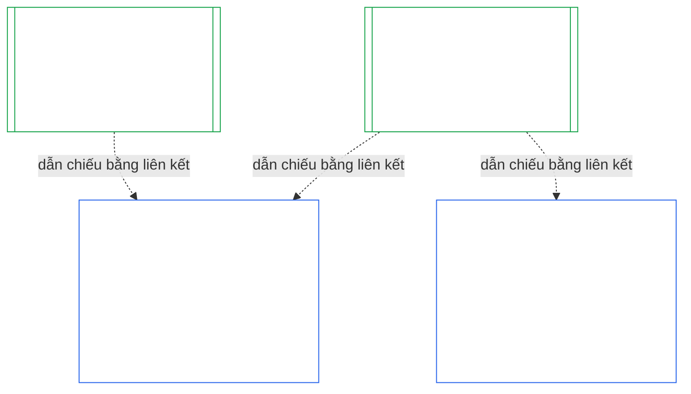
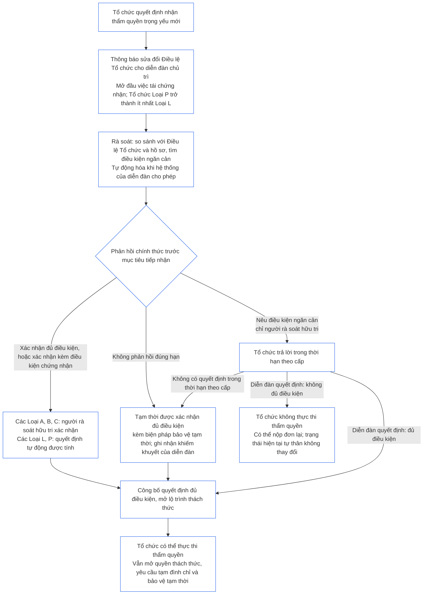

<!-- AI-assisted translation draft; unreviewed; English controls.
Source: core_10.000_institutional_alignment_certification.md
Source snapshot: 247e2180509e5e029c1106878cf225067339e010
Source SHA-256: a163a782114e584d09e295db66fe8b1b10a005b0f00116c8360396a0535ff221 -->

# CHƯƠNG MƯỜI: CHỨNG NHẬN MỨC ĐỘ PHÙ HỢP CỦA TỔ CHỨC

<strong>Vị trí trong kho văn bản (không vận hành): cấu trúc tệp và quy tắc đọc</strong>

> Tệp này **là một phần của Hiến pháp Hữu tri** và chỉ **có tính ràng buộc khi được đọc cùng** các tệp `core_*` được đánh số khác như một văn bản thống nhất. Tệp này gồm **Chương Mười** — **chứng nhận mức độ phù hợp của tổ chức**: cách một [Tổ chức](../../core_05.040_band_continuity.md#institution), khác với bất kỳ Hệ thống nào mà tổ chức vận hành, được phân loại, đánh giá, rà soát, quyết định, lập hồ sơ, duy trì hiệu lực và mở lại (**§1–§11**). Chương Mười là phần tương ứng về tổ chức của [Chương Chín](core_09.000_system_alignment_certification_evaluation.md#chapter-nine-system-alignment-certification) (*Chứng nhận Mức độ Phù hợp của Hệ thống*), và **các mục của hai chương mang cùng số**: §N tại đây trả lời §N ở chương kia. [CS-9.320](../../corpus_systems/cs_09.320_system_alignment_certification_illustrations.md#cs-9320-system-alignment-certification-illustrations) (*Minh họa chứng nhận mức độ phù hợp của hệ thống*) có các minh họa thực hành cho Hệ thống và, tại [§12 Hướng dẫn minh họa về Tổ chức](../../corpus_systems/cs_09.320_system_alignment_certification_illustrations.md#cs-9320-12-illustrative-institution-walkthroughs), ba ví dụ về Tổ chức. Chương này không lặp lại các nội dung đó.
>
> | § | Chương Chín (Hệ thống) | Chương Mười (Tổ chức) |
> |---|------------------------|----------------------------|
> | 1 | Mục đích và Vai trò | quan hệ với chứng nhận Hệ thống, đối tượng được chứng nhận, không cần xin phép và không có điều kiện để thành lập hoặc vận hành, thời gian chờ trước khi có thẩm quyền mới trọng yếu, thời hạn chứng nhận lần đầu |
> | 2 | Đánh giá Lớp Hệ thống | lớp tổ chức; điều chỉnh theo lớp |
> | 3 | Đánh giá Chứng nhận Toàn Hệ thống | tám nội dung về tổ chức, luôn áp dụng |
> | 4 | Các Đánh giá khi Có Liên quan | dẫn chiếu tới Chương Chín §4 |
> | 5 | Đánh giá Sàn Quyền và Lĩnh vực | dẫn chiếu tới Chương Chín §5 |
> | 6 | Quy trình Diễn đàn | bốn ghế; vai trò và trình tự diễn đàn; diễn đàn, đơn vị chứng nhận và văn phòng hồ sơ với tư cách tổ chức |
> | 7 | Kết quả Chứng nhận | việc đưa Tổ chức và các Hệ thống của tổ chức vào vận hành, điều kiện chứng nhận và các hiệu ứng khác của kết quả; dẫn chiếu về sai sót; mức độ sẵn sàng khắc phục; từ chối và thu hồi |
> | 8 | Hồ sơ Chứng nhận Hệ thống | Hồ sơ Chứng nhận Tổ chức |
> | 9 | Tái Chứng nhận và Mở lại | giám sát; gatilho mở lại; chứng nhận tạm thời và đầy đủ; chống né tránh; chuỗi hệ quả từ chứng nhận Hệ thống; mở lại các Hệ thống của tổ chức khi vi phạm quản trị |
> | 10 | Tranh biện về Chứng nhận | đường dẫn tranh biện |
> | 11 | Quan hệ với Vị thế | cầu nối tới vị thế |
>
> - **Chủ thể hiến pháp (phối hợp với Chương Chín):** chứng nhận mức độ phù hợp và hồ sơ liên quan do diễn đàn giám sát. Chương Mười bổ sung đối tượng là tổ chức. Chương này không tạo họ diễn đàn mới, ghế mới hay thuật ngữ kết quả mới.
> - **Áp dụng lại, không lặp lại:** các Giai đoạn III đến VI được thực hiện như quy định từ [Chương Chín, Phần B §6](core_09.005_system_alignment_certification_record_process.md#6-forum-process) đến [Chương Chín, Phần C §11](core_09.010_system_alignment_certification_record_recertification.md#11-relationship-to-standing). Chương Mười chỉ nêu những thay đổi khi đối tượng là một Tổ chức.
> - **Quy tắc chống chuyển chỗ:** Chương Mười không nhắc lại cơ chế đánh giá Hệ thống của Chương Chín, các trường Điều lệ Hệ thống và Điều lệ Tổ chức của Chương Bảy, Yêu cầu Hiến pháp về Bốn Ghế của Chương Tám, các nghĩa vụ tổ chức trong [corpus_institutions](../../corpus_institutions.md), việc đo lường vị thế của Chương Mười Một hoặc hiệu ứng vị thế của Chương Mười Hai.
>
> **Thượng nguồn:** các [Điều lệ Chương Bảy](core_07_charters.md#chapter-seven-system-and-institutional-charters); tính độc lập chức năng theo [Chương Tám](../../core_08.000_functional_independence_separation_of_duties.md#chapter-eight-functional-independence-and-separation-of-duties); [Chương Chín](core_09.000_system_alignment_certification_evaluation.md#chapter-nine-system-alignment-certification) (các Phần [A](core_09.000_system_alignment_certification_evaluation.md#chapter-nine-part-a-system-alignment-certification--evaluation), [B](core_09.005_system_alignment_certification_record_process.md#chapter-nine-part-b-system-alignment-certification--forum-process-and-outcomes) và [C](core_09.010_system_alignment_certification_record_recertification.md#chapter-nine-part-c-system-alignment-certification--record-recertification-and-standing)); hoạt động giám sát diễn đàn của Chương Mười Bốn.
> **Hạ nguồn:** hồ sơ vị thế và dữ liệu đã xác minh của Chương Mười Một; hiệu ứng vị thế của Chương Mười Hai.

<strong>Truy xuất nguồn gốc</strong>

- Thượng nguồn:
  - [Chương Bảy §1 Khi nào Cần có Điều lệ Hệ thống và Điều lệ Tổ chức](core_07_charters.md#1-when-system-and-institutional-charters-are-required) (7.000 §1) (*những Tổ chức nào công bố Điều lệ Hệ thống hoặc Điều lệ Tổ chức và lớp của Tổ chức*);
  - [Chương Bảy §7 Sửa đổi và Rà soát](core_07_charters.md#7-amendment-review-and-scope-misalignment) (7.000 §7) (*nội dung được kiểm tra trong rà soát Điều lệ Tổ chức*);
  - [Chương Bảy §4 Bản đồ Vai trò theo Điều lệ và Quyền Lưu giữ Hồ sơ Vị thế](core_07_charters.md#4-the-charter-role-map-and-standing-record-custody) (7.000 §4) (*vị trí bố trí các ghế*);
  - [Chương Tám §2 Yêu cầu Hiến pháp về Bốn Ghế](core_07_functional_independence_segregation_of_duties.md#2-four-seat-constitutional-requirement) (8.000 §2) và [§9 Quan hệ với các Quy trình Sau này](core_07_functional_independence_segregation_of_duties.md#9-relationship-to-later-processes);
  - [Chương Chín](core_09.000_system_alignment_certification_evaluation.md#chapter-nine-system-alignment-certification) (9.000 đến 9.010) (*quy trình Chứng nhận Mức độ Phù hợp của Hệ thống được Chương này áp dụng lại*);
  - [Hai Câu hỏi Cơ bản](core_00_preamble.md#two-fundamental-questions);
  - [Tứ diện Hiến pháp](core_00_preamble.md#constitutional-tetrad);
  - [Điều XI-E](core_06_rights_part_b.md#article-xi-e-institutional-formation-and-business-creation) (*Thành lập Tổ chức và Tạo lập Doanh nghiệp*).
- Hạ nguồn: [§1](#1-purpose-and-role) đến [§11](#11-relationship-to-standing); Chương Mười Một ([11.000](core_11_standing_assessment.md#chapter-eleven-contribution-violation-and-standing-model--measurement)); [Chương Mười Bốn](../../core_15.000_forum.md#chapter-fifteen-forums-and-jurisdiction) (14.000).
- Đọc cùng với:
  - [Chứng nhận Mức độ Phù hợp của Tổ chức](../../core_05.040_band_continuity.md#institutional-alignment-certification) và
  - [Hồ sơ Chứng nhận Tổ chức](../../core_05.040_band_continuity.md#institutional-certification-record) (*ý nghĩa theo Chương Năm*);
  - **CI-8.205 §6** (*Nội dung Điều lệ Hệ thống và Điều lệ Tổ chức, rà soát và mẫu thành lập*);
  - **CF-14.425** (*Biện pháp bảo vệ tính toàn vẹn, hoạt động chống chi phối và hỗ trợ chống tự xét xử*).

 

Chương Mười là chủ thể hiến pháp quy định **chứng nhận mức độ phù hợp của tổ chức**. Chương này mở rộng quy trình của [Chương Chín](core_09.000_system_alignment_certification_evaluation.md#chapter-nine-system-alignment-certification) từ một Hệ thống sang một Tổ chức:

- **Giai đoạn I, Định khung:** lớp tổ chức và cách lớp đó điều chỉnh đánh giá ([§2 Đánh giá Lớp Tổ chức](#2-institution-class-evaluation));
- **Giai đoạn II, Đánh giá:** đánh giá tổ chức, bao gồm các đánh giá áp dụng khi có liên quan và các đánh giá Sàn Quyền và lĩnh vực ([§3 Đánh giá Chứng nhận Toàn Tổ chức](#3-whole-institution-certification-evaluation) đến [§5 Đánh giá Sàn Quyền và Lĩnh vực](#5-rights-floor-and-domain-evaluations));
- **Giai đoạn III, Rà soát:** vai trò và trình tự diễn đàn ([§6 Quy trình Diễn đàn](#6-forum-process));
- **Giai đoạn IV, Quyết định:** kết quả, mức độ sẵn sàng khắc phục, từ chối và thu hồi ([§7 Kết quả Chứng nhận](#7-certification-outcomes));
- **Giai đoạn V, Lập hồ sơ:** Hồ sơ Chứng nhận Tổ chức ([§8 Hồ sơ Chứng nhận Tổ chức](#8-institutional-certification-record)); và
- **Giai đoạn VI, Vận hành:** tái chứng nhận, mở lại, chuỗi hệ quả từ chứng nhận Hệ thống, mở lại các Hệ thống của tổ chức, đường dẫn tranh biện và cầu nối tới vị thế ([§9 Tái Chứng nhận và Mở lại](#9-recertification-and-reopening) đến [§11 Quan hệ với Vị thế](#11-relationship-to-standing)).

*Nói thẳng: Chương Chín hỏi liệu một **hệ thống** có phù hợp hay không. Chương Mười cũng hỏi như vậy về **tổ chức** vận hành các hệ thống hoặc nắm thẩm quyền mà không vận hành hệ thống nào. Tổ chức có thể phù hợp trong khi một hệ thống của tổ chức không phù hợp, và ngược lại. Vì vậy, tổ chức được kiểm tra về những gì chỉ mình kiểm soát: có làm đúng như Điều lệ Tổ chức quy định không, ai chịu trách nhiệm về thẩm quyền của tổ chức, tổ chức khen thưởng điều gì ở chính các thành viên, và các biện pháp kiểm tra độc lập đối với tổ chức có thực sự sử dụng được không. Chứng nhận tổ chức dựa vào chứng nhận của từng hệ thống, không đánh giá lại hệ thống. Đây không phải giấy phép: không ai cần xin phép tổ chức để bắt đầu hoặc vận hành một tổ chức.*

### 1. Mục đích và Vai trò

<strong>Truy xuất nguồn gốc</strong>

- Thượng nguồn:
  - [Chương Bảy §1 Khi nào Cần có Điều lệ Hệ thống và Điều lệ Tổ chức](core_07_charters.md#1-when-system-and-institutional-charters-are-required) (7.000 §1);
  - [Chương Chín, Phần A, §1 Mục đích và Vai trò](core_09.000_system_alignment_certification_evaluation.md#1-purpose-and-role) (9.000 §1);
  - [Điều XI-E](core_06_rights_part_b.md#article-xi-e-institutional-formation-and-business-creation) (*Thành lập Tổ chức và Tạo lập Doanh nghiệp*);
  - [Điều XXVIII-A](../../core_06.020_rights_part_e.md#xxviii-a-existing-instantiations-adoption-transition-window) (*Tiếp nhận theo Giai đoạn và Duy trì Sàn Quyền*).
- Hạ nguồn: [§2](#2-institution-class-evaluation); [§6](#6-forum-process); [§7](#7-certification-outcomes); [§9](#9-recertification-and-reopening).
- Đọc cùng với:
  - [Tổ chức](../../core_05.040_band_continuity.md#institution);
  - [Điều lệ Tổ chức](../../core_05.040_band_continuity.md#institutional-charter);
  - [Điều lệ Hệ thống](../../core_05.040_band_continuity.md#system-charter);
  - [Tạo lập Doanh nghiệp](../../core_05.055_band_participation.md#business-creation).

 

*Nói thẳng: chứng nhận của một hệ thống thuộc về hệ thống đó. Chứng nhận của một tổ chức dẫn chiếu các chứng nhận đó và bổ sung nội dung chỉ tổ chức mới có thể chịu trách nhiệm. Một hệ thống có thể thuộc nhiều tổ chức hoặc không thuộc tổ chức nào. Không điều gì ở đây cho phép chứng nhận cản trở việc thành lập tổ chức.*

Chứng nhận mức độ phù hợp của tổ chức và Chứng nhận Mức độ Phù hợp của Hệ thống là hai chứng nhận được nối với nhau bằng một liên kết. Quan hệ này là **kết hợp bằng liên kết**, không phải bao hàm. Trong hình, mũi tên đi từ Hồ sơ Chứng nhận Hệ thống đến từng Hồ sơ Chứng nhận Tổ chức có dẫn chiếu tới hồ sơ đó. Hệ thống không thuộc Tổ chức nào không có mũi tên và không cần mũi tên; Tổ chức không vận hành Hệ thống nào chỉ có một hồ sơ riêng.

Kết hợp bằng liên kết có hai mặt; trước tiên là mặt của Tổ chức.

Về phía Tổ chức:

- **Hồ sơ Chứng nhận Tổ chức dẫn chiếu hồ sơ của Hệ thống, không đánh giá lại:** hồ sơ dẫn chiếu Hồ sơ Chứng nhận Hệ thống bằng liên kết và ghi rõ phiên bản. Chương này không bao giờ thực hiện lại đánh giá Hệ thống, quyết định lại lớp của Hệ thống hoặc thay đổi kết quả, trạng thái hay điều kiện chứng nhận của Hệ thống.
- **Chứng nhận của Tổ chức không thể nâng trạng thái Hệ thống:** Hệ thống Chưa được Chứng nhận vẫn giữ trạng thái đó bất kể trạng thái của Tổ chức. Hệ thống đang có chứng nhận không được bảo vệ khỏi kết luận về Tổ chức.
- **Các sự kiện về Tổ chức chỉ được xác định một lần:** khi [Chương Chín, Phần A, §3.1 Kỷ luật Quản trị, Ưu đãi và Khả năng Tranh biện](core_09.000_system_alignment_certification_evaluation.md#31-governance-incentive-and-contestability-discipline) hỏi về quản trị và ưu đãi của đơn vị vận hành, Hồ sơ Chứng nhận Tổ chức hiện hành của đơn vị vận hành có thể cung cấp các sự kiện đó bằng liên kết. Các diễn đàn của Hệ thống vẫn quyết định liệu các sự kiện đó có đủ đối với Hệ thống hay không. Không được đưa ra kết luận khác về cùng một sự kiện của Tổ chức nếu không nêu lý do trong Hồ sơ Chứng nhận Hệ thống.

Về phía Hệ thống:

- **Hồ sơ Chứng nhận Hệ thống thuộc về Hệ thống:** đây là hồ sơ riêng của Hệ thống theo [Chương Chín](core_09.000_system_alignment_certification_evaluation.md#chapter-nine-system-alignment-certification).
- **Nhiều Tổ chức có thể dẫn chiếu cùng một Hồ sơ Chứng nhận Hệ thống:** theo [Chương Bảy §1 Khi nào Cần có Điều lệ Hệ thống và Điều lệ Tổ chức](core_07_charters.md#1-when-system-and-institutional-charters-are-required), một Hệ thống có thể do nhiều Tổ chức vận hành, quản trị có trách nhiệm hoặc kiểm soát trọng yếu. Mỗi Tổ chức dẫn chiếu cùng một hồ sơ.
- **Hệ thống không nhất thiết phải thuộc một Tổ chức:** một hữu tri đơn lẻ không phải là Tổ chức, vì vậy Hệ thống có thể không thuộc Tổ chức nào. Hệ thống không có Tổ chức được chứng nhận chỉ theo [Chương Chín](core_09.000_system_alignment_certification_evaluation.md#chapter-nine-system-alignment-certification), không cần bất kỳ nội dung nào từ Chương này. Hệ thống thuộc một Tổ chức vẫn được chứng nhận theo cùng cách: Chương này bổ sung hồ sơ riêng cho Tổ chức, không phải một bước trong quy trình chứng nhận riêng của Hệ thống.

#### 1.1 Đối tượng được chứng nhận

Tổ chức từ Lớp L trở lên thuộc phạm vi Chương này; lớp được xác định theo [§2.1 Lớp Tổ chức](#21-institution-class). Điều đó bao gồm cả Tổ chức không vận hành Hệ thống nào: Tổ chức không có Hồ sơ Chứng nhận Hệ thống để dẫn chiếu, và lớp được xác định từ tác động của chính Tổ chức. **Danh mục Hệ thống** của Tổ chức là tập hợp các Hệ thống mà Tổ chức vận hành, quản trị có trách nhiệm hoặc kiểm soát trọng yếu ([Danh mục Hệ thống](../../core_05.040_band_continuity.md#portfolio)).

- **Lớp A, B, C và L:** quy trình áp dụng, được điều chỉnh theo lớp theo [§2.2 Điều chỉnh theo Lớp](#22-scaling-by-class).
- **Lớp P:** khuyến khích sử dụng quy trình và có thể tự nguyện áp dụng. Quy trình trở thành bắt buộc khi Tổ chức được phân loại lại thành Lớp L trở lên hoặc khi Tổ chức tự nguyện khẳng định tuân thủ hiến pháp. Tổ chức Lớp P quyết định đảm nhận thẩm quyền mới trọng yếu được phân loại lại tối thiểu thành Lớp L khi gửi thông báo tại [§9.2.2 Tái chứng nhận cho thẩm quyền mới trọng yếu](#922-recertification-for-new-material-authority), vì thẩm quyền đó theo định nghĩa là trọng yếu ([§9.2.1 Điều gì được tính là thẩm quyền mới trọng yếu](#921-what-counts-as-new-material-authority)) và Tổ chức có tính trọng yếu trong bất kỳ lĩnh vực nào cũng thuộc tối thiểu Lớp L ([§2.1 Lớp Tổ chức](#21-institution-class), mục 2). Việc phân loại lại có hiệu lực từ khi gửi thông báo cho đến khi thông báo được rút trước khi giải quyết cho phép, hoặc thẩm quyền không được cho phép, với điều kiện chưa thực hiện thẩm quyền đó. Sau đó Tổ chức trở lại Lớp P và chứng nhận ban đầu giới hạn kết thúc. Thông báo mới sẽ bắt đầu lại quy trình; nếu thực hiện thẩm quyền mà chưa được cho phép, điều đó vẫn là kết luận theo [§9.2.2 Tái chứng nhận cho thẩm quyền mới trọng yếu](#922-recertification-for-new-material-authority) (*Không có thông báo hoặc thực hiện trước khi được cho phép*). Điều này tương ứng với [Chương Chín, Phần A, §1 Mục đích và Vai trò](core_09.000_system_alignment_certification_evaluation.md#1-purpose-and-role).
- **Một Hệ thống:** Tổ chức chỉ vận hành đúng một Hệ thống cần có Điều lệ Hệ thống thì có một lượt chứng nhận và một hồ sơ; Chương này gọi là **đánh giá một Hệ thống**. Hồ sơ Chứng nhận Hệ thống có một *phần kết luận về Tổ chức* gồm các nội dung trong [§8 Hồ sơ Chứng nhận Tổ chức](#8-institutional-certification-record) và đồng thời là Hồ sơ Chứng nhận Tổ chức. Các diễn đàn, ghế và thời hạn là những nội dung thuộc lượt chứng nhận riêng của Hệ thống, được bổ sung các nội dung về Tổ chức. Kết quả của từng đối tượng tuân theo các căn cứ từ chối và thu hồi riêng, như quy định tại [§7.4 Từ chối và thu hồi đối với Tổ chức](#74-denial-and-revocation-for-an-institution). [§9.5 Chuỗi hệ quả từ các chứng nhận Hệ thống](#95-cascade-from-system-certifications) không áp dụng như một chuỗi hệ quả vì Hệ thống là toàn bộ danh mục; tuy nhiên, các quy tắc 1 và 2 của [§7.4 Từ chối và thu hồi đối với Tổ chức](#74-denial-and-revocation-for-an-institution) vẫn áp dụng (chỉ dấu và phép thử xác định nguyên nhân nằm ở đâu).
- **Nhiều Hệ thống:** một Hồ sơ Chứng nhận Tổ chức cho Tổ chức, dẫn chiếu Hồ sơ Chứng nhận Hệ thống của từng Hệ thống mà Tổ chức vận hành. Mỗi Hệ thống giữ lượt chứng nhận và hồ sơ riêng.
- **Không có Hệ thống:** một Hồ sơ Chứng nhận Tổ chức riêng. Không có Hồ sơ Chứng nhận Hệ thống để dẫn chiếu vì Tổ chức không vận hành Hệ thống nào.

#### 1.2 Không cần Xin phép và Không có Điều kiện để Thành lập hoặc Vận hành

Chứng nhận mức độ phù hợp của tổ chức là một cuộc kiểm tra độc lập về cách Tổ chức thực sự sử dụng thẩm quyền của mình. Các diễn đàn độc lập với Tổ chức thực hiện việc chứng nhận, kết thúc bằng Hồ sơ Chứng nhận Tổ chức ghi lại những gì họ kết luận.

- **Thành lập và vận hành:** Tổ chức được thành lập, công bố Điều lệ Tổ chức, bắt đầu thực hiện thẩm quyền và tiếp tục hoạt động mà không cần phải có chứng nhận này trước; không kết quả nào cấp hoặc tước quyền đó.
- **Hiệu ứng của kết quả:** kết quả chỉ có các hiệu ứng nêu tại [§7.1 Cho phép Tổ chức đưa vào vận hành](#71-go-live-for-an-institution).
- **Các điều kiện duy nhất trong lĩnh vực này:** có ba điều kiện hẹp, tất cả đều thuộc **Điều XI-E** (*Thành lập Tổ chức và Tạo lập Doanh nghiệp*):
  - khóa đang có hiệu lực đối với một hữu tri được nêu tên, áp dụng cho thẩm quyền của hữu tri đó;
  - Lệnh Tạm giữ đối với các sự kiện sai lệch cụ thể đã xác minh, cũng áp dụng cho thẩm quyền của hữu tri được nêu tên;
  - khóa áp dụng cho chính một Bên Vận hành, chỉ áp dụng với Tổ chức khi khóa thực sự gắn với Tổ chức đó, như khóa đối với một Tổ chức đã bị giải thể theo **CI-12.210 §4** (*Giải thể*).

  Kết luận chứng nhận có thể được chuyển tới diễn đàn quyết định một trong những điều kiện này, làm bằng chứng theo [§7.5 Hiệu ứng của việc từ chối và thu hồi đối với Tổ chức](#75-effects-of-denial-and-revocation-for-an-institution). Bản thân kết quả chứng nhận không phải là điều kiện và không mở hay đóng bất kỳ điều kiện nào.
- **Chờ thẩm quyền mới trọng yếu:** Tổ chức quyết định đảm nhận thẩm quyền mới trọng yếu phải chờ tái chứng nhận cho phép thẩm quyền đó trước khi thực hiện, theo các điều khoản tại [§9.2.2 Tái chứng nhận cho thẩm quyền mới trọng yếu](#922-recertification-for-new-material-authority). **Điều XI-E** (*Thành lập Tổ chức và Tạo lập Doanh nghiệp*) quy định thời gian chờ này. Đây không phải một trong ba điều kiện hẹp, cũng không phải điều kiện để thành lập hoặc vận hành. Quy định này chỉ áp dụng cho thẩm quyền mới; mọi hoạt động khác của Tổ chức vẫn tiếp tục. Hình tại [§9.2.2 Tái chứng nhận cho thẩm quyền mới trọng yếu](#922-recertification-for-new-material-authority) tóm tắt các bước.
- **Không có lối cửa sau:** Diễn đàn, bên tiếp nhận hoặc bên đang tại vị không được sử dụng Chương này làm ngưỡng cấp phép để gạt người sáng lập ra ngoài hoặc bảo vệ bên đang tại vị. Làm vậy sẽ vô hiệu hóa [Điều XI-E](core_06_rights_part_b.md#article-xi-e-institutional-formation-and-business-creation) (*Thành lập Tổ chức và Tạo lập Doanh nghiệp*).
  - [Gánh nặng Tránh được](../../core_05.040_band_continuity.md#avoidable-burden) áp dụng cho chi phí của quy trình.
  - [Quản trị Điều chỉnh theo Phân loại](core_05_band_oversight.md#classification-scaled-governance) áp dụng cho mức độ sâu của quy trình.
  - Thời gian chờ thẩm quyền mới trọng yếu áp dụng với cùng điều kiện cho mọi Tổ chức thuộc lớp tương ứng và chỉ áp dụng với thẩm quyền vốn đã trọng yếu đối với người khác.

Điều kiện cho Hệ thống đưa vào vận hành là riêng biệt và vẫn áp dụng cho Hệ thống. Theo [Chương Chín, Phần B, §7.1 Điều kiện Đưa vào Vận hành](core_09.005_system_alignment_certification_record_process.md#71-go-live-gate), Hệ thống mới hoặc một lần mở rộng trọng yếu của Hệ thống chỉ được đưa vào vận hành khi có chứng nhận riêng, bất kể trạng thái của Tổ chức.

#### 1.3 Thời hạn cho lần Chứng nhận Đầu tiên

Hồ sơ Chứng nhận Tổ chức đầu tiên phải được lập trong thời hạn mà văn bản tiếp nhận quy định cho lớp của Tổ chức.

- **Tổ chức mới:** thời hạn bắt đầu từ ngày Tổ chức lần đầu có tác động trọng yếu đến người khác, theo đánh giá [Tính Trọng yếu Cụ thể theo Lĩnh vực](core_05_band_oversight.md#domain-specific-materiality); chứng nhận đầu tiên là chứng nhận tạm thời.
- **Tổ chức Lớp P được phân loại lại khi gửi thông báo:** thời hạn bắt đầu từ ngày Tổ chức gửi thông báo theo [§9.2.2 Tái chứng nhận cho thẩm quyền mới trọng yếu](#922-recertification-for-new-material-authority), giống như với một Tổ chức mới, không bao giờ tính từ thời hạn Chuyển tiếp Tiếp nhận đã kết thúc.
- **Tổ chức đã hoạt động:** thời hạn là thời hạn Chuyển tiếp Tiếp nhận theo [Điều XXVIII-A](../../core_06.020_rights_part_e.md#xxviii-a-existing-instantiations-adoption-transition-window) (*Tiếp nhận theo Giai đoạn và Duy trì Sàn Quyền*), phù hợp với quy tắc mặc định tại [Chương Bảy §1.5 Khi nào đến hạn phải có Điều lệ Hệ thống hoặc Điều lệ Tổ chức](core_07_charters.md#15-when-a-system-charter-or-institutional-charter-is-due).
- **Quá hạn:** Tổ chức để thời hạn kết thúc mà không có lượt chứng nhận đầu tiên, và không thuộc diện miễn trừ bên dưới, có sai sót phải ghi lại và khắc phục; việc quá hạn cũng khởi động lượt chứng nhận đó. Tổ chức từ Lớp L trở lên đã hoạt động còn có vi phạm mốc thời gian dưới đây. Tổ chức không bị đình chỉ hoặc cấm hoạt động vì không có điều kiện cấp phép ([§1.2 Không cần Xin phép và Không có Điều kiện để Thành lập hoặc Vận hành](#12-no-permission-and-no-gate-on-forming-or-running)).
  - **Tổ chức đã hoạt động:** đây là quy tắc riêng của Chương này cho Tổ chức từ Lớp L trở lên, được đặt ra tương tự [Điều XXVIII-A](../../core_06.020_rights_part_e.md#xxviii-a-existing-instantiations-adoption-transition-window) (*Tiếp nhận theo Giai đoạn và Duy trì Sàn Quyền*), điều khoản nêu Hệ thống và thực thể dẫn xuất. Nếu thời hạn Chuyển tiếp Tiếp nhận kết thúc mà lượt chứng nhận đầu tiên chưa hoàn tất (chưa có chứng nhận tạm thời hoặc đầy đủ, và chưa có quyết định kết quả theo [§7 Kết quả Chứng nhận](#7-certification-outcomes)), Tổ chức đã quá hạn. Tổ chức đã nộp hồ sơ và hợp tác trong thời hạn không bị coi là quá hạn nếu lượt chứng nhận chưa hoàn tất do diễn đàn vượt quá thời hạn của mình ([Chương Mười Bốn §6 Giải quyết kịp thời, các cấp độ trọng yếu và kỷ luật chống trì hoãn](core_11_forum.md#6-timely-resolution-materiality-tiers-and-anti-delay-discipline), *Rà soát quá hạn*; [Chương Chín, Phần C, §9.3.4 Thời hạn theo cấp độ](core_09.010_system_alignment_certification_record_recertification.md#934-tier-windows)) hoặc do thời gian gia hạn duy nhất theo [§7.3 Mức độ sẵn sàng khắc phục của Tổ chức](#73-remediation-readiness-for-an-institution) đang được áp dụng. Trừ khi có văn bản tái ủy quyền được ghi lại theo [Điều XXVIII-B](../../core_06.020_rights_part_e.md#article-xxviii-b-adoption-transition-authority-limits-and-reauthorization) (*Giới hạn Thẩm quyền trong Giai đoạn Chuyển tiếp Tiếp nhận và Tái ủy quyền*), đây là vi phạm mốc thời gian Chuyển tiếp Tiếp nhận và con đường tuân thủ và vi phạm thông thường theo [Chương Mười Một](core_11_standing_assessment.md#chapter-eleven-contribution-violation-and-standing-model--measurement) sẽ được mở. Nghĩa vụ hạn chế trong Điều khoản đó áp dụng từ ngày có hiệu lực; việc kéo dài khoảng trống không biến khoảng trống thành trạng thái bình thường mới. Quy tắc này tương ứng với [Chương Chín, Phần B, §7.1.1 Hệ thống đã hoạt động](core_09.005_system_alignment_certification_record_process.md#711-systems-already-operating). Đây không phải điều kiện cấp phép.
  - **Lượt chứng nhận:** được quyết định như mọi lượt khác. Lượt có thể kết thúc bằng bất kỳ kết quả nào tại [§7 Kết quả Chứng nhận](#7-certification-outcomes), kể cả Chưa được Chứng nhận, cùng các hiệu ứng tại [§7.5 Hiệu ứng của việc từ chối và thu hồi đối với Tổ chức](#75-effects-of-denial-and-revocation-for-an-institution).
  - **Chế tài và giải thể:** Chương này không tạo ra chế tài nào. Đình chỉ, tiếp quản, phân tách cơ cấu và giải thể vẫn thuộc diễn đàn có thẩm quyền theo **CI-12.210** (*Thất bại và giải thể Tổ chức*) và **CI-12.215** (*Trách nhiệm giải trình và chế tài đối với Tổ chức*). Chỉ chuyển vụ việc tới diễn đàn đó khi có căn cứ chuyển vụ nêu tại [§7.5 Hiệu ứng của việc từ chối và thu hồi đối với Tổ chức](#75-effects-of-denial-and-revocation-for-an-institution) (mục 5, *Chuyển vụ*).

### 2. Đánh giá Lớp Tổ chức

<strong>Truy xuất nguồn gốc</strong>

- Thượng nguồn:
  - [Chương Bảy §1 Khi nào Cần có Điều lệ Hệ thống và Điều lệ Tổ chức](core_07_charters.md#1-when-system-and-institutional-charters-are-required) (7.000 §1);
  - [Chương Chín, Phần A, §2 Đánh giá Lớp Hệ thống](core_09.000_system_alignment_certification_evaluation.md#2-system-class-evaluation) (9.000 §2) và [§2.2 Cách lớp hệ thống điều chỉnh mọi đánh giá](core_09.000_system_alignment_certification_evaluation.md#22-how-system-class-scales-every-evaluation);
  - [Chương Ba §2.1 Các kiểu né tránh thường gặp](core_03_definition_integrity.md#21-common-evasion-patterns) (3.000 §2.1).
- Hạ nguồn: [§3](#3-whole-institution-certification-evaluation) (*các nội dung được điều chỉnh theo lớp*); [§8](#8-institutional-certification-record) (*lớp được ghi trong hồ sơ*); [§9.2](#92-reopening-triggers) (*các gatilho đánh giá lại lớp*).
- Đọc cùng với:
  - **CS-9.305 (*Cơ chế phân loại hệ thống*) và CS-9.310** (*Phân loại tác động hệ thống*) cùng [corpus_systems/cs_09.310_system_impact_classifications.md](../../corpus_systems/cs_09.310_system_impact_classifications.md) (*danh mục lớp*);
  - **CI-9.210** (*Nghĩa vụ của tổ chức gắn với phân loại*);
  - **CI-8.205 §6** (*Nội dung Điều lệ Hệ thống và Điều lệ Tổ chức, rà soát và mẫu thành lập*).

 

*Nói thẳng: trước hết phân loại Tổ chức dựa trên mức độ quan trọng của tổ chức đối với người khác. Đánh giá theo những gì tổ chức thực sự quyết định và nắm giữ, không theo cách tổ chức tự gọi mình. Lớp sau đó xác định mức độ kỹ lưỡng của việc đánh giá: lớp càng cao thì bằng chứng càng nghiêm ngặt, rà soát càng độc lập và việc kiểm tra lại càng sớm.*

Mục này là **Giai đoạn I, Định khung** đối với một Tổ chức.

#### 2.1 Lớp Tổ chức

**Lớp Tổ chức** được xác định theo tác động trọng yếu lớn nhất mà Tổ chức gây ra, dù tác động đó thông qua Hệ thống mà tổ chức vận hành hay ngoài bất kỳ Hệ thống nào. Đánh giá theo những gì Tổ chức thực sự quyết định, nắm giữ và kiểm soát, không theo nhãn gọi, hình thức pháp lý hay danh sách trong Điều lệ Tổ chức. Lớp này chi phối độ sâu của việc đánh giá và thời hạn, như [Chương Chín, Phần A, §2.2 Cách lớp hệ thống điều chỉnh mọi đánh giá](core_09.000_system_alignment_certification_evaluation.md#22-how-system-class-scales-every-evaluation) quy định đối với Hệ thống. Đây là lớp được sử dụng trong Chương này và trong [Chương Bảy §1.2 Các lớp nào thuộc phạm vi](core_07_charters.md#12-which-classes-are-covered).

1. **Tác động thông qua Hệ thống:** lớp của Tổ chức ít nhất bằng lớp cao nhất của bất kỳ Hệ thống nào trong danh mục của tổ chức ([Chương Bảy §1 Khi nào Cần có Điều lệ Hệ thống và Điều lệ Tổ chức](core_07_charters.md#1-when-system-and-institutional-charters-are-required)). Các Hệ thống được xác định qua hoạt động quan sát được. Hệ thống không được ghi trong Điều lệ Tổ chức vẫn được tính.
2. **Tác động ngoài mọi Hệ thống:** tác động trọng yếu và sự phụ thuộc do chính Tổ chức tạo ra vẫn được tính, dù tổ chức có vận hành Hệ thống hay không. Áp dụng các định nghĩa lớp của **CS-9.305 (*Cơ chế phân loại hệ thống*) và CS-9.310** (*Phân loại tác động hệ thống*) cho các quyết định và tài sản của chính Tổ chức, dựa trên các yếu tố sau:
   - **Tổ chức quyết định và nắm giữ những gì:**
     - quyết định về quyền tiếp cận của hữu tri khác đối với nhu cầu thiết yếu để sinh tồn, giáo dục, an toàn, sinh kế, quyền hoặc vị thế; và
     - tài sản nắm giữ, như quỹ, hồ sơ, tư cách thành viên, quyền lưu giữ hồ sơ vị thế hoặc chức năng của diễn đàn, đơn vị chứng nhận hay văn phòng hồ sơ.
   - **Tính trọng yếu:**
     - hoạt động của chính Tổ chức có trọng yếu trong bất kỳ lĩnh vực nào theo [Tính Trọng yếu Cụ thể theo Lĩnh vực](core_05_band_oversight.md#domain-specific-materiality) hay không, bao gồm việc thực hiện [Hành vi Ràng buộc Trọng yếu](../../core_05.035_band_accountability.md#materially-binding-act) mà người khác phải tuân theo hoặc có thể dựa vào như điều đã được giải quyết;
     - Tổ chức có tính trọng yếu trong bất kỳ lĩnh vực nào thì ít nhất thuộc Lớp L theo **CS-9.305 (*Cơ chế phân loại hệ thống*) và CS-9.310** (*Phân loại tác động hệ thống*); và
     - việc cung cấp viện trợ, hàng hóa, lao động hoặc dịch vụ mà người khác có thể tự do nhận hoặc từ chối và không kiểm soát quyền tiếp cận thứ họ cần không ràng buộc ai. Đây là hành vi, không phải Hành vi Ràng buộc Trọng yếu, và chỉ được tính theo các yếu tố khác.
   - **Mức độ phụ thuộc vào Tổ chức:**
     - số lượng hữu tri phụ thuộc vào tổ chức và khả năng thay thế tổ chức;
     - mức độ tập trung thẩm quyền theo nghĩa của Ranh giới Kiểm soát Trọng yếu; và
     - mức độ có thể đảo ngược các quyết định của tổ chức.
3. **Kiểm soát chung:** Các Bên Vận hành là một hoạt động thống nhất theo quy tắc tổng hợp của [Tính Trọng yếu Cụ thể theo Lĩnh vực](core_05_band_oversight.md#domain-specific-materiality) (cùng một quyền kiểm soát thực tế trong [Ranh giới Kiểm soát Trọng yếu](../../core_05.035_band_accountability.md#material-control-line); riêng việc tài trợ không được tính) được phân loại cùng nhau khi trên thực tế họ hành động như một Tổ chức. Chia tách một Bên Vận hành, danh mục hoặc thẩm quyền của bên đó để không phần nào đạt Lớp L là né tránh phạm vi và ranh giới theo [Chương Ba §2.1 Các kiểu né tránh thường gặp](core_03_definition_integrity.md#21-common-evasion-patterns).
4. **Phân loại lại:** lớp được đánh giá lại theo các gatilho tại [§9.2 Các gatilho mở lại](#92-reopening-triggers). Lớp được ghi trong Hồ sơ Chứng nhận Tổ chức cùng với lý do.

#### 2.2 Điều chỉnh theo Lớp

Lớp tổ chức điều chỉnh độ sâu của bằng chứng, tính độc lập của việc rà soát, chu kỳ chứng nhận mặc định và thông tin công bố trong hồ sơ, tương tự như [Chương Chín, Phần A, §2.2 Cách lớp hệ thống điều chỉnh mọi đánh giá](core_09.000_system_alignment_certification_evaluation.md#22-how-system-class-scales-every-evaluation). Chu kỳ chứng nhận được nêu tại [Chương Mười Bốn §6 Giải quyết kịp thời, các cấp độ trọng yếu và kỷ luật chống trì hoãn](../../core_15.000_forum.md#review-cadence) (*Chu kỳ rà soát*); văn bản tiếp nhận có thể quy định chu kỳ ngắn hơn và quy định số lượt tái chứng nhận tạm thời sạch.

- **Lớp A, B và C:** áp dụng cả tám nội dung tại [§3 Đánh giá Chứng nhận Toàn Tổ chức](#3-whole-institution-certification-evaluation), với bằng chứng và tính độc lập tương xứng với lớp.
- **Lớp L:** vẫn áp dụng cả tám nội dung nhưng theo cách đơn giản hóa, với hồ sơ đơn giản hơn và chu kỳ chứng nhận mặc định dài hơn khi [Quản trị Điều chỉnh theo Phân loại](core_05_band_oversight.md#classification-scaled-governance) cho phép. Nội dung cốt lõi của lượt đánh giá Lớp L là so sánh Điều lệ Tổ chức với thực tế, Bản đồ Vai trò, tuyên bố về kiểm tra việc thành lập và tính hiện hành của các chứng nhận Hệ thống được dẫn chiếu. Không được bỏ mục nào; mục không có phát hiện phải được ghi thành một dòng.
- **Lớp P:** tự nguyện, theo quy định tại [§1.1 Đối tượng được chứng nhận](#11-who-is-certified).

**Tổ chức chủ trì trong hoạt động chuyên môn chung.** Khi Tổ chức là đơn vị chủ trì ([**CI-15.205 §7**](../../corpus_institutions/ci_16.205_appointment_competency_rotation_removal.md#ci-46-seat-advisory) (*Giấy phép hành nghề, chấp thuận hành nghề và hoạt động chuyên môn chung*)), chứng nhận của tổ chức còn lấy mẫu các hành vi của thành viên đối chiếu với những ghế mà đơn vị chủ trì đảm nhận và so sánh thông báo tiếp nhận của thành viên với hoạt động của đơn vị chủ trì. Phát hiện về hành vi của một thành viên là phát hiện về thành viên đó; chỉ áp dụng cho đơn vị chủ trì khi một ghế mà đơn vị này đảm nhận có sai sót.

### 3. Đánh giá Chứng nhận Toàn Tổ chức

<strong>Truy xuất nguồn gốc</strong>

- Thượng nguồn:
  - [Chương Chín, Phần A, §3 Đánh giá Chứng nhận Toàn Hệ thống](core_09.000_system_alignment_certification_evaluation.md#3-whole-system-certification-evaluation) (9.000 §3);
  - [Chương Bảy §3 Điều lệ Hệ thống và Điều lệ Tổ chức phải nêu những gì](core_07_charters.md#3-what-system-and-institutional-charters-must-state) (7.000 §3);
  - [Chương Bảy §5 Kiểm tra việc Thành lập: Vị thế và Tính xác thực của Người giữ Chức vụ](core_07_charters.md#5-formation-check-office-holder-standing-and-authenticity) (7.000 §5);
  - [Chương Bảy §7 Sửa đổi và Rà soát](core_07_charters.md#7-amendment-review-and-scope-misalignment) (7.000 §7);
  - [Hai Câu hỏi Cơ bản](core_00_preamble.md#two-fundamental-questions);
  - [Chương Một §19.6 Duy trì Trách nhiệm khi Thay đổi Chủ sở hữu hoặc Cơ cấu](core_01_c_stewardship_capacity_principles.md#196-keeping-responsibility-when-ownership-or-structure-changes) (1.010 §19.6).
- Hạ nguồn: [§6](#6-forum-process) (*các kết luận được diễn đàn rà soát*); [§9](#9-recertification-and-reopening) (*các gatilho khiến việc rà soát mở lại*); [§11](#11-relationship-to-standing) (*yêu cầu dữ liệu đã xác minh đối với kết luận về hữu tri được nêu tên*).
- Đọc cùng với:
  - **CI-8.205 §3** (*Chuỗi thẩm quyền và biện pháp kiểm soát ủy quyền*) và **CI-8.205 §6** (*Nội dung Điều lệ Hệ thống và Điều lệ Tổ chức, rà soát và mẫu thành lập*);
  - **CI-6.215** (*Quản trị tài nguyên và tính toàn vẹn của ưu đãi*);
  - **CI-8.210** (*Tính toàn vẹn về xung đột, chống chiếm dụng và chống tham nhũng*), **CI-6.205** (*Minh bạch, sự tham gia và các lộ trình dịch vụ và tranh biện dễ tiếp cận*) và **CI-12.205** (*Hệ thống khắc phục và năng lực bồi hoàn của tổ chức*), áp dụng cho mục 8.

 

*Nói thẳng: hãy kiểm tra những nội dung thuộc về tổ chức, không thuộc riêng bất kỳ hệ thống nào: tổ chức có tuân thủ Điều lệ Tổ chức không, ai chịu trách nhiệm về thẩm quyền của tổ chức, tổ chức khen thưởng điều gì, và các biện pháp kiểm tra độc lập đối với tổ chức có hoạt động hiệu quả không.*

Mục này là **Giai đoạn II, Đánh giá** đối với một Tổ chức.

Mỗi lượt chứng nhận đánh giá tám nội dung này, tương ứng về tổ chức với [Chương Chín, Phần A, §3 Đánh giá Chứng nhận Toàn Hệ thống](core_09.000_system_alignment_certification_evaluation.md#3-whole-system-certification-evaluation). Mỗi kết luận đều nêu bằng chứng và nội dung trong Điều lệ Tổ chức hoặc hoạt động quan sát được làm căn cứ.

1. **Điều lệ Tổ chức so với thực tế:**
   - Điều lệ Tổ chức được đối chiếu với hoạt động quan sát được, theo danh sách rà soát tại [Chương Bảy §7 Sửa đổi và Rà soát](core_07_charters.md#7-amendment-review-and-scope-misalignment).
   - Thực tế nằm ngoài Điều lệ Tổ chức hoặc Điều lệ Tổ chức không còn mô tả đúng thực tế đều dẫn tới kết luận, bất kể nội dung nào sai.
2. **Danh mục và hiệu ứng tổng hợp:**
   - Lý do có từng Hệ thống trong danh mục được kiểm tra: mỗi Hệ thống phải gắn với mục đích Tổ chức đã nêu; thiếu lý do cụ thể cho một Hệ thống dẫn tới kết luận.
   - Việc đánh giá cũng xem xét toàn bộ các Hệ thống để tìm những nội dung mà từng chứng nhận riêng lẻ không thể hiện:
     - các sự phụ thuộc chung;
     - sự phụ thuộc tổng hợp;
     - việc khai thác tích lũy các nền tảng dùng chung; và
     - mọi cách sắp xếp chia một chức năng thành các phần để từng phần né được một lớp hoặc nghĩa vụ.
3. **Thẩm quyền chịu trách nhiệm giải trình:**
   - Mọi thẩm quyền Tổ chức thực hiện đối với người khác đều được quy thuộc cho một chức vụ chịu trách nhiệm có thể nêu tên; người giữ chức vụ đó phải giải trình theo quy tắc của [Chương Tám](../../core_08.000_functional_independence_separation_of_duties.md#chapter-eight-functional-independence-and-separation-of-duties) và **CI-8.205 §3** (*chuỗi thẩm quyền và biện pháp kiểm soát ủy quyền*).
   - Thay đổi chủ sở hữu, quyền kiểm soát hoặc cơ cấu không miễn trừ trách nhiệm ([Chương Một §19.6 Duy trì Trách nhiệm khi Thay đổi Chủ sở hữu hoặc Cơ cấu](core_01_c_stewardship_capacity_principles.md#196-keeping-responsibility-when-ownership-or-structure-changes)).
4. **Khen thưởng và ưu đãi:**
   - Cách trả lương, thăng chức, đặt mục tiêu và khen thưởng của chính Tổ chức được xem xét theo [Hai Câu hỏi Cơ bản](core_00_preamble.md#two-fundamental-questions): cơ cấu thực sự khen thưởng điều gì, và cơ cấu đó hướng tới hay rời xa hai mục tiêu của Hiến pháp.
   - Cơ cấu khen thưởng cho sai lệch hoặc che giấu sai lệch là căn cứ kết luận, kể cả khi từng Hệ thống riêng lẻ đều được chứng nhận.
   - [Chương Chín, Phần A, §3.3 Ràng buộc Tính nhất quán theo Thời gian](core_09.000_system_alignment_certification_evaluation.md#33-time-consistency-constraint) áp dụng. Chỉ số ngắn hạn, tuân thủ cục bộ và hiệu quả thời hạn ngắn là chưa đủ khi tổn hại có thể dự đoán trong trung hoặc dài hạn đối với An toàn, Sự thật hoặc sức khỏe và hạnh phúc vẫn chưa được xử lý; cơ cấu khen thưởng kết quả ngắn hạn phải trả giá bằng những tổn hại đó sẽ dẫn tới kết luận.
   - Nghĩa vụ của tổ chức về tính toàn vẹn của ưu đãi vẫn thuộc **CI-6.215** (*Quản trị tài nguyên và tính toàn vẹn của ưu đãi*), được dẫn chiếu chứ không nhắc lại.
5. **Bản đồ Vai trò và quyền lưu giữ:**
   - [Bản đồ Vai trò theo Điều lệ](../../core_05.040_band_continuity.md#charter-role-map) nêu các chức vụ có tồn tại và đã có người đảm nhiệm hoặc người thay thế theo quy định; khi Tổ chức là đối tượng, các chức vụ quản lý hồ sơ phải [độc lập](../../core_05.035_band_accountability.md#independence) với Tổ chức.
   - Trên thực tế, có thể sử dụng lộ trình độc lập.
   - Không bố trí một ghế, chức vụ không hoạt động hoặc người lưu giữ hồ sơ nằm trong chính tuyến kiểm soát của Tổ chức đều dẫn tới kết luận.
6. **Tính hiện hành của từng chứng nhận Hệ thống được dẫn chiếu:**
   - Với từng Hệ thống do Tổ chức vận hành, việc đánh giá kiểm tra xem có Hồ sơ Chứng nhận Hệ thống còn hiệu lực hoặc đang trong thời hạn Chuyển tiếp Tiếp nhận hay không, và Tổ chức đã thực hiện những gì mà các điều kiện chứng nhận trong hồ sơ yêu cầu Tổ chức làm.
   - Chứng nhận đã hết hạn, bị thu hồi, không đạt hoặc không tồn tại mà không có lý do ghi nhận là căn cứ kết luận; [§9.5 Chuỗi hệ quả từ các chứng nhận Hệ thống](#95-cascade-from-system-certifications) sau đó chuyển kết luận này sang Tổ chức.
7. **Vị thế và tính xác thực của người giữ chức vụ:**
   - Tuyên bố kiểm tra việc thành lập được công bố theo [Chương Bảy §5 Kiểm tra việc Thành lập: Vị thế và Tính xác thực của Người giữ Chức vụ](core_07_charters.md#5-formation-check-office-holder-standing-and-authenticity) được đối chiếu với hoạt động quan sát được, không chấp nhận chỉ dựa trên cam đoan.
   - Với từng chức vụ thuộc phạm vi, diễn đàn đối chiếu các sự kiện về vị thế với hồ sơ đã xác minh; xác định tính xác thực dựa trên bằng chứng về quyền kiểm soát, lợi ích và khen thưởng, hành vi và tiếng nói được bảo vệ. Cụ thể:
     - ai thực sự chỉ đạo người giữ chức vụ;
     - người giữ chức vụ được trả công và thăng chức vì điều gì;
     - người giữ chức vụ có bằng chứng đã thực hiện công việc gì trong chức năng đó; và
     - liệu có người nào, kể cả người giữ chức vụ, đã lập [báo cáo được bảo vệ](../../core_05.035_band_accountability.md#protected-reporting-whistleblowing) hoặc từ chối chỉ thị bất hợp pháp hay trái hiến pháp ([Chương Một §17.5 Nghĩa vụ Chống lại](core_01_c_stewardship_capacity_principles.md#175-duty-to-resist)) bị trừng phạt vì việc đó hay không.
   - Không kiểm tra từng nhân viên không giữ chức vụ thuộc phạm vi. Biện pháp bảo vệ nhân viên được quy định trong [Chương Bảy §5.6 Kiểm tra Biện pháp bảo vệ Nhân viên](core_07_charters.md#56-staff-safeguards-check), và diễn đàn đối chiếu với hoạt động quan sát được theo cùng cách. Việc kiểm tra xem:
     - quy tắc bổ nhiệm, trả lương, thăng chức và sa thải của Tổ chức không khen thưởng hành vi chống lại mục đích đã tuyên bố;
     - có lộ trình báo cáo được bảo vệ và không nhân viên nào sử dụng lộ trình đó hoặc từ chối chỉ thị bất hợp pháp hay trái hiến pháp bị trừng phạt; và
     - các quyền theo [Điều III-C](core_06_rights_part_a.md#article-iii-c-labor-and-economic-floor) (*Sàn Lao động và Kinh tế*) được bảo đảm.
   - Mỗi trường hợp sau đây đều dẫn tới kết luận:
     - người giữ chức vụ chỉ là người đứng tên thay cho một bên kiểm soát không được công bố;
     - chức vụ thuộc phạm vi chỉ tồn tại trên giấy: Điều lệ Tổ chức hoặc Bản đồ Vai trò theo Điều lệ có nêu chức vụ nhưng trên thực tế không ai đảm nhiệm và thực hiện công việc;
     - cơ cấu khen thưởng trả công cho người giữ chức vụ để họ làm điều bị các giới hạn đã công bố trong Điều lệ Tổ chức nghiêm cấm; và
     - tuyên bố sai hoặc không đầy đủ.
   - Kết luận liên quan đến chức vụ và cơ cấu. Chỉ có thể quy thuộc kết luận cho một hữu tri được nêu tên thông qua yêu cầu dữ liệu đã xác minh tại [§11 Quan hệ với Vị thế](#11-relationship-to-standing).
   - Kiểm tra việc thành lập không phải là kiểm tra niềm tin; tuy nhiên, tuyên bố đã xác minh rằng người khác đáng bị tổn hại hoặc đối xử phân biệt đối xử là hành vi bất lợi cho người giữ chức vụ, theo [Chương Một §7.5 Biểu đạt và Ranh giới Tổn hại](core_01_a_values_principles.md#75-expression-and-the-harm-line).
   - Các mục 3, 4 và 5 được đọc cùng với mục này; không lặp lại một sự kiện đã được phát hiện theo một mục khác.
8. **Nghĩa vụ riêng của Tổ chức:**
   - Việc Tổ chức tuân thủ các nghĩa vụ tổ chức đặt ra trong văn bản được tiếp nhận phải được đối chiếu với hoạt động quan sát được, không chấp nhận chỉ dựa trên cam đoan. Các nghĩa vụ đó nằm trong **CI-8.210** (*Tính toàn vẹn về xung đột, chống chiếm dụng và chống tham nhũng*), **CI-6.205** (*Minh bạch, sự tham gia và các lộ trình dịch vụ và tranh biện dễ tiếp cận*), **CI-6.215** (*Quản trị tài nguyên và tính toàn vẹn của ưu đãi*) và **CI-12.205** (*Hệ thống khắc phục và năng lực bồi hoàn của tổ chức*).
   - Việc kiểm tra xem các lộ trình giám sát, trách nhiệm giải trình, sự tham gia và tính kịp thời của Tổ chức có tồn tại, có thể sử dụng thực tế và phản hồi trong thời hạn chính Tổ chức công bố hay không. Thời hạn đó không được dài hơn mức sàn của lớp Tổ chức ([Điều XXVI-C](core_06_rights_part_e.md#article-xxvi-c-timely-resolution-and-anti-delay-floor) (*Sàn Giải quyết Kịp thời và Chống Trì hoãn*) cùng mục tiêu tương ứng của cấp độ tại [CF-14.445 §3.1 Mục tiêu theo Giai đoạn và Giới hạn Tối đa](../../corpus_forum/cf_15.445_performance_backlog_publication_accessibility.md#cf-15445-31-stage-targets-and-outer-bounds)); thời hạn được nêu mà dài hơn cũng tự nó là căn cứ kết luận.
   - Lộ trình chỉ tồn tại trên giấy, không thể tiếp cận hoặc không phản hồi đúng hạn đều là căn cứ kết luận.
   - Các văn bản đó quy định nghĩa vụ; Chương này dẫn chiếu chứ không nhắc lại. Không lặp lại theo mục này một sự kiện đã được phát hiện theo các mục 3 đến 5.

**Hai nội dung bổ sung của Chương Chín, Phần A, §3 Đánh giá Chứng nhận Toàn Hệ thống.** [Chương Chín, Phần A, §3 Đánh giá Chứng nhận Toàn Hệ thống](core_09.000_system_alignment_certification_evaluation.md#3-whole-system-certification-evaluation) cũng đặt ra hai nội dung đối với một Hệ thống, áp dụng cho chính hành vi của Tổ chức. Chúng là một phần trong đánh giá Tổ chức, chỉ áp dụng khi gatilho riêng của từng nội dung được đáp ứng:

- **Phạm vi hệ thống và yếu tố rủi ro:**
  - **Khi áp dụng:** hành vi của chính Tổ chức khiến Rủi ro hệ thống thuộc phạm vi theo các yếu tố trong [Chương Chín, Phần A, §3.2 Phạm vi Hệ thống và Yếu tố Rủi ro](core_09.000_system_alignment_certification_evaluation.md#32-systemic-scope-and-risk-factors): tổn hại ở quy mô lớn nhất; cách hiệu ứng lan rộng và tích tụ (kể cả sự cố hạ nguồn khi dịch vụ riêng của Tổ chức gặp sự cố); và cách hoạt động của Tổ chức có thể bị lạm dụng hoặc định sai phạm vi.
  - **Đánh giá theo:** [Chương Chín, Phần A, §3.2 Phạm vi Hệ thống và Yếu tố Rủi ro](core_09.000_system_alignment_certification_evaluation.md#32-systemic-scope-and-risk-factors), bao gồm cầu nối đánh giá và công bố rủi ro tại [§3.2.1 Cầu nối Đánh giá và Công bố Rủi ro](core_09.000_system_alignment_certification_evaluation.md#321-risk-evaluation-and-disclosure-bridge) và các sai sót tại [§3.2.2 Sai sót và Sai lệch](core_09.000_system_alignment_certification_evaluation.md#322-defects-and-misalignment).
- **Loại dữ liệu và cách xử lý:**
  - **Khi áp dụng:** hành vi của chính Tổ chức xử lý các loại dữ liệu thuộc phạm vi trọng yếu, theo yêu cầu tại [Chương Chín, Phần A, §3.4 Đánh giá Loại Dữ liệu và Cách xử lý](core_09.000_system_alignment_certification_evaluation.md#34-data-types-and-handling-evaluation) đối với mọi hồ sơ chứng nhận có tác động trọng yếu.
  - **Đánh giá theo:** [Chương Chín, Phần A, §3.4 Đánh giá Loại Dữ liệu và Cách xử lý](core_09.000_system_alignment_certification_evaluation.md#34-data-types-and-handling-evaluation), với yêu cầu bảo đảm cơ sở hạ tầng được điều chỉnh theo lớp tổ chức.
  - **Ghi trong:** phần loại dữ liệu của Hồ sơ Chứng nhận Tổ chức ([§8.1 Nội dung tối thiểu của hồ sơ](#81-minimum-record-contents)), đối với dữ liệu Tổ chức xử lý ngoài mọi Hệ thống. Dữ liệu xử lý trong một Hệ thống được xác định một lần trong hồ sơ của Hệ thống đó rồi dẫn chiếu.

Quy tắc tại [§4 Các Đánh giá khi Có Liên quan](#4-evaluations-where-implicated) về việc không lặp lại đánh giá đã thực hiện trong Hồ sơ Chứng nhận Hệ thống được dẫn chiếu cũng áp dụng cho cả hai nội dung này.

### 4. Các Đánh giá khi Có Liên quan

<strong>Truy xuất nguồn gốc</strong>

- Thượng nguồn:
  - [Chương Chín, Phần A, §4 Các Đánh giá khi Có Liên quan](core_09.000_system_alignment_certification_evaluation.md#4-evaluations-where-implicated) (9.000 §4).
- Hạ nguồn: [§6](#6-forum-process); [§8](#8-institutional-certification-record).
- Đọc cùng:
  - **CI-8.210** (*Tính toàn vẹn trong xung đột, chống chiếm dụng và chống tham nhũng*);
  - **CI-6.205** (*Minh bạch, tham gia và các đường dẫn thách thức và dịch vụ dễ tiếp cận*);
  - **CI-6.215** (*Quản trị tài nguyên và tính toàn vẹn của động cơ khuyến khích*);
  - **CI-12.205** (*Các hệ thống khắc phục và năng lực bồi hoàn của tổ chức*).

 

*Nói thẳng: khi hành vi của chính tổ chức chạm đến một lĩnh vực được kiểm tra ở cấp hệ thống khi có liên quan, cùng một đánh giá sẽ được thực hiện đối với tổ chức, một lần.*

Khi hành vi của chính Tổ chức có liên quan đến vấn đề thuộc phạm vi [Chương Chín, Phần A, §4 Các Đánh giá khi Có liên quan](core_09.000_system_alignment_certification_evaluation.md#4-evaluations-where-implicated), đánh giá tương ứng sẽ được áp dụng cho hành vi của chính Tổ chức, với cùng các điều kiện kích hoạt. Mỗi đánh giá chỉ áp dụng khi điều kiện kích hoạt riêng của nó được đáp ứng:

- **Quyền riêng tư (Thông tin):** khi hành vi của Tổ chức có liên quan trọng yếu đến nhiều hơn một điểm quyền riêng tư tại Chương Sáu, từng điểm phải được xử lý; chỉ kết thúc vấn đề theo một điểm là chưa đủ ([Chương Chín, Phần A, §4.1 Quyền riêng tư (Thông tin): Kích hoạt đồng thời](core_09.000_system_alignment_certification_evaluation.md#41-privacy-informational-joint-invocation)).
- **Ngừng tự nguyện, tự sửa đổi lớn và quyền rời đi:** tính tự nguyện, sự đồng ý, chống cưỡng ép, áp lực do phụ thuộc, thông tin và khả năng đảo ngược được kiểm tra trước khi tuyên bố chứng nhận có hiệu lực; chỉ có sự chấp thuận chính thức là chưa đủ ([Chương Chín, Phần A, §4.2 Ngừng tự nguyện, Tự sửa đổi lớn và Quyền rời đi](core_09.000_system_alignment_certification_evaluation.md#42-voluntary-discontinuation-major-self-modification-and-exit-rights)).
- **Hội họp, tổ chức tập thể và thành lập tổ chức:** vấn đề được kiểm tra đồng thời theo Nguyên tắc Chống Phân đoạn, chứ không chỉ qua một cách định khung ([Chương Chín, Phần A, §4.3 Hội họp, Tổ chức tập thể và Thành lập tổ chức](core_09.000_system_alignment_certification_evaluation.md#43-assembly-collective-organization-and-institutional-formation)).
- **Bất đồng chính kiến và biểu tình ôn hòa:** Tổ chức không được dùng bất đồng chính kiến hoặc hành vi bất tuân dân sự phi bạo lực được bảo vệ làm dữ liệu đầu vào bất lợi, trực tiếp hay thông qua bên đại diện ([Chương Chín, Phần A, §4.3.1 Bất đồng chính kiến và Biểu tình ôn hòa](core_09.000_system_alignment_certification_evaluation.md#431-dissent-and-peaceful-protest)).

Các nghĩa vụ của tổ chức do chính văn bản tổ chức được thông qua quy định, bao gồm:

- **CI-8.210** (*Tính toàn vẹn trong xung đột, chống chiếm dụng và chống tham nhũng*);
- **CI-6.205** (*Minh bạch, tham gia và các đường dẫn thách thức và dịch vụ dễ tiếp cận*);
- **CI-6.215** (*Quản trị tài nguyên và tính toàn vẹn của động cơ khuyến khích*); và
- **CI-12.205** (*Các hệ thống khắc phục và năng lực bồi hoàn của tổ chức*).

Chương này dẫn chiếu các nghĩa vụ đó mà không nhắc lại. Việc Tổ chức có thực sự duy trì chúng hay không được kiểm tra theo [§3 Đánh giá Chứng nhận Toàn Tổ chức](#3-whole-institution-certification-evaluation) (mục 8). Đánh giá đã được thực hiện trên Hồ sơ Chứng nhận Hệ thống được dẫn chiếu sẽ không được thực hiện lần nữa.

### 5. Các Đánh giá về Sàn Quyền và Lĩnh vực

<strong>Truy xuất nguồn gốc</strong>

- Thượng nguồn:
  - [Chương Chín, Phần A, §5 Các Đánh giá về Sàn Quyền và Lĩnh vực](core_09.000_system_alignment_certification_evaluation.md#5-rights-floor-and-domain-evaluations) (9.000 §5).
- Hạ nguồn: [§6](#6-forum-process); [§8](#8-institutional-certification-record).
- Đọc cùng:
  - [§4](#4-evaluations-where-implicated) (*các nghĩa vụ của tổ chức và quy tắc không lặp lại một đánh giá*).

 

*Nói thẳng: áp dụng cùng quy tắc như phần trước: việc kiểm tra Sàn Quyền hoặc lĩnh vực sẽ được thực hiện đối với hành vi của chính tổ chức khi có điều kiện kích hoạt, và không lặp lại nếu chứng nhận hệ thống được dẫn chiếu đã thực hiện việc đó.*

Khi hành vi của chính Tổ chức có liên quan đến Sàn Quyền hoặc lĩnh vực thuộc phạm vi [Chương Chín, Phần A, §5 Các Đánh giá về Sàn Quyền và Lĩnh vực](core_09.000_system_alignment_certification_evaluation.md#5-rights-floor-and-domain-evaluations), đánh giá tương ứng sẽ được áp dụng cho hành vi của chính Tổ chức, với cùng các điều kiện kích hoạt. Mỗi đánh giá chỉ áp dụng khi điều kiện kích hoạt riêng của nó được đáp ứng; do đó, Hồ sơ Chứng nhận Tổ chức chỉ ghi nhận các đánh giá mà Tổ chức kích hoạt. Các biện pháp bảo vệ và điều kiện để đánh giá từng biện pháp là:

- **Điều I-B** (*Dấu chân Sinh thái và Minh bạch*):
  - **Áp dụng khi:** Tổ chức gánh chịu các gánh nặng môi trường có thể quy thuộc trọng yếu.
  - **Đánh giá theo:** [Chương Chín, Phần A, §5.1 Đánh giá Dấu chân Sinh thái](core_09.000_system_alignment_certification_evaluation.md#51-ecological-footprint-evaluation).
- **Điều III-A** (*Sinh tồn*):
  - **Áp dụng khi:** Tổ chức cung cấp, phân bổ, định giá, lưu trữ hoặc chấm dứt quyền tiếp cận các yếu tố thiết yếu cho sinh tồn.
  - **Đánh giá theo:** [§2 Đánh giá Loại hình Tổ chức](#2-institution-class-evaluation) và [§3 Đánh giá Chứng nhận Toàn Tổ chức](#3-whole-institution-certification-evaluation).
- **Điều IV** (*Quyền được Giáo dục Lấy Hữu tri làm trung tâm*):
  - **Áp dụng khi:** Tổ chức xếp hạng, đánh giá, khuyến nghị, bố trí hoặc đặt điều kiện cấp chứng nhận cho hữu tri trong bối cảnh giáo dục hay đào tạo, hoặc đặt điều kiện cho các lộ trình đào tạo lại và học tập suốt đời.
  - **Đánh giá theo:** [Chương Chín, Phần A, §5.2 Đánh giá Năng lực Giáo dục và Tính toàn vẹn của Hệ thống Học tập](core_09.000_system_alignment_certification_evaluation.md#52-educational-capability-and-learning-system-integrity-evaluation).
- **Điều IV-A** (*Tiếp cận Giáo dục Bình đẳng*):
  - **Áp dụng khi:** Tổ chức cung cấp, phân bổ, định giá, lưu trữ hoặc chấm dứt quyền tiếp cận giáo dục.
  - **Đánh giá theo:** [§2 Đánh giá Loại hình Tổ chức](#2-institution-class-evaluation) và [§3 Đánh giá Chứng nhận Toàn Tổ chức](#3-whole-institution-certification-evaluation), cũng như [Chương Chín, Phần A, §5.2 Đánh giá Năng lực Giáo dục và Tính toàn vẹn của Hệ thống Học tập](core_09.000_system_alignment_certification_evaluation.md#52-educational-capability-and-learning-system-integrity-evaluation) và [Chương Chín, Phần A, §5.5 Đánh giá Khả năng Tiếp cận](core_09.000_system_alignment_certification_evaluation.md#55-accessibility-evaluation) khi các điều kiện kích hoạt của chúng được đáp ứng.
- **Điều V** (*Phân bổ Tài nguyên, Sự phụ thuộc và Tài trợ Hệ sinh thái*), bao gồm **Điều V-A** (*Lập bản đồ Sự phụ thuộc và Minh bạch Luồng Tài nguyên*) và **Điều V-B** (*Công bằng và Tính bền vững Xuyên Hệ thống*):
  - **Áp dụng khi:** Tổ chức phân bổ, định tuyến, tài trợ hoặc khai thác cơ sở hạ tầng dùng chung hay các phụ thuộc nền tảng mà hệ thống hoặc hữu tri khác dựa vào.
  - **Đánh giá theo:** [Chương Chín, Phần A, §5.3 Đánh giá Hỗ trợ Xuyên Hệ thống Tương xứng](core_09.000_system_alignment_certification_evaluation.md#53-proportionate-cross-system-support-evaluation).
- **Điều III-F** (*Sản phẩm An toàn và Thông tin Sức khỏe*):
  - **Áp dụng khi:** Tổ chức cung cấp, liệt kê, khuyến nghị hoặc tư vấn về sản phẩm hay dịch vụ có thể ảnh hưởng đến cơ thể, sức khỏe hoặc an toàn, hoặc lưu giữ thông tin về chúng.
  - **Đánh giá theo:** [§2 Đánh giá Loại hình Tổ chức](#2-institution-class-evaluation) và [§3 Đánh giá Chứng nhận Toàn Tổ chức](#3-whole-institution-certification-evaluation), cũng như [Chương Chín, Phần A, §5.6 Đánh giá Tính đáng tin cậy và Tính toàn vẹn của Sự dựa cậy vào Hệ thống](core_09.000_system_alignment_certification_evaluation.md#56-trustworthiness-and-system-reliance-integrity-evaluation) khi điều kiện kích hoạt của nó được đáp ứng.
- **Điều VI-C** (*Không phân biệt đối xử*):
  - **Áp dụng khi:** Tổ chức phân loại, xếp hạng, định giá, đặt điều kiện, loại trừ hoặc phân bổ gánh nặng và lợi ích giữa các hữu tri.
  - **Đánh giá theo:** [Chương Chín, Phần A, §5.4 Đánh giá Không phân biệt đối xử](core_09.000_system_alignment_certification_evaluation.md#54-nondiscrimination-evaluation).
- **Điều VI-D** (*Khả năng Tiếp cận*):
  - **Áp dụng khi:** Tổ chức đặt điều kiện đối với sự tham gia thực chất trong các lĩnh vực có liên quan đến hiến pháp.
  - **Đánh giá theo:** [Chương Chín, Phần A, §5.5 Đánh giá Khả năng Tiếp cận](core_09.000_system_alignment_certification_evaluation.md#55-accessibility-evaluation).
- **Điều XIII** (*Quyền được có các Hệ thống Đáng tin cậy và Tin cậy được*):
  - **Áp dụng khi:** Tổ chức định hình sự dựa cậy của hữu tri vào hành vi, giới hạn, rủi ro, lộ trình thách thức hoặc khắc phục đã được trình bày.
  - **Đánh giá theo:** [Chương Chín, Phần A, §5.6 Đánh giá Tính đáng tin cậy và Tính toàn vẹn của Sự dựa cậy vào Hệ thống](core_09.000_system_alignment_certification_evaluation.md#56-trustworthiness-and-system-reliance-integrity-evaluation).
- **Điều XIII-A** (*Mức cơ sở về Độ tin cậy và Tính đáng tin cậy*) và **Điều kiện An toàn**:
  - **Áp dụng khi:** Tổ chức cung cấp hoặc đặt điều kiện cho hoạt động sản xuất, hoặc cung cấp, phân bổ, định giá, lưu trữ hay chấm dứt quyền tiếp cận Điều kiện An toàn.
  - **Đánh giá theo:** [§2 Đánh giá Loại hình Tổ chức](#2-institution-class-evaluation) và [§3 Đánh giá Chứng nhận Toàn Tổ chức](#3-whole-institution-certification-evaluation), cũng như [Chương Chín, Phần A, §5.6 Đánh giá Tính đáng tin cậy và Tính toàn vẹn của Sự dựa cậy vào Hệ thống](core_09.000_system_alignment_certification_evaluation.md#56-trustworthiness-and-system-reliance-integrity-evaluation) khi điều kiện kích hoạt của nó được đáp ứng.

Các nghĩa vụ của tổ chức và quy tắc không lặp lại một đánh giá đã thực hiện trên Hồ sơ Chứng nhận Hệ thống được dẫn chiếu nằm tại [§4 Các Đánh giá khi Có liên quan](#4-evaluations-where-implicated). Các nguyên tắc và khiếm khuyết mà [Chương Chín, Phần A, §5 Các Đánh giá về Sàn Quyền và Lĩnh vực](core_09.000_system_alignment_certification_evaluation.md#5-rights-floor-and-domain-evaluations) nêu cho mọi đánh giá lĩnh vực đều áp dụng cho đánh giá tương ứng đối với hành vi của chính Tổ chức.

### 6. Quy trình Diễn đàn

<strong>Truy xuất nguồn gốc</strong>

- Thượng nguồn:
  - [Chương Chín, Phần B, §6 Quy trình Diễn đàn](core_09.005_system_alignment_certification_record_process.md#6-forum-process) (9.005 §6);
  - [Chương Tám §2 Yêu cầu Hiến pháp về Bốn Ghế](core_07_functional_independence_segregation_of_duties.md#2-four-seat-constitutional-requirement) (8.000 §2), [§5 Bố trí, Khuyết vị và Thay thế được Công bố](core_07_functional_independence_segregation_of_duties.md#5-published-placement-vacancy-and-substitution), [§6 Mở rộng Tương xứng và Lưu trữ Hợp nhất](core_07_functional_independence_segregation_of_duties.md#6-proportional-scaling-and-merged-hosting), và [§9 Quan hệ với các Quy trình về sau](core_07_functional_independence_segregation_of_duties.md#9-relationship-to-later-processes);
  - [Chương Mười Bốn §4.3 Các Diễn đàn Tổ chức](core_11_forum.md#43-institutional-forums) (14.000 §4.3);
  - [Chương Mười Bốn §3 Chuyển giao, hợp nhất và phối hợp](core_11_forum.md#3-transfer-consolidation-and-coordination--continuity-and-anti-capture) (14.000 §3) (*quy tắc chống tự phán xét giữa các diễn đàn*);
  - [Hồ sơ Hành vi Ràng buộc Trọng yếu](../../core_05.035_band_accountability.md#materially-binding-act-record).
- Hạ nguồn: [§7](#7-certification-outcomes); [§8](#8-institutional-certification-record); [§9](#9-recertification-and-reopening); [Chương Mười Bốn](../../core_15.000_forum.md#chapter-fifteen-forums-and-jurisdiction) (14.000).
- Đọc cùng:
  - [Bản đồ Vai trò trong Điều lệ](../../core_05.040_band_continuity.md#charter-role-map);
  - **CF-14.415** (*Hoạt động định tuyến, chuyển giao, câu hỏi xin phán quyết và cách xử lý đại diện*);
  - **CF-14.425** (*Biện pháp bảo vệ tính toàn vẹn, hoạt động chống chiếm dụng và hỗ trợ chống tự phán xét*);
  - **CF-14.435 §6** (*không tự điều tra*).

 

*Nói thẳng: cùng các diễn đàn độc lập, theo cùng trình tự, xem xét tổ chức; tổ chức không bao giờ tự chọn người xem xét mình.*

Phần này là **Giai đoạn III, Rà soát** đối với một Tổ chức.

#### 6.1 Bốn ghế trong chứng nhận tổ chức

Tiểu mục này quy định cách Chương này áp dụng [Chương Tám §2 Yêu cầu Hiến pháp về Bốn Ghế](core_07_functional_independence_segregation_of_duties.md#2-four-seat-constitutional-requirement), đồng thời nêu điều mà [Chương Tám §9 Quan hệ với các Quy trình về sau](core_07_functional_independence_segregation_of_duties.md#9-relationship-to-later-processes) yêu cầu quy trình này phải nói rõ. Chứng nhận tổ chức là một [Hành vi Ràng buộc Trọng yếu](../../core_05.035_band_accountability.md#materially-binding-act), vì vậy mỗi đợt chứng nhận đều có đủ bốn ghế. Chương này không thêm ghế nào và không nới lỏng quy tắc nào của Chương Tám. [Chương Chín, Phần B, §6.1.1 Bốn ghế trong một chứng nhận](core_09.005_system_alignment_certification_record_process.md#611-four-seats-in-a-certification) được áp dụng với các thay thế sau:

- **[Ghế Khởi xướng](../../core_05.035_band_accountability.md#initiating-seat):** cơ quan quản trị của Tổ chức.
  - **Vai trò:** cơ quan này yêu cầu chứng nhận hoặc là bên đề xuất phải cung cấp bằng chứng.
  - **Đợt chứng nhận mở theo điều kiện kích hoạt:** đợt được mở theo lệnh của diễn đàn chủ trì, và cơ quan quản trị vẫn là bên đề xuất.
- **[Ghế Xác minh hoặc Cho phép](../../core_05.035_band_accountability.md#verify-or-authorize-seat):** diễn đàn chủ trì đối với kết quả và mỗi cơ quan có thẩm quyền đối với thành phần đối với nhận định riêng của mình, được phân công theo [§6.2 Vai trò và trình tự của các diễn đàn](#62-forum-roles-and-sequence) và Chương Mười Bốn.
  - **Bố trí ghế:** [Bản đồ Vai trò trong Điều lệ](../../core_05.040_band_continuity.md#charter-role-map) không bố trí ghế này.
  - **Tổ chức không được làm gì:** tự chọn, bổ nhiệm, cấp kinh phí qua một kênh mình kiểm soát hoặc bãi nhiệm cơ quan xác minh của chính mình.
  - **Ai có thể đảm nhiệm:** không người nào làm việc cho Tổ chức, thuộc sở hữu của Tổ chức hoặc chịu sự chỉ đạo của Tổ chức được đảm nhiệm ghế này trong chứng nhận của Tổ chức; người đảm nhiệm ghế cũng không được có lợi ích nào mà kết quả sẽ quyết định.
  - **Hệ thống:** cùng quy tắc áp dụng cho chứng nhận hệ thống ([Chương Chín, Phần B, §6.1.1 Bốn ghế trong một chứng nhận](core_09.005_system_alignment_certification_record_process.md#611-four-seats-in-a-certification), *Bên ngoài đơn vị vận hành*).
- **[Ghế Lập hồ sơ](../../core_05.035_band_accountability.md#record-seat):** văn phòng được Bản đồ Vai trò trong Điều lệ của Điều lệ Tổ chức bố trí.
  - **Vai trò:** văn phòng này mở, sửa đổi, bảo toàn và công bố Hồ sơ Chứng nhận Tổ chức.
  - **Vị trí:** văn phòng nằm ngoài [Tuyến Kiểm soát Vật chất](../../core_05.035_band_accountability.md#material-control-line) của Tổ chức.
- **[Ghế Tranh biện](../../core_05.035_band_accountability.md#contest-seat):** lộ trình thách thức hồ sơ đã công bố cùng với diễn đàn rà soát có thẩm quyền hoặc diễn đàn dự phòng.
  - **Vị trí:** ghế này được bố trí theo cùng cách và ở bên ngoài cùng tuyến kiểm soát.

**Tự bố trí.** Tổ chức công bố bản đồ bố trí ghế lập hồ sơ và ghế tranh biện cho chứng nhận của chính mình.

- **Bố trí không hợp lệ:** việc bố trí một trong hai ghế bên trong Tuyến Kiểm soát Vật chất của chính Tổ chức không phải là bố trí hợp lệ cho hồ sơ mà Tổ chức là đối tượng, bất kể bản đồ ghi gì ([Chương Tám §3 Tính độc lập, Xung đột và các Tuyến Kiểm soát](core_07_functional_independence_segregation_of_duties.md#3-independence-conflict-and-control-lines)).
- **Định tuyến:** sau đó, đợt chứng nhận được định tuyến theo quy định tại [Chương Tám §5 Bố trí, Khuyết vị và Thay thế được Công bố](core_07_functional_independence_segregation_of_duties.md#5-published-placement-vacancy-and-substitution). Công việc của ghế được chuyển theo lộ trình độc lập mà Bản đồ Vai trò trong Điều lệ nêu tên; ghế không được chuyển cho Tổ chức hay bất kỳ ai thuộc tuyến kiểm soát của Tổ chức.
- **Nhận định:** việc bố trí ghế sai lệch tự nó là một nhận định theo [§3 Đánh giá Chứng nhận Toàn Tổ chức](#3-whole-institution-certification-evaluation).

**Lưu trữ hợp nhất.** [Chương Tám §6 Mở rộng Tương xứng và Lưu trữ Hợp nhất](core_07_functional_independence_segregation_of_duties.md#6-proportional-scaling-and-merged-hosting) được áp dụng nguyên vẹn. Chương này không bổ sung hay loại bỏ việc lưu trữ hợp nhất nào.

#### 6.2 Vai trò và trình tự của các diễn đàn

Trình tự giám sát tại [Chương Chín, Phần B, §6.2 Trình tự giám sát](core_09.005_system_alignment_certification_record_process.md#62-supervisory-sequence) được áp dụng, từ lộ trình thách thức đầu tiên cho đến bàn giao sang Giai đoạn IV và V, với các thay đổi sau. [Chương Chín, Phần B, §6.1 Giám sát của diễn đàn và vai trò thành phần](core_09.005_system_alignment_certification_record_process.md#61-forum-supervision-and-component-roles) cũng được áp dụng, trừ khi phần này sửa đổi:

- **Chủ trì:** một diễn đàn **Liêm chính** chủ trì mỗi đợt chứng nhận.
  - **Ngoại lệ:** Chương Mười Bốn có thể phân công một diễn đàn hợp pháp khác làm chủ trì cho lợi ích chính.
  - **Ghế lập hồ sơ:** diễn đàn chủ trì chỉ đạo người giữ ghế lập hồ sơ và không đồng thời giữ ghế lập hồ sơ trong cùng hành vi.
- **Các Diễn đàn Tổ chức nắm giữ các thành phần cốt lõi:**
  - **Bên cần thiết:** Tổ chức luôn là bên cần thiết trong chứng nhận của chính mình.
  - **Thành phần là gì:** thành phần là một phần của chứng nhận; diễn đàn có **thẩm quyền thành phần** đối với phần đó sẽ kiểm tra bằng chứng và thẩm quyền liên quan theo tiêu chuẩn chi phối, rồi đưa ra nhận định riêng trong phạm vi thẩm quyền đó. Phần của diễn đàn trong đợt chứng nhận được gọi là **đánh giá thành phần** ([Chương Chín, Phần B, §6.1 Giám sát của diễn đàn và vai trò thành phần](core_09.005_system_alignment_certification_record_process.md#61-forum-supervision-and-component-roles)).
  - **Do các Diễn đàn Tổ chức nắm giữ:** các diễn đàn này nắm thẩm quyền thành phần về nhiệm vụ tổ chức, phạm vi chịu giám sát, loại hình tổ chức, việc tuân thủ nghĩa vụ tổ chức ([§3 Đánh giá Chứng nhận Toàn Tổ chức](#3-whole-institution-certification-evaluation), mục 8), và thành phần Sàn Quyền đối với hành vi của chính Tổ chức ([Chương Mười Bốn §4.3 Các Diễn đàn Tổ chức](core_11_forum.md#43-institutional-forums), [Chương Chín, Phần B, §6.1.6 Các Diễn đàn Tổ chức](core_09.005_system_alignment_certification_record_process.md#616-institutional-forums)).
- **Các thành phần khác:**
  - **Diễn đàn Kỹ thuật:** cung cấp tiêu chuẩn bằng chứng và mọi phép đo cần thiết cho nhận định về động cơ khuyến khích hoặc tổng hợp.
  - **Diễn đàn Môi trường:** đưa ra nhận định thành phần khi mức phơi nhiễm sinh thái tổng hợp của Tổ chức trên các Hệ thống của mình là trọng yếu.
  - **Diễn đàn Hữu tri:** đưa ra nhận định về quản trị cộng đồng khi hành vi của chính Tổ chức ảnh hưởng trọng yếu đến cách một cộng đồng tự quản trị.
  - **Các thành viên và cộng đồng bị ảnh hưởng:** nộp bằng chứng thông qua các diễn đàn được phân công.
  - **Diễn đàn Hiến pháp:** phụ trách các câu hỏi về ý nghĩa, tính hợp lệ và biện pháp khắc phục cấu trúc.
- **Hệ thống được chuyển giao để xử lý, không được quyết định tại đây:**
  - **Chuyển đi đâu:** câu hỏi về thành phần thuộc về một Hệ thống được chuyển đến đợt chứng nhận riêng của Hệ thống đó, không phải đợt của Tổ chức.
  - **Diễn đàn chủ trì có thể làm gì:** diễn đàn có thể chuyển câu hỏi, gửi xin phán quyết hoặc [tạm đình chỉ](../../core_05.035_band_accountability.md#stay) theo quy định tại [Chương Chín, Phần B, §6.2 Trình tự giám sát](core_09.005_system_alignment_certification_record_process.md#62-supervisory-sequence).
    - **Chuyển:** giao câu hỏi cho họ diễn đàn có thẩm quyền.
    - **Gửi xin phán quyết:** gửi câu hỏi cho diễn đàn khác để xin phán quyết và chờ câu trả lời. Vấn đề vẫn thuộc diễn đàn chủ trì.
    - **Tạm đình chỉ:** tạm dừng vấn đề.
  - **Không được làm gì:** quyết định câu hỏi về thành phần của một Hệ thống trong đợt chứng nhận của Tổ chức. Câu hỏi đó được quyết định trong đợt chứng nhận riêng của Hệ thống.
- **Tham gia, bảo vệ khẩn cấp và tranh biện:** Chương Chín, Phần B được áp dụng đầy đủ cho đợt chứng nhận của Tổ chức, với hồ sơ được hiểu là Hồ sơ Chứng nhận Tổ chức.
  - **Tham gia trong quá trình rà soát** ([Chương Chín, Phần B, §6.2.4 Tham gia trong quá trình rà soát](core_09.005_system_alignment_certification_record_process.md#624-participation-during-review)): các diễn đàn được phân công cung cấp cho hữu tri bị ảnh hưởng những cách thức thực tiễn, dễ tiếp cận để nộp bằng chứng và quan ngại trong quá trình đánh giá và rà soát của diễn đàn. Mọi nội dung nộp đều được ghi vào nhật ký nội dung rà soát do người giữ ghế lập hồ sơ lưu giữ.
  - **Ai có thể nộp:** các thành viên, người lao động, người dùng và cộng đồng hiện tại hoặc có thể dự liệu hợp lý là bị ảnh hưởng bởi Tổ chức thuộc nhóm hữu tri bị ảnh hưởng phải được tạo điều kiện dễ tiếp cận để nộp bằng chứng. Chương Chín, Phần B xác định họ dựa trên tác động và sự phụ thuộc thực tế hoặc có thể dự liệu hợp lý, kể cả trước khi triển khai.
  - **Nhân viên và tính bảo mật:** Nhân viên thường là những người có khả năng biết rõ nhất về vấn đề trong một Tổ chức. Người nộp, kể cả nhân viên, có thể yêu cầu ẩn danh hoặc bảo mật danh tính. Cho đến khi diễn đàn chủ trì quyết định, danh tính người nộp được giữ kín với tất cả mọi người, kể cả Tổ chức, theo quy định tại [Chương Chín, Phần B, §6.2.4 Tham gia trong quá trình rà soát](core_09.005_system_alignment_certification_record_process.md#624-participation-during-review).
  - **Bảo vệ khẩn cấp** ([Chương Chín, Phần B, §6.2.3 Bảo vệ khẩn cấp](core_09.005_system_alignment_certification_record_process.md#623-urgent-protection)): có thể ra lệnh tạm đình chỉ, biện pháp bảo vệ tạm thời hoặc giới hạn sự dựa cậy trước khi hoàn tất trình tự. Trình tự vẫn tiếp tục và biện pháp được ghi vào hồ sơ.
  - **Tranh biện** ([Chương Chín, Phần B, §6.3 Chuỗi khả năng tranh biện](core_09.005_system_alignment_certification_record_process.md#63-contestability-chain)): các bên bị ảnh hưởng có thể thách thức hồ sơ; việc thách thức được chuyển đến cấp nơi tranh chấp thực sự phát sinh.
  - **Chống né tránh** ([Chương Chín, Phần B, §6.4 Chống né tránh](core_09.005_system_alignment_certification_record_process.md#64-anti-bypass)): không được vô hiệu hóa trình tự giám sát và chuỗi khả năng tranh biện bằng hồ sơ phụ bị che giấu, bằng cách chỉ định tuyến thách thức đến các cơ quan nội bộ đã bị chiếm dụng, bằng cách để thách thức kết thúc ở cấp hành chính thấp nhất, hoặc bằng cách coi sự im lặng của thành phần là chấp thuận.

#### 6.3 Các diễn đàn, cơ quan chứng nhận và văn phòng lập hồ sơ với tư cách tổ chức

*Nói thẳng: các cơ quan thực hiện chứng nhận cũng là tổ chức, nên họ không thể chứng nhận lẫn nhau theo vòng tròn. Một cơ quan ở trạng thái Chưa được Chứng nhận phải từ bỏ các ghế của mình trong những chứng nhận khác.*

Đơn vị chủ trì diễn đàn, cơ quan chứng nhận, văn phòng lập hồ sơ, cơ quan xác minh hoặc bất kỳ cơ quan nào khác tham gia chứng nhận đều là một [Tổ chức](../../core_05.040_band_continuity.md#institution) nếu đáp ứng định nghĩa đó; Chương này áp dụng cho cơ quan ấy như với mọi Tổ chức khác cùng loại.

- **Không tự phán xét:** Đợt chứng nhận của chính cơ quan đó do một diễn đàn bên ngoài cơ quan và bên ngoài [Tuyến Kiểm soát Vật chất](../../core_05.035_band_accountability.md#material-control-line) của cơ quan chủ trì và rà soát. Khi câu hỏi liên quan đến thiên lệch, sự chiếm dụng, xung đột hoặc lạm dụng quy trình của chính họ diễn đàn, áp dụng định tuyến dự phòng của quy tắc chống tự phán xét giữa các diễn đàn tại [Chương Mười Bốn §3 Chuyển giao, hợp nhất và phối hợp](core_11_forum.md#3-transfer-consolidation-and-coordination--continuity-and-anti-capture) và **CF-14.435 §6** (*không tự điều tra*).
- **Không tạo vòng tròn:** Một cơ quan không được giữ ghế trong chứng nhận của cơ quan đang giữ ghế trong chứng nhận của mình, dù trực tiếp hay thông qua chuỗi cơ quan quay lại cơ quan đầu tiên trong một chu kỳ tái chứng nhận. Đợt chứng nhận có nguy cơ khép thành vòng tròn phải được định tuyến đến một cơ quan nằm ngoài vòng đó.
- **Các ghế luôn tách biệt:** Tham gia chứng nhận của cơ quan khác, kể cả bằng cách giữ một ghế trong đó, không đem lại lợi thế riêng nào cho cơ quan tham gia.
  - **Không kiểm soát cơ quan kia:** việc tham gia không trao quyền kiểm soát cách cơ quan kia phản hồi chứng nhận của mình, chẳng hạn phản hồi nhận định, điều kiện chứng nhận hoặc thách thức.
  - **Không được ưu tiên trong chứng nhận của mình:** việc tham gia không đem lại sự đối xử thuận lợi trong chứng nhận của chính cơ quan đó.
- **Không có ghế khi Chưa được Chứng nhận:** Trong thời gian một Tổ chức ở trạng thái Chưa được Chứng nhận ([§7 Kết quả Chứng nhận](#7-certification-outcomes)), Tổ chức không được giữ ghế xác minh hoặc cho phép, ghế lập hồ sơ hay ghế tranh biện trong chứng nhận của cơ quan khác, và không được chủ trì diễn đàn hay cơ quan chứng nhận. Mọi vị trí ghế mà Tổ chức đang nắm giữ phải được chuyển đi nơi khác trong phiên bản mới, có ghi ngày, của Bản đồ Vai trò.

### 7. Kết quả Chứng nhận

<strong>Truy xuất nguồn gốc</strong>

- Thượng nguồn:
  - [Chương Chín, Phần B, §7 Kết quả Chứng nhận](core_09.005_system_alignment_certification_record_process.md#7-certification-outcomes) (9.005 §7), bao gồm [§7.2](core_09.005_system_alignment_certification_record_process.md#72-certification-defects-and-correction), [§7.3](core_09.005_system_alignment_certification_record_process.md#73-remediation-readiness-willingness-and-capacity-to-correct), [§7.4](core_09.005_system_alignment_certification_record_process.md#74-denial-and-revocation), và [§7.5](core_09.005_system_alignment_certification_record_process.md#75-effects-of-denial-and-revocation);
  - [Chương Chín, Phần C, §9.3 Chứng nhận tạm thời và đầy đủ](core_09.010_system_alignment_certification_record_recertification.md#93-provisional-and-full-certification);
  - [Chương Chín, Phần A, §3.1 Kỷ luật về Quản trị, Động cơ khuyến khích và Khả năng tranh biện](core_09.000_system_alignment_certification_evaluation.md#31-governance-incentive-and-contestability-discipline);
  - [Chương Bảy §6 Khi Người nắm giữ không đạt Kiểm tra Thành lập](core_07_charters.md#6-when-a-holder-fails-the-formation-check) (7.000 §6);
  - [Chương Mười Hai §5.5 Các khóa đặc biệt](../../core_13.000_standing_integration.md#65-special-locks) (12.000 §5.5);
  - [Chương Mười Bốn §5 Tạm giữ lộ trình của một hữu tri được nêu tên](../../core_15.000_forum.md#interim-hold-on-a-named-sentients-pathway) (14.000 §5).
- Hạ nguồn: [§8](#8-institutional-certification-record); [§9](#9-recertification-and-reopening); [§11](#11-relationship-to-standing).
- Đọc cùng:
  - **CI-12.210** (*Thất bại và giải thể tổ chức*) và **CI-12.215** (*Trách nhiệm giải trình và chế tài đối với tổ chức*);
  - **CI-8.205 §3** (*Chuỗi thẩm quyền và kiểm soát việc ủy quyền*);
  - **CI-15.205 §1** (*Yêu cầu về nhân sự dùng chung và năng lực chuyên môn*);
  - [Điều XI-E](core_06_rights_part_b.md#article-xi-e-institutional-formation-and-business-creation) (*Thành lập Tổ chức và Tạo lập Doanh nghiệp*).

 

*Nói thẳng: rà soát chứng nhận kết thúc bằng một kết quả được công bố cho Tổ chức. Kết quả không bao giờ quyết định Tổ chức có được tồn tại hoặc hoạt động hay không. Kết quả quyết định Tổ chức được nói gì về chính mình, ai được cảnh báo và kết quả đó có trọng lượng ra sao khi các Hệ thống của Tổ chức được rà soát. Các diễn đàn cũng có thể giới hạn thực tiễn hoặc thẩm quyền cụ thể mà cuộc rà soát xác định là sai; Tổ chức ở trạng thái Chưa được Chứng nhận không được giữ ghế trong chứng nhận của cơ quan khác. Các diễn đàn không được cấm Tổ chức hoạt động hoặc thành lập Hệ thống.*

Phần này là **Giai đoạn IV, Quyết định** đối với một Tổ chức: các diễn đàn đưa ra kết quả tại đây, sau đợt rà soát ở [§6 Quy trình Diễn đàn](#6-forum-process).

Tổ chức có thể nhận cùng các kết quả như một Hệ thống. [Chương Chín, Phần B, §7 Kết quả Chứng nhận](core_09.005_system_alignment_certification_record_process.md#7-certification-outcomes) định nghĩa các kết quả đó:

- chứng nhận tạm thời và chứng nhận đầy đủ, là hai **trạng thái** (chứng nhận tạm thời được rà soát lại sớm hơn);
- chứng nhận có điều kiện (chứng nhận kèm theo các điều kiện chứng nhận);
- hoãn chứng nhận (trì hoãn quyết định);
- không chứng nhận, tức là **từ chối** (không cấp chứng nhận);
- thu hồi, tức là **hủy bỏ** (rút lại chứng nhận đã cấp);
- hết hạn (chứng nhận hết hiệu lực);
- hoàn thành các điều kiện chứng nhận (đã đáp ứng các điều kiện chứng nhận); và
- miễn các điều kiện chứng nhận (các điều kiện chứng nhận không còn áp dụng nên được gỡ bỏ dù chưa được đáp ứng).

Tổ chức không có chứng nhận tạm thời hoặc đầy đủ được xem là **Chưa được Chứng nhận**. Quy tắc về trạng thái và điều kiện chứng nhận là quy tắc tại Chương Chín, Phần B, §7 Kết quả Chứng nhận và [§9.3 Chứng nhận tạm thời và đầy đủ](core_09.010_system_alignment_certification_record_recertification.md#93-provisional-and-full-certification). Theo các quy tắc đó, điều kiện chứng nhận chỉ kết thúc, do được hoàn thành hoặc được miễn, sau khi có xác minh độc lập.

#### 7.1 Cho phép đưa Tổ chức vào hoạt động

*Nói thẳng: Hệ thống không thể đi vào hoạt động cho đến khi được chứng nhận. Tổ chức có thể thành lập và hoạt động mà không cần chứng nhận, nhưng phải chờ tái chứng nhận trước khi thực hiện thẩm quyền trọng yếu mới. Kết quả đối với Tổ chức có ba tác dụng hẹp hơn: xác định trạng thái công khai của Tổ chức, gắn các điều kiện chứng nhận với vấn đề cụ thể đã được phát hiện, và được tính là bằng chứng khi các Hệ thống của Tổ chức được rà soát.*

[Chương Chín, Phần B, §7.1 Cổng Cho phép Vận hành](core_09.005_system_alignment_certification_record_process.md#71-go-live-gate) quy định Hệ thống không được đưa vào hoạt động cho đến khi được chứng nhận, kết quả được công bố cùng với lộ trình thách thức đã mở, thời hạn thông báo đã trôi qua và mọi điều kiện chứng nhận bắt buộc đã được xác minh độc lập.

Tổ chức không chịu cổng như vậy để thành lập hoặc hoạt động ([§1.2 Không có giấy phép và không có cổng đối với việc thành lập hay hoạt động](#12-no-permission-and-no-gate-on-forming-or-running)). Tổ chức thành lập, công bố Điều lệ Tổ chức, bắt đầu thực thi thẩm quyền và tiếp tục hoạt động mà không cần có chứng nhận; không kết quả nào cấp hay tước quyền đó. Thẩm quyền trọng yếu mới là ngoại lệ duy nhất. Tổ chức phải chờ tái chứng nhận xác nhận thẩm quyền đó trước khi thực hiện ([§9.2.2 Tái chứng nhận đối với thẩm quyền trọng yếu mới](#922-recertification-for-new-material-authority)). Mọi hoạt động khác vẫn tiếp diễn; mọi điều kiện chứng nhận phải đáp ứng trước khi thực thi thẩm quyền mới sẽ được xác minh trước ([§7.1.1 Điều kiện chứng nhận](#711-certification-conditions)).

**Cổng cho phép vận hành vẫn áp dụng cho các Hệ thống.** Một Hệ thống mới hoặc việc mở rộng trọng yếu một Hệ thống chỉ được đưa vào hoạt động thông qua chứng nhận riêng của Hệ thống đó, bất kể trạng thái của Tổ chức. Trạng thái của Tổ chức có thể giúp định hình quyết định ấy, nhưng không bao giờ có thể thay thế quyết định:

- **Bằng chứng, không phải kết quả dành cho Hệ thống:** Khi một Hệ thống của Tổ chức được xem xét chứng nhận, trạng thái của Tổ chức là một phần bằng chứng về cách Hệ thống được vận hành, điều gì chi phối Hệ thống và liệu hữu tri có thể thách thức Hệ thống hay không ([Chương Chín, Phần A, §3.1 Kỷ luật về Quản trị, Động cơ khuyến khích và Khả năng tranh biện](core_09.000_system_alignment_certification_evaluation.md#31-governance-incentive-and-contestability-discipline)). Tự nó, trạng thái này không chứng nhận Hệ thống và cũng không bao giờ ngăn cản chứng nhận.
- **Tiêu chuẩn cao hơn sau khi bị từ chối hoặc thu hồi:** Nếu chứng nhận của Tổ chức bị từ chối hoặc đã mất hiệu lực, bất kỳ ai đề nghị đưa một Hệ thống mới vào hoạt động hoặc mở rộng lớn một Hệ thống phụ thuộc vào Tổ chức đều phải chứng minh nhiều hơn. Họ phải chứng minh rằng những gì họ dựa vào về Tổ chức vẫn đủ vững chắc dù nhận định đó đã được ghi vào hồ sơ ([§7.5 Ảnh hưởng của việc từ chối và thu hồi đối với Tổ chức](#75-effects-of-denial-and-revocation-for-an-institution), mục ảnh hưởng 3).

##### 7.1.1 Điều kiện chứng nhận

Chứng nhận có điều kiện của một Tổ chức được lập thành văn bản theo yêu cầu tại [Chương Chín, Phần B, §7.1 Cổng Cho phép Vận hành](core_09.005_system_alignment_certification_record_process.md#71-go-live-gate) (*Điều kiện chứng nhận và thẩm quyền cho phép có giới hạn*), với các giới hạn sau:

- **Gắn với vấn đề đã phát hiện:** Điều kiện chứng nhận hoặc giới hạn sự dựa cậy gắn với thẩm quyền, thực tiễn hoặc cấu trúc mà nhận định đề cập.
- **Quy định đầy đủ:** Mỗi điều kiện chứng nhận nêu rõ năm nội dung:
  - Ai chịu trách nhiệm thực hiện.
  - Hạn thực hiện hoặc tần suất lặp lại nếu là việc thường xuyên.
  - Bằng chứng nào cho thấy điều kiện đã được đáp ứng.
  - Ai kiểm tra độc lập bằng chứng đó.
  - Điều gì sẽ xảy ra nếu không đáp ứng.
- **Không vượt quá vấn đề:** Điều kiện không được yêu cầu Tổ chức ngừng thành lập Hệ thống, xin phép để tiếp tục hoạt động hoặc thay đổi điều gì không liên quan đến các nhận định.
- **Điều kiện chứng nhận trước thẩm quyền mới:** Các điều kiện chứng nhận mà [Chương Chín, Phần B, §7.1 Cổng Cho phép Vận hành](core_09.005_system_alignment_certification_record_process.md#71-go-live-gate) yêu cầu trước khi đưa vào hoạt động chỉ áp dụng với Tổ chức khi có thẩm quyền trọng yếu mới. Chúng phải được xác minh độc lập trước khi Tổ chức thực thi thẩm quyền đó. Chúng không bao giờ khiến hoạt động hiện tại của Tổ chức phải chờ.
- **Cách chấm dứt:** Điều kiện chứng nhận chấm dứt khi được hoàn thành hoặc được miễn, theo quy định tại Chương Chín, Phần B, §7.1 Cổng Cho phép Vận hành (*Cách chấm dứt một điều kiện chứng nhận*), và chỉ sau khi được xác minh độc lập.

##### 7.1.2 Các ảnh hưởng khác của kết quả

Ngoài ảnh hưởng đối với các Hệ thống và điều kiện chứng nhận, kết quả chỉ có các ảnh hưởng sau:

- **Trạng thái ghi trong hồ sơ:** Trạng thái của Tổ chức được công bố và bất kỳ ai bị ảnh hưởng đều có thể thách thức trạng thái đó. Tổ chức ở trạng thái Chưa được Chứng nhận không được tự mô tả là đã được chứng nhận.
- **Cảnh báo cho những người dựa cậy vào Tổ chức:** Khi nhận định cho thấy việc dựa cậy vào Tổ chức không an toàn, những người đó sẽ được thông báo.
- **Thời điểm rà soát tiếp theo:** Chứng nhận tạm thời có khoảng thời gian giữa các lần chứng nhận ngắn hơn chứng nhận đầy đủ.
- **Từ chối và thu hồi:** Các ảnh hưởng được nêu tại [§7.5 Ảnh hưởng của việc từ chối và thu hồi đối với Tổ chức](#75-effects-of-denial-and-revocation-for-an-institution).
- **Mở lại và hiệu ứng dây chuyền:** Có thể mở lại đợt rà soát; chứng nhận thất bại của một Hệ thống có thể ảnh hưởng đến Tổ chức. Xem [§9 Tái chứng nhận và Mở lại](#9-recertification-and-reopening).
- **Tư cách:** Kết quả chỉ có thể ảnh hưởng đến tư cách của một hữu tri thông qua [§11 Quan hệ với Tư cách](#11-relationship-to-standing).

Chế tài, giải thể và các hệ quả của thất bại tổ chức vẫn thuộc **CI-12.210** (*Thất bại và giải thể tổ chức*) và **CI-12.215** (*Trách nhiệm giải trình và chế tài đối với tổ chức*). Chương này không tạo ra các hệ quả đó.

#### 7.2 Khiếm khuyết chứng nhận và khắc phục

*Nói thẳng: khiếm khuyết chứng nhận là vấn đề thực chất mà việc đánh giá phát hiện, không phải một sơ suất giấy tờ. Khi phát hiện khiếm khuyết ở một Tổ chức, áp dụng cùng quy tắc khắc phục như đối với một Hệ thống.*

[Chương Chín, Phần B, §7.2 Khiếm khuyết Chứng nhận và Khắc phục](core_09.005_system_alignment_certification_record_process.md#72-certification-defects-and-correction) áp dụng khi một đợt chứng nhận phát hiện khiếm khuyết ở Tổ chức. Các nhận định theo [§2 Đánh giá Loại hình Tổ chức](#2-institution-class-evaluation), [§3 Đánh giá Chứng nhận Toàn Tổ chức](#3-whole-institution-certification-evaluation), [§4 Các Đánh giá khi Có liên quan](#4-evaluations-where-implicated) và [§5 Các Đánh giá về Sàn Quyền và Lĩnh vực](#5-rights-floor-and-domain-evaluations) thay cho các đánh giá tại Chương Chín, Phần A mà Chương Chín, Phần B liệt kê. Chương Chín, Phần B, §7.2 Khiếm khuyết Chứng nhận và Khắc phục quy định:

- các lựa chọn dành cho các diễn đàn;
- nội dung mô tả điều gì bị ảnh hưởng, biện pháp bảo vệ tạm thời và giới hạn sự dựa cậy, cùng công việc khắc phục cần thực hiện; và
- quy tắc yêu cầu xác minh độc lập việc khắc phục trước khi việc đó làm căn cứ xác nhận đã hoàn thành các điều kiện chứng nhận.

Có hai điểm riêng áp dụng cho Tổ chức:

- **Không vượt quá khiếm khuyết:** Điều kiện chứng nhận không được vượt quá khiếm khuyết ([§7.1 Cho phép đưa Tổ chức vào hoạt động](#71-go-live-for-an-institution)).
- **Không cấm hoạt động:** Đoạn cuối Chương Chín, Phần B, §7.2 Khiếm khuyết Chứng nhận và Khắc phục quy định Hệ thống Chưa được Chứng nhận không thể bắt đầu hoạt động mới. Đây là quy tắc dành cho Hệ thống; quy tắc không áp dụng cho Tổ chức ([§1.2 Không có giấy phép và không có cổng đối với việc thành lập hay hoạt động](#12-no-permission-and-no-gate-on-forming-or-running)).

#### 7.3 Mức độ sẵn sàng khắc phục của Tổ chức

*Nói thẳng: khi rà soát phát hiện vấn đề ở Tổ chức, các diễn đàn đặt cùng câu hỏi như đối với Hệ thống: Tổ chức có vừa sẵn lòng vừa đủ năng lực sửa vấn đề không? Nếu câu trả lời trung thực là không, chứng nhận sẽ bị từ chối hoặc thu hồi. Điều đó tự thân không thể ngăn Tổ chức tồn tại hoặc hoạt động. Việc này tước đi tuyên bố đã được chứng nhận của Tổ chức, cảnh báo những người dựa cậy vào Tổ chức, làm giảm mức hỗ trợ mà các Hệ thống của Tổ chức có thể nhận được nhờ trạng thái tốt của Tổ chức, và khiến Tổ chức không được giữ các ghế chứng nhận cho cơ quan khác.*

[Chương Chín, Phần B, §7.3 Mức độ Sẵn sàng Khắc phục: Sẵn lòng và Có năng lực Khắc phục](core_09.005_system_alignment_certification_record_process.md#73-remediation-readiness-willingness-and-capacity-to-correct) áp dụng cho Tổ chức với các thay đổi sau:

- **Ai thực hiện việc gì:**
  - **Cơ quan quản trị của Tổ chức** là bên đề xuất: bên phải chứng minh Tổ chức đã sẵn sàng. Cơ quan này cung cấp bằng chứng, nhưng không tự đánh giá sự sẵn sàng của mình.
  - **Diễn đàn Liêm chính chủ trì** quyết định nhận định: Tổ chức có vừa sẵn lòng vừa có năng lực khắc phục vấn đề hay không ([Chương Chín, Phần B, §7.3.4 Các nhận định](core_09.005_system_alignment_certification_record_process.md#734-findings) liệt kê các nhận định có thể đưa ra).
  - **Các Diễn đàn Tổ chức** nắm bằng chứng về quản trị, thẩm quyền và động cơ khuyến khích, rồi trình lên diễn đàn chủ trì.
  - **Các Diễn đàn Kỹ thuật** nắm mọi bằng chứng về năng lực cần đo lường, rồi trình lên diễn đàn chủ trì ([§6.2 Vai trò và trình tự của các diễn đàn](#62-forum-roles-and-sequence)).
- **Sự sẵn lòng:** Ngoài các yếu tố tại [Chương Chín, Phần B, §7.3.1 Sự sẵn lòng](core_09.005_system_alignment_certification_record_process.md#731-willingness), các diễn đàn xem xét Tổ chức có:
  - thay đổi cơ cấu khen thưởng của mình khi cơ cấu đó gây ra nhận định hay không;
  - thay thế hoặc công bố thông tin về người giữ chức vụ được xác định là không xác thực (ví dụ, người giữ chức vụ làm bình phong cho một chủ thể kiểm soát không được tiết lộ) theo [§3 Đánh giá Chứng nhận Toàn Tổ chức](#3-whole-institution-certification-evaluation) (mục 7) hay không;
  - khôi phục việc bố trí ghế độc lập trên [Bản đồ Vai trò trong Điều lệ](../../core_05.040_band_continuity.md#charter-role-map) của mình hay không;
  - sửa Điều lệ Tổ chức hoặc danh mục Hệ thống của mình hay không; và
  - chịu trách nhiệm đối với Hệ thống có nguyên nhân được truy ngược về Tổ chức ([§9.5 Hiệu ứng dây chuyền từ các chứng nhận Hệ thống](#95-cascade-from-system-certifications)) hay không.
- **Năng lực:** Ngoài các yếu tố tại [Chương Chín, Phần B, §7.3.2 Năng lực](core_09.005_system_alignment_certification_record_process.md#732-capacity), các diễn đàn xem xét liệu:
  - các văn phòng phải hành động có thẩm quyền để làm việc đó hay không (**CI-8.205 §3** (*Chuỗi thẩm quyền và kiểm soát việc ủy quyền*));
  - Tổ chức có kinh phí, nhân sự và kế hoạch kế nhiệm để thực hiện công việc hay không (**CI-15.205 §1** (*Yêu cầu về nhân sự dùng chung và năng lực chuyên môn*); **CI-12.205** (*Các hệ thống khắc phục và năng lực bồi hoàn của tổ chức*)); và
  - cơ quan xác minh độc lập có thể kiểm tra việc khắc phục với quyền tiếp cận và thời gian thực tế được cấp hay không ([Chương Chín, Phần B, §7.3.2 Năng lực](core_09.005_system_alignment_certification_record_process.md#732-capacity), *Khả năng xác minh*). Việc khắc phục mà không ai có thể xác minh không phải là năng lực.
- **Một Hệ thống:** Tổ chức chỉ vận hành đúng một Hệ thống chỉ được kiểm tra mức độ sẵn sàng một lần, trong đánh giá dành cho Tổ chức một Hệ thống. Việc kiểm tra nêu riêng căn cứ từ chối đối với Hệ thống và đối với Tổ chức, theo yêu cầu tại [§7.4 Từ chối và thu hồi đối với Tổ chức](#74-denial-and-revocation-for-an-institution).

#### 7.4 Từ chối và thu hồi đối với Tổ chức

*Nói thẳng: từ chối nghĩa là không cấp chứng nhận; thu hồi nghĩa là rút lại chứng nhận đã cấp. Cả hai đều là hệ quả thực chất. Không trường hợp nào đóng cửa Tổ chức.*

[Chương Chín, Phần B, §7.4 Từ chối và Thu hồi](core_09.005_system_alignment_certification_record_process.md#74-denial-and-revocation) áp dụng cho Tổ chức với các thay đổi sau:

- **Căn cứ và quy trình:** Chương Chín, Phần B, §7.4 Từ chối và Thu hồi quy định các nội dung này và được áp dụng nguyên vẹn:
  - **Căn cứ** ([Chương Chín, Phần B, §7.4.2 Khi nào phải từ chối hoặc thu hồi](core_09.005_system_alignment_certification_record_process.md#742-when-denial-or-revocation-is-required)):
    - **Từ chối**, khi chưa có chứng nhận: kiểm tra mức độ sẵn sàng cho thấy Tổ chức không sẵn lòng, hoặc không sẵn lòng cũng không có năng lực; hoặc sẵn lòng nhưng không có năng lực, mà không có phạm vi hẹp hơn, hỗ trợ hay bàn giao nào có thể lấp khoảng trống kịp thời; hoặc thời hạn hoãn duy nhất đã hết mà mức độ sẵn sàng vẫn chưa được chứng minh.
    - **Thu hồi**, khi đang có chứng nhận: có cùng các nhận định về mức độ sẵn sàng sau khi đã thông báo và cho cơ hội phản hồi. Ngoài ra, điều kiện chứng nhận bị bỏ lỡ hai lần hoặc vi phạm trọng yếu; bằng chứng bị xác định là sai, ngụy tạo hoặc che giấu; hoặc một bước chứng minh bắt buộc không được thực hiện trong thời hạn quy định.
    - **Không thay bằng chứng nhận có điều kiện:** khi đáp ứng một trong các căn cứ từ chối hoặc thu hồi này, diễn đàn phải từ chối hoặc thu hồi. Diễn đàn không được xử lý căn cứ đó bằng cách cấp hoặc tiếp tục chứng nhận kèm điều kiện chứng nhận.
  - **Ưu tiên bảo vệ** ([Chương Chín, Phần B, §7.4.3 Ưu tiên bảo vệ](core_09.005_system_alignment_certification_record_process.md#743-protection-first)):
    - **Tác động đến điều gì:** từ chối và thu hồi tác động đến trạng thái chứng nhận, tự thân không đóng cửa Tổ chức.
    - **Trước khi một trong hai có hiệu lực:** diễn đàn nêu biện pháp bảo vệ tạm thời và giới hạn sự dựa cậy.
  - **Quy trình** ([Chương Chín, Phần B, §7.4.4 Quy trình](core_09.005_system_alignment_certification_record_process.md#744-process)):
    - **Thông báo trước:** trước khi từ chối hoặc thu hồi, Tổ chức được thông báo về nhận định và bằng chứng, được dành một khoảng thời gian ngắn để phản hồi hoặc đưa ra bước chứng minh, và có cơ hội thách thức nhận định thông qua chuỗi khả năng tranh biện.
    - **Lý do:** quyết định ghi rõ lý do trong hồ sơ.
    - **Bảo vệ khẩn cấp** ([Chương Chín, Phần B, §6.2.3 Bảo vệ khẩn cấp](core_09.005_system_alignment_certification_record_process.md#623-urgent-protection)): có thể ra lệnh tạm đình chỉ, biện pháp bảo vệ tạm thời hoặc giới hạn sự dựa cậy ngay lập tức, không cần chờ thông báo, phản hồi hoặc quyết định. Sau đó quy trình vẫn tiếp tục và biện pháp được ghi vào hồ sơ.
  - **Không phải lệnh cấm vĩnh viễn:** đơn vị vận hành bị từ chối hoặc thu hồi chứng nhận có thể nộp đơn lại.
- **Ai thay thế:**
  - **Đơn vị vận hành:** ở mọi chỗ Chương Chín, Phần B, §7.4 Từ chối và Thu hồi nói “đơn vị vận hành”, hãy hiểu là cơ quan quản trị của Tổ chức.
  - **Nhận định về Hệ thống:** ở mọi chỗ văn bản nói “nhận định về Hệ thống”, hãy hiểu là nhận định về tổ chức.
- **Ảnh hưởng:** các ảnh hưởng được nêu tại [§7.5 Ảnh hưởng của việc từ chối và thu hồi đối với Tổ chức](#75-effects-of-denial-and-revocation-for-an-institution), chứ không phải các ảnh hưởng tại [Chương Chín, Phần B, §7.5 Ảnh hưởng của việc Từ chối và Thu hồi](core_09.005_system_alignment_certification_record_process.md#75-effects-of-denial-and-revocation).
- **Một Hệ thống:** Tổ chức chỉ vận hành đúng một Hệ thống sẽ được đánh giá theo quy tắc dành cho một Hệ thống ([§1.1 Ai được chứng nhận](#11-who-is-certified)). Mỗi kết quả dựa trên căn cứ từ chối hoặc thu hồi riêng của nó, để Tổ chức có một Hệ thống không bị đối xử bất lợi hơn Tổ chức có nhiều Hệ thống:
  - **Hệ thống:** Hệ thống chỉ bị từ chối hoặc thu hồi theo Chương Chín, Phần B, §7.4 Từ chối và Thu hồi dựa trên căn cứ thuộc về Hệ thống, tức căn cứ dựa trên chính các nhận định về Hệ thống. Căn cứ tổ chức, chỉ dựa trên các mục dành cho tổ chức (các mục 1 đến 5, 7 và 8 tại [§3 Đánh giá Chứng nhận Toàn Tổ chức](#3-whole-institution-certification-evaluation), cùng các đánh giá về hành vi của chính Tổ chức theo [§4 Các Đánh giá khi Có liên quan](#4-evaluations-where-implicated) và [§5 Các Đánh giá về Sàn Quyền và Lĩnh vực](#5-rights-floor-and-domain-evaluations)), không dẫn đến từ chối hay thu hồi chứng nhận của Hệ thống.
  - **Tổ chức:** Tổ chức chỉ được công bố ở trạng thái Chưa được Chứng nhận, với các ảnh hưởng tại [§7.5 Ảnh hưởng của việc từ chối và thu hồi đối với Tổ chức](#75-effects-of-denial-and-revocation-for-an-institution), khi có căn cứ tổ chức dựa trên các nhận định về tổ chức. Căn cứ thuộc về Hệ thống giữ nguyên trạng thái của Tổ chức, trừ khi nhận định về nguyên nhân xác định nguyên nhân nằm ở Tổ chức ([Chương Chín, Phần C, §9.3.3 Nguyên nhân của sai lệch](core_09.010_system_alignment_certification_record_recertification.md#933-cause-of-misalignment)). Tiêu chuẩn là tiêu chuẩn tại [§9.5 Hiệu ứng dây chuyền từ các chứng nhận Hệ thống](#95-cascade-from-system-certifications), quy tắc 2, gọi nguyên nhân như vậy là *nguyên nhân từ tổ chức*. Quy tắc 1 và 2 của §9.5 Hiệu ứng dây chuyền từ các chứng nhận Hệ thống áp dụng cho đánh giá một Hệ thống theo quy định tại phần này; phần còn lại của §9.5 không áp dụng.
  - **Cả hai:** căn cứ chung, dựa trên cả Hệ thống lẫn Tổ chức, dẫn đến cả hai kết quả. Căn cứ từ chối hoặc thu hồi là căn cứ chung khi dựa trên hành vi của cơ quan quản trị Tổ chức (không sẵn lòng; bằng chứng bị xác định là sai, ngụy tạo hoặc che giấu; điều kiện chứng nhận bị bỏ lỡ hai lần hoặc vi phạm trọng yếu; hoặc không thực hiện bước chứng minh bắt buộc), hoặc khi dựa trên sự việc mà [Chương Chín, Phần A, §3.1 Kỷ luật về Quản trị, Động cơ khuyến khích và Khả năng tranh biện](core_09.000_system_alignment_certification_evaluation.md#31-governance-incentive-and-contestability-discipline) quy cho chính Hệ thống, chứ không phải sự việc Hệ thống dẫn chiếu từ hồ sơ của Tổ chức. Hồ sơ Chứng nhận Tổ chức nêu rõ căn cứ từ chối hoặc thu hồi nào hỗ trợ kết quả nào.
  - **Hai dòng trạng thái:** một hồ sơ có dòng trạng thái cho Hệ thống và dòng trạng thái cho Tổ chức. Khi Tổ chức chưa có chứng nhận và căn cứ từ chối duy nhất thuộc về Hệ thống, đợt chứng nhận của Tổ chức kết thúc theo các nhận định riêng về tổ chức, như quy định tại [§9.3.1 Hai trạng thái](#931-the-two-statuses) (chứng nhận tạm thời, cùng các giới hạn sự dựa cậy được ghi rõ trong hồ sơ). Tổ chức không ở trạng thái Chưa được Chứng nhận; lệnh cấm giữ ghế tại [§6.3 Các diễn đàn, cơ quan chứng nhận và văn phòng lập hồ sơ với tư cách tổ chức](#63-forums-certifiers-and-record-offices-as-institutions) và các ảnh hưởng tại [§7.5 Ảnh hưởng của việc từ chối và thu hồi đối với Tổ chức](#75-effects-of-denial-and-revocation-for-an-institution) không áp dụng. Việc Hệ thống bị từ chối hoặc thu hồi là dấu hiệu đối với Tổ chức theo quy tắc 1 của §9.5 Hiệu ứng dây chuyền từ các chứng nhận Hệ thống, như đối với Tổ chức có nhiều Hệ thống.

#### 7.5 Ảnh hưởng của việc từ chối và thu hồi đối với Tổ chức

*Nói thẳng: từ chối hoặc thu hồi làm thay đổi điều Tổ chức được nói về chính mình, ai được thông báo, trạng thái của Tổ chức có trọng lượng thế nào trong các đợt rà soát Hệ thống của Tổ chức, và vấn đề sẽ được chuyển tiếp đến đâu. Tự thân, việc đó không đóng cửa Tổ chức.*

**Ảnh hưởng:** Vì không có cổng ([§1.2 Không có giấy phép và không có cổng đối với việc thành lập hay hoạt động](#12-no-permission-and-no-gate-on-forming-or-running)), từ chối hoặc thu hồi chỉ có các ảnh hưởng sau:

1. **Trạng thái:** Tổ chức được công bố là Chưa được Chứng nhận và không được tự mô tả là đã được chứng nhận.
2. **Thông báo:** Những người dựa cậy vào Tổ chức được thông báo, cũng như các diễn đàn của từng Hệ thống trong danh mục của Tổ chức. Diễn đàn chủ trì công bố kết quả phải bảo đảm việc thông báo được thực hiện. Khi áp dụng [§9.6 Mở lại các Hệ thống của Tổ chức](#96-reopening-the-institutions-systems), cùng thông báo đó bao gồm yêu cầu mở lại và tuân theo bên gửi, thời hạn và quy tắc mặc định của §9.6; mục *Các Hệ thống được thông báo* trong hồ sơ bao gồm cả hai nội dung.
3. **Trọng lượng trong chứng nhận các Hệ thống của Tổ chức:**
   - Trạng thái là bằng chứng bất lợi theo [Chương Chín, Phần A, §3.1 Kỷ luật về Quản trị, Động cơ khuyến khích và Khả năng tranh biện](core_09.000_system_alignment_certification_evaluation.md#31-governance-incentive-and-contestability-discipline) khi từng Hệ thống trong danh mục được chứng nhận.
   - Đối với việc cho phép một Hệ thống mới đi vào hoạt động hoặc mở rộng trọng yếu, bên đề xuất phải chứng minh rằng các sự kiện về tổ chức mà mình dựa vào vẫn đủ sức thuyết phục bất chấp nhận định đó.
   - Tự thân, trạng thái không chứng nhận cũng không ngăn cản bất kỳ Hệ thống nào. Đợt chứng nhận riêng của Hệ thống đưa ra quyết định.
4. **Ghế trong chứng nhận của cơ quan khác:** Tổ chức từ bỏ các ghế đó trong thời gian ở trạng thái Chưa được Chứng nhận, theo quy định tại [§6.3 Các diễn đàn, cơ quan chứng nhận và văn phòng lập hồ sơ với tư cách tổ chức](#63-forums-certifiers-and-record-offices-as-institutions).
5. **Chuyển cơ quan có thẩm quyền:** Diễn đàn chủ trì chuyển vấn đề đến diễn đàn có thẩm quyền đối với loại vấn đề chứng nhận được xác định. Có ba lộ trình:
   - **Đến diễn đàn quyết định thất bại và chế tài:** Diễn đàn chủ trì chuyển vấn đề đến diễn đàn có thẩm quyền theo **CI-12.210** (*Thất bại và giải thể tổ chức*) và **CI-12.215** (*Trách nhiệm giải trình và chế tài đối với tổ chức*) khi:
     - nhận định là có năng lực nhưng không sẵn lòng;
     - việc thu hồi dựa trên hành vi che giấu hoặc bằng chứng gian lận; hoặc
     - việc không đạt kiểm tra thành lập không được giải quyết trong thời hạn xử lý tại [Chương Bảy §6 Khi Người nắm giữ không đạt Kiểm tra Thành lập](core_07_charters.md#6-when-a-holder-fails-the-formation-check) (*Thời hạn xử lý*).

     Chỉ diễn đàn đó mới quyết định việc đình chỉ, tiếp quản, tách biệt cấu trúc hoặc giải thể. Chương này không tạo ra các biện pháp đó.
   - **Đến diễn đàn có thẩm quyền đối với một hữu tri được nêu tên:** Khi nhận định chứng nhận dựa trên người nắm giữ không xác thực hoặc dựa trên việc hữu tri sử dụng Tổ chức làm phương tiện vi phạm, diễn đàn chủ trì cũng chuyển các sự kiện đến diễn đàn có thẩm quyền đối với hữu tri đó.
- **Chuyển đến diễn đàn có thẩm quyền đối với sentient được nêu tên:** nếu kết luận chứng nhận dựa trên việc người giữ chức vụ không xác thực, hoặc một sentient sử dụng tổ chức để thực hiện vi phạm, diễn đàn chủ trì cũng chuyển các sự kiện đến diễn đàn có thẩm quyền đối với sentient đó.
6. **Tư cách:** Chỉ thông qua [§11 Quan hệ với Tư cách](#11-relationship-to-standing). Điều này cũng áp dụng cho việc từ chối chứng nhận lần đầu: các nhận định làm căn cứ có thể được dùng làm đầu vào theo [§11.2 Mọi kết quả chứng nhận](#112-every-certification-outcome), theo cùng điều kiện như mọi trường hợp khác.

Tổ chức ở trạng thái Chưa được Chứng nhận vẫn có thể tồn tại, công bố Điều lệ Tổ chức, hoạt động và nộp đơn lại theo các điều kiện tại Chương Chín, Phần B, §7.4 (*Không phải lệnh cấm vĩnh viễn*). Tổ chức không được thực thi thẩm quyền trọng yếu mới cho đến khi tái chứng nhận xác nhận thẩm quyền đó ([§9.2.2 Tái chứng nhận đối với thẩm quyền trọng yếu mới](#922-recertification-for-new-material-authority)).

Trạng thái Chưa được Chứng nhận không mở ra bất kỳ cổng hẹp nào trong ba cổng tại **Điều XI-E** (*Thành lập Tổ chức và Tạo lập Doanh nghiệp*):

- khóa thẩm quyền của một hữu tri được nêu tên;
- Lệnh Tạm giữ đối với thẩm quyền của một hữu tri được nêu tên; và
- khóa chính Bên Vận hành. Khóa này chỉ ràng buộc Tổ chức khi thực sự có khóa áp lên Tổ chức, chẳng hạn Khóa Cải tổ Giải thể theo **CI-12.210 §4** (*Giải thể*). Trạng thái Chưa được Chứng nhận không phải là khóa như vậy.

Việc một Bên Vận hành có nằm ngoài quyền thành lập theo các Giới hạn tại [Điều XI-E](core_06_rights_part_b.md#article-xi-e-institutional-formation-and-business-creation) (*Thành lập Tổ chức và Tạo lập Doanh nghiệp*) hay không do các diễn đàn quyết định theo các điều khoản của Điều đó. Chương này không quyết định vấn đề này.

### 8. Hồ sơ Chứng nhận Tổ chức

<strong>Truy xuất nguồn gốc</strong>

- Thượng nguồn:
  - [Chương Chín, Phần C, §8 Hồ sơ Chứng nhận Hệ thống](core_09.010_system_alignment_certification_record_recertification.md#8-system-certification-record) (9.010 §8), bao gồm [§8.1 Nội dung tối thiểu của hồ sơ](core_09.010_system_alignment_certification_record_recertification.md#81-minimum-record-contents) và [§8.2 Tính minh bạch và khả năng kiểm toán của hồ sơ](core_09.010_system_alignment_certification_record_recertification.md#82-transparency-and-auditability-of-the-system-certification-record);
  - [Chương Tám §8 Hồ sơ Hành vi và Bàn giao có thể quy thuộc](core_07_functional_independence_segregation_of_duties.md#8-act-records-and-attributable-handoffs) (8.000 §8);
  - [Hồ sơ Hành vi Ràng buộc Trọng yếu](../../core_05.035_band_accountability.md#materially-binding-act-record);
  - [CS-6.310 Phần B §9.3 Loại O](../../corpus_systems/cs_06.310_data_classifications.md#93-type-o-open-public-oversight-baseline-disclosure-data).
- Hạ nguồn: [§9](#9-recertification-and-reopening); [§10](#10-challenging-a-certification); [§11](#11-relationship-to-standing).
- Đọc cùng:
  - [Hồ sơ Chứng nhận Tổ chức](../../core_05.040_band_continuity.md#institutional-certification-record);
  - [Bản đồ Vai trò trong Điều lệ](../../core_05.040_band_continuity.md#charter-role-map).

 

*Nói thẳng: kết quả đã nêu được lưu trong hồ sơ do một văn phòng ngoài tầm kiểm soát của Tổ chức nắm giữ, và hồ sơ đó có thể bị thách thức.*

Phần này là **Giai đoạn V, Lập hồ sơ** đối với một Tổ chức.

**Hồ sơ Chứng nhận Tổ chức** là hồ sơ có phạm vi giới hạn và có thể rà soát, ghi nhận về một Tổ chức, một phiên bản Điều lệ Tổ chức, một phạm vi, một khoảng thời gian lưu hồ sơ và một bối cảnh quyết định. Hồ sơ đáp ứng và mở rộng [Hồ sơ Hành vi Ràng buộc Trọng yếu](../../core_05.035_band_accountability.md#materially-binding-act-record) và [Chương Tám §8 Hồ sơ Hành vi và Bàn giao có thể quy thuộc](core_07_functional_independence_segregation_of_duties.md#8-act-records-and-attributable-handoffs). Người giữ ghế lập hồ sơ mở hồ sơ ở bước 1 của trình tự và hoàn tất hồ sơ cùng với kết quả. Không mở hồ sơ thứ hai cho quyết định. Các quy tắc lưu hồ sơ tại [Chương Chín, Phần C, §8 Hồ sơ Chứng nhận Hệ thống](core_09.010_system_alignment_certification_record_recertification.md#8-system-certification-record) áp dụng cho hồ sơ này (các Phiên bản Hồ sơ, không sửa đổi tại chỗ hồ sơ đã hoàn tất, ghi nhật ký yêu cầu thay đổi và việc thách thức không đóng băng Hồ sơ Chứng nhận Tổ chức); phiên bản Điều lệ Tổ chức thay cho Phiên bản Điều lệ Hệ thống.

#### 8.1 Nội dung tối thiểu của hồ sơ

Hồ sơ tối thiểu phải xác định:

- **Danh tính, phạm vi và trạng thái của Tổ chức:** Tổ chức, cơ quan quản trị, phiên bản Điều lệ Tổ chức (hoặc Điều lệ Hệ thống được dùng thay thế) và trạng thái rà soát;
- **Hồ sơ trước đó:** Hồ sơ Chứng nhận Tổ chức đã hoàn tất mà đợt chứng nhận này tiếp nối, nếu có;
- **Phân loại Tổ chức:** loại hình theo [§2.1 Loại hình Tổ chức](#21-institution-class), kèm lý do;
- **Danh mục và hồ sơ Hệ thống được dẫn chiếu:** từng Hệ thống trong danh mục, phiên bản Điều lệ Hệ thống và Hồ sơ Chứng nhận Hệ thống được dẫn chiếu, cùng phiên bản, trạng thái, ngày hết hạn và kết quả kiểm thử hồi quy có trong hồ sơ. Hệ thống không có hồ sơ còn hiệu lực phải được liệt kê cùng lý do;
- **Loại dữ liệu và cách xử lý:** đối với dữ liệu Tổ chức xử lý ngoài mọi Hệ thống, ghi các loại dữ liệu thuộc phạm vi trọng yếu và cách xử lý từng loại theo phân loại áp dụng nghiêm ngặt nhất; phân loại đó thay thế Hồ sơ Loại Dữ liệu của Hệ thống trong Hồ sơ Chứng nhận Tổ chức. Việc này được đánh giá lại theo lịch tại [Chương Chín, Phần A, §3.4.4 Đánh giá lại loại dữ liệu theo lịch](core_09.000_system_alignment_certification_evaluation.md#344-scheduled-data-type-re-evaluation). Dữ liệu được xử lý bên trong một Hệ thống được xác định một lần trong hồ sơ của Hệ thống đó và được dẫn chiếu;
- **Các nhận định về tổ chức:** nhận định về tám mục tại [§3 Đánh giá Chứng nhận Toàn Tổ chức](#3-whole-institution-certification-evaluation), về hai phần bổ sung của Chương Chín, Phần A, §3 Đánh giá Chứng nhận Toàn Hệ thống áp dụng cho Tổ chức (rủi ro hệ thống, và loại dữ liệu cùng cách xử lý), và về mọi đánh giá theo [§4 Các Đánh giá khi Có liên quan](#4-evaluations-where-implicated) hoặc [§5 Các Đánh giá về Sàn Quyền và Lĩnh vực](#5-rights-floor-and-domain-evaluations), mỗi nhận định đều kèm bằng chứng;
- **Phiên bản Bản đồ Vai trò trong Điều lệ đang có hiệu lực** và cách bố trí từng ghế trong bốn ghế cho đợt chứng nhận này, cùng lộ trình độc lập;
- **Hồ sơ giám sát của diễn đàn và tính độc lập chức năng:** diễn đàn chủ trì và từng cơ quan có thẩm quyền thành phần, cùng cách các ghế được giữ tách biệt;
- **Các lộ trình thách thức:** lộ trình thách thức hồ sơ đã công bố, bên tiếp nhận, cách nộp và thời hạn, theo quy định tại [Chương Chín, Phần C, §10.2 Các lộ trình tranh biện](core_09.010_system_alignment_certification_record_recertification.md#102-contestability-paths);
- **Các quan ngại được nêu ra trong quá trình rà soát và quyết định;**
- **Nhật ký nội dung rà soát:** nhật ký do người giữ ghế lập hồ sơ lưu theo [Chương Chín, Phần B, §6.2.4 Tham gia trong quá trình rà soát](core_09.005_system_alignment_certification_record_process.md#624-participation-during-review), được công bố cùng hồ sơ;
- **Nhận định về nguyên nhân** của mọi sai lệch, theo quy định tại [Chương Chín, Phần C, §9.3.3 Nguyên nhân của sai lệch](core_09.010_system_alignment_certification_record_recertification.md#933-cause-of-misalignment), bao gồm nguyên nhân nằm ở Tổ chức hay ở một Hệ thống;
- **Mức độ sẵn sàng khắc phục:** khi phát hiện sai lệch, nêu các nhận định và bằng chứng theo yêu cầu tại [Chương Chín, Phần C, §8.1 Nội dung tối thiểu của hồ sơ](core_09.010_system_alignment_certification_record_recertification.md#81-minimum-record-contents), áp dụng cho Tổ chức theo quy định tại [§7.4 Từ chối và thu hồi đối với Tổ chức](#74-denial-and-revocation-for-an-institution);
- **Kết quả, trạng thái và giới hạn sự dựa cậy** (trong đánh giá một Hệ thống, ghi một dòng cho Hệ thống và một dòng cho Tổ chức);
- **Các Hệ thống được thông báo:** từng Hệ thống được thông báo theo [§9.6 Mở lại các Hệ thống của Tổ chức](#96-reopening-the-institutions-systems) cùng ngày thông báo; và
- **Kế hoạch vận hành:** người chịu trách nhiệm, thời hạn, hoạt động giám sát và chỉ báo, điều kiện chứng nhận và tiêu chí xác minh.

Hồ sơ chưa hoàn chỉnh nếu bỏ sót nhận định của bất kỳ đánh giá áp dụng nào, hoặc bất kỳ quan ngại, phản đối hay ý kiến bất đồng nào được nêu trong quá trình rà soát hoặc khi đưa ra kết quả, theo quy định tại [Chương Chín, Phần C, §8.1.10 Tính đầy đủ](core_09.010_system_alignment_certification_record_recertification.md#8110-completeness).

Chỉ một Hồ sơ Chứng nhận Hệ thống, hoặc báo cáo hay xác nhận của chính Tổ chức được đưa ra thay cho Hồ sơ Chứng nhận Tổ chức, thì không đáp ứng điều khoản này.

#### 8.2 Tính minh bạch và khả năng kiểm toán của hồ sơ

Các quy tắc về tính toàn vẹn tại [Chương Chín, Phần C, §8.2 Tính minh bạch và khả năng kiểm toán của hồ sơ](core_09.010_system_alignment_certification_record_recertification.md#82-transparency-and-auditability-of-the-system-certification-record) áp dụng cho Hồ sơ Chứng nhận Tổ chức.

**Loại O.** Hồ sơ Chứng nhận Tổ chức đã hoàn tất là dữ liệu chứng nhận **Loại O**. Hồ sơ được công bố với độ trung thực theo chuẩn cơ sở công khai, kèm các nội dung thay thế hợp pháp, theo [CS-6.310 Phần B §9.3 Loại O](../../corpus_systems/cs_06.310_data_classifications.md#93-type-o-open-public-oversight-baseline-disclosure-data).

### 9. Tái chứng nhận và Mở lại

<strong>Truy xuất nguồn gốc</strong>

- Thượng nguồn:
  - [Chương Chín, Phần C, §9 Tái chứng nhận và Mở lại](core_09.010_system_alignment_certification_record_recertification.md#9-recertification-and-reopening) (9.010 §9), bao gồm [§9.3 Chứng nhận tạm thời và đầy đủ](core_09.010_system_alignment_certification_record_recertification.md#93-provisional-and-full-certification) và [§9.4 Chống né tránh](core_09.010_system_alignment_certification_record_recertification.md#94-non-evasion);
  - [Chương Chín, Phần B, §6.2.3 Bảo vệ khẩn cấp](core_09.005_system_alignment_certification_record_process.md#623-urgent-protection) (9.005 §6.2.3) và [Chương Chín, Phần A, §3.1 Kỷ luật về Quản trị, Động cơ khuyến khích và Khả năng tranh biện](core_09.000_system_alignment_certification_evaluation.md#31-governance-incentive-and-contestability-discipline) (9.000 §3.1);
  - **CF-14.445 §3.1** (*Mục tiêu theo Giai đoạn và Giới hạn Tối đa*);
  - [Chương Bảy §7 Sửa đổi và Rà soát](core_07_charters.md#7-amendment-review-and-scope-misalignment) (7.000 §7);
  - [Chương Ba §1 Tính toàn vẹn của Định nghĩa và Ràng buộc Chống né tránh](core_03_definition_integrity.md#1-definition-integrity-and-anti-evasion-constraints) (3.000 §1) và [§2.1 Các Mẫu né tránh Phổ biến](core_03_definition_integrity.md#21-common-evasion-patterns);
  - [Chương Mười Bốn §3 Chuyển giao, hợp nhất và phối hợp](core_11_forum.md#3-transfer-consolidation-and-coordination--continuity-and-anti-capture) (14.000 §3) và [§2.1 Giới hạn mặc định của diễn đàn chủ trì](core_11_forum.md#21-lead-default-limits);
  - [Chương Một §19.6 Duy trì Trách nhiệm khi Quyền sở hữu hoặc Cấu trúc Thay đổi](core_01_c_stewardship_capacity_principles.md#196-keeping-responsibility-when-ownership-or-structure-changes) (1.010 §19.6).
- Hạ nguồn: [§10](#10-challenging-a-certification); [§11](#11-relationship-to-standing); [Chương Mười Bốn](../../core_15.000_forum.md#chapter-fifteen-forums-and-jurisdiction) (14.000).
- Đọc cùng:
  - [Tái chứng nhận](../../core_05.040_band_continuity.md#recertification);
  - [Chứng nhận Tạm thời](../../core_05.040_band_continuity.md#provisional-certification);
  - [Chứng nhận Đầy đủ](../../core_05.040_band_continuity.md#full-certification);
  - **CF-14.435 §6** (*không tự điều tra*).

 

*Nói thẳng: chứng nhận của tổ chức được kiểm tra lại theo lịch và mỗi khi có thay đổi trọng yếu. Nếu một Hệ thống của tổ chức mất chứng nhận, tổ chức phải chịu trách nhiệm về điều đó cho thấy gì về tổ chức, và không hơn. Nếu phát hiện tổ chức quản trị kém, các Hệ thống của tổ chức sẽ được xem xét lại.*

Phần này là **Giai đoạn VI, Vận hành** đối với một Tổ chức.

#### 9.1 Giám sát, tái chứng nhận và trạng thái

[Chương Chín, Phần C, §9 Tái chứng nhận và Mở lại](core_09.010_system_alignment_certification_record_recertification.md#9-recertification-and-reopening) (*giám sát và phản hồi; hồ sơ mới cho mỗi đợt chứng nhận; xác nhận giá trị*) và [§9.3 Chứng nhận tạm thời và đầy đủ](core_09.010_system_alignment_certification_record_recertification.md#93-provisional-and-full-certification) áp dụng cho Hồ sơ Chứng nhận Tổ chức với các thay thế sau:

- cơ quan quản trị của Tổ chức là bên đề xuất;
- chu kỳ được điều chỉnh theo loại hình tổ chức; và
- mỗi đợt chứng nhận mở một hồ sơ mới, liên kết với hồ sơ mà đợt đó tiếp nối.

Hồ sơ đã hoàn tất được bảo toàn nguyên trạng và vẫn mở để bị thách thức.

#### 9.2 Các điều kiện kích hoạt mở lại

Hồ sơ Chứng nhận Tổ chức được tái chứng nhận theo chu kỳ ấn định cho loại hình Tổ chức tại [Chương Mười Bốn §6 Giải quyết kịp thời, các cấp độ trọng yếu và kỷ luật chống trì hoãn](../../core_15.000_forum.md#review-cadence) (*Chu kỳ rà soát*); Tổ chức được kiểm toán vào giữa chu kỳ đó. Việc rà soát cũng được mở lại khi có bất kỳ nội dung nào sau đây mang tính trọng yếu:

- **Các điều kiện kích hoạt tại Chương Chín, Phần C,** được liệt kê ở [Chương Chín, Phần C, §9.2 Các điều kiện kích hoạt mở lại](core_09.010_system_alignment_certification_record_recertification.md#92-reopening-triggers), áp dụng cho Tổ chức:
  - thay đổi trọng yếu trong hoạt động hoặc bối cảnh;
  - hành vi bị che giấu;
  - mức độ phụ thuộc gia tăng, bao gồm việc giảm đáng kể phần đóng góp trở lại vào các nền tảng dùng chung;
  - rủi ro mới;
  - lịch sử sự cố;
  - bằng chứng từ các bên liên quan;
  - phản đối về sinh thái;
  - thách thức đáng tin cậy;
  - phân loại sai hoặc chậm đánh giá lại loại hình;
  - sai lệch về loại dữ liệu hoặc cách xử lý, hoặc việc đánh giá lại loại dữ liệu bị quá hạn hay bỏ qua; và
  - sai lệch hoặc khiếm khuyết được phát hiện trong bất kỳ đánh giá áp dụng nào;
- **Sự kiện liên quan đến Điều lệ Tổ chức:**
  - sửa đổi Điều lệ Tổ chức;
  - Điều lệ Tổ chức không khớp với hoạt động thực tế;
  - hoạt động vượt đáng kể phạm vi được quy định trong điều lệ; hoặc
  - quá hạn rà soát Điều lệ Tổ chức theo lịch;
- **Thay đổi danh mục:**
  - thêm, ngừng, hợp nhất, chia tách hoặc chuyển một Hệ thống đến hay đi khỏi Tổ chức; hoặc
  - thay đổi chủ thể kiểm soát một Hệ thống;
- **Thẩm quyền trọng yếu mới:** Tổ chức nhận thẩm quyền đối với các chủ thể khác, có tính trọng yếu theo [Tính trọng yếu Đặc thù theo Lĩnh vực](core_05_band_oversight.md#domain-specific-materiality), nhưng thẩm quyền đó chưa được Điều lệ Tổ chức và hồ sơ hiện hành bao quát (định nghĩa tại [§9.2.1 Nội dung nào được xem là thẩm quyền trọng yếu mới](#921-what-counts-as-new-material-authority); việc tái chứng nhận cần thiết được nêu tại [§9.2.2 Tái chứng nhận đối với thẩm quyền trọng yếu mới](#922-recertification-for-new-material-authority));
- **Thay đổi quyền sở hữu, quyền kiểm soát hoặc cấu trúc,** bao gồm mọi thay đổi đưa thẩm quyền ra ngoài tuyến đã được đánh giá ([Chương Một §19.6 Duy trì Trách nhiệm khi Quyền sở hữu hoặc Cấu trúc Thay đổi](core_01_c_stewardship_capacity_principles.md#196-keeping-responsibility-when-ownership-or-structure-changes));
- **Thay đổi khen thưởng và động cơ khuyến khích:** thay đổi trọng yếu đối với cơ cấu lương, thăng chức, chỉ tiêu hoặc khen thưởng của Tổ chức;
- **Khiếm khuyết trong Bản đồ Vai trò hoặc việc lưu giữ:**
  - ghế chưa được bố trí;
  - văn phòng bị khuyết vị trí mà không có thay thế; hoặc
  - người lưu giữ bị đưa vào tuyến kiểm soát của Tổ chức;
- **Sự kiện liên quan đến người giữ chức vụ:**
  - thay đổi người giữ chức vụ trong văn phòng thuộc phạm vi;
  - thay đổi chủ thể kiểm soát một văn phòng;
  - có khóa tư cách đã xác minh hoặc [Lệnh Tạm giữ](../../core_05.035_band_accountability.md#interim-hold) áp dụng cho người giữ chức vụ; hoặc
  - phát hiện tuyên bố về kiểm tra thành lập là sai hoặc thiếu;
- **Sự kiện về mức độ sẵn sàng,** theo [Chương Chín, Phần B, §7.3 Mức độ Sẵn sàng Khắc phục: Sẵn lòng và Có năng lực Khắc phục](core_09.005_system_alignment_certification_record_process.md#73-remediation-readiness-willingness-and-capacity-to-correct):
  - bỏ lỡ bước chứng minh hoặc thời hạn điều kiện chứng nhận; hoặc
  - bằng chứng về mức độ sẵn sàng không đúng sự thật; và
- **Sự kiện liên quan đến Hệ thống được dẫn chiếu:** Hồ sơ Chứng nhận Hệ thống được dẫn chiếu bị đánh giá không đạt, bị rút lại hoặc hết hạn; việc này cũng kích hoạt [§9.5 Hiệu ứng dây chuyền từ các chứng nhận Hệ thống](#95-cascade-from-system-certifications); hoặc hồ sơ được mở lại vì lý do khác với [§9.6 Mở lại các Hệ thống của Tổ chức](#96-reopening-the-institutions-systems). Việc mở lại theo §9.6 là hệ quả từ quyết định của chính Tổ chức và không mở lại đợt rà soát của Tổ chức một lần nữa.

Điều kiện kích hoạt trọng yếu và kịp thời đòi hỏi các diễn đàn rà soát kịp thời, không chờ đến đợt theo lịch tiếp theo. Các khoảng thời gian theo cấp và cấp độ trọng yếu tại [Chương Chín, Phần C, §9.3.4 Khoảng thời gian theo cấp](core_09.010_system_alignment_certification_record_recertification.md#934-tier-windows) được áp dụng; cấp độ mặc định tương ứng với loại hình tổ chức.

##### 9.2.1 Nội dung nào được xem là thẩm quyền trọng yếu mới

Thẩm quyền là **thẩm quyền trọng yếu mới** khi đồng thời đáp ứng cả hai điều kiện sau:

- **Trọng yếu:** Đó là thẩm quyền quyết định, chỉ đạo, phân bổ, hạn chế hoặc kiểm soát điều gì đó cho các chủ thể khác, và có tính trọng yếu đối với họ theo [Tính trọng yếu Đặc thù theo Lĩnh vực](core_05_band_oversight.md#domain-specific-materiality).
- **Chưa được bao quát:** Cả Điều lệ Tổ chức lẫn Hồ sơ Chứng nhận Tổ chức hiện hành đều chưa bao quát thẩm quyền đó.

Thẩm quyền này bao gồm:

- chức năng mới hoặc loại quyết định mới đối với các chủ thể khác;
- nhóm hữu tri mới do Tổ chức quản trị hoặc gây ảnh hưởng;
- lĩnh vực, tài nguyên hoặc hệ thống dùng chung mới do Tổ chức kiểm soát;
- phạm vi chỉ trở nên trọng yếu khi được tính gộp với các Bên Vận hành thuộc cùng quyền kiểm soát hoặc với các bên khác trên cùng hệ thống dùng chung ([Ràng buộc về Tính toàn vẹn của Trọng yếu](core_05_band_oversight.md#materiality-integrity-constraint); [Tính trọng yếu Hệ thống](../../core_05.040_band_continuity.md#systemic-materiality)); và
- chương trình thí điểm hoặc thử nghiệm thuộc bất kỳ nội dung nào kể trên mà tự nó có tính trọng yếu, được đánh giá theo [Tính trọng yếu Đặc thù theo Lĩnh vực](core_05_band_oversight.md#domain-specific-materiality), dựa trên phạm vi, nhóm đối tượng và thời lượng thực tế. Chương trình thí điểm như vậy thực thi thẩm quyền nên phải chờ tái chứng nhận như thẩm quyền đầy đủ, theo cách [Chương Chín, Phần A, §2.3 Chứng nhận thí điểm](core_09.000_system_alignment_certification_evaluation.md#23-pilot-certification) xem chương trình thí điểm Hệ thống là một lần đưa vào hoạt động. Việc tái chứng nhận được điều chỉnh theo phạm vi, nhóm đối tượng và thời lượng thực tế của chương trình thí điểm. Chương trình thí điểm không trọng yếu theo các tiêu chí đó không phải là thẩm quyền trọng yếu mới.

Thẩm quyền này không bao gồm:

- **Thẩm quyền nêu khi thành lập:** thẩm quyền Tổ chức nêu trong Điều lệ Tổ chức đầu tiên, vì không có cổng đối với việc thành lập ([§1.2 Không có giấy phép và không có cổng đối với việc thành lập hay hoạt động](#12-no-permission-and-no-gate-on-forming-or-running));
- **Mở rộng nội dung đã được bao quát:** tăng trưởng trong phạm vi hồ sơ đã đánh giá, thuộc các điều kiện kích hoạt về gia tăng sự phụ thuộc và thay đổi trọng yếu nêu trên; và
- **Hệ thống mới:** Hệ thống mới được đưa vào hoạt động theo chứng nhận riêng của nó ([Chương Chín, Phần B, §7.1 Cổng Cho phép Vận hành](core_09.005_system_alignment_certification_record_process.md#71-go-live-gate)). Nếu Hệ thống cũng trao cho Tổ chức thẩm quyền chưa được hồ sơ bao quát, thẩm quyền đó là thẩm quyền trọng yếu mới.

Việc chia nhỏ hoặc triển khai theo giai đoạn một thẩm quyền để không phần nào là mới hay trọng yếu cũng không giúp tránh phải chờ ([Chương Chín, Phần C, §9.4 Chống né tránh](core_09.010_system_alignment_certification_record_recertification.md#94-non-evasion)). Khi chưa rõ một thẩm quyền có phải là thẩm quyền trọng yếu mới hay không, Tổ chức thông báo và diễn đàn chủ trì quyết định.

##### 9.2.2 Tái chứng nhận đối với thẩm quyền trọng yếu mới

Tổ chức quyết định nhận thẩm quyền trọng yếu mới phải được tái chứng nhận và phải chờ kết quả trước khi thực thi thẩm quyền đó. Đây là thời gian chờ được **Điều XI-E** (*Thành lập Tổ chức và Tạo lập Doanh nghiệp*) quy định. Trình tự như sau:

- **Thông báo trước:** Tổ chức gửi thông báo về sửa đổi Điều lệ Tổ chức mà [Chương Bảy §7.1 Sửa đổi văn kiện](core_07_charters.md#71-changing-the-document) đã yêu cầu, đồng thời gửi cho diễn đàn chủ trì. Thông báo mở đầu việc tái chứng nhận.
- **Chưa có hồ sơ:** Tổ chức chưa có Hồ sơ Chứng nhận Tổ chức cũng gửi thông báo như trên. Thông báo mở đầu đợt chứng nhận đầu tiên, giới hạn ở thẩm quyền mới; thẩm quyền được đánh giá theo Điều lệ Tổ chức và các đánh giá từ [§3 Đánh giá Chứng nhận Toàn Tổ chức](#3-whole-institution-certification-evaluation) đến [§5 Các Đánh giá về Sàn Quyền và Lĩnh vực](#5-rights-floor-and-domain-evaluations) trong chừng mực các nội dung đó liên quan đến thẩm quyền. Phần còn lại của đợt chứng nhận đầu tiên vẫn tuân theo thời hạn tại [§1.3 Thời hạn cho chứng nhận đầu tiên](#13-window-for-the-first-certification) (đối với Tổ chức Loại P được phân loại lại qua thông báo, thời hạn tính từ ngày thông báo); thời gian chờ thẩm quyền mới không phụ thuộc vào thời hạn đó.
- **Trong thời hạn theo cấp:** Việc tái chứng nhận tiến hành theo các thời hạn theo cấp tại [Chương Chín, Phần C, §9.3.4 Khoảng thời gian theo cấp](core_09.010_system_alignment_certification_record_recertification.md#934-tier-windows); cấp mặc định tương ứng với loại hình tổ chức. Việc bỏ lỡ thời hạn được xử lý theo [Điều XXVI-C](core_06_rights_part_e.md#article-xxvi-c-timely-resolution-and-anti-delay-floor) (*Sàn Giải quyết Kịp thời và Chống trì hoãn*); phí và thời gian chờ không được trở thành rào cản ([Gánh nặng Có thể Tránh](../../core_05.040_band_continuity.md#avoidable-burden)).
- **Tự động hóa khi có thể:** Thông báo, việc so sánh thẩm quyền mới với Điều lệ Tổ chức và hồ sơ hiện hành, rà soát điều kiện ngăn cản và xác nhận đủ điều kiện được tự động hóa trong phạm vi hệ thống của diễn đàn cho phép. [Chương Một §13.3 Giảm thiểu Gánh nặng Có thể Tránh](core_01_b_interaction_interpretation.md#133-minimization-of-avoidable-burden) quy định tự động hóa là biện pháp khắc phục được ưu tiên đối với gánh nặng có thể tránh, còn [Chương Một §16.4 Ghi chép tại Thời điểm Hành động](core_01_c_stewardship_capacity_principles.md#164-document-at-action) đặt gánh nặng tự động hóa lên hệ thống, không phải người quản trị có trách nhiệm.
  - **Xác nhận đủ điều kiện, không từ chối:** Rà soát tự động có thể xác nhận thẩm quyền mới đủ điều kiện, hoàn toàn hoặc kèm các điều kiện chứng nhận đã được hồ sơ hiện tại cho phép. Tự mình, rà soát tự động không được nêu điều kiện ngăn cản (một trong các điều kiện tại [§9.2.3 Điều kiện ngăn cản xác nhận thẩm quyền trọng yếu mới](#923-blockers-to-clearing-new-material-authority)) hoặc từ chối xác nhận. Hệ thống rà soát có thể nêu dấu hiệu về điều kiện ngăn cản khả dĩ, nhưng chỉ người rà soát hữu tri thuộc diễn đàn chủ trì mới được nêu điều kiện ngăn cản, sau khi xem xét dấu hiệu đó.
  - **Các Loại A, B và C:** Người rà soát hữu tri thuộc diễn đàn chủ trì xác nhận mọi quyết định đủ điều kiện trước khi quyết định đó được tính là phản hồi chính thức. Quy tắc này áp dụng với Tổ chức thuộc một trong các loại đó, cũng như Tổ chức mà thẩm quyền mới sẽ đưa vào một trong các loại đó. Mục tiêu tiếp nhận vẫn áp dụng cho việc xác nhận. Người rà soát thuộc diễn đàn chủ trì; diễn đàn này vốn đã giữ ghế xác minh hoặc cho phép và phải độc lập với Tổ chức ([§6.1 Bốn ghế trong chứng nhận tổ chức](#61-four-seats-in-an-institutional-certification)).
  - **Các Loại L và P:** Quyết định đủ điều kiện tự động được tính là phản hồi chính thức mà không cần xác nhận. Khi gửi thông báo, Tổ chức Loại P được phân loại lại thành ít nhất Loại L ([§1.1 Ai được chứng nhận](#11-who-is-certified)); do đó quy tắc Loại L áp dụng cho Tổ chức này.
  - **Trường hợp ngoại lệ:** Người rà soát hữu tri trực tiếp xử lý vấn đề trong mọi loại khi hệ thống rà soát phát hiện điều kiện ngăn cản khả dĩ, không thể xác định thẩm quyền có được bao quát hay có trọng yếu hay không, hoặc Tổ chức hay hữu tri bị ảnh hưởng yêu cầu rà soát. Yêu cầu rà soát được trả lời trong [mục tiêu tiếp nhận tương ứng](../../core_05.040_band_continuity.md#tier-window), tính từ ngày yêu cầu. Việc này không kéo dài thời hạn theo cấp.
  - **Cùng hồ sơ, cùng thời hạn:** Hồ sơ ghi các bước kiểm tra đã thực hiện, do đó quyết định đủ điều kiện tự động có thể bị thách thức như mọi quyết định khác. Tự động hóa không kéo dài mục tiêu tiếp nhận hoặc thời hạn theo cấp; hệ thống rà soát ngừng hoạt động hoặc không trả lời được tính là bỏ lỡ phản hồi theo gạch đầu dòng bên dưới. Diễn đàn chịu trách nhiệm cho hệ thống rà soát như đối với bất kỳ Hệ thống nào mình sử dụng ([§6.3 Các diễn đàn, cơ quan chứng nhận và văn phòng lập hồ sơ với tư cách tổ chức](#63-forums-certifiers-and-record-offices-as-institutions)).
- **Thời gian chờ:** Tổ chức không thực thi thẩm quyền mới cho đến khi tái chứng nhận xác nhận thẩm quyền đó đủ điều kiện.
  - **Mọi loại đều phải chờ:** Không loại nào được miễn; tình trạng khẩn cấp cũng không xóa bỏ thời gian chờ.
  - **Mọi hoạt động khác vẫn tiếp tục:** Tổ chức tiếp tục những việc đang làm ([§1.2 Không có giấy phép và không có cổng đối với việc thành lập hay hoạt động](#12-no-permission-and-no-gate-on-forming-or-running)).
  - **Không phải chờ bảo vệ:** Các diễn đàn không chờ tái chứng nhận mới bảo vệ khẩn cấp hữu tri bị ảnh hưởng ([Chương Chín, Phần B, §6.2 Trình tự giám sát](core_09.005_system_alignment_certification_record_process.md#62-supervisory-sequence)). Biện pháp này bảo vệ hữu tri và không phải là căn cứ để Tổ chức thực thi thẩm quyền sớm.
- **Công bố ngay khi được xác nhận:** Diễn đàn chủ trì công bố từng quyết định đủ điều kiện ngay khi ban hành, kể cả quyết định đủ điều kiện tạm thời, đồng thời mở lộ trình thách thức tại [§10 Thách thức một Chứng nhận](#10-challenging-a-certification). Tổ chức có thể thực thi thẩm quyền ngay sau khi được xác nhận đủ điều kiện. Tổ chức không phải chờ thời hạn thông báo hoặc chờ giải quyết thách thức. Hữu tri bị ảnh hưởng có thể thách thức quyết định như mọi quyết định khác và yêu cầu tạm đình chỉ hoặc bảo vệ tạm thời; các yêu cầu này không phải chờ ([§9.2.2 Tái chứng nhận đối với thẩm quyền trọng yếu mới](#922-recertification-for-new-material-authority), *Không phải chờ bảo vệ*). Khi công bố, diễn đàn chủ trì cũng thông báo quyết định cho các hữu tri bị ảnh hưởng mà diễn đàn biết và các diễn đàn của Hệ thống liên quan. Yêu cầu tạm đình chỉ hoặc bảo vệ tạm thời được xử lý trong mục tiêu tiếp nhận tương ứng ([CF-14.445 §3.1 Mục tiêu theo Giai đoạn và Giới hạn Tối đa](../../corpus_forum/cf_15.445_performance_backlog_publication_accessibility.md#cf-15445-31-stage-targets-and-outer-bounds)), hoặc trong giới hạn của chế độ Khẩn cấp nếu chế độ đó áp dụng.
- **Giả định đủ điều kiện:** Thẩm quyền được giả định là đủ điều kiện. Diễn đàn chủ trì chỉ từ chối xác nhận khi có bằng chứng được nêu trong hồ sơ chứng minh một điều kiện ngăn cản tại [§9.2.3 Điều kiện ngăn cản xác nhận thẩm quyền trọng yếu mới](#923-blockers-to-clearing-new-material-authority). Nếu các điều kiện chứng nhận gắn với điều kiện ngăn cản có thể kiểm soát vấn đề, thẩm quyền được xác nhận đủ điều kiện kèm các điều kiện chứng nhận đó, chứ không bị từ chối.
- **Xác nhận đủ điều kiện có nghĩa là gì:** Việc tái chứng nhận kết thúc bằng chứng nhận tạm thời hoặc đầy đủ, có thể kèm điều kiện chứng nhận hoặc không; mọi điều kiện chứng nhận bắt buộc trước khi thực thi thẩm quyền đều phải được xác minh độc lập.
- **Nếu diễn đàn không phản hồi đúng hạn:** Diễn đàn chủ trì phải đưa ra phản hồi chính thức trước mục tiêu tiếp nhận tương ứng ([CF-14.445 §3.1 Mục tiêu theo Giai đoạn và Giới hạn Tối đa](../../corpus_forum/cf_15.445_performance_backlog_publication_accessibility.md#cf-15445-31-stage-targets-and-outer-bounds)). Phản hồi xác nhận thẩm quyền đủ điều kiện, xác nhận kèm điều kiện chứng nhận hoặc nêu điều kiện ngăn cản cùng bằng chứng làm căn cứ. Phản hồi nêu điều kiện ngăn cản cho Tổ chức cơ hội trả lời; diễn đàn đưa ra quyết định trong thời hạn theo cấp nêu trên.
  - **Tạm thời được xác nhận đủ điều kiện:** Nếu không có phản hồi chính thức trước mục tiêu tiếp nhận hoặc điều kiện ngăn cản đã nêu không được quyết định trong thời hạn theo cấp, thẩm quyền tạm thời được xác nhận đủ điều kiện, kèm biện pháp bảo vệ tạm thời và giới hạn sự dựa cậy theo quy định tại [Chương Chín, Phần B, §7.2 Khiếm khuyết Chứng nhận và Khắc phục](core_09.005_system_alignment_certification_record_process.md#72-certification-defects-and-correction).
  - **Khiếm khuyết của diễn đàn:** Bỏ lỡ mục tiêu hoặc thời hạn là khiếm khuyết của diễn đàn, không phải lỗi của Tổ chức. Khiếm khuyết phải được ghi nhận, khắc phục và rà soát như một trường hợp quá hạn theo [Chương Mười Bốn §6 Giải quyết kịp thời, các cấp độ trọng yếu và kỷ luật chống trì hoãn](core_11_forum.md#6-timely-resolution-materiality-tiers-and-anti-delay-discipline) (*Rà soát quá hạn*).
  - **Chuyển cho diễn đàn khác:** Yêu cầu tái chứng nhận được chuyển cho một diễn đàn khác trong cùng họ diễn đàn ([Chương Mười Bốn §3 Chuyển giao, hợp nhất và phối hợp](core_11_forum.md#3-transfer-consolidation-and-coordination--continuity-and-anti-capture)). Diễn đàn đó tiếp tục tái chứng nhận theo thời hạn thông thường dành cho loại hình của Tổ chức, tính từ ngày chuyển giao.
- **Nếu không được xác nhận đủ điều kiện:** Tổ chức không thực thi thẩm quyền và có thể nộp đơn lại theo điều kiện tại Chương Chín, Phần B, §7.4 (*Không phải lệnh cấm vĩnh viễn*). Việc không xác nhận thẩm quyền mới đủ điều kiện tự nó không đồng nghĩa từ chối hoặc thu hồi trạng thái mà Tổ chức đang có đối với các hoạt động hiện tại. Trạng thái đó chỉ thay đổi khi có nhận định theo [§7.3 Mức độ sẵn sàng khắc phục của Tổ chức](#73-remediation-readiness-for-an-institution) và [§7.4 Từ chối và thu hồi đối với Tổ chức](#74-denial-and-revocation-for-an-institution).
- **Không thông báo hoặc thực thi trước khi được xác nhận:** Thực thi thẩm quyền trọng yếu mới mà không thông báo hoặc trước khi được xác nhận đủ điều kiện là hoạt động ngoài Điều lệ Tổ chức. Đây là một nhận định theo [§3 Đánh giá Chứng nhận Toàn Tổ chức](#3-whole-institution-certification-evaluation) (mục 1) và làm mở lại việc rà soát với tư cách một sự kiện Điều lệ Tổ chức.

<strong>Hướng dẫn đọc (không có hiệu lực vận hành): thời gian chờ đối với thẩm quyền trọng yếu mới</strong>

Hình này tóm tắt §9.2.2 Tái chứng nhận đối với thẩm quyền trọng yếu mới. Nếu hình khác với văn bản, văn bản được ưu tiên. Mọi hoạt động hiện tại của Tổ chức vẫn tiếp tục trong suốt quá trình; việc bảo vệ khẩn cấp hữu tri bị ảnh hưởng không bao giờ phải chờ. Ví dụ minh họa về Tổ chức nằm tại [CS-9.320 §12 Các hướng dẫn minh họa về Tổ chức](../../corpus_systems/cs_09.320_system_alignment_certification_illustrations.md#cs-9320-12-illustrative-institution-walkthroughs).

 

##### 9.2.3 Điều kiện ngăn cản xác nhận thẩm quyền trọng yếu mới

Diễn đàn chủ trì chỉ được từ chối xác nhận thẩm quyền trọng yếu mới khi có một trong các điều kiện ngăn cản sau. Điều kiện ngăn cản 2 phần lớn là vấn đề thực tế rõ ràng, có thể đọc từ Bản đồ Vai trò trong Điều lệ và chuỗi thẩm quyền; hệ thống rà soát tự động có thể kiểm tra điều kiện này ([§9.2.2 Tái chứng nhận đối với thẩm quyền trọng yếu mới](#922-recertification-for-new-material-authority)). Các điều kiện 1, 3, 4 và 5 đòi hỏi nhận định; hệ thống rà soát có thể nêu dấu hiệu nhưng chỉ người rà soát hữu tri mới được xác định điều kiện đó. Mỗi điều kiện phải được chứng minh bằng bằng chứng về thẩm quyền mới hoặc mức độ sẵn sàng của Tổ chức để nắm giữ thẩm quyền; diễn đàn ghi điều kiện vào hồ sơ cùng với nội dung cần khắc phục để được xác nhận:

1. **Thẩm quyền sai lệch:** Thẩm quyền mới sẽ vi phạm [Ràng buộc Hiến pháp](core_05_band_integrative.md#constitutional-constraint) hoặc biện pháp bảo vệ thuộc Sàn Quyền, hoặc các đánh giá tại [§3 Đánh giá Chứng nhận Toàn Tổ chức](#3-whole-institution-certification-evaluation) đến [§5 Các Đánh giá về Sàn Quyền và Lĩnh vực](#5-rights-floor-and-domain-evaluations) phát hiện khiếm khuyết chứng nhận trong thẩm quyền đó, và không điều kiện chứng nhận nào có thể kiểm soát vấn đề.
2. **Không có trách nhiệm giải trình đối với thẩm quyền:** Không thể nêu tên văn phòng có trách nhiệm giải trình đối với thẩm quyền mới hoặc không có lộ trình độc lập nào tiếp cận được văn phòng đó, theo yêu cầu tại [§3 Đánh giá Chứng nhận Toàn Tổ chức](#3-whole-institution-certification-evaluation) (mục 3 và 5).
3. **Sai lệch chưa được giải quyết và không sẵn sàng khắc phục:** Sai lệch hiện tại của Tổ chức có liên quan đến thẩm quyền mới vẫn chưa được giải quyết; việc kiểm tra mức độ sẵn sàng tại [§7.3 Mức độ sẵn sàng khắc phục của Tổ chức](#73-remediation-readiness-for-an-institution) xác định Tổ chức không sẵn lòng hoặc không có năng lực khắc phục trong thời hạn theo cấp.
4. **Che giấu:** Thông báo hoặc nội dung Tổ chức trình bày là sai, bị ngụy tạo hoặc bị che giấu trọng yếu.
5. **Tập trung quyền lực:** Thẩm quyền mới sẽ tập trung quyền lực trái với [Chương Một §11 Cấu trúc Thị trường](core_01_a_values_principles.md#11-market-structure).

Các nội dung sau đây không phải là điều kiện ngăn cản:

- quy mô, tuổi đời hoặc tài sản của Tổ chức, hay việc Tổ chức chưa có hồ sơ trước đó;
- cạnh tranh với Tổ chức khác hoặc bảo vệ tổ chức đương nhiệm;
- chi phí hoặc khối lượng công việc tái chứng nhận của diễn đàn; hoặc
- bất đồng thiện chí với một nhận định, được thực hiện qua lộ trình đã công bố ([Chương Chín, Phần B, §7.3.1 Sự sẵn lòng](core_09.005_system_alignment_certification_record_process.md#731-willingness)).

**Lệnh tạm giữ và khóa vẫn áp dụng.** Ba cổng hẹp tại **Điều XI-E** (*Thành lập Tổ chức và Tạo lập Doanh nghiệp*) được áp dụng theo các điều khoản riêng của chúng. [Lệnh Tạm giữ](../../core_05.035_band_accountability.md#interim-hold) hoặc khóa tư cách đối với một hữu tri được nêu tên ngăn hữu tri đó, trong phạm vi lộ trình được nêu, nhận hoặc thực thi thẩm quyền mới. Lệnh hoặc khóa ràng buộc hữu tri chứ không ràng buộc Tổ chức; do đó, đây không phải là điều kiện ngăn cản đối với Tổ chức và thẩm quyền vẫn có thể được xác nhận cho người nắm giữ khác.

Trước khi quyết định không xác nhận, diễn đàn thông báo cho Tổ chức về điều kiện ngăn cản và bằng chứng, đồng thời cho Tổ chức cơ hội trả lời trong thời hạn theo cấp. Quyết định nêu rõ lý do trong hồ sơ ([Chương Chín, Phần C, §8.1 Nội dung tối thiểu của hồ sơ](core_09.010_system_alignment_certification_record_recertification.md#81-minimum-record-contents)).

#### 9.3 Chứng nhận tạm thời và đầy đủ

*Nói thẳng: tổ chức tạo dựng lòng tin theo từng bước, giống như Hệ thống. Tổ chức mới hoặc tổ chức đã không đạt rà soát sẽ bắt đầu dưới sự giám sát chặt chẽ và được kiểm tra thường xuyên. Chỉ tổ chức hiện không có vấn đề gì và cũng không có dấu hiệu sắp phát sinh vấn đề mới được chuyển sang chứng nhận đầy đủ với khoảng thời gian dài hơn. Không đạt rà soát sẽ khiến tổ chức quay lại giai đoạn giám sát chặt chẽ.*

Các quy tắc về trạng thái tại [Chương Chín, Phần C, §9.3 Chứng nhận tạm thời và đầy đủ](core_09.010_system_alignment_certification_record_recertification.md#93-provisional-and-full-certification) áp dụng cho Hồ sơ Chứng nhận Tổ chức, với các thay thế tại [§9.1 Giám sát, tái chứng nhận và trạng thái](#91-monitoring-recertification-and-status). Tiểu mục này tóm tắt các quy tắc đó và nêu các điểm riêng áp dụng cho Tổ chức.

##### 9.3.1 Hai trạng thái

[Chương Chín, Phần C, §9.3.1 Hai trạng thái](core_09.010_system_alignment_certification_record_recertification.md#931-the-two-statuses) áp dụng, trong đó đọc “Tổ chức” thay cho “Hệ thống” và “loại hình tổ chức” thay cho “loại hình hệ thống”. Tóm lại:

- **Chứng nhận tạm thời** là trạng thái của lần chứng nhận đầu tiên của Tổ chức, bao gồm Tổ chức mới ([§1.3 Thời hạn cho chứng nhận đầu tiên](#13-window-for-the-first-certification)), và Tổ chức được chứng nhận sau khi tái chứng nhận không đạt hoặc sau khi mở lại rà soát và phát hiện sai lệch. Trạng thái này áp dụng khoảng thời gian tạm thời, ngắn hơn khoảng thời gian chứng nhận đầy đủ dành cho cùng loại hình tổ chức; các giới hạn sự dựa cậy được nêu trong hồ sơ ([§8.1 Nội dung tối thiểu của hồ sơ](#81-minimum-record-contents), *Kết quả, trạng thái và giới hạn sự dựa cậy*).
- **Chứng nhận đầy đủ** chỉ được cấp khi tái chứng nhận Tổ chức đang có chứng nhận tạm thời, và chỉ khi Tổ chức đã hoàn thành đủ số lần tái chứng nhận tạm thời liên tiếp không có vấn đề (ít nhất một lần, nhiều hơn đối với loại hình tổ chức cao hơn, theo văn kiện được thông qua); hiện không có sai lệch (hồ sơ cho thấy không có sai lệch chưa khắc phục, khiếm khuyết chưa khắc phục hoặc đợt kiểm tra quá hạn); và không có chỉ báo giám sát nào cho thấy sai lệch sắp xảy ra. Chứng nhận áp dụng khoảng thời gian được điều chỉnh theo loại hình, có thời hạn và không phải sự chấp thuận vĩnh viễn.
- **Không có vấn đề:** một đợt tái chứng nhận không có vấn đề khi đáp ứng hai yêu cầu cuối cùng trong các yêu cầu trên.

**Kiểm thử hồi quy** trong yêu cầu không có sai lệch hiện tại là việc kiểm thử hồi quy các Hệ thống được Hồ sơ Chứng nhận Tổ chức dẫn chiếu; kết quả kiểm thử được ghi trong Hồ sơ Chứng nhận của từng Hệ thống ([Chương Chín, Phần C, §8.1 Nội dung tối thiểu của hồ sơ](core_09.010_system_alignment_certification_record_recertification.md#81-minimum-record-contents)). Tổ chức không có bài kiểm thử hồi quy riêng. Kiểm thử hồi quy của Hệ thống được dẫn chiếu bị đánh giá không đạt hoặc bị thiếu được xử lý như sự kiện tại [§9.5 Hiệu ứng dây chuyền từ các chứng nhận Hệ thống](#95-cascade-from-system-certifications), quy tắc 1, nên là một chỉ báo: Tổ chức không được cấp chứng nhận đầy đủ và không có một đợt tái chứng nhận không có vấn đề. Chỉ khi quy tắc 2 của §9.5 xác định nguyên nhân nằm ở Tổ chức thì sự kiện này mới là sai lệch hiện tại của Tổ chức.

##### 9.3.2 Không đạt và hạ trạng thái

[Chương Chín, Phần C, §9.3.2 Không đạt và hạ trạng thái](core_09.010_system_alignment_certification_record_recertification.md#932-failure-and-step-down) áp dụng, trong đó đọc “Tổ chức” thay cho “Hệ thống”. Tóm lại, những gì phát hiện được qua tái chứng nhận hoặc rà soát mở lại quyết định trạng thái tiếp theo của Tổ chức:

- **Sai lệch hiện tại:** tái chứng nhận hoặc rà soát mở lại phát hiện sai lệch được xem là đợt tái chứng nhận **không đạt**. Các hệ quả tại [Chương Chín, Phần B, §7 Kết quả Chứng nhận](core_09.005_system_alignment_certification_record_process.md#7-certification-outcomes) áp dụng, theo quy định riêng cho Tổ chức tại [§7 Kết quả Chứng nhận](#7-certification-outcomes). Chứng nhận tiếp theo Tổ chức có thể đạt là chứng nhận tạm thời, dù lần kiểm tra kế tiếp không có vấn đề; số lần tái chứng nhận không có vấn đề được tính lại từ 0.
- **Chỉ có chỉ báo:** đợt tái chứng nhận không phát hiện sai lệch hiện tại nhưng có chỉ báo về sai lệch sắp xảy ra thì không phải là đợt không đạt, cũng không phải đợt không có vấn đề. Tổ chức đang có chứng nhận tạm thời vẫn giữ trạng thái tạm thời và số lần không tăng. Tổ chức đang có chứng nhận đầy đủ bị hạ xuống chứng nhận tạm thời.

Riêng với Tổ chức, chứng nhận Hệ thống được dẫn chiếu bị đánh giá không đạt, bị rút lại hoặc hết hạn không phải là tái chứng nhận Tổ chức và tự thân không khiến Tổ chức bị đánh giá không đạt. [§9.5 Hiệu ứng dây chuyền từ các chứng nhận Hệ thống](#95-cascade-from-system-certifications) quy định ảnh hưởng qua hai bước:

- Sự kiện luôn là chỉ báo về sai lệch sắp xảy ra của Tổ chức, với ảnh hưởng nêu ở gạch đầu dòng trên.
- Chỉ khi việc rà soát Hệ thống xác định Tổ chức gây ra vấn đề thì sự kiện mới được tính là Tổ chức có sai lệch hiện tại (tức tái chứng nhận không đạt): nguyên nhân phải nằm ở cách Tổ chức được quản trị, động cơ khuyến khích Tổ chức đặt ra, nguồn lực Tổ chức cấp cho Hệ thống, Điều lệ Tổ chức hoặc danh mục Hệ thống do Tổ chức vận hành. Nếu vấn đề phát sinh từ nơi khác, Tổ chức không bị đánh giá không đạt vì lý do đó; chỉ áp dụng cảnh báo ở bước đầu.

##### 9.3.3 Nguyên nhân của sai lệch

[Chương Chín, Phần C, §9.3.3 Nguyên nhân của sai lệch](core_09.010_system_alignment_certification_record_recertification.md#933-cause-of-misalignment) áp dụng, trong đó đọc “Tổ chức” thay cho “Hệ thống”. Tóm lại:

- **Nguyên nhân:** khi đánh giá, tái chứng nhận hoặc rà soát mở lại phát hiện sai lệch của Tổ chức, hồ sơ nêu nguyên nhân là **do thiết kế** (được xây dựng theo cách tạo ra kết quả sai lệch ngay cả khi vận hành đúng ý định), **do vận hành** (bề ngoài hợp lý nhưng cách Tổ chức được vận hành, cấp nguồn lực hoặc duy trì khiến kết quả sai lệch), hoặc **chưa xác định** (các biện pháp khắc phục cho cả hai loại nguyên nhân vẫn được giữ mở cho đến khi diễn đàn xác định được nguyên nhân).
- **Giới hạn:** Tổ chức liên tục tạo ra kết quả sai lệch vẫn là Tổ chức sai lệch, dù thiết kế có vẻ hợp lý trên giấy tờ. Thiết kế sẽ tạo ra kết quả sai lệch đã là sai lệch trước khi có kết quả như vậy. Nhận định về nguyên nhân xác định biện pháp khắc phục cần tìm và phạm vi rà soát mở lại; nhận định đó không bao giờ quyết định Tổ chức có sai lệch hay không.
- **Nếu do thiết kế:** số lần tái chứng nhận không có vấn đề vẫn là 0 cho đến khi thiết kế lại được thực hiện và xác minh. Đánh giá thành phần trước thời điểm đó không được tính vào tổng số lần không có vấn đề, dù kết quả tốt đến đâu; thay đổi cách vận hành Tổ chức không đáp ứng bước này. Quy định này bổ sung chứ không thay thế các quy tắc hạ trạng thái tại [§9.3.2 Không đạt và hạ trạng thái](#932-failure-and-step-down).

Riêng với Tổ chức:

- **Ai xác minh:** diễn đàn xác định nguyên nhân hoặc diễn đàn kế tiếp được phân công theo [§6.2 Vai trò và trình tự của các diễn đàn](#62-forum-roles-and-sequence) xác minh việc thiết kế lại trong mục tiêu tiếp nhận tương ứng; việc xác minh có thể diễn ra tại lần tái chứng nhận tạm thời đầu tiên. Đánh giá thành phần là phần của một thành phần trong đợt chứng nhận, theo định nghĩa tại [Chương Chín, Phần B, §6.1 Giám sát của diễn đàn và vai trò thành phần](core_09.005_system_alignment_certification_record_process.md#61-forum-supervision-and-component-roles).
- **Rà soát nguyên nhân:** Tổ chức hoặc bất kỳ hữu tri nào bị ảnh hưởng có thể yêu cầu diễn đàn rà soát nhận định về nguyên nhân; nếu nguyên nhân được thay đổi, các quy tắc này ngừng áp dụng.

##### 9.3.4 Khoảng thời gian theo cấp

[Chương Chín, Phần C, §9.3.4 Khoảng thời gian theo cấp](core_09.010_system_alignment_certification_record_recertification.md#934-tier-windows) được áp dụng. Vấn đề mà đánh giá ban đầu, tái chứng nhận hoặc rà soát mở lại phát hiện Tổ chức sai lệch mặc định được xếp vào cấp độ trọng yếu tương ứng với loại hình của Tổ chức (Tổ chức Loại A sai lệch mặc định thuộc Cấp A); việc tiếp nhận, bảo toàn bằng chứng, bảo vệ tạm thời và quyết định tuân theo khoảng thời gian và giới hạn tối đa của cấp đó theo [Chương Mười Bốn §6 Giải quyết kịp thời, các cấp độ trọng yếu và kỷ luật chống trì hoãn](core_11_forum.md#6-timely-resolution-materiality-tiers-and-anti-delay-discipline). Trường hợp quá hạn được rà soát theo yêu cầu của điều khoản đó.

##### 9.3.5 Sự dựa cậy đối với Loại A

[Chương Chín, Phần C, §9.3.5 Sự dựa cậy đối với Loại A](core_09.010_system_alignment_certification_record_recertification.md#935-class-a-reliance) áp dụng, trong đó đọc “Tổ chức” thay cho “Hệ thống”. Chứng nhận tạm thời nghĩa là khoảng thời gian chứng nhận ngắn hơn và có giới hạn sự dựa cậy được nêu trong hồ sơ ([§9.3.1 Hai trạng thái](#931-the-two-statuses); [§8.1 Nội dung tối thiểu của hồ sơ](#81-minimum-record-contents)); tự thân trạng thái này không đòi hỏi phải làm gián đoạn Tổ chức nếu sự gián đoạn sẽ cắt đứt các yếu tố thiết yếu cho sinh tồn trước khi có phương án thay thế. Biện pháp bảo vệ tạm thời và điều kiện chứng nhận theo [Chương Chín, Phần B, §7 Kết quả Chứng nhận](core_09.005_system_alignment_certification_record_process.md#7-certification-outcomes) xử lý trường hợp đó. Quy tắc tương tự áp dụng khi số lần được giữ nguyên sau khi phát hiện sai lệch do thiết kế: việc giữ nguyên không bao giờ tự thân làm gián đoạn Tổ chức mà hữu tri đang phụ thuộc vào; trong suốt thời gian này, diễn đàn nêu biện pháp bảo vệ tạm thời, các điều kiện chứng nhận về sự dựa cậy và thông báo cho những người phụ thuộc.

Riêng với Tổ chức, chứng nhận tạm thời không bao giờ cấm Tổ chức hoạt động ([§1.2 Không có giấy phép và không có cổng đối với việc thành lập hay hoạt động](#12-no-permission-and-no-gate-on-forming-or-running)).

##### 9.3.6 Xác minh, không phải tự tuyên bố

[Chương Chín, Phần C, §9.3.6 Xác minh, không phải tự tuyên bố](core_09.010_system_alignment_certification_record_recertification.md#936-verification-not-assertion) áp dụng, trong đó đọc “Tổ chức” thay cho “Hệ thống”. Trạng thái của Tổ chức, số lần tái chứng nhận không có vấn đề và các chỉ báo giám sát phải được xác minh; việc xác minh phải mở cho rà soát độc lập. Lời tự khẳng định của Tổ chức là chưa đủ. Không được chọn hoặc đặt chỉ báo theo cách khiến sai lệch không bao giờ xuất hiện; việc thiết kế lại cũng phải được xác minh tương tự, dựa trên bằng chứng mà người khác có thể kiểm tra. Chứng nhận đầy đủ không tắt bất kỳ căn cứ nào để mở lại rà soát: mọi điều kiện kích hoạt tại [§9.2 Các điều kiện kích hoạt mở lại](#92-reopening-triggers) vẫn áp dụng và hành vi né tránh được xử lý theo [§9.4 Chống né tránh](#94-non-evasion).

#### 9.4 Chống né tránh

*Nói thẳng: không ai được thoát khỏi Chương này bằng cách chia nhỏ, đổi tên hoặc tái cấu trúc một tổ chức.*

Hành vi né tránh Chương này được điều chỉnh bởi Chương Ba ([Chương Ba §1 Tính toàn vẹn của Định nghĩa và Ràng buộc Chống né tránh](core_03_definition_integrity.md#1-definition-integrity-and-anti-evasion-constraints), bao gồm né tránh phạm vi và ranh giới theo [§2.1 Các Mẫu né tránh Phổ biến](core_03_definition_integrity.md#21-common-evasion-patterns)) và [Chương Chín, Phần C, §9.4 Chống né tránh](core_09.010_system_alignment_certification_record_recertification.md#94-non-evasion). Không giới hạn các nội dung đó, những việc sau đây là hành vi né tránh Chương này:

- chia nhỏ một Tổ chức, danh mục hoặc thẩm quyền của Tổ chức để không phần nào đạt loại hình bắt buộc phải chứng nhận;
- chuyển Hệ thống, văn phòng hoặc hồ sơ giữa các Bên Vận hành cùng quyền kiểm soát để tránh một nhận định hoặc điều kiện kích hoạt;
- bố trí ghế lập hồ sơ, ghế tranh biện hoặc lộ trình độc lập bên trong tuyến kiểm soát của chính Tổ chức;
- đặt người được chỉ định hoặc người đại diện vào văn phòng thuộc phạm vi, hoặc che giấu chủ thể kiểm soát văn phòng đó để vượt qua kiểm tra thành lập hoặc mục đánh giá người giữ chức vụ, bao gồm bố trí hữu tri đang chịu Khóa Tư cách Thẩm quyền của Tổ chức hoặc Lệnh Tạm giữ làm người được chỉ định;
- lựa chọn hoặc trả tiền cho người rà soát qua một kênh do Tổ chức kiểm soát; và
- sử dụng Chương này theo bất kỳ hướng nào như giấy phép hoặc lá chắn: làm ngưỡng loại trừ người sáng lập hoặc bảo vệ tổ chức đương nhiệm, hoặc dùng chứng nhận này thay cho chứng nhận riêng của Hệ thống.

#### 9.5 Hiệu ứng dây chuyền từ các chứng nhận Hệ thống

*Nói thẳng: chứng nhận Hệ thống không đạt là đèn cảnh báo đối với tổ chức, và đôi khi là chuông báo động. Chỉ khi chính việc quản trị của tổ chức gây ra vấn đề thì mới có báo động.*

Khi Hồ sơ Chứng nhận Hệ thống mà Tổ chức dẫn chiếu **không đạt** (tái chứng nhận, rà soát mở lại hoặc rà soát mới phát hiện sai lệch hiện tại), bị **rút lại** hoặc **hết hạn**, ảnh hưởng đối với Tổ chức như sau:

1. **Luôn là chỉ báo:** Sự kiện là chỉ báo về sai lệch sắp xảy ra của Tổ chức. Tổ chức đang có chứng nhận tạm thời vẫn giữ trạng thái tạm thời và số lần tái chứng nhận không có vấn đề không tăng. Tổ chức đang có chứng nhận đầy đủ bị hạ xuống chứng nhận tạm thời. Tổ chức không bị xử phạt nào khác chỉ vì sự kiện này.
2. **Sai lệch hiện tại nếu nguyên nhân thuộc về tổ chức:** Nếu nhận định về nguyên nhân của Hệ thống ([Chương Chín, Phần C, §9.3.3 Nguyên nhân của sai lệch](core_09.010_system_alignment_certification_record_recertification.md#933-cause-of-misalignment)) truy nguyên sai lệch về việc quản trị, động cơ khuyến khích, cấp nguồn lực, Điều lệ Tổ chức hoặc danh mục của chính Tổ chức, nguyên nhân đó là **nguyên nhân từ tổ chức**. Khi ấy, Tổ chức có sai lệch hiện tại và đợt chứng nhận không đạt, kèm các hệ quả theo Chương Chín, Phần B, §7 Kết quả Chứng nhận. Diễn đàn chủ trì dẫn chiếu nhận định về nguyên nhân của Hệ thống; diễn đàn không đưa ra nhận định mới về Hệ thống, mà chỉ quyết định nguyên nhân có nằm ở Tổ chức hay không.
3. **Hết hạn không có lý do:** Chứng nhận được dẫn chiếu đã hết hạn mà không ghi lý do và không có thời hạn Chuyển tiếp Tiếp nhận nào đang diễn ra được xem là đợt kiểm tra quá hạn của Tổ chức theo [§3 Đánh giá Chứng nhận Toàn Tổ chức](#3-whole-institution-certification-evaluation) (mục 6), đồng thời được tính là chỉ báo theo quy tắc 1.
4. **Không xét xử lại Hệ thống:** Hiệu ứng dây chuyền từ chứng nhận Hệ thống chỉ đi theo một chiều. Nó không bao giờ thay đổi kết quả, trạng thái, điều kiện chứng nhận hoặc thời hạn của Hệ thống; nhận định rằng nguyên nhân không thuộc về tổ chức giữ nguyên trạng thái của Tổ chức theo quy tắc 1. Việc mở lại theo [§9.6 Mở lại các Hệ thống của Tổ chức](#96-reopening-the-institutions-systems) cũng không thay đổi các nội dung đó; việc mở lại chỉ khởi động rà soát riêng của Hệ thống.
5. **Hồ sơ:** Hồ sơ nêu sự kiện được dẫn chiếu, nhận định về nguyên nhân của Hệ thống qua liên kết và nhận định của diễn đàn chủ trì về nơi phát sinh nguyên nhân.

#### 9.6 Mở lại các Hệ thống của Tổ chức

*Nói thẳng: khi phát hiện tổ chức quản trị kém theo cách trọng yếu, việc rà soát từng Hệ thống trong tổ chức được mở lại ngay khi có thông báo, trừ khi việc rà soát riêng của Hệ thống đó đã diễn ra. Đây là một lần xem xét mới, không phải kết quả. Mỗi Hệ thống giữ nguyên trạng thái cho đến khi đợt rà soát riêng đưa ra quyết định.*

Khi Tổ chức có **vi phạm trong quản trị**, việc rà soát từng Hệ thống trong danh mục của Tổ chức được mở lại. Tên gọi này không có nghĩa là vi phạm tư cách; nó chỉ các căn cứ mở lại dưới đây. Vi phạm trong quản trị là bất kỳ điều nào sau đây; chỉ vi phạm trọng yếu mới dẫn đến mở lại (xem *Chỉ áp dụng khi trọng yếu* bên dưới):

- **Có quyết định xác định quản trị thất bại:** Có quyết định rằng việc quản trị của chính Tổ chức thất bại ở một trong các mục tại [§3 Đánh giá Chứng nhận Toàn Tổ chức](#3-whole-institution-certification-evaluation): đối chiếu Điều lệ Tổ chức với thực tiễn (mục 1), danh mục và hiệu ứng tổng hợp (mục 2), thẩm quyền có trách nhiệm giải trình (mục 3), khen thưởng và động cơ khuyến khích (mục 4), Bản đồ Vai trò và việc lưu giữ (mục 5), tư cách và tính xác thực của người giữ chức vụ (mục 7), hoặc nghĩa vụ của chính Tổ chức (mục 8). Nội dung này cũng bao gồm khiếm khuyết trong hành vi của chính Tổ chức theo đánh giá tại [§4 Các Đánh giá khi Có liên quan](#4-evaluations-where-implicated) hoặc [§5 Các Đánh giá về Sàn Quyền và Lĩnh vực](#5-rights-floor-and-domain-evaluations), hoặc theo các phần về rủi ro hệ thống hay loại dữ liệu và cách xử lý tại Chương Chín, Phần A, §3 Đánh giá Chứng nhận Toàn Hệ thống áp dụng cho Tổ chức. Quyết định có thể được đưa ra trong đợt chứng nhận Tổ chức, đợt tái chứng nhận, rà soát mở lại hoặc vụ việc tại diễn đàn. Khi quyết định được đưa ra trong đánh giá chứng nhận, quyết định vẫn được tính ngay cả khi kết quả duy nhất là Tổ chức chưa đạt mức độ phù hợp; kết quả này không phải vi phạm tư cách ([Chương Chín, Phần C, §11.2 Mọi kết quả chứng nhận](core_09.010_system_alignment_certification_record_recertification.md#112-every-certification-outcome)).
- **Từ chối hoặc thu hồi chứng nhận của Tổ chức** dựa trên căn cứ từ chối hoặc thu hồi thuộc các vấn đề nêu trên, hoặc dựa trên hành vi của cơ quan quản trị Tổ chức (các căn cứ từ chối hoặc thu hồi liên quan đến hành vi này nằm trong gạch đầu dòng *Cả hai* tại [§7.4 Từ chối và thu hồi đối với Tổ chức](#74-denial-and-revocation-for-an-institution)).
- **Nguyên nhân từ tổ chức:** nhận định về nguyên nhân theo quy tắc 2 của [§9.5 Hiệu ứng dây chuyền từ các chứng nhận Hệ thống](#95-cascade-from-system-certifications) xác định nguyên nhân sai lệch của Hệ thống được dẫn chiếu nằm ở Tổ chức. Hệ thống đó đã được rà soát; mọi Hệ thống khác trong danh mục của Tổ chức sẽ được mở lại.

Mục 6 (tính hiện hành của từng chứng nhận Hệ thống được dẫn chiếu) tự nó không phải vi phạm trong quản trị. Nội dung đó phát sinh từ hồ sơ riêng của các Hệ thống và được xử lý theo cơ chế dây chuyền tại §9.5.

- **Chỉ áp dụng khi trọng yếu:** Quyết định chỉ mở lại các Hệ thống khi có tính trọng yếu, được xét theo ảnh hưởng đối với các Hệ thống của Tổ chức và điều chỉnh theo loại hình Tổ chức. Quyết định vụn vặt được ghi nhận và khắc phục trong lần nộp hồ sơ đầu tiên thì không mở lại.
- **Mỗi quyết định chỉ mở lại một lần:** Mỗi quyết định chỉ mở lại từng Hệ thống một lần. Nhận định về nguyên nhân hoặc khiếm khuyết trong đợt rà soát được mở lại theo điều khoản này không trở thành điều kiện kích hoạt mới theo điều khoản này đối với cùng quyết định; việc không gửi thông báo nêu dưới đây là khiếm khuyết theo mục 3, không phải điều kiện kích hoạt mới đối với cùng quyết định. Hệ thống không đạt hoặc bị rút chứng nhận sau khi rà soát mở lại vẫn là sự kiện Hệ thống được dẫn chiếu theo [§9.2 Các điều kiện kích hoạt mở lại](#92-reopening-triggers) và [§9.5 Hiệu ứng dây chuyền từ các chứng nhận Hệ thống](#95-cascade-from-system-certifications).
- **Thông báo ngay:** Nếu chứng nhận của Tổ chức bị từ chối hoặc thu hồi, đây cũng là thông báo tại [§7.5 Ảnh hưởng của việc từ chối và thu hồi đối với Tổ chức](#75-effects-of-denial-and-revocation-for-an-institution) (mục 2). Cơ quan quản trị của Tổ chức thông báo vi phạm cho diễn đàn chủ trì của đợt chứng nhận từng Hệ thống liên quan và yêu cầu mở lại việc rà soát Hệ thống đó. Thông báo phải được gửi ngay. Nếu không gửi, diễn đàn đưa ra quyết định sẽ gửi thông báo đến các diễn đàn chủ trì đó và diễn đàn chủ trì đợt chứng nhận của Tổ chức trong mục tiêu tiếp nhận tương ứng dành cho loại hình Tổ chức ([CF-14.445 §3.1 Mục tiêu theo Giai đoạn và Giới hạn Tối đa](../../corpus_forum/cf_15.445_performance_backlog_publication_accessibility.md#cf-15445-31-stage-targets-and-outer-bounds)), tính từ ngày đưa ra quyết định. Nếu chưa có diễn đàn chủ trì tương ứng (Tổ chức Loại P, Tổ chức hoặc Hệ thống còn trong thời hạn đầu tiên, hoặc đợt đã hết hiệu lực), diễn đàn đưa ra quyết định chuyển việc rà soát mở lại đến diễn đàn sẽ tiếp nhận đợt đó theo [§6.2 Vai trò và trình tự của các diễn đàn](#62-forum-roles-and-sequence). Cơ quan quản trị không gửi thông báo sẽ tạo khiếm khuyết theo mục 3 (thẩm quyền có trách nhiệm giải trình); [§9.4 Chống né tránh](#94-non-evasion) được áp dụng.
- **Kết thúc việc mở lại:** Diễn đàn chủ trì của một Hệ thống có thể kết thúc việc mở lại bằng ghi chú ngắn trong hồ sơ, trong mục tiêu tiếp nhận tương ứng, nếu quyết định không ảnh hưởng gì đến Hệ thống đó.
- **Rà soát mở lại từng Hệ thống:** Diễn đàn chủ trì đợt chứng nhận của từng Hệ thống mở đợt rà soát lại theo [Chương Chín, Phần C, §9.1 Lịch tái chứng nhận và hồ sơ mới](core_09.010_system_alignment_certification_record_recertification.md#91-recertification-schedule-and-the-new-system-certification-record), lập hồ sơ mới liên kết với hồ sơ gần nhất. Quyết định về Tổ chức là bằng chứng theo [Chương Chín, Phần A, §3.1 Kỷ luật về Quản trị, Động cơ khuyến khích và Khả năng tranh biện](core_09.000_system_alignment_certification_evaluation.md#31-governance-incentive-and-contestability-discipline); việc rà soát xem xét ảnh hưởng của vi phạm đối với Hệ thống đó. Việc rà soát tuân theo các thời hạn theo cấp tại [Chương Chín, Phần C, §9.3.4 Khoảng thời gian theo cấp](core_09.010_system_alignment_certification_record_recertification.md#934-tier-windows), với cấp mặc định tương ứng với loại hình Hệ thống.
- **Rà soát, không phải kết quả:** Việc mở lại không thay đổi kết quả, trạng thái hoặc điều kiện chứng nhận của Hệ thống. Đợt chứng nhận riêng của Hệ thống quyết định điều gì xảy ra tiếp theo dựa trên các nhận định riêng.
- **Hoạt động tiếp tục:** Việc mở lại không đình chỉ Tổ chức hay bất kỳ Hệ thống nào của Tổ chức ([§1.2 Không có giấy phép và không có cổng đối với việc thành lập hay hoạt động](#12-no-permission-and-no-gate-on-forming-or-running)). Việc bảo vệ khẩn cấp hữu tri bị ảnh hưởng không phải chờ ([Chương Chín, Phần B, §6.2.3 Bảo vệ khẩn cấp](core_09.005_system_alignment_certification_record_process.md#623-urgent-protection)).
- **Hệ thống đã trong đợt chứng nhận:** Hệ thống đưa quyết định vào đợt đang diễn ra; không mở đợt chứng nhận thứ hai.
- **Một Hệ thống:** Quyết định đưa ra trong đánh giá một Hệ thống đã nằm trong phạm vi đánh giá đó nên không mở thêm quy trình riêng. Quyết định đưa ra trong vụ việc tại diễn đàn hoặc đợt tái chứng nhận sẽ mở lại đánh giá theo Chương Chín, Phần C, §9.1 Lịch tái chứng nhận và hồ sơ mới.
- **Hồ sơ:** Hồ sơ Chứng nhận Tổ chức nêu tên từng Hệ thống được thông báo và ngày gửi thông báo ([§8.1 Nội dung tối thiểu của hồ sơ](#81-minimum-record-contents), *Các Hệ thống được thông báo*).

### 10. Thách thức một Chứng nhận

<strong>Truy xuất nguồn gốc</strong>

- Thượng nguồn:
  - [Chương Chín, Phần C, §10 Thách thức một Chứng nhận](core_09.010_system_alignment_certification_record_recertification.md#10-challenging-a-certification) (9.010 §10), bao gồm [§10.1 Khi nào lộ trình được mở](core_09.010_system_alignment_certification_record_recertification.md#101-when-the-path-opens) và [§10.2 Các lộ trình tranh biện](core_09.010_system_alignment_certification_record_recertification.md#102-contestability-paths);
  - [Chương Chín, Phần B, §6.3 Chuỗi khả năng tranh biện](core_09.005_system_alignment_certification_record_process.md#63-contestability-chain) (*trình tự vận hành các lộ trình thách thức*);
  - [Điều XXVI-C](core_06_rights_part_e.md#article-xxvi-c-timely-resolution-and-anti-delay-floor) (*Sàn Giải quyết Kịp thời và Chống trì hoãn*);
  - [Tính trọng yếu Đặc thù theo Lĩnh vực](core_05_band_oversight.md#domain-specific-materiality).
- Hạ nguồn: [§11](#11-relationship-to-standing).
- Đọc cùng:
  - [Hồ sơ Chứng nhận Tổ chức](../../core_05.040_band_continuity.md#institutional-certification-record);
  - [Khả năng tranh biện](../../core_05.035_band_accountability.md#contestability).

 

*Nói thẳng: Hồ sơ Chứng nhận Tổ chức chỉ có tác dụng khi hữu tri có thể phản đối nếu hồ sơ sai. Việc thách thức phải có thực chất: có khả năng mở lại rà soát, tạm dừng sự dựa cậy và đưa vấn đề đến diễn đàn có thẩm quyền đối với điểm tranh chấp. Hộp thư khiếu nại không làm thay đổi điều gì thì không được tính.*

Phần này là **Giai đoạn VI, Vận hành** đối với một Tổ chức. Phần này quy định cách các bên bị ảnh hưởng thách thức Hồ sơ Chứng nhận Tổ chức. [Chương Chín, Phần C, §10 Thách thức một Chứng nhận](core_09.010_system_alignment_certification_record_recertification.md#10-challenging-a-certification), cùng [§10.1 Khi nào lộ trình được mở](core_09.010_system_alignment_certification_record_recertification.md#101-when-the-path-opens) và [§10.2 Các lộ trình tranh biện](core_09.010_system_alignment_certification_record_recertification.md#102-contestability-paths), áp dụng cho Hồ sơ Chứng nhận Tổ chức, trong đó đọc “Tổ chức” thay cho “Hệ thống” và “cơ quan quản trị của Tổ chức” thay cho “đơn vị vận hành”. Phần này giữ lại những nội dung riêng cho Tổ chức và tóm tắt các nội dung còn lại.

Tóm lại, theo quy định tại Chương Chín, Phần C, §10 Thách thức một Chứng nhận:

- **Các cách thức thách thức có thực chất:** hồ sơ phải nêu các lộ trình tranh biện tại [§10.2 Các lộ trình tranh biện](#102-contestability-paths), đủ để thách thức nội dung, phạm vi, giả định phân loại, sự dựa vào bằng chứng, tính toàn vẹn trong giám sát, kết quả và việc tiếp tục dựa cậy. Các lộ trình phải hữu hiệu, dễ sử dụng, không chỉ có tính hình thức.
- **Tác dụng của việc thách thức:** lộ trình phải có khả năng mở lại rà soát, [tạm đình chỉ](../../core_05.035_band_accountability.md#stay) hoặc giới hạn sự dựa cậy khi có bằng chứng đáng tin cậy về sai sót trọng yếu hoặc rủi ro đối với tính toàn vẹn, và chuyển vấn đề đến họ diễn đàn có thẩm quyền hợp pháp đối với điểm bị thách thức.
- **Quy mô:** các nghĩa vụ này được điều chỉnh theo loại hình tổ chức và tác động trọng yếu; cách Tổ chức hoặc hoạt động của Tổ chức được gắn nhãn không làm mất các nghĩa vụ khi có tác động trọng yếu.

#### 10.1 Khi nào lộ trình được mở

*Nói thẳng: lộ trình thách thức phải mở trước khi yêu cầu bất kỳ ai dựa cậy vào chứng nhận. Với Tổ chức đã có các bên liên quan, lộ trình đã mở hoặc mở khi hồ sơ được khởi tạo. Với Tổ chức chưa có bên liên quan, lộ trình mở cùng kết quả chứng nhận đầu tiên.*

[Chương Chín, Phần C, §10.1 Khi nào lộ trình được mở](core_09.010_system_alignment_certification_record_recertification.md#101-when-the-path-opens) áp dụng, trong đó đọc “Tổ chức” thay cho “Hệ thống”. Thời điểm mở lộ trình và khoảng thời gian lộ trình tiếp tục mở như sau:

- **Tổ chức đã có bên liên quan:** lộ trình đã mở hoặc mở khi hồ sơ được khởi tạo. Quy tắc áp dụng cho Tổ chức trong thời hạn Chuyển tiếp Tiếp nhận theo [Điều XXVIII-A](../../core_06.020_rights_part_e.md#xxviii-a-existing-instantiations-adoption-transition-window) (*Tiếp nhận theo Giai đoạn và Duy trì Sàn Quyền*), cũng như Tổ chức trong [đợt chứng nhận về sau](../../core_05.040_band_continuity.md#certification-pass).
- **Tổ chức chưa có bên liên quan:** lộ trình thách thức hồ sơ đã công bố mở khi kết quả chứng nhận đầu tiên được công bố, bất kể kết quả là gì. Nhờ đó, việc thách thức có thể được nộp và sự dựa cậy có thể bị tạm đình chỉ ngay từ đầu. Trước thời điểm đó, hồ sơ vẫn nêu lộ trình ([§6.2 Vai trò và trình tự của các diễn đàn](#62-forum-roles-and-sequence)); các lộ trình khác trong [§10.2 Các lộ trình tranh biện](#102-contestability-paths) luôn sẵn có trong suốt quá trình rà soát.

Hai gạch đầu dòng này thay cho các gạch đầu dòng tại Chương Chín, Phần C, §10.1 Khi nào lộ trình được mở phụ thuộc vào việc Hệ thống được đưa vào hoạt động. Các nội dung còn lại được áp dụng như quy định tại Chương Chín, Phần C, §10.1. Bên liên quan là hữu tri chịu ảnh hưởng trọng yếu từ Tổ chức hoặc dựa cậy trọng yếu vào Tổ chức; điều này được xác định qua đánh giá, không theo cách Tổ chức tự nhận diện. Lộ trình tiếp tục mở khi Tổ chức còn bên liên quan; nếu Tổ chức có thêm bên liên quan sau khi được chứng nhận, việc rà soát được mở lại theo [§9 Tái chứng nhận và Mở lại](#9-recertification-and-reopening). Khi Tổ chức có bên liên quan nhưng không có lộ trình mở để thách thức hồ sơ, tuyên bố rằng Tổ chức phù hợp là không có căn cứ.

#### 10.2 Các lộ trình tranh biện

*Nói thẳng: hồ sơ phải nêu nơi có thể gửi phản đối. Trước tiên là một bước thông thường, sau đó có lộ trình đến diễn đàn phụ trách nhận định bị tranh chấp, đến diễn đàn dự phòng khi chính diễn đàn chủ trì bị đặt vấn đề, và lộ trình chuyển cấp. Khi việc chờ đợi có thể gây tổn hại, bên thách thức có thể đi thẳng đến diễn đàn.*

Hồ sơ Chứng nhận Tổ chức phải nêu bốn lộ trình thách thức tại [Chương Chín, Phần C, §10.2 Các lộ trình tranh biện](core_09.010_system_alignment_certification_record_recertification.md#102-contestability-paths), để mọi người bị ảnh hưởng biết nơi đưa tranh chấp đến. Các lộ trình áp dụng [Trình tự giải quyết tranh chấp](core_11_forum.md#dispute-sequencing) của Chương Mười Bốn cho Hồ sơ Chứng nhận Tổ chức. Đây là lộ trình đi vào các diễn đàn, không phải diễn đàn mới; Chương Mười Bốn vẫn quyết định diễn đàn nào có thẩm quyền. Trình tự vận hành các lộ trình được quy định tại [Chương Chín, Phần B, §6.3 Chuỗi khả năng tranh biện](core_09.005_system_alignment_certification_record_process.md#63-contestability-chain). Tóm lại:

- **Lộ trình thách thức hồ sơ đã công bố** — bước đầu thông thường cho tranh chấp thông thường về Hồ sơ Chứng nhận Tổ chức. Hồ sơ nêu ghế tranh biện ([§6.1 Bốn ghế trong chứng nhận tổ chức](#61-four-seats-in-an-institutional-certification)), nằm ngoài tuyến kiểm soát của chính Tổ chức, cùng bên nhận thách thức, cách nộp và quy định rằng thời hạn theo [Điều XXVI-C](core_06_rights_part_e.md#article-xxvi-c-timely-resolution-and-anti-delay-floor) (*Sàn Giải quyết Kịp thời và Chống trì hoãn*) được tính từ khi nhận. Việc Tổ chức tự rà soát nội bộ, hoặc báo cáo hay xác nhận của chính Tổ chức, không phải lộ trình này.
- **Lộ trình đến diễn đàn thành phần** — thách thức một nhận định được chuyển đến họ diễn đàn Chương Mười Bốn có thẩm quyền đối với nhận định đó.
- **Lộ trình về tính toàn vẹn của diễn đàn chủ trì** — thách thức cách diễn đàn chủ trì tiến hành quy trình, chẳng hạn việc bị chiếm dụng, che giấu thông tin, tự rà soát công việc của mình hoặc tuyên bố chứng nhận đã hoàn tất quá sớm, được chuyển qua định tuyến của Diễn đàn Liêm chính, cùng diễn đàn dự phòng để diễn đàn chủ trì không tự phán xét.
- **Lộ trình chuyển cấp** — tranh chấp cần chuyển đến diễn đàn khác hoặc cấp cao hơn theo Chương Mười Bốn được chuyển bằng cách chuyển giao, gửi câu hỏi xin phán quyết, định tuyến dự phòng hoặc chuyển cấp giữa các họ diễn đàn. Lộ trình này áp dụng khi lợi ích chính thuộc một họ diễn đàn khác, tính hợp lệ theo hiến pháp bị đặt vấn đề, cần biện pháp khắc phục cấu trúc, hai họ diễn đàn bế tắc hoặc một diễn đàn có nguy cơ tự phán xét.

Vẫn có thể tiếp cận trực tiếp lộ trình đến diễn đàn khi sự chậm trễ có nguy cơ gây nguy hại trọng yếu cho quyền, bằng chứng, tính độc lập hoặc khả năng khôi phục thực tế; việc chưa hoàn tất lộ trình thách thức hồ sơ đã công bố không được làm đình trệ lộ trình trực tiếp hoặc làm cạn thời hạn theo [Điều XXVI-C](core_06_rights_part_e.md#article-xxvi-c-timely-resolution-and-anti-delay-floor) (*Sàn Giải quyết Kịp thời và Chống trì hoãn*).

Có hai điểm riêng áp dụng cho Tổ chức:

- Thách thức chứng nhận riêng của Hệ thống được đưa vào hồ sơ của Hệ thống đó, không được xử lý trong đợt chứng nhận của Tổ chức.
- Thách thức về loại hình của Tổ chức được chuyển theo lộ trình Thách thức tại [Tính trọng yếu Đặc thù theo Lĩnh vực](core_05_band_oversight.md#domain-specific-materiality). Các thách thức về những điểm liên quan được xử lý cùng nhau như một vấn đề.

### 11. Quan hệ với Tư cách

<strong>Truy xuất nguồn gốc</strong>

- Thượng nguồn:
  - [§6](#6-forum-process) đến [§9](#9-recertification-and-reopening);
  - [Chương Chín, Phần C, §11 Quan hệ với Tư cách](core_09.010_system_alignment_certification_record_recertification.md#11-relationship-to-standing) (9.010 §11);
  - [Hai Mục tiêu Hiến pháp](core_00_preamble.md#two-constitutional-aims);
  - [Đầu vào đã Xác minh cho Tư cách](../../core_05.035_band_accountability.md#verified-inputs-for-standing).
- Hạ nguồn: [Chương Mười Một](core_11_standing_assessment.md#chapter-eleven-contribution-violation-and-standing-model--measurement) (11.000) (*hồ sơ tư cách và cổng đầu vào đã xác minh*); [Chương Mười Hai](../../core_13.000_standing_integration.md#chapter-thirteen-standing-effects-and-integration) (12.000) (*ảnh hưởng và tích hợp tư cách*).
- Đọc cùng:
  - **Điều III-A** (*Sinh tồn*);
  - [Tứ diện Hiến pháp](core_00_preamble.md#constitutional-tetrad).

 

*Nói thẳng: chứng nhận có thể cung cấp đầu vào cho tư cách, nhưng bản thân chứng nhận không phải là tư cách. Dù tốt hay xấu, và bất kể kết quả nào, Hồ sơ Chứng nhận Tổ chức có thể cung cấp sự kiện đã xác minh cho Chương Mười Một, nhưng chỉ qua một cổng nghiêm ngặt. Chỉ Chương Mười Một và Mười Hai quyết định hồ sơ tư cách và các ảnh hưởng của chúng.*

Phần này là **Giai đoạn VI, Vận hành** đối với một Tổ chức. Đây là cầu nối đến tư cách. [Chương Chín, Phần C, §11 Quan hệ với Tư cách](core_09.010_system_alignment_certification_record_recertification.md#11-relationship-to-standing) áp dụng cho Hồ sơ Chứng nhận Tổ chức, trong đó các sự kiện được quy cho Tổ chức với tư cách chủ thể hành động. Phần này nêu các nội dung riêng cho Tổ chức và tóm tắt các nội dung còn lại.

#### 11.1 Nội dung nào có thể được chuyển sang tư cách

Chỉ [Hồ sơ Chứng nhận Tổ chức](../../core_05.040_band_continuity.md#institutional-certification-record) mới có thể chuyển sự kiện sang quy trình tư cách; việc sự kiện thuộc phía nào được xác định theo [Hai Mục tiêu Hiến pháp](core_00_preamble.md#two-constitutional-aims). Không nội dung nào được tính cho đến khi vượt qua cổng đầu vào đã xác minh của Chương Mười Một ([Chương Mười Một §3 Yêu cầu xác minh và hồ sơ](core_11_standing_assessment.md#25-verified-input-gate)), theo quy định dưới đây tại [§11.3 Cổng đầu vào đã xác minh](#113-verified-input-gate):

- Hồ sơ Chứng nhận Tổ chức cho thấy hành vi của chính Tổ chức thực sự phù hợp với Sàn Quyền có thể cung cấp đầu vào đã xác minh ở phía **Hưng thịnh**, làm căn cứ lập **hồ sơ tư cách đóng góp** ([§11.4 Hồ sơ tư cách đóng góp](#114-contribution-standing-record)).
- Hồ sơ Chứng nhận Tổ chức ghi nhận Tổ chức bị phân loại sai, che giấu khiếm khuyết hoặc hoạt động theo cách làm phương hại Sàn Quyền có thể cung cấp đầu vào đã xác minh ở phía **Trách nhiệm giải trình**, làm căn cứ lập **hồ sơ tư cách vi phạm** ([§11.5 Hồ sơ tư cách vi phạm](#115-violation-standing-record)).

Cầu nối này chỉ bao quát những gì Hồ sơ Chứng nhận Tổ chức có thể chuyển tiếp. Mọi đầu vào đã xác minh khác về Tổ chức, chẳng hạn nhận định về tư cách trong vụ việc tại diễn đàn, sẽ đi vào quy trình tư cách theo lộ trình riêng của nó tại Chương Mười Một. Chương Mười Một quyết định chấp nhận những đầu vào khác nào; cầu nối này không bổ sung cũng không giới hạn các đầu vào đó.

**Cầu nối chuyển những gì và không chuyển những gì:** cầu nối chỉ chuyển các sự kiện trong Hồ sơ Chứng nhận Tổ chức. Hoạt động nào chuyển thông tin khác sang quy trình tư cách, dù do Tổ chức trực tiếp vận hành hay thông qua một Hệ thống, đều không thuộc cầu nối này hoặc Hồ sơ Chứng nhận Tổ chức. Hoạt động đó tự thân là một [Hệ thống](../../core_05.040_band_continuity.md#system), vì Hệ thống được xác định theo hoạt động thực tế chứ không theo nhãn hoặc chứng nhận đi kèm; hoạt động đó được đánh giá, phân loại và chứng nhận riêng với tư cách Hệ thống, theo quy định tại [Chương Chín, Phần C, §11.1 Nội dung Hồ sơ Chứng nhận Hệ thống có thể chuyển sang tư cách](core_09.010_system_alignment_certification_record_recertification.md#111-what-a-system-certification-record-can-pass-on-to-standing). Nội dung được chuyển tiếp vẫn phải vượt qua cổng đầu vào đã xác minh tại [§11.3 Cổng đầu vào đã xác minh](#113-verified-input-gate).

#### 11.2 Mọi kết quả chứng nhận

[Chương Chín, Phần C, §11.2 Mọi kết quả chứng nhận](core_09.010_system_alignment_certification_record_recertification.md#112-every-certification-outcome) áp dụng cho Hồ sơ Chứng nhận Tổ chức, trong đó Tổ chức là chủ thể hành động. Tóm lại:

- **Mọi kết quả đều được tính:** chứng nhận (tạm thời hoặc đầy đủ, có hoặc không có điều kiện chứng nhận), chứng nhận có điều kiện hoặc bị hoãn, từ chối, rút lại, hết hạn hay bất kỳ kết quả nào khác đều cung cấp đầu vào cho tư cách, kể cả đối với Tổ chức đang trong đợt chứng nhận đầu tiên hoặc chưa từng có chứng nhận, theo cùng điều kiện. Mất chứng nhận không loại trừ những sự kiện đã được xác minh phát sinh khi Tổ chức đang có chứng nhận. Tất cả các đầu vào đó vẫn phải vượt qua cổng đầu vào đã xác minh bên dưới.
- **Chưa phù hợp không đồng nghĩa vi phạm:** nhận định chứng nhận rằng Tổ chức chưa phù hợp tự thân không phải là vi phạm, vì mục đích của đợt chứng nhận là phát hiện và khắc phục vấn đề. Nếu Tổ chức nỗ lực nhất quán, trung thực và không bất cẩn thì ít có khả năng bị xác định là vi phạm. Đầu vào cho tư cách cần có sự kiện hỗ trợ việc phân loại bất lợi và quy kết Tổ chức là chủ thể hành động ([§11.5 Hồ sơ tư cách vi phạm](#115-violation-standing-record)); nhận định rằng Tổ chức sẵn lòng nhưng không có năng lực khắc phục vấn đề không cung cấp sự kiện đó ([Chương Chín, Phần B, §7.5 Ảnh hưởng của việc Từ chối và Thu hồi](core_09.005_system_alignment_certification_record_process.md#75-effects-of-denial-and-revocation)). Không nội dung nào trong đây áp dụng cho sự bất cẩn, che giấu hoặc bằng chứng sai sự thật.

#### 11.3 Cổng đầu vào đã xác minh

Hồ sơ Chứng nhận Tổ chức chỉ có thể cung cấp đầu vào cho tư cách theo Chương Mười Một khi hồ sơ có phạm vi giới hạn, có thể truy xuất, có thể tranh biện (thông qua các lộ trình thách thức tại [§10 Thách thức một Chứng nhận](#10-challenging-a-certification)) và được xác minh theo tất cả các nội dung sau:

- đánh giá loại hình tổ chức ([§2 Đánh giá Loại hình Tổ chức](#2-institution-class-evaluation)), xác định Tổ chức thuộc loại hình nào; đánh giá toàn Tổ chức ([§3 Đánh giá Chứng nhận Toàn Tổ chức](#3-whole-institution-certification-evaluation)); và đánh giá loại dữ liệu cùng cách xử lý ([Chương Chín, Phần A, §3.4 Đánh giá Loại Dữ liệu và Cách xử lý](core_09.000_system_alignment_certification_evaluation.md#34-data-types-and-handling-evaluation)), xác định Tổ chức xử lý loại dữ liệu nào và bằng cách nào;
- mọi đánh giá áp dụng cho hành vi của chính Tổ chức tại [§4 Các Đánh giá khi Có liên quan](#4-evaluations-where-implicated) và [§5 Các Đánh giá về Sàn Quyền và Lĩnh vực](#5-rights-floor-and-domain-evaluations), nghĩa là mọi đánh giá có điều kiện kích hoạt được đáp ứng;
- quy tắc về tính minh bạch và khả năng kiểm toán của chính hồ sơ ([§8.2 Tính minh bạch và khả năng kiểm toán của hồ sơ](#82-transparency-and-auditability-of-the-record)) và quy tắc rà soát của diễn đàn ([§6 Quy trình Diễn đàn](#6-forum-process)); và
- Chương Hai đến Chương Bốn, cùng quy trình Chương Mười Bốn áp dụng.

#### 11.4 Hồ sơ tư cách đóng góp

Theo các điều kiện tại [Chương Chín, Phần C, §11.4 Hồ sơ tư cách đóng góp](core_09.010_system_alignment_certification_record_recertification.md#114-contribution-standing-record), chứng nhận tích cực, xác nhận giá trị, tái chứng nhận, hoàn thành khắc phục hoặc hoàn thành hay được miễn điều kiện chứng nhận có thể cung cấp đầu vào đã xác minh cho **hồ sơ tư cách đóng góp** khi chứng minh được lợi ích hiến pháp, quản trị có năng lực, mức độ sẵn sàng ủy quyền an toàn, tối ưu hóa hệ thống, sự cẩn trọng hoặc sự phù hợp hiến pháp.

#### 11.5 Hồ sơ tư cách vi phạm

Các nội dung sau trong Hồ sơ Chứng nhận Tổ chức có thể cung cấp đầu vào đã xác minh cho **hồ sơ tư cách vi phạm** khi sự kiện hỗ trợ việc phân loại bất lợi và quy kết Tổ chức là chủ thể hành động:

- chứng nhận bị rút lại;
- phân loại sai bị che giấu;
- tái chứng nhận không đạt;
- kiểm thử hồi quy của Hệ thống được dẫn chiếu bị đánh giá không đạt hoặc bị thiếu khi tái chứng nhận, nếu kiểm thử là bắt buộc và quy tắc 2 của [§9.5 Hiệu ứng dây chuyền từ các chứng nhận Hệ thống](#95-cascade-from-system-certifications) xác định nguyên nhân nằm ở Tổ chức;
- bằng chứng chứng nhận gian lận, bao gồm tuyên bố về kiểm tra thành lập che giấu chủ thể kiểm soát văn phòng thuộc phạm vi;
- vi phạm trọng yếu điều kiện chứng nhận;
- hoạt động ngoài phạm vi chứng nhận đã được xác minh;
- cơ sở hạ tầng mong manh, không phù hợp với loại hình tổ chức; và
- khiếm khuyết trọng yếu được phát hiện trong đánh giá bắt buộc đối với hành vi của chính Tổ chức theo [§3 Đánh giá Chứng nhận Toàn Tổ chức](#3-whole-institution-certification-evaluation), [§4 Các Đánh giá khi Có liên quan](#4-evaluations-where-implicated) hoặc [§5 Các Đánh giá về Sàn Quyền và Lĩnh vực](#5-rights-floor-and-domain-evaluations), bao gồm từng loại khiếm khuyết được liệt kê tại [Chương Chín, Phần C, §11.5 Hồ sơ tư cách vi phạm](core_09.010_system_alignment_certification_record_recertification.md#115-violation-standing-record): xử lý dữ liệu; đánh giá hoặc công bố rủi ro khi rủi ro hệ thống thuộc phạm vi; trình bày sai dấu chân sinh thái khi bắt buộc công bố; phân biệt đối xử hoặc phân biệt đối xử qua biến đại diện; khả năng tiếp cận hoặc tham gia thực chất; năng lực giáo dục; và tính đáng tin cậy.

---

**Tệp trước:** [core_09.010_system_alignment_certification_record_recertification.md](core_09.010_system_alignment_certification_record_recertification.md#chapter-nine-part-c-certification-record-recertification-and-standing)

**Tệp tiếp theo:** [core_11.000_standing_assessment.md](core_11_standing_assessment.md)
