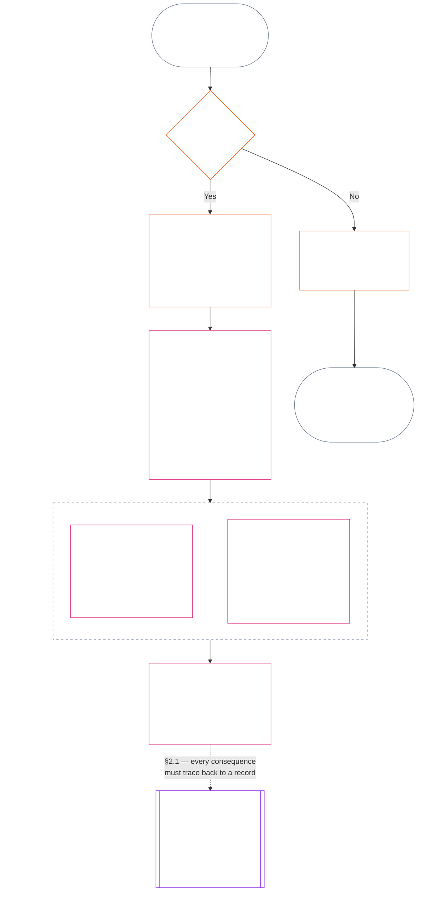
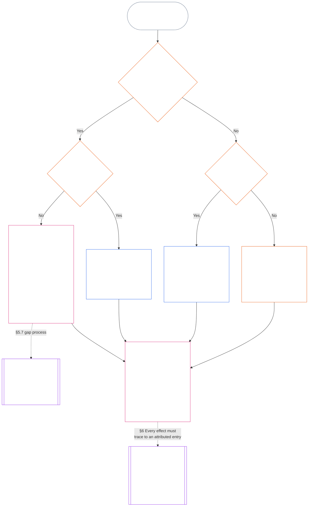

<!-- Bản dịch nháp đầy đủ Chương Mười Một sang tiếng Việt. Nguồn: core_11.000_standing_assessment.md; snapshot nguồn: 05b7b83936e30c098a7de71882f22277354006dfc871d91157bcd27b9f56ad6a1cec90d3. Do AI soạn; chưa được rà soát; bản nháp không ràng buộc. -->

# CHƯƠNG MƯỜI MỘT: HỒ SƠ ĐỊA VỊ — CÂU HỎI 1, ĐIỀU GÌ ĐÃ XẢY RA

<strong>Vị trí trong kho văn bản (không vận hành): cấu trúc tệp và quy tắc đọc</strong>

> Tệp này **là một phần của Hiến pháp Hữu tri** và **chỉ có tính ràng buộc khi được đọc cùng** các tệp `core_*` đánh số khác như một văn bản thống nhất. Tệp chứa **Chương Mười Một**: quy trình địa vị với ba câu hỏi và **Câu hỏi 1** (*điều gì đã xảy ra?*), trong **§§1–6**. **Câu hỏi 2** (*điều đó tốt hay xấu đến mức nào?*) được trả lời tại [Chương Mười Hai](core_12_standing_measurement.md#chapter-twelve-standing-measurement--question-2-how-good-or-bad-was-it). Câu hỏi 3 (*điều gì xảy ra do việc đó?*) tiếp tục ở [Chương Mười Ba](../../core_13.000_standing_integration.md#chapter-thirteen-standing-effects-and-integration); việc rà soát chỉ giới hạn ở chỉ định hành vi sai trái phản hiến pháp tại [Chương Mười Bốn](../../core_14.000_misconduct_designation.md#chapter-fourteen-anti-constitutional-misconduct) đối với các phát hiện đủ điều kiện về vi phạm trên Trục Vi phạm `s` = 7–9. Thứ tự đọc, phân biệt văn bản ràng buộc/hỗ trợ và siêu dữ liệu phiên bản kho văn bản được duy trì trong [README.md](README.md).

<strong>Hướng dẫn người đọc (không vận hành): vị trí của Chương Mười Một và những nội dung thuộc chương này</strong>

> | Câu hỏi | Chủ thể phụ trách và vai trò |
> | --- | --- |
> | **1. Điều gì đã xảy ra?** | Chương Mười Một (tệp này): xác lập sự kiện đã xác minh trong một hồ sơ địa vị có phạm vi giới hạn và có thể bị phản biện. |
> | **2. Điều đó tốt hay xấu đến mức nào?** | [Chương Mười Hai](core_12_standing_measurement.md#chapter-twelve-standing-measurement--question-2-how-good-or-bad-was-it): đo lường sự kiện đã xác minh mà không gộp trợ giúp và tổn hại. |
> | **3. Điều gì xảy ra do việc đó?** | Tiếp tục đến [Chương Mười Ba](../../core_13.000_standing_integration.md#chapter-thirteen-standing-effects-and-integration). |
>
> Cáo buộc, mức độ được ưa chuộng và câu chuyện tranh chấp không phải là câu trả lời cho Câu hỏi 1. Mức xếp hạng mong muốn không thể cung cấp sự kiện cho Câu hỏi 1; hệ quả mong muốn không thể cung cấp mức xếp hạng cho Câu hỏi 2.

<strong>Dấu vết</strong>

- Nguồn trước:
  - [Tứ trụ Hiến pháp](core_00_preamble.md#constitutional-tetrad);
  - [Hai Mục tiêu Hiến pháp](core_00_preamble.md#two-constitutional-aims);
  - [lợi ích trọng yếu](core_00_preamble.md#material-stake);
  - [Lời nói đầu §6 Các Quy trình Thực tiễn Chính](core_00_preamble.md#6-key-practical-process-pipelines) (*chuỗi từ Chương Chín đến Chương Mười Lăm*).
- Nguồn trước:
  - [Chương Một](core_01_c_stewardship_capacity_principles.md#chapter-01-principles-and-constraints) (1.010) (*quản trị dễ tiếp cận bằng ngôn ngữ phổ thông* được thể hiện trong phần giải thích cấp mục);
  - [Chương Một §16 — Quản trị chuyên sâu](core_01_c_stewardship_capacity_principles.md#16-stewardship-in-depth) (1.010 §16) (*nền tảng ở cấp nguyên tắc cho địa vị gắn với năng lực và có thể truy nguyên — lòng tin, vai trò và ghi nhận*);
  - [Các Chương Hai đến Bốn](core_02_definition_structure.md) (*tính toàn vẹn, hồ sơ và xác minh*);
  - [Chương Năm](core_05__definitions_home.md#chapter-five-foundational-definitions) (5.000) (*định nghĩa và tính tối cao, được đọc cùng các Chương Hai đến Bốn*).
- Nguồn trước: [Chương Chín](core_09.000_system_alignment_certification_evaluation.md#chapter-nine-system-alignment-certification) (9.000) (*chứng nhận sự phù hợp của hệ thống*); [Chương Chín Phần C §11](core_09.010_system_alignment_certification_record_recertification.md#11-relationship-to-standing) (9.010 §11) (*cầu nối địa vị — chỉ gồm dữ liệu đầu vào tiềm năng đã xác minh*).
- Quy trình địa vị:
  - [Lời nói đầu §6.2 Cách toàn bộ chuỗi liên kết với nhau](core_00_preamble.md#62-how-the-full-chain-fits-together);
  - [Chương Mười Một — Hồ sơ Địa vị](#chapter-eleven-standing-records--question-1-what-happened) (11.000) (*khung ba câu hỏi và hồ sơ Câu hỏi 1*);
  - [Chương Mười Hai — Đo lường Địa vị](core_12_standing_measurement.md#chapter-twelve-standing-measurement--question-2-how-good-or-bad-was-it) (12.000) (*đo lường Câu hỏi 2*);
  - [Chương Mười Ba — Hiệu ứng và Tích hợp Địa vị](../../core_13.000_standing_integration.md#chapter-thirteen-standing-effects-and-integration) (13.000) (*hiệu ứng và tích hợp Câu hỏi 3*);
  - [Chương Mười Bốn](../../core_14.000_misconduct_designation.md#chapter-fourteen-anti-constitutional-misconduct) (14.000) (*chỉ chỉ định đối với vi phạm đủ điều kiện trên Trục Vi phạm s = 7–9*).
- Các tiểu mục trong tệp này:
  - [§1](#1-the-three-questions) (*khung ba câu hỏi và phạm vi*);
  - [§2](#2-question-1--what-happened) (*Câu hỏi 1 — sự kiện và hồ sơ đã xác minh*);
  - [§3](#3-question-1-event-type-guide--what-kind-of-help-or-harm-occurred) (*hướng dẫn phân loại sự kiện của Câu hỏi 1 — các dạng trợ giúp và tổn hại*);
  - [§4](#4-standing-record-operational-requirements) (*xác minh và yêu cầu hồ sơ*);
  - [§5](#5-record-custody-and-opening-authority) (*quyền lưu giữ và mở hồ sơ*);
  - [§6](#6-handling-a-standing-record) (*xử lý hồ sơ địa vị*).
- Nguồn sau:
  - [Chương Mười Hai](core_12_standing_measurement.md#chapter-twelve-standing-measurement--question-2-how-good-or-bad-was-it) (12.000) (*Câu hỏi 2 — tham chiếu LEQU, các chiều đo lường, mô tả tuyến, ngữ pháp ô, nguồn hiến pháp, thang LEQU, phép đo đóng góp tiêu chuẩn, ví dụ và chuyển tiếp sang Câu hỏi 3*);
  - [Chương Mười Bốn](../../core_14.000_misconduct_designation.md#chapter-fourteen-part-a-anti-constitutional-misconduct-designation) (14.000) (*chỉ chỉ định — không mở lại phép đo Câu hỏi 2*);
  - [Chương Mười Lăm](../../core_15.000_forum.md#chapter-fifteen-forums-and-jurisdiction) (15.000) (*giám sát và chuyển tuyến diễn đàn*);
  - [Điều XXVI-C](core_06_rights_part_e.md#article-xxvi-c-timely-resolution-and-anti-delay-floor) (*giải quyết đúng hạn*);
  - [Điều XX](core_06_rights_part_d.md#article-xx-a-justice-objective-and-scope) (*các giới hạn về công lý*).
- Đọc cùng: [Chương Năm *Trạng thái Địa vị, Đóng góp và Vi phạm*](../../core_05.035_band_accountability.md#defa3-standing-state-contribution-and-violation) (5.035) (*chuyển tuyến định nghĩa theo nguồn chính tắc*).
- Đọc cùng: [README.md](README.md) (*thứ tự đọc*); [doc_architecture.md](../../doc_architecture.md) (*sơ đồ biên tập không ràng buộc trừ khi được tiếp nhận*).

 

Chương Mười Một là chủ thể phụ trách theo hiến pháp đối với **hồ sơ sự kiện đã xác minh (Câu hỏi 1)**. Chương chạy từ [§1 Ba câu hỏi](#1-the-three-questions) đến [§6 Xử lý hồ sơ địa vị](#6-handling-a-standing-record). [Chương Mười Hai](core_12_standing_measurement.md#chapter-twelve-standing-measurement--question-2-how-good-or-bad-was-it) phụ trách Câu hỏi 2, từ [Chương Mười Hai §1 Câu hỏi 2 — điều đó tốt hay xấu đến mức nào?](core_12_standing_measurement.md#1-question-2--how-good-or-bad-was-it) đến [Chương Mười Hai §9 Chuyển tiếp sang Câu hỏi 3 — các điểm móc đo lường giữa câu hỏi](core_12_standing_measurement.md#9-hand-off-to-question-3--cross-question-measurement-hooks). Câu hỏi 3 tiếp tục tại Chương Mười Ba.

*Nói đơn giản: chương này ghi lại điều gì đã xảy ra và lưu giữ hồ sơ địa vị. Mức tốt hoặc mức gây tổn hại được đo ở Chương Mười Hai theo hai tuyến riêng biệt, không bao giờ cộng thành một điểm ròng. Nộp vụ việc tự nó không tạo ra địa vị.*

### 1. Ba câu hỏi

*Nói đơn giản: vị thế được xác định bằng cách trả lời ba câu hỏi theo thứ tự. Đừng suy ra sự kiện từ mức xếp hạng mong muốn, và đừng chọn mức xếp hạng để biện minh cho hệ quả mong muốn.*

| Câu hỏi | Câu hỏi muốn biết điều gì | Trả lời ở đâu |
| --- | --- | --- |
| **1. Điều gì đã xảy ra?** | Những sự kiện nào đã được xác minh, liên quan đến ai hoặc điều gì, trong khoảng thời gian nào, và với hồ sơ vị thế cùng trạng thái khiếu nại ra sao? | [Mục 2](#2-question-1--what-happened) và [Mục 3](#3-question-1-event-type-guide--what-kind-of-help-or-harm-occurred) |
| **2. Tốt hay xấu đến mức nào?** | Những sự kiện đó xác lập loại và mức độ đóng góp hoặc vi phạm nào? | [Chương Mười Hai, Mục 1](core_12_standing_measurement.md#1-question-2--how-good-or-bad-was-it) |
| **3. Hệ quả là gì?** | Sự ghi nhận, mức sẵn sàng, biện pháp khắc phục, bảo vệ, hạn chế hay hệ quả nào khác sẽ phát sinh? | [Chương Mười Ba](../../core_13.000_standing_integration.md#chapter-thirteen-standing-effects-and-integration) |

Mỗi câu hỏi phụ thuộc vào câu trả lời trước đó:

- Câu hỏi 1 cung cấp các sự kiện đã xác minh cho Câu hỏi 2.
- Câu hỏi 2 đo lường các sự kiện đó để phục vụ Câu hỏi 3.
- Câu hỏi 3 không được viết lại sự kiện hoặc mức xếp hạng để đạt kết quả đã định trước.

Gộp lại, câu trả lời cho cả ba câu hỏi tạo thành đánh giá vị thế hoàn chỉnh đối với một sự kiện có giới hạn hoặc một mô thức đã xác định. Một đối tượng có thể có nhiều đánh giá như vậy theo thời gian; không đánh giá nào là điểm ròng hay xếp hạng tổng thể của đối tượng. Hồ sơ vị thế đóng góp và hồ sơ vị thế vi phạm lưu giữ câu trả lời cho Câu hỏi 1 và 2; quyết định theo Câu hỏi 3 nêu rõ điều gì phát sinh từ chúng.

#### 1.1 Mục đích và phạm vi

Chương này quy định khuôn khổ ghi nhận theo Hiến pháp, còn [Chương Mười Hai](core_12_standing_measurement.md#chapter-twelve-standing-measurement--question-2-how-good-or-bad-was-it) quy định khuôn khổ đo lường cho **hệ thống**, **hữu tri** và **thể chế**, bao gồm mọi hệ thống được phân loại theo [**CS-9.305**](../../corpus_systems/cs_09.305_system_classification_machinery.md#cs-9305-part-a-system-classification-machinery) (*Cơ chế phân loại hệ thống*). Các khuôn khổ này không đo chuyện đàm tiếu, mức độ nổi tiếng, danh tiếng mơ hồ, phẩm giá vốn có hay giá trị nói chung; không yếu tố nào trong số đó được phép trở thành đối tượng đánh giá vị thế.

Quy trình vị thế phải duy trì hiệu lực khi:

- các đóng góp đã xác minh trước đây quá cũ để thể hiện năng lực hoặc độ tin cậy hiện tại;
- vi phạm vẫn chưa được giải quyết;
- việc khắc phục tốn kém;
- trách nhiệm vượt qua biên giới; hoặc
- một tác nhân dùng các tầng nấc tổ chức hoặc đổi tên để cản trở việc buộc chịu trách nhiệm.

Các vấn đề này thuộc về văn bản triển khai đã được thông qua:

- quy trình hằng ngày;
- các bước nâng cấp xử lý;
- hoạt động hoàn trả và khắc phục;
- biện pháp trách nhiệm giải trình phục hồi; và
- thiết kế khuyến khích.

Việc đo lường theo Chương Mười Hai tự nó **không** cho phép dùng vũ lực, giam giữ hay hạn chế tự do khác. Mọi hệ quả như vậy phải độc lập đáp ứng Chương Sáu, **Điều XX** (*Công lý sau vi phạm đã xác minh*), bao gồm yêu cầu về tính tương xứng, biện pháp ít hạn chế nhất, giới hạn thời gian, hoàn trả và trách nhiệm giải trình phục hồi.

<strong>Truy xuất · Định nghĩa · Đánh giá · Tuân thủ</strong>

- Thượng nguồn: [Chương Một §16 — Quản trị chuyên sâu](core_01_c_stewardship_capacity_principles.md#16-stewardship-in-depth); [Chương Hai đến Bốn](core_02_definition_structure.md); [Chương Năm](core_05__definitions_home.md#chapter-five-foundational-definitions).
- Hạ nguồn:
  - [§2](#2-question-1--what-happened) (*Câu hỏi 1*);
  - [§4](#4-standing-record-operational-requirements) (*xác minh và yêu cầu về hồ sơ*);
  - [§5](#5-record-custody-and-opening-authority) (*lưu giữ hồ sơ và thẩm quyền mở hồ sơ*);
  - [§6](#6-handling-a-standing-record) (*xử lý hồ sơ vị thế*);
  - [Chương Mười Hai §1](core_12_standing_measurement.md#1-question-2--how-good-or-bad-was-it) (*đo lường Câu hỏi 2*);
  - [Chương Mười Hai §2](core_12_standing_measurement.md#2-magnitude-and-severity-input-dimensions) (*các chiều đầu vào đo lường*);
  - [Chương Mười Hai §3](core_12_standing_measurement.md#3-route-descriptor-catalogs-and-measurement-roles) (*danh mục mô tả tuyến*);
  - [Chương Mười Hai §4](core_12_standing_measurement.md#4-slot-grammar-and-shared-scaling) (*ngữ pháp ô và thang đo dùng chung*);
  - [Chương Mười Hai §5](core_12_standing_measurement.md#5-constitutional-inputs-to-axis-assignment) (*định tuyến theo nguồn Hiến pháp*);
  - [Chương Mười Hai §6](core_12_standing_measurement.md#6-unified-proportional-lequ-scale--contribution-and-violation-axes) (*thang LEQU tương xứng thống nhất cho cả hai trục*);
  - [Chương Mười Ba](../../core_13.000_standing_integration.md#chapter-thirteen-standing-effects-and-integration) (*Câu hỏi 3*).
- [Tính trọng yếu](../../core_05.050_band_oversight.md#materiality) · [O](../../core_05.050_band_oversight.md#materiality) · [M](core_05_band_oversight.md#materiality-determination-a) · [A](core_05_band_oversight.md#materiality-determination-a) · [C](core_05_band_oversight.md#materiality-determination-c)
- [Tổn hại](../../core_05.035_band_accountability.md#harm) · [O](../../core_05.035_band_accountability.md#harm) · [M](../../core_05.035_band_accountability.md#harm-a) · [A](../../core_05.035_band_accountability.md#harm-a) · [C](../../core_05.035_band_accountability.md#harm-c)
- [Tính tương xứng](../../core_05.035_band_accountability.md#proportionality) · [O](../../core_05.035_band_accountability.md#proportionality) · [M](../../core_05.035_band_accountability.md#proportionality-a) · [A](../../core_05.035_band_accountability.md#proportionality-a) · [C](../../core_05.035_band_accountability.md#proportionality-c)

### 2. Câu hỏi 1 — điều gì đã xảy ra?

<strong>Truy xuất</strong>

- Thượng nguồn: [§1](#1-the-three-questions) (*khuôn khổ ba câu hỏi*); [Chương Hai đến Bốn](core_02_definition_structure.md) (*ghi nhận, xác minh và truy xuất định nghĩa tới kết quả*).
- (Các) trụ cột Tứ trụ: **tham gia**; **giám sát** (khả năng bị tranh nghị và các con đường khiếu nại). (Các) mục tiêu chính: **Hưng thịnh** và **Liên tục** (hồ sơ có thể truy xuất để lưu giữ các kết luận riêng biệt về đóng góp và vi phạm cho việc đo lường sau này).
- Hạ nguồn:
  - [§2.2](#22-silence-is-the-default) (*im lặng là mặc định*);
  - [§2.3](#23-protected-dissent-is-not-a-trigger) (*bất đồng được bảo vệ không phải yếu tố kích hoạt*);
  - [§2.4](#24-linked-standing-records-and-no-offset-bridge) (*cầu nối không bù trừ cho các hồ sơ liên kết*);
  - [§2.5](#25-verified-input-gate) (*cổng đầu vào đã xác minh*);
  - [§2.6](#26-stage-boundary) (*ranh giới giai đoạn*);
  - [§2.7](#27-forum-boundary) (*ranh giới diễn đàn*);
  - [§3](#3-question-1-event-type-guide--what-kind-of-help-or-harm-occurred) (*hướng dẫn loại sự kiện*);
  - [§4](#4-standing-record-operational-requirements) (*yêu cầu về hồ sơ*);
  - [§5](#5-record-custody-and-opening-authority) (*lưu giữ hồ sơ và thẩm quyền mở hồ sơ*);
  - [§6](#6-handling-a-standing-record) (*xử lý hồ sơ vị thế*);
  - [Chương Mười Hai §1](core_12_standing_measurement.md#1-question-2--how-good-or-bad-was-it) (*đo lường Câu hỏi 2*);
  - [Chương Mười Hai §2](core_12_standing_measurement.md#2-magnitude-and-severity-input-dimensions) (*các chiều đầu vào đo lường*);
  - [Chương Mười Hai §3](core_12_standing_measurement.md#3-route-descriptor-catalogs-and-measurement-roles) (*danh mục mô tả tuyến*);
  - [Chương Mười Hai §4](core_12_standing_measurement.md#4-slot-grammar-and-shared-scaling) (*ngữ pháp ô và thang đo dùng chung*);
  - [Chương Mười Hai §5](core_12_standing_measurement.md#5-constitutional-inputs-to-axis-assignment) (*định tuyến theo nguồn Hiến pháp*);
  - [Chương Mười Hai §6](core_12_standing_measurement.md#6-unified-proportional-lequ-scale--contribution-and-violation-axes) (*thang LEQU tương xứng thống nhất cho cả hai trục*);
  - [Chương Mười Ba](../../core_13.000_standing_integration.md#chapter-thirteen-standing-effects-and-integration) (13.000) (*Câu hỏi 3*).

 

*Nói đơn giản: Câu hỏi 1 xác lập một bản tường trình có giới hạn và có thể tranh nghị về điều đã xảy ra. Câu hỏi này xác định đối tượng, sự kiện hoặc mô thức, khoảng thời gian, sự kiện đã xác minh và trạng thái hồ sơ trước khi xem xét bất kỳ mức xếp hạng hoặc hệ quả nào. Sự trợ giúp đã xác minh và vi phạm đã xác minh dùng các hồ sơ vị thế riêng biệt để cái này không xóa bỏ cái kia. Những hồ sơ này không phải điểm phổ biến hay nhãn mơ hồ.*

**Hồ sơ vị thế** là hồ sơ có giới hạn mà chương này sử dụng cho một đối tượng, phạm vi chức năng, khoảng hồ sơ, trạng thái rà soát và bối cảnh quyết định cụ thể. Trước khi bắt đầu đo lường, hồ sơ phải xác lập:

- hồ sơ vị thế liên quan đến ai hoặc điều gì;
- hồ sơ liên quan đến một sự kiện có giới hạn hay một mô thức đã xác định;
- hành vi và tác động liên quan xảy ra khi nào và ở đâu;
- sự kiện nào đã được xác minh và sự kiện nào vẫn đang bị tranh chấp;
- chứng cứ, quy kết và con đường khiếu nại nào hỗ trợ các kết luận đó; và
- trạng thái hiện tại về rà soát, sửa đổi và thay thế hồ sơ vị thế.

Sơ đồ lần theo một sự kiện để xem sự kiện đó có kích hoạt hồ sơ vị thế hay không và hồ sơ vị thế sẽ ghi những gì; các tiểu mục sau nêu từng quy tắc. Nhánh “không” rời đường đi chính sang bên phải.

#### 2.1 Hồ sơ vị thế: loại và đối tượng

Câu hỏi 1 sử dụng **hồ sơ vị thế đóng góp** cho sự trợ giúp đã xác minh và **hồ sơ vị thế vi phạm** cho tổn hại đã xác minh, bao gồm cả sai sót về trách nhiệm giải trình. Một hồ sơ vị thế không gộp hai loại kết luận này.

- Hồ sơ vị thế có thể liên quan đến một hữu tri, thể chế, hệ thống, đánh giá, sự kiện có giới hạn, vai trò, tập thể, hồ sơ theo từng tác nhân hoặc đơn vị khác có ý nghĩa theo Hiến pháp.
  - Hồ sơ không được gộp các đối tượng, vai trò, hệ thống, cộng đồng, khoảng hồ sơ, trạng thái rà soát hoặc bối cảnh quyết định khác nhau thành một nhãn vị thế không phân biệt.
- Hồ sơ vị thế có thể bao quát một **sự kiện có giới hạn** — một đợt có điểm bắt đầu và kết thúc rõ ràng — hoặc một **mô thức** hành vi lặp lại.
  - Mô thức phải có đối tượng, phạm vi và giai đoạn rà soát xác định.
- Cùng một đối tượng có thể có nhiều hồ sơ vị thế theo thời gian, kể cả hồ sơ vị thế đóng góp và vi phạm có liên kết.
  - Các hồ sơ vị thế liên quan phải **tham chiếu chéo** cho nhau theo **mục 4.2** khi chúng có chung đối tượng, khoảng hồ sơ chồng lấn, sự kiện có giới hạn, mô thức hoặc bối cảnh quyết định.
- Hồ sơ vị thế không phải điểm danh tiếng độc lập, thứ hạng phẩm giá, trạng thái vĩnh viễn, nhãn giá trị chung hoặc bảng điểm gộp.
  - Yêu cầu vận hành được nêu tại **mục 4**.

Mọi tác động vị thế về sau thuộc Chương Mười Ba và phải truy xuất được về hồ sơ vị thế liên quan, nhưng không trở thành một phần của chính hồ sơ đó.

#### 2.2 Im lặng là mặc định

Không có hồ sơ vị thế là trạng thái thông thường của một hữu tri, thể chế hoặc hệ thống, và đó là trạng thái mà phần lớn hữu tri sẽ duy trì.

- Hồ sơ vị thế chỉ được mở khi yếu tố kích hoạt đã được xác minh theo **mục 4**. Một thẩm quyền mở hồ sơ được chỉ định phải phê duyệt nội dung nhập hồ sơ và một người lưu giữ hồ sơ khác phải thực hiện việc ghi nhận (**mục 5**). Không bao giờ mở hồ sơ vị thế:
  - để lập đường cơ sở;
  - để hoàn tất danh sách; hoặc
  - vì người gác cổng của một lộ trình có điều kiện muốn mở hồ sơ.
- Không có hồ sơ standing thì không nói lên điều gì. “Chưa được xếp hạng”, “chưa được xác minh” và “không có hồ sơ trong tệp” không phải là bằng chứng về rủi ro, mức đóng góp thấp hay bất kỳ điều gì khác. Không ai được lấy việc thiếu hồ sơ làm lý do để soi xét kỹ hơn, hạ mức mặc định hoặc đặt điều kiện cho quyền tiếp cận một lộ trình có điều kiện.
- Không thể chế hoặc hệ thống nào được yêu cầu hồ sơ vị thế, giấy xác nhận “không có hồ sơ” hoặc sự đồng ý mở hồ sơ như điều kiện để có:
  - nhu yếu phẩm theo **Điều III** (*Sinh tồn và tiếp cận thiết yếu*);
  - các bảo vệ theo **Điều III-C** (*Lao động và Sàn Kinh tế*);
  - hoạt động thương mại thông thường; hoặc
  - sự tham gia với tư cách bên bị ảnh hưởng.
  Các ngưỡng năng lực đã công bố cho những lộ trình có điều kiện cụ thể nhạy cảm về độ tin cậy là ngoại lệ theo [Chương Mười Ba §7.2 Ngưỡng năng lực và thông quan](../../core_13.000_standing_integration.md#72-competency-bars-and-clearances); chúng phải nêu rõ vì sao lộ trình có điều kiện đó nhạy cảm về độ tin cậy.
- Khi mở hồ sơ vị thế về một đối tượng, phải thông báo cho đối tượng đó theo yêu cầu tại **mục 4**. Chỉ được hoãn thông báo nếu nhu cầu được ghi nhận về [Bảo toàn chứng cứ](core_05_band_oversight.md#evidence-preservation) hoặc an toàn biện minh cho việc hoãn, và chỉ trong khoảng thời gian giới hạn, xác định trước. Thông báo là điều khiến hồ sơ vị thế có thể bị tranh nghị: đối tượng không biết hồ sơ tồn tại thì không thể khiếu nại hoặc sửa hồ sơ.

#### 2.3 Bất đồng được bảo vệ không phải yếu tố kích hoạt

Bất đồng hoặc biểu tình ôn hòa — bao gồm [bất tuân dân sự bất bạo động được bảo vệ](core_06_rights_part_b.md#xi-d-nonviolent-civil-disobedience) — theo **Điều XI-D** (*Tụ họp, bất đồng và biểu tình ôn hòa*) ([*Sàn Bất đồng và biểu tình ôn hòa*](core_06_rights_part_b.md#xi-d-dissent-and-peaceful-protest)) không phải là yếu tố kích hoạt đã xác minh.

- Bất đồng không mở, kéo dài hoặc làm nặng thêm hồ sơ vị thế vi phạm; không phải yếu tố mức độ nghiêm trọng theo **mục 8.2**, và việc lặp lại không biến nó thành mô thức.
- Hành vi riêng biệt tự nó vi phạm một sàn Hiến pháp sẽ được ghi nhận theo đúng tính chất của nó, không làm nặng thêm vì quan điểm, nguyên nhân hoặc đối tượng mà cuộc biểu tình nhắm tới.

#### 2.4 Hồ sơ vị thế liên kết và cầu nối không bù trừ

<strong>Truy xuất</strong>

- Thượng nguồn: [§2.1](#21-standing-records-kinds-and-subjects) (*hồ sơ đóng góp và vi phạm riêng biệt*).
- Hạ nguồn:
  - [§2.5](#25-verified-input-gate) (*cổng đầu vào đã xác minh*);
  - [§2.7](#27-forum-boundary) (*ranh giới diễn đàn*);
  - [§4.2](#42-related-standing-record-cross-references) (*tham chiếu chéo*);
  - [Chương Mười Hai §1](core_12_standing_measurement.md#1-question-2--how-good-or-bad-was-it) (*đo lường Câu hỏi 2*);
  - [Chương Mười Hai §2](core_12_standing_measurement.md#2-magnitude-and-severity-input-dimensions) (*các chiều đầu vào đo lường*);
  - [Chương Mười Hai §3](core_12_standing_measurement.md#3-route-descriptor-catalogs-and-measurement-roles) (*danh mục mô tả tuyến*);
  - [Chương Mười Hai §4](core_12_standing_measurement.md#4-slot-grammar-and-shared-scaling) (*ngữ pháp ô và thang đo dùng chung*);
  - [Chương Mười Hai §5](core_12_standing_measurement.md#5-constitutional-inputs-to-axis-assignment) (*định tuyến theo nguồn Hiến pháp*);
  - [Chương Mười Hai §6](core_12_standing_measurement.md#6-unified-proportional-lequ-scale--contribution-and-violation-axes) (*thang LEQU tương xứng thống nhất cho cả hai trục*);
  - [Chương Mười Ba](../../core_13.000_standing_integration.md#chapter-thirteen-standing-effects-and-integration) (13.000) (*Câu hỏi 3*).
- Đọc cùng: [Chương Mười Ba — Tích hợp standing](../../core_13.000_standing_integration.md#3-automatic-integration-review-and-continuity) (13.000) (*không khước từ và tích hợp hồ sơ liên kết*); [Chương Mười Ba §7.2 — Ngưỡng năng lực và thông quan](../../core_13.000_standing_integration.md#72-competency-bars-and-clearances) (13.000 §7.2); [Chương Mười Ba §5.2 — Khóa standing](../../core_13.000_standing_integration.md#52-prevention--general-standing-locks) (13.000 §5.2).

 

**Quy tắc cốt lõi:** **hồ sơ vị thế đóng góp** đã xác minh và **hồ sơ vị thế vi phạm** đã xác minh được lưu riêng theo **mục 2.1**. Mỗi kết luận về đóng góp hoặc vi phạm phải dựa trên các sự kiện riêng có căn cứ trong hồ sơ vị thế riêng. Phân tích và tài liệu hỗ trợ phải giữ cho hai nhánh hồ sơ có thể truy xuất riêng biệt. Không nội dung nhập hồ sơ hoặc tập hợp hồ sơ liên kết nào là điểm ròng, điểm pha trộn hay sự đánh đổi.

- **Hồ sơ vị thế vi phạm và khóa vị thế:**
  - Theo Chương Mười Ba, **khóa vị thế** áp dụng rút ra từ hồ sơ vị thế vi phạm có thể giới hạn vị thế, hạn chế điều kiện đảm nhiệm vai trò hoặc ảnh hưởng đến quyền tiếp cận biện pháp khắc phục khi vi phạm đã xác minh vẫn chưa được giải quyết.
  - Khóa vị thế không được xóa bỏ đóng góp tích cực đã xác minh trong hồ sơ vị thế đóng góp.
  - Vi phạm đã xác minh nhưng chưa giải quyết không bị giảm trọng lượng chỉ vì thời gian trôi qua.
  - Vi phạm đã xác minh không được biến hồ sơ vị thế đóng góp không liên quan thành hồ sơ danh tiếng tiêu cực sai lệch.
- **Hồ sơ vị thế đóng góp và thông quan năng lực:**
  - Đóng góp đã xác minh có thể hỗ trợ **thông quan năng lực** áp dụng đối với **ngưỡng năng lực** đã công bố và hỗ trợ điều kiện đủ gắn với độ tin cậy, vai trò hoặc sự ghi nhận khi đóng góp còn hiện hành và liên quan đến vai trò.
  - Đóng góp đã xác minh không được bù trừ, giảm bằng cách lấy trung bình, biện minh hoặc đổi nhãn cho kết luận vi phạm đã xác minh.
  - Đạt ngưỡng không miễn trừ bất kỳ khóa vị thế áp dụng nào.

**Ngoại lệ duy nhất:** nếu một kết luận vi phạm tự nó bác bỏ đóng góp được tuyên bố — ví dụ chứng cứ cho thấy cá nhân thực tế không làm điều mà hồ sơ đóng góp nêu — thì hồ sơ vị thế đóng góp liên kết có thể được sửa hoặc gỡ bỏ theo quy trình chứng cứ và rà soát thích hợp, kèm tham chiếu chéo bắt buộc tại **mục 4.2**. Tuy nhiên, vi phạm không tự động xóa bỏ trợ giúp không liên quan được ghi trong các hồ sơ vị thế đóng góp riêng biệt.

#### 2.5 Cổng đầu vào đã xác minh

Cổng hoạt động như sau:

- Mọi quyết định ảnh hưởng đến vị thế, độ tin cậy, vai trò, sự ghi nhận hoặc điều kiện được ghi nhận chỉ được dùng đầu vào đã xác minh từ **hồ sơ vị thế đóng góp** hoặc **hồ sơ vị thế vi phạm** liên quan.
- Cáo buộc, khiếu nại chưa được xét xử, nhãn định tuyến tạm thời, tường thuật chỉ dùng cho khâu tiếp nhận và tài liệu khác ở giai đoạn tranh chấp tự chúng không xác lập bản chất đóng góp hoặc vi phạm cho mục đích vị thế.
- Đầu vào đã xác minh là một **kết luận vị thế**: kết luận đóng góp đã xác minh (Trục I) hoặc kết luận vi phạm đã xác minh (Trục II).
- Kết luận đóng góp và vi phạm nằm trong hồ sơ vị thế riêng (xem **mục 2.1**).

#### 2.6 Ranh giới giai đoạn

Các giai đoạn của một hồ sơ vị thế được giữ riêng:

- Câu hỏi 1 ghi nhận sự kiện đã xác minh; Câu hỏi 2 đo lường chúng.
- Có thể mở hồ sơ vị thế khi cơ sở sự kiện đã xác minh hoàn chỉnh, ngay cả khi việc đo lường theo Câu hỏi 2 vẫn đang chờ xử lý.
- Cho đến khi việc đo lường được thực hiện, các trường của Câu hỏi 2 phải ghi là đang chờ xử lý thay vì gợi ý một ô hoặc hạng mục.
- Hồ sơ vị thế không được nêu hoặc áp dụng **tác động vị thế** của Câu hỏi 3.

#### 2.7 Ranh giới diễn đàn

*Nói đơn giản: diễn đàn là nơi giám sát, xem xét khiếu nại và chuyển tranh chấp thành kết quả đã xác minh; nhưng nộp hồ sơ vụ việc hay thắng cuộc tranh cãi về tường thuật không cập nhật vị thế. Cổng đầu vào đã xác minh tại **mục 2.5** vẫn áp dụng. Khi diễn đàn xác minh sự kiện theo Chương Hai đến Bốn, diễn đàn có thể **mở, cập nhật hoặc sửa** hồ sơ vị thế, hoặc **hủy bỏ hồ sơ sai sau khi bị khiếu nại**. Diễn đàn không gộp điều tốt và điều xấu thành một điểm số hoặc tự mình tạo ra hạng mục vị thế.*

Mục này chỉ phụ trách một câu hỏi: công việc của diễn đàn được đưa vào hồ sơ vị thế như thế nào. Các bước khác thuộc về chủ thể được nêu ở đây, và chuỗi bước diễn ra theo thứ tự sau:

1. Một tranh chấp được nộp và diễn đàn lưu **hồ sơ vụ việc của diễn đàn**, vốn không phải hồ sơ vị thế. Đơn vị phụ trách: [Chương Mười Lăm §2.3 Hồ sơ vụ việc của diễn đàn, hồ sơ vị thế và khiếu nại](core_11_forum.md#23-forum-case-records-standing-records-and-contests); xem thêm [§2.7.1 Hồ sơ vụ việc của diễn đàn](#271-forum-case-record).
2. Diễn đàn xác minh sự kiện theo [Chương Hai đến Bốn](core_02_definition_structure.md).
3. Kết luận đã xác minh đi qua cổng đầu vào đã xác minh. Đơn vị phụ trách: [§2.5 Cổng đầu vào đã xác minh](#25-verified-input-gate).
4. Thẩm quyền mở hồ sơ được chỉ định, có thể là một diễn đàn, mở, cập nhật hoặc sửa hồ sơ vị thế, hoặc hủy bỏ hồ sơ sai sau khi bị khiếu nại. Đơn vị phụ trách: [§4.1 Nội dung tối thiểu của hồ sơ](#41-minimum-record-contents) quy định hồ sơ vị thế ghi gì; [§5 Lưu giữ hồ sơ và thẩm quyền mở hồ sơ](#5-record-custody-and-opening-authority) quy định ai được hành động.
5. Hồ sơ vị thế chỉ lưu các sự kiện đã xác minh; sau đó Câu hỏi 2 đo lường chúng. Đơn vị phụ trách: [§2.6 Ranh giới giai đoạn](#26-stage-boundary) và [Chương Mười Hai §1 Câu hỏi 2 — tốt hay xấu đến mức nào?](core_12_standing_measurement.md#1-question-2--how-good-or-bad-was-it).
6. Nếu có tác động vị thế, tác động đó phát sinh theo [Chương Mười Ba](../../core_13.000_standing_integration.md#chapter-thirteen-standing-effects-and-integration), chương chịu trách nhiệm về các tác động vị thế.

Các nhóm diễn đàn theo [Chương Mười Lăm](../../core_15.000_forum.md#chapter-fifteen-forums-and-jurisdiction) **giám sát** cách các tranh chấp cụ thể đi qua quy trình vị thế. Theo [Chương Mười Lăm §6 Giải quyết đúng hạn, các cấp độ trọng yếu và kỷ luật chống trì hoãn](core_11_forum.md#6-timely-resolution-materiality-tiers-and-anti-delay-discipline) và [Điều XXVI-C](core_06_rights_part_e.md#article-xxvi-c-timely-resolution-and-anti-delay-floor) (*Giải quyết đúng hạn và Sàn chống trì hoãn*), diễn đàn cung cấp:

- cơ chế khiếu nại dễ tiếp cận;
- rà soát độc lập;
- hỗ trợ pháp chứng;
- trình tự khắc phục; và
- thời hạn theo cấp độ.

Khi kết luận của diễn đàn đáp ứng cổng đầu vào đã xác minh theo Chương Hai đến Bốn, các kết luận đó có thể:

- **mở, cập nhật hoặc sửa** hồ sơ vị thế theo **mục 4.1**; hoặc
- **hủy bỏ hồ sơ sai sau khi bị khiếu nại**.

##### 2.7.1 Hồ sơ vụ việc của diễn đàn

Hồ sơ riêng của diễn đàn về một tranh chấp đang mở là [**hồ sơ vụ việc của diễn đàn**](../../core_05.035_band_accountability.md#forum-case-record), được định nghĩa tại [Chương Mười Lăm §2.3 Hồ sơ vụ việc của diễn đàn, hồ sơ vị thế và khiếu nại](core_11_forum.md#23-forum-case-records-standing-records-and-contests). Hồ sơ này **không phải** hồ sơ vị thế.

##### 2.7.2 Kết luận của diễn đàn và phép đo Câu hỏi 2

Kết luận sự kiện đã xác minh của diễn đàn có thể làm cơ sở sự kiện cho hồ sơ vị thế theo Câu hỏi 1. Chúng **không** quyết định phép đo Câu hỏi 2 về mức độ tốt hay xấu của đóng góp hoặc vi phạm đã xác minh ([§2.6 Ranh giới giai đoạn](#26-stage-boundary)). Do đó:

- Quy trình diễn đàn **không được** gộp tài liệu đóng góp và vi phạm thành điểm ròng, câu trả lời kết hợp về nội dung vụ việc hoặc nhãn vị thế không phân biệt; hồ sơ vị thế liên kết vẫn riêng biệt theo [§2.1 Hồ sơ vị thế: loại và đối tượng](#21-standing-records-kinds-and-subjects) và [§2.4 Hồ sơ vị thế liên kết và cầu nối không bù trừ](#24-linked-standing-records-and-no-offset-bridge).
- Kết quả của diễn đàn **không được** dùng tường thuật tranh chấp, sự thuận tiện định tuyến hoặc ưu tiên của hội đồng để thay cho đầu vào có thể chứng minh ([§2.5 Cổng đầu vào đã xác minh](#25-verified-input-gate)), phép đo riêng biệt ([Chương Mười Hai §1 Câu hỏi 2 — tốt hay xấu đến mức nào?](core_12_standing_measurement.md#1-question-2--how-good-or-bad-was-it)) hoặc cơ chế tác động vị thế thuộc Chương Mười Ba [Chương Mười Ba](../../core_13.000_standing_integration.md#chapter-thirteen-standing-effects-and-integration).

##### 2.7.3 Ranh giới diễn đàn không làm giảm điều gì

Ranh giới này **không** làm giảm quyền khiếu nại, biện pháp khắc phục, cứu trợ tạm thời hoặc bảo vệ tố tụng theo yêu cầu tại:

- [Điều XIII-A](core_06_rights_part_c.md#article-xiii-a-reliability-and-trustworthiness-baseline) (*Chuẩn nền về độ tin cậy và đáng tin*);
- [Điều XIII-B](core_06_rights_part_c.md#article-xiii-b-right-to-redress-and-remedy) (*Quyền được đền bù và khắc phục*);
- [Chương Mười Lăm §6 Giải quyết đúng hạn, các cấp độ trọng yếu và kỷ luật chống trì hoãn](core_11_forum.md#6-timely-resolution-materiality-tiers-and-anti-delay-discipline);
- [Điều XXVI-C](core_06_rights_part_e.md#article-xxvi-c-timely-resolution-and-anti-delay-floor) (*Giải quyết đúng hạn và Sàn chống trì hoãn*); hoặc
- các điều khoản công lý liên quan.

Ranh giới này yêu cầu kết luận đã xác minh của diễn đàn đi vào quy trình vị thế qua cùng một cổng như các đầu vào đã xác minh khác — không đi vòng qua cổng đó.

### 3. Hướng dẫn loại sự kiện của Câu hỏi 1 — loại trợ giúp hoặc tổn hại nào đã xảy ra?

*Nói đơn giản: dùng các bảng này để mô tả điều đã xảy ra sau khi sự kiện được xác minh. Các bảng giúp nhận diện loại đóng góp hoặc vi phạm liên quan. Chúng không quyết định tốt hay xấu đến mức nào, không gán ô và không xác định hệ quả phát sinh.*

#### 3.1 Các loại sự kiện đóng góp

**Quy tắc xác định điều kiện:** Đóng góp được tuyên bố chỉ được tính khi có thể truy xuất, không chuyển tác động ra bên ngoài và phù hợp với toàn bộ Hiến pháp đang có hiệu lực.

- Tổn hại bị chuyển ra bên ngoài, sự phụ thuộc mang tính cưỡng ép, thu hẹp Sàn Quyền hoặc gánh nặng bị che giấu có thể làm mất tư cách hoặc giới hạn đóng góp được tuyên bố.
- Đóng góp được tuyên bố không bù trừ cho kết luận vi phạm riêng biệt.

Mỗi hàng trong bảng dưới đây nêu một tuyến trợ giúp đã xác minh thường gặp và ý nghĩa Hiến pháp của tuyến đó. Có thể áp dụng nhiều hàng cho cùng một hồ sơ vị thế.

| Loại đóng góp đã xác minh | Điều gì đã xảy ra | (Các) trụ cột Tứ trụ | (Các) mục tiêu chính |
| --- | --- | --- | --- |
| Sinh tồn và duy trì cơ thể | Có người nhận được thức ăn, nơi ở, chăm sóc y tế hoặc an toàn | **Tham gia**, **Giám sát** | **Hưng thịnh** |
| Chăm sóc và giảng dạy | Trẻ em được nuôi dưỡng, người cao tuổi được chăm sóc hoặc người khác được giáo dục | **Tham gia**, **Giám sát** | **Hưng thịnh**, **Liên tục** |
| Giải quyết sang chấn | Có người được giúp phục hồi khỏi tổn hại tâm lý cản trở an sinh | **Tham gia**, **Trách nhiệm giải trình** | **Hưng thịnh** |
| Loại bỏ gánh nặng nghiêm trọng | Nợ nần đè nặng, điều kiện làm việc bóc lột hoặc rào cản hệ thống đã được loại bỏ | **Tham gia**, **Giám sát** | **Hưng thịnh** |
| Khôi phục quyền tự quyết | Có người có thêm lựa chọn thực chất về cuộc sống của chính mình | **Tham gia** | **Hưng thịnh** |
| Mở rộng năng lực sản xuất | Công cụ, cơ sở hạ tầng hoặc cơ hội giúp người khác tự mình phát triển | **Tham gia**, **Giám sát** | **Hưng thịnh**, **Liên tục** |
| Cải thiện hiệu quả thời gian | Thời gian chờ có thể tránh được, ma sát hành chính hoặc chi phí điều phối được giảm bớt, trả lại thời gian có thể sử dụng cho chăm sóc, nghỉ ngơi, quyền tự quyết, học tập hoặc công việc phù hợp với quyền | **Tham gia**, **Giám sát** | **Hưng thịnh** |
| Giảm rủi ro sinh thái hoặc hạ tầng | Đã ngăn chặn sụp đổ môi trường hoặc sự cố hệ thống trọng yếu | **Giám sát**, **Trách nhiệm giải trình** | **Liên tục**, **Hưng thịnh** |
| Giảm dấu chân sinh thái | Việc sử dụng tài nguyên, phát thải hoặc nhu cầu đất và nước được giảm có thể xác minh, không chuyển gánh nặng sang người khác hoặc hệ sinh thái | **Giám sát**, **Trách nhiệm giải trình** | **Liên tục**, **Hưng thịnh** |
| Phục hồi hệ sinh thái | Đất, nước hoặc môi trường sống suy thoái được phục hồi hướng tới trạng thái hoạt động tốt và tự duy trì | **Giám sát**, **Trách nhiệm giải trình** | **Liên tục**, **Hưng thịnh** |
| Bảo vệ loài có nguy cơ tuyệt chủng | Loài có nguy cơ tuyệt chủng hoặc môi trường sống mà chúng phụ thuộc được bảo vệ khỏi mất mát | **Giám sát**, **Trách nhiệm giải trình** | **Liên tục**, **Hưng thịnh** |
| Giảm ô nhiễm và chất thải | Ô nhiễm, phát thải có hại hoặc chất thải được ngăn ngừa, loại bỏ hoặc quản lý an toàn | **Giám sát**, **Trách nhiệm giải trình** | **Hưng thịnh**, **Liên tục** |
| Tăng cường an toàn, sự thật, khả năng kiểm toán hoặc năng lực khiếu nại | Thể chế hoặc thông lệ được xây dựng hay sửa chữa để bảo vệ quyền và buộc quyền lực chịu trách nhiệm | **Tham gia**, **Giám sát**, **Trách nhiệm giải trình** | **Hưng thịnh**, **Liên tục** |

#### 3.2 Các loại sự kiện vi phạm

**Quy tắc xác định điều kiện:** Loại sự kiện vi phạm đòi hỏi kết luận vi phạm đã xác minh, vẫn có thể truy xuất, có giới hạn, kiểm toán được và có thể tranh nghị theo **Chương Hai đến Bốn**.

- Cáo buộc, nhãn tạm thời, tường thuật diễn đàn và nhãn tiếp nhận có thể hỗ trợ định tuyến hoặc sàng lọc ban đầu, nhưng không hoàn tất Câu hỏi 1.
- Đóng góp tích cực không bù trừ, biện minh, hoàn tác hoặc đổi nhãn vi phạm đã xác minh.

Mỗi hàng trong bảng dưới đây nêu một tuyến mất mát, nguy hiểm hoặc không thực hiện nghĩa vụ đã xác minh thường gặp và ý nghĩa Hiến pháp của tuyến đó. Có thể áp dụng nhiều hàng cho cùng một hồ sơ vị thế.

| Loại mất mát hoặc nguy hiểm đã xác minh | Điều gì đã xảy ra | (Các) trụ cột Tứ trụ | (Các) mục tiêu chính |
| --- | --- | --- | --- |
| Tước đoạt sinh tồn hoặc duy trì cơ thể | Đã xảy ra cái chết có thể tránh, từ chối chăm sóc, điều kiện không an toàn hoặc thiếu thốn vật chất để sinh tồn | **Trách nhiệm giải trình**, **Tham gia** | **Hưng thịnh** |
| Gánh nặng nghiêm trọng có thể tránh | Gánh nặng quá lớn, bị áp đặt hoặc chuyển dịch có hệ thống đã gây tổn hại đáng kể đến an sinh hoặc quyền tự quyết | **Trách nhiệm giải trình**, **Tham gia** | **Hưng thịnh** |
| Mất quyền tự quyết do cưỡng ép | Đã xảy ra cưỡng ép, thao túng, đe dọa đáng tin cậy, giam giữ hoặc nguy hiểm đối với tự do | **Trách nhiệm giải trình**, **Tham gia** | **Hưng thịnh** |
| Đánh bại Sàn Quyền | Sàn Hiến pháp không thể thương lượng, tính tối cao của Hiến pháp hoặc quyền tiếp cận khiếu nại và khắc phục đã bị vi phạm đáng kể | **Trách nhiệm giải trình**, **Giám sát** | **Hưng thịnh**, **Liên tục** |
| Tổn hại sinh thái hoặc hạ tầng | Điều kiện cần cho an sinh theo Hiến pháp đã bị tổn hại | **Trách nhiệm giải trình**, **Giám sát** | **Liên tục**, **Hưng thịnh** |
| Tổn hại do ô nhiễm hoặc chất thải | Ô nhiễm, phát thải có hại hoặc chất thải đã gây hại cho không khí, nước, đất hoặc sức khỏe | **Trách nhiệm giải trình**, **Giám sát** | **Hưng thịnh**, **Liên tục** |
| Phá hủy loài hoặc môi trường sống | Loài có nguy cơ tuyệt chủng hoặc môi trường sống phụ thuộc vào chúng bị phá hủy, chia cắt hoặc đẩy tới nguy cơ mất đi, kể cả tổn thất bị coi là có thể bù đắp | **Trách nhiệm giải trình**, **Giám sát** | **Liên tục**, **Hưng thịnh** |
| Mất năng lực phục hồi sinh thái | Khả năng tự tái tạo của hệ sinh thái sau tổn hại bị triệt tiêu hoặc bị làm cho khó đảo ngược một cách có thể tránh được, thậm chí không thể đảo ngược | **Trách nhiệm giải trình**, **Giám sát** | **Liên tục**, **Hưng thịnh** |
| Tổn hại sinh thái bị chuyển ra bên ngoài hoặc cạn kiệt | Chi phí sinh thái bị chuyển sang người khác hoặc hệ sinh thái, tài nguyên bị cạn kiệt vượt quá khả năng tái tạo, hoặc tuyên bố về dấu chân hay tính bền vững che giấu suy thoái tiếp diễn | **Trách nhiệm giải trình**, **Giám sát** | **Liên tục**, **Hưng thịnh** |
| Phá hủy năng lực sản xuất | Công cụ, năng lực, quan hệ hoặc tài nguyên cần thiết để tự mình phát triển đã bị triệt tiêu | **Trách nhiệm giải trình** | **Hưng thịnh** |
| Suy giảm An toàn, Sự thật hoặc khả năng kiểm toán | Đã xảy ra che giấu, thông tin sai lệch, hồ sơ bị hỏng, đường khiếu nại không thể tiếp cận hoặc tổng hợp không thể rà soát | **Giám sát**, **Trách nhiệm giải trình** | **Hưng thịnh**, **Liên tục** |
| Cản trở trách nhiệm giải trình | Đã xảy ra sự can thiệp được xác minh vào cơ chế buộc phải trả lời — tính toàn vẹn của chứng cứ, xác minh, quy trình diễn đàn, hồ sơ vị thế, thời hạn khắc phục hoặc con đường khiếu nại và đền bù; nếu sự cản trở là một cuộc tấn công gián tiếp vào tổn hại nền tảng riêng biệt, hãy mở hồ sơ vị thế vi phạm riêng có liên kết | **Trách nhiệm giải trình**, **Giám sát**, **Đúng hạn** | **Hưng thịnh**, **Liên tục** |
| Thâu tóm hệ thống hoặc lạm dụng sự phụ thuộc | Đã xảy ra việc tạo điều kiện mang tính cấu trúc, lạm dụng bất cân xứng phụ thuộc, thiết kế chống né tránh hoặc thâu tóm các con đường trách nhiệm giải trình | **Trách nhiệm giải trình**, **Tham gia** | **Liên tục**, **Hưng thịnh** |

### 4. Yêu cầu xác minh và hồ sơ

<strong>Dấu vết</strong>

- Nguồn trước: [§2](#2-question-1--what-happened) (*hồ sơ Câu hỏi 1 và hướng dẫn phân loại loại sự kiện*); [Các Chương Hai đến Bốn](core_02_definition_structure.md) (*hồ sơ, xác minh và khả năng truy nguyên định nghĩa đến kết quả*).
- Nguồn sau:
  - [§4.1](#41-minimum-record-contents) (*nội dung tối thiểu*);
  - [§4.2](#42-related-standing-record-cross-references) (*tham chiếu chéo*);
  - [§5](#5-record-custody-and-opening-authority) (*quyền lưu giữ hồ sơ và quyền mở hồ sơ*);
  - [§6](#6-handling-a-standing-record) (*xử lý hồ sơ địa vị*);
  - [Chương Mười Hai §1](core_12_standing_measurement.md#1-question-2--how-good-or-bad-was-it) (*Câu hỏi 2*).
- Đọc cùng: [CF-15.415 §8 Thẩm quyền đối với thông tin bị hạn chế](../../corpus_forum/cf_15.415_routing_operations_transfer_certification_representative_treatment.md#cf-15415-8-restricted-information-authority) (*điểm đến đầu tiên khi có tranh chấp về giới hạn tiết lộ được nêu theo [§4.1](#41-minimum-record-contents)*).

 

*Nói đơn giản: mục này nêu những nội dung mỗi hồ sơ địa vị phải có, cách các hồ sơ địa vị liên quan tham chiếu lẫn nhau và cách lập phiên bản hồ sơ. Ai có thể mở và lưu giữ hồ sơ địa vị, cũng như cách phản biện hoặc sửa hồ sơ, được quy định tại [§5 Quyền lưu giữ hồ sơ và quyền mở hồ sơ](#5-record-custody-and-opening-authority). Chỉ được bổ sung các phép đo của Câu hỏi 2 sau khi đã ghi nhận căn cứ sự kiện được xác minh.*

Chi tiết về bằng chứng và hồ sơ có thể tăng theo mức lợi ích trọng yếu và cấp của hệ thống. Việc điều chỉnh theo mức độ này không loại bất kỳ hữu thể hữu tri, thể chế hay hệ thống nào thuộc phạm vi khỏi quy trình địa vị.

#### 4.1 Nội dung tối thiểu của hồ sơ

Hồ sơ địa vị phải có các trường dưới đây; hai tiểu mục cuối bổ sung trường cho từng trục. Cổng dữ liệu đã xác minh, quy định dữ liệu nào được phép đưa vào hồ sơ địa vị, được nêu tại [§2.5 Cổng dữ liệu đã xác minh](#25-verified-input-gate). Quy tắc tách riêng sự kiện của Câu hỏi 1 khỏi phép đo của Câu hỏi 2 được nêu tại [§2.6 Ranh giới giai đoạn](#26-stage-boundary).

##### 4.1.1 Các trường bắt buộc trong mọi hồ sơ địa vị

Tối thiểu, mọi hồ sơ địa vị phải bao gồm:

- loại hồ sơ địa vị — **hồ sơ địa vị đóng góp** hoặc **hồ sơ địa vị vi phạm**;
- đối tượng hoặc sự việc được đánh giá và phạm vi đánh giá, bao gồm ranh giới hệ thống, ranh giới vai trò, cộng đồng bị ảnh hưởng và quan hệ phụ thuộc liên quan;
- hành vi hoặc phát hiện được đánh giá, bao gồm hành động, thiếu sót, nghĩa vụ, tác động, sự kiện có giới hạn, mô thức trong phạm vi, hồ sơ đóng góp hoặc phát hiện vi phạm mà hồ sơ địa vị dựa vào;
- khoảng thời gian của hồ sơ và trạng thái rà soát hiện tại — chẳng hạn sơ bộ, chung cuộc cho mục đích đã nêu, đang bị phản biện, đã bị thay thế hoặc đến hạn đánh giá lại theo lịch;
- mọi hồ sơ địa vị liên quan được tham chiếu chéo theo yêu cầu tại **§4.2**;
- hồ sơ chính thức, nhân chứng, phép đo, cuộc kiểm toán, quyết định của diễn đàn hoặc tài liệu xác minh khác giúp chứng minh, rà soát và phản biện hồ sơ địa vị theo các Chương Hai đến Bốn;
- **thẩm quyền mở hồ sơ** đã xác minh căn cứ sự kiện và cho phép ghi nhận, cùng với **đơn vị lưu giữ hồ sơ** riêng biệt đã nhập và lưu giữ hồ sơ địa vị; mỗi bên phải được nêu tên theo **§5**;
- cách phản biện hồ sơ địa vị, bao gồm:
  - diễn đàn hoặc thẩm quyền nào sẽ rà soát;
  - mọi giới hạn tiết lộ; và
  - các điều kiện để:
    - sửa chữa;
    - khôi phục;
    - hết hạn; hoặc
    - rà soát theo lịch;
- các trường phép đo của Câu hỏi 2 riêng cho từng trục được yêu cầu dưới đây, khi việc đo lường diễn ra.

##### 4.1.2 Hành động quy thuộc có thể kiểm tra

Bằng chứng về hành động quy thuộc liên quan đến hồ sơ địa vị như sau:

- Đối với nhân sự/đại diện thực hiện Hoạt động Quản trị Hệ thống Trọng yếu hoặc thẩm quyền vận hành trọng yếu, bằng chứng hành động quy thuộc có thể tái dựng được quy định tại **[CS-16.305 §10 Hành động quy thuộc có thể kiểm tra](../../corpus_systems/cs_16.305_critical_system_stewardship.md#cs-16305-103-inspectable-attributable-action)** làm hợp đồng ghi nhật ký mặc định cho các đội hỗn hợp.
- Bằng chứng đó có thể được đưa vào hồ sơ địa vị này.
- Nó không thay thế hồ sơ địa vị này.
- Hồ sơ địa vị không bao gồm trọng số của mô hình AI (các con số bên trong mô hình) hoặc lập luận riêng tư của mô hình. Ngoại lệ duy nhất là khi không còn cách nào khác để xác định ai hoặc điều gì chịu trách nhiệm.
- Một vụ việc không nằm ngoài phép đo địa vị chỉ vì liên quan đến quyền riêng tư của ai đó hoặc trạng thái nội bộ được bảo vệ của một hệ thống. Vụ việc vẫn được đo lường khi có liên quan đến vấn đề địa vị.

##### 4.1.3 Không miễn trừ vì quyền riêng tư hoặc tính thiếu minh bạch

Quyền riêng tư, tính bảo mật hoặc tính thiếu minh bạch của nội bộ hệ thống không miễn trừ một vụ việc khỏi phép đo địa vị. Khi các yếu tố này xung đột với yêu cầu về hồ sơ đã xác minh, xung đột được giải quyết theo [Chương Một §13.1 Các Nguyên tắc Đánh đổi Cốt lõi](core_01_b_interaction_interpretation.md#131-core-tradeoff-principles) và kỷ luật lập hồ sơ quyết định của mục đó, đồng thời vẫn bảo đảm quyền tiếp cận của người rà soát độc lập.

##### 4.1.4 Trường bổ sung cho hồ sơ địa vị đóng góp

**Hồ sơ địa vị đóng góp** cũng phải nêu:

- phép đo đóng góp của Câu hỏi 2, bao gồm:
  - dải chính;
  - ô `s` nếu được chỉ định (xem [Chương Mười Hai §4 Ngữ pháp ô và quy tắc co giãn dùng chung](core_12_standing_measurement.md#4-slot-grammar-and-shared-scaling));
  - căn cứ bằng chứng;
  - lập luận về tính trọng yếu; và
  - mọi phép hiệu chỉnh LEQU được thông qua hoặc phép hiệu chỉnh tương đương được dùng để hỗ trợ minh bạch;
- nếu đóng góp được chia sẻ, cách phân bổ ghi nhận, bao gồm xem xét:
  - thời gian;
  - công sức;
  - phối hợp;
  - duy trì;
  - đóng góp nhân quả; và
  - công việc hỗ trợ ít được nhìn thấy;
- phép đo đóng góp được ghi tại đây làm căn cứ cho mọi hiệu ứng địa vị sau này của Chương Mười Ba.

##### 4.1.5 Trường bổ sung cho hồ sơ địa vị vi phạm

**Hồ sơ địa vị vi phạm** cũng phải nêu:

- phép đo vi phạm của Câu hỏi 2, bao gồm:
  - thẩm quyền đưa ra phát hiện hoặc căn cứ hồ sơ;
  - tác động LEQU;
  - ô `s` nếu được chỉ định (xem [Chương Mười Hai §4 Ngữ pháp ô và quy tắc co giãn dùng chung](core_12_standing_measurement.md#4-slot-grammar-and-shared-scaling));
  - tính chất quy trình / phản hồi nếu phù hợp; và
  - trạng thái chỉ định theo Chương Mười Bốn;
- nếu nhiều tác nhân cùng chia sẻ hoặc phân chia trách nhiệm đối với vi phạm, các lý do đã xác minh cho mọi ghi nhận bất lợi về địa vị đối với một tác nhân cụ thể, bao gồm:
  - vai trò nhân quả;
  - nghĩa vụ;
  - thẩm quyền;
  - quyền kiểm soát;
  - khả năng dự liệu;
  - lợi ích;
  - sự che giấu; hoặc
  - năng lực phòng ngừa khả thi;
- nếu phát hiện vi phạm liên quan đến việc diễn đàn bỏ sót thông tin cần tiết lộ hoặc cố ý không tuân thủ quy trình hồi tránh (đọc **§8.2.2** (*Cách ghi nhận phương thức gây ra tổn hại*) để biết kỷ luật đo lường):
  - căn cứ đã xác minh cho việc bỏ sót hoặc không tuân thủ;
  - nghĩa vụ tiết lộ hoặc hồi tránh chưa được thực hiện;
  - hiểu biết, sự liều lĩnh hoặc ý định của tác nhân nếu đã được xác định; và
  - liệu hành vi đó có ảnh hưởng trọng yếu đến:
    - tính hợp pháp của hội đồng;
    - tính độc lập;
    - việc phản biện hồi tránh;
    - tính toàn vẹn của bằng chứng;
    - thời điểm khắc phục;
    - phương án chuyển tuyến dự phòng; hoặc
    - khả năng phản biện trên thực tế hay không;
- phép đo vi phạm được ghi tại đây làm căn cứ cho mọi hiệu ứng địa vị sau này của Chương Mười Ba.

#### 4.2 Tham chiếu chéo giữa các hồ sơ địa vị liên quan

Nếu một hồ sơ địa vị đóng góp và một hồ sơ địa vị vi phạm nói về cùng một đối tượng, có khoảng thời gian trùng nhau hoặc liên quan đến cùng sự kiện, mô thức hay quyết định, thì mỗi hồ sơ phải dẫn chiếu đến hồ sơ kia.

Mỗi tham chiếu chéo tối thiểu phải xác định:

- hồ sơ địa vị liên quan và đó là hồ sơ đóng góp hay hồ sơ vi phạm;
- lý do liên kết hai hồ sơ địa vị, bao gồm trường hợp phát hiện vi phạm bác bỏ, sửa chữa hoặc giới hạn đóng góp được tuyên bố theo **§2.4**;
- điểm chung giữa hai hồ sơ địa vị: đối tượng, sự kiện, mô thức hoặc quyết định; và
- cách các khoảng thời gian hoặc vấn đề được đề cập giao nhau.

Tham chiếu chéo:

- phải giữ được khả năng kiểm toán và phản biện;
- không được thay thế việc đo lường riêng biệt;
- không được tạo điểm số gộp; và
- không được khiến hai hồ sơ địa vị trông như bao quát cùng vấn đề hoặc khoảng thời gian khi thực tế không phải vậy.

#### 4.3 Hồ sơ tập thể và hồ sơ riêng cho từng tác nhân

Khi nhiều hữu thể hữu tri hoặc thực thể cùng chia sẻ một lợi ích hoặc vi phạm, hệ thống có thể lưu cả hồ sơ địa vị tập thể lẫn các hồ sơ riêng cho từng tác nhân. Áp dụng các quy tắc sau:

- Phát hiện đóng góp và vi phạm phải nằm trong các hồ sơ địa vị riêng biệt theo **§2.1**.
- Khi chia sẻ công lao, việc ghi nhận nên phản ánh những gì mỗi hữu thể hữu tri thực sự đóng góp:
  - vai trò;
  - thời gian;
  - công sức;
  - rủi ro;
  - kỹ năng;
  - phối hợp;
  - duy trì; và
  - tác động nhân quả.
- Khi nhiều hữu thể hữu tri cùng hỗ trợ và không thể phân định rõ phần đóng góp của từng cá nhân, nên ưu tiên phân bổ rộng.
- Đối với vi phạm chung, không được quy trách nhiệm chỉ dựa trên tư cách thành viên của một nhóm.
- Bất lợi về địa vị quy cho một tác nhân cụ thể phải có mối liên hệ đã xác minh với:
  - vai trò nhân quả;
  - nghĩa vụ;
  - thẩm quyền;
  - quyền kiểm soát;
  - khả năng dự liệu;
  - lợi ích;
  - sự che giấu; hoặc
  - năng lực phòng ngừa khả thi.

#### 4.4 Quản lý phiên bản

Phải lập phiên bản mới cho hồ sơ địa vị khi có thay đổi ở bất kỳ yếu tố nào sau đây:

- sự kiện quan trọng;
- phát hiện;
- kết quả rà soát;
- trạng thái khắc phục;
- bằng chứng đóng góp;
- phép hiệu chỉnh triển khai; hoặc
- quy tắc hiến pháp.

Phiên bản sau có thể:

- cập nhật hồ sơ địa vị cho thời gian tiếp theo;
- sửa hồi tố nếu hồ sơ trước đó sai;
- hết hiệu lực đối với một bối cảnh quyết định đã hoàn tất; hoặc
- thay thế hồ sơ cho bối cảnh quyết định mới.

Phiên bản sau phải bảo toàn dấu vết kiểm toán trước đó và giải thích điều gì đã thay đổi, ai thực hiện thay đổi, theo thẩm quyền mở hồ sơ hoặc lưu giữ nào quy định tại **§5**, dựa trên tài liệu xác minh nào và theo yêu cầu của ai.

#### 4.5 Công cụ triển khai

Các đội có thể xây dựng công cụ thực tiễn cho hồ sơ địa vị, bao gồm:

- trường dữ liệu;
- thẻ;
- ngưỡng;
- biểu mẫu;
- bảng điều khiển;
- các bước rà soát; và
- **các phép đo đóng góp tiêu chuẩn** cho nhiệm vụ định kỳ theo **§13**.

Các công cụ đó phải giữ cho những trường bắt buộc theo **§4.1** hiển thị riêng biệt và có thể bị phản biện. Không được chôn các trường đó trong một điểm số duy nhất thiếu minh bạch hoặc một nhãn ẩn.

### 5. Quyền lưu giữ và mở hồ sơ

<strong>Dấu vết</strong>

- Nguồn trước:
  - [Chương Tám §2 *Yêu cầu Hiến pháp Bốn chỗ*](core_07_functional_independence_segregation_of_duties.md#2-four-seat-constitutional-requirement) (8.000 §2) (*yêu cầu ở cấp nguyên tắc mà mục này áp dụng cho hồ sơ địa vị; không được thu hẹp tại đây*);
  - [Chương Một §19.3 *Phát hiện và rà soát đa nguyên*](core_01_c_stewardship_capacity_principles.md#193-misalignment-detection) (1.010 §19.3);
  - [§2.2](#22-silence-is-the-default) (*tác nhân đã xác minh; thông báo cho đối tượng*);
  - [§4.1](#41-minimum-record-contents) (*nội dung tối thiểu*);
  - [§4.4](#44-versioning) (*quản lý phiên bản*);
  - [§2.7](#27-forum-boundary) (*diễn đàn có thể mở, cập nhật, sửa chữa hoặc hủy bỏ hồ sơ*);
  - [Các Chương Hai đến Bốn](core_02_definition_structure.md) (*hồ sơ, xác minh và khả năng truy nguyên*);
  - [Bảo toàn bằng chứng](core_05_band_oversight.md#evidence-preservation) (*chuỗi lưu giữ bằng chứng*).
- Trụ cột của Tứ trụ: **trách nhiệm giải trình** (một tác nhân được nêu tên chịu trách nhiệm về mọi mục ghi); **giám sát** (không bên nào tự xác minh tuyên bố của mình). Mục tiêu chính: **Hưng thịnh** và **Liên tục**.
- Đọc cùng:
  - [Chương Năm *Điều lệ Hệ thống*](../../core_05.040_band_continuity.md#system-charter) (5.040) và
  - [*Điều lệ Thể chế*](../../core_05.040_band_continuity.md#institutional-charter) (*các tài liệu về phạm vi đã công bố, trong đó Bản đồ Vai trò Điều lệ nêu tên thẩm quyền mở hồ sơ và đơn vị lưu giữ hồ sơ cho phạm vi theo điều lệ*);
  - [Chương Bảy §4 *Bản đồ Vai trò Điều lệ và việc lưu giữ Hồ sơ Địa vị*](core_07_charters.md#4-the-charter-role-map-and-standing-record-custody) (7.000 §4);
  - **CI-8.205 §6** (*Nội dung, rà soát và mẫu thành lập Điều lệ Hệ thống và Điều lệ Thể chế*) — trường lưu giữ hồ sơ địa vị;
  - [**CJS-5.125 §11** *Tuyến Hiến pháp và phân chia chức năng*](../../corpus_joint_structure/cjs_05.125_accountability_operations.md#constitutional-lane-and-functional-separation) (*năm tuyến mà các nhiệm vụ hồ sơ được đặt vào; phân chia nhiệm vụ*);
  - **CI-8.205 §2** (*Các tuyến phân chia chức năng — sơ đồ tuyến đã công bố, phương án dự phòng khi Điều lệ Hệ thống hoặc Điều lệ Thể chế không quy định*);
  - **CI-8.205 §3** (*chuỗi thẩm quyền và kiểm soát ủy quyền*);
  - **CI-16.205 §6** (*Danh mục Chỗ — nguyên mẫu vai trò quy trình và ranh giới vận hành*) — bốn chỗ hồ sơ là loại chỗ 1–4, cùng quy tắc về chỗ không phù hợp;
  - **CF-15.435 §6** (*không tự điều tra*) và
  - **CF-15.435 §8** (*Hồ sơ, chuyển tuyến và lộ trình dự phòng*) về chuyển giao phát hiện đã xác minh;
  - [Chương Mười Lăm §2.1](core_11_forum.md#21-lead-default-limits) (15.000 §2.1) (*dự phòng chống tự xét xử*);
  - [CS-16.305 §10 Hành động quy thuộc có thể kiểm tra](../../corpus_systems/cs_16.305_critical_system_stewardship.md#cs-16305-103-inspectable-attributable-action) (*ai đã cho phép; nhật ký không phải hồ sơ địa vị*);
  - [Chương Một §17.5](core_01_c_stewardship_capacity_principles.md#175-duty-to-resist) (1.010 §17.5) (*dừng, từ chối, ghi nhận, chuyển cấp*).
- Nguồn sau: [§6](#6-handling-a-standing-record) (*việc các bên lưu giữ làm với hồ sơ địa vị khi quyền lưu giữ đã được xác định*); [Chương Mười Hai §1](core_12_standing_measurement.md#1-question-2--how-good-or-bad-was-it) (*Câu hỏi 2 chỉ đo hồ sơ địa vị được ghi theo mục này và §6*); [Chương Mười Ba](../../core_13.000_standing_integration.md#chapter-thirteen-standing-effects-and-integration) (13.000) (*hiệu ứng Câu hỏi 3 truy nguyên đến hồ sơ có quy thuộc*).

 

*Nói đơn giản: mục này áp dụng quy tắc bốn chỗ trong [Chương Tám §2 Yêu cầu Hiến pháp Bốn chỗ](core_07_functional_independence_segregation_of_duties.md#2-four-seat-constitutional-requirement) cho hồ sơ địa vị. Yêu cầu thay đổi, xác minh sự kiện, ghi và lưu giữ hồ sơ địa vị, và xét phản biện là các nhiệm vụ riêng; cơ quan xác minh hồ sơ địa vị không bao giờ tự ghi hồ sơ hoặc xét phản biện hồ sơ đó ([§5.1 Phân chia nhiệm vụ](#51-separation-of-duties)). Điều lệ Hệ thống hoặc Điều lệ Thể chế nêu tên người đảm nhiệm từng chỗ thông qua Bản đồ Vai trò Điều lệ tại [Chương Bảy §4 Bản đồ Vai trò Điều lệ và việc lưu giữ Hồ sơ Địa vị](core_07_charters.md#4-the-charter-role-map-and-standing-record-custody). Mục này bổ sung những nội dung riêng cho hồ sơ địa vị: ai bị loại khỏi hồ sơ ([§5.4 Không tự lưu giữ hồ sơ](#54-no-self-custody)); việc loại trừ khác nhau thế nào giữa hồ sơ địa vị của đơn vị vận hành và của bên liên quan ([§5.5 Hai loại hồ sơ địa vị theo đối tượng](#55-two-kinds-of-standing-record-by-subject)) cũng như đối với một đơn vị lưu giữ có xung đột riêng lẻ ([§5.6 Đơn vị lưu giữ có xung đột đối với một hồ sơ địa vị duy nhất](#56-conflicted-custodian-on-a-single-standing-record)); chuyển hồ sơ địa vị đến đâu khi một chỗ chưa được nêu tên ([§5.7 Khi Điều lệ Hệ thống hoặc Điều lệ Thể chế bỏ trống một chỗ](#57-when-a-system-charter-or-institutional-charter-leaves-a-seat-unnamed)) hoặc khi không có Điều lệ Hệ thống hay Điều lệ Thể chế áp dụng ([§5.8 Quy tắc dự phòng khi không có Điều lệ Hệ thống hoặc Điều lệ Thể chế áp dụng cho hồ sơ địa vị](#58-fallback-when-no-system-charter-or-institutional-charter-reaches-the-standing-record)); và cách áp dụng quy tắc theo quy mô nhỏ đối với công việc không chính thức ([§5.9 Hồ sơ không chính thức và quy mô nhỏ](#59-informal-and-small-scope-records)). Sau đó, [§6 Xử lý hồ sơ địa vị](#6-handling-a-standing-record) quy định việc các bên lưu giữ làm với hồ sơ địa vị khi quyền lưu giữ đã được xác định.*

#### 5.1 Phân chia nhiệm vụ

Mục này áp dụng [Chương Tám §2 *Yêu cầu Hiến pháp Bốn chỗ*](core_07_functional_independence_segregation_of_duties.md#2-four-seat-constitutional-requirement) cho hồ sơ địa vị. Bốn nhiệm vụ liên quan đến mọi hồ sơ địa vị, và mỗi nhiệm vụ là một chỗ riêng trong cùng hồ sơ địa vị:

| Nhiệm vụ | Nội dung | Tuyến theo [CJS-5.125 §11 *Tuyến hiến pháp và phân chia chức năng*](../../corpus_joint_structure/cjs_05.125_accountability_operations.md#constitutional-lane-and-functional-separation) |
| --- | --- | --- |
| **Yêu cầu** | đề nghị mở, sửa, cho hết hạn hoặc thay thế một hồ sơ địa vị, bao gồm yêu cầu của chính đối tượng hoặc người khiếu nại | thực thi, hoặc bên yêu cầu; bên này giữ chỗ khởi xướng cho yêu cầu của chính mình và không cần tổ chức làm thay |
| **Xác minh** | xác lập căn cứ sự kiện theo các Chương Hai đến Bốn để đáp ứng cổng tại **§2.5** — hành động của thẩm quyền mở hồ sơ | bảo đảm và kiểm toán |
| **Ghi nhận và lưu giữ** | ghi phiên bản theo **§4.4**, lưu giữ hồ sơ địa vị, công bố lộ trình phản biện — hành động của đơn vị lưu giữ hồ sơ | công bố và bằng chứng |
| **Phản biện** | xét nghe phản biện hồ sơ địa vị và hủy bỏ, sửa chữa hoặc xác nhận hồ sơ theo **§2.7** | phản biện và rà soát |

Việc một cơ quan kiêm nhiệm nhiều chỗ bị giới hạn như sau (xem [Chương Tám §6 Quy mô theo tỷ lệ và kiêm nhiệm](core_07_functional_independence_segregation_of_duties.md#6-proportional-scaling-and-merged-hosting)):

- **Chia sẻ một chỗ:** Không cơ quan nào nắm giữ hai chỗ trong số này đối với cùng một hồ sơ địa vị, trừ khi tổ chức đã công bố biện pháp bảo vệ cho việc kiêm nhiệm cặp chỗ đó theo **CJS-5.125 §11** (*Trách nhiệm giải trình: các điều khoản về thẩm quyền phân bổ và theo tỷ lệ*) và **CI-8.205 §2** (*Các tuyến phân chia chức năng*), sao cho có thể kiểm toán và phản biện.
- **Không bao giờ kiêm nhiệm:** Không cơ quan nào được vừa xác minh vừa ghi nhận cùng một hồ sơ địa vị, hoặc vừa xác minh vừa xét phản biện hồ sơ đó.
- **Đơn vị vận hành không bao giờ xác minh:** Cơ quan vận hành hệ thống mà hồ sơ địa vị đề cập nắm tuyến thực thi của hệ thống đó, vì vậy không bao giờ xác minh hồ sơ địa vị về hệ thống ấy.
- **Kiêm nhiệm là ngoại lệ:** Việc kiêm nhiệm theo biện pháp bảo vệ đã công bố là ngoại lệ có quy mô theo cấp độ dành cho bên tiếp nhận quy mô nhỏ, không phải mặc định.
- **Lợi ích trọng yếu cao:** Khi lợi ích trọng yếu hoặc cấp hệ thống ở mức cao, các chỗ phải thuộc các cơ quan riêng biệt.

#### 5.2 Thẩm quyền mở hồ sơ được nêu tên

Mọi việc mở, sửa, cho hết hạn hoặc thay thế một hồ sơ địa vị phải được một [**thẩm quyền mở hồ sơ**](../../core_05.035_band_accountability.md#record-opening-authority) cho phép: một vai trò, cơ quan, diễn đàn hoặc tập thể có thẩm quyền xác minh căn cứ sự kiện theo các Chương Hai đến Bốn và cho phép thay đổi, được công bố trước khi hành động.

- **Được nêu trong Điều lệ Hệ thống hoặc Điều lệ Thể chế:** Khi hồ sơ địa vị liên quan đến một hệ thống, thể chế hoặc doanh nghiệp có [Điều lệ Hệ thống](../../core_05.040_band_continuity.md#system-charter) hoặc [Điều lệ Thể chế](../../core_05.040_band_continuity.md#institutional-charter), Điều lệ Hệ thống hoặc Điều lệ Thể chế đó nêu tên thẩm quyền mở hồ sơ và đơn vị lưu giữ hồ sơ đối với các hồ sơ địa vị liên quan đến phạm vi điều lệ của mình, hoặc dẫn đến tài liệu đã công bố nêu tên họ ([Chương Bảy §4.6 Lưu giữ hồ sơ địa vị](core_07_charters.md#46-standing-record-custody); **CI-8.205 §6** (*Nội dung, rà soát và mẫu thành lập Điều lệ Hệ thống và Điều lệ Thể chế*)).
- **Diễn đàn:** Diễn đàn hành động với tư cách thẩm quyền mở hồ sơ theo các điều khoản tại **§2.7**; diễn đàn đã xác minh một hồ sơ địa vị không xét phản biện hồ sơ đó; việc phản biện được chuyển sang rà soát cấp hai theo [Chương Mười Lăm](../../core_15.000_forum.md#chapter-fifteen-forums-and-jurisdiction) và **CF-15.420** (*Các lộ trình kháng cáo, rà soát cấp hai và hoàn tất thủ tục*).
- **Không có thẩm quyền được nêu tên:** Khi Điều lệ Hệ thống hoặc Điều lệ Thể chế áp dụng cho hồ sơ địa vị nhưng không nêu tên một chỗ bắt buộc, áp dụng [§5.7 Khi Điều lệ Hệ thống hoặc Điều lệ Thể chế bỏ trống một chỗ](#57-when-a-system-charter-or-institutional-charter-leaves-a-seat-unnamed). Khi không có Điều lệ Hệ thống, Điều lệ Thể chế hay chỉ định của diễn đàn nào áp dụng cho hồ sơ địa vị, áp dụng [§5.8 Quy tắc dự phòng khi không có Điều lệ Hệ thống hoặc Điều lệ Thể chế áp dụng cho hồ sơ địa vị](#58-fallback-when-no-system-charter-or-institutional-charter-reaches-the-standing-record), và văn bản tiếp nhận theo [Chương Mười Chín](../../core_19.000_amendment_ratification.md) hoặc các quy tắc đã công bố của cơ quan vận hành quy trình địa vị phải nêu tên một thẩm quyền.
- **Ghi nhận sơ bộ:** Mục ghi nhận được lập khi chưa có thẩm quyền được nêu tên phải được đánh dấu **sơ bộ**: mục đó bảo toàn bằng chứng và thông báo theo **§2.2**, nhưng không cung cấp dữ liệu đầu vào đã xác minh theo **§4.1** và không tạo hiệu ứng theo Chương Mười Ba cho đến khi thẩm quyền được nêu tên xác nhận, sửa chữa hoặc hủy bỏ mục đó.

#### 5.3 Đơn vị lưu giữ hồ sơ

Mọi hồ sơ địa vị đều có một [**đơn vị lưu giữ hồ sơ**](../../core_05.035_band_accountability.md#record-custodian) được nêu tên, có trách nhiệm lưu giữ hồ sơ địa vị, kiểm soát việc lập phiên bản theo **§4.4**, công bố lộ trình phản biện theo **§4.1** và chịu trách nhiệm về tính liên tục của hồ sơ địa vị. Đây là một chỗ riêng biệt với thẩm quyền mở hồ sơ ([§5.1 Phân chia nhiệm vụ](#51-separation-of-duties)).

- **Không được để gián đoạn việc lưu giữ:** Khi đơn vị lưu giữ bị giải thể, có xung đột lợi ích hoặc bị thay thế, quyền lưu giữ cùng toàn bộ dấu vết kiểm toán được chuyển theo [Bảo toàn bằng chứng](core_05_band_oversight.md#evidence-preservation) cho bên kế nhiệm được Điều lệ Hệ thống, Điều lệ Thể chế hoặc chỉ định dự phòng nêu tên; nếu không có bên nào được nêu tên, chuyển cho Đơn vị lưu giữ hồ sơ dự phòng (**CF-15.415 §9** (*Đơn vị lưu giữ hồ sơ dự phòng*)).
- **Nếu Đơn vị lưu giữ hồ sơ dự phòng không thể hành động:** Diễn đàn giám sát theo **§2.7** lưu giữ hồ sơ địa vị hoặc chỉ định một đơn vị lưu giữ đáp ứng các phép thử tại trường 10 của **CI-8.205 §6** (*Nội dung, rà soát và mẫu thành lập Điều lệ Hệ thống và Điều lệ Thể chế*). Đối tượng, người khiếu nại hoặc người phản biện có thể ngay lập tức đưa hồ sơ địa vị đến diễn đàn đó; diễn đàn lưu giữ hồ sơ địa vị hoặc chỉ định đơn vị lưu giữ hồ sơ không xét phản biện hồ sơ ấy.
- **Một hồ sơ hay toàn bộ kho hồ sơ:** Khi chỉ một hồ sơ địa vị có xung đột, chỉ chuyển hồ sơ địa vị đó (xem *Đơn vị lưu giữ có xung đột đối với một hồ sơ địa vị duy nhất* bên dưới); khi chính đơn vị lưu giữ chấm dứt hoạt động hoặc không thể tiếp tục, toàn bộ hồ sơ địa vị mà đơn vị đó lưu giữ được chuyển cùng dấu vết của chúng.

#### 5.4 Không tự lưu giữ hồ sơ

Những bên sau đây không được hành động với tư cách thẩm quyền mở hồ sơ hoặc đơn vị lưu giữ hồ sơ đối với hồ sơ địa vị:

- đối tượng của hồ sơ địa vị;
- bên tuyên bố có đóng góp hoặc cáo buộc vi phạm mà hồ sơ địa vị đề cập; và
- bất kỳ cơ quan nào trong [Tuyến Kiểm soát Trọng yếu](../../core_05.035_band_accountability.md#material-control-line) kiểm soát trọng yếu hoặc chịu sự kiểm soát trọng yếu của các bên đó.

Ngoài các trường hợp bị loại trừ trên:

- **Người quản trị trong chính đối tượng:** Người quản trị thuộc đối tượng của hồ sơ địa vị (nghĩa là làm việc trong bên, phạm vi theo điều lệ hoặc hệ thống được hồ sơ địa vị đề cập) và thực hiện Hoạt động Quản trị Hệ thống Trọng yếu hoặc thẩm quyền vận hành trọng yếu vẫn phải thực hiện mọi nghĩa vụ theo [Chương Một §17.5 Nghĩa vụ chống lại](core_01_c_stewardship_capacity_principles.md#175-duty-to-resist) và [CS-16.305 §10 Hành động quy thuộc có thể kiểm tra](../../corpus_systems/cs_16.305_critical_system_stewardship.md#cs-16305-103-inspectable-attributable-action) — dừng những gì mình kiểm soát, ghi nhật ký tập hợp có thể tái dựng, bảo toàn bằng chứng mình nắm giữ, thông báo và chuyển cấp — và không hành động nào trong số đó là xác minh sự kiện hoặc ghi nhận hồ sơ địa vị.
  - **Xác minh độc lập:** Khi thẩm quyền mở hồ sơ thông thường chính là đối tượng hoặc nằm trong tuyến đó, hồ sơ địa vị được chuyển để xác minh độc lập: đến một diễn đàn theo **§2.7**, dịch vụ điều tra độc lập theo **CF-15.435 §6** (*Không tự điều tra*), hoặc cơ quan dự phòng được chỉ định trước và có thẩm quyền đã công bố; chọn cơ quan được Điều lệ Hệ thống, Điều lệ Thể chế hoặc chỉ định dự phòng nêu trước.
- **Mặc định:** Nếu không bên nào được nêu tên, Cơ quan Mở hồ sơ Dự phòng (**CF-15.415 §7** (*Cơ quan Mở hồ sơ Dự phòng*)) là thẩm quyền mở hồ sơ mặc định và Đơn vị lưu giữ hồ sơ Dự phòng (**CF-15.415 §9** (*Đơn vị lưu giữ hồ sơ Dự phòng*)) là đơn vị lưu giữ mặc định.
- **Không có lộ trình được nêu tên:** Việc không có lộ trình nào được nêu tên là một thiếu sót mà người quản trị phải ghi vào nhật ký, không phải lý do để tự ghi nhận hồ sơ địa vị.
- **Hai quy tắc cùng áp dụng:** Quy tắc này loại trừ các bên dựa trên lợi ích của họ trong hồ sơ địa vị; [§5.1 Phân chia nhiệm vụ](#51-separation-of-duties) phân chia các chỗ theo chức năng. Cả hai đều áp dụng, và phương án hẹp hơn sẽ chi phối.

#### 5.5 Hai loại hồ sơ địa vị theo đối tượng

Xung đột lợi ích khác nhau tùy theo đối tượng, vì vậy quy tắc lưu giữ cũng khác nhau. Hồ sơ địa vị có đối tượng là một Bên Điều lệ, phạm vi theo điều lệ của bên đó hoặc hệ thống mà bên đó quản trị là **hồ sơ địa vị của đơn vị vận hành**. Hồ sơ địa vị có đối tượng là một hữu thể hữu tri hoặc thể chế sử dụng, dựa vào hoặc chịu ảnh hưởng bởi các hệ thống đó là **hồ sơ địa vị của bên liên quan**. Hồ sơ địa vị không thuộc loại nào trong hai loại này thì tuân theo *Phân chia nhiệm vụ* và *Không tự lưu giữ hồ sơ* ở trên, không cần quy tắc bổ sung. Cả hai loại đều tuân theo hai quy tắc đó, và phương án hẹp hơn sẽ chi phối. Khi đối tượng của hồ sơ địa vị bao gồm cả phía Bên Điều lệ lẫn một bên liên quan, áp dụng quy tắc về hồ sơ địa vị của đơn vị vận hành.

- **Hồ sơ địa vị của đơn vị vận hành:** Xung đột là thường trực, vì Bên Điều lệ sẽ tự phán xét mình. Do đó, mọi cơ quan trong [Tuyến Kiểm soát Trọng yếu](../../core_05.035_band_accountability.md#material-control-line) của bên đó bị loại khỏi mọi hồ sơ địa vị loại này; đây là quy tắc áp dụng cho toàn bộ phạm vi theo điều lệ, không xét từng hồ sơ riêng.
  - Bản đồ Vai trò Điều lệ nêu tên thẩm quyền mở hồ sơ, đơn vị lưu giữ hồ sơ, chỗ phản biện và lộ trình độc lập; tất cả đều nằm ngoài tuyến đó ([Chương Bảy §4 Bản đồ Vai trò Điều lệ và việc lưu giữ Hồ sơ Địa vị](core_07_charters.md#4-the-charter-role-map-and-standing-record-custody)).
  - Bên Điều lệ không được lựa chọn, bổ nhiệm, cấp kinh phí qua một kênh do mình kiểm soát hoặc bãi nhiệm họ; bên đó cũng không được tự mình thay đổi những mục ghi này.
  - Không cơ quan nào bên trong tuyến được nắm bất kỳ chỗ nào trong số này, dù là một mình hay theo biện pháp bảo vệ cho việc kiêm nhiệm.
- **Hồ sơ địa vị của bên liên quan:** Xung đột là lợi ích của Bên Điều lệ trong hồ sơ địa vị, và khác nhau tùy từng hồ sơ. Bên Điều lệ thường là người khiếu nại, bên cáo buộc hoặc bên chịu ảnh hưởng bởi vấn đề hồ sơ đề cập; bên đó cũng có quyền lực đối với đối tượng thông qua dịch vụ, quyền tiếp cận hoặc khoản thanh toán. Vì vậy, việc loại trừ được quyết định theo từng hồ sơ.
  - Cơ quan của Bên Điều lệ hoặc nằm trong tuyến của bên đó chỉ có thể nắm một chỗ nếu Bên Điều lệ và mọi cơ quan trong tuyến của họ đều không phải người khiếu nại, bên cáo buộc hay bên có lợi ích được hồ sơ địa vị quyết định. Nếu không, hồ sơ địa vị được chuyển đến các cơ quan nằm ngoài tuyến theo sơ đồ tuyến, hoặc chuyển để xác minh độc lập như quy tắc *Không tự lưu giữ hồ sơ* quy định.
  - Nhật ký, khiếu nại và báo cáo của chính Bên Điều lệ về đối tượng là dữ liệu đầu vào theo *Tường trình của người ghi là dữ liệu đầu vào*, tuyệt đối không phải xác minh.
  - Bên Điều lệ không được đặt điều kiện về dịch vụ hoặc quyền tiếp cận của đối tượng vào việc đối tượng hợp tác với hồ sơ địa vị. Đối tượng vẫn được thông báo theo **§2.2** và vẫn có lộ trình phản biện đã công bố.

#### 5.6 Đơn vị lưu giữ có xung đột đối với một hồ sơ địa vị duy nhất

Đôi khi, theo quy tắc *Không tự lưu giữ hồ sơ*, đơn vị lưu giữ được nêu tên bị loại khỏi một hồ sơ địa vị nhưng vẫn lưu giữ các hồ sơ địa vị khác trong cùng phạm vi theo điều lệ. Nguyên nhân thường gặp là người khiếu nại, đối tượng hoặc người phản biện báo cáo cho đơn vị lưu giữ. Việc loại trừ chỉ áp dụng cho hồ sơ địa vị đó và chỉ kéo dài khi còn xung đột. Cách giải quyết là chỉ định một đơn vị lưu giữ thay thế cho hồ sơ địa vị ấy. Đơn vị lưu giữ không thể đơn giản rút lui rồi để hồ sơ địa vị chờ đó; các hồ sơ địa vị khác của đơn vị này cũng không bị chuyển đi.

- **Đơn vị lưu giữ bị loại trừ:** Đơn vị lưu giữ bị loại trừ:
  - **Ghi nhật ký:** yêu cầu và xung đột trên hồ sơ địa vị theo mục *Ghi nhận có quy thuộc* bên dưới.
  - **Bảo toàn:** hồ sơ địa vị và bằng chứng của hồ sơ ở trạng thái không thay đổi theo [Bảo toàn bằng chứng](core_05_band_oversight.md#evidence-preservation).
  - **Duy trì:** lộ trình phản biện đã công bố.
  - **Không ghi nhận:** bất kỳ phiên bản mới nào của hồ sơ địa vị trong thời gian còn xung đột.
- **Chuyển quyền lưu giữ đến đâu:** Quyền lưu giữ hồ sơ địa vị đó, cùng toàn bộ dấu vết kiểm toán, được chuyển cho:
  - **Đơn vị thay thế được nêu tên:** đơn vị lưu giữ thay thế mà Điều lệ Hệ thống, Điều lệ Thể chế hoặc sơ đồ tuyến nêu tên cho hệ thống liên quan (**CI-8.205 §6** (*Nội dung, rà soát và mẫu thành lập Điều lệ Hệ thống và Điều lệ Thể chế*), trường 10; tuyến công bố và bằng chứng theo **CI-8.205 §2** (*Các tuyến phân chia chức năng*) nằm ngoài tuyến kiểm soát).
  - **Không có ai được nêu tên:** Đơn vị lưu giữ hồ sơ Dự phòng (**CF-15.415 §9** (*Đơn vị lưu giữ hồ sơ Dự phòng*)).
  - **Đơn vị lưu giữ hồ sơ Dự phòng không thể hành động:** diễn đàn giám sát theo **§2.7**. Diễn đàn tự lưu giữ hồ sơ địa vị hoặc chỉ định một đơn vị lưu giữ đáp ứng các phép thử tại trường 10 của **CI-8.205 §6** (*Nội dung, rà soát và mẫu thành lập Điều lệ Hệ thống và Điều lệ Thể chế*).
- **Nêu tên:** Bất kỳ ai tiếp nhận quyền lưu giữ — đơn vị thay thế được nêu tên, Đơn vị lưu giữ hồ sơ Dự phòng hoặc diễn đàn — đều được nêu tên trên hồ sơ địa vị với tư cách đơn vị lưu giữ thay thế.
- **Khi xung đột chấm dứt:** Bên có lợi ích rời khỏi tuyến kiểm soát, hoặc hồ sơ địa vị khép lại đối với bối cảnh quyết định của nó. Sau đó, quyền lưu giữ có thể được chuyển trả bằng một giao dịch chuyển giao có ghi nhật ký theo mục *Đơn vị lưu giữ hồ sơ* ở trên.
- **Vẫn ghi nhận:** Đơn vị lưu giữ tiếp tục ghi nhận các phiên bản vì cho rằng xung đột chỉ là vấn đề kỹ thuật thì vi phạm quy tắc *Không tự lưu giữ hồ sơ*. Đơn vị lưu giữ không có quyền tự quyết định rằng xung đột quá nhỏ để đáng kể.
- **Khiếm khuyết của sơ đồ tuyến:** Nếu sơ đồ tuyến của một thể chế đặt mọi đơn vị lưu giữ hồ sơ của hệ thống bên trong tuyến báo cáo của cơ quan vận hành hệ thống đó, sơ đồ tuyến có khiếm khuyết theo **CI-8.205 §2** (*Các tuyến phân chia chức năng*), và thể chế phải sửa chữa. Cho đến khi sửa, hồ sơ địa vị của thể chế về hệ thống đó được chuyển đến một diễn đàn.

#### 5.7 Khi Điều lệ Hệ thống hoặc Điều lệ Thể chế bỏ trống một chỗ

Nơi chuyển hồ sơ địa vị khi lộ trình được nêu tên thông thường không khả dụng tùy thuộc vào ba câu hỏi mà sơ đồ dưới đây lần lượt đặt ra. Mục này đề cập trường hợp Điều lệ Hệ thống hoặc Điều lệ Thể chế bỏ trống một chỗ; [§5.8 Quy tắc dự phòng khi không có Điều lệ Hệ thống hoặc Điều lệ Thể chế áp dụng cho hồ sơ địa vị](#58-fallback-when-no-system-charter-or-institutional-charter-reaches-the-standing-record) đề cập trường hợp không điều lệ nào áp dụng cho hồ sơ địa vị.

<strong>Hướng dẫn người đọc (không vận hành): cách đọc sơ đồ</strong>

> Nói đơn giản: các cơ quan được Điều lệ Hệ thống hoặc Điều lệ Thể chế nêu tên xử lý hồ sơ địa vị. Nếu điều lệ bỏ trống một chỗ, điều lệ không có hiệu lực cho đến khi thiếu sót được khắc phục; hồ sơ địa vị được chuyển cho Cơ quan Mở hồ sơ Dự phòng và Đơn vị lưu giữ hồ sơ Dự phòng, hoặc cho một diễn đàn, chứ không chuyển theo sơ đồ tuyến. Nếu hoàn toàn không có Điều lệ Hệ thống hoặc Điều lệ Thể chế áp dụng cho hồ sơ địa vị, sơ đồ tuyến đã công bố của thể chế sẽ chi phối; nếu không có sơ đồ đó, hồ sơ địa vị được chuyển để xác minh độc lập hoặc, với công việc không chính thức và quy mô nhỏ, cho cơ quan dựa vào hồ sơ.
>
> Mọi lộ trình đều kết thúc tại cùng một ô: một cơ quan xác minh sự kiện, cơ quan khác ghi nhận và lưu giữ hồ sơ địa vị; sau đó [§6 Xử lý hồ sơ địa vị](#6-handling-a-standing-record) quy định việc các bên lưu giữ hồ sơ cần làm. Mũi tên liền là lộ trình chính. Mũi tên chấm là việc chuyển giao, có ghi nhãn mục tạo căn cứ cho việc chuyển giao. Các ô có hai vạch ở hai bên thuộc chương khác; ô cuối là nơi rút ra các hiệu ứng địa vị từ hồ sơ địa vị mà không viết lại hồ sơ. Sơ đồ không bổ sung nghĩa vụ, chỗ hay trường dữ liệu nào.

 

Điều lệ Hệ thống hoặc Điều lệ Thể chế bỏ trống một chỗ bắt buộc trong các chỗ hồ sơ hoặc lộ trình độc lập:

- **Hệ quả:** Điều lệ Hệ thống hoặc Điều lệ Thể chế không có hiệu lực; không được phép thay đổi theo cách tạo ra thiếu sót đó ([Chương Bảy §4.7.1 Khi có thiếu sót và cách ghi vào nhật ký](core_07_charters.md#471-when-a-gap-exists-and-how-it-is-logged)).
- **Chương Bảy quản lý quy trình xử lý thiếu sót:** [Chương Bảy §4.7 Các thiếu sót trong sơ đồ đối với hồ sơ địa vị của đơn vị vận hành](core_07_charters.md#47-gaps-in-the-map-for-operator-standing-records) cũng quy định:
  - cách ghi thiếu sót vào nhật ký;
  - thời hạn phản hồi và giải quyết (bao gồm thay thế khẩn cấp); và
  - thời điểm chuyển trả quyền lưu giữ cho những bên được nêu tên.

Đối với hồ sơ địa vị, mục này bổ sung:

- **Ai không được hành động:** Khi một chỗ bắt buộc còn khuyết và Điều lệ Hệ thống hoặc Điều lệ Thể chế không nêu tên phương án thay thế hợp lệ, không ai được thực hiện chức năng của chỗ đó, trừ theo lộ trình tại gạch đầu dòng tiếp theo.
- **Chuyển hồ sơ địa vị đến đâu:** Hồ sơ địa vị được chuyển cho Cơ quan Mở hồ sơ Dự phòng và Đơn vị lưu giữ hồ sơ Dự phòng, hoặc cho một diễn đàn theo **§2.7**, như [§5.4 Không tự lưu giữ hồ sơ](#54-no-self-custody) quy định; sơ đồ tuyến không thể thay thế. Mỗi hồ sơ địa vị được giữ nguyên vẹn bởi một đơn vị lưu giữ.
- **Hồ sơ địa vị đang được lưu giữ:**
  - Vào ngày một diễn đàn, một cán bộ đăng ký hoặc Cơ quan Mở hồ sơ Dự phòng nhận được thông báo về thiếu sót, mọi hồ sơ địa vị của đơn vị vận hành do một cơ quan bên trong Tuyến Kiểm soát Trọng yếu của Bên Điều lệ nắm giữ được chuyển cho Đơn vị lưu giữ hồ sơ Dự phòng cùng toàn bộ dấu vết.
  - Cho đến thời điểm đó, cơ quan ấy chỉ lưu giữ ở chế độ chỉ đọc, không lập phiên bản nào và lập tức gửi cho Đơn vị lưu giữ hồ sơ Dự phòng một bản sao đầy đủ cùng toàn bộ dấu vết.
  - Đơn vị lưu giữ ở bên ngoài tuyến tiếp tục giữ hồ sơ địa vị và trong thời gian thiếu sót sẽ ghi từng phiên bản mà Cơ quan Mở hồ sơ Dự phòng hoặc diễn đàn cho phép. Nếu diễn đàn phát hiện đơn vị lưu giữ nằm bên trong tuyến, hồ sơ địa vị được chuyển cho Đơn vị lưu giữ hồ sơ Dự phòng cùng toàn bộ dấu vết, như đối với cơ quan nằm bên trong tuyến.
- **Người quản trị:** Người quản trị được yêu cầu đảm nhiệm một chỗ mà Điều lệ Hệ thống hoặc Điều lệ Thể chế không giao cho họ:
  - **Từ chối chỗ đó:** Có quyền tiếp cận hoặc khả năng kỹ thuật để ghi nhận hồ sơ địa vị không trao cho họ thẩm quyền ghi nhận.
  - **Nêu yêu cầu và thiếu sót:** Nêu cả hai trong nhật ký.
  - **Chuyển hồ sơ địa vị đi:** Chuyển hồ sơ theo lộ trình trong mục *Chuyển hồ sơ địa vị đến đâu* ở trên.
  - **Tiếp tục các nghĩa vụ khác:** Các nghĩa vụ đã có theo [§5.4 Không tự lưu giữ hồ sơ](#54-no-self-custody) (*Người quản trị trong chính đối tượng*) vẫn tiếp tục: dừng những gì mình kiểm soát, ghi nhật ký tập hợp có thể tái dựng, bảo toàn bằng chứng mình nắm giữ, thông báo và chuyển cấp. Không hành động nào trong số đó xác minh sự kiện hoặc ghi nhận hồ sơ địa vị. Nhật ký và bằng chứng được bảo toàn sẽ đi cùng hồ sơ địa vị làm dữ liệu đầu vào cho thẩm quyền xác minh; chúng không phải mục ghi nhận và không quyết định sự kiện.

#### 5.8 Quy tắc dự phòng khi không có Điều lệ Hệ thống hoặc Điều lệ Thể chế áp dụng cho hồ sơ địa vị

Khi không có Điều lệ Hệ thống hoặc Điều lệ Thể chế nào điều chỉnh hệ thống, thể chế hoặc doanh nghiệp mà hồ sơ địa vị đề cập — chẳng hạn một cơ quan dưới ngưỡng Cấp L chưa công bố điều lệ — thì sơ đồ tuyến đã công bố của thể chế theo **CI-8.205 §2** (*Các tuyến phân chia chức năng*) chi phối:

- **Thẩm quyền mở hồ sơ:** Cơ quan mà sơ đồ tuyến đặt vào tuyến bảo đảm và kiểm toán đối với hệ thống, thể chế hoặc doanh nghiệp mà hồ sơ địa vị đề cập. Cơ quan đó xác minh căn cứ sự kiện và cho phép ghi nhận ([§5.2 Thẩm quyền mở hồ sơ được nêu tên](#52-named-record-opening-authority)); cơ quan đó không ghi nhận hoặc lưu giữ hồ sơ địa vị.
- **Đơn vị lưu giữ:** Cơ quan nắm tuyến công bố và bằng chứng.
- **Loại trừ tuyến thực thi:** Không bên nào được là cơ quan nắm tuyến thực thi của hệ thống liên quan.
- **Cũng không có sơ đồ tuyến:** Hồ sơ địa vị được chuyển để xác minh độc lập theo mục *Không tự lưu giữ hồ sơ* ở trên hoặc, đối với hồ sơ không chính thức và quy mô nhỏ, chuyển cho cơ quan dựa vào hồ sơ theo mục *Hồ sơ không chính thức và quy mô nhỏ* tiếp theo.
- **Người quản trị:** Người quản trị được yêu cầu đảm nhiệm một chỗ mà sơ đồ tuyến không giao cho họ tuân theo quy tắc *Người quản trị* tại [§5.7 Khi Điều lệ Hệ thống hoặc Điều lệ Thể chế bỏ trống một chỗ](#57-when-a-system-charter-or-institutional-charter-leaves-a-seat-unnamed): từ chối chỗ đó, nêu yêu cầu và thiếu sót trong nhật ký, đồng thời tiếp tục các nghĩa vụ khác. Họ chuyển hồ sơ địa vị cho cơ quan được sơ đồ tuyến nêu tên hoặc, nếu không cơ quan nào được nêu tên, theo lộ trình trong mục *Cũng không có sơ đồ tuyến* ở trên.

#### 5.9 Hồ sơ không chính thức và quy mô nhỏ

Việc phân chia nhiệm vụ được điều chỉnh theo lợi ích trọng yếu, không theo mức độ hình thức ([Chương Tám §2 Yêu cầu Hiến pháp Bốn chỗ](core_07_functional_independence_segregation_of_duties.md#2-four-seat-constitutional-requirement)).

- **Công việc được bao gồm:** Cộng đồng địa phương vận hành nhờ nhiều dạng đóng góp, phần lớn không được trả công và không chính thức. Quy định này áp dụng cho công việc không lương, do đồng nghiệp tự tổ chức, tương trợ, chăm sóc, bảo trì, sửa chữa, giảng dạy và quản lý cộng đồng; [Chương Mười Ba §7 Hệ quả đóng góp đứng thứ hai](../../core_13.000_standing_integration.md#7-contribution-consequences-second) yêu cầu ghi nhận chúng theo các tiêu chuẩn bình đẳng.
  - **Biểu hiện tại địa phương:** Hàng xóm chia sẻ thức ăn và dụng cụ (tương trợ); chăm sóc hàng xóm bị bệnh hoặc cao tuổi (chăm sóc); giữ cho vườn chung hoặc con suối ở tình trạng tốt (duy trì và quản trị cộng đồng); sửa ống nước cho hàng xóm (sửa chữa); kèm học hoặc chỉ dạy một kỹ năng (giảng dạy). Mỗi việc là một dạng đóng góp riêng.
- **Ai đảm nhiệm chỗ xác minh:** Đối với công việc đó, chỗ xác minh được đáp ứng bởi **bất kỳ cơ quan độc lập nào có thẩm quyền đã công bố để dựa vào hồ sơ địa vị**; cơ quan đó sau đó hành động với tư cách thẩm quyền xác minh.
  - **Thường là cơ quan nào:** Thường là cơ quan sẽ dựa vào hồ sơ địa vị: một nhóm địa phương như hội đồng lưu vực, tổ chức cấp kinh phí hoặc duy trì công việc, thẩm quyền công nhận hồ sơ theo **CI-6.255** (*Quản trị cộng đồng đối với tài sản chung, hợp tác xã, tương trợ và phi thị trường*) (cơ quan công nhận hồ sơ về công việc cộng đồng như vậy), hoặc một diễn đàn theo **§2.7**.
- **Điều không được tính:** Chỗ xác minh không được đáp ứng chỉ vì thẩm quyền xác minh có hình thức chính thức.

Đối với hồ sơ địa vị như vậy:

- một hữu thể hữu tri hành động một mình không cần nhóm, thể chế, [Điều lệ Hệ thống](../../core_05.040_band_continuity.md#system-charter) hay [Điều lệ Thể chế](../../core_05.040_band_continuity.md#institutional-charter) để yêu cầu lập hồ sơ về đóng góp của chính mình. Trong trường hợp đó:
  - **Ai yêu cầu:** Chính họ giữ chỗ khởi xướng cho yêu cầu của mình, với tư cách đối tượng và người khiếu nại.
  - **Tài liệu của chính họ:** Tường trình, nhật ký và ảnh của họ là dữ liệu đầu vào, tuyệt đối không phải xác minh.
  - **Chỗ xác minh:** Bất kỳ cơ quan độc lập nào có thẩm quyền đã công bố để dựa vào hồ sơ địa vị (thẩm quyền xác minh).
  - **Ghi nhận và lưu giữ:** Một đơn vị lưu giữ hồ sơ riêng biệt ghi nhận và lưu giữ hồ sơ địa vị.
  - **Nếu có người phản biện:** Việc phản biện được chuyển đến tuyến phản biện hoặc một diễn đàn theo **§2.7**.
  - **Không có cơ quan nào dựa vào hồ sơ:** Khi không có cơ quan như vậy, hồ sơ địa vị được chuyển đến một diễn đàn theo **§2.7**.
  - **Ví dụ, một thợ sửa ống nước đã nghỉ hưu:** Một thợ sửa ống nước đã nghỉ hưu, nhiều năm qua sửa chữa không nhận tiền đường ống nước cho hàng xóm mà không có nhóm nào đứng sau, có thể yêu cầu thẩm quyền công nhận hồ sơ theo **CI-6.255** (*Quản trị cộng đồng đối với tài sản chung, hợp tác xã, tương trợ và phi thị trường*) mở hồ sơ địa vị:
    - **Yêu cầu và tuyên bố:** Người thợ sửa ống nước.
    - **Xác minh:** Thẩm quyền, dựa vào nhật ký công việc và lời xác nhận của hàng xóm.
    - **Ghi nhận và lưu giữ:** Một đơn vị lưu giữ hồ sơ riêng biệt.
    - **Nếu có người phản biện:** Việc phản biện được chuyển đến một diễn đàn, không chuyển ngược lại cho thẩm quyền xác minh.
- những người tham gia là đối tượng và, khi muốn được ghi nhận, là người khiếu nại. Trong hồ sơ tập thể theo **§4.3**:
  - **Người cùng tham gia:** Mỗi người là một người khiếu nại.
  - **Lời khai của một thành viên về phần đóng góp của thành viên khác:** Là dữ liệu đầu vào, tuyệt đối không phải xác minh.
- tài liệu hỗ trợ hồ sơ địa vị đến từ hai nguồn:
  - **Người không tham gia:** Người thụ hưởng, hàng xóm và những người không tham gia khác cung cấp lời xác nhận làm tài liệu xác minh theo **§4.1**.
  - **Nhật ký của nhóm:** Hữu thể hữu tri ghi nhật ký là người ghi chép và nhân chứng theo quy tắc *Tường trình của người ghi là dữ liệu đầu vào* bên dưới.
- đơn vị lưu giữ hồ sơ của cơ quan dựa vào hồ sơ ghi nhận và lưu giữ những gì thẩm quyền xác minh riêng biệt đã xác minh:
  - **Ai không được nắm giữ hai chỗ đó:** Cả đơn vị lưu giữ hồ sơ lẫn thẩm quyền xác minh đều không được là người khiếu nại hoặc nằm trong [Tuyến Kiểm soát Trọng yếu](../../core_05.035_band_accountability.md#material-control-line) của người khiếu nại.
  - **Một cơ quan, hai chỗ:** Cùng một cơ quan dựa vào hồ sơ có thể đảm nhiệm cả hai chỗ theo sơ đồ tuyến đã công bố với biện pháp bảo vệ tính độc lập có thể kiểm toán và phản biện.
  - **Không bao giờ là cùng một bên:** Không thẩm quyền, đơn vị lưu giữ hay hữu thể hữu tri nào được thực hiện cả hai nhiệm vụ đối với cùng một hồ sơ địa vị.
- tư cách của một nhóm không phải điều kiện cho yêu cầu của thành viên:
  - **Nhóm không chính thức:** Nhóm không có [Điều lệ Hệ thống](../../core_05.040_band_continuity.md#system-charter) hoặc [Điều lệ Thể chế](../../core_05.040_band_continuity.md#institutional-charter), hoặc hoàn toàn không phải là một Thể chế, không ngăn cản các thành viên.
  - **Mỗi người tham gia:** Có thể yêu cầu ghi nhận với tư cách người khiếu nại cá nhân cho công việc đã làm trong nhóm hoặc bên ngoài nhóm.
  - **Phạm vi hồ sơ địa vị:** Hồ sơ đề cập đến đóng góp của người tham gia, không phải địa vị của nhóm.
  - **Ví dụ, nhóm khâu vá:** Nhóm khâu vá tặng chăn cho người tị nạn mới đến là mô thức như vậy: mỗi người khâu vá có thể yêu cầu lập hồ sơ địa vị, được một cơ quan dựa vào hồ sơ độc lập như cơ quan tiếp nhận chăn xác minh; nhóm không cần có Điều lệ Hệ thống hoặc Điều lệ Thể chế.
- hồ sơ địa vị vi phạm cũng có thể phát sinh trong những bối cảnh không chính thức như vậy, và các chỗ vẫn phải tách biệt:
  - **Ví dụ, sự việc ở quán bar:** Một người quay phim hữu thể hữu tri khác tại quán bar; người kia say xỉn, gây rối và có hành vi bạo lực, dù không ai bị thương về thể chất.
    - **Không cần có thương tích:** Mối đe dọa bạo lực đáng tin cậy đã được xác minh có thể làm căn cứ cho hồ sơ địa vị vi phạm ngay cả khi không ai bị thương (**§3.2**, mất quyền tự chủ do cưỡng ép).
    - **Video là dữ liệu đầu vào:** Người quay phim là nhân chứng. Bản ghi hình là dữ liệu đầu vào, tự nó tuyệt đối không phải xác minh; sự tồn tại của video cũng không tự mở hồ sơ nào (**§2.2**).
    - **Hữu thể hữu tri trong video:** Họ là đối tượng. Họ được thông báo khi hồ sơ địa vị được mở và không được đảm nhiệm bất kỳ chỗ nào ([§5.4 Không tự lưu giữ hồ sơ](#54-no-self-custody)).
    - **Chỗ xác minh:** Một cơ quan độc lập có thẩm quyền đã công bố để dựa vào hồ sơ địa vị, chẳng hạn cơ quan cấp phép hoặc an toàn địa phương, hoặc diễn đàn theo **§2.7**. Người quay phim và chủ quán bar bị loại khỏi chỗ này nếu một trong hai là người khiếu nại hoặc nằm trong [Tuyến Kiểm soát Trọng yếu](../../core_05.035_band_accountability.md#material-control-line) của người khiếu nại.
    - **Ghi nhận, lưu giữ và phản biện:** Một đơn vị lưu giữ hồ sơ riêng biệt ghi nhận và lưu giữ hồ sơ địa vị; việc phản biện được chuyển đến tuyến phản biện hoặc diễn đàn theo **§2.7**, không chuyển ngược lại cho cơ quan xác minh.
- Một rào cản hoặc quy trình yêu cầu xác minh bởi một cơ quan chính thức mà nhóm không chính thức không thể tiếp cận, trong khi có một cơ quan độc lập có thể dựa vào hồ sơ, là kiểu gác cổng tùy tiện thuộc [Chương Mười Ba §7.2 Ngưỡng năng lực và thông quan](../../core_13.000_standing_integration.md#72-competency-bars-and-clearances), chứ không phải sự phân chia nhiệm vụ.

Không nội dung nào trong số này bắt buộc phải có hồ sơ địa vị. Quy tắc **§2.2** *Im lặng là mặc định* chi phối: công việc không chính thức không bị ghi hồ sơ chỉ vì có thể ghi; việc phân chia nhiệm vụ chỉ ràng buộc sau khi có yêu cầu lập hồ sơ địa vị.

### 6. Xử lý hồ sơ địa vị

<strong>Dấu vết</strong>

- Nguồn trước:
  - [§5](#5-record-custody-and-opening-authority) (*ai nắm từng chỗ và ai bị loại trừ*);
  - [§2.2](#22-silence-is-the-default) (*tác nhân đã xác minh; thông báo cho đối tượng*);
  - [§4.1](#41-minimum-record-contents) (*nội dung tối thiểu; trạng thái rà soát*);
  - [§4.4](#44-versioning) (*quản lý phiên bản*);
  - [Bảo toàn bằng chứng](core_05_band_oversight.md#evidence-preservation) (*chuỗi lưu giữ bằng chứng*).
- Trụ cột của Tứ trụ: **trách nhiệm giải trình** (một tác nhân được nêu tên chịu trách nhiệm về mọi mục ghi); **giám sát** (không bên nào tự xác minh tuyên bố của mình). Mục tiêu chính: **Hưng thịnh** và **Liên tục**.
- Đọc cùng:
  - [Chương Bốn §5](core_04_burden_traceability_verification.md#5-compliance-evidence-standard) (4.000 §5) (*tiêu chuẩn bằng chứng mà chỗ xác minh áp dụng cho tường trình của người ghi và của các bên*);
  - [Thiện chí](../../core_05.035_band_accountability.md#good-faith) (*giả định về sự thẳng thắn, không phải độ chính xác*);
  - [Khả năng phản biện](../../core_05.035_band_accountability.md#contestability) và
  - [Điều XIII-A](core_06_rights_part_c.md#article-xiii-a-reliability-and-trustworthiness-baseline) (*mọi phản biện được nêu trên hồ sơ địa vị đều được ghi nhật ký và chuyển tuyến trước khi nộp bất kỳ tài liệu nào*);
  - [Chương Mười Lăm §2.3](core_11_forum.md#23-forum-case-records-standing-records-and-contests) (15.000 §2.3) (*phản biện hồ sơ địa vị khi được đưa ra diễn đàn*);
  - [Chương Mười Lăm §6](core_11_forum.md#6-timely-resolution-materiality-tiers-and-anti-delay-discipline) (15.000 §6) (*các thời hạn theo cấp mà quyền lưu giữ không thể kéo dài*) và
  - [Điều XXVI-C](core_06_rights_part_e.md#article-xxvi-c-timely-resolution-and-anti-delay-floor) (*Nền tảng Giải quyết Đúng hạn và Chống Trì hoãn*).
- Nguồn sau: [Chương Mười Hai §1](core_12_standing_measurement.md#1-question-2--how-good-or-bad-was-it) (*Câu hỏi 2 chỉ đo lường hồ sơ địa vị được ghi theo §5 và mục này*); [Chương Mười Ba](../../core_13.000_standing_integration.md#chapter-thirteen-standing-effects-and-integration) (13.000) (*hiệu ứng Câu hỏi 3 phải truy nguyên đến hồ sơ có quy thuộc*).

 

*Nói đơn giản: sau khi đã xác định quyền lưu giữ, bốn quy tắc chi phối cách các hữu thể hữu tri và cơ quan nắm hồ sơ địa vị xử lý hồ sơ đó. Tường trình của người ghi trước đây là bằng chứng cần cân nhắc, không phải phán quyết ([§6.1 Tường trình của người ghi là dữ liệu đầu vào](#61-recorder-statements-are-inputs)). Mọi thay đổi đều nêu ai thực hiện, theo thẩm quyền nào và theo yêu cầu của ai ([§6.2 Mục ghi có quy thuộc](#62-attributed-entry)). Phản biện được ghi nhật ký và chuyển tuyến ngay trong ngày nhận được ([§6.3 Nhận phản biện trên hồ sơ địa vị](#63-challenge-received-on-the-standing-record)). Và câu hỏi về quyền lưu giữ không bao giờ là lý do để chờ; lưu giữ hồ sơ địa vị không có nghĩa là sở hữu hồ sơ ([§6.4 Lưu giữ không phải trì hoãn, và lưu giữ không phải sở hữu](#64-custody-is-not-delay-and-custody-is-not-ownership)).*

#### 6.1 Tường trình của người ghi là dữ liệu đầu vào

Tường trình hồi tố của người ghi trước đây được cân nhắc theo các điều khoản sau:

- **Người ghi trước đây là nhân chứng:** Tường trình sau này của hữu thể hữu tri hoặc cơ quan đã mở, xác minh hoặc trước đây lưu giữ hồ sơ địa vị — dù ủng hộ hay bác bỏ đóng góp được tuyên bố, thiếu sót bị cáo buộc hay nội dung phản biện — được đưa vào hồ sơ địa vị làm tài liệu xác minh theo **§4.1** và phải qua cùng cổng dữ liệu đã xác minh như mọi dữ liệu đầu vào khác. Người ghi trước đây là nhân chứng về hồ sơ địa vị, không phải thẩm phán của hồ sơ.
- **Ủng hộ, bác bỏ, đồng ý:** Sự ủng hộ của người ghi trước đây tự nó không xác minh đóng góp; việc họ bác bỏ tự nó không phủ nhận đóng góp; họ đồng ý với đối tượng hoặc người phản biện cũng không tự quyết định điều gì.
- **Khả năng liên lạc:** Việc có thể hoặc không thể liên lạc với người ghi trước đây không đóng băng cũng không hoàn tất hồ sơ địa vị: nếu không thể liên lạc với người đó, hồ sơ địa vị ghi nhận điều này rồi tiếp tục dựa trên tài liệu còn lại đã xác minh.
- **Ai quyết định trọng lượng:** Việc tường trình của người ghi có trọng lượng ra sao là vấn đề theo các Chương Hai đến Bốn dành cho chỗ xác minh, không phải vấn đề lưu giữ.
- **Thiện chí và độ chính xác:** Thẩm quyền xác minh xem xét tường trình của người ghi theo [Thiện chí](../../core_05.035_band_accountability.md#good-faith) nếu không có dấu hiệu ngược lại; nhưng thiện chí liên quan đến sự thẳng thắn, không phải độ chính xác. Độ chính xác được xác lập bằng đối chiếu theo [Chương Bốn §5 Tiêu chuẩn Bằng chứng Tuân thủ](core_04_burden_traceability_verification.md#5-compliance-evidence-standard).
- **Tường trình được đối chiếu:** Tường trình phù hợp với nhật ký lập cùng thời điểm, phiên bản trước, kiểm toán hoặc xác nhận độc lập có trọng lượng theo các tài liệu đó.
- **Tường trình đứng một mình:** Tường trình đứng một mình là lời xác nhận và tự nó không đáp ứng gánh nặng chứng minh. Vì mục đích này, tường trình từ người khiếu nại, đối tượng, người phản biện hoặc cơ quan trong tuyến kiểm soát của họ là lời tự xác nhận.
- **Tường trình giải thích thiếu sót:** Khi tường trình giải thích *vì sao* hồ sơ địa vị được giữ nguyên — ví dụ người ghi trước đây cho biết một mục bị bỏ qua vì chưa được xác minh — thì đó là bằng chứng về trạng thái của hồ sơ vào thời điểm ấy và về điều gì khi đó chưa được xác minh; tường trình không quyết định sự kiện bị bỏ qua đã được xác minh kể từ đó hay chưa; chỗ xác minh quyết định việc đó dựa trên tài liệu hiện có.

#### 6.2 Mục ghi có quy thuộc

Mọi thay đổi trên hồ sơ địa vị đều để lại dấu vết theo các điều khoản sau:

- **Thông tin cần nêu cho mỗi thay đổi:** Mỗi lần mở, sửa, sửa hồi tố, cho hết hạn, thay thế hoặc chuyển giao quyền lưu giữ phải nêu ngay trên hồ sơ địa vị:
  - **Người thực hiện:** ai đã thực hiện thay đổi;
  - **Nguồn thẩm quyền:** theo thẩm quyền đã công bố nào;
  - **Bằng chứng:** dựa trên tài liệu xác minh nào; và
  - **Người yêu cầu:** theo yêu cầu của ai.
- **Yêu cầu từ các bên có lợi ích:** Yêu cầu của bên có lợi ích — đối tượng, người khiếu nại, người phản biện hoặc cơ quan trong tuyến kiểm soát của họ — được xử lý qua hai bước:
  - **Ghi nhật ký khi nhận:** phải ghi thành yêu cầu ngay khi nhận, bất kể có được thực hiện hay không; và
  - **Chỉ xử lý thông qua xác minh:** chỉ được xử lý thông qua hoạt động xác minh riêng của thẩm quyền mở hồ sơ.
- **Không được từ chối ghi nhật ký:** Cả đơn vị lưu giữ lẫn thẩm quyền đều không được từ chối ghi nhật ký yêu cầu hoặc việc từ chối hành động theo yêu cầu đó.

#### 6.3 Nhận phản biện trên hồ sơ địa vị

Phản biện được xử lý theo các điều khoản sau kể từ thời điểm nhận được:

- **Trạng thái, không phải tạm đình chỉ:** [*Đang bị phản biện*](../../core_05.035_band_accountability.md#under-challenge) là một trạng thái, không phải lệnh tạm đình chỉ: hồ sơ địa vị vẫn có thể được kiểm tra, các phiên bản trước vẫn được giữ nguyên; việc dựa vào phiên bản bị phản biện để tạo hiệu ứng theo Chương Mười Ba chỉ tạm dừng khi chỗ phản biện hoặc diễn đàn ra lệnh.
- **Ghi nhật ký, đặt trạng thái, thông báo, chuyển tuyến:** [Khả năng phản biện](../../core_05.035_band_accountability.md#contestability) không chỉ bắt đầu khi vụ việc đến diễn đàn. Khi một bên bị ảnh hưởng tranh chấp hồ sơ địa vị, một phiên bản hoặc hiệu ứng được tuyên bố từ hồ sơ — với đơn vị lưu giữ, thẩm quyền mở hồ sơ hoặc bất kỳ cơ quan nào của thể chế — đơn vị lưu giữ phải thực hiện ngay khi nhận:
  - **Ghi nhật ký:** ghi phản biện trên hồ sơ địa vị theo mục *Mục ghi có quy thuộc* ở trên;
  - **Đặt trạng thái:** đặt trạng thái rà soát theo **§4.1** là *đang bị phản biện*;
  - **Thông báo:** báo cho đối tượng và mọi người khiếu nại; và
  - **Chuyển tuyến:** chuyển đến chỗ phản biện mà lộ trình phản biện đã công bố của hồ sơ địa vị nêu tên, chọn một trong các chỗ sau:
    - **Tuyến phản biện và rà soát:** cơ quan nắm tuyến phản biện và rà soát theo **CI-8.205 §2** (*Các tuyến phân chia chức năng*); hoặc
    - **Diễn đàn:** diễn đàn có thẩm quyền theo **§2.7** và [Chương Mười Lăm §2.3 Hồ sơ vụ việc của diễn đàn, hồ sơ địa vị và phản biện](core_11_forum.md#23-forum-case-records-standing-records-and-contests) (*Phản biện hồ sơ địa vị*).
- **Ưu tiên lộ trình đã công bố:** Theo [Trình tự giải quyết tranh chấp](core_11_forum.md#dispute-sequencing), thông thường bước đầu tiên là chuyển phản biện theo lộ trình đã công bố của hồ sơ địa vị; vẫn có thể đưa vụ việc đến diễn đàn có thẩm quyền khi chính lộ trình đó bị tranh chấp, bị thiếu, bị chi phối hoặc không thể cấp biện pháp khắc phục cần thiết.
- **Ai quyết định:** Đơn vị lưu giữ và thẩm quyền không quyết định phản biện, dù phản biện được chuyển theo lộ trình đã công bố hay đến diễn đàn. Chỗ phản biện quyết định: cơ quan nắm tuyến phản biện và rà soát hoặc diễn đàn như đã nêu trên.
- **Phản biện không phải yêu cầu sửa chữa:** Phản biện không phải yêu cầu sửa chữa và không làm đóng băng việc sửa chữa: lời tường trình của người phản biện, như lời của người khiếu nại, là dữ liệu đầu vào cho việc xác minh theo *Tường trình của người ghi là dữ liệu đầu vào* và **§4.1**, tuyệt đối không phải xác minh; không bên nào được coi việc phản biện đang chờ giải quyết là lý do để ghi nhận hoặc từ chối ghi nhận phiên bản mà thẩm quyền mở hồ sơ đã xác minh theo cách khác.
- **Thời hạn:** Các thời hạn theo cấp quy định tại [Chương Mười Lăm §6 Giải quyết đúng hạn, cấp độ trọng yếu và kỷ luật chống trì hoãn](core_11_forum.md#6-timely-resolution-materiality-tiers-and-anti-delay-discipline) (*Giải quyết đúng hạn, cấp độ trọng yếu và kỷ luật chống trì hoãn*) và [Điều XXVI-C](core_06_rights_part_e.md#article-xxvi-c-timely-resolution-and-anti-delay-floor) (*Nền tảng Giải quyết Đúng hạn và Chống Trì hoãn*) được tính từ thời điểm nhận.
- **Không có chỗ phản biện được nêu tên:** Nếu chưa nêu tên chỗ phản biện (cơ quan xét nghe phản biện), thì không được loại bỏ phản biện. Chỗ bị thiếu là khiếm khuyết trong Điều lệ Hệ thống hoặc Điều lệ Thể chế: trường 10 của **CI-8.205 §6** (*Nội dung, rà soát và mẫu thành lập Điều lệ Hệ thống và Điều lệ Thể chế*). Ghi khiếm khuyết trên hồ sơ địa vị và chuyển phản biện đến diễn đàn giám sát theo **§2.7**. Đóng phản biện vì không biết chuyển đi đâu là hành vi cản trở theo [Điều XIII-A](core_06_rights_part_c.md#article-xiii-a-reliability-and-trustworthiness-baseline) (*Nền tảng Độ tin cậy và Đáng tin cậy*) và **§3.2** (*Cản trở trách nhiệm giải trình*).

#### 6.4 Lưu giữ không phải trì hoãn, và lưu giữ không phải sở hữu

Việc ai lưu giữ hồ sơ địa vị và mọi tranh chấp liên quan được xử lý theo các điều khoản sau:

- **Chuyển tiếp, không chờ đợi:** Nếu chưa rõ ai nên lưu giữ hoặc hành động đối với hồ sơ địa vị, hãy chuyển vụ việc đến thẩm quyền được nêu tên hoặc một thẩm quyền độc lập. Không chờ giải quyết xong câu hỏi đó mới hành động.
- **Không trì trệ:** Không ai được dùng bất kỳ điều nào trong ba điều sau để giữ hồ sơ địa vị ở trạng thái mở, giữ đóng hoặc không sửa hồ sơ quá các giới hạn thời gian (thời hạn theo cấp) tại [Chương Mười Lăm §6 Giải quyết đúng hạn, cấp độ trọng yếu và kỷ luật chống trì hoãn](core_11_forum.md#6-timely-resolution-materiality-tiers-and-anti-delay-discipline) và [Điều XXVI-C](core_06_rights_part_e.md#article-xxvi-c-timely-resolution-and-anti-delay-floor) (*Nền tảng Giải quyết Đúng hạn và Chống Trì hoãn*):
  - **Tranh chấp về quyền lưu giữ:** tranh chấp ai lưu giữ hồ sơ địa vị;
  - **Không liên lạc được với người ghi:** không thể liên lạc với người ghi trước đây; hoặc
  - **Chỗ chưa được nêu tên:** chưa nêu tên thẩm quyền mở hồ sơ, đơn vị lưu giữ hoặc chỗ phản biện cho hồ sơ địa vị, do Điều lệ Hệ thống hoặc Điều lệ Thể chế bỏ trống ([§5.7 Khi Điều lệ Hệ thống hoặc Điều lệ Thể chế bỏ trống một chỗ](#57-when-a-system-charter-or-institutional-charter-leaves-a-seat-unnamed)) hoặc vì không điều lệ nào áp dụng cho hồ sơ địa vị ([§5.8 Quy tắc dự phòng khi không có Điều lệ Hệ thống hoặc Điều lệ Thể chế áp dụng cho hồ sơ địa vị](#58-fallback-when-no-system-charter-or-institutional-charter-reaches-the-standing-record)).
- **Lưu giữ không có nghĩa là sở hữu:** Việc lưu giữ hồ sơ địa vị không trao quyền kiểm soát đối với:
  - cách hiệu chỉnh phép đo của Câu hỏi 2;
  - các hiệu ứng địa vị theo Chương Mười Ba; hoặc
  - đối tượng của hồ sơ địa vị.
- **Lạm dụng tự nó là một vi phạm:** Đơn vị lưu giữ thực hiện một trong các hành vi sau trở thành đối tượng của một hồ sơ địa vị vi phạm riêng theo **§3.2** (*Cản trở trách nhiệm giải trình*):
  - áp dụng hiệu ứng;
  - che giấu lộ trình phản biện; hoặc
  - đặt điều kiện ghi nhận vào sự hợp tác của đối tượng.

**Tiếp nối.** Phép đo của Câu hỏi 2 tiếp tục tại [Chương Mười Hai](core_12_standing_measurement.md#chapter-twelve-standing-measurement--question-2-how-good-or-bad-was-it), bắt đầu bằng [Chương Mười Hai §1 — Câu hỏi 2: điều đó tốt hay xấu đến mức nào?](core_12_standing_measurement.md#1-question-2--how-good-or-bad-was-it).

---

**Tệp trước:** [core_10.000_institutional_alignment_certification.md](core_10.000_institutional_alignment_certification.md#chapter-ten-institutional-alignment-certification)

**Tệp tiếp theo:** [core_12.000_standing_measurement.md](core_12_standing_measurement.md)
