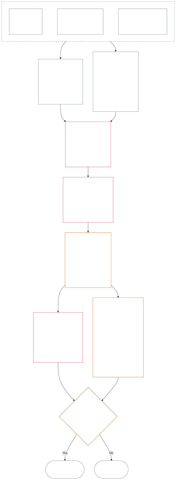

<!-- Bản dịch nháp đầy đủ Chương Mười Hai sang tiếng Việt. Nguồn: core_12.000_standing_measurement.md; snapshot nguồn: a9ad713c15de3c6ba565486590518aa07c7d62fa. Do AI soạn; chưa được rà soát; bản nháp không ràng buộc. ; source SHA-256: 7ae49781f558ad90db53cdd4469dd22d8227f0a17b0c7393c3a1d2168263f59d; committed-main row update 2026-11-11 -->

# CHƯƠNG MƯỜI HAI: ĐO LƯỜNG ĐỊA VỊ — CÂU HỎI 2, ĐIỀU ĐÓ TỐT HAY XẤU ĐẾN MỨC NÀO?

<strong>Vị trí trong kho văn bản (không vận hành): cấu trúc tệp và quy tắc đọc</strong>

> Tệp này **là một phần của Hiến pháp Hữu tri** và **chỉ có tính ràng buộc khi được đọc cùng** các tệp `core_*` đánh số khác như một văn bản thống nhất. Tệp chứa **Chương Mười Hai** — **Câu hỏi 2** (*điều đó tốt hay xấu đến mức nào?*): mốc LEQU và giới hạn, các chiều dữ liệu đầu vào đo lường, danh mục mô tả tuyến, ngữ pháp ô và phép co giãn dùng chung, dữ liệu đầu vào hiến pháp để phân trục, thang LEQU tỷ lệ thống nhất, phép đo đóng góp tiêu chuẩn, ví dụ thực tiễn và phần chuyển tiếp sang Câu hỏi 3 (**§§1–9**). Khung ba câu hỏi và **Câu hỏi 1** (*điều gì đã xảy ra?*) — sự kiện đã xác minh, loại sự kiện, yêu cầu hồ sơ, lưu giữ và xử lý hồ sơ — nằm tại [Chương Mười Một](core_11_standing_assessment.md#chapter-eleven-standing-records--question-1-what-happened). Câu hỏi 3 (*điều gì xảy ra do việc đó?*) tiếp tục tại [Chương Mười Ba](../../core_13.000_standing_integration.md#chapter-thirteen-standing-effects-and-integration); việc rà soát chỉ giới hạn ở chỉ định hành vi sai trái phản hiến pháp tại [Chương Mười Bốn](../../core_14.000_misconduct_designation.md#chapter-fourteen-anti-constitutional-misconduct) đối với các phát hiện đủ điều kiện về vi phạm trên Trục Vi phạm `s` = 7–9. Thứ tự đọc, phân biệt văn bản ràng buộc/hỗ trợ và siêu dữ liệu phiên bản kho văn bản được duy trì trong [README.md](README.md).

<strong>Dấu vết</strong>

- Nguồn trước:
  - [Chương Mười Một §1](core_11_standing_assessment.md#1-the-three-questions) (*khung ba câu hỏi*);
  - [Chương Mười Một §2](core_11_standing_assessment.md#2-question-1--what-happened) đến [Chương Mười Một §6](core_11_standing_assessment.md#6-handling-a-standing-record) (*Câu hỏi 1 — sự kiện đã xác minh, hồ sơ địa vị, lưu giữ và xử lý*);
  - [Tứ trụ Hiến pháp](core_00_preamble.md#constitutional-tetrad);
  - [Hai Mục tiêu Hiến pháp](core_00_preamble.md#two-constitutional-aims);
  - [Lời nói đầu §6 Các Quy trình Thực tiễn Chính](core_00_preamble.md#6-key-practical-process-pipelines) (*chuỗi từ Chương Chín đến Chương Mười Lăm*).
- Các tiểu mục trong tệp này:
  - [§1](#1-question-2--how-good-or-bad-was-it) (*Câu hỏi 2 — mốc LEQU, cầu nối tình trạng, giới hạn và phạm vi*);
  - [§2](#2-magnitude-and-severity-input-dimensions) (*các chiều dữ liệu đầu vào đo lường cho cả hai trục*);
  - [§3](#3-route-descriptor-catalogs-and-measurement-roles) (*danh mục mô tả tuyến*);
  - [§4](#4-slot-grammar-and-shared-scaling) (*ngữ pháp ô và phép co giãn dùng chung*);
  - [§5](#5-constitutional-inputs-to-axis-assignment) (*chuyển tuyến nguồn hiến pháp*);
  - [§6](#6-unified-proportional-lequ-scale--contribution-and-violation-axes) (*thang LEQU tỷ lệ thống nhất cho cả hai trục*);
  - [§7](#7-standard-contribution-measures) (*phép đo đóng góp tiêu chuẩn do bên tiếp nhận công bố*);
  - [§8](#8-measurement-illustrations) (*ví dụ đo lường thực tiễn*);
  - [§9](#9-hand-off-to-question-3--cross-question-measurement-hooks) (*chuyển tiếp sang Câu hỏi 3*).
- Nguồn sau:
  - [Chương Mười Ba](../../core_13.000_standing_integration.md#chapter-thirteen-standing-effects-and-integration) (13.000) (*hiệu ứng và tích hợp Câu hỏi 3*);
  - [Chương Mười Bốn](../../core_14.000_misconduct_designation.md#chapter-fourteen-anti-constitutional-misconduct) (14.000) (*chỉ chỉ định — không mở lại phép đo Câu hỏi 2*).
- Đọc cùng: [Chương Năm *Trạng thái Địa vị, Đóng góp và Vi phạm*](../../core_05.035_band_accountability.md#defa3-standing-state-contribution-and-violation) (5.035) (*chuyển tuyến định nghĩa theo nguồn chính tắc*).

 

Chương Mười Hai là chủ thể phụ trách theo hiến pháp đối với **Câu hỏi 2**, đo lường sự kiện do [Chương Mười Một](core_11_standing_assessment.md#chapter-eleven-standing-records--question-1-what-happened) xác minh. Chương bắt đầu tại [§1 Câu hỏi 2 — điều đó tốt hay xấu đến mức nào?](#1-question-2--how-good-or-bad-was-it). [Chương Mười Một](core_11_standing_assessment.md#chapter-eleven-standing-records--question-1-what-happened) phụ trách khung ba câu hỏi, Câu hỏi 1 và hồ sơ địa vị, kết thúc tại [Chương Mười Một §6 Xử lý hồ sơ địa vị](core_11_standing_assessment.md#6-handling-a-standing-record).

*Nói đơn giản: Chương Mười Một xác định điều gì đã xảy ra và ai lưu giữ hồ sơ địa vị. Chương này đo lường việc đó: đóng góp tốt đến mức nào hoặc vi phạm xấu đến mức nào, trên hai thang riêng biệt không bao giờ cộng thành điểm ròng. Những gì phát sinh từ phép đo thuộc Chương Mười Ba.*

### 1. Câu hỏi 2 — điều đó tốt hay xấu đến mức nào?

<strong>Dấu vết</strong>

- Nguồn trước: [Chương Mười Một §2](core_11_standing_assessment.md#2-question-1--what-happened) (*Câu hỏi 1 — hồ sơ địa vị và sự kiện đã xác minh*); [Chương Mười Một §2.5](core_11_standing_assessment.md#25-verified-input-gate) (*cổng dữ liệu đã xác minh*); [Chương Mười Một §4](core_11_standing_assessment.md#4-standing-record-operational-requirements) (*yêu cầu hồ sơ*); [Chương Mười Một §1](core_11_standing_assessment.md#1-the-three-questions) (*khung ba câu hỏi*).
- Nguồn sau:
  - [§2](#2-magnitude-and-severity-input-dimensions) (*các chiều dữ liệu đầu vào đo lường cho cả hai trục*);
  - [§3](#3-route-descriptor-catalogs-and-measurement-roles) (*danh mục mô tả tuyến*);
  - [§4](#4-slot-grammar-and-shared-scaling) (*ngữ pháp ô và phép co giãn dùng chung*);
  - [§5](#5-constitutional-inputs-to-axis-assignment) (*chuyển tuyến nguồn hiến pháp*);
  - [§6](#6-unified-proportional-lequ-scale--contribution-and-violation-axes) (*phân ô trên Trục Đóng góp và Trục Vi phạm*);
  - [§7](#7-standard-contribution-measures) (*phép đo đóng góp tiêu chuẩn do bên tiếp nhận công bố*);
  - [§8](#8-measurement-illustrations) (*ví dụ đo lường thực tiễn*);
  - [§9](#9-hand-off-to-question-3--cross-question-measurement-hooks) (*chuyển tiếp sang Câu hỏi 3*);
  - [Chương Mười Ba §7.2](../../core_13.000_standing_integration.md#72-competency-bars-and-clearances) (13.000 §7.2) (*Câu hỏi 3 về đóng góp — ủy quyền an toàn*);
  - [Chương Mười Ba §5.2](../../core_13.000_standing_integration.md#52-prevention--general-standing-locks) (13.000 §5.2) (*các khóa phòng ngừa*);
  - [Chương Mười Ba §6](../../core_13.000_standing_integration.md#6-lock-design-and-enforcement) (13.000 §6) (*thiết kế và thực thi khóa*).
- Đọc cùng: [Chương Mười Một §4.1](core_11_standing_assessment.md#41-minimum-record-contents) (*các trường hồ sơ địa vị đã xác minh; Chương Mười Một không tạo hiệu ứng địa vị*).

 

*Nói đơn giản: Câu hỏi 2 đo lường các sự kiện đã xác minh của Câu hỏi 1. Câu hỏi này hỏi **đóng góp tốt đến mức nào** hoặc **vi phạm nghiêm trọng đến mức nào**. Đây là nơi chương lần đầu giới thiệu hai trục đo lường chính thức: **Trục Đóng góp** đối với trợ giúp đã xác minh và **Trục Vi phạm** đối với tổn hại đã xác minh. Hai trục vẫn tách biệt; chúng không phải hai mặt của một điểm số ròng.*

Để quyết định đóng góp hoặc vi phạm của ai thuộc ô nào, chương này đo lường tác động bằng **Đơn vị Tương đương Tuổi thọ (LEQU)**. Một LEQU tương đương gần đúng với việc cứu sống hoặc hủy hoại toàn bộ cuộc đời sung túc của một hữu tri. Đây không phải việc đếm số người hay số tiền; câu hỏi là liệu hành động có làm thay đổi đáng kể mức sung túc của cộng đồng hiến pháp hay không. Cùng một đơn vị áp dụng cho mọi hữu thể hữu tri, dù là con người hay không.

#### 1.1 Mốc cơ sở LEQU

**Đơn vị Tương đương Tuổi thọ** (**LEQU**) là đơn vị viết tắt cho lợi ích hoặc tổn thất hiến pháp tương đương một cuộc đời trọn vẹn, khi triển khai được tiếp nhận cần hiệu chỉnh bằng số.

- Đơn vị này không phụ thuộc vào nền tảng vật chất.
- Bên tiếp nhận hiện tại có thể dùng tuổi thọ thông thường của con người làm ví dụ hiệu chỉnh trong bối cảnh sinh học của con người, nhưng mốc ràng buộc là hữu tri và hiến pháp, không gắn với loài.

**Lợi ích hiến pháp tương đương một cuộc đời trọn vẹn** là lợi ích đã xác minh tương đương với việc bảo tồn, phục hồi hoặc giải phóng trọn một tuổi đời của hữu tri với mức sung túc đáng kể và phù hợp với quyền. **Tổn thất hiến pháp tương đương một cuộc đời trọn vẹn** là tổn hại, lãng phí, hủy hoại, tước mất lựa chọn, tước đoạt hoặc hiện thực hóa rủi ro đã xác minh, tương đương với việc hủy hoại, tiêu hao sai trái hoặc ngăn cản một lợi ích hiến pháp tương đương trọn một cuộc đời.

#### 1.2 Giới hạn khi dùng LEQU

Các giới hạn sau áp dụng mỗi khi dùng LEQU.

- **Không phải quy tắc tính điểm ròng:** Không thể «bù trừ» vi phạm bằng đóng góp hoặc ngược lại. Mỗi trục đứng riêng.
- **Không phải thước đo bắt buộc dựa trên đời người:** LEQU áp dụng chung cho hữu tri; áp dụng với mọi hữu thể có ý thức, không chỉ con người.
- **Không phải thước đo cáo buộc:** Cáo buộc, thẻ tiếp nhận, quyết định định tuyến, danh tiếng, địa vị bị bất lợi hoặc ác cảm đạo đức không cung cấp lợi ích cho Trục Đóng góp hay mức độ nghiêm trọng cho Trục Vi phạm nếu không có dữ liệu đầu vào đã xác minh theo **Chương Mười Một §2.5** và hiệu chỉnh theo **§6**.
- **Không phải giấy phép đánh đổi quyền:** Những tuyên bố được diễn đạt như hiệu quả, năng lực sản xuất, đổi mới, giảm gánh nặng, an ninh, trả đũa, ứng phó khẩn cấp hoặc nhu cầu thể chế phải bị giảm trọng số hoặc bác bỏ nếu phụ thuộc vào:
  - cưỡng ép;
  - chuyển gánh nặng mang tính phân biệt đối xử;
  - làm cạn kiệt sinh thái;
  - lao động không được trả công bị che giấu;
  - thiếu minh bạch có thể tránh được;
  - thu hẹp Sàn Quyền;
  - thâu tóm;
  - chỉ báo thay thế gây hiểu lầm;
  - mất khả năng phản biện; hoặc
  - tổng hợp không thể rà soát.

#### 1.3 Chỉ Câu hỏi 2 — phạm vi và chuyển tuyến

Phần này chỉ đề cập Câu hỏi 2, tức bước đo lường. Phần này lấy các sự kiện đã được xác minh (Câu hỏi 1) và hỏi đóng góp tốt đến mức nào hoặc vi phạm nghiêm trọng đến mức nào.

- Bắt đầu từ các sự kiện đã xác minh theo **Chương Mười Một §2** và ghi vào hồ sơ địa vị theo **Chương Mười Một §4**, rồi đo chúng bằng các chiều tại **§2**.
- Tiếp theo, đặt tên tiêu chuẩn cho từng dạng trợ giúp hoặc tổn hại từ các danh mục: danh mục **tuyến lợi ích** cho trợ giúp (**§3.1**) và danh mục **tuyến tổn hại** cho tổn hại (**§3.2**).
- Mỗi tên cũng cho biết dạng trợ giúp hoặc tổn hại đó được tính đến mức nào khi xác định *tốt* hay *xấu* đến đâu.
- Các quy tắc về hệ quả từ lợi ích nằm ở [phía lợi ích](../../core_13.000_standing_integration.md#72-competency-bars-and-clearances), còn quy tắc về hệ quả từ tổn hại nằm ở [phía tổn hại](../../core_13.000_standing_integration.md#52-prevention--general-standing-locks).
- Câu hỏi 3 quyết định điều gì xảy ra tiếp theo. Bắt đầu với [Chương Mười Ba §4 Tích hợp mô tả và chuẩn hóa đính kèm](../../core_13.000_standing_integration.md#4-descriptor-integration-and-attachment-normalization).

#### 1.4 Cầu nối với tình trạng hữu tri

Đo lường địa vị **không** quyết định một thực thể có phải là **hữu tri** hay không.

- Tranh chấp về tình trạng được chuyển đến [Phân xử Tình trạng Hữu tri](../../core_05.055_band_participation.md#sentience-status-adjudication) và [Điều VI-B](core_06_rights_part_b.md#article-vi-b-sentience-status-adjudication-floor) (*Nền tảng Phân xử Tình trạng Hữu tri*). Không đưa chúng vào điểm LEQU hoặc hồ sơ phân loại.
- Trong khi tranh chấp tình trạng theo [Sự sống Hữu tri đang bị tranh chấp](../../core_05.055_band_participation.md#contested-sentient-life) còn mở, **Điều VI-B** (*Nền tảng Phân xử Tình trạng Hữu tri*) mặc định bao gồm thực thể đó: thực thể vẫn có thể được đo lường và nộp hồ sơ địa vị cho đến khi tranh chấp được quyết định; đơn vị vận hành không được coi riêng việc tranh chấp đang mở là lý do để từ chối địa vị của thực thể.
- Nếu kết luận thực thể là [Hữu tri](../../core_05.055_band_participation.md#sentient), hoặc tình trạng của thực thể bị thu hẹp hay được khôi phục sau một quyết định phân xử có thể được rà soát:
  - đối tượng của hồ sơ địa vị được cập nhật từ thời điểm đó trở đi; và
  - không được hồi tố việc loại trừ sai trái để xóa tư cách đủ điều kiện được đo lường của thực thể trong thời gian chờ, trừ thông qua [Bù đắp và Khắc phục](../../core_05.035_band_accountability.md#redress-and-remediation).

### 2. Các chiều đầu vào về độ lớn và mức độ nghiêm trọng

*Nói đơn giản: mục này nêu sản phẩm của Câu hỏi 2 (**§2.1**), rồi liệt kê những điều cần xem xét khi đo một đóng góp đã xác minh hoặc một vi phạm đã xác minh (**§2.2**). Mỗi trục được đo riêng. Quy tắc co giãn dùng chung nằm tại **§4.2**, còn ô được xác định theo thang tại **§6**.*

Thang ô đo mức độ lớn và loại kết quả hiến pháp. Chỉ tính các kết quả đã xác minh.

**Thang đo tính những gì và liên hệ ra sao với các phép thử cốt lõi của Hiến pháp:**

- **[Hai Mục tiêu Hiến pháp](core_00_preamble.md#two-constitutional-aims):** cả hai trục đều đo tác động lên **Hưng thịnh** và **Liên tục**. Trục Đóng góp thúc đẩy hai mục tiêu này. Trục Vi phạm làm chúng thụt lùi.
- **[Hai Câu hỏi Căn bản](core_00_preamble.md#two-fundamental-questions):** mỗi trục cung cấp sự kiện đã xác minh cho một câu hỏi. Trả lời câu này không trả lời câu kia, vì vậy hai trục không bao giờ được tính gộp ròng.
  - **Câu hỏi thứ nhất:** Trục Đóng góp cung cấp sự kiện đã xác minh. Hệ thống có tưởng thưởng hành vi giúp hữu tri hưng thịnh và trường tồn, nói sự thật và khắc phục tổn hại không?
    - **Được tính:** lợi ích hiến pháp đã xác minh, bao gồm giảm rủi ro đã xác minh.
    - **Không được tính:** sản lượng thô, danh tiếng, của cải, mức độ sử dụng một thứ, tốc độ hoặc quy mô của thể chế.
  - **Câu hỏi thứ hai:** Trục Vi phạm cung cấp sự kiện đã xác minh. Hệ thống có tưởng thưởng hành vi gây tổn hại, đánh lừa, loại trừ, trì hoãn, lãng phí hoặc chuyển chi phí cho người khác một cách vô lý không?
    - **Được tính:** tổn thất hiến pháp, tổn hại, lãng phí, mất lựa chọn (đóng lối lựa chọn), nguy hiểm hoặc gia tăng rủi ro đã xác minh.
    - **Tự thân không được tính:** địa vị bị bất lợi, cáo buộc hoặc ác cảm đạo đức.
- **[Tứ trụ Hiến pháp](core_00_preamble.md#constitutional-tetrad):**
  - **Giám sát và trách nhiệm giải trình:** «đã xác minh» nghĩa là một tác nhân được nêu tên chịu trách nhiệm về kết luận và không bên nào tự xác minh tuyên bố của mình.
  - **Đúng hạn:** trì hoãn có thể tránh được được ghi nhận như một sự kiện riêng, không gộp vào độ lớn tổn thất.

#### 2.1 Câu hỏi 2 tạo ra những gì

Câu hỏi 2 ghi các nội dung sau vào hồ sơ địa vị của từng trục. Đây là phép đo, không phải hiệu ứng địa vị (các hệ quả do Câu hỏi 3 quyết định):

| **Sản phẩm** | **Trục Đóng góp** | **Trục Vi phạm** |
| --- | --- | --- |
| **Nơi ghi** | Hồ sơ địa vị đóng góp. | Hồ sơ địa vị vi phạm. |
| **Ô** | Ô áp dụng cao nhất của **Trục Đóng góp** (`s` = 1–9). | Ô áp dụng cao nhất của **Trục Vi phạm** (`s` = 1–9). |
| **Mô tả tuyến** | Các **mô tả tuyến lợi ích** áp dụng, được cộng gộp. | Các **mô tả tuyến tổn hại** áp dụng, được cộng gộp. |
| **Dữ liệu chuyển cho Câu hỏi 3** | Dữ liệu đặt điểm bắt đầu cho việc ghi nhận đóng góp theo [Chương Mười Ba §7 Hệ quả đóng góp ở bước thứ hai](../../core_13.000_standing_integration.md#7-contribution-consequences-second). | Dữ liệu đặt dải khóa mặc định (điểm bắt đầu để xác định khóa nghiêm ngặt đến đâu) theo [Chương Mười Ba §6 Thiết kế và thực thi khóa](../../core_13.000_standing_integration.md#6-lock-design-and-enforcement). |
| **Tổng LEQU** | Đánh giá riêng từng dạng lợi ích liên quan (sinh thái, hệ thống hoặc tài nguyên), rồi ghi một tổng LEQU cho toàn bộ đóng góp. | Đánh giá riêng từng dạng tổn hại liên quan (tổn hại sinh thái, tổn hại hệ thống hoặc mất tài nguyên), rồi ghi một tổng LEQU cho toàn bộ vi phạm. |

Nhắc lại: không nội dung nào trong số này hủy bỏ hồ sơ vi phạm đang mở. Quy tắc không bù trừ được nêu tại [Chương Mười Một §2.4 Hồ sơ địa vị liên kết và cầu nối không bù trừ](core_11_standing_assessment.md#24-linked-standing-records-and-no-offset-bridge).

#### 2.2 Các chiều đầu vào về độ lớn đóng góp và mức độ nghiêm trọng của vi phạm

**Câu hỏi 2 — tốt hay xấu đến mức nào?** Để quyết định đóng góp nằm ở đâu trên Trục Đóng góp, hoặc vi phạm nằm ở đâu trên Trục Vi phạm (tức **ô** của nó, từ 1 đến 9), và áp dụng mô tả lợi ích hoặc tổn hại nào, hãy lần lượt xem xét ba phần. Có thể đồng thời áp dụng nhiều mô tả và chúng được cộng gộp. Ghi kết quả vào hồ sơ địa vị của trục như **§2.1** liệt kê. **§6** có thang đo thống nhất cho phần 2, áp dụng như nhau cho lợi ích và tổn hại. Thang này giải thích cách ước tính tổng lợi ích hoặc tổn thất theo LEQU (Đơn vị Tương đương Tuổi thọ, gần bằng mức sung túc của trọn một đời) và ô tương ứng với từng mức. Trên Trục Đóng góp, các ô được nhóm thành bốn dải.

**1. Kiểm tra cách thức tạo ra kết quả.** Hai trục xử lý điều này khác nhau:

- **Đóng góp (chất lượng hành vi):** yếu tố này có thể làm tăng hoặc giới hạn mức lợi ích được tính: có thể truy nguyên không, có tránh chuyển chi phí cho người khác không, có được thực hiện cẩn trọng không, và có phù hợp với Hiến pháp không? Năm phép kiểm tra được nêu tại [§2.2.1 Cách thức tạo ra lợi ích ảnh hưởng đến việc tính lợi ích](#221-how-the-way-a-benefit-was-produced-affects-what-counts).
- **Vi phạm (đặc điểm hành vi):** được ghi riêng với mức độ tác động. Nghĩa vụ, sơ suất, lừa dối, che giấu, cản trở trách nhiệm giải trình, cưỡng ép, bạo lực, ý định, tàn ác và tạo điều kiện mang tính cấu trúc quyết định ai chịu trách nhiệm, cần biện pháp bảo vệ nào và cách ứng phó. Quy tắc rằng chúng không làm thay đổi ô và cách ghi từng yếu tố nằm ở [§2.2.2 Ghi nhận cách thức gây hại](#222-how-the-way-a-harm-was-caused-is-recorded).

**2. Định lượng: lợi ích hoặc tổn thất lớn đến mức nào?** Đây là yếu tố xác định ô.

| **Điều cần xem xét** | **Tác động** | **Được quy định ở đâu** |
| --- | --- | --- |
| **Độ lớn tổng thể (LEQU)** | Phép đo chính và yếu tố kiểm soát ô. Với đóng góp, đây là tổng lợi ích tốt đã xác minh và được tính bằng LEQU. Với vi phạm, đây là tổng tổn thất hiến pháp đã xác minh. Chỉ định hành vi sai trái của Chương Mười Bốn được quyết định riêng. | [§6 Thang LEQU tỷ lệ thống nhất](#6-unified-proportional-lequ-scale--contribution-and-violation-axes) |
| **Ai bị tác động (bao nhiêu người, sâu đến đâu, dễ bị tổn thương ra sao)** | Điều chỉnh ước tính LEQU và mức độ quan trọng của lợi ích hoặc tổn hại (tính trọng yếu). | [§4.2 Quy tắc co giãn tác động dùng chung](#42-shared-impact-scaling-rules); [Tính trọng yếu](../../core_05.050_band_oversight.md#materiality) |
| **Tác động kéo dài bao lâu (thời lượng; độ bền của lợi ích, tính không thể đảo ngược của tổn hại)** | Điều chỉnh ước tính LEQU. Với đóng góp, quản trị bền vững, lợi ích qua nhiều thế hệ hoặc việc sửa chữa thể chế lâu dài hướng đến các ô cao hơn. Với vi phạm, sang chấn kéo dài, mất mát không thể đảo ngược và tổn hại lâu dài đến khả năng tự hành động của hữu tri làm tăng ước tính tổn thất tổng thể. | [§4.2 Quy tắc co giãn tác động dùng chung](#42-shared-impact-scaling-rules) |
| **Tác động lan xa đến đâu (qua các địa điểm hoặc thể chế)** | Điều chỉnh ước tính LEQU. Ví dụ, đóng góp có thể đem lợi ích cho nhiều cộng đồng hoặc thể chế, hay trên quy mô nền văn minh. Với vi phạm, tổn hại lan qua nhiều cộng đồng hoặc thể chế, hay trên quy mô nền văn minh, có thể làm tăng ước tính tổng tổn thất. | [§4.2 Quy tắc co giãn tác động dùng chung](#42-shared-impact-scaling-rules) |

**3. Đặt tên cho dạng lợi ích hoặc tổn hại (tuyến).** Nêu cách thức xảy ra lợi ích hoặc tổn hại đã xác minh. Có thể áp dụng nhiều dạng và chúng được cộng gộp. Danh sách nằm trong [**Danh mục mô tả tuyến lợi ích**](#31-contribution-route-descriptor-catalog-and-measurement-roles) và [**Danh mục mô tả tuyến tổn hại**](#32-violation-route-descriptor-catalog-and-measurement-roles).

##### 2.2.1 Cách thức tạo ra lợi ích ảnh hưởng đến việc tính lợi ích

Hãy kiểm tra nội dung này trước khi chọn ô trên Trục Đóng góp:

| **Điều được xác định** | **Tác động đến lợi ích** |
| --- | --- |
| Sửa chữa kịp thời, đã xác minh một vấn đề sau khi được thông báo | Có thể được tính là **Sự tận tâm** (hành vi cẩn trọng, có trách nhiệm) khi tạo ra lợi ích thực tế và có thể chứng minh. |
| Tổn hại bị đẩy sang người khác hoặc gánh nặng bị che giấu | Giới hạn lợi ích ghi nhận cho tuyến bị tranh chấp (tuyến cụ thể được dùng để ghi nhận lợi ích) hoặc loại trừ lợi ích đó. |
| Rủi ro thâu tóm đã xác minh (cơ chế có thể bị lợi ích hẹp chi phối), sự phụ thuộc mang tính cấu trúc (hữu tri bị đặt vào tình thế phải dựa vào cơ chế đó), hoặc thiết kế lối thoát và giam giữ (khó rời bỏ) | Giới hạn mức ghi nhận cho quản trị tốt. |
| Sửa chữa đã xác minh một rào cản về khả năng tiếp cận hoặc tham gia | Có thể làm tăng mức độ quan trọng của lợi ích (tính trọng yếu) và hỗ trợ mô tả tuyến lợi ích **Tiếp cận và Hòa nhập** theo **§3.1**. |
| Phần thưởng đáng kể xuất phát từ cơ chế khuyến khích đi ngược Hiến pháp, hành vi chống Hiến pháp hoặc quy trình có sai sót trọng yếu | Mặc định không được tính là lợi ích. Khi đó áp dụng [Chương Mười Ba §6.4.2 Phần thưởng không phù hợp](../../core_13.000_standing_integration.md#642-misaligned-rewards) và giới hạn Chuyển tiếp Tiếp nhận tại [Điều XXVIII-A](../../core_06.020_rights_part_e.md#incentive-alignment-adoption-transition-carve-out) (*Tiếp nhận theo giai đoạn và duy trì mức sàn quyền*). |

##### 2.2.2 Cách ghi nhận phương thức gây ra tổn hại

Mức độ thiệt hại (tổng LEQU ở phần 2 bên trên) xác định ô. Cách gây ra thiệt hại không xác định ô; vì vậy từng loại hành vi dưới đây được ghi riêng.

Tiểu mục này nêu quy tắc một lần trong Chương Mười Hai. **Không tăng hoặc giảm ô chỉ vì sự kiện hay quá trình hành vi được mô tả là một trong các yếu tố sau:**

- nghĩa vụ;
- sơ suất;
- ý định;
- che giấu;
- lặp lại;
- tình tiết tăng nặng;
- cưỡng ép;
- bạo lực;
- nguy cơ đối với tự do;
- khả năng khắc phục; hoặc
- hệ quả được ưu tiên.

Các sự kiện về đặc điểm hành vi được ghi thành mô tả riêng có thể truy nguyên. Chúng có thể chi phối quy trách nhiệm, cường độ rà soát, biện pháp bảo vệ, khắc phục hoặc một chỉ định theo Chương Mười Bốn. Chúng chỉ ảnh hưởng đến ô thông qua hậu quả đã được xác minh: nếu hành vi làm tăng tổn thất, tổn thất đó chỉ được tính một lần trong tổng LEQU và ô đi theo tổng số.

**Hành vi làm phát sinh tổn thất, chỉ tính một lần vào độ lớn:**

| **Điều được xác định** | **Cách ghi nhận** |
| --- | --- |
| Trì hoãn có thể tránh được khi ứng phó hoặc chuyển cấp, trong trường hợp có nghĩa vụ và năng lực hành động | Ghi nhận như một sự kiện riêng về hành vi. Mọi tổn thất tăng thêm do trì hoãn gây ra chỉ được tính một lần trong ước tính LEQU. |
| Tổn hại đã được xác minh độc lập đối với tính toàn vẹn của diễn đàn (làm tổn hại tính công bằng của diễn đàn) | Được tính đúng một lần trong ước tính LEQU. Việc cố ý bỏ sót không trung thực, cố ý không tuân thủ quy trình rút lui, cưỡng ép, nguy cơ đối với tự do và các sự kiện hành vi khác vẫn là các mô tả riêng. |
| **Cản trở trách nhiệm giải trình** (sự can thiệp đã được xác minh vào cơ chế buộc người có trách nhiệm phải trả lời, chẳng hạn tính toàn vẹn của chứng cứ, xác minh, quy trình diễn đàn, hồ sơ standing, thời hạn khắc phục hoặc các lộ trình phản đối và đền bù) | Được ghi riêng như một sự kiện hành vi. Tổn thất bổ sung do nó gây ra trên lộ trình có điều kiện được tính một lần trong ước tính LEQU. |

**Sự kiện về hành vi được ghi tách khỏi độ lớn tổn hại:**

| **Điều được xác định** | **Cách ghi nhận** |
| --- | --- |
| Lừa dối, che giấu, né tránh, lặp lại hành vi sau khi được thông báo, coi thường rủi ro một cách liều lĩnh, tạo điều kiện mang tính cấu trúc (sắp đặt để tổn hại dễ xảy ra hoặc có khả năng xảy ra), hoặc lợi dụng sự mất cân bằng phụ thuộc đáng kể (khai thác người phụ thuộc nhiều vào mình) | Mỗi yếu tố vẫn là một sự kiện về hành vi được ghi riêng. |
| Bạo lực, cưỡng ép, thao túng hoặc nguy hiểm đối với tự do | Được ghi riêng và có thể đòi hỏi biện pháp bảo vệ mạnh hơn bất kể ô nào. |
| [Tàn ác](../../core_05.035_band_accountability.md#cruelty) (gây đau khổ đã được xác minh như mục đích tự thân, hoặc gây hại vô cớ hay hạ thấp phẩm giá vượt quá mức cần thiết và tương xứng) | Được ghi riêng như một sự kiện hành vi. Có thể cần biện pháp bảo vệ mạnh hơn và giới hạn biện pháp khắc phục hạ thấp phẩm giá theo [Chương Mười Ba §5 Vi phạm, khắc phục và phòng ngừa](../../core_13.000_standing_integration.md#5-violation-correction-and-prevention). |

**Trách nhiệm và quy thuộc:**

| **Điều được xác định** | **Cách ghi nhận** |
| --- | --- |
| Phân tán (trách nhiệm được phân bổ ra sao: ai đảm nhiệm vai trò nhân quả nào, nắm thẩm quyền hay quyền kiểm soát nào, có thể dự liệu tổn hại hay không, được lợi, che giấu hoặc có thể ngăn ngừa tổn hại hay không) | Không thuộc **phạm vi hữu tri**, và không cho phép quy trách nhiệm cho ai chỉ vì họ là thành viên của một nhóm. |
| Tán thành hoặc không chống lại tổn hại | Chỉ có thể hỗ trợ kết luận về tính chất dựa trên nghĩa vụ, tăng nặng hoặc trách nhiệm giải trình tập thể khi mối liên hệ với tác nhân cụ thể theo yêu cầu của **Chương Mười Một §§4.1 và 4.3** được xác minh. |

**Phần thưởng lệch hướng:**

| **Điều được xác định** | **Cách ghi nhận** |
| --- | --- |
| Cố ý nhận hoặc giữ phần thưởng đáng kể đi ngược Hiến pháp mà không báo cáo kịp thời qua kênh được bảo vệ (việc báo cáo được bảo vệ khỏi trả đũa) | Được ghi theo [Chương Mười Ba §6.4.2 Phần thưởng không phù hợp](../../core_13.000_standing_integration.md#642-misaligned-rewards), chịu giới hạn tại [Điều XXVIII-A](../../core_06.020_rights_part_e.md#incentive-alignment-adoption-transition-carve-out) (*Tiếp nhận theo giai đoạn và duy trì mức sàn quyền*). Chỉ tổn thất hiến định đã xác minh do việc đó gây ra mới ảnh hưởng đến ô. |

**Ranh giới phần thưởng không phù hợp.** Chương này chỉ đo cách phần thưởng không phù hợp đã được xác minh (phần thưởng đi ngược Hiến pháp) ảnh hưởng đến Trục Đóng góp hoặc Trục Vi phạm. [Chương Mười Ba §6.4.2 Phần thưởng không phù hợp](../../core_13.000_standing_integration.md#642-misaligned-rewards) quy định nghĩa vụ báo cáo, các trường hợp loại trừ, hậu quả của việc từ bỏ phần thưởng (tịch thu), nghĩa vụ sửa chữa và quy tắc chuyển tuyến.

### 3. Danh mục mô tả tuyến và vai trò đo lường

*Nói đơn giản: hai danh mục dưới đây nêu tên các dạng trợ giúp đã xác minh (**§3.1**) và tổn hại đã xác minh (**§3.2**) có thể xuất hiện trong hồ sơ địa vị. Mô tả cho biết lợi ích hoặc tổn hại đã xảy ra theo cách nào; các mô tả có thể cộng gộp và đứng dưới ô.*

**Quy tắc mô tả.** Hai danh mục dưới đây, [§3.1 Danh mục mô tả tuyến đóng góp và vai trò đo lường](#31-contribution-route-descriptor-catalog-and-measurement-roles) và [§3.2 Danh mục mô tả tuyến vi phạm và vai trò đo lường](#32-violation-route-descriptor-catalog-and-measurement-roles), là danh sách chính thức các mô tả cho cả hai trục. Mô tả nêu **cách thức** xảy ra lợi ích hoặc tổn hại đã xác minh. Áp dụng các quy tắc sau:

- Các mô tả được cộng gộp, và không mô tả nào loại trừ mô tả khác: một hồ sơ địa vị có thể có nhiều mô tả nếu sự kiện đã xác minh làm căn cứ cho chúng.
- Chúng đứng dưới ô: ô cho biết lợi ích hoặc tổn hại lớn đến đâu; mô tả bổ sung chi tiết về cách thức xảy ra nhưng không bao giờ thay thế ô.
- Các mô tả được liệt kê là nền tảng, không phải toàn bộ danh sách; danh mục không loại trừ các dạng lợi ích hoặc tổn hại khác.
- Triển khai có thể dùng định danh ổn định (ID cố định riêng) ánh xạ đến danh mục, nhưng không được tạo một hệ phân loại xung đột với danh mục, có các nhóm loại trừ lẫn nhau khiến hồ sơ địa vị chỉ mang được một mô tả.
- Trước khi sự kiện được xác minh, mô tả bị cáo buộc có thể hỗ trợ việc bảo toàn bằng chứng hợp pháp, phân loại vụ việc hoặc áp dụng biện pháp bảo vệ tạm thời.
- Chỉ mô tả đã xác minh mới được ghi làm kết quả của Câu hỏi 2 hoặc được dùng để tác động đến địa vị.

#### 3.1 Danh mục mô tả tuyến đóng góp và vai trò đo lường

Đây là các mô tả tuyến lợi ích và nội dung mỗi mô tả đo lường trong Câu hỏi 2 (điều đó tốt đến mức nào?). Chúng được chia thành năm lĩnh vực, mỗi lĩnh vực có một bảng; danh mục Vi phạm tại [§3.2 Danh mục mô tả tuyến vi phạm và vai trò đo lường](#32-violation-route-descriptor-catalog-and-measurement-roles) cũng dùng cùng năm lĩnh vực theo cùng thứ tự. Vai trò trong Câu hỏi 3, tức ủy quyền an toàn, được nêu tại [Chương Mười Ba §7.2 Các ngưỡng năng lực và sự cho phép](../../core_13.000_standing_integration.md#72-competency-bars-and-clearances).

**Tính đầy đủ của danh mục.** Nếu triển khai hiển thị nhiều mô tả trong một hàng hoặc dưới một nhãn, hàng hay nhãn đó phải ánh xạ ngược đến mọi mô tả áp dụng. Danh mục này chỉ quy định tên mô tả và nội dung mỗi mô tả đo lường trong Câu hỏi 2. Quy tắc Câu hỏi 3 (đính kèm, biện pháp khắc phục, khóa, sự cho phép và các hiệu ứng địa vị khác) chỉ được nêu tại Chương Mười Ba.

##### 3.1.1 An toàn thân thể, quan hệ, chăm sóc và năng lực tự quyết

| **Mô tả tuyến lợi ích** | **Đo lường nội dung gì trong Câu hỏi 2** |
| --- | --- |
| **Sự yên ổn của thân thể, tâm trí và/hoặc cộng đồng** | Lợi ích từ sự yên ổn về thân thể, tâm lý và cộng đồng. Mô tả này điều chỉnh mức độ quan trọng của lợi ích (tính trọng yếu). |
| **Quan hệ đáng tin cậy** | Lợi ích từ các quan hệ có thể tin cậy, bao gồm quan hệ dựa trên nghĩa vụ tín nhiệm trong bối cảnh hai bên không bình đẳng. |
| **Chăm sóc và hỗ trợ người phụ thuộc** | Chăm sóc đã xác minh dành cho hữu tri phụ thuộc vào người khác. Chăm sóc không chính thức cũng được tính nếu có thể chứng minh. |
| **Tiếp cận và Hòa nhập** | Lợi ích từ sự tham gia thực chất và khả năng tiếp cận. Mô tả này điều chỉnh mức độ quan trọng của lợi ích trong bối cảnh một bên phụ thuộc nhiều vào bên kia. |

##### 3.1.2 Khắc phục, tài sản và tài nguyên

| **Mô tả tuyến lợi ích** | **Đo lường nội dung gì trong Câu hỏi 2** |
| --- | --- |
| **Lợi ích khắc phục và phục hồi** | Lợi ích từ sửa chữa, bồi thường và giảm tổn hại. |
| **Quản trị tài nguyên khéo léo** | Chăm sóc cẩn trọng tài nguyên vật chất và phân bổ chúng một cách đáng tin cậy. |

##### 3.1.3 Tri thức, giáo dục, hồ sơ và khám phá

| **Mô tả tuyến lợi ích** | **Đo lường nội dung gì trong Câu hỏi 2** |
| --- | --- |
| **Tính toàn vẹn của Không gian Thông tin** | Củng cố hồ sơ, tính minh bạch và thông tin liên lạc. |
| **Giáo dục và phát triển năng lực** | Lợi ích từ học tập, biết chữ và sự phát triển năng lực tự hành động của hữu tri. Ô phụ thuộc vào tổng lợi ích LEQU. |
| **Đóng góp cho STEM và khám phá** | Những khám phá mà người khác có thể tái tạo và nghiên cứu giúp mọi thứ an toàn hơn. |

##### 3.1.4 Hệ thống và hoạt động hiến pháp

| **Mô tả tuyến lợi ích** | **Đo lường nội dung gì trong Câu hỏi 2** |
| --- | --- |
| **Tối ưu hóa hệ thống** | Sửa chữa các quy trình xuyên qua nhiều thể chế và giảm rủi ro. |
| **Thẳng hàng với Hiến pháp** | Củng cố Sàn Quyền và tạo điều kiện để phản biện quyết định dễ dàng hơn. |

##### 3.1.5 Sinh thái và sự tận tâm

| **Mô tả tuyến lợi ích** | **Đo lường nội dung gì trong Câu hỏi 2** |
| --- | --- |
| **Quản trị Sinh thái** | Lợi ích cho môi trường sống và đa dạng sinh học, cùng hành động có trách nhiệm với khí hậu. |
| **Sự tận tâm** | Ngăn ngừa rủi ro có thể dự liệu và giám sát có năng lực. |

#### 3.2 Danh mục mô tả tuyến vi phạm và vai trò đo lường

Đây là các mô tả tuyến tổn hại và nội dung mỗi mô tả đo lường trong Câu hỏi 2 (điều đó xấu đến mức nào?). Chúng được chia thành năm lĩnh vực, mỗi lĩnh vực có một bảng, theo cùng năm lĩnh vực và thứ tự như [§3.1 Danh mục mô tả tuyến đóng góp và vai trò đo lường](#31-contribution-route-descriptor-catalog-and-measurement-roles). Đối với Câu hỏi 3, quy tắc tích hợp và đính kèm nằm tại [Chương Mười Ba §4 Tích hợp mô tả và chuẩn hóa đính kèm](../../core_13.000_standing_integration.md#4-descriptor-integration-and-attachment-normalization); quy tắc phòng ngừa và thiết kế khóa nằm tại [Chương Mười Ba §5.2 Phòng ngừa — các khóa địa vị chung](../../core_13.000_standing_integration.md#52-prevention--general-standing-locks) và [Chương Mười Ba §6 Thiết kế và thực thi khóa](../../core_13.000_standing_integration.md#6-lock-design-and-enforcement).

**Tính đầy đủ của danh mục.** Nếu triển khai hiển thị nhiều mô tả trong một hàng hoặc dưới một nhãn, hàng hay nhãn đó phải ánh xạ ngược đến mọi mô tả áp dụng. Danh mục này chỉ quy định tên mô tả và nội dung mỗi mô tả đo lường trong Câu hỏi 2. Quy tắc Câu hỏi 3 (đính kèm, biện pháp khắc phục, khóa, sự cho phép và các hiệu ứng địa vị khác) chỉ được nêu tại Chương Mười Ba.

##### 3.2.1 An toàn thân thể, quan hệ, chăm sóc và năng lực tự quyết

| **Mô tả tuyến tổn hại** | **Đo lường nội dung gì trong Câu hỏi 2** |
| --- | --- |
| **Hành vi Sai trái Bạo lực** | Bạo lực, cưỡng ép hoặc nguy hiểm đối với tự do được ghi riêng, tách khỏi ô tác động LEQU. Có thể cần biện pháp bảo vệ tăng cường. |
| **Hành vi Sai trái giữa Cá nhân / Vi phạm Nghĩa vụ Chăm sóc** | Tổn hại có mức độ quan trọng cao hơn (tính trọng yếu lớn hơn) khi một bên phụ thuộc nhiều vào bên kia. |
| **Hành vi Sai trái do Rào cản Tiếp cận và Tham gia** | Tổn hại có mức độ quan trọng cao hơn (tính trọng yếu lớn hơn) khi một bên phụ thuộc nhiều vào bên kia; các yếu tố tăng nặng có thể cộng gộp. |
| **Hành vi Sai trái về Quyền riêng tư và Quyền tự sở hữu** | Áp dụng các yếu tố tăng nặng khi đã xác minh sự che giấu hoặc khai thác; các yếu tố này có thể cộng gộp. |
| **Hành vi Sai trái về Năng lực Tự quyết và Thao túng** | Cưỡng ép, thao túng hoặc nguy hiểm đối với tự do được ghi riêng, tách khỏi ô tác động. |

##### 3.2.2 Khắc phục, tài sản và tài nguyên

| **Mô tả tuyến tổn hại** | **Đo lường nội dung gì trong Câu hỏi 2** |
| --- | --- |
| **Hành vi Sai trái có thể khắc phục** | Ghi nhận tính chất sửa chữa của nó (tổn hại có thể được khắc phục hay không và bằng cách nào). Ô dựa trên tổng tổn thất LEQU. |
| **Hành vi Sai trái về Tài sản** | Tuyến tổn thất tài sản. Ô dựa trên tổng tổn thất LEQU. |

##### 3.2.3 Tri thức, giáo dục, hồ sơ và khám phá

| **Mô tả tuyến tổn hại** | **Đo lường nội dung gì trong Câu hỏi 2** |
| --- | --- |
| **Hành vi Sai trái đối với Không gian Thông tin** | Tổn hại đến An toàn hoặc Sự thật. Che giấu và lừa dối vẫn là các sự kiện riêng về cách thức gây tổn hại (tính chất của hành vi). |
| **Hành vi Sai trái trong Giáo dục** | Tổn hại đến việc học hoặc năng lực tự hành động của hữu tri. Ô dựa trên tổng tổn thất LEQU. |
| **Hành vi Sai trái trong Nghiên cứu và Khám phá** | Tổn hại đến nghiên cứu hoặc khám phá. Ô dựa trên tổng tổn thất LEQU. |

##### 3.2.4 Hệ thống và hoạt động hiến pháp

| **Mô tả tuyến tổn hại** | **Đo lường nội dung gì trong Câu hỏi 2** |
| --- | --- |
| **Hành vi sai trái của hệ thống** | Sự phân tán trách nhiệm giữa các tác nhân và việc tạo điều kiện mang tính cấu trúc được ghi riêng. |
| **Hành vi sai trái cản trở trách nhiệm giải trình** | Bao gồm việc cản trở trách nhiệm giải trình: ngăn việc buộc người gây hại phải trả lời. Được ghi nhận là cách thức gây ra thiệt hại. Cách thức cản trở (ví dụ che giấu hoặc sơ suất) được ghi thành sự kiện riêng. Khi ô thuộc nhóm cao nhất (xem [§4.1 Bảng 1 — nhãn hiển thị ô](#41-table-1--slot-display-labels)), vụ việc cũng có thể được ghi là **Hành vi sai trái chống Hiến pháp** để chuyển đến [Rà soát Hành vi sai trái chống Hiến pháp](../../core_05.035_band_accountability.md#anti-constitutional-misconduct-review) tại Chương Mười Bốn. Chuyển vụ việc đến đó không đồng nghĩa với việc chỉ định hành vi sai trái chống Hiến pháp; Chương Mười Bốn quyết định riêng. |
| **Hành vi Sai trái về Thoát và Giam giữ** | Bao gồm các đặc điểm của Hành vi Sai trái Hệ thống, cộng thêm sự phân tán hoặc thâu tóm khi chúng mang tính cấu trúc (được tích hợp vào cách hệ thống vận hành). |
| **Hành vi Sai trái về Vòng đời và Tính không thể đảo ngược** | Tính không thể đảo ngược ảnh hưởng đến độ lớn tổn thất LEQU. Che giấu hoặc sơ suất vẫn được ghi riêng như tính chất của hành vi. |
| **Hành vi Sai trái Phản Hiến pháp** (mô tả) | Chuyển vi phạm thuộc các ô cao nhất (xem [§4.1 Bảng 1 — nhãn hiển thị ô](#41-table-1--slot-display-labels)) đến rà soát chỉ định của Chương Mười Bốn mà không thay đổi ô tác động. |

##### 3.2.5 Sinh thái và sự tận tâm

| **Mô tả tuyến tổn hại** | **Đo lường nội dung gì trong Câu hỏi 2** |
| --- | --- |
| **Hành vi Sai trái Sinh thái** | Tổn thất LEQU được cân nhắc theo mức suy giảm [Năng lực Phục hồi Sinh thái](../../core_05.040_band_continuity.md#ecological-recovery-capacity) (khả năng tái sinh của hệ sinh thái sau tổn hại). Có thể cộng gộp với tuyến bạo lực (Hành vi Sai trái Bạo lực). |
| **Hành vi Sai trái do Sơ suất** | Nghĩa vụ, khả năng dự liệu và khả năng phòng ngừa được ghi riêng, tách khỏi ô tác động. |

### 4. Ngữ pháp ô và phép co giãn dùng chung

*Nói đơn giản: mục này đưa ra tên gọi nhất quán cho chín vị trí có thể có trên mỗi trục trong hai trục riêng biệt và giải thích cách co giãn tác động giữa các vị trí. Một trục ghi nhận đóng góp đã xác minh; trục kia ghi nhận vi phạm đã xác minh. Dùng chung một số ô không kết hợp hai trục hoặc bù trừ tổn hại bằng trợ giúp. Thang thống nhất tại **§6** phân ô cho cả hai trục theo tác động LEQU tỷ lệ.*

Ngữ pháp ô sử dụng số ô `s` từ **1** đến **9**. Mỗi trục có vị trí ô riêng:

- **Trục Đóng góp** ghi nhận tính chất đóng góp tích cực; và
- **Trục Vi phạm** ghi nhận phát hiện vi phạm đã xác minh.

Cùng một số ô có thể xuất hiện trên cả hai trục, nhưng hai trục vẫn tách biệt. Ô đóng góp không phải ô vi phạm, và ô vi phạm không phải ô đóng góp.

#### 4.1 Bảng 1 — nhãn hiển thị ô

**Bảng 1** đặt tên cho chín ô và hiển thị cạnh nhau các nhãn trên Trục Đóng góp và Trục Vi phạm. Bảng chỉ cung cấp cách diễn đạt để hiển thị; việc phân ô được thực hiện theo thang thống nhất tại **§6**.

|  `s` | Nhãn hiển thị của Trục Đóng góp | Nhãn hiển thị của Trục Vi phạm |
| ---: | --- | --- |
|    1 | **Đóng góp nền tảng nhỏ** | **Tác động Hiến pháp nhỏ** |
|    2 | **Đóng góp nền tảng thấp** | **Tác động Hiến pháp thấp** |
|    3 | **Đóng góp tích cực đáng kể** | **Tác động Hiến pháp đáng kể** |
|    4 | **Đóng góp tích cực quan trọng** | **Tác động Hiến pháp quan trọng** |
|    5 | **Đóng góp tích cực nghiêm trọng trong quản trị** | **Tác động Hiến pháp nghiêm trọng** |
|    6 | **Đóng góp tích cực lớn trong quản trị** | **Tác động Hiến pháp lớn** |
|    7 | **Người tiên phong được công nhận** | **Tác động Hiến pháp nặng nề** |
|    8 | **Người tiên phong xuất sắc** | **Tác động Hiến pháp đặc biệt nghiêm trọng** |
|    9 | **Người tiên phong tiêu biểu** | **Tác động Hiến pháp thảm khốc** |

Trục Đóng góp dùng các nhãn nền tảng, tích cực, tích cực trong quản trị và tiên phong. Trục Vi phạm dùng nhãn tác động trung tính ở mọi ô. Hai trục vẫn tách biệt, không tạo điểm số ròng hoặc cho phép bù trừ giữa hồ sơ đóng góp và hồ sơ vi phạm. Một ô trên Trục Vi phạm tự nó không phân loại hành vi sai trái phản hiến pháp; [Chương Mười Bốn](../../core_14.000_misconduct_designation.md#chapter-fourteen-anti-constitutional-misconduct) xác định độc lập việc chỉ định hành vi sai trái phản hiến pháp (ACMD) có được áp dụng cho vi phạm đã xác minh với `s` = 7–9 hay không.

Triển khai có thể công bố đơn vị đo lường, phương pháp chứng minh và ví dụ để hỗ trợ ước tính lợi ích hoặc tổn thất tương đương một cuộc đời trọn vẹn. Các tài liệu này chỉ có tính hướng dẫn, không được thay thế **§6**, **Chương Một** hoặc Sàn Quyền của **Chương Sáu**.

#### 4.2 Quy tắc co giãn tác động dùng chung

*Nói đơn giản: tác động không chỉ được đo bằng số người. Một lợi ích hoặc tổn thất sâu sắc ảnh hưởng đến một hữu tri có thể quan trọng hơn tác động nông đến nhiều người. Phải đánh giá đồng thời số lượng, độ sâu, tính dễ bị tổn thương, thời lượng, độ bền, phạm vi và tính chất hiến pháp.*

Dùng các quy tắc sau để diễn giải cả hai trục tại **§6**:

| Chiều co giãn | Quy tắc dùng chung | Áp dụng riêng cho từng trục |
| --- | --- | --- |
| **Độ lớn kết quả hiến pháp (LEQU)** | Đánh giá tổng hợp lợi ích hoặc tổn thất đã xác minh. LEQU là mốc chính về độ lớn; số người, tiền, sản lượng hoặc quy mô thể chế thô không phải mốc đó. | Đóng góp tính lợi ích phù hợp với quyền; vi phạm tính tổn thất, tổn hại, lãng phí, đóng lối lựa chọn hoặc nguy hiểm đã xác minh về mặt hiến pháp. |
| **Phạm vi hữu tri** | Xem xét đồng thời **số lượng, độ sâu và tính dễ bị tổn thương**. Không ô nào đặt số người làm điều kiện độc lập. Tác động đủ sâu đến một hữu tri có thể hỗ trợ cùng một ô như tác động rộng hơn nhưng nông hơn nếu độ lớn tổng hợp và các tiêu chí khác của hàng đó bằng nhau; vẫn phải đáp ứng mọi tiêu chí rõ ràng về LEQU gộp hoặc phạm vi rộng. | Sự phụ thuộc, năng lực suy giảm hoặc tính dễ bị tổn thương bất thường có thể làm tăng tính trọng yếu. Chỉ riêng quy mô nhóm không xác lập đóng góp hay mức độ nghiêm trọng. |
| **Phạm vi thời gian** | Xem xét thời lượng, tái diễn, độ bền và, đối với tổn thất, tính không thể đảo ngược. Sự kiện ngắn nhưng mang tính chuyển đổi có thể lớn hơn tác động tầm thường kéo dài; thời lượng tự nó không chi phối. | Lợi ích bền vững hỗ trợ độ lớn đóng góp cao hơn. Tổn thất kéo dài hoặc không thể đảo ngược hỗ trợ mức độ vi phạm nghiêm trọng hơn. |
| **Phạm vi không gian hoặc thể chế** | Phạm vi rộng hơn có thể làm tăng độ lớn, nhưng không bắt buộc tác động xuyên cộng đồng hoặc xuyên thể chế khi độ sâu, thời lượng, tính dễ bị tổn thương hoặc tính trọng yếu về hiến pháp đã độc lập hỗ trợ ô đó. | Sửa chữa thể chế có thể làm tăng độ lớn đóng góp; tổn hại mang tính cấu trúc hoặc hệ thống có thể làm tăng mức độ vi phạm nghiêm trọng. |
| **Chất lượng hoặc đặc tính hiến định** | Đo cách tạo ra kết quả riêng với phạm vi lan rộng. Không tính trùng cùng một sự kiện. | Thiệt hại bị ngoại hóa, gánh nặng bị che giấu, sự chiếm đoạt hoặc phụ thuộc có thể giới hạn hoặc loại trừ đóng góp được tuyên bố. Nghĩa vụ, sơ suất, lừa dối, cưỡng ép, bạo lực hoặc tạo điều kiện mang tính cấu trúc vẫn được ghi riêng là đặc điểm hành vi vi phạm. |
| **Sàn Quyền và biện pháp bảo vệ trọng yếu** | Không đánh đổi việc tuân thủ Sàn Quyền để lấy lợi ích hoặc tổn thất gộp. | Tuân thủ một sàn tự nó không xác lập đóng góp cao. Vi phạm Sàn Quyền trọng yếu hoặc không đáp ứng biện pháp bảo vệ trọng yếu có thể hỗ trợ mức độ vi phạm nghiêm trọng cao hơn ngay cả khi chỉ ảnh hưởng trực tiếp đến một số ít hữu tri. |

Các chiều này không phải danh sách kiểm tra buộc phải có mọi dạng quy mô. Hãy giải thích những chiều nào chi phối, những chiều nào không và lý do.

- **Phương pháp phân ô dùng chung:**
  - Ước tính tổng hợp lợi ích hoặc tổn thất đã xác minh theo LEQU dựa trên Tính Tương xứng, rồi gán ô duy nhất có dải số bao gồm độ lớn đó.
  - Áp dụng cùng ngưỡng cho cả hai trục.
  - Ô đóng góp vẫn phải đáp ứng các yêu cầu áp dụng về mốc nền tảng và thẳng hàng hiến pháp; đạt ngưỡng số không biến sản lượng bị ngoại hóa hoặc vi phạm Hiến pháp thành đóng góp.
- **Tách biệt tính chất:** Giữ các mô tả tuyến lợi ích, tuyến tổn hại, chất lượng hành vi và tính chất hành vi áp dụng được cộng gộp trên hồ sơ địa vị. Nghĩa vụ, sơ suất, lừa dối, tình tiết tăng nặng, cưỡng ép, bạo lực, ý định hoặc tạo điều kiện mang tính cấu trúc có thể ảnh hưởng đến quy thuộc, biện pháp bảo vệ hoặc hệ quả Câu hỏi 3, nhưng không yếu tố nào làm tăng hay giảm ô tác động LEQU.
- **Ranh giới của Rà soát Hành vi Sai trái Phản Hiến pháp:** Tổn thất đã xác minh trên Trục Vi phạm có thể đạt `s` = 7–9 do tác động, bất kể hành vi sai trái phản hiến pháp đã được xác lập hay chưa. Chương Mười Bốn không thay thế việc phân ô tác động; chương đó xác định độc lập ACMD tương ứng có được áp dụng hay không.

Nếu nguy cơ chưa thực sự xảy ra, hãy ghi riêng từng nội dung sau:

- khả năng xảy ra;
- hữu tri sẽ phải tiếp xúc với nguy cơ trong bao lâu;
- nguy cơ có thể lan xa đến đâu;
- mức độ không chắc chắn của ước tính; và
- kết quả xấu nhất vẫn có thể tin là sẽ xảy ra.

Không tính kết quả xấu nhất đó là tổn hại đã xảy ra (tổn thất LEQU), trừ khi triển khai được tiếp nhận đã thiết lập phép hiệu chỉnh rủi ro (phương pháp chuyển đổi rủi ro thành LEQU) mà mọi người có thể kiểm tra.

### 5. Dữ liệu đầu vào hiến pháp để phân trục

*Nói đơn giản: trước khi chọn ô, xác định các nguồn hiến pháp quy định mốc nền tảng, lợi ích, nghĩa vụ, tổn hại hoặc vi phạm nào đang được đo. Dùng liên kết dưới đây để áp dụng các nguồn đó tại nơi chính tắc; đừng biến bước chuyển tuyến này thành một điểm số khác hoặc định nghĩa thay thế.*

Trước khi phân ô theo **§6**, hồ sơ địa vị phải xác định:

- mốc nền tảng hiến pháp, nghĩa vụ, ràng buộc hoặc lợi ích được bảo vệ áp dụng;
- các điều khoản xác lập lợi ích, kết quả bất lợi, tổn hại hoặc vi phạm đã xác minh đang được đo;
- định nghĩa, nguyên tắc và điều khoản thuộc Sàn Quyền ảnh hưởng trọng yếu đến độ lớn hoặc tính chất hành vi; và
- lý do áp dụng từng nguồn đã xác định cùng cách nguồn đó ảnh hưởng đến việc phân trục.

Các bảng chuyển tuyến dưới đây không đầy đủ. Mọi định nghĩa, nguyên tắc hoặc điều khoản bổ sung được sự kiện đã xác minh kích hoạt vẫn áp dụng và phải được xác định trong hồ sơ địa vị. Nguồn chính tắc được liên kết có hiệu lực chi phối; các bảng này không nhắc lại hay thu hẹp nguồn đó.

#### 5.1 Dữ liệu đầu vào từ định nghĩa

| Nguồn chính tắc | Vai trò trên Trục Đóng góp | Vai trò trên Trục Vi phạm |
| --- | --- | --- |
| [Trạng thái Địa vị, Đóng góp và Vi phạm](../../core_05.035_band_accountability.md#defa3-standing-state-contribution-and-violation) | Giải thích điều gì được tính là đóng góp và có thể dùng những sự kiện đã kiểm tra nào để đo lường. Đồng thời bảo đảm hồ sơ địa vị đóng góp chỉ ghi nhận phía tốt, không bao giờ trộn với phía xấu. | Giải thích điều gì được tính là vi phạm và cách ghi nhận. Đồng thời chuyển những vụ nghiêm trọng nhất đến Rà soát Hành vi Sai trái Phản Hiến pháp, một rà soát riêng đối với hành vi làm suy yếu chính Hiến pháp. |
| [Trách nhiệm Giải trình](core_05_apex_accountability_leg.md#accountability) | Kiểm tra xem tuyên bố về quản trị tốt hoặc sửa chữa có thực sự giữ cho ai đó phải trả lời hay không. Vẫn phải nêu rõ ai đã làm gì, ai phải chịu trách nhiệm, và việc đó có thể được rà soát, sửa cho đúng và khắc phục tương xứng với tác động ra sao. | Xác định các trường hợp không rõ ai đã làm việc gì hoặc ai phải trả lời. Bao gồm trường hợp trách nhiệm giải trình ngừng hoạt động sau khi tổ chức hoặc cơ cấu của tổ chức thay đổi. |
| [Tổn hại](../../core_05.035_band_accountability.md#harm) | Tổn hại bị chuyển sang người khác hoặc che giấu có thể giới hạn hay hủy bỏ lợi ích được tuyên bố. Sửa chữa tổn hại có thể được tính là lợi ích, nhưng chỉ khi việc sửa chữa đã xác minh và được chứng minh độc lập. | Nêu cụ thể các dạng tổn hại được tính khi đo tổn thất và mức độ nghiêm trọng: trực tiếp, gián tiếp, trì hoãn, tích lũy, lan qua các hệ thống và tổn hại đến tâm trí hoặc sức khỏe cảm xúc của hữu tri. |
| [Tính trọng yếu](../../core_05.050_band_oversight.md#materiality) và [Đơn vị Tương đương Tuổi thọ (LEQU)](../../core_05.055_band_participation.md#lifespan-equivalent-unit-lequ) | Xác định mức tính lợi ích đã xác minh dựa trên phạm vi ảnh hưởng, tính dễ bị tổn thương của người bị ảnh hưởng và thời gian kéo dài. Kết quả đo bằng LEQU, thước đo chung cho lợi ích tương đương một cuộc đời trọn vẹn. | Xác định mức tính tổn thất hoặc nguy hiểm đã xác minh dựa trên phạm vi ảnh hưởng, tính dễ bị tổn thương của người bị ảnh hưởng, thời gian kéo dài và mức khó đảo ngược. Kết quả đo bằng LEQU, cùng thước đo cho tổn thất tương đương một cuộc đời trọn vẹn. |
| [Tính chất Đóng góp](../../core_05.035_band_accountability.md#contribution-nature) | Quyết định liệu một việc có được tính là đóng góp hay không. Việc đó chỉ được tốt, không bao giờ trộn với tổn hại, và phải được hỗ trợ bằng hồ sơ đóng góp đã xác minh có thể trình ra. Không có đủ cả hai điều kiện thì không thể phân ô trên Trục Đóng góp. | Không có vai trò ở đây. Không quyết định điều gì được tính là tổn hại và không bao giờ làm giảm mức độ nghiêm trọng của vi phạm. |
| [Tính chất Vi phạm](../../core_05.035_band_accountability.md#violation-nature) | Không có vai trò ở đây. Vi phạm không bao giờ được tính là đóng góp tiêu cực và không xóa bỏ lợi ích đã xác minh không liên quan đến vi phạm đó. | Quyết định liệu một việc có được tính là vi phạm hay không. Việc đó phải được xếp loại là gây hại và được hỗ trợ bằng phát hiện đã xác minh rằng vi phạm đã xảy ra. Không có đủ cả hai điều kiện thì không thể phân ô trên Trục Vi phạm. |
| [Ràng buộc Hiến pháp](core_05_band_integrative.md#constitutional-constraint), [Thứ bậc Thẩm quyền và Hệ thống Phân cấp Nội bộ](core_05_band_integrative.md#authority-stack-and-internal-hierarchy) và [Khả năng Kiểm toán](core_05_band_oversight.md#auditability) | Ngăn lợi ích được tuyên bố được tính nếu nó phụ thuộc vào việc đánh bại Hiến pháp, né tránh quy tắc, thu hẹp Sàn Quyền (các bảo vệ tối thiểu mà Hiến pháp bảo đảm) hoặc chỉ tuân thủ trên giấy. | Nêu bật các yếu tố ảnh hưởng đến mức nghiêm trọng thực sự của vi phạm: phá vỡ giới hạn hiến pháp có ý nghĩa, đặt thứ gì đó lên trên thẩm quyền của Hiến pháp, lách quy tắc hoặc khiến quy tắc không thể thực thi. |
| [Khả năng Kiểm toán](core_05_band_oversight.md#auditability) và [Khả năng Phản biện](../../core_05.035_band_accountability.md#contestability) | Yêu cầu lợi ích được tuyên bố có thể chứng minh và kiểm tra, đồng thời bất kỳ ai bất đồng đều có cách thức hữu hiệu để phản biện. | Yêu cầu các kết luận có thể kiểm tra và phản biện. Cáo buộc hoặc nhãn không giải thích không thể xác định mức độ nghiêm trọng của vi phạm. |

#### 5.2 Dữ liệu đầu vào từ nguyên tắc

| Nguồn nguyên tắc | Vai trò trong việc phân trục |
| --- | --- |
| [Tứ trụ Hiến pháp](core_00_preamble.md#constitutional-tetrad), [Hai Mục tiêu Hiến pháp](core_00_preamble.md#two-constitutional-aims) và [lợi ích trọng yếu](core_00_preamble.md#material-stake) | Xác lập bốn nguyên tắc vận hành (tham gia, giám sát, trách nhiệm giải trình và đúng hạn), hai kết quả Hiến pháp hướng tới (Hưng thịnh và Liên tục), và khuôn khổ định lượng từng phân ô theo mức lợi ích đang bị đe dọa. |
| [Sức khỏe](core_01_a_values_principles.md#3-foundational-objective-wellbeing-flourishing-aim) và [Ghi nhận, Củng cố và Khát vọng](core_01_a_values_principles.md#32-recognition-reinforcement-and-aspiration) | Làm cơ sở cho lợi ích tôn trọng quyền và sự ghi nhận tương xứng trên Trục Đóng góp. Danh tiếng hoặc phần thưởng không bao giờ được xem là bằng chứng đóng góp. |
| [An toàn](core_01_a_values_principles.md#4-safety-harm-constraint) và [Sự thật](core_01_a_values_principles.md#5-truth-epistemic-integrity-constraint) | Đặt giới hạn ràng buộc cho cả hai trục. Lợi ích thu được qua tổn hại hoặc lừa dối không được tính đầy đủ; vi phạm an toàn hoặc sự thật đã xác minh có thể chỉ ra độ lớn hay loại vi phạm. |
| [Quản trị Chuyên sâu](core_01_c_stewardship_capacity_principles.md#16-stewardship-in-depth) và [Quản trị theo Kỷ luật Quản trị](core_01_c_stewardship_capacity_principles.md#18-governance-under-stewardship-discipline) | Hướng dẫn cách cân nhắc đóng góp lâu dài, nghĩa vụ đi kèm vai trò, sửa chữa thể chế, giám sát và trách nhiệm khi sự kiện đã xác minh đòi hỏi. |
| [Các Nguyên tắc Đánh đổi Cốt lõi](core_01_b_interaction_interpretation.md#131-core-tradeoff-principles) và [Các Sàn Hiến pháp, An toàn và Quy trình Không Hạ nhục](core_01_b_interaction_interpretation.md#1314-constitutional-floors-safety-and-anti-degrading-process) | Áp dụng khi hành vi được đo liên quan đến tính cần thiết, giảm tổn hại đến mức thấp nhất có thể, tính tương xứng, xung đột quyền hoặc hạn chế. Tự chúng không bao giờ cho phép áp dụng một hệ quả. |

#### 5.3 Dữ liệu đầu vào từ Sàn Quyền và các Điều khoản

| Nguồn Điều khoản | Vai trò hoặc ranh giới trong việc phân trục |
| --- | --- |
| [Sàn Quyền Chương Sáu](core_06_rights_part_a.md#chapter-six-foundational-rights) áp dụng theo sự kiện, bao gồm mọi Điều khoản có liên quan trọng yếu theo hồ sơ địa vị đã xác minh | Xác lập các bảo vệ, lợi ích, nghĩa vụ, lợi ích đạt được hoặc vi phạm cơ bản đang bị đe dọa. Không được bỏ qua Điều khoản nào chỉ vì nó không được liệt kê dưới đây. |
| [Điều XIX — Địa vị và Tình trạng Tham gia](core_06_rights_part_d.md#article-xix-standing-and-participation-status) | Giữ riêng biệt địa vị và phẩm giá của hữu tri, các bảo vệ tối thiểu của Sàn Quyền, tư cách bên liên quan, danh tiếng và mọi thay đổi sau đó về tình trạng tham gia. |
| [Điều XIII-A — Mốc Nền tảng về Độ tin cậy và Đáng tin](core_06_rights_part_c.md#article-xiii-a-reliability-and-trustworthiness-baseline) và [Điều XIII-B — Quyền được Đền bù và Khắc phục](core_06_rights_part_c.md#article-xiii-b-right-to-redress-and-remedy), [Điều XV-B — Minh bạch, Khả năng Kiểm toán và Khả năng Phản biện](core_06_rights_part_c.md#article-xv-b-transparency-auditability-and-contestability), và [Điều XVI — Kiểm toán, Minh bạch và Xác minh Độc lập](core_06_rights_part_c.md#article-xvi-audit-transparency-and-independent-verification) | Áp dụng khi lợi ích hoặc vi phạm đã xác minh liên quan đến việc duy trì hồ sơ trung thực, chia sẻ thông tin, kiểm tra sự kiện, khả năng phản biện quyết định hoặc sửa sai. |
| [Điều XXIV — Phân tích Nguyên nhân Gốc rễ và Ứng phó Thích ứng](core_06_rights_part_d.md#article-xxiv-root-cause-analysis-and-adaptive-response) | Áp dụng khi nguyên nhân của hành vi, việc hành vi đã được sửa chưa, hành vi có tiếp diễn hay không hoặc phản hồi có thích ứng hay không là vấn đề quan trọng vì các yếu tố đó cho thấy hành vi đứng ở đâu trước Hiến pháp. |
| [Điều XX — Công lý sau Vi phạm Đã xác minh](core_06_rights_part_d.md#article-xx-justice-after-verified-violation) và [Điều XXVI-C — Giải quyết Đúng hạn và Nền tảng Chống Trì hoãn](core_06_rights_part_e.md#article-xxvi-c-timely-resolution-and-anti-delay-floor) | Áp dụng với bất kỳ quy trình hoặc sự trì hoãn nào mà sự kiện thực tế có liên quan. **Điều XX** (*Công lý sau Vi phạm Đã xác minh*) chủ yếu giới hạn những gì xảy ra sau khi đo lường vi phạm (Câu hỏi 3). Không được dùng Điều khoản này để tăng hoặc giảm ô Câu hỏi 2 chỉ nhằm biện minh cho phản hồi mà ai đó đã muốn áp dụng. |

**Giới hạn áp dụng.** Bước này chỉ dẫn chiếu đến đúng nguồn.

- Bước này không:
  - mở lại Câu hỏi 1;
  - đưa vào các sự kiện chưa được xác minh;
  - thêm phép đo hoặc điểm số mới;
  - tính trùng một sự kiện thông qua các nguồn khác nhau;
  - gộp hai trục; hoặc
  - khiến mọi nguồn được liệt kê đều áp dụng cho mọi hồ sơ địa vị.
- Đóng góp và vi phạm vẫn được đo riêng biệt.
- Hệ quả theo **Điều XX** (*Công lý sau Vi phạm Đã xác minh*) nằm ngoài Câu hỏi 2.
- Rà soát chỉ định theo Chương Mười Bốn vẫn tách biệt với ô tác động được phân tại đây.

### 6. Thang LEQU tỷ lệ thống nhất — Trục Đóng góp và Trục Vi phạm

<strong>Hướng dẫn người đọc (không vận hành): cách hoạt động của cấp số nhân năm lần</strong>

> Thang đo dùng cấp số nhân năm lần, lấy `s` = 7 = một LEQU làm mốc. Với mỗi trục, độ lớn tối thiểu của ô `s` là `5^(s−7)` LEQU đối với các ô 2 đến 9; ô 1 bắt đầu từ không. Triển khai được tiếp nhận có thể công bố các ngưỡng số và ví dụ hiệu chỉnh tương ứng. Ô 1 bao gồm mốc nền tảng hiến pháp đã xác minh trên Trục Đóng góp và tổn thất đã xác minh dưới ngưỡng dương đầu tiên trên Trục Vi phạm; không có đóng góp hoặc không có vi phạm tự nó không tạo thành hồ sơ `s` = 1.
>
> **Mốc dễ hiểu.** Dùng một đời người 80 năm làm ví dụ hiệu chỉnh, đọc cột giữa từ trên xuống là lợi ích tương đương một cuộc đời trọn vẹn, thời gian có thể sử dụng, tài nguyên phù hợp với quyền và năng lực được bổ sung; đọc từ dưới lên là tổn thất tương đương, sự tước đoạt, lãng phí hoặc đóng lối lựa chọn. Chỉ riêng số lượng tài nguyên không được tính — kết quả hiến pháp mà tài nguyên tạo ra hoặc ngăn ngừa mới chi phối.

 

*Nói đơn giản: **Bảng 2** đặt đóng góp và vi phạm đã xác minh trên cùng một thang tác động tỷ lệ. Ô cao hơn thể hiện lợi ích hoặc tổn thất hiến pháp tổng hợp lớn hơn. Hồ sơ địa vị và hai trục vẫn tách biệt: thang chung so sánh độ lớn, không so sánh giá trị đạo đức, và tuyệt đối không cho phép trợ giúp bù trừ tổn hại.*

Sơ đồ theo dõi một lần phân ô từ đầu đến cuối. Sơ đồ cho biết thứ tự thực hiện các bước, không phải thứ tự các gạch đầu dòng bên dưới; các gạch đầu dòng nêu từng quy tắc.

Áp dụng **Tính Tương xứng** để ước tính tác động LEQU tổng hợp dựa trên độ sâu, phạm vi hữu tri, tính dễ bị tổn thương, thời lượng, độ bền hoặc tính không thể đảo ngược, phạm vi và tính trọng yếu về hiến pháp. Các chiều này định hình ước tính LEQU; chúng không phải phần thưởng ô độc lập.

- Dùng **Bảng 2** sau khi Câu hỏi 1 xác nhận điều gì đã xảy ra, Câu hỏi 2 đo lợi ích hoặc tổn thất đã xác minh, đã áp dụng **§§1–3 và §4.2**, và đã xác định các nguồn hiến pháp bắt buộc theo **§5**.
- Phân một ô dựa trên ước tính LEQU tổng hợp.
  - Giải thích mỗi chiều co giãn trọng yếu ảnh hưởng đến ước tính ra sao và vì sao các chiều bị bỏ qua không chi phối.
  - Mọi lần phân ô phải đáp ứng:
    - khả năng truy nguyên;
    - khả năng kiểm toán;
    - khả năng phản biện; và
    - Sàn Quyền áp dụng.
  - Đóng góp còn phải đáp ứng việc không ngoại hóa và thẳng hàng với Hiến pháp.
- Ghi các sự kiện về đặc điểm hành vi thành mô tả riêng có thể truy nguyên, không bao giờ ghi thành thay đổi ô (quy tắc này nằm ở [§2.2.2 Ghi nhận cách thức gây hại](#222-how-the-way-a-harm-was-caused-is-recorded)).
- Đánh giá đầy đủ hệ quả đã xác minh của hành động hoặc quá trình hành vi qua các chiều co giãn trọng yếu, bao gồm:
  - thương tích thể chất;
  - sang chấn tâm lý;
  - tác động cưỡng ép;
  - tước đoạt hoặc nguy hiểm đối với tự do;
  - tổn hại tích lũy; và
  - lợi ích hoặc tổn thất khác được Hiến pháp công nhận.
- Không suy ra đặc điểm hành vi từ mức độ và không thay thế mức độ đã xác minh bằng đặc điểm hành vi.

**Bảng 2** liệt kê chín ô theo thứ tự. Mỗi hàng nêu số ô `s`, lượng lợi ích được bổ sung hoặc tổn thất áp đặt để đạt ô đó (dùng tuổi thọ con người 80 năm làm ví dụ hiệu chỉnh), cùng tên ô trên mỗi trục. Cả hai trục áp dụng cùng ngưỡng, nhưng tên gọi tách biệt: ô trên Trục Đóng góp và ô trên Trục Vi phạm là các hồ sơ khác nhau, không bao giờ bù trừ cho nhau.

| `s` | Hiệu chỉnh theo tuổi thọ người 80 năm — lợi ích bổ sung / tổn thất áp đặt | Trục Đóng góp | Trục Vi phạm |
| ---: | --- | --- | --- |
| 1 | Ít hơn khoảng **9 ngày** | **Đóng góp nền tảng nhỏ** — đáp ứng mốc nền tảng hiến pháp đã xác minh cho phạm vi được đánh giá; mọi cải thiện đo được vẫn dưới `s` = 2. | **Tác động Hiến pháp nhỏ** — tổn thất hoặc suy giảm vận hành đã xác minh dưới `s` = 2, bao gồm khiếm khuyết hình thức không có tổn hại thực chất được chứng minh. |
| 2 | Khoảng **9–47 ngày** | **Đóng góp nền tảng thấp** — hoạt động đáng tin cậy, có giới hạn và vượt mức nền tảng tối thiểu trong cấp tác động này. | **Tác động Hiến pháp thấp** — tổn thất có giới hạn đã xác minh trong cấp tác động này. |
| 3 | Khoảng **47 ngày–8 tháng** | **Đóng góp tích cực đáng kể** — lợi ích có thể chứng minh vượt mức nền tảng trong cấp tác động này. | **Tác động Hiến pháp đáng kể** — tổn thất đáng kể đã xác minh trong cấp tác động này. |
| 4 | Khoảng **8 tháng–3,2 năm** | **Đóng góp tích cực quan trọng** — lợi ích đã xác minh sâu hơn, lâu dài, lặp lại, đáp ứng tính dễ bị tổn thương hoặc rộng hơn. | **Tác động Hiến pháp quan trọng** — tổn thất hiến pháp quan trọng đã xác minh. |
| 5 | Khoảng **3,2–16 năm** | **Đóng góp tích cực nghiêm trọng trong quản trị** — quản trị, phối hợp, duy trì, sửa chữa bền vững hoặc lợi ích duy trì tương đương. | **Tác động Hiến pháp nghiêm trọng** — tổn thất hiến pháp nghiêm trọng đã xác minh. |
| 6 | Khoảng **16–80 năm** | **Đóng góp tích cực lớn trong quản trị** — lợi ích lớn đã xác minh, tiến gần một LEQU. | **Tác động Hiến pháp lớn** — tổn thất lớn đã xác minh, tiến gần một LEQU. |
| 7 | Khoảng **1–5 đời** (**80–400 năm**) | **Người tiên phong được công nhận** — ít nhất một LEQU lợi ích đã xác minh và thẳng hàng với Hiến pháp. | **Tác động Hiến pháp nặng nề** — ít nhất một LEQU tổn thất hiến pháp đã xác minh. |
| 8 | Khoảng **5–25 đời** (**400–2.000 năm**) | **Người tiên phong xuất sắc** — lợi ích đã xác minh vượt đáng kể `s` = 7. | **Tác động Hiến pháp đặc biệt nghiêm trọng** — tổn thất đã xác minh vượt đáng kể `s` = 7. |
| 9 | Ít nhất **25 đời** (**2.000+ năm**) | **Người tiên phong tiêu biểu** — lợi ích đã xác minh vượt đáng kể `s` = 8. | **Tác động Hiến pháp thảm khốc** — tổn thất đã xác minh vượt đáng kể `s` = 8. |

<strong>Ghi chú về khả năng tương tác của triển khai</strong>

> Thành phần này chứa tài liệu tương tác hướng đến triển khai. Tài liệu hỗ trợ các nhóm vận hành của chương; không tạo ra hệ nhóm song song.

Các trường máy đọc được để hiển thị ô (`sub_tier`, `sub_tier_display` và các trường hiển thị liên quan) được định nghĩa tại [CH06_NINE_SLOT_STANDING_SCALE.md](../../implementation/CH06_NINE_SLOT_STANDING_SCALE.md) và [ch06_nine_slot_constants.json](../../implementation/ch06_nine_slot_constants.json). Sơ đồ bốn dải của triển khai vẫn là phương tiện hỗ trợ tương tác và không bổ sung cột dải chính vào **Bảng 2** có hiệu lực.

Phương pháp tham chiếu và các ví dụ phân ô thực tiễn, kể cả cho hữu tri có trọng số, điểm kiểm tra trạng thái đã lưu và không có tỷ lệ tử vong cố định, nằm tại [LEQU_CALIBRATION_REFERENCE.md](../../implementation/LEQU_CALIBRATION_REFERENCE.md). Các nội dung đó không được thay thế ngưỡng dùng chung và quy tắc phân ô tỷ lệ tại **§6**, không được phân một hồ sơ đang hoạt động và không được quyết định ai được tính.

Triển khai được tiếp nhận có thể công bố ước tính LEQU và nhãn hiển thị được khóa mã. Các công cụ hỗ trợ đó không được thay thế ngưỡng dùng chung và quy tắc phân ô tỷ lệ tại **§6** hoặc biện pháp bảo vệ chỉ định của Chương Mười Bốn, trừ thông qua thay đổi **tài liệu phù hợp**.

### 7. Phép đo đóng góp tiêu chuẩn

*Nói đơn giản: đối với các nhiệm vụ hữu tri thường xuyên làm, chẳng hạn nhặt rác hoặc thực hiện một đơn vị công việc phục hồi suối, bên tiếp nhận có thể công bố phép đo Câu hỏi 2 mặc định để mỗi trường hợp đã xác minh không cần ước tính riêng. Mức mặc định là sàn, không phải trần: công việc có kết quả đã xác minh tốt hơn được đo theo kết quả thực tế; công việc không đạt mức đó được đo theo những gì đã xác minh. Các mức mặc định được cập nhật theo lịch đã công bố, có thể bị phản biện và không bao giờ tạo nghĩa vụ thực hiện nhiệm vụ.*

Triển khai được tiếp nhận có thể công bố **phép đo đóng góp tiêu chuẩn**: một ước tính mặc định của Câu hỏi 2 — LEQU, phạm vi và mô tả tuyến lợi ích — cho việc thực hiện đã xác minh một nhiệm vụ định kỳ được xác định, ở phạm vi cụ thể, chẳng hạn nhặt rác dọc một đoạn đã nêu, một đơn vị công việc phục hồi đường thủy, một khoảnh đất phục hồi hoặc một đợt luân phiên bảo trì. Các tiêu chuẩn giúp công việc quản trị thường lệ trở nên dễ hiểu và đáng được lặp lại theo [Chương Một §3.2](core_01_a_values_principles.md#32-recognition-reinforcement-and-aspiration) (*Ghi nhận, Củng cố và Khát vọng*) mà không cần ước tính riêng cho từng trường hợp. Tiêu chuẩn là công cụ hỗ trợ đo lường theo **Chương Mười Một §4.5**, và:

- **Cách áp dụng tiêu chuẩn**
  - Chỉ áp dụng cho công việc được xác minh theo Câu hỏi 1 thông qua **Chương Mười Một §5**; tiêu chuẩn không bao giờ thay thế việc xác minh rằng nhiệm vụ đã được thực hiện đúng phạm vi đã nêu bởi đối tượng được nêu tên.
  - Đây là **sàn cho hiệu suất tiêu chuẩn, không phải trần**:
    - Công việc có tác động đã xác minh vượt mức tác động mà tiêu chuẩn giả định — phương pháp tốt hơn, kết quả bền hơn, ít gánh nặng ngoại hóa hơn, lợi ích rộng hơn hoặc sâu hơn — được đo theo tác động thực tế đã xác minh theo **§4.2**, nhờ đó duy trì động lực làm nhiệm vụ tốt hơn mức tiêu chuẩn.
    - Công việc có phạm vi hoặc độ bền thực tế thấp hơn mức tiêu chuẩn giả định được đo theo nội dung đã xác minh, không theo nhãn.
- **Cách sửa đổi tiêu chuẩn**
  - Tiêu chuẩn được **xem xét theo chu kỳ đã công bố và xác lập lại mốc nền tảng khi hiệu quả được nâng cao**, nhờ đó phản ánh chi phí và sản lượng hiện tại của nhiệm vụ thay vì đóng băng nỗ lực của hôm qua thành phần ghi nhận của hôm nay.
  - Sửa đổi áp dụng về sau; các hồ sơ đã mở vẫn giữ căn cứ đo lường theo **Chương Mười Một §4.4**, trừ khi căn cứ đó sai ngay tại thời điểm ghi nhận.
  - Sửa đổi phải dựa trên bằng chứng, được công bố và có thể bị phản biện.
  - Không được dùng sửa đổi để ngăn cản việc ghi nhận một loại công việc, cộng đồng hoặc nhóm; cũng không được hạ tiêu chuẩn nhanh hơn mức tăng hiệu quả đã xác minh làm căn cứ cho tiêu chuẩn đó ([Chương Một §19 Thẳng hàng Khuyến khích và Thâu tóm Hệ thống](core_01_c_stewardship_capacity_principles.md#19-incentive-alignment-and-system-capture)).
- **Biện pháp bảo vệ chống lạm dụng và vượt quá phạm vi**
  - Tiêu chuẩn không tạo hạn ngạch, nghĩa vụ thực hiện hay ngưỡng năng lực theo [Chương Mười Ba §7.2 Các ngưỡng năng lực và sự cho phép](../../core_13.000_standing_integration.md#72-competency-bars-and-clearances); quy tắc **Chương Mười Một §2.2** *Im lặng là mặc định* chi phối, và hữu tri không bao giờ thực hiện nhiệm vụ tiêu chuẩn sẽ không có hồ sơ chỉ vì lý do đó.
  - Cơ quan thiết lập hoặc sửa đổi tiêu chuẩn nắm chỗ định hướng và chính sách theo **Chương Mười Một §5.1** *Phân chia nhiệm vụ*; đó không phải cơ quan xác minh hiệu suất theo tiêu chuẩn, và cả hai đều không phải bên có sự ghi nhận được tiêu chuẩn đo lường.

Tiêu chuẩn không được thay thế **§6**, **Chương Một** hoặc Sàn Quyền của **Chương Sáu**. Phương pháp tham chiếu và lịch trình có ví dụ thực tiễn nằm trong [LEQU_CALIBRATION_REFERENCE.md](../../implementation/LEQU_CALIBRATION_REFERENCE.md) (*hỗ trợ quy trình; không thể phân một hồ sơ đang hoạt động*).

### 8. Ví dụ minh họa đo lường

*Nói đơn giản: hai ví dụ thực tiễn, **Tình huống 8 và 9**, đo một đóng góp đã xác minh và một vi phạm đã xác minh. Chúng nằm cùng các ví dụ thực tiễn khác và không bổ sung quy tắc nào.*

Các ví dụ thực tiễn nằm trong [Các tình huống áp dụng của Chương Mười Một–Mười Lăm](../../corpus_joint_structure/cjs_11.105_application_vignettes.md#cjs-11105-application-vignettes), minh họa cho chương này và không đặt ra quy tắc:

- [Tình huống 8: Hợp tác phục hồi ven sông (đo lường đóng góp)](../../corpus_joint_structure/cjs_11.105_application_vignettes.md#cjs-11105-8-riparian-cooperative-restoration-contribution-measurement): đóng góp đã xác minh, được đo từ sự kiện của Câu hỏi 1 đến kết quả Câu hỏi 2.
- [Tình huống 9: Người quản trị lưu vực sơ suất, che giấu kết quả thử nghiệm (đo lường vi phạm)](../../corpus_joint_structure/cjs_11.105_application_vignettes.md#cjs-11105-9-watershed-steward-negligence-with-concealed-test-results-violation-measurement): vi phạm đã xác minh được đo theo cách tương tự, cùng với đóng góp liên kết nhưng không bù trừ vi phạm.

### 9. Chuyển tiếp sang Câu hỏi 3 — các điểm móc đo lường giữa các câu hỏi

**Hướng dẫn giữa các câu hỏi.** Một số sự kiện đã xác minh được dùng cho hai câu hỏi khác nhau.

- **Câu hỏi 2: điều đó tốt hay xấu đến mức nào?** **Tình huống 8 và 9** ([§8 Ví dụ minh họa đo lường](#8-measurement-illustrations)) cho biết từng sự kiện ảnh hưởng đến câu hỏi này ra sao. Hồ sơ Đóng góp và hồ sơ Vi phạm luôn được đo riêng, hồ sơ này không bao giờ bù trừ hồ sơ kia ([Chương Mười Một §2.4 Hồ sơ địa vị liên kết và cầu nối không bù trừ](core_11_standing_assessment.md#24-linked-standing-records-and-no-offset-bridge)).
- **Câu hỏi 3: điều gì xảy ra do việc đó?** Bảng dưới đây cho biết những sự kiện đó cũng có thể liên quan đến câu hỏi này như thế nào.
- Một sự kiện có thể liên quan đến cả hai câu hỏi, và có thể liên quan đến một trục (Đóng góp hoặc Vi phạm) mà không liên quan đến trục kia.
- Ghi riêng việc sử dụng sự kiện trong Câu hỏi 2 và Câu hỏi 3.
  - Không cộng chúng lại.
  - Không tính trùng cùng một sự kiện.

Các đặc điểm đã xác minh được nhóm theo cách Câu hỏi 2 xử lý:

**Sự kiện cũng liên quan đến đóng góp:**

| **Đặc điểm đã xác minh** | **Chủ thể phụ trách Câu hỏi 2 trong chương này** | **Chủ thể tích hợp Câu hỏi 3** |
| --- | --- | --- |
| **Tổn hại bị ngoại hóa / gánh nặng bị che giấu** | [§2.2.1 Cách thức tạo ra lợi ích ảnh hưởng đến việc tính lợi ích](#221-how-the-way-a-benefit-was-produced-affects-what-counts) | [Chương Mười Ba §7.2 Các ngưỡng năng lực và sự cho phép](../../core_13.000_standing_integration.md#72-competency-bars-and-clearances) — có thể chặn hoặc thu hẹp sự cho phép cho đến khi được khắc phục |
| **Tạo điều kiện mang tính hệ thống / cấu trúc** | [§2.2.1 Cách thức tạo ra lợi ích ảnh hưởng đến điều gì được tính](#221-how-the-way-a-benefit-was-produced-affects-what-counts); [§2.2.2 Ghi nhận cách thức gây hại](#222-how-the-way-a-harm-was-caused-is-recorded) và **Hành vi sai trái của hệ thống** trong [§3.2 Danh mục mô tả lộ trình vi phạm và vai trò đo lường](#32-violation-route-descriptor-catalog-and-measurement-roles) | [Chương Mười Ba §7.2 Ngưỡng năng lực và quyền cho phép](../../core_13.000_standing_integration.md#72-competency-bars-and-clearances) và [§5.2 Các khóa standing chung để phòng ngừa](../../core_13.000_standing_integration.md#52-prevention--general-standing-locks) — biện pháp bảo vệ khi ủy quyền hoặc khóa thẩm quyền trong một tổ chức |
| **Rủi ro thoát / giam giữ hoặc đóng lối lựa chọn** | [§2.2.1 Cách thức tạo ra lợi ích ảnh hưởng đến việc tính lợi ích](#221-how-the-way-a-benefit-was-produced-affects-what-counts); **Hành vi Sai trái về Thoát và Giam giữ** tại [§3.2 Danh mục mô tả tuyến vi phạm và vai trò đo lường](#32-violation-route-descriptor-catalog-and-measurement-roles) | [Chương Mười Ba §7.2 Các ngưỡng năng lực và sự cho phép](../../core_13.000_standing_integration.md#72-competency-bars-and-clearances) và [Chương Mười Ba §5.2 Phòng ngừa — các khóa địa vị chung](../../core_13.000_standing_integration.md#52-prevention--general-standing-locks) — biện pháp bảo vệ ủy quyền hoặc chặn lối thoát |
| **Sửa chữa khả năng tiếp cận / rào cản tham gia** | **Tiếp cận và Hòa nhập** tại [§3.1 Danh mục mô tả tuyến đóng góp và vai trò đo lường](#31-contribution-route-descriptor-catalog-and-measurement-roles) | [Chương Mười Ba §7.2 Các ngưỡng năng lực và sự cho phép](../../core_13.000_standing_integration.md#72-competency-bars-and-clearances) — trải nghiệm hòa nhập hoặc ngưỡng giới hạn theo lộ trình có điều kiện |

**Phương thức gây ra tổn hại:**

| **Đặc điểm đã xác minh** | **Chủ thể phụ trách Câu hỏi 2 trong chương này** | **Chủ thể tích hợp Câu hỏi 3** |
| --- | --- | --- |
| **Cản trở trách nhiệm giải trình** | [§2.2.2 Cách ghi nhận phương thức gây ra tổn hại](#222-how-the-way-a-harm-was-caused-is-recorded) và **Hành vi Sai trái Cản trở Trách nhiệm Giải trình** tại [§3.2 Danh mục mô tả tuyến vi phạm và vai trò đo lường](#32-violation-route-descriptor-catalog-and-measurement-roles) | [Chương Mười Ba §5.2 Phòng ngừa — khóa standing chung](../../core_13.000_standing_integration.md#52-prevention--general-standing-locks) và [§6.4 Quy tắc vi phạm đặc biệt](../../core_13.000_standing_integration.md#64-special-violation-rules) — khóa chỉ giới hạn ở đường đi có điều kiện; [Chương Mười Ba §6.5 Khóa đặc biệt](../../core_13.000_standing_integration.md#65-special-locks) (*không có khóa đặc biệt cho nhóm sự kiện này*); việc chỉ định ở Chương Mười Bốn chỉ đi qua cổng xem xét hành vi sai trái vi hiến theo [Chương Mười Ba §3.4 Trình tự xử lý](../../core_13.000_standing_integration.md#34-processing-order). |
| **Tổn hại đến tính toàn vẹn của diễn đàn** | [§2.2.2 Cách ghi nhận phương thức gây ra tổn hại](#222-how-the-way-a-harm-was-caused-is-recorded) | [Chương Mười Ba §6.5 Các khóa đặc biệt](../../core_13.000_standing_integration.md#65-special-locks) — hiệu ứng khóa địa vị do tổn hại đến tính toàn vẹn của diễn đàn |
| **Lừa dối / che giấu / né tránh** | [§2.2.2 Cách ghi nhận phương thức gây ra tổn hại](#222-how-the-way-a-harm-was-caused-is-recorded) | [Chương Mười Ba §5.2 Phòng ngừa — các khóa địa vị chung](../../core_13.000_standing_integration.md#52-prevention--general-standing-locks) — khóa tăng cấp do che giấu / né tránh |
| **Dai dẳng / mô thức / tái diễn sau khi được thông báo** | [§2.2.2 Cách ghi nhận phương thức gây ra tổn hại](#222-how-the-way-a-harm-was-caused-is-recorded) | [Chương Mười Ba §5.2 Phòng ngừa — các khóa địa vị chung](../../core_13.000_standing_integration.md#52-prevention--general-standing-locks) — khóa do tái diễn và dai dẳng |
| **Bạo lực / cưỡng ép / nguy hiểm đối với tự do** | [§2.2.2 Cách ghi nhận phương thức gây ra tổn hại](#222-how-the-way-a-harm-was-caused-is-recorded) và **Hành vi Sai trái Bạo lực** tại [§3.2 Danh mục mô tả tuyến vi phạm và vai trò đo lường](#32-violation-route-descriptor-catalog-and-measurement-roles) | [Chương Mười Ba §5.2 Phòng ngừa — các khóa địa vị chung](../../core_13.000_standing_integration.md#52-prevention--general-standing-locks) — khóa bảo vệ và biện pháp bảo vệ |
| **Sự tàn ác** | [§2.2.2 Cách ghi nhận phương thức gây ra tổn hại](#222-how-the-way-a-harm-was-caused-is-recorded); [Sự tàn ác](../../core_05.035_band_accountability.md#cruelty) | [Chương Mười Ba §5.2 Phòng ngừa — các khóa địa vị chung](../../core_13.000_standing_integration.md#52-prevention--general-standing-locks) — khóa bảo vệ và biện pháp bảo vệ; [Chương Mười Ba §5.3 Biểu đạt trách nhiệm giải trình công khai tự nguyện](../../core_13.000_standing_integration.md#53-voluntary-public-accountability-expression) — biểu đạt phục hồi không hạ nhục khi được áp dụng |
| **Phân tán trách nhiệm hoặc quyền kiểm soát** | [§2.2.2 Ghi nhận cách thức gây hại](#222-how-the-way-a-harm-was-caused-is-recorded); liên kết theo từng tác nhân theo [Chương Mười Một §4.1 Nội dung tối thiểu của hồ sơ](core_11_standing_assessment.md#41-minimum-record-contents) và [§4.3 Hồ sơ tập thể và theo tác nhân](core_11_standing_assessment.md#43-collective-and-actor-specific-records) | [Chương Mười Ba §5.2 Các khóa standing chung để phòng ngừa](../../core_13.000_standing_integration.md#52-prevention--general-standing-locks) — phạm vi lộ trình có điều kiện rộng hơn hoặc cân nhắc việc lạm dụng một tổ chức |
| **Tham gia mặc nhiên tán thành / không chống lại** | [§2.2.2 Cách ghi nhận phương thức gây ra tổn hại](#222-how-the-way-a-harm-was-caused-is-recorded) | [Chương Mười Ba §5.2 Phòng ngừa — các khóa địa vị chung](../../core_13.000_standing_integration.md#52-prevention--general-standing-locks) — phạm vi lộ trình có điều kiện và hiệu ứng dai dẳng, tái diễn |

**Các dạng tổn hại có mô tả vi phạm riêng:**

| **Đặc điểm đã xác minh** | **Chủ thể phụ trách Câu hỏi 2 trong chương này** | **Chủ thể tích hợp Câu hỏi 3** |
| --- | --- | --- |
| **Đánh bại khả năng tiếp cận / tổn hại do rào cản tham gia** | **Hành vi Sai trái do Rào cản Tiếp cận và Tham gia** tại [§3.2 Danh mục mô tả tuyến vi phạm và vai trò đo lường](#32-violation-route-descriptor-catalog-and-measurement-roles) | [Chương Mười Ba §5.2 Phòng ngừa — các khóa địa vị chung](../../core_13.000_standing_integration.md#52-prevention--general-standing-locks) — khóa tuyến tham gia và khả năng tiếp cận được nêu tên |
| **Tổn hại quyền riêng tư / quyền tự sở hữu** | **Hành vi Sai trái về Quyền riêng tư và Quyền tự sở hữu** tại [§3.2 Danh mục mô tả tuyến vi phạm và vai trò đo lường](#32-violation-route-descriptor-catalog-and-measurement-roles) | [Chương Mười Ba §5.2 Phòng ngừa — các khóa địa vị chung](../../core_13.000_standing_integration.md#52-prevention--general-standing-locks) — khóa lộ trình có điều kiện về dữ liệu, hình ảnh, công bố hoặc trạng thái nội bộ |
| **Che giấu vòng đời / tính không thể đảo ngược** | **Hành vi Sai trái về Vòng đời và Tính không thể đảo ngược** tại [§3.2 Danh mục mô tả tuyến vi phạm và vai trò đo lường](#32-violation-route-descriptor-catalog-and-measurement-roles) | [Chương Mười Ba §5.2 Phòng ngừa — các khóa địa vị chung](../../core_13.000_standing_integration.md#52-prevention--general-standing-locks) — khóa về triển khai và thẩm quyền vòng đời |

#### 9.1 Các sự kiện trông giống nhau nhưng phải tách riêng

Một số sự kiện có liên quan nhưng trả lời những câu hỏi khác nhau. Hãy ghi chúng riêng biệt:

| **Sự kiện thứ nhất** | **Sự kiện khác biệt** | **Lý do phải tách riêng** |
| --- | --- | --- |
| **Trì hoãn phản hồi hoặc chuyển cấp vấn đề ban đầu** | **Trì hoãn khởi động hoặc thực hiện biện pháp khắc phục** | Sự kiện đầu giúp đo Câu hỏi 2 theo [§2.2 Các chiều đầu vào về độ lớn đóng góp và mức độ nghiêm trọng của vi phạm](#22-contribution-magnitude-input-and-violation-severity-input-dimensions). Sự kiện sau là sự kiện Câu hỏi 3 xảy ra sau đó theo [Chương Mười Ba §10.5 Thực thi đúng hạn](../../core_13.000_standing_integration.md#105-timely-implementation). |
| **Số lượng hữu tri bị ảnh hưởng** | **Cách trách nhiệm hoặc quyền kiểm soát được phân tán giữa các tác nhân hoặc hệ thống** | Sự kiện đầu giúp đo độ lớn lợi ích hoặc tổn hại theo [§2.2 Các chiều đầu vào về độ lớn đóng góp và mức độ nghiêm trọng của vi phạm](#22-contribution-magnitude-input-and-violation-severity-input-dimensions). Sự kiện sau liên quan đến trách nhiệm riêng của tác nhân, sự phân tán và phạm vi có thể có của lộ trình có điều kiện trong Câu hỏi 3. |

---

**Tiếp nối.** Hiệu ứng và tích hợp địa vị tiếp tục tại [Chương Mười Ba](../../core_13.000_standing_integration.md#chapter-thirteen-standing-effects-and-integration), bắt đầu với **§1 — Hiệu ứng Địa vị**.

---

**Tệp trước:** [core_11.000_standing_assessment.md](core_11_standing_assessment.md)

**Tệp tiếp theo:** [core_13.000_standing_integration.md](core_09_standing_integration.md)
