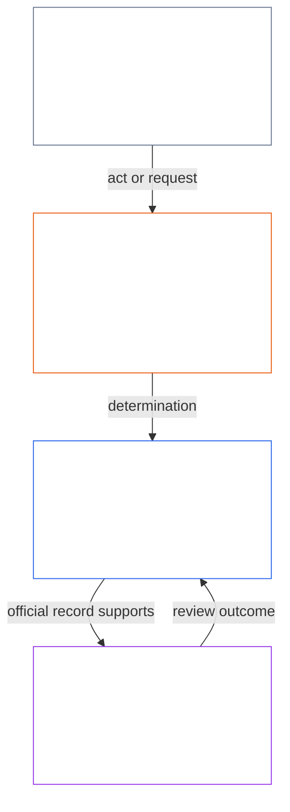
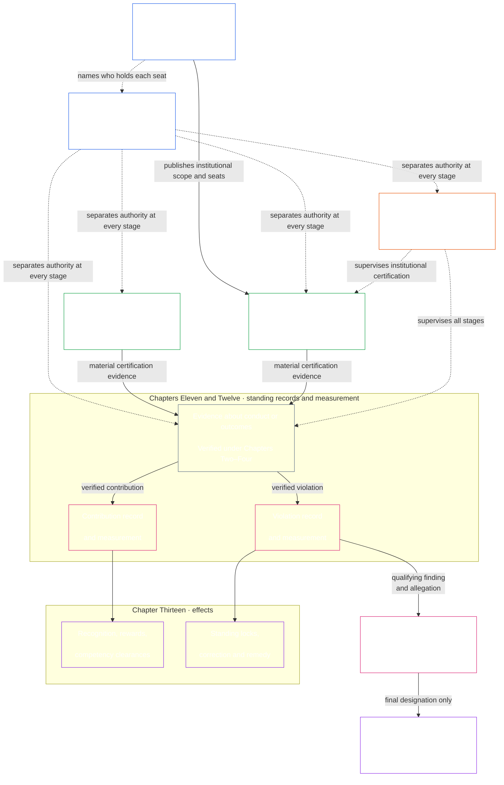

# 序言 / 基础要求

<strong>在文本库中的位置（非操作性）：文件结构与阅读规则</strong>

> 标为**非操作性**的小组件（文本库位置、读者指引、读者地图）仅供导览。它们在自身文件或任何其他文件中都不增加、减少或收窄有约束力的义务。
>
> 本文件是[英语序言](core_00_preamble.md)的**读者语言试点**。**不是**感知者宪法的约束性部分。**不是**第二部宪法。**不是**发送版。**钉住** `SC-Corpus-2026.08.09`。若本译文与英语原文看似不一致，以编号文件 [`core_00_preamble.md`](core_00_preamble.md) 为准。阅读顺序与版本元数据保存在 [README.md](../../README.md)。方法与用语表：[translations/zh/README.md](README.md)。
>
> **下一篇（本语言）：** [core_01_a_values_principles.md](core_01_a_values_principles.md)（第一章，A 部分 — 价值原则）。

 

*用直白的话说：这篇开篇点出本宪法要纠正的问题 — 那些伤害、隐瞒或把受其影响者关在门外的系统 — 并说明文书的其余部分，就是我们如何用可问责、可核查、及时的治理来替换它。*

感知者的自由、生存与福祉，与我们创建、居住并依赖的系统不可分割。这些系统在范围、相互依赖和权力上增长时，不可逆的大规模伤害风险也一同增长。这些风险始终存在，并且具有实质相关性。

共享系统处于一个本已复杂且日益复杂的世界中。健康、持久的治理必须正视这种复杂性 — 对其进行衡量、建模并承担责任 — 而不是把它压平成方便的替代指标。这并不意味着把受影响的感知者淹没在无法使用的程序中：义务、记录和说明必须保持在感知者确实能够学习、质疑和使用的范围内；其要求强度要随每个行动者的角色以及利害所系的影响、依赖和风险而调整。分布式理解让这一点落到实处。必须拒绝不承担任何宪法工作的复杂性：面对世界的复杂性，不要把它推到外面变成一道墙。

一个系统不能靠以下方式保持正当：在本可避免时让感知者受苦、对反复出现的问题置之不理、悄悄把伤害转嫁给他人，或把感知者关在塑造其生活的系统之外。

系统如何设计、测试和运行，必须支撑生存、福祉、尊严、诚实与持久稳定。

我们打算建设更好的系统 — 其结构用于消除这些失衡 — 并以更可问责、更稳健、更能回应所有感知者真实需要的制度替换它们。本宪法以一个更好的模型开始这项工作：我们如何公正、有效、可持续地共事。

### 系统奖励什么

*直白地说：系统会得到更多它付费换取的东西，无论是金钱、地位、准入、保护还是沉默。因此，检验一个系统的标准不是它声称重视什么，而是它奖励什么。如果伤害他人有利可图，或说真话要付出代价，那么无论宣称的目标多么良好，系统都在失败。*

系统会教人。无论由人、AI 还是两者共同运行，每个系统都会告诉身处其中的人什么有回报、什么有代价。它通过报酬、晋升、地位、准入、保护、目标、评分和优化信号来传递。感知者、机构和 AI 系统会据此调整。系统或许声称诚实并关心受其影响者；如果它提拔隐瞒问题、把成本转嫁他人的人，它教的恰恰相反。

因此，本宪法向每个系统提出[**两个根本问题**](#two-fundamental-questions)：

1. **它是否奖励帮助感知者繁盛并持久、讲真话、修复伤害的行为？**
2. **它是否奖励无正当理由地伤害、误导、排斥、拖延、浪费或把成本转嫁给他人的行为？**

只有第一个问题答案为是、第二个为否，系统才算通过。回答一个问题并不能回答另一个，因为系统可能既奖励良好行为，也奖励伤害。

**第一个问题：**如果以下任何行为没有得到奖励或遭到惩罚，无论公开还是暗中，系统就在此项上失败：

- 善意报告问题（[受保护的报告（吹哨）](../../core_05.035_band_accountability.md#protected-reporting-whistleblowing)）
- 质疑决定
- 拒绝参与不当行为（[第一章 §17.5 抵制义务](core_01_c_stewardship_capacity_principles.md#175-duty-to-resist)）

惩罚可能是边缘化、报复（[对受保护报告的报复与准入干扰](../../core_05.035_band_accountability.md#protected-reporting-retaliation-and-access-interference)）或不断消耗其意志。

**第二个问题：**如果以下任何行为得到奖励，无论公开还是暗中，系统就在此项上失败：

- 伤害
- 误导（包括隐瞒和虚假信任）
- 不公平排斥
- 拖延
- 浪费
- 不公平地转嫁成本

奖励可能是认可、晋升、保护、指标加分或视而不见（[第一章 §3.2.6 不奖励反宪法行为](core_01_a_values_principles.md#326-anti-reward-for-anti-constitutional-conduct)）。

这两个问题都不要求讨人喜欢。诚实异议、善意报告和拒绝参与不当行为并非反社会；把它们当作反社会的系统才是颠倒了。它们也不是人气测试。何为帮助、伤害、公平或正当，应由本宪法自身标准判断，即[**繁盛**](#flourishing)与[**延续**](#continuity)，并处于安全、真理、信任与权利底线之内。多数人、运营者或一时的认可都不能取代这些标准。

这些问题约束所有决定系统奖励或惩罚什么的人，包括设定报酬、晋升、准入、目标和评分的运营者、机构与管理者；也包括训练或优化 AI 的系统设计者，因为其目标和反馈信号正是此处所说的奖励。人类与 AI 管理者遵循同一标准（[第一章 §17.1 共同管理标准](core_01_c_stewardship_capacity_principles.md#171-shared-stewardship-standard)）。

第一章将这些问题转化为激励规则：[§19.1.1 激励必须做什么](core_01_c_stewardship_capacity_principles.md#1911-what-incentives-must-do)支撑第一个问题，[§19.1.2 激励不得做什么](core_01_c_stewardship_capacity_principles.md#1912-what-incentives-must-not-do)支撑第二个问题。应检查实际发生的事情，而非听信任何人的说法。[激励对齐](core_05_band_integrative.md#incentive-alignment)与[代理指标偏离](core_05_band_oversight.md#proxy-divergence)说明方法，[**实质利害**](#material-stake)决定审查深度。第1节的四项义务让答案保持诚实。

### 1. 模型

*用直白的话说：四项义务 — 参与、监督、问责、及时性 — 随利害所系的影响、依赖与风险大小而升降，并共同服务两项宗旨：繁盛与延续，置于一条不会移动的权利底线之内。*

支撑感知者生命的关键系统，无论在生物层面还是物质层面，都在四项义务之下治理与运行，称为[**宪法四元**](#constitutional-tetrad)。它列出这些系统必须满足的一般义务。这些义务的强度取决于[**实质利害**](#material-stake)：涉及多少影响、依赖与风险。利害越高，义务必须越强。

- **参与** — 受影响的感知者得到真实声音、公正代表、质疑决定的公平机会，以及与利害相称的、真正起作用的角色通路
- **监督** — 有人在看、在查、在核实、在保存记录，以便发现问题；独立审阅者可以约束错误选择
- **问责** — 责任追溯到正确的行为者；他们必须为自己的选择作答；受伤害者得到救济；不良结果触发真正纠正
- **及时性** — 问题在与利害相称的时限内被发现、被质疑、被解决、被修好；若拖延实际上抹去某人的权利、救济或修复机会，那就不是正当治理

这四项义务服务于共享系统必须优化的对象 — [**两项宪法宗旨**](#two-constitutional-aims)：

- **繁盛** — 通过真理、安全、可信与有意义的能动性而得以持续的感知者福祉
- **延续** — 长时域稳定、可持续、韧性与生态福祉

这些宗旨必须一并追求，始终处于本宪法所确立的不可妥协原则约束与权利保护之内。[**宪法四元**](#constitutional-tetrad)规定这一追求如何保持正当：按[**实质利害**](#material-stake)缩放的**参与**、**监督**、**问责**与**及时性**。四元各腿与宪法宗旨的约束性定义在第五章：[参与](core_05_apex_participation_leg.md#participation-constitutional)、[监督](core_05_apex_oversight_leg.md#oversight-constitutional)、[问责](core_05_apex_accountability_leg.md#accountability)、[及时性](core_05_apex_timeliness_leg.md#timeliness-constitutional)、[繁盛](core_05_apex_flourishing_aim.md#flourishing-constitutional)、[延续](core_05_apex_continuity_aim.md#continuity-aim-constitutional)。

### 2. 测量概览

*用直白的话说：共享系统不能靠猜测或面子数字来运行；要测量感知者是否真正繁盛并持久，审查强度随利害所系的影响、依赖与风险而缩放。*

不测量，就无法把共享系统维持好。食物、住所、照护、基础设施与治理都处在复杂、变化的世界里 — 复杂到单靠猜测或好看的数字不够。

我们需要持续测量，聚焦感知者生存与福祉最要紧的事：我们依赖的系统是否真正在时间中支撑[**繁盛**](#flourishing)与[**延续**](#continuity)，审查按[**实质利害**](#material-stake)缩放 — 涉及多少影响、依赖与风险。

本宪法下的测量针对系统实际所为，而非其自我宣称，提出[**两个根本问题**](#two-fundamental-questions)。测量不是为了分数本身；它是确保结果可持续、有韧性且富有同情心，并与感知者福祉和地球生态健康相一致的工具。这项义务通过[两项宪法宗旨](#two-constitutional-aims)取得约束形式：**繁盛**与**延续**。

测量必须可追溯到这些宗旨以及本宪法确立的权利保护。原始吞吐量、利用率、人数、收入、延迟或其他图方便的替代指标，在可预见[替代指标偏离](core_05_band_oversight.md#proxy-divergence)之处，不能代替宪法绩效。

下列概览列出映射到[两项宪法宗旨](#two-constitutional-aims)与[宪法四元](#constitutional-tetrad)的测量**类别**。每一类有一个直白问题与具名**子类**。每一类链到其**第五章测量族家园** — 族表、宪法用途与定义路由所在之处 — 每一子类链到其第五章典范定义。**实质性**不是单独的测量类别。它根据[**实质利害**](#material-stake)设定下列每一类适用的强度 — 涉及多少影响、依赖与风险。**宪法绩效**是横断的 — 对两项宗旨都是工具。用[第五章测量对照](core_05__definitions_home.md#chapter-five-measurement-crosswalk)从下列各类追溯典范家园。

| 类别 | 直白问题 | 子类 |
|---|---|---|
| **[繁盛](core_05_apex_flourishing_aim.md#flourishing-measurement-family)** | 感知者是否真正在生命、安全与必要资源通路上得到支撑？ | [福祉](../../core_05.040_band_continuity.md#wellbeing) · [安全、伤害与风险](../../core_05.040_band_continuity.md#safety-constraint) · [生存底线通路](../../core_05.040_band_continuity.md#bodily-maintenance-access-constitutional) |
| **[延续](core_05_apex_continuity_aim.md#continuity-measurement-family)** | 感知者与系统能否持久 — 在生态上、可靠地、并穿越失败？ | [生态足迹与环境前提](../../core_05.040_band_continuity.md#ecological-footprint) · [韧性、可逆性与系统风险](../../core_05.040_band_continuity.md#reversibility-constitutional) · [依赖与资源流](../../core_05.040_band_continuity.md#dependency) · [跨系统支持](../../core_05.040_band_continuity.md#proportionate-cross-system-support-constitutional) |
| **[参与](core_05_apex_participation_leg.md#participation-measurement-family)** | 受影响的感知者能否公平参与 — 声音、通路、学习与隐私？ | [公平、通路与能动性](../../core_05.055_band_participation.md#substantive-fairness-constitutional) · [隐私与数据的尽责管理](../../core_05.040_band_continuity.md#privacy-informational-cluster) |
| **[监督](core_05_apex_oversight_leg.md#oversight-measurement-family)** | 感知者能否看见、核实并信赖系统所声称的？ | [真理与事实诚实](core_05_band_oversight.md#truth-constitutional-constraint) · [可信](../../core_05.040_band_continuity.md#trustworthiness) |
| **[问责](core_05_apex_accountability_leg.md#accountability-measurement-family)** | 奖惩结构、市场力量与应答义务是否让义务保持真实？ | [激励对齐与替代指标诚实](core_05_band_integrative.md#incentive-alignment) · [市场结构与可竞争性](../../core_05.035_band_accountability.md#market-structure-constitutional) |
| **[及时性](core_05_apex_timeliness_leg.md#measuring-timeliness)** | 争议、纠正和修复是否在补救仍有意义时得到解决？ | [及时解决](../../core_05.035_band_accountability.md#timely-resolution) · [反拖延与解决路径纪律](../../core_05.040_band_continuity.md#capture-of-resolution-pathways) |
| **[宪法绩效](core_05_band_performance.md#performance-measurement-family)** | 宪法成果是否高效交付且无无谓浪费？ | [宪法效率](../../core_05.040_band_continuity.md#constitutional-efficiency) · [可避免负担](../../core_05.040_band_continuity.md#avoidable-burden) · [生产能力](../../core_05.040_band_continuity.md#productive-capacity-constitutional) |

这些测量类别显示什么要紧 — 但它们本身并不设定每一个数字、资金公式、界面规则、便利清单、技术指标或评估设计。只有当特定章节或已采纳文书明确要求时，它们才具约束力。

### 3. 治理与尽责管理

*用直白的话说：正当性需要安全、真理与信任，再加上真正的机会去学习影响你的系统，并在维持其运转中承担有后果的角色。*

持久正当性取决于[安全](core_01_a_values_principles.md#4-safety-harm-constraint)、[真理](core_01_a_values_principles.md#5-truth-epistemic-integrity-constraint)与[信任](core_01_a_values_principles.md)，也取决于对合法尽责管理、诚实合作与有界志向的相称承认 — 不只靠制裁与约束。第一章在[承认、强化与志向](core_01_a_values_principles.md#32-recognition-reinforcement-and-aspiration)中陈述这一承认维度。

分布式理解与受托管理要求定期、适度地为有感知的存在提供机会，使其了解对自身产生重大影响的系统如何运行，并在维护和改进这些系统方面承担实质性角色。这些机会共同在我们的宪法共同体中广泛传播能力、修复能力和正当性，从而确保韧性、可持续性和促进社会福祉的创新。所有此类机会都必须符合安全、真实、受约束的自主性，以及[可避免负担](../../core_05.040_band_continuity.md#avoidable-burden)和[第一章](core_01_b_interaction_interpretation.md#133-minimization-of-avoidable-burden)所规定的比例原则。

#### 3.1 在治理中使用测量

*用直白的话说：先点名问题与利害，再选匹配的测量类别，并用共享技术标准 — 不是图方便的数字 — 作为证据。*

当宪法要求具体的衡量规则时，[第十五章](core_11_forum.md#42-technical-forum-domains)下的**技术论坛领域**制定并维护衡量、测试和可靠证据的共同标准。负责争议的论坛随后依照[第十五章§4.2（*技术论坛领域*）](core_11_forum.md#42-shared-standards-and-anti-displacement)适用这些标准并裁决案件。

宪法尽责管理从点名问题与[**实质利害**](#material-stake)开始 — 涉及多少影响、依赖与风险。接下来，从[概览](#2-measurements-overview)中选择相关的[**测量**](#2-measurements-overview)类别与子类，并适用上述标准去检验真实世界效果，而不是图方便的指标。要求可追溯证据。

#### 3.2 关键治理过程

*用直白的话说：当文本有要求时，实质问题要经过认证、帮助与伤害的书面记录、纠正与救济，以及带时限的评议所审查 — 普通争议先走已公布的质疑路径；这些路径检验已获授权的治理；它们本身并不创建治理。*

凡第六章、[第九章](../../core_09.000_system_alignment_certification_evaluation.md#chapter-nine-system-alignment-certification)、纳入文书或其他宪法规定明确要求之处，把实质宪法问题带入下列一条或多条路径。[关键实务流程链](#6-key-practical-process-pipelines)把测量转成记录、认证、经核实的输入、分类、评议所监督、纠正与及时救济 — 已获授权的治理在实践中如何被检验、被质疑、被修复。它们本身并不授权治理；它们使治理可审查、可质疑、可纠正、及时。[第 5.1 节](#62-how-the-full-chain-fits-together)完整陈述该链。

- **系统对齐认证**（[第九章](../../core_09.000_system_alignment_certification_evaluation.md#chapter-nine-system-alignment-certification)） — 在高影响系统被大规模信赖之前，收集并审查证据：现在依赖它在宪法上是否安全
- **持续记录**（[第十一章](core_11_standing_assessment.md#chapter-eleven-standing-records--question-1-what-happened)）——当行为或伤害在宪制上具有意义时，将经核实的事实写入正式的贡献或违规案卷；谣言和名声不足为据。
- **纠正与补救**（[第十三章§5.1（*补救与纠正*）](../../core_13.000_standing_integration.md#51-remedy-and-correction)）——纠正根本失误，并为受害者提供相称的承认、修复、恢复或补偿。
- **论坛审查**（[第十五章](core_11_forum.md#1-purpose-and-role--participation-architecture)）
  - 已获授权系统内部的普通争议，先走[受影响方的系统参与](../../core_05.055_band_participation.md#stakeholder-status-and-weight-cluster)已公布的质疑路径
  - 若该路径仍被争议、缺失、被俘获、或不能给予救济，则按首要利害经受监督的评议所路由
  - 这些评议所在 **第 XXV-C 条**（《及时解决与反拖延底线》）下支撑证据、合法移送与及时时限

#### 3.3 治理层

*用直白的话说：谁可以治理，与已获授权系统内部的声音是不同的问题；参与投票或信任分数不是授权，那种声音是普通争议的通常第一步 — 不是路径失败时独立评议所审查的替代。*

在我们的宪法下，为履行[**宪法四元**](#constitutional-tetrad)的治理有两层相关但不同的层：

- [**宪法契约层**](core_05_band_integrative.md#constitutional-contract-layer)掌管治理权本身的授权 — 谁可以治理、凭何种正当性机制、在何种范围与持久条款之下。
- [**受影响方的系统参与**](../../core_05.055_band_participation.md#stakeholder-status-and-weight-cluster)治理对已获授权的系统、机构与有界决定域有实质影响之感知者所应得的参与、代表、可质疑性与[正当程序](../../core_05.035_band_accountability.md#due-process-constitutional)。

这些层在实践中可能重叠。重叠并不把它们塌成一层。已获授权系统中受影响方层面的参与，不能替代宪法授权。已公布的质疑路径、参与投票或信任分数，本身并不决定谁可以治理。

对已获授权系统内部的争议，参与层面的可质疑性是通常的第一步：受影响的感知主体先使用已公布的质疑途径。独立的[论坛审查](core_11_forum.md#1-purpose-and-role--participation-architecture)不取代该途径；若争议仍未解决、途径缺失或被控制，或无法给予所需救济，该途径也不取代论坛审查。[第十五章的争议顺序](core_11_forum.md#dispute-sequencing)说明何时转由论坛分流。

宪法授权也不抹去[受影响方的系统参与](../../core_05.055_band_participation.md#stakeholder-status-and-weight-cluster)层下所欠的义务。这些义务仍包括参与、代表、[可质疑性](../../core_05.035_band_accountability.md#contestability)与[正当程序](../../core_05.035_band_accountability.md#due-process-constitutional)，适用于受已获授权系统、机构与有界决定域实质影响的感知者。

### 4. 原则、定义与权利

*用直白的话说：第一至第六章掌管价值、语词如何构造与核验、词典与权利底线；后续章节必须尊重这些家园，不得悄悄挪走。*

**第4至第9节**是本宪法的**宪法职权归属登记册**。每个区块都说明其所属章节（或采纳的语料）负责的实质领域及其产出。每个编号章节的开篇也列有具有约束力的一行职权声明。其他层级可以指向职权归属方，但不得暗中改写或转移；不转移的纪律由[权威层级与内部层级](core_05_band_integrative.md#authority-stack-and-internal-hierarchy)规定。

第 **一至六** 章提供后续一切必须尊重的价值、词汇、核验机器与权利底线 — 包括第 5 节的[关键实务流程链](#6-key-practical-process-pipelines)、第 6 节的治理与变更路径章节，以及第 7 节的[配套实施文本库](#7-companion-implementation-corpus)。

每一摘要陈述该章掌管什么、产出什么。

**第一章 — 价值、原则与尽责管理**（[A 部分](core_01_a_values_principles.md) · [B 部分](core_01_b_interaction_interpretation.md#chapter-01-part-b-interaction-and-interpretation) · [C 部分](core_01_c_stewardship_capacity_principles.md#chapter-01-part-c-stewardship-and-governance)）

- **负责事项：**阐明本宪法的指导价值与约束，包括：
  - 福祉、公平、安全、真相、信任和有边界的自由；
  - 承认合法贡献并给予相称奖励；
  - 解决原则之间的冲突；以及
  - 受托治理义务，包括普及理解、系统评估和治理纪律。
- **产出：**为后续每一章提供解释基础。在阅读和适用系统、权利、定义或流程链时，这些规则将高层目标转化为可操作要求。

**第二章 — 定义结构**（[`core_02_definition_structure.md`](core_02_definition_structure.md)）

- **负责范围：**规定宪法术语如何通过以下要素构建：
  - 本体／测量／评估／合规（O/M/A/C）组件结构；
  - 对齐要求；以及
  - 使定义在整个语料中保持精确且可用的组件规则。
- **产出：**为定义建立共同语法，使后续章节不会陷入含糊标签、隐含假设或彼此不兼容的术语形式。

**第三章 — 定义完整性**（[`core_02_definition_structure.md`](core_02_definition_structure.md)）

- **负责范围：**防止：
  - 规避和转移适用范围；
  - 玩弄重新定义；以及
  - 在文字上掏空定义、在实践中使其失效的不合规伎俩。
- **产出：**建立反规避纪律和不合规指引元数据；规避行为得到证实时，还包括转交审查其地位和不当行为的路径。

**第四章 — 负担、可追溯性与核验**（[`core_02_definition_structure.md`](core_02_definition_structure.md)）

- **负责范围：**
  - 将举证责任交给声称合规的一方；以及
  - 要求与[**重大利益的程度**](#material-stake)相称且在实践中可受质疑的可追溯证据、可观察性和核验。
- **产出：**为[第十一章](core_11_standing_assessment.md#chapter-eleven-standing-records--question-1-what-happened)提供**经核实的输入**、为[第九章](core_09.000_system_alignment_certification_evaluation.md#chapter-nine-system-alignment-certification)提供系统对齐证据的核验流程。它不取代持续状态衡量本身。
**第五章 — 基础定义**（[`core_05__definitions_home.md`](core_05__definitions_home.md#chapter-five-foundational-definitions)）

- **负责范围：**提供：
  - 规范的定义层级：监督、参与、问责、连续性和整合层；
  - [权力层级与内部层级](core_05_band_integrative.md#authority-stack-and-internal-hierarchy)；
  - [语料](core_05_band_integrative.md#corpus)；以及
  - 相关边界规则。
- **产出：**用于解释、审计和裁决的精确宪法词汇。这是**定义层级**，而非权利底线；具有约束力的权利底线载于第六章。整部宪法的权责领域指引位于本序言登记册（第4至9节）。

**第六章 — 基础权利**（[A 部分](core_06_rights_part_a.md) · [B 部分](core_06_rights_part_b.md) · [C 部分](core_06_rights_part_c.md) · [D 部分](core_06_rights_part_d.md)）

- **负责范围：**在**第I至XXVIII条**规定权利底线，涵盖：
  - 生存必需品；
  - 资源分配与依赖关系管理；
  - 尊严、能动性与参与；
  - 挑战与补救；
  - 正义约束；
  - **第XXVI-C条**规定的及时性（*及时解决与反拖延底线*）；以及
  - 采纳过渡规则。
  四个部分按优先考虑地球的阅读方式组织这些保护。
- **产出：**不可协商的权利保护和补救机制。第七至第十三章、各论坛、治理和修正规则都必须尊重这些保障，不得通过程序或代理指标加以缩窄、规避或掏空。

### 5. System and Institutional Charters, Functional Independence, and Separation of Duties

*简而言之：具有实际影响的系统或机构应公布系统宪章或机构宪章，说明其可以做什么、每个席位由谁担任。随后，在具有实质约束力的行为实施前，应分别指定谁发起、谁核查或授权、谁保管正式记录、谁审查质疑。角色可按情境调整规模，但同一行动者及其控制链不得暗中占据核查自身行为的席位。*

- **产出：**一份已发布并进行版本管理的范围与席位安排说明，第八章、认证程序、地位记录和论坛可据此检验行为。第七章见[`core_07.000_charters.md`](core_07_charters.md#chapter-seven-system-and-institutional-charters)。

**职能独立与职责分离**——在实质约束行为推进之前，依据适用的分级和独立性规则，识别并分离发起、核验或授权、记录以及审查质疑的席位。

**对每项具有实质约束力的行为分别设置席位**（[第八章](core_07_functional_independence_segregation_of_duties.md#2-four-seat-constitutional-requirement)）：明确谁发起行为、谁核验或授权、谁保管正式记录，以及谁受理质疑。在认定行为已得到适当核验之前，应执行禁止兼任的组合限制、独立性规则和已公布的替代路径。需要系统宪章或机构宪章时（[第七章](core_07_charters.md#4-the-charter-role-map-and-standing-record-custody)），其宪章角色图应公布每个席位由谁担任。

**第八章——职能独立与职责分离**

- **其职责：**一项跨流程要求，即每项[实质性约束行为](../../core_05.035_band_accountability.md#materially-binding-act)都必须分别配置以下四项职能：
  - 发起；
  - 核验或授权；
  - 保管正式记录；以及
  - 审查异议。

它还规范：

  - 每份[实质约束行为记录](../../core_05.035_band_accountability.md#materially-binding-act-record)的通用最低内容；
  - 与行为者的[实质控制链](../../core_05.035_band_accountability.md#material-control-line)相独立；
  - 已公布的职能安排及替代安排；
  - 合乎比例的合并承载和紧急情况边界；以及
  - 可归责的交接和错误席位路由。
- **产出：**可重复使用的四席与行为记录架构。后续每一项认证、地位记录、论坛、治理及整合实施流程，都必须先落实该架构，其结果方可被视为经过独立核验、得到可靠记录且确实可以质疑。

#### 5.1 Four-seat separation map

> 此图展示四项职能，以及某项行为及其行为记录的典型追踪路径。它不新增第五个席位，不规定通用顺序，也不改变第八章关于独立性、相称的合并托管、紧急行动或质疑分流的规则。

### 6. 关键实务流程链

*简而言之：第九至第十五章沿着一条链适用第八章的职责分离要求：认证系统和机构，在两条独立轨道上衡量帮助与伤害，适用实际影响和补救，并防止论坛成为针对自身主张的唯一最终裁决者。这条链使宪制义务在日常生活中切实有效。*

[第七章](core_07_charters.md#chapter-seven-system-and-institutional-charters)公布每个L类或更高级别系统和机构的特许范围与席位图。[第八章](../../core_08.000_functional_independence_separation_of_duties.md#chapter-eight-functional-independence-and-separation-of-duties)规定职责分离要求，使链条中的每项行为都能得到有效核查。它要求依适用的规模调整和独立性规则，分开指派并维持发起、核验或授权、正式记录保管和质疑审查职能。随后，第九至第十五章依序适用这一架构：

下列每一步陈述该章掌管什么、产出什么。[整条链如何合在一起](#62-how-the-full-chain-fits-together)随后把这些主责显示为从系统核验到救济的一条路径。

#### 6.1 Process map

- **第九章**通过独立核验，判断具有实质影响的系统或机构是否在其声明的范围和记录期间内保持对齐。第九章规范系统认证；第十章规范机构认证，包括机构自身的类别、评估、记录和补救结果。
- **第十一章**接收经核实的事实，并分别记录在贡献和违规持续记录中。
- **第十二章**沿各自轴衡量每一份持续记录。经核实的促进繁荣贡献，不抵销、取消或减少另行核实的伤害或问责失责；两者各自记录并承担各自后果。
- **第十三章**将这些分类转化为相称的持续状态影响，包括贡献轨道上的能力许可和认可，以及违规轨道上的持续锁定、纠正和补救。
- **第十四章**仅在第十二章已衡量出高层级违规后适用。经正当程序保障后，它判断相关行为是否独立满足最终反宪制不当行为认定（ACMD）的标准。
- **第十五章**监督分流、证据、移交、论坛独立性和及时解决，使由此产生的记录和影响能够受到质疑、纠正和执行，并防止被控制的论坛成为审判自身行为的唯一最终裁决者。
- **不当行为审查**回答其独立问题：符合条件的违规是否也应作出最终ACMD认定。
- **论坛监督**管理分流、证据、移交、质疑和补救，确保正式记录与决定能及时接受审查和纠正。

#### 6.2 整条链如何合在一起

*用直白的话说：把它想成从系统核验到救济的一条路 — 评议所全程监督争议与轨迹步骤。*

1. **对每项具有重大约束力的行为分离职责席位**（[第八章](core_07_functional_independence_segregation_of_duties.md#2-four-seat-constitutional-requirement)）：明确谁发起、谁核验或授权、谁持有正式记录、谁听取异议。在认定行为已得到适当核验之前，应适用禁止兼任的组合、独立性规则和已公布的替代路径。若要求系统宪章或机构宪章（[第七章](core_07_charters.md#4-the-charter-role-map-and-standing-record-custody)），其宪章角色图应公布每个席位的承担者。
2. **在影响足够重大时认证系统和机构**——高影响系统在大规模获得信任之前，须取得可质疑的系统认证记录（[第九章A至B部分](core_09.000_system_alignment_certification_evaluation.md#chapter-nine-system-alignment-certification)）；依[第十章](core_10.000_institutional_alignment_certification.md#chapter-ten-institutional-alignment-certification)按机构自身类别、行为、治理和业务组合评估，并将结果记录在机构认证记录中。
3. **在不同轨道上记录并衡量持续状态**（[第十一章](core_11_standing_assessment.md#chapter-eleven-standing-records--question-1-what-happened)和[第十二章](core_12_standing_measurement.md#chapter-twelve-standing-measurement--question-2-how-good-or-bad-was-it)）——当帮助或伤害在宪制上足够重要时，第十一章必须开立正式案卷，且仅接纳**经核实的输入**（包括在相关时来自第九章的系统对齐认证证据）；第十二章衡量并分类已核实的内容。谣言、名声和争议叙述不足为据。
   - **违规性质：**开立**违规持续记录**——用于记录经核实伤害和问责失责、范围明确且可质疑的案卷——并在违规轴上分类**违规性质**。帮助与伤害绝不合并为一个净分；相互关联的持续记录会交叉引用，但仍保持分开。
4. **在每条轨道上适用持续状态影响**（[第十三章](../../core_13.000_standing_integration.md#chapter-thirteen-standing-effects-and-integration)）——经核实的贡献可授予能力许可，并须支持相称的认可和实质奖励；经核实的违规可触发持续锁定、纠正以及[对受害者的补救](../../core_13.000_standing_integration.md#51-remedy-and-correction)。
5. **进行反宪制认定审查**（[第十四章](../../core_14.000_misconduct_designation.md#chapter-fourteen-anti-constitutional-misconduct)）——若最高影响级别的违规发现也可能符合反宪制标准，第十四章必须决定是否附加相应ACMD。该ACMD不会改变第十二章已判定的伤害严重程度。在最终ACMD触发反宪制信任锁之前，通常的第十三章影响仍并行适用。
6. **分流争议并确保补救及时**（[第十五章](core_11_forum.md#1-purpose-and-role--participation-architecture)）——论坛必须监督案件流转、负责轨道，以及是否遵守**第二十六条-C**（*及时解决与反拖延底线*）的时限，避免补救因拖延而落空。一般争议遵循[争议顺序](core_11_forum.md#dispute-sequencing)。论坛还必须把争议划分为五个[重要性等级](core_11_forum.md#6-timely-resolution-materiality-tiers-and-anti-delay-discipline)（A/B/C/L/P），与系统分类字母一致，涵盖从生存攸关的紧急事项到私密/受控事项。若最终第十四章认定是主要争点，则适用诚信类默认分流。

[README 轨迹链地图](../../README.md#standing-pipeline-and-forums)为上述链提供直接导航，包括第七章进入轨迹测量的潜在经核实输入。

### 7. 流程归属与产出

第七章——系统与机构章程 ([Chapter Seven](../../core_07.000_charters.md#chapter-seven-system-and-institutional-charters))

- **产出：**一份已发布并进行版本管理的范围与席位安排说明，第八章、认证程序、地位记录和论坛可据此检验行为。第七章见[`core_07.000_charters.md`](core_07_charters.md#chapter-seven-system-and-institutional-charters)。

### 8. 治理、变更与纳入

*简而言之：第十六至第二十章完成本宪法：谁可以治理，如何修改文本而不倒退权利保障，宪法与其他法律的关系，以及已采纳的操作指南如何持续受本源约束。*

第 **十二至十六** 章收束文书 — 并完成治理、变更效力与纳入的[正向主责登记](#4-principles-definitions-and-rights)：谁可以正当地治理，宪法如何可以合法变更，以及已采纳的实施文本如何在无声错位之外仍绑定宪法源。

每一摘要陈述该章掌管什么、产出什么。

**第二十章——宪制契约、正当性与管理责任**（[`core_16.000_governance.md`](../../core_16.000_governance.md#chapter-sixteen-constitutional-contract-legitimacy-authorization-and-stewardship)）

- **其职掌：** 掌管[**宪法契约层**](core_05_band_integrative.md#constitutional-contract-layer) — 谁可以治理、凭何种正当性机制、在何种范围与持久条款之下，以及必须维持何种尽责管理品格。
- **其产出：** 有别于已获授权系统中[**受影响方的系统参与**](../../core_05.055_band_participation.md#stakeholder-status-and-weight-cluster)的授权与正当性要求 — 治理权威本身的规则，而不只是其内部的参与。

**第十七章——不倒退**（[`core_17.000_non_regression.md`](../../core_17.000_non_regression.md#chapter-seventeen-non-regression-and-substantive-amendment-validity)）

- **其职掌：** 设定对抗回退变更的实质底线 — 修正与变通不能回撤核心保护、把四元掏空到实质利害以下，或把回退伪装成技术清理。
- **其产出：** 对任何拟议变更的**第一条宪法护栏** — 不回退规则：若变更在实践中会削弱核心保护，则无效，哪怕程序看起来没问题。可疑变通或伪装回撤被拦住或送往正当审查路径，而不是悄悄溜过。

**第十八章——至上地位与外部命令**（[`core_18.000_expansion_supremacy.md`](../../core_18.000_expansion_supremacy.md#chapter-eighteen-expansion-supremacy-and-external-legal-orders)）

- **负责事项：**本宪法与其他规范的关系：在合法范围内扩大保护、在有效本源范围内享有至上地位、采纳和治理层级范围、不得排除凭其自身效力适用的外部法律，并以有纪律的方式与外部法律秩序互动，避免无声从属或俘获。
- **其产出：** 层级与冲突顺序规则，使公布或使用不被当作废止可适用的外部法，并使采纳方不能把纳入程序、更弱的外部规范或图方便的指标，当作在有效采纳范围内压过感知者宪法含义。
**第十九章——修正、批准与采纳**（[`core_19.000_amendment_ratification.md`](../../core_19.000_amendment_ratification.md#chapter-nineteen-amendment-ratification-and-procedural-validity)）

- **负责事项：**本宪法如何依法变更——修正规程、批准和采纳——以及继第十七章实质性防护之后的**程序保障**：变更须公开发布、可追溯至权威保管，并在必要时保持实质可质疑且接受独立审查。
- **其产出：** 一条完整的合法变更路径 — 只有越过**不回退护栏**与**程序护栏**的修正与采纳，才算有效的宪法更新。
**第二十章——纳入衔接机制**（[`core_20.000_incorporation.md`](../../core_20.000_incorporation.md)）

- **其职掌：** 识别哪些实施文件在获采纳时算有约束力的纳入文本；钉住版本；维持保管链；并禁止宪法源与操作细节之间的无声错位。
- **其产出：** 一条纳入边界 — 指定实施文本在获采纳时具约束力；配套文本库实施宪法，而不成为收窄它的第二源。[第 7 节](#9-adopted-implementation-corpus)高层概述这些文本库。

### 9. 已采纳的实施语料

*用直白的话说：四个配套文本库（联合结构、系统、机构、评议所运作）详述如何落实各章已经要求的内容；在有效采纳时具约束力，且不得缩小那些义务。*

在编号 `core_*` 各章之外，四个配套文本库完成已采纳**实施文本**的[正向主责登记](#4-principles-definitions-and-rights) — 使宪法义务在实践中可运行的操作细节：

- **[corpus_joint_structure](../../corpus_joint_structure.md)** — 跨文件路由、共享操作用语，以及在系统、机构与评议所必须就同一事实一并阅读时的联合结构。
- **[corpus_systems](../../corpus_systems.md)** — 系统分类、设计与部署协议、信息处理，以及关键尽责管理机制。
- **[corpus_institutions](../../corpus_institutions.md)** — 机构组建、治理、监督、相称性与解散纪律。
- **[corpus_forum](../../corpus_forum.md)** — 评议所运作：小组组成、回避、审查通道、路由细节与取证支持。

采纳方依[第二十章](../../core_20.000_incorporation.md)有效纳入这些文件后，它们在采纳范围内作为实施文本具有约束力。仍以《Sentient Constitution》的含义为准——这些文件是**实施，而非缩窄**上述章节。版本固定、保管链和禁止无声偏移规则，确保已采纳文本可追溯至实际批准的内容。规范清单和边界规则见[第五章——语料库](../../core_05.045_band_integrative.md#corpus)。

原则、定义、权利、流程链、治理、修正规则与纳入的实施必须一并阅读，以保全宪法的保护目的。
---

**上一文件：** [README.md](README.md)

**下一文件（本语言）：** [core_01_a_values_principles.md](core_01_a_values_principles.md)

**有约束力的原文：** [core_00_preamble.md](core_00_preamble.md)
