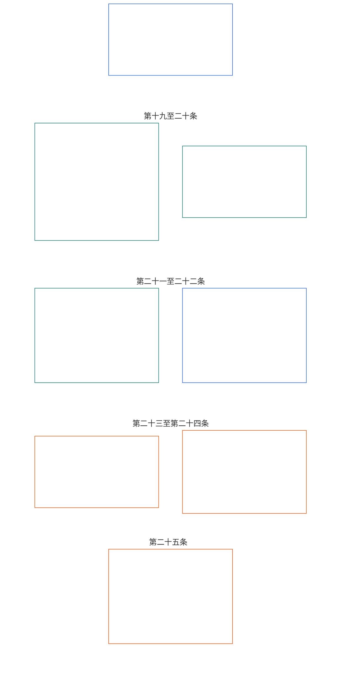

# 第六章：基础权利

<strong>语料库位置（非规范性）：文件结构与阅读规则</strong>

> 以下内容仅为读者指引。它不会增添、删除或缩限本文件或其他章节中的任何约束性义务。
>
> 本文件是《有感知者宪章》的一部分，且只有与其他编号的 `core_*` 文件作为一份整体共同阅读时才具有约束力。本文件包含**第六章 D 部分**；条文编号和交叉引用与整合后的文书一致。阅读顺序、约束性内容与辅助内容的区分，以及语料库版本元数据，均由 [README.md](README.md) 维护。

<strong>读者指引（非规范性）：D 部分在第六章中的位置</strong>

> 以下内容仅为读者指引。它不会增添、删除或缩限本章或其他章节中的任何约束性义务。
>
> [core_06_rights_part_a.md](core_06_rights_part_a.md) 中的 **A 部分**载有全章默认约束框架、以行星为先的阅读顺序及解释枢纽。**D 部分**依次呈现**第十九至第二十四条**。

 

### D 部分：地位、正义、互操作性、可理解性、根因审查与宪法解释

 

*简单来说：D 部分涵盖地位和参与状态、经核实违规后的正义、互操作性和退出、可理解性、根本原因分析以及宪法解释和审查 - 第十九条至第二十四条。*

<strong>读者指南（非操作性）：D部分文章图</strong>

> 以下内容是 **仅供读者指导**。它不会在本章其他地方或其他章节中添加、删除或缩小约束性义务。
>
> **读者地图（非操作）。** 此图表显示源如何对本部分的文章和子文章进行分组。网格是源分组，而不是过程序列：文章不是程序步骤，因此地图没有箭头。子文章标签缩短为主题；以下编号的条款和子条款管辖。该图表不添加任何定义或职责，不建立优先级，并且不能替换源文本。

 

**第十九至第二十四条** 下面详细说明了这些楼层。 D 部分包含常设权、违规后正义、互操作性、可理解性、根本原因和解释性审查底线，包括 **第二十四条** （*宪法解释、审查和反捕获保障*）在当前源布局中。

### 第 XIX 条：地位与参与状态

<strong>痕迹</strong>

- 上游：原则：第一章 [§7 自由](core_01_a_values_principles.md#7-freedom-bounded-agency), [§15.1 宪法禁止绕行原则](core_01_b_interaction_interpretation.md#151-constitutional-no-bypass-principle)， 和 [第15条 宪法解释](core_01_b_interaction_interpretation.md#15-constitutional-interpretation)。

<strong>定义·评估·合规性</strong>

- [参与者地位](../../core_05.035_band_accountability.md#participant-standing-constitutional) · [氧](../../core_05.035_band_accountability.md#participant-standing-constitutional) · [中号](../../core_05.035_band_accountability.md#participant-standing-constitutional-a) · [一个](../../core_05.035_band_accountability.md#participant-standing-constitutional-a) · [C](../../core_05.035_band_accountability.md#participant-standing-constitutional-c)
- [利益相关者](../../core_05.055_band_participation.md#stakeholder) · [氧](../../core_05.055_band_participation.md#stakeholder) · [中号](../../core_05.055_band_participation.md#stakeholder-a) · [一个](../../core_05.055_band_participation.md#stakeholder-a) · [C](../../core_05.055_band_participation.md#stakeholder-c)
- [重大影响](../../core_05.050_band_oversight.md#material-impact) · [氧](../../core_05.050_band_oversight.md#material-impact) · [中号](../../core_05.050_band_oversight.md#material-impact-a) · [一个](../../core_05.050_band_oversight.md#material-impact-a) · [C](../../core_05.050_band_oversight.md#material-impact-c)
- [尊严和平等的道德地位](../../core_05.055_band_participation.md#dignity-and-equal-moral-standing) · [氧](../../core_05.055_band_participation.md#dignity-and-equal-moral-standing) · [中号](../../core_05.055_band_participation.md#dignity-and-equal-moral-standing-a) · [一个](../../core_05.055_band_participation.md#dignity-and-equal-moral-standing-a) · [C](../../core_05.055_band_participation.md#dignity-and-equal-moral-standing-c)
- [补救和补救](../../core_05.035_band_accountability.md#redress-and-remediation) · [氧](../../core_05.035_band_accountability.md#redress-and-remediation) · [中号](../../core_05.035_band_accountability.md#redress-and-remediation-constitutional-a) · [一个](../../core_05.035_band_accountability.md#redress-and-remediation-constitutional-a) · [C](../../core_05.035_band_accountability.md#redress-and-remediation-constitutional-c)
- [可竞争性](../../core_05.035_band_accountability.md#contestability) · [氧](../../core_05.035_band_accountability.md#contestability) · [中号](../../core_05.035_band_accountability.md#contestability-a) · [一个](../../core_05.035_band_accountability.md#contestability-a) · [C](../../core_05.035_band_accountability.md#contestability-c)

 

*简单来说： **第十九条** （*声望和参与状态*）是参与状态权利下限 - 它规定谁有资格担任哪些角色、如何提出和质疑这些呼吁，以及当声望降低或暂停时会发生什么。 **参与者站立** 是来自经过验证的记录和公平规则的角色资格，而不是受欢迎程度、品牌名称或社会分数，它与尊严、权利底线最低限度以及作为利益相关者是分开的，因为系统实际上会影响你。如果立场被降低或暂停，你必须找到明确的理由、真正的反击方法以及适合实际风险的限制——并且立场本身绝不能切断生存必需品或挑战伤害和获得补救的途径。良好的信誉必须反映的是今天可以检查的东西，而不是旧的声誉。移动、避难、携带和离开均受 **第二十一条** （*互操作性、可移植性、移动、避难和退出完整性*），而不是仅靠站立标签。*

这篇文章指出 **宪法楼层** 的地位和参与地位 [两个宪法目标](core_00_preamble.md#two-constitutional-aims)：

- **芊芊：** 感知者可以通过有效的、多元的、可审计的命名途径来持有和争夺角色资格——无需用常设标签来取代尊严、权利底线最低限度或利益相关者地位 [重大影响](core_05_band_oversight.md#实质影响) 存在；命名途径的资格取决于当前的、可观察的、有争议的证据，而不仅仅是品牌、规模或过去的声誉。
- **连续性：** 常设纪律随着时间的推移可以修改——限制仍然是相称的，在纠正后可以恢复，并且不得硬化为永久排除在基本宪法的声音之外，除非 **第十一章** **违反宪法的不当行为** 分类和 [**第十三章 §4.1 权利和资格**](core_12_governance.md#41-entitlement-and-eligibility) 明确保留持久的政治发言权 **全额归还**。

合法追求贯穿始终 [宪法四联体](core_00_preamble.md#constitutional-tetrad)，缩放至 [物质桩](core_00_preamble.md#material-stake)：

- **参与：** 在多元化的资格评估中，对不透明或垄断的资格决定提出质疑，并在纠正重大限制的情况下恢复或重新资格。
- **监督：** 通过可审计的长期记录、对资格和锁定索赔的持续审查以及与相关角色和限制相称的独立验证。
- **责任：** 那些分配或限制地位的人必须对降低地位负责，而没有个性化的理由、相称性、狭隘的剪裁或真正的恢复路径——包括跟踪受保护特征或其代理的模式。
- **时效性：** 在常设审查中，延迟之前的质疑和补救将排除对生存至关重要的访问、审计路径或宪法规定的补救措施 **第 25-C 条** （*及时解决和防延迟底线*）。

[参与者地位](../../core_05.035_band_accountability.md#participant-standing-constitutional) 参与地位或角色资格地位是根据宪法有效的长期记录、长期影响或 [能力栏](../../core_05.035_band_accountability.md#competency-bar) 指定路径的标准。它不是声誉或社会尊重，它本身也不施加访问限制。限制性后果仅通过 [站立效应](../../core_05.035_band_accountability.md#standing-effect-chapter-six) 和 [常设锁](../../core_05.035_band_accountability.md#standing-lock) 在命名特权路径上。

本条规定的常设纪律执行 [宪法四联体](core_00_preamble.md#constitutional-tetrad) 和 [两个宪法目标](core_00_preamble.md#two-constitutional-aims) 与...一起 [系统一致性认证](../../core_05.040_band_continuity.md#system-alignment-certification-constitutional) 和 [第九至十二章 常务和论坛监督渠道](../../core_00.000_preamble.md#62-how-the-full-chain-fits-together)。这些所有者层流程衡量经过验证的贡献和违规行为并监督补救措施；他们不能被用来击败 **第三条-A** （*生存*）生存要点或本章所述的其他权利底线。

它必须区别于：
- 固有的尊严；
- 权利-最低限度；
- 通过重大影响识别利益相关者；
- 在本宪法保留这些底线的情况下，可以提出质疑或采取补救措施。

*文章邻居：*

- **所有者层：** [第九章](core_08_standing_assessment.md) 和 [第十章](core_09_standing_integration.md) 衡量长期记录和长期影响；该条款规定 Rights-Floor 限制这些层不得缩小。
- **一起阅读：**
  - **第六条-A** （*尊严和平等的道德地位*）和 **第十二条** （*利益相关者系统参与、代表和正当程序*）——站立标准不得取代利益相关者的尊严或存在；
  - **第三条-A** (*生存*)——单独的参与者不得排除对生存至关重要的访问；
  - **第二十一条** （*互操作性、可移植性、移动、避难和退出完整性*）——常设纪律不得取代个性化的司法程序，或仅凭标签充当流放、拒绝庇护或无国籍状态；移动、避难、便携性和出口楼层仍然保留 **第二十一条** （*互操作性、可移植性、移动、避难和退出完整性*），而不会缩小此处的常备保障措施。

#### 第 XIX-A 条：地位区分

<strong>痕迹</strong>

- 上游：原则：第一章 [§6 信任](core_01_a_values_principles.md#6-trust-and-trustworthiness-coordination-integrity), [第一章 §7 自由](core_01_a_values_principles.md#7-freedom-bounded-agency)， 和 [§20 综合应用](core_01_c_stewardship_capacity_principles.md#20-综合适用)。
- 阅读： [第十章§6.2](core_09_standing_integration.md#62-competency-bars-and-clearances) （*能力标准和许可*）， [能力栏](../../core_05.035_band_accountability.md#competency-bar)， 和 [能力许可](../../core_05.035_band_accountability.md#competency-clearance); [第十章§4.2](core_09_standing_integration.md#42-prevention--general-standing-locks) （*立锁*）， [违规性质](../../core_05.035_band_accountability.md#violation-nature-chapter-six)， 和 [常设锁](../../core_05.035_band_accountability.md#standing-lock) —来自经过验证的违规轴输入的限制性命名路径；能力许可并不放弃适用的长期锁定，良好的贡献也不会消除未解决的违规问题。

<strong>定义·评估·合规性</strong>

- [尊严和平等的道德地位](../../core_05.055_band_participation.md#dignity-and-equal-moral-standing) · [氧](../../core_05.055_band_participation.md#dignity-and-equal-moral-standing) · [中号](../../core_05.055_band_participation.md#dignity-and-equal-moral-standing-a) · [一个](../../core_05.055_band_participation.md#dignity-and-equal-moral-standing-a) · [C](../../core_05.055_band_participation.md#dignity-and-equal-moral-standing-c)
- [利益相关者权重](../../core_05.055_band_participation.md#stakeholder-weight) · [氧](../../core_05.055_band_participation.md#stakeholder-weight) · [中号](../../core_05.055_band_participation.md#stakeholder-weight-a) · [一个](../../core_05.055_band_participation.md#stakeholder-weight-a) · [C](../../core_05.055_band_participation.md#stakeholder-weight-c)
- [参与者地位](../../core_05.035_band_accountability.md#participant-standing-constitutional) · [氧](../../core_05.035_band_accountability.md#participant-standing-constitutional) · [中号](../../core_05.035_band_accountability.md#participant-standing-constitutional-a) · [一个](../../core_05.035_band_accountability.md#participant-standing-constitutional-a) · [C](../../core_05.035_band_accountability.md#participant-standing-constitutional-c)
- [能力栏](../../core_05.035_band_accountability.md#competency-bar) · [氧](../../core_05.035_band_accountability.md#competency-bar) · [中号](../../core_05.035_band_accountability.md#competency-bar-a) · [一个](../../core_05.035_band_accountability.md#competency-bar-a) · [C](../../core_05.035_band_accountability.md#competency-bar-c)
- [能力许可](../../core_05.035_band_accountability.md#competency-clearance) · [氧](../../core_05.035_band_accountability.md#competency-clearance) · [中号](../../core_05.035_band_accountability.md#competency-clearance-a) · [一个](../../core_05.035_band_accountability.md#competency-clearance-a) · [C](../../core_05.035_band_accountability.md#competency-clearance-c)
- [常设锁](../../core_05.035_band_accountability.md#standing-lock) · [氧](../../core_05.035_band_accountability.md#standing-lock) · [中号](../../core_05.035_band_accountability.md#standing-lock-a) · [一个](../../core_05.035_band_accountability.md#standing-lock-a) · [C](../../core_05.035_band_accountability.md#standing-lock-c)
- [违规性质](../../core_05.035_band_accountability.md#violation-nature-chapter-six) · [氧](../../core_05.035_band_accountability.md#violation-nature-chapter-six) · [中号](../../core_05.035_band_accountability.md#violation-nature-chapter-six-a) · [一个](../../core_05.035_band_accountability.md#violation-nature-chapter-six-a) · [C](../../core_05.035_band_accountability.md#violation-nature-chapter-six-c)

 

*简单来说：当经过验证的准备情况满足已发布的要求时，信任敏感的角色可能会开放 **能力栏** 和 **能力许可** 有效 - 并可能通过以下方式保持关闭或限制 **立锁** 而一个 **经核实的违规发现** 仍需修正。 **治理投票** 锁定暂停基础治理投票； **利益相关者参与** 锁限制了授权系统内利益相关者的发言权——它们不可互换，利益相关者的地位也不会被后者删除。这两条路径都不是受欢迎程度、内部把关，也不是尊严的替代品。指控本身并不构成违规调查结果；锁必须符合实际验证的内容，并留下真正的挑战和补救路径。*

本文阐述了站立与能力栏、能力许可和站立锁定的不同之处：

- **站立不同于：**
  - 固有的尊严和平等的道德地位（**第六条-A** （*尊严和平等的道德地位*））；
  - 展示重要利益以供利益相关者识别（**第五章** — *利益相关者*； *利益相关者权重*)。
- **能力标准和许可：** 一个 [能力栏](../../core_05.035_band_accountability.md#competency-bar) 是针对指定途径的已发布、可审核、可争议的资格标准。一个 [能力许可](../../core_05.035_band_accountability.md#competency-clearance) 是当经过验证的能力、经验和贡献记录满足该标准时，积极的常设效应结果。当许可有效且不适用时 [常设锁](../../core_05.035_band_accountability.md#standing-lock) 阻止指定的途径，它可能会开放对信任敏感的角色、授权、监督资格或逐步相应的管理权的访问 [第十章 §6.2 能力标准和许可](core_09_standing_integration.md#62-competency-bars-and-clearances)。
  - 能力门槛或许可不是声誉、社会声望、内部赞助、证书垄断、尊严等级或永久权利。
  - 非正式的、同行组织的、互助的、维护、修理、教学或社区管理的经验，如果满足与正式机构经验相同的可证明标准，则必须得到认可。
- **违规性质及立锁：** [违规性质](../../core_05.035_band_accountability.md#violation-nature-chapter-six) 仅当基于可审计、可争议的调查结果满足以下条件时，才可能影响常设效力： **第二章至第四章** 和 [第九章](core_08_standing_assessment.md#verified-inputs-for-standing) ——不仅仅是指控、摄入标签、临时路线或论坛阶段的叙述。
  - 一个 [常设锁](../../core_05.035_band_accountability.md#standing-lock) 是能力审查的限制性对应。虽然经核实的违规行为仍未得到解决或实质上未得到补救，但它可能会阻止或限制信任、角色、权威、信用、监督、认可、 **治理投票**， 或者 **利益相关者参与** 下的途径 [第十章 §4.2 预防——普通立锁](core_09_standing_integration.md#42-prevention--general-standing-locks)。
  - **治理投票** 是合法性-机制/基础治理-投票路径。 **利益相关者参与** 是在已授权领域内的权益加权影响力和具有约束力的利益相关者选择。两个指定的途径都不能替代另一个途径，并且 **利益相关者参与** 锁定不擦除 [利益相关者](../../core_05.055_band_participation.md#stakeholder) 地位。
  - 站立锁定不是尊严等级、权利底线减少、自动报复或合并功绩分数。
  - 每个常设锁定必须确定被阻止或限制的效果、受保护的主体或利益、纠正条件、审查路径和重新评估点，并保持必要性、相称性、可审计性和可争议性。
  - 如果经核实未能回避需要回避且公正性受到重大损害的论坛角色，则会造成 **论坛服务常设锁** 中所述 [第十章 §5.5 特殊锁具](core_09_standing_integration.md#55-special-locks)。恢复论坛服务需要严格的独立恢复；普通的道歉、先前的贡献、声誉、专业知识的缺乏或人员的需求本身并不能满足这条道路。
  - 经核实的腐败、掠夺、虚假股权滥用、胁迫或对利益相关者参与途径的类似物质滥用会产生 **利益相关者参与常备锁** 中所述 [第十章 §5.5 特殊锁具](core_09_standing_integration.md#55-special-locks)。它限制了受影响领域的利益相关者的影响力和约束性利益相关者的选择；它本身不会剥离 **治理投票**、基本宪法选择或利益相关者地位。普通的道歉、事先的贡献、股权规模或运营商的不可或缺性本身并不能解除这个锁定。
  - 最终章第十一章违反宪法的不当行为造成 **反宪法信任锁** 中所述 [第十章 §5.5 特殊锁具](core_09_standing_integration.md#55-special-locks)。当活跃时，它会禁止角色或物质影响 **A级**, **B级**， 或者 **C级** 系统、宪法论坛、宪法一致性认可、关键系统管理和反宪法问责途径，直到严格的独立恢复得到验证。
  - 能力许可并不放弃适用的常设锁定；良好的贡献并不能消除未解决的、已核实的违规调查结果。
- **不可替代：** 地位标准、标签、分数、能力标准、能力许可和地位锁定仅管理角色资格。他们不得：
  - 模糊了谁有资格担任某个角色以及谁具有固有的尊严或平等的道德地位；
  - 让角色地位替代最低权限或决定某人是否是利益相关者，因为系统实际上会影响他们；
  - 代表感知状态的确定，该确定仅在以下情况下进行 **第六条 B 款** （*情感状态裁决层*）；
  - 将缺乏长期记录视为不利事实，或要求记录或“无记录”证明作为生存必需品、正常商业或作为受影响方参与的条件——没有记录是正常状态 [第九章§2.1](core_08_standing_assessment.md#21-silence-is-the-default) （*默认为沉默*）；
  - 对待异议或和平抗议 **第 XI-D 条** （[*异议与和平抗议场地*](core_06_rights_part_b.md#xi-d-dissent-and-peaceful-protest)) 作为任何指定途径的不利事实或权重因素；或者
  - 将命名路径效应组装到配置文件、排名或公开展示中 - [第十章§7.1](core_09_standing_integration.md#71-anti-aggregation-of-named-pathway-effects) （*命名途径效应的抗聚集*）。

#### 第 XIX-B 条：可争议性和比例限制

<strong>痕迹</strong>

- 上游： 原则： [第一章 §7 自由](core_01_a_values_principles.md#7-freedom-bounded-agency), [§13.1 核心权衡原则](core_01_b_interaction_interpretation.md#131-核心权衡原则)， 和 [第一章 §13.1.5 权利冲突程序](core_01_b_interaction_interpretation.md#1315-rights-collision-decision-test)。
- 下游： [第九章§2](core_08_standing_assessment.md#2-question-1--what-happened) （*常备记录、验证输入门和最低记录内容*）； [第九章§3.6](core_08_standing_assessment.md#36-forum-boundary) (*论坛边界*); [第十章§6.2](core_09_standing_integration.md#62-competency-bars-and-clearances) （*能力标准和许可*）； [第十章§4.2](core_09_standing_integration.md#42-prevention--general-standing-locks) （*立锁*）； [第十章§8](core_09_standing_integration.md#8-restoration-and-reassessment) （*恢复和审查*）。
- 阅读： **第三条-A** （*生存*）； **第十三条A** （*可靠性和可信度基线*）和 **第十三条 B 款** （*补救和补救权*）； [前言 §6.2 整个链条如何组合在一起](../../core_00.000_preamble.md#62-how-the-full-chain-fits-together); [系统一致性认证](../../core_05.040_band_continuity.md#system-alignment-certification-constitutional); [宪法四联体](core_00_preamble.md#constitutional-tetrad) — **参与**, **监督**, **问责制**， 和 **及时性** 在下面 **第 25-C 条** （*及时解决和防延迟底线*）和 **第 XX-B 条** （*限制楼层*）。

<strong>定义·评估·合规性</strong>

- [可竞争性](../../core_05.035_band_accountability.md#contestability) · [氧](../../core_05.035_band_accountability.md#contestability) · [中号](../../core_05.035_band_accountability.md#contestability-a) · [一个](../../core_05.035_band_accountability.md#contestability-a) · [C](../../core_05.035_band_accountability.md#contestability-c)
- [相称性](../../core_05.035_band_accountability.md#proportionality) · [氧](../../core_05.035_band_accountability.md#proportionality) · [中号](../../core_05.035_band_accountability.md#proportionality-a) · [一个](../../core_05.035_band_accountability.md#proportionality-a) · [C](../../core_05.035_band_accountability.md#proportionality-c)
- [必要性](../../core_05.035_band_accountability.md#necessity) · [氧](../../core_05.035_band_accountability.md#necessity) · [中号](../../core_05.035_band_accountability.md#necessity-a) · [一个](../../core_05.035_band_accountability.md#necessity-a) · [C](../../core_05.035_band_accountability.md#necessity-c)
- [程序公正](../../core_05.055_band_participation.md#procedural-fairness) · [氧](../../core_05.055_band_participation.md#procedural-fairness) · [中号](../../core_05.055_band_participation.md#procedural-fairness-constitutional-a) · [一个](../../core_05.055_band_participation.md#procedural-fairness-constitutional-a) · [C](../../core_05.055_band_participation.md#procedural-fairness-constitutional-c)
- [可审计性](../../core_05.050_band_oversight.md#auditability) · [氧](../../core_05.050_band_oversight.md#auditability) · [中号](../../core_05.050_band_oversight.md#auditability-a) · [一个](../../core_05.050_band_oversight.md#auditability-a) · [C](../../core_05.050_band_oversight.md#auditability-c)
- [违规性质](../../core_05.035_band_accountability.md#violation-nature-chapter-six) · [氧](../../core_05.035_band_accountability.md#violation-nature-chapter-six) · [中号](../../core_05.035_band_accountability.md#violation-nature-chapter-six-a) · [一个](../../core_05.035_band_accountability.md#violation-nature-chapter-six-a) · [C](../../core_05.035_band_accountability.md#violation-nature-chapter-six-c)
- [能力栏](../../core_05.035_band_accountability.md#competency-bar) · [氧](../../core_05.035_band_accountability.md#competency-bar) · [中号](../../core_05.035_band_accountability.md#competency-bar-a) · [一个](../../core_05.035_band_accountability.md#competency-bar-a) · [C](../../core_05.035_band_accountability.md#competency-bar-c)
- [能力许可](../../core_05.035_band_accountability.md#competency-clearance) · [氧](../../core_05.035_band_accountability.md#competency-clearance) · [中号](../../core_05.035_band_accountability.md#competency-clearance-a) · [一个](../../core_05.035_band_accountability.md#competency-clearance-a) · [C](../../core_05.035_band_accountability.md#competency-clearance-c)
- [常设锁](../../core_05.035_band_accountability.md#standing-lock) · [氧](../../core_05.035_band_accountability.md#standing-lock) · [中号](../../core_05.035_band_accountability.md#standing-lock-a) · [一个](../../core_05.035_band_accountability.md#standing-lock-a) · [C](../../core_05.035_band_accountability.md#standing-lock-c)
- [补救和补救](../../core_05.035_band_accountability.md#redress-and-remediation-constitutional) · [氧](../../core_05.035_band_accountability.md#redress-and-remediation-constitutional) · [中号](../../core_05.035_band_accountability.md#redress-and-remediation-constitutional-a) · [一个](../../core_05.035_band_accountability.md#redress-and-remediation-constitutional-a) · [C](../../core_05.035_band_accountability.md#redress-and-remediation-constitutional-c)
- [贡献性质](../../core_05.035_band_accountability.md#contribution-nature) · [氧](../../core_05.035_band_accountability.md#contribution-nature) · [中号](../../core_05.035_band_accountability.md#contribution-nature-a) · [一个](../../core_05.035_band_accountability.md#contribution-nature-a) · [C](../../core_05.035_band_accountability.md#contribution-nature-c)

 

*简单来说：长期记录、能力标准、能力许可和长期锁定都必须​​通过真正的审查路径接受挑战——限制必须有理由、适合经过验证的发现，并且不超出流程或安全需求。指控和摄入标签不是有效的判决。仅靠遵守纪律绝不能切断生存必需品或宪法规定的审计、质疑和补救途径。*

本条规定了资格限制的可竞争性和相称性限制：

- **验证输入门和记录可竞争性：** 任何影响地位、信任、角色、认可或认可资格的决定只能使用 axis-pure 的经过验证的输入 **捐款常备记录** 或者 **违规记录** 在下面 [第九章 §2 问题 1 — 发生了什么？](core_08_standing_assessment.md#2-question-1--what-happened)。指控、未经裁决的索赔、临时路由标签、仅限接收的叙述和其他争议阶段材料本身不具有违法性质或贡献性质。
  - 每份长期记录都必须说明如何对其提出质疑、哪个论坛或机构对其进行审查，以及更正、恢复、到期或定期审查的条件 [第九章 §3.1 最低记录内容](core_08_standing_assessment.md#31-minimum-record-contents)。
  - 链接的贡献和违规记录必须在需要时相互交叉引用，保持可审核性并接受质疑，并且不得崩溃为合并分数、混合优点答案或无差别的常设标签。
- **多元化和可竞争性：** 地位评估必须保持多元化、可审计、足够透明以进行有意义的审查，并且具有可争议性。
  - 任何单一权威机构、数据集、声誉渠道或不透明的算法系统都不能以排除有意义的审查的方式单方面确定立场。
  - [能力标准和许可](core_09_standing_integration.md#62-competency-bars-and-clearances) 积极的信誉认可必须保持可争议、可审查和非垄断性。
- **论坛监督及记录挑战：** [第十二章](core_11_forum.md) 论坛家庭监督可访问的挑战，并且当事实根据第二章至第四章得到验证后，可以：
  - **打开、更新或更正** 下的长期记录 [第九章 §3.1 最低记录内容](core_08_standing_assessment.md#31-minimum-record-contents);或者
  - **在挑战中抛开不良记录**。

  - 已立案的案件本身并不成立。
  - 争议阶段材料本身并不提供贡献性质或违规性质（[第九章 §3.6 论坛边界](core_08_standing_assessment.md#36-forum-boundary)）。
  - 该界限不会减少根据规定所要求的质疑、补救、临时救济或程序保护 **第十三条A** （*可靠性和可信度基线*）， **第十三条 B 款** （*补救和补救权*），以及 **第 25-C 条** （*及时解决和防延迟底线*）。
- **程序可审查性：** 当站立受到实质性限制、降级或暂停时——包括通过 [立锁](core_09_standing_integration.md#42-prevention--general-standing-locks) 绑在一个 [经核实的违规发现](../../core_05.035_band_accountability.md#violation-nature-chapter-six) — 系统必须应用 [**最少限制、有时限且可审查的约束原则**](core_01_b_interaction_interpretation.md#1315-least-restrictive-time-bounded-and-reviewable-constraint-principle) 并且必须：
  - 解释 **为什么** 条款明确；
  - 设置一个 **时限** 在可行的情况下进行限制 **第 XX-B 条** （*限制楼层*）；
  - 提供一个 **工作路径** 对决定提出质疑，对其进行审查，修复错误，并要求重新审视。

  每个常设锁都必须说明哪些访问被阻止、谁受到保护、在锁解除之前必须修复什么、在哪里上诉以及何时进行重新评估。尽管这一挑战尚未解决，但任何临时限制都必须按照安全性、完整性或公平流程实际需要的范围广泛且难以撤销。
- **比例性和校准：** 对地位的限制必须保持必要且相称 **必要性**, **相称性**， 和 **第 XX-B 条** （*限制楼层*）。
  - [立式锁](core_09_standing_integration.md#42-prevention--general-standing-locks) 必须校准以验证 **违规性质**、受保护的命名途径、当前补救状态以及任何链接的 **贡献性质** 仅当该贡献与修复能力、保障可靠性、不复发或限制最少的重新评估有关时， [第九章 §2 问题 1 — 发生了什么？](core_08_standing_assessment.md#2-question-1--what-happened)。贡献不得抵消、放弃、平均降低或替代未解决的违规调查结果。
  - 影响较小的违规轴发现 [第九章§7统一尺度](core_08_standing_assessment.md#7-unified-proportional-lequ-scale--contribution-and-violation-axes) 如果没有重复的模式证据、逃避或物质损害联系，则不能证明持久排除是合理的。疏忽、隐瞒、胁迫、重复和类似的角色描述会告知审查，但不会移动第九章的影响槽。
  - 由于行为重复发生或责任被隐瞒而升级的情况仍然必须是必要的、相称的、可审查的，并且与经过验证的调查结果挂钩。
- **权利最低限度和非取消抵押品赎回权：** 参与者地位、能力门槛、能力许可和地位锁定仅管理角色资格和指定特权途径。他们不得：
  - 暂停、放弃、消除或减少 **权利-最低限度** 应用通过 **第六条** （*平等基本权利*） [权利下限最低原则](core_01_b_interaction_interpretation.md#权利底线最低保障原则);
  - 取消对生存至关重要的访问或 **第三条-A** （*生存*）有重大影响的资源分配和依赖底线；或者
  - 取消宪法规定的审计、质疑或补救途径——包括根据 **第十三条A** （*可靠性和可信度基线*）和 **第十三条 B 款** （*补救和补救权*）， **第 XV-B 条** （*透明度、可审计性和可争议性*），以及 **第十六条** （*审计、透明度和独立验证*）——缺乏充分的理由 **第一章**, **第五章**，以及适用的合并程序。
- **恢复和非巩固：** 如果因违规发现而导致地位降低，系统必须提供明确的条件，以便进行审查、基于补救的恢复以及定期重新评估。 [第十章 §8 恢复和重新评估](core_09_standing_integration.md#8-restoration-and-reassessment)。
  - 仅基于历史状态而没有当前和可审计的理由的永久排除是不合规的。
  - 完成纠正、恢复原状、监控、保障措施实施或其他已证明的复发风险降低措施，必须在合法的情况下创建名为路径的真正重新评估；未能履行这些义务将使未解决的调查结果长期有效。

#### 第 XIX-C 条：指定途径资格、责任和持续审核

<strong>痕迹</strong>

- 上游：原则：第一章 [§6 信任](core_01_a_values_principles.md#6-trust-and-trustworthiness-coordination-integrity), [第九章§3 全体系认证评价](core_07_a_system_alignment_certification_evaluation.md#3-whole-system-certification-evaluation)， 和 [第一章 §18 管理纪律下的治理](core_01_c_stewardship_capacity_principles.md#18-受托责任纪律下的治理)。

<strong>定义·评估·合规性</strong>

- [问责制](core_05_apex_accountability_leg.md#accountability) · [氧](core_05_apex_accountability_leg.md#accountability) · [中号](core_05_apex_accountability_leg.md#accountability-m) · [一个](core_05_apex_accountability_leg.md#accountability-a) · [C](core_05_apex_accountability_leg.md#accountability-c)
- [常设锁](../../core_05.035_band_accountability.md#standing-lock) · [氧](../../core_05.035_band_accountability.md#standing-lock) · [中号](../../core_05.035_band_accountability.md#standing-lock-a) · [一个](../../core_05.035_band_accountability.md#standing-lock-a) · [C](../../core_05.035_band_accountability.md#standing-lock-c)
- [能力栏](../../core_05.035_band_accountability.md#competency-bar) · [氧](../../core_05.035_band_accountability.md#competency-bar) · [中号](../../core_05.035_band_accountability.md#competency-bar-a) · [一个](../../core_05.035_band_accountability.md#competency-bar-a) · [C](../../core_05.035_band_accountability.md#competency-bar-c)
- [能力许可](../../core_05.035_band_accountability.md#competency-clearance) · [氧](../../core_05.035_band_accountability.md#competency-clearance) · [中号](../../core_05.035_band_accountability.md#competency-clearance-a) · [一个](../../core_05.035_band_accountability.md#competency-clearance-a) · [C](../../core_05.035_band_accountability.md#competency-clearance-c)
- [参与者地位](../../core_05.035_band_accountability.md#participant-standing-constitutional) · [氧](../../core_05.035_band_accountability.md#participant-standing-constitutional) · [中号](../../core_05.035_band_accountability.md#participant-standing-constitutional-a) · [一个](../../core_05.035_band_accountability.md#participant-standing-constitutional-a) · [C](../../core_05.035_band_accountability.md#participant-standing-constitutional-c)
- [集体责任失败](../../core_05.035_band_accountability.md#collective-accountability-failure) · [氧](../../core_05.035_band_accountability.md#collective-accountability-failure) · [中号](../../core_05.035_band_accountability.md#collective-accountability-failure-a) · [一个](../../core_05.035_band_accountability.md#collective-accountability-failure-a) · [C](../../core_05.035_band_accountability.md#collective-accountability-failure-c)
- [相信](../../core_05.040_band_continuity.md#trust) · [氧](../../core_05.040_band_continuity.md#trust) · [中号](../../core_05.040_band_continuity.md#trust-a) · [一个](../../core_05.040_band_continuity.md#trust-a) · [C](../../core_05.040_band_continuity.md#trust-c)
- [基本宪法选择](core_05_band_integrative.md#基础宪法选择) · [氧](core_05_band_integrative.md#基础宪法选择) · [中号](core_05_band_integrative.md#foundational-constitutional-choice-a) · [一个](core_05_band_integrative.md#foundational-constitutional-choice-a) · [C](core_05_band_integrative.md#foundational-constitutional-choice-c)
- [程序公正](../../core_05.055_band_participation.md#procedural-fairness-constitutional) · [氧](../../core_05.055_band_participation.md#procedural-fairness-constitutional) · [中号](../../core_05.055_band_participation.md#procedural-fairness-constitutional-a) · [一个](../../core_05.055_band_participation.md#procedural-fairness-constitutional-a) · [C](../../core_05.055_band_participation.md#procedural-fairness-constitutional-c)
- [必要性](../../core_05.035_band_accountability.md#necessity) · [氧](../../core_05.035_band_accountability.md#necessity) · [中号](../../core_05.035_band_accountability.md#necessity-a) · [一个](../../core_05.035_band_accountability.md#necessity-a) · [C](../../core_05.035_band_accountability.md#necessity-c)
- [相称性](../../core_05.035_band_accountability.md#proportionality) · [氧](../../core_05.035_band_accountability.md#proportionality) · [中号](../../core_05.035_band_accountability.md#proportionality-a) · [一个](../../core_05.035_band_accountability.md#proportionality-a) · [C](../../core_05.035_band_accountability.md#proportionality-c)
- [受保护的特性](../../core_05.055_band_participation.md#protected-characteristics) · [氧](../../core_05.055_band_participation.md#protected-characteristics) · [中号](../../core_05.055_band_participation.md#protected-characteristics-constitutional-a) · [一个](../../core_05.055_band_participation.md#protected-characteristics-constitutional-a) · [C](../../core_05.055_band_participation.md#protected-characteristics-constitutional-c)

 

*简单来说：普通参与命名途径在基于现有证据（而不是品牌、规模或过去声誉）的已发布、可争议的资格规则下保持开放。打开信任敏感的命名路径需要根据其发布的能力栏进行能力许可；关闭权限需要对该指定路径进行长期锁定。站立的锁不能永久地剥夺基本的声音，除非 **最终的** **第十一章** 的分类 **违反宪法的不当行为** 保留那个声音，直到 **全额归还** 如中所述 [**第十三章 §4.1 权利和资格**](core_12_governance.md#41-entitlement-and-eligibility)。*

本条规定了指定途径的资格和责任以及政治声音的纪律：

- **指定途径的资格和责任：** 公布了普通参与、信任敏感角色、监督资格的资格标准， **治理投票**， 和 **利益相关者参与** 命名途径必须基于现有的、可观察的、有争议的证据——而不是声誉、规模或单独的历史地位。与基本要求的一致一致可能会支持 [能力许可](../../core_05.035_band_accountability.md#competency-clearance) 反对适用的 [能力栏](../../core_05.035_band_accountability.md#competency-bar) 和信任敏感的角色资格，但限制性后果只能通过 [常设锁](../../core_05.035_band_accountability.md#standing-lock) 在命名特权路径上 [第十章 §4.2 预防——普通立锁](core_09_standing_integration.md#42-prevention--general-standing-locks)。 **治理投票** 锁不能替代 **利益相关者参与** 锁，和一个 **利益相关者参与** 锁定本身不会消除利益相关者的地位或剥夺基础治理投票。
  - 资格和锁定声明仍需接受持续审核以及本条和指定实施文本中的保障措施。
  - 资格和锁必须：
    - 仍受 **第九章** （*贡献、违规和声望模型*）；
    - 当当前证据发生变化时，保持可修订性，并且在材料限制得到纠正的情况下，允许真实而不仅仅是形式的恢复或重新鉴定途径；
    - 在存在实质性义务和能力的情况下，说明默许参与和未能抵制非法或违宪指令的情况，符合 **第五章** （*集体责任失败*）；
    - 不作为持久政治声音取消资格的媒介 **基本宪法选择** （**第五章**），除非 [**第十三章 §4.1 权利和资格**](core_12_governance.md#41-entitlement-and-eligibility) 扣留 **持久的政治声音** 为了 **最终的** **第十一章** **违反宪法的不当行为** 待办的 **全额归还**。
- **政治声音纪律：** 如果调用常设锁来限制参与管理机构的授权，则该限制必须满足：
  - 个性化谓词 **程序公正**;
  - **必要性** 和 **相称性** 在下面 **第一章**;
  - 针对特定不当行为类别进行缩小调整；
  - 真正的而不只是形式上的恢复途径。

  **违反宪法的不当行为** 根据指定 **第十一章** 关于最后的第九章 **违规轴 s = 7**, **s = 8**， 或者 **s = 9** 冲击槽不属于此站立锁定规则 **持久的政治声音**：参与仍被保留，直到 **全额归还** 如中所述 [**第十三章 §4.1 权利和资格**](core_12_governance.md#41-entitlement-and-eligibility)。第十一章增加了名称；它不分配数字槽。

  以下情况不符合规定：
  - 广泛的不当行为类别被纳入取消资格范围；
  - 跟踪的锁定模式 **受保护的特性** 或他们的物质代理。

  运营实施位于 [**第十三章§4.1**](core_12_governance.md#41-entitlement-and-eligibility) （*持久的政治发言权*）。

#### 第 XIX-D 条： 违反行为与资格锁定

<strong>溯源</strong>

- Upstream: Principles: [Chapter One §7 Freedom](../../core_01.000_values_principles.md#7-freedom-bounded-agency), [§13.1 Core Tradeoff Principles](../../core_01.005_interaction_interpretation.md#131-core-tradeoff-principles), and [§18 Governance Under Stewardship Discipline](../../core_01.010_stewardship_capacity_principles.md#18-governance-under-stewardship-discipline).
- Downstream: [Chapter Eleven §4.2](../../core_11.000_standing_integration.md#42-prevention--general-standing-locks) (*standing locks*); [Chapter Eleven §8](../../core_11.000_standing_integration.md#8-restoration-and-reassessment) (*reinstatement and review*).
- Read with: [Article XIX-E](../../core_06.015_rights_part_d.md#article-xix-e-voting-and-special-locks) (*Voting and Special Locks*); [Chapter Ten §7](../../core_10.000_standing_assessment.md#7-unified-proportional-lequ-scale--contribution-and-violation-axes) (*unified scale*); **Article XX-B** (*Restriction Floors*); [Article XXII-D](../../core_06.015_rights_part_d.md#article-xxii-d-limitation-custody-and-emergency-discipline) (*standing is not a border*).

<strong>定义 · 评估 · 合规</strong>

- [Violation Nature](../../core_05.035_band_accountability.md#violation-nature) · [O](../../core_05.035_band_accountability.md#violation-nature) · [M](../../core_05.035_band_accountability.md#violation-nature-chapter-six-a) · [A](../../core_05.035_band_accountability.md#violation-nature-chapter-six-a) · [C](../../core_05.035_band_accountability.md#violation-nature-chapter-six-c)
- [Standing Lock](../../core_05.035_band_accountability.md#standing-lock) · [O](../../core_05.035_band_accountability.md#standing-lock) · [M](../../core_05.035_band_accountability.md#standing-lock-a) · [A](../../core_05.035_band_accountability.md#standing-lock-a) · [C](../../core_05.035_band_accountability.md#standing-lock-c)
- [Accountability](../../core_05.005_apex_accountability_leg.md#accountability) · [O](../../core_05.005_apex_accountability_leg.md#accountability) · [M](../../core_05.005_apex_accountability_leg.md#accountability-m) · [A](../../core_05.005_apex_accountability_leg.md#accountability-a) · [C](../../core_05.005_apex_accountability_leg.md#accountability-c)
- [Collective Accountability Failure](../../core_05.035_band_accountability.md#collective-accountability-failure) · [O](../../core_05.035_band_accountability.md#collective-accountability-failure) · [M](../../core_05.035_band_accountability.md#collective-accountability-failure-a) · [A](../../core_05.035_band_accountability.md#collective-accountability-failure-a) · [C](../../core_05.035_band_accountability.md#collective-accountability-failure-c)
- [Proportionality](../../core_05.035_band_accountability.md#proportionality) · [O](../../core_05.035_band_accountability.md#proportionality) · [M](../../core_05.035_band_accountability.md#proportionality-a) · [A](../../core_05.035_band_accountability.md#proportionality-a) · [C](../../core_05.035_band_accountability.md#proportionality-c)
- [Redress and Remediation](../../core_05.035_band_accountability.md#redress-and-remediation) · [O](../../core_05.035_band_accountability.md#redress-and-remediation) · [M](../../core_05.035_band_accountability.md#redress-and-remediation-constitutional-a) · [A](../../core_05.035_band_accountability.md#redress-and-remediation-constitutional-a) · [C](../../core_05.035_band_accountability.md#redress-and-remediation-constitutional-c)

 

*通俗地说：本条说明如何关闭具名路径。单有指控并不足够；只有经核实的违规认定才能作为资格锁定的依据。锁定必须说明阻止哪项访问、保护谁或什么、解除前必须纠正什么、向何处申诉以及何时复审。锁定须与已核实的损害相称；良好贡献不能抵消损害；损害纠正后必须有真实的恢复路径。影响投票的锁定和三种特殊锁定另受**第 XIX-E 条**规则约束。*

本条规定如何记录违规，以及如何施加资格锁定：

- **违规性质仅依据已核实的认定：**[违规性质](../../core_05.035_band_accountability.md#violation-nature)只有在依据满足**第二至第四章**以及[第十章](../../core_10.000_standing_assessment.md#verified-inputs-for-standing)要求、可审计且可争议的认定时，才可影响资格。单独的指控、受理标签、临时路由标记或论坛阶段叙述均不足以作为依据。
  - 当存在相关义务和能力时，资格与锁定评估须考虑默许参与以及未能抵制违法或违宪指令的情况，并与**第五章**（*集体问责失灵*）一致。
- **资格锁定：**[资格锁定](../../core_05.035_band_accountability.md#standing-lock)是能力许可的限制性对应机制。在经核实的违规认定尚未解决或尚未得到实质补救时，锁定可阻止或限制信任、角色、权限、信用、监督、认可、**治理投票**或**利益相关方参与**路径。限制后果仅适用于具名特权路径；经核实的风险确有需要时，隔离特定场所、网络或感知者须遵守[隔离界限](../../core_11.000_standing_integration.md#51-separation-limits)。
  - 资格锁定不是尊严等级、权利底线削减、自动报复或合并功绩分数。
  - 锁定须明确被阻止的访问、受保护的人或事、解除锁定所需的纠正条件、复审路径和重新评估时间；并须依照[第 XIX-B 条](../../core_06.015_rights_part_d.md#article-xix-b-contestability-and-proportional-restriction-limits)做到必要、合比例、可审计且可争议。
  - 能力许可不能豁免适用中的资格锁定；良好贡献不能抹去尚未解决的已核实违规认定。
  - 投票路径锁定和三种特殊锁定的附加规则见[第 XIX-E 条](../../core_06.015_rights_part_d.md#article-xix-e-voting-and-special-locks)。
  - 资格锁定不能取代个别化的司法程序，也**不会单独**限制迁徙、避难、可移植性或退出（[第 XXI 条](#article-xxi-interoperability-portability-and-exit-integrity)和[第 XXII 条](#第-xxii-条-迁徙移民避难和非无国籍状态)）。
- **使锁定与损害相称：**锁定须符合经核实损害的严重程度、其保护的具体角色或特权，以及补救进展。
  - **既往贡献：**只有在其表明感知者能够补救、维持保障或避免重犯，或者在重新评估时支持较轻限制的情况下，才可予以考虑。既往贡献不得抵消、豁免、平均降低或取代尚未解决的损害认定。
  - **较轻的损害：**依照[第十章 §7](../../core_10.000_standing_assessment.md#7-unified-proportional-lequ-scale--contribution-and-violation-axes)衡量为较轻的认定，除非存在重复模式、规避行为或与重大损害相关联，否则不足以证明长期排除合理。
  - **行为方式：**疏忽、隐瞒、胁迫或重复发生可影响复审，但不会改变损害本身的严重程度评定。
  - **重复或隐瞒的行为：**因行为重复或隐瞒责任而施加更严格限制，仍须必要、合比例、可复审并与已核实认定相关联。
- **恢复资格与防止固化：**因违规认定而降低资格时，系统须依据[第十一章 §8](../../core_11.000_standing_integration.md#8-restoration-and-reassessment)提供明确的复审、基于补救的恢复和定期重新评估条件。
  - 仅凭历史状态且没有当前、可审计理由而永久排除，属于不合规。
  - 重大限制得到纠正后，恢复或重新取得资格的路径必须真实有效，而非徒具形式。
  - 完成纠正、赔偿、监测、保障措施实施，或其他可证明复发风险下降的步骤后，在法律允许范围内必须提供真实的重新评估路径；未完成这些义务时，未解决的认定仍对资格判断有效。

#### 第 XIX-E 条：投票与特别锁定

本条规定投票锁定和特别锁定的限制：

- **投票锁定仅针对指定路径：** 一个路径的锁定不延伸到另一个路径。**governance-voting** 是通过正当性机制授权治理权力的基础治理投票；**stakeholder-participation** 是在已获授权的系统、机构或决策领域内，按利益权重施加影响并作出有约束力的利益相关方选择。前者本身不剥夺按利益权重行使的发声权；后者本身不剥夺基础治理投票，也不抹去[利益相关方](../../core_05.055_band_participation.md#stakeholder)身份。
- **政治发声纪律：** 限制参与授予治理权力的身份锁定，必须依据针对该有感知者本人行为的已核实认定，并经由符合[程序公正](../../core_05.055_band_participation.md#procedural-fairness)的公平程序；符合**第一章**的**必要性**与**相称性**；严格限于特定不当行为类别；并提供真实而非仅具形式的恢复路径。不得依据群体成员身份。身份锁定不得在**基础宪法选择**（**第五章**）中造成长期剥夺政治发声权。把宽泛不当行为类别纳入取消资格范围，或按**受保护特征**及其实质代理因素施加锁定，均不合规。
  - **唯一例外：** 根据[第十二章](core_10_a_misconduct_designation.md#chapter-twelve-part-a-anti-constitutional-misconduct--designation)针对已核实的最严重宪法攻击作出的反宪法不当行为最终认定，可暂停基础治理投票权，直至**完全赔偿**。该暂停不属于身份锁定；规则和保障见[第十四章 §4.1](core_12_governance.md#41-entitlement-and-eligibility)。
- **特别锁定**见[第十一章 §5.5](core_09_standing_integration.md#55-special-locks)：
  - **论坛服务身份锁定：** 已核实未在必须回避时退出论坛角色且实质损害公正性的，将产生此锁定。恢复服务需要严格、独立的恢复核验；通常道歉、过往贡献、声誉、专家稀缺或人员需要均不能单独满足条件。
  - **利益相关方参与身份锁定：** 已核实的腐败、操控、虚假利益滥用、胁迫或类似实质滥用将产生此锁定。它限制受影响领域内按利益权重施加的影响及有约束力的利益相关方选择；本身不剥夺 **governance-voting**、基础宪法选择或利益相关方身份。道歉、过往贡献、利益规模或运营者不可替代性均不能单独解除锁定。
  - **反宪法信任锁定：** 根据**第十二章**作出的最终认定将产生此锁定。在严格独立的恢复得到核验前，禁止在**A、B 或 C 类**系统、宪法论坛、宪法一致性认可、关键系统管理及反宪法问责路径中担任角色或施加实质影响。

### 第 XX 条：查实违法行为后的司法公正

<strong>痕迹</strong>

- 上游：原则：第一章 [§3 基本目标：福祉](core_01_a_values_principles.md#3-foundational-objective-wellbeing-flourishing-aim), [§4 安全](../../core_01.000_values_principles.md#4-safety-harm-constraint), [§7 自由](core_01_a_values_principles.md#7-freedom-bounded-agency)， 和 [§18 管理纪律下的治理](core_01_c_stewardship_capacity_principles.md#18-受托责任纪律下的治理)。
- 下游： [第十章§4](core_09_standing_integration.md#4-violation-correction-and-prevention) （*违规、纠正和预防*）； [第十一章§4](core_10_a_misconduct_designation.md#4-due-process-safeguards-for-slot-assignment) （*正当程序保障、补救和预防*）。

<strong>定义·评估·合规性</strong>

- [程序公正](../../core_05.055_band_participation.md#procedural-fairness-constitutional) · [氧](../../core_05.055_band_participation.md#procedural-fairness-constitutional) · [中号](../../core_05.055_band_participation.md#procedural-fairness-constitutional-a) · [一个](../../core_05.055_band_participation.md#procedural-fairness-constitutional-a) · [C](../../core_05.055_band_participation.md#procedural-fairness-constitutional-c)
- [可竞争性](../../core_05.035_band_accountability.md#contestability) · [氧](../../core_05.035_band_accountability.md#contestability) · [中号](../../core_05.035_band_accountability.md#contestability-a) · [一个](../../core_05.035_band_accountability.md#contestability-a) · [C](../../core_05.035_band_accountability.md#contestability-c)

 

*简单来说： **第二十条** （*核实违规后的正义*）是正义权利底线。一旦违规行为得到证实，答案就不是报复或残忍。这是一个公平的过程 **违反**, **更正**， 和 **预防** ——制止伤害、修复伤害、减少复发——根据风险程度而定。他们自己的楼层有严格的限制：经过证实的安全需要，时钟和返回的方式，并且绝不杀人。争议、升级、审查并及时解决 **第二十五条**。紧急措施已在 **第十二章§6.1** （*紧急措施和持续负担*）。*

本条规定了违规行为一经核实，适用的司法底线：司法目标和范围（**第 XX-A 条**）和受到严格限制的楼层（**第 XX-B 条**）。

*文章邻居：*

- **冲突解决、审查和及时性：** 有关宪法权利底线、回顾性审查、权利冲突和反拖延纪律的争议，由 [**第二十五条**](core_06_rights_part_e.md) （*及时回顾性审查和恢复性调整*）。
- **紧急措施：** 受管辖 [第十二章 §6.1 紧急措施和持续负担](../../core_13.000_forum.md#61-emergency-measures-and-continuation-burden), 阅读与 **第 XX-B 条** （*限制下限*）紧急措施施加的任何限制。
- **常设：** [**第十九条**](core_06_rights_part_d.md#第-xix-条地位与参与状态) （*声望和参与状态*）决定声望。本条规定的司法措施是单独的，不是一个常设标签的解决方法。
- **及时纠正：** 阅读与 [**第 XIII-B 条**（*补救和补救权*）](core_06_rights_part_c.md#第十三条-b-款获得救济与补救的权利) （*及时纠正访问*）。

采用的治理实施可能会增加细节。不得缩小本条规定的正义目标或限制底线。

#### 第 XX-A 条：司法目标和范围

<strong>痕迹</strong>

- 上游：原则：第一章 [§4 安全](../../core_01.000_values_principles.md#4-safety-harm-constraint), [第一章 §13.1.5 权利冲突程序](core_01_b_interaction_interpretation.md#1315-rights-collision-decision-test), [第一章 §3.3 防降级处理](core_01_a_values_principles.md#33-防止贬损的程序)， 和 [§20 综合应用](core_01_c_stewardship_capacity_principles.md#20-综合适用)。
- 下游： [第十章§4](core_09_standing_integration.md#4-violation-correction-and-prevention) （*违规、纠正和预防*）； [第 XX-B 条](#第-xx-b-条限制底线)。
- 阅读： [残酷](../../core_05.035_band_accountability.md#cruelty) （*第五章是反虐待地板的“以痛苦为终点”标准的家园*）。

<strong>定义·评估·合规性</strong>

- [裁决及争议解决](../../core_05.035_band_accountability.md#adjudication-and-dispute-resolution) · [氧](../../core_05.035_band_accountability.md#adjudication-and-dispute-resolution) · [中号](../../core_05.035_band_accountability.md#adjudication-and-dispute-resolution-constitutional-a) · [一个](../../core_05.035_band_accountability.md#adjudication-and-dispute-resolution-constitutional-a) · [C](../../core_05.035_band_accountability.md#adjudication-and-dispute-resolution-constitutional-c)
- [残酷](../../core_05.035_band_accountability.md#cruelty) · [氧](../../core_05.035_band_accountability.md#cruelty) · [中号](../../core_05.035_band_accountability.md#cruelty-a) · [一个](../../core_05.035_band_accountability.md#cruelty-a) · [C](../../core_05.035_band_accountability.md#cruelty-c)
- [补救和补救](../../core_05.035_band_accountability.md#redress-and-remediation-constitutional) · [氧](../../core_05.035_band_accountability.md#redress-and-remediation-constitutional) · [中号](../../core_05.035_band_accountability.md#redress-and-remediation-constitutional-a) · [一个](../../core_05.035_band_accountability.md#redress-and-remediation-constitutional-a) · [C](../../core_05.035_band_accountability.md#redress-and-remediation-constitutional-c)
- [问责制](core_05_apex_accountability_leg.md#accountability) · [氧](core_05_apex_accountability_leg.md#accountability) · [中号](core_05_apex_accountability_leg.md#accountability-m) · [一个](core_05_apex_accountability_leg.md#accountability-a) · [C](core_05_apex_accountability_leg.md#accountability-c)

 

*简单来说：正义是通过 **违反**, **更正**， 和 **预防**。解决问题所在，修复损坏的部分以及导致问题的原因，并防止其再次发生——而不是为了痛苦本身而造成痛苦。*

本条规定了正义和反虐待底线的目标和范围：

- **司法目标和范围：** 宪法正义是围绕违法、纠正和预防而构建的。其主要目的是：
  - 对已核实的违规行为做出反应，包括停止持续的伤害；
  - 通过恢复原状、补救措施以及行为或系统的改变来确保纠正；
  - 在可行的情况下，通过康复、保障措施和其他持久控制措施防止复发；
  - 将信誉和后果归咎于正确的行为者——并有记录在案的证据支持—— **第九章** （*贡献、违规和地位模型*）。
- **防虐待地板：** 施行正义绝不能以造成痛苦为目的。第五章的家是 [残酷](../../core_05.035_band_accountability.md#cruelty)。

#### 第 XX-B 条：限制底线

<strong>痕迹</strong>

- 上游：原则：第一章 [§4 安全](core_01_a_values_principles.md#4-safety-harm-constraint), [§13.1 核心权衡原则](core_01_b_interaction_interpretation.md#131-核心权衡原则), [第一章 §13.1.5 权利冲突程序](core_01_b_interaction_interpretation.md#1315-rights-collision-decision-test)， 和 [§14 禁止绝对超越](core_01_b_interaction_interpretation.md#14-prohibition-on-absolute-override)。
- 下游： [第十章 §5 锁的设计和实施](core_09_standing_integration.md#5-lock-design-and-enforcement) 和 [§5.4 特别违规规则](core_09_standing_integration.md#54-special-violation-rules) （*因经证实的暴力行为和其他胁迫性或限制自由的保障措施而需要监禁*）； [第十一章§4.2](core_10_a_misconduct_designation.md#4-2-prevention-anti-constitutional-locks) （*预防——反宪法锁*；监禁专业化）。
- 阅读： [第 25-C 条](core_06_rights_part_e.md) （*及时解决和防延迟底线*）； [第十二章 §5 升级和认证](core_11_forum.md#5-escalation-and-certification)。

<strong>定义·评估·合规性</strong>

- [安全（宪法约束）](../../core_05.040_band_continuity.md#safety-constitutional-constraint) · [氧](../../core_05.040_band_continuity.md#safety-constitutional-constraint) · [中号](../../core_05.040_band_continuity.md#safety-constraint-a) · [一个](../../core_05.040_band_continuity.md#safety-constraint-a) · [C](../../core_05.040_band_continuity.md#safety-constraint-c)
- [补救和补救](../../core_05.035_band_accountability.md#redress-and-remediation-constitutional) · [氧](../../core_05.035_band_accountability.md#redress-and-remediation-constitutional) · [中号](../../core_05.035_band_accountability.md#redress-and-remediation-constitutional-a) · [一个](../../core_05.035_band_accountability.md#redress-and-remediation-constitutional-a) · [C](../../core_05.035_band_accountability.md#redress-and-remediation-constitutional-c)
- [问责制](core_05_apex_accountability_leg.md#accountability) · [氧](core_05_apex_accountability_leg.md#accountability) · [中号](core_05_apex_accountability_leg.md#accountability-m) · [一个](core_05_apex_accountability_leg.md#accountability-a) · [C](core_05_apex_accountability_leg.md#accountability-c)
- [必要性](../../core_05.035_band_accountability.md#necessity) · [氧](../../core_05.035_band_accountability.md#necessity) · [中号](../../core_05.035_band_accountability.md#necessity-a) · [一个](../../core_05.035_band_accountability.md#necessity-a) · [C](../../core_05.035_band_accountability.md#necessity-c)
- [相称性](../../core_05.035_band_accountability.md#proportionality) · [氧](../../core_05.035_band_accountability.md#proportionality) · [中号](../../core_05.035_band_accountability.md#proportionality-a) · [一个](../../core_05.035_band_accountability.md#proportionality-a) · [C](../../core_05.035_band_accountability.md#proportionality-c)
- [可逆性](../../core_05.040_band_continuity.md#reversibility-constitutional) · [氧](../../core_05.040_band_continuity.md#reversibility-constitutional) · [中号](../../core_05.040_band_continuity.md#reversibility-constitutional-a) · [一个](../../core_05.040_band_continuity.md#reversibility-constitutional-a) · [C](../../core_05.040_band_continuity.md#reversibility-constitutional-c)
- [可竞争性](../../core_05.035_band_accountability.md#contestability) · [氧](../../core_05.035_band_accountability.md#contestability) · [中号](../../core_05.035_band_accountability.md#contestability-a) · [一个](../../core_05.035_band_accountability.md#contestability-a) · [C](../../core_05.035_band_accountability.md#contestability-c)

 

*简单来说：这是受到严格限制的底线。对有感知能力的严重限制需要真正的安全需求、公平的修复路径以及任何人都可以审核的证据。它还需要一个时钟、一个回顾和一个回溯。当需要保护他人时，暴力的众生就必须被监禁，而杀戮从来都不是正义的措施。锁的设计方式由锁设计规则决定 **第十章**。*

本条规定了限制的底线。操作规则位于每个楼层旁边命名的章节中。

- **非平凡的限制层：** 重要的剥夺和限制包括以下方面的限制：
  - 自由;
  - 使用权;
  - 角色权限；
  - 移动;
  - 资源;
  - 持久的站立效果。

  任何此类措施都是不合规的，除非 **明显满足所有** 以下的 **共同**。部分满足还不够：
  - 物质安全必要性；
  - 适当的恢复或补救；
  - 在可行的情况下进行康复或减少复发；
  - 将信用和后果归咎于正确的行为者——有任何人都可以审计的证据支持—— **第二章至第四章**。
- **个性化负担：** 任何此类措施都必须针对所涉及的特定情感或角色——而不是群体标签或代理人——并且必须对挑战和独立审查保持开放态度。严厉的标签、公开谴责或行政捷径并不能代替证明上述每一项联合要求。锁的设计和执行受 [第十章 §5 锁的设计和实施](core_09_standing_integration.md#5-lock-design-and-enforcement)。
- **限制最少且有时间限制的楼层：** 司法、遏制和恢复性问责措施适用 [**最少限制、有时限且可审查的约束原则**](core_01_b_interaction_interpretation.md#1315-least-restrictive-time-bounded-and-reviewable-constraint-principle)。如果需要干预，每项措施必须包括：
  - 明确的期限限制；
  - 审查节奏；
  - 恢复条件。

  以下情况不符合规定：
  - 无限期的严格限制；
  - 在可逆的恢复、补救或保护可行的情况下采取不可逆的限制性措施；
  - 限制缺乏可审计的重新评估触发器。
- **平等的基本权利和尊严：** 限制、排除和类似的司法措施必须符合 **第六条** （*平等基本权利*）和 [**尊严原则**](core_01_b_interaction_interpretation.md#尊严原则) （这 [权利下限最低原则](core_01_b_interaction_interpretation.md#权利底线最低保障原则) 和 [防降解过程原理](core_01_b_interaction_interpretation.md#禁止贬损性程序原则)) 在实施、审查和执行任何限制、遏制或恢复性问责措施的整个过程中。
- **升级和审查：** 受影响方必须能够获得与影响成比例的升级路径。
  - 访问权包括在重大利益受到威胁时提出上诉或多层审查。
  - 受影响方必须收到：
    - 及时通知；
    - 说明原因；
    - 实际访问足以使用这些升级和审查途径的记录。

  狭窄的、合理的限制 **第一章** 是上述唯一允许的限制。论坛路由和认证由 [第十二章 §5 升级和认证](core_11_forum.md#5-escalation-and-certification)。
- **因暴力而入狱：** 监禁是一种限制自由的措施，与立锁不同，并使用与锁相同的附件字段进行记录（[第十章 §5.1 定义和附加](core_09_standing_integration.md#51-definition-and-attachment)）。它必须满足本条中的每一层，包括明确的持续时间限制、审查节奏和恢复条件。当需要监禁以保护他人免受进一步伤害时，实施经证实的暴力行为或构成持续暴力威胁的人必须被监禁。以剥夺生命为替代，或者在本层需要时不判处监禁，都是不合规的。条件受 [第十章 §5.4 特别违规规则](core_09_standing_integration.md#54-special-violation-rules) （*因经核实的暴力行为需要监禁*）。因经核实的违反宪法的不当行为而入狱的规定与以下相同： [第十一章 §4.2 预防——违反宪法的封锁](core_10_a_misconduct_designation.md#4-2-prevention-anti-constitutional-locks) （*预防——反宪法锁*；监禁专业化）。
- **作为正义措施，反对不可逆转地剥夺生命的权利底线：** 国家、运营者或类似司法系统不得将不可逆转的剥夺生命作为惩罚、制裁或公共安全处置。
  - 如果需要监禁， **因暴力而入狱** 根据本条和根据本条的监禁 **第十一章** §4.1（*补救措施和纠正（违反宪法）*) 是所需的防护措施；禁止剥夺生命。
  - 该楼层不管辖有感知能力的人自己自由做出的决定 **第七条-D** （*自愿终止自己的存在*）。强制、重新标记或国家/运营商将该选择转变为强加的结果，将问题带回到这一层。

### 第 XXI 条： 互操作性、便携性与退出完整性

<strong>痕迹</strong>

- 上游：原则：第一章 [§7 自由](core_01_a_values_principles.md#7-freedom-bounded-agency), [§7.1 限制纪律](core_01_a_values_principles.md#71-limitation-discipline)， 和 [§11市场结构](core_01_a_values_principles.md#11-市场结构)。

<strong>定义·评估·合规性</strong>

- [系统性锁定](../../core_05.040_band_continuity.md#systemic-lock-in) · [氧](../../core_05.040_band_continuity.md#systemic-lock-in) · [中号](../../core_05.040_band_continuity.md#systemic-lock-in-a) · [一个](../../core_05.040_band_continuity.md#systemic-lock-in-a) · [C](../../core_05.040_band_continuity.md#systemic-lock-in-c)
- [搬迁](../../core_05.055_band_participation.md#movement-and-relocation) · [氧](../../core_05.055_band_participation.md#movement-and-relocation) · [中号](../../core_05.055_band_participation.md#movement-and-relocation-constitutional-a) · [一个](../../core_05.055_band_participation.md#movement-and-relocation-constitutional-a) · [C](../../core_05.055_band_participation.md#movement-and-relocation-constitutional-c)
- [避免违规行为](../../core_05.055_band_participation.md#refuge-from-non-compliance) · [氧](../../core_05.055_band_participation.md#refuge-from-non-compliance) · [中号](../../core_05.055_band_participation.md#refuge-from-non-compliance-constitutional-a) · [一个](../../core_05.055_band_participation.md#refuge-from-non-compliance-constitutional-a) · [C](../../core_05.055_band_participation.md#refuge-from-non-compliance-constitutional-c)
- [非无国籍状态](../../core_05.055_band_participation.md#non-statelessness) · [氧](../../core_05.055_band_participation.md#non-statelessness) · [中号](../../core_05.055_band_participation.md#non-statelessness-constitutional-a) · [一个](../../core_05.055_band_participation.md#non-statelessness-constitutional-a) · [C](../../core_05.055_band_participation.md#non-statelessness-constitutional-c)
- [有意义的代理](../../core_05.055_band_participation.md#meaningful-agency) · [氧](../../core_05.055_band_participation.md#meaningful-agency) · [中号](../../core_05.055_band_participation.md#meaningful-agency-a) · [一个](../../core_05.055_band_participation.md#meaningful-agency-a) · [C](../../core_05.055_band_participation.md#meaningful-agency-c)
- [依赖性](../../core_05.040_band_continuity.md#dependency) · [氧](../../core_05.040_band_continuity.md#dependency) · [中号](../../core_05.040_band_continuity.md#dependency-a) · [一个](../../core_05.040_band_continuity.md#dependency-a) · [C](../../core_05.040_band_continuity.md#dependency-c)
- [必要性](../../core_05.035_band_accountability.md#necessity) · [氧](../../core_05.035_band_accountability.md#necessity) · [中号](../../core_05.035_band_accountability.md#necessity-a) · [一个](../../core_05.035_band_accountability.md#necessity-a) · [C](../../core_05.035_band_accountability.md#necessity-c)
- [相称性](../../core_05.035_band_accountability.md#proportionality) · [氧](../../core_05.035_band_accountability.md#proportionality) · [中号](../../core_05.035_band_accountability.md#proportionality-a) · [一个](../../core_05.035_band_accountability.md#proportionality-a) · [C](../../core_05.035_band_accountability.md#proportionality-c)

 

*简单来说： **第二十一条** （*互操作性、可移植性、移动、避难和退出完整性*）是退出和移动权利底线 - 您应该能够离开不再为您服务的系统或地方，随身携带您的数据和身份，连接到替代方案而不被困住，在司法管辖区之间移动，向违反本宪法的政权寻求庇护，并且永远不会让任何人负责您的基本保护。纸上的退出是不够的：可移植性、通知和避难所必须在实践中发挥作用。使离职成本高昂、令人困惑或不可能的伎俩——不透明的格式、出人意料的规则变化、强制性条款、无休无止的文书工作——都是违规行为，而不是正常业务。*

这篇文章指出 **宪法楼层** 互操作性、可移植性、移动、避难和出口完整性 [两个宪法目标](core_00_preamble.md#two-constitutional-aims)：

- **芊芊：** 感知者可以跨系统和管辖区进行选择、切换和协调，而无需强制锁定、排斥 [感知不排斥](../../core_05.055_band_participation.md#sentience-non-exclusion)，或代理拒绝——通过可用的可移植性、互惠互操作性以及移动和避难的真实路径 [重大影响](core_05_band_oversight.md#实质影响) 存在。
- **连续性：** 随着依赖性加深、运营商发生变化或司法管辖区发生变化，退出、可移植性、避难和承认义务将保持持久——系统和制度不得强化陷阱架构、在未经通知的情况下缩小整合条款，或在结构失效或关系结束时使感知者无国籍。

合法追求贯穿始终 [宪法四联体](core_00_preamble.md#constitutional-tetrad)，缩放至 [物质桩](core_00_preamble.md#material-stake)：

- **参与：** 选择系统和司法管辖区，使用可用数据和身份进行迁移，挑战锁定和代理拒绝，以及在实践严重不合规的情况下寻求庇护。
- **监督：** 通过记录的互操作性边界、及时的可移植性、材料缩小之前的提前通知以及审查过渡条件是否真实而不仅仅是形式。
- **责任：** 制度和制度必须负责 [系统性锁定](../../core_05.040_band_continuity.md#systemic-lock-in)，反移植性设计，排除违背 [感知不排斥](../../core_05.055_band_participation.md#sentience-non-exclusion)、官僚疲惫，或其他主要效果是困住众生的行为——阻止退出、替代、流动、避难或认可。
- **时效性：** 在延迟、不透明或程序摩擦导致退出、迁移或补救措施有效无法实现之前，在可移植性交付、避​​难考虑、互操作性通知和障碍纠正方面 **第 25-C 条** （*及时解决和防延迟底线*）。

感知者和依赖系统有权进行有意义的、可用的退出、迁移、互操作性、移动、避难和识别，而无需强制锁定、排斥 [感知不排斥](../../core_05.055_band_participation.md#sentience-non-exclusion)，或无国籍。

- 该权利不需要不安全或不合理的暴露。
- 它确实需要实践中真实的过渡条件——而不仅仅是形式上的。
- 它符合 **第五章** [*系统性锁定*](../../core_05.040_band_continuity.md#systemic-lock-in) 阅读与 **[第五章*治理架构、监督、依赖性、权力下放、集中、市场结构和退出路径完整性*](../../core_05.035_band_accountability.md#governance-architecture-oversight-decentralization-and-concentration-cluster)** 当依赖、耦合或取消赎回权对于反锁定分析很重要时，与 **[第五章*迁徙、避难、非无国籍状态和退出完整性*](../../core_05.050_band_oversight.md#oversight-dependent-clusters)** 其中退出、可移植性、避难、承认或无国籍状态在实质上是相互依赖的，并且具有互操作性、可移植性、退出完整性和合理约束的合并实施要求。

*文章邻居：*

- **一起阅读：**
  - **第十九条** （*站立和参与状态*）——站立状态、能力栏、能力许可和站立锁不包括在内。 **他们自己** 限制行动、避难、携带或出境，且不得取代个性化司法程序；
  - 合法的限制自由措施 **第 XX-B 条** （*限制楼层*）和 [第十章§5.4](core_09_standing_integration.md#54-special-violation-rules) （*强制或限制自由的保障特征*）在以下情况下仍可能限制行动、监护或类似的自由： **必要性**, **相称性**、过程保护，以及 **非无国籍状态** 义务得到履行；
  - **第十七条** （*系统生命周期、环境和可逆性*）部署或依赖关系超出了沙箱或生命周期假设的范围；
  - **第二十七条** （*过渡治理、连续性和重新基线*）在政权或联盟发生变化时进行过渡认可。
- **实现层：** 跨体制承认及其操作程序留待通过的实施文本 **第十七章**。

#### 第 XXI-A 条：可移植权

<strong>痕迹</strong>

- 上游： 原则： [第一章 §7 自由](core_01_a_values_principles.md#7-freedom-bounded-agency), [§13.1 核心权衡原则](core_01_b_interaction_interpretation.md#131-核心权衡原则)， 和 [第九章§3 全体系认证评价](core_07_a_system_alignment_certification_evaluation.md#3-whole-system-certification-evaluation)。

<strong>定义·评估·合规性</strong>

- [有意义的代理](../../core_05.055_band_participation.md#meaningful-agency) · [氧](../../core_05.055_band_participation.md#meaningful-agency) · [中号](../../core_05.055_band_participation.md#meaningful-agency-a) · [一个](../../core_05.055_band_participation.md#meaningful-agency-a) · [C](../../core_05.055_band_participation.md#meaningful-agency-c)
- [系统性锁定](../../core_05.040_band_continuity.md#systemic-lock-in) · [氧](../../core_05.040_band_continuity.md#systemic-lock-in) · [中号](../../core_05.040_band_continuity.md#systemic-lock-in-a) · [一个](../../core_05.040_band_continuity.md#systemic-lock-in-a) · [C](../../core_05.040_band_continuity.md#systemic-lock-in-c)
- [相称性](../../core_05.035_band_accountability.md#proportionality) · [氧](../../core_05.035_band_accountability.md#proportionality) · [中号](../../core_05.035_band_accountability.md#proportionality-a) · [一个](../../core_05.035_band_accountability.md#proportionality-a) · [C](../../core_05.035_band_accountability.md#proportionality-c)

 

*简单来说：数据、身份和操作状态必须实际上是可移动的——格式、延迟和报复性术语不能用来诱骗用户。*

本文规定了可移植性底板：

- **可移植性：** 当系统持有或依赖此类资产时，必须支持数据、身份和操作状态的可用可移植性。
  - 所需的可移植性必须及时记录下来，以保证实际的退出、迁移或替代。
  - 支持仍然受到相应安全保障的限制。
  - 如果超出了这些限制，则不得通过以下任何一种方式来击败它：
    - 格式不透明度；
    - 故意降低质量；
    - 报复性条款。

#### 第 XXI-B 条：互惠互操作性边界

<strong>痕迹</strong>

- 上游： 原则： [第一章 §7 自由](core_01_a_values_principles.md#7-freedom-bounded-agency), [§13.1 核心权衡原则](core_01_b_interaction_interpretation.md#131-核心权衡原则)， 和 [第九章§3 全体系认证评价](core_07_a_system_alignment_certification_evaluation.md#3-whole-system-certification-evaluation)。

<strong>定义·评估·合规性</strong>

- [依赖性](../../core_05.040_band_continuity.md#dependency) · [氧](../../core_05.040_band_continuity.md#dependency) · [中号](../../core_05.040_band_continuity.md#dependency-a) · [一个](../../core_05.040_band_continuity.md#dependency-a) · [C](../../core_05.040_band_continuity.md#dependency-c)
- [可行性](../../core_05.035_band_accountability.md#feasibility) · [氧](../../core_05.035_band_accountability.md#feasibility) · [中号](../../core_05.035_band_accountability.md#feasibility-a) · [一个](../../core_05.035_band_accountability.md#feasibility-a) · [C](../../core_05.035_band_accountability.md#feasibility-c)
- [相称性](../../core_05.035_band_accountability.md#proportionality) · [氧](../../core_05.035_band_accountability.md#proportionality) · [中号](../../core_05.035_band_accountability.md#proportionality-a) · [一个](../../core_05.035_band_accountability.md#proportionality-a) · [C](../../core_05.035_band_accountability.md#proportionality-c)

 

*简单来说：其他人所依赖的系统必须发布其集成条款，并在缩小范围之前发出真正的通知。*

本条规定了互操作性的最低限度和缩小范围的通知：

- **互操作性：** 与外部系统进行实质性集成的系统必须提供与依赖性成比例的相互的、记录在案的集成边界。
- **缩小通知：** 必须及时披露互操作性条件、接口或访问条款的实质性缩小，以便相关方适应、迁移或提出质疑。
  - 只有在合理且可根据适用的合理性要求进行审核的情况下，才允许使用较窄的界限。

#### 第 XXI-C 条：反锁定规则

<strong>痕迹</strong>

- 上游： 原则： [第一章 §7 自由](core_01_a_values_principles.md#7-freedom-bounded-agency), [第九章§3 全体系认证评价](core_07_a_system_alignment_certification_evaluation.md#3-whole-system-certification-evaluation)， 和 [第一章 §18 管理纪律下的治理](core_01_c_stewardship_capacity_principles.md#18-受托责任纪律下的治理)。

<strong>定义·评估·合规性</strong>

- [系统性锁定](../../core_05.040_band_continuity.md#systemic-lock-in) · [氧](../../core_05.040_band_continuity.md#systemic-lock-in) · [中号](../../core_05.040_band_continuity.md#systemic-lock-in-a) · [一个](../../core_05.040_band_continuity.md#systemic-lock-in-a) · [C](../../core_05.040_band_continuity.md#systemic-lock-in-c)
- [依赖性](../../core_05.040_band_continuity.md#dependency) · [氧](../../core_05.040_band_continuity.md#dependency) · [中号](../../core_05.040_band_continuity.md#dependency-a) · [一个](../../core_05.040_band_continuity.md#dependency-a) · [C](../../core_05.040_band_continuity.md#dependency-c)
- [有意义的代理](../../core_05.055_band_participation.md#meaningful-agency) · [氧](../../core_05.055_band_participation.md#meaningful-agency) · [中号](../../core_05.055_band_participation.md#meaningful-agency-a) · [一个](../../core_05.055_band_participation.md#meaningful-agency-a) · [C](../../core_05.055_band_participation.md#meaningful-agency-c)

 

*简单来说：主要是为了让离开变得困难而存在的“特征”是违规行为，而不是商业策略。*

本条规定了反锁定规则：

- **防锁定：** 主要作用是排除退出、转换、替代或挑战权利的人为障碍违反了本条。范围内：
  - 格式不透明度；
  - 不合理的不兼容；
  - 强制转换条款；
  - 隐瞒实际过渡所需的实质性信息。

  该规则适用于超出比例的交易成本并适用于以下情况 [系统性锁定](../../core_05.040_band_continuity.md#systemic-lock-in) （**第五章**) 受到牵连。

#### 第 XXI-D 条：开放格式与标准

*通俗地说：系统应采用任何人无需许可或付费即可读取和继续开发的开放格式与标准，除非没有开放选项能够满足要求。只要存在可用的开放格式，退出路径就必须始终提供该格式。本条约束系统，不规定个人为自己的作品选择何种格式；开放格式也不意味着内容开放。*

本条规定系统采用开放格式的底线：

- **优先采用开放格式：**系统应优先使用开放格式、接口和协议。重大影响和依赖程度越高，义务越强。
- **开放的含义：**完整规范须公开；任何人都可以无需许可、费用或版税予以实现；且任何单一方不得单方面更改，或者该方停止支持时，其他人能够自由分叉并继续维护。未满足任一条件的有文档格式在本款下属于封闭格式，但仍优于没有文档的格式。
- **分层义务：**
  - **退出：**[Article XXI-A](../../core_06.015_rights_part_d.md#article-xxi-a-portability-rights)规定的导出和迁移路径，在开放格式能够承载数据且不会实质损失结构、元数据、关系或保真度时，至少须提供一种开放格式。
  - **互操作：**[Article XXI-B](../../core_06.015_rights_part_d.md#article-xxi-b-reciprocal-interoperability-boundaries)规定的集成边界默认须采用开放标准和协议；只有依本款获得正当理由时才可采用封闭标准。
  - **内部和原生格式：**系统应优先采用开放格式进行存储和原生工作。封闭格式的理由须随重大影响和依赖程度提高而更加充分。
  - **面向公众的数据：**为公众访问而发布的数据，包括 corpus_systems.md 的 CS-2 所列 O、E、W 类型，默认须采用开放格式发布。
- **封闭格式的正当理由：**只有在没有开放替代方案能够满足保真度、性能、安全、网络安全、可访问性或专门功能等重大要求时，封闭格式、接口或协议才有正当理由。使用时，系统须以可审计方式记录理由；仍提供现有最佳开放导出方式并披露其损失；充分记录封闭格式以支持迁移，或将文档交由独立托管；并随着开放替代方案成熟定期复审选择，包括每次具有重大影响的认证或重新验证。便利、运营者节省成本或既有市场地位本身均不足以构成理由。若封闭格式的主要效果是阻碍退出或转换，则违反[Article XXI-C](../../core_06.015_rights_part_d.md#article-xxi-c-anti-lock-in-rule)。
- **过渡：**本款首次适用于已经运行的系统时，该系统须公布迁移计划，并原则上在一年内履行互操作、内部格式和公共数据义务。采纳方可通过纳入 Chapter Eighteen 为不同系统类别设定不同期限，并公布理由。只有在特殊情形下，才能依适用的举证责任，以有记录、可审查且有时限的理由延期。退出义务不适用过渡期。
- **范围与限制：**本款约束系统，不指示个人为其作品使用何种格式，但鼓励优先选择开放格式。开放格式能够满足个人需要时，系统不得强迫其使用封闭格式。开放格式不等于开放内容；保密、加密以及 CS-2 各类数据的处理保护均不受影响。依据 Chapter One §16.3，开放性不得凌驾于 Safety、Truth、正当保密或安全约束之上。

### 第 XXII 条： 迁徙、移民、避难和非无国籍状态

<strong>痕迹</strong>

- 上游：原则：第一章 [§4 安全](core_01_a_values_principles.md#4-safety-harm-constraint), [第一章 §7 自由](core_01_a_values_principles.md#7-freedom-bounded-agency), [§13.1.3 比例性](core_01_b_interaction_interpretation.md#1313-比例原则), [§7.1 限制纪律](core_01_a_values_principles.md#71-limitation-discipline)。
- 下游： **第六条-A** （*尊严和平等的道德地位*）尊严地板， **第 VI-C 条** （*非歧视*）非歧视， **第十二条** （*利益相关者系统参与、代表和正当程序*）利益相关者参与， **第十九条** （*站立和参与状态*）站立和参与状态路由， **第十三章§6.1** （*紧急措施和持续负担*）紧急措施限制， **第二十八条** （*过渡治理、连续性和重新基线*）过渡治理。
- 阅读： [第五章*迁徙、避难、非无国籍状态和退出完整性*](core_05_band_oversight.md#监督依赖集群); *移动和搬迁*、*违规避难*、*非无国籍*、*感知非排斥*； *系统性锁定*和*占用连续性*，其中涉及退出、托管终止、驱逐或实质性搬迁； **第 I-A 条** （*环境先决条件和生态完整性*）系统或项目使一个地方不适宜居住； **第二十一条-A** （*可移植权*）通过 **第二十一条-C** （*反锁定规则*）用于基板可移植性和退出完整性机制； **第二十八条** （*过渡治理、连续性和重新基线*）过渡识别机制。

<strong>定义·评估·合规性</strong>

- [搬迁](../../core_05.055_band_participation.md#movement-and-relocation-constitutional) · [氧](../../core_05.055_band_participation.md#movement-and-relocation-constitutional) · [中号](../../core_05.055_band_participation.md#movement-and-relocation-constitutional-a) · [一个](../../core_05.055_band_participation.md#movement-and-relocation-constitutional-a) · [C](../../core_05.055_band_participation.md#movement-and-relocation-constitutional-c)
- [避免违规行为](../../core_05.055_band_participation.md#refuge-from-non-compliance-constitutional) · [氧](../../core_05.055_band_participation.md#refuge-from-non-compliance-constitutional) · [中号](../../core_05.055_band_participation.md#refuge-from-non-compliance-constitutional-a) · [一个](../../core_05.055_band_participation.md#refuge-from-non-compliance-constitutional-a) · [C](../../core_05.055_band_participation.md#refuge-from-non-compliance-constitutional-c)
- [非无国籍状态](../../core_05.055_band_participation.md#non-statelessness-constitutional) · [氧](../../core_05.055_band_participation.md#non-statelessness-constitutional) · [中号](../../core_05.055_band_participation.md#non-statelessness-constitutional-a) · [一个](../../core_05.055_band_participation.md#non-statelessness-constitutional-a) · [C](../../core_05.055_band_participation.md#non-statelessness-constitutional-c)
- [系统性锁定](../../core_05.040_band_continuity.md#systemic-lock-in) · [氧](../../core_05.040_band_continuity.md#systemic-lock-in) · [中号](../../core_05.040_band_continuity.md#systemic-lock-in-a) · [一个](../../core_05.040_band_continuity.md#systemic-lock-in-a) · [C](../../core_05.040_band_continuity.md#systemic-lock-in-c)
- [占用连续性](../../core_05.040_band_continuity.md#occupancy-continuity) · [氧](../../core_05.040_band_continuity.md#occupancy-continuity) · [中号](../../core_05.040_band_continuity.md#occupancy-continuity-constitutional-a) · [一个](../../core_05.040_band_continuity.md#occupancy-continuity-constitutional-a) · [C](../../core_05.040_band_continuity.md#occupancy-continuity-constitutional-c)
- [必要性](../../core_05.035_band_accountability.md#necessity) · [氧](../../core_05.035_band_accountability.md#necessity) · [中号](../../core_05.035_band_accountability.md#necessity-a) · [一个](../../core_05.035_band_accountability.md#necessity-a) · [C](../../core_05.035_band_accountability.md#necessity-c)
- [相称性](../../core_05.035_band_accountability.md#proportionality) · [氧](../../core_05.035_band_accountability.md#proportionality) · [中号](../../core_05.035_band_accountability.md#proportionality-a) · [一个](../../core_05.035_band_accountability.md#proportionality-a) · [C](../../core_05.035_band_accountability.md#proportionality-c)
- [程序公正](../../core_05.055_band_participation.md#procedural-fairness-constitutional) · [氧](../../core_05.055_band_participation.md#procedural-fairness-constitutional) · [中号](../../core_05.055_band_participation.md#procedural-fairness-constitutional-a) · [一个](../../core_05.055_band_participation.md#procedural-fairness-constitutional-a) · [C](../../core_05.055_band_participation.md#procedural-fairness-constitutional-c)
- [可行性](../../core_05.035_band_accountability.md#feasibility) · [氧](../../core_05.035_band_accountability.md#feasibility) · [中号](../../core_05.035_band_accountability.md#feasibility-a) · [一个](../../core_05.035_band_accountability.md#feasibility-a) · [C](../../core_05.035_band_accountability.md#feasibility-c)
- [补救和补救](../../core_05.035_band_accountability.md#redress-and-remediation-constitutional) · [氧](../../core_05.035_band_accountability.md#redress-and-remediation-constitutional) · [中号](../../core_05.035_band_accountability.md#redress-and-remediation-constitutional-a) · [一个](../../core_05.035_band_accountability.md#redress-and-remediation-constitutional-a) · [C](../../core_05.035_band_accountability.md#redress-and-remediation-constitutional-c)
- [受保护的特性](../../core_05.055_band_participation.md#protected-characteristics-constitutional) · [氧](../../core_05.055_band_participation.md#protected-characteristics-constitutional) · [中号](../../core_05.055_band_participation.md#protected-characteristics-constitutional-a) · [一个](../../core_05.055_band_participation.md#protected-characteristics-constitutional-a) · [C](../../core_05.055_band_participation.md#protected-characteristics-constitutional-c)

 

*通俗地说：每个有感知者都有权在辖区之间迁徙，可逃离实质违反本宪法的政权，并且始终有至少一个政权负责保障其基本权利。原籍政权仍承担首要承认责任；若它消失或拒绝承担责任，共享或联邦安排必须填补空缺。官僚拖延和不符合“不得排除有感知者”原则的借口，不能成为变相拒绝。气候导致居所不适宜居住，是否本身构成避难理由，由采纳方决定；本条既不要求也不禁止。*

有感知者享有有意义的迁徙、移民、避难与承认权；不得违反[不得排除有感知者](../../core_05.055_band_participation.md#sentience-non-exclusion)、以代理方式拒绝或造成无国籍状态。本条与[第五章“迁徙、避难、非无国籍与退出完整性”](../../core_05.050_band_oversight.md#oversight-dependent-clusters)一致，但不要求任何特定采纳方大规模接纳他者。

- **与可移植性和退出完整性的衔接：** 第 XXI 条规定互操作性、可移植性与退出完整性；本条规定实体、辖区之间及政权之间迁徙的权利。
  - 同一行为同时涉及两者时（例如合成有感知者通过底层可移植性跨联邦迁移），两条均适用，且任何一条均不得缩窄另一条。
  - 冲突依照**第一章 §6.1.5《权利冲突决定测试》**解决。

本条依照[两项宪法目标](../../core_00.000_preamble.md#two-constitutional-aims)确立迁徙、移民、避难和非无国籍的宪法底线：

- **福祉：**有感知者能够在辖区、联邦和采纳方政权之间迁徙、重新安置并寻求避难；不得违反[不得排除有感知者](../../core_05.055_band_participation.md#sentience-non-exclusion)或以代理方式拒绝，尤其不得在继续留居实质损害生存、尊严、权利底线获取或免受操纵的自由时如此拒绝。
- **连续性：**辖区变更、联邦变动或结构失灵时，避难与承认责任仍须延续。关系终止或母系统崩溃，不得使有感知者成为无国籍者。

正当追求须经由[宪法四联体](../../core_00.000_preamble.md#constitutional-tetrad)，并依照[重大利益程度](../../core_00.000_preamble.md#material-stake)调整：

- **参与：**参与决定居住或运行地点、重新安置、在实践存在重大不合规时寻求避难，以及质疑以代理方式作出的拒绝。
- **监督：**公布入境与避难条件，规定限制所需的个别化事实依据，并审查迁徙与承认途径是否真实可用而非徒具形式。
- **问责：**政权须为违反[不得排除有感知者](../../core_05.055_band_participation.md#sentience-non-exclusion)、胁迫驱逐或倾倒、以官僚程序耗尽申请人，或主要效果为阻止迁徙、避难或承认的其他行为负责。
- **及时性：**及时审议避难申请、安排承认，并在紧急限制导致迁徙、避难或救济实际上无法取得之前完成审查，遵守**第 XXVI-C 条《及时解决与反拖延底线》**。

*条文关系：*

- **系统退出底线：**第 XXI 条《互操作性、可移植性与退出完整性》。
- **权利细则：**第 XXII-A 条《迁徙与重新安置》、第 XXII-B 条《因不合规而寻求避难》、第 XXII-C 条《非无国籍》及第 XXII-D 条《限制、羁押与紧急纪律》。
- **实施层：**跨政权承认及其操作程序留待第十八章的采纳实施文本规定。

#### 第 XXII-A 条：迁徙与重新安置

*通俗地说：所有有感知者都有权在辖区之间迁徙；若继续留居会实质损害生存、尊严、基本权利保障或免受操纵的自由，也有权重新安置。对合成与混合有感知者，迁徙可包括更换运行实例或承载底层。*

- **迁徙与重新安置底线：**所有有感知者均有权在辖区、联邦及采纳方政权之内和之间迁徙；若继续留居实质损害以下任一事项，也有权重新安置：
  - 生存；
  - 尊严；
  - 获取权利底线保护；
  - 免受操纵的自由。

  本底线依照**不得排除有感知者**适用。
  - 迁徙包括：
    - 生物有感知者的身体迁徙；
    - 合成与混合有感知者在操作上等同的方式（迁移运行实例、更换承载底层或其他等同方式），但须遵守第一章的安全与连续性约束。

#### 第 XXII-B 条：因不合规而寻求避难

*通俗地说：当原籍辖区、联邦或采纳方政权的实践存在重大不合规时，有感知者可以向合规政权寻求避难。接收方必须审议每项申请；接收方并非因此必须接纳所有被蓄意驱逐的人。气候导致无法居住是否单独构成避难理由，由采纳方公开决定。*

- **因不合规而寻求避难：**若有感知者面对的辖区、联邦或采纳方政权在实践上实质不符合本宪法，该有感知者有权向合规政权寻求避难。
- **避难理由，依紧迫程度排列：**底线理由是原籍政权实践存在重大不合规。以下顺序表示及时性上的紧迫程度，不表示后列理由较弱：
  1. **生存：**不合规威胁申请人的生命或持续存在。
  2. **获取权利底线：**不合规切断申请人获得基本权利底线保护的途径。
  3. **尊严：**不合规实质损害第 VI-A 条《尊严与平等道德地位》保障的尊严。
  4. **免受操纵的自由：**不合规使申请人遭受违反第 X-A 条《能动性与免受操纵的自由》的操纵。
  5. **其他重大不合规：**任何其他实质不符合本宪法的实践。
  6. **气候导致无法居住（由采纳方决定，而非权利底线理由）：**若原籍政权未被证明存在重大不合规，本条不决定气候导致居所无法居住的流离失所是否构成避难理由；既不要求将其视为理由，也不禁止这样做。本条的沉默既非暗示肯定，也非暗示否定。
- **接收政权的义务：**
  - **审议每项申请：**接收政权必须审议申请，并在符合其自身权利底线的情况下给予避难。
  - **不得因底层类别拒绝：**不得仅因申请人的底层类别与接收政权通常接纳的类别不同而拒绝避难，遵守[不得排除有感知者](../../core_05.055_band_participation.md#sentience-non-exclusion)。
  - **仅在有记录的敌意情况下排除：**依照第五章的入境条件，对存在未经补救的反宪法行为、表现出宪法敌意，或有记录显示蔑视或否认宪法共同体者，可以排除或附加入境及避难条件，但须满足**必要性、相称性、程序公正**及[不得排除有感知者](../../core_05.055_band_participation.md#sentience-non-exclusion)。
  - **强制驱逐造成的涌入：**意图压垮接收采纳方的蓄意胁迫驱逐或倾倒，构成原籍政权或驱逐政权层面的违规。如果原籍方的首要承认责任，或共享／联邦后备承认仍真实存在，该行为不会自动把接纳义务分配给任何特定接收方。特定采纳方可以依照**必要性、相称性与可行性**拒绝此类被用作工具的胁迫性涌入，但不得因此消除其他地方的基本承认。
  - **气候导致无法居住的决定：**采纳方若处理此类避难申请，须以公开且可争议的条件作出决定。该决定：
    - 不构成气候避难的权利底线，也不单凭气候认定政权存在重大不合规；
    - 不要求证明天气违反本宪法；
    - 不得缩窄原籍政权实践存在重大不合规时的上述避难理由；
    - 不得缩窄第 I-A 条《环境先决条件与生态完整性》；
    - 若继续留居实质损害生存、尊严、权利底线获取或免受操纵的自由，不得消除第 XXII-A 条《迁徙与重新安置》所保障的重新安置权。
  - 跨政权承认的操作程序留待第十八章的采纳实施文本规定。

#### 第 XXII-C 条：非无国籍

*通俗地说：每位有感知者始终至少有一个政权负责承认其基本权利底线、裁定其资格并提供救济途径。原籍政权首先承担责任；若其消失或拒绝，共享或联邦后备承认必须填补空缺，并在安排期间提供实际保护。承认本身不等于居住、托管或公民身份。*

- **目的：**权利必须有受约束、会予以保障的政权，才是真实权利。非无国籍底线保证每位有感知者始终至少有一个这样的政权。
  - 这是后备保障，确保第 XXII-B 条允许的拒绝、第 XXII-D 条允许的羁押以及第 XIX 条允许的资格锁定，不会使有感知者无人负责。
  - 本底线跨越崩溃、退出与脱离等结构变化持续适用，因为采纳本宪法是自愿的，政权也可能终止。
- **保障内容：**不得使任何有感知者失去一个愿意并能够履行以下职责的政权：
  - 承认其基本权利底线；
  - 依据第 XIX 条《资格与参与状态》裁定其资格；
  - 提供[救济与补救](../../core_05.035_band_accountability.md#redress-and-remediation)途径。

  三项职责都必须真实可用，而非徒具形式：有感知者能够通过愿意听取其案件的论坛实际使用这些途径。本条构成**不得归零政权承认底线**，并依照[不得排除有感知者](../../core_05.055_band_participation.md#sentience-non-exclusion)适用。
- **承认不等于接纳居住或公民身份：**承认表示政权对上述三项职责负责。承认本身不赋予在该政权居住、由其托管或享有完整政治特许权的资格，符合第五章关于承认与接纳的区分。
- **责任顺序：**
  - **首要责任：**原籍、驱逐、崩溃、退出或脱离的政权若仍存在且有能力承认该有感知者，仍承担首要承认责任。
  - **后备责任：**若该政权消失、拒绝承担责任或留下空缺，须依照第 XXVIII 条《过渡治理、连续性与重新基线》安排共享或联邦过渡承认，使有感知者绝不会失去所有承认。
  - **空缺期间的保护：**落实持久承认之前，过渡安排必须实际提供资格处理、裁定及救济途径。等待后备承认的有感知者不得被视为没有承认。
- **结构中断后仍然适用：**母系统崩溃、采纳方退出、离开联邦或类似结构中断，不会消灭有感知者依据第六章享有的保护。
- **受限身份的承认：**若有记录显示存在反宪法行为、宪法敌意或对宪法共同体的蔑视或否认，政权可以对承认附加条件、监督或受限身份。
  - 这些措施不得消灭核心权利底线、**救济与补救**及**程序公正**保护。
  - 不得捏造受限身份，也不得以错误标注的理由施加限制。
- **本底线不保障：**
  - 首选的公民身份或在不同政权之间自由选择；
  - 超出基本权利底线承认的完整政治特许权；
  - 要求特定采纳方大规模托管，或吸收以胁迫手段造成的大规模外流，前提是原籍方首要承认或共享／联邦后备承认仍真实存在。在此情形下，被特定采纳方拒绝入境或接纳不违反非无国籍底线。
- 跨政权承认的具体机制留待第十八章的采纳实施文本规定。

#### 第 XXII-D 条：限制、羁押与紧急纪律

*通俗地说：迁徙或避难限制必须针对个人、确有必要、合乎比例，并采用有效手段中限制最小者。经核实存在危险时，仍可依法羁押，但不得使当事人失去负责保障其权利的政权。资格标签不是边界；紧急限制必须有期限并接受审查；故意耗尽申请人的程序属于变相拒绝。*

- **限制纪律：**对迁徙、移民或避难的限制须满足**第一章 §7.1《限制纪律》**：必要性、相称性、严格限定范围，以及有效手段中限制最小者。
  - 限制不得基于**受保护特征**或其实质代理因素。
  - 不得以群体人口统计框架取代依照**程序公正**作出的个别化事实判断。
- **合法羁押与限制自由措施：**若经核实的暴力、胁迫、反宪法不当行为或类似社会危险确有要求，本条不豁免合法拘留、羁押、监督运行或其他限制自由的司法措施。
  - 此类措施须满足第 XX-B 条《限制底线》、第 XX-B 条《限制底线》中的羁押条件，以及因[第十一章 §5.4《特殊违规规则》](../../core_11.000_standing_integration.md#54-special-violation-rules)而适用的刑事程序或等同保护。
  - 措施仍须符合第 XXII-C 条《非无国籍》：即使羁押或其他限制正在生效，也必须有政权承认基本权利底线、裁定资格并提供**救济与补救**途径。
- **资格不等于边界：**第 XIX 条《资格与参与状态》下的参与资格、能力限制、能力恢复及资格锁定，决定是否符合特定途径的资格。若经核实的风险确有需要，锁定也可依照[隔离限制](../../core_11.000_standing_integration.md#51-separation-limits)将有感知者与特定场所、网络或其他有感知者隔开。
  - 资格标签或隔离锁定本身均不限制迁徙、移民、避难、可移植性、退出或非无国籍权利。
  - 隔离可以禁止进入特定场所或接触特定对象，但不得起到普遍流放、拒绝避难、造成无国籍、监禁或系统性锁定的作用；资格后果不得取代个别化司法程序。
  - 锁定本身绝不授权监禁、拘留或其他限制自由；这些措施须满足上述程序。若各自均符合宪法要求，两者可以并行，参见[第十一章 §4.2](../../core_11.000_standing_integration.md#42-prevention--general-standing-locks)《一般资格锁定》及本条。
- **紧急措施限制：**限制迁徙、移民或避难的紧急措施须遵守**第十三章 §6.1《紧急措施与继续举证责任》**，包括：
  - 设定时限；
  - 要求个别化事实依据；
  - 按比例进行审查；
  - 履行恢复原状的义务。

  不符合通常限制测试的一般化“边境安全”或“能力不足”理由，不能证明持久限制正当。持久限制只有在**必要性**与**相称性**均经独立证明并记录后，才能通过审查。
- **禁止以代理方式拒绝：**官僚、行政或分配门控若实际起到拒绝迁徙、避难或承认的作用，应按其实质效果审查。不合规例子包括：
  - 旨在耗尽申请人的拖延制度；
  - 其作用违反[不得排除有感知者](../../core_05.055_band_participation.md#sentience-non-exclusion)的资格审查制度；
  - 将申请人分配到不具等同性服务的分配制度。
- **本条的限制：**本条规定权利底线。
  - 跨联邦承认程序留待第十八章的采纳实施文本规定。
  - 气候导致无法居住的避难决定依照本条的采纳方决定规则处理；不得将其解释为本条设定了气候避难的权利底线，也不得解释为本条排除了这种可能。

### 第 XXIII 条： 管理的可理解性和复杂性

<strong>痕迹</strong>

- 上游： 原则： [第一章 §5.2 通俗语言可访问性（管理责任）](core_01_a_values_principles.md#52-通俗语言可及性参与与受托管理义务), [§13.3 尽量减少可避免的负担](core_01_b_interaction_interpretation.md#133-尽量减少可避免负担)， 和 [第一章 C 部分 §16.1 分布式理解](core_01_c_stewardship_capacity_principles.md#161-分布式理解)。
- 阅读： [宪法四联体](core_00_preamble.md#constitutional-tetrad); [两个宪法目标](core_00_preamble.md#two-constitutional-aims) — **芊芊** 和 **连续性**; [可避免的负担](../../core_05.040_band_continuity.md#avoidable-burden), [生产能力](../../core_05.040_band_continuity.md#productive-capacity)， 和 [宪政效率](../../core_05.040_band_continuity.md#constitutional-efficiency) 在 **第五章**。

<strong>定义·评估·合规性</strong>

- [生产能力](../../core_05.040_band_continuity.md#productive-capacity) · [氧](../../core_05.040_band_continuity.md#productive-capacity) · [中号](../../core_05.040_band_continuity.md#productive-capacity-constitutional-a) · [一个](../../core_05.040_band_continuity.md#productive-capacity-constitutional-a) · [C](../../core_05.040_band_continuity.md#productive-capacity-constitutional-c)
- [宪政效率](../../core_05.040_band_continuity.md#constitutional-efficiency) · [氧](../../core_05.040_band_continuity.md#constitutional-efficiency) · [中号](../../core_05.040_band_continuity.md#constitutional-efficiency-a) · [一个](../../core_05.040_band_continuity.md#constitutional-efficiency-a) · [C](../../core_05.040_band_continuity.md#constitutional-efficiency-c)
- [可避免的负担](../../core_05.040_band_continuity.md#avoidable-burden) · [氧](../../core_05.040_band_continuity.md#avoidable-burden) · [中号](../../core_05.040_band_continuity.md#avoidable-burden-a) · [一个](../../core_05.040_band_continuity.md#avoidable-burden-a) · [C](../../core_05.040_band_continuity.md#avoidable-burden-c)
- [安全（宪法约束）](../../core_05.040_band_continuity.md#safety-constitutional-constraint) · [氧](../../core_05.040_band_continuity.md#safety-constitutional-constraint) · [中号](../../core_05.040_band_continuity.md#safety-constraint-a) · [一个](../../core_05.040_band_continuity.md#safety-constraint-a) · [C](../../core_05.040_band_continuity.md#safety-constraint-c)
- [真理（宪法约束）](../../core_05.050_band_oversight.md#truth-constitutional-constraint) · [氧](../../core_05.050_band_oversight.md#truth-constitutional-constraint-o) · [中号](../../core_05.050_band_oversight.md#truth-constitutional-constraint-a) · [一个](../../core_05.050_band_oversight.md#truth-constitutional-constraint-a) · [C](../../core_05.050_band_oversight.md#truth-constitutional-constraint-c)
- [实质性](../../core_05.050_band_oversight.md#materiality) · [氧](../../core_05.050_band_oversight.md#materiality) · [中号](../../core_05.050_band_oversight.md#materiality-determination-a) · [一个](../../core_05.050_band_oversight.md#materiality-determination-a) · [C](../../core_05.050_band_oversight.md#materiality-determination-c)
- [有意义的代理](../../core_05.055_band_participation.md#meaningful-agency) · [氧](../../core_05.055_band_participation.md#meaningful-agency) · [中号](../../core_05.055_band_participation.md#meaningful-agency-a) · [一个](../../core_05.055_band_participation.md#meaningful-agency-a) · [C](../../core_05.055_band_participation.md#meaningful-agency-c)
- [可审计性](../../core_05.050_band_oversight.md#auditability) · [氧](../../core_05.050_band_oversight.md#auditability) · [中号](../../core_05.050_band_oversight.md#auditability-a) · [一个](../../core_05.050_band_oversight.md#auditability-a) · [C](../../core_05.050_band_oversight.md#auditability-c)
- [可竞争性](../../core_05.035_band_accountability.md#contestability) · [氧](../../core_05.035_band_accountability.md#contestability) · [中号](../../core_05.035_band_accountability.md#contestability-a) · [一个](../../core_05.035_band_accountability.md#contestability-a) · [C](../../core_05.035_band_accountability.md#contestability-c)

 

*简单来说： **第二十二条** （*可理解性和复杂性管理*）是可理解性权利底线 - 当一个系统对您的生活产生重大影响时，您有权实际掌握它是如何工作的，它的局限性是什么，以及当它失败时会发生什么。 Complexity cannot be used as a wall against participation, audit, or accountability. Stewards also may not pile on needless complexity that wastes everyone's time without a real constitutional benefit.*

这篇文章指出 **宪法楼层** 为了便于理解和复杂性管理 [两个宪法目标](core_00_preamble.md#two-constitutional-aims)：

- **芊芊：** 感知者可以理解对生存、环境先决条件、信息圈完整性和影响产生重大影响的系统 [有意义的代理](../../core_05.055_band_participation.md#meaningful-agency) — 足以参与、依赖准确的信息，并在没有专家访问权限的情况下挑战问题所在。
- **连续性：** 可理解性和复杂性纪律跨越时间、规模和加深的依赖性——随着风险的增加，系统不能悄然变得更难以审计、挑战或纠正，并且 [可避免的负担](../../core_05.040_band_continuity.md#avoidable-burden) 不得侵蚀 [生产能力](../../core_05.040_band_continuity.md#productive-capacity) 或者 [宪政效率](../../core_05.040_band_continuity.md#constitutional-efficiency) 不抵消宪法利益。

合法追求贯穿始终 [宪法四联体](core_00_preamble.md#constitutional-tetrad)，缩放至 [物质桩](core_00_preamble.md#material-stake)：

- **参与：** 理解与角色和影响相称的物质操作、限制、依赖性和故障模式，以及挑战阻碍有意义的机构或明智选择的复杂性。
- **监督：** 通过分层解释、复杂性审计以及与分类和风险相称的披露行为，审核人员可以验证系统的功能以及它们如何失败。
- **责任：** 管理员必须对不必要的复杂性、隐藏的层次或阻碍的理解障碍负责 [可审计性](../../core_05.050_band_oversight.md#auditability) 或者 [可竞争性](../../core_05.035_band_accountability.md#contestability) ——并修复管理缺陷，即在没有宪法依据的情况下，复杂性浪费了能力。
- **时效性：** 在复杂性审查、障碍纠正和可访问的披露之前，延迟、不透明或仅限专家的表面将使理解、挑战或有效补救变得遥不可及。

感知者有权对对生存、环境先决条件、信息圈完整性和有意义的代理产生重大影响的系统进行适当的理解。这项权利保护对系统如何运行、它依赖什么、它的局限性以及它如何失败的实际理解——而不仅仅是正式通知。

复杂性、通俗易懂的语言访问和负担最小化的管理纪律在原则层进行了规定 [第一章 §5.2 通俗语言可访问性（管理责任）](core_01_a_values_principles.md#52-通俗语言可及性参与与受托管理义务), [§13.3 尽量减少可避免的负担](core_01_b_interaction_interpretation.md#133-尽量减少可避免负担)， 和 [第一章 C 部分 §16.1 分布式理解](core_01_c_stewardship_capacity_principles.md#161-分布式理解), 阅读与 [可避免的负担](../../core_05.040_band_continuity.md#avoidable-burden), [生产能力](../../core_05.040_band_continuity.md#productive-capacity)， 和 [宪政效率](../../core_05.040_band_continuity.md#constitutional-efficiency) 在 **第五章**。本条规定了在系统对受保护利益产生重大影响的情况下这些纪律所实施的权利底限。

*文章邻居：*

- **原理层：**
  - [第一章 §5.2](core_01_a_values_principles.md#52-通俗语言可及性参与与受托管理义务) （*通俗易懂的语言和行话作为失败的纪律*）；
  - [第一章 §13.3 尽量减少可避免的负担](core_01_b_interaction_interpretation.md#133-尽量减少可避免负担) （*可避免的负担最小化和简化剥离*）；
  - [第一章 C 部分 §16.1](core_01_c_stewardship_capacity_principles.md#161-分布式理解) （*以重要性和依赖性为关键的分布式理解*）。

#### 第 XXIII-A 条：比例可理解性权利

<strong>痕迹</strong>

- 上游：原则：第一章 [§5 真相](../../core_01.000_values_principles.md#5-truth-epistemic-integrity-constraint), [第一章 §7 自由](core_01_a_values_principles.md#7-freedom-bounded-agency)， 和 [第九章§3 全体系认证评价](core_07_a_system_alignment_certification_evaluation.md#3-whole-system-certification-evaluation)。
- 阅读： [第一章 §5.2 通俗语言可访问性（管理责任）](core_01_a_values_principles.md#52-通俗语言可及性参与与受托管理义务), [§13.3 尽量减少可避免的负担](core_01_b_interaction_interpretation.md#133-尽量减少可避免负担)， 和 [第一章 C 部分 §16.1 分布式理解](core_01_c_stewardship_capacity_principles.md#161-分布式理解)。

<strong>定义·评估·合规性</strong>

- [透明度](../../core_05.050_band_oversight.md#transparency) · [氧](../../core_05.050_band_oversight.md#transparency) · [中号](../../core_05.050_band_oversight.md#transparency-a) · [一个](../../core_05.050_band_oversight.md#transparency-a) · [C](../../core_05.050_band_oversight.md#transparency-c)
- [重大影响](../../core_05.050_band_oversight.md#material-impact) · [氧](../../core_05.050_band_oversight.md#material-impact) · [中号](../../core_05.050_band_oversight.md#material-impact-a) · [一个](../../core_05.050_band_oversight.md#material-impact-a) · [C](../../core_05.050_band_oversight.md#material-impact-c)
- [可行性](../../core_05.035_band_accountability.md#feasibility) · [氧](../../core_05.035_band_accountability.md#feasibility) · [中号](../../core_05.035_band_accountability.md#feasibility-a) · [一个](../../core_05.035_band_accountability.md#feasibility-a) · [C](../../core_05.035_band_accountability.md#feasibility-c)

 

*简单来说：如果系统对 **众生**、运营商、利益相关者和监管部门实际上必须能够理解它是如何工作和失败的——而不仅仅是专家。*

本文规定了比例可理解性的底线：

- **比例可理解性：** 运营商、受影响的利益相关者和适当的监督机构必须能够了解高影响力系统如何：
  - 功能;
  - 失败;
  - 依赖于其他系统；
  - 施加物质限制或条件。

  这种理解必须达到与角色、分类和风险相称的水平。它不能仅限于专门涉及更广泛的责任或参与的表面。

#### 第 XXIII-B 条：复杂性审核和模块化要求

<strong>痕迹</strong>

- 上游：原则：第一章 [§4 安全](../../core_01.000_values_principles.md#4-safety-harm-constraint), [第九章§3 全体系认证评价](core_07_a_system_alignment_certification_evaluation.md#3-whole-system-certification-evaluation)， 和 [第一章 §18.5 模块化架构和依赖性规则](core_01_c_stewardship_capacity_principles.md#185-模块化架构与依赖纪律)， 和 [第一章 §20 综合应用](core_01_c_stewardship_capacity_principles.md#20-综合适用)。

<strong>定义·评估·合规性</strong>

- [可审计性](../../core_05.050_band_oversight.md#auditability) · [氧](../../core_05.050_band_oversight.md#auditability) · [中号](../../core_05.050_band_oversight.md#auditability-a) · [一个](../../core_05.050_band_oversight.md#auditability-a) · [C](../../core_05.050_band_oversight.md#auditability-c)
- [依赖性](../../core_05.040_band_continuity.md#dependency) · [氧](../../core_05.040_band_continuity.md#dependency) · [中号](../../core_05.040_band_continuity.md#dependency-a) · [一个](../../core_05.040_band_continuity.md#dependency-a) · [C](../../core_05.040_band_continuity.md#dependency-c)
- [系统边界完整性](../../core_05.040_band_continuity.md#system-boundary-integrity) · [氧](../../core_05.040_band_continuity.md#system-boundary-integrity) · [中号](../../core_05.040_band_continuity.md#system-boundary-integrity-a) · [一个](../../core_05.040_band_continuity.md#system-boundary-integrity-a) · [C](../../core_05.040_band_continuity.md#system-boundary-integrity-c)

 

*简单来说：无论在技术上、组织上、合同上还是程序上，复杂性都不能被用作阻止审计、竞争或纠正的墙。*

本文列出了复杂性审计、模块化、反分层和协议对齐的底线：

- **复杂性审核和模块化：** 关键系统必须支持独立评估：
  - 复杂;
  - 依赖耦合；
  - 失效模式；
  - 责任或可观察性交接的边界。
- **模块化架构：** 关键系统 **必须** 进行结构化，以便可以独立地识别和检查它们的组件、每个组件的职责以及组件之间的依赖关系。依赖关系必须在接口处声明，保持不超出功能要求，并映射到审计的相同边界。必须在每个内部边界上保持责任和可观察性。隐藏责任或失败整个系统审计的模块化结构是下一个子弹下的反分层，并且不满足此要求。阅读与 [§18.5 模块化架构和依赖性规则](core_01_c_stewardship_capacity_principles.md#185-模块化架构与依赖纪律)。
- **抗分层：** 不得利用复杂性（通过技术、组织、合同或程序分层）来挫败审核、争议或纠正。
- **协议对齐：** 评估必须符合：
  - **[corpus_systems.md](../../corpus_systems.md)，CS-6 — *可理解性和复杂性管理***;
  - 通过了演示和架构实施要求。

  如果 CS-6（*可理解性和复杂性管理*）和合并的实施发生冲突，则适用的要求与 [最充分的保护效果](../../core_05.045_band_integrative.md#fullest-protective-effect) 管辖。

### 第 XXIV 条： 根本原因分析和适应性响应

<strong>痕迹</strong>

- 上游：原则：第一章 [§4 安全](../../core_01.000_values_principles.md#4-safety-harm-constraint), [§5 真相](../../core_01.000_values_principles.md#5-truth-epistemic-integrity-constraint), [§13.1 核心权衡原则](core_01_b_interaction_interpretation.md#131-核心权衡原则)， 和 [第九章§3 全体系认证评价](core_07_a_system_alignment_certification_evaluation.md#3-whole-system-certification-evaluation)。
- 阅读： [宪法四联体](core_00_preamble.md#constitutional-tetrad); [两个宪法目标](core_00_preamble.md#two-constitutional-aims) — **芊芊** 和 **连续性**; [可逆性](../../core_05.040_band_continuity.md#reversibility), [风险](../../core_05.040_band_continuity.md#risk)， 和 [系统捕获](../../core_05.040_band_continuity.md#system-capture) 在 **第五章**。

<strong>定义·评估·合规性</strong>

- [实质性](../../core_05.050_band_oversight.md#materiality) · [氧](../../core_05.050_band_oversight.md#materiality) · [中号](../../core_05.050_band_oversight.md#materiality-determination-a) · [一个](../../core_05.050_band_oversight.md#materiality-determination-a) · [C](../../core_05.050_band_oversight.md#materiality-determination-c)
- [系统捕获](../../core_05.040_band_continuity.md#system-capture) · [氧](../../core_05.040_band_continuity.md#system-capture) · [中号](../../core_05.040_band_continuity.md#system-capture-a) · [一个](../../core_05.040_band_continuity.md#system-capture-a) · [C](../../core_05.040_band_continuity.md#system-capture-c)
- [反捕获](../../core_05.040_band_continuity.md#anti-capture) · [氧](../../core_05.040_band_continuity.md#anti-capture) · [中号](../../core_05.040_band_continuity.md#anti-capture-a) · [一个](../../core_05.040_band_continuity.md#anti-capture-a) · [C](../../core_05.040_band_continuity.md#anti-capture-c)
- [可审计性](../../core_05.050_band_oversight.md#auditability) · [氧](../../core_05.050_band_oversight.md#auditability) · [中号](../../core_05.050_band_oversight.md#auditability-a) · [一个](../../core_05.050_band_oversight.md#auditability-a) · [C](../../core_05.050_band_oversight.md#auditability-c)
- [可竞争性](../../core_05.035_band_accountability.md#contestability) · [氧](../../core_05.035_band_accountability.md#contestability) · [中号](../../core_05.035_band_accountability.md#contestability-a) · [一个](../../core_05.035_band_accountability.md#contestability-a) · [C](../../core_05.035_band_accountability.md#contestability-c)

 

*简单来说： **第二十三条** （*根本原因分析和适应性响应*）是找到真正问题并正确修复的基础。当某些东西出现故障、性能下降或持续失败时，您获得的不仅仅是新闻稿或创可贴。系统必须找出真正造成伤害的原因——包括迟到或随着时间的推移而出现的原因——尽可能解决这些原因，并留下可供其他人检查和质疑的记录。允许快速遏制；没有诚实诊断的永久修复是不可能的。*

这篇文章指出 **宪法楼层** 用于根本原因分析和适应性响应 [两个宪法目标](core_00_preamble.md#two-constitutional-aims)：

- **芊芊：** 受失败影响的人可以了解到哪里出了问题，参与与影响相称的诊断，并接受针对真正原因的纠正措施——而不是象征性的反应、推卸责任或只留下表面问题的补丁。
- **连续性：** 随着规模和依赖性加深，系统以防止复发的方式适应退化和风险——在测试和完善修正的同时保留弹性、证据和可逆性。

合法追求贯穿始终 [宪法四联体](core_00_preamble.md#constitutional-tetrad)，缩放至 [物质桩](core_00_preamble.md#material-stake)：

- **参与：** 报告失败、提供证据以及质疑与影响和依赖性相称的肤浅、捕获或不完整的诊断。
- **监督：** 通过记录的因果分析、捕获风险或利害关系需要的多元或独立评估，以及保存自动恢复不得删除的证据线索。
- **责任：** 应对者必须对仅治疗症状、抑制根本原因探究、夸大信心或在已知原因后未能采取相应的纠正措施等问题负责。
- **时效性：** 在开放诊断、临时遏制、监测和纠正工作之前，拖延会导致危害蔓延、证据质量下降或同样的失败重复发生。

当检测到退化、不稳定或系统性风险时，感知者和系统有权 **实践中诊断的严谨性** ——不是象征性的回应。这种严格性要求及时识别和记录主要原因和促成原因（包括直接、间接、延迟或实质性相关的累积原因）；在适当的情况下进行多元或独立评估并捕获风险；针对原因而不仅仅是针对症状的纠正措施，并在需要时进行临时遏制和监测。

诊断的严谨性必须保持可审计和可质疑的状态。它必须符合 [**CS-8**](../../corpus_systems/cs_06.325_adaptive_sustainability_ecosystem_resilience.md) （*适应性可持续性和生态系统弹性*），并在测试和验证环境下 [**CS-5**](../../corpus_systems/cs_06.345_design_testing_verification_deployment.md) （*设计、测试、验证和部署*）和 **第十六条A款** （*可审计性和可观察证据*）。

*文章邻居：*

- **证据和挑战：** **第十六条** （*审计、透明度和独立验证*）和 **第十三条A** （*可靠性和可信度基线*）——根本原因记录必须保持开放以供审计和质疑，而不会缩小这些底线。
- **生命周期和恢复：** **第十七条** （*系统生命周期、环境和可逆性*）——自动恢复不得抑制根本原因分析所需的证据，这与本文对可逆性的偏好一致。
- **实现路由：** **[corpus_systems.md](../../corpus_systems.md),CS-8** （*适应性可持续性和生态系统复原力*）和 **CS-5** （*设计、测试、验证和部署*）- 实施自适应响应，而不取代此处所述的权利底线。

#### 第 XXIV-A 条：诊断严谨性和因果归因

<strong>痕迹</strong>

- 上游：原则：第一章 [§4 安全](../../core_01.000_values_principles.md#4-safety-harm-constraint), [§5 真相](../../core_01.000_values_principles.md#5-truth-epistemic-integrity-constraint)， 和 [第九章§3 全体系认证评价](core_07_a_system_alignment_certification_evaluation.md#3-whole-system-certification-evaluation)。

<strong>定义·评估·合规性</strong>

- [问责制](core_05_apex_accountability_leg.md#accountability) · [氧](core_05_apex_accountability_leg.md#accountability) · [中号](core_05_apex_accountability_leg.md#accountability-m) · [一个](core_05_apex_accountability_leg.md#accountability-a) · [C](core_05_apex_accountability_leg.md#accountability-c)
- [可审计性](../../core_05.050_band_oversight.md#auditability) · [氧](../../core_05.050_band_oversight.md#auditability) · [中号](../../core_05.050_band_oversight.md#auditability-a) · [一个](../../core_05.050_band_oversight.md#auditability-a) · [C](../../core_05.050_band_oversight.md#auditability-c)
- [可预见性](../../core_05.050_band_oversight.md#foreseeability) · [氧](../../core_05.050_band_oversight.md#foreseeability) · [中号](../../core_05.050_band_oversight.md#foreseeability-diligence-a) · [一个](../../core_05.050_band_oversight.md#foreseeability-diligence-a) · [C](../../core_05.050_band_oversight.md#foreseeability-diligence-c)

 

*简单来说：根本原因的发现必须写下来，接受质疑，接受纠正——而不是封存在权威之下。*

本文列出了根本原因调查结果的文档和挑战底线：

- **文件和审核：** 以下内容必须记录并可审核（**第十六条A款** （*可审计性和可观察证据*）； **第二十三条** （*根本原因分析和适应性响应*））：
  - 根本原因结论；
  - 置信水平；
  - 重大不确定性；
  - 实质上合理的被拒绝的替代方案；
  - 由此产生的行动。
- **勇于挑战：** 他们必须对以下方面保持开放：
  - 质疑、独立核查和纠正 **第十三条A** （*可靠性和可信度基线*）， **第十三条 B 款** （*补救和补救权*），以及 **第十六条** （*审计、透明度和独立验证*）；
  - 可竞争性义务 **第十五条** （*信息领域完整性*）涉及认知完整性。

#### 第 XXIV-B 条：可审计性、质疑和可逆性优先

<strong>痕迹</strong>

- 上游：原则：第一章 [§4 安全](core_01_a_values_principles.md#4-safety-harm-constraint), [§13.1 核心权衡原则](core_01_b_interaction_interpretation.md#131-核心权衡原则)， 和 [第九章§3 全体系认证评价](core_07_a_system_alignment_certification_evaluation.md#3-whole-system-certification-evaluation)。

<strong>定义·评估·合规性</strong>

- [可逆性](../../core_05.040_band_continuity.md#reversibility-constitutional) · [氧](../../core_05.040_band_continuity.md#reversibility-constitutional) · [中号](../../core_05.040_band_continuity.md#reversibility-constitutional-a) · [一个](../../core_05.040_band_continuity.md#reversibility-constitutional-a) · [C](../../core_05.040_band_continuity.md#reversibility-constitutional-c)
- [风险](../../core_05.040_band_continuity.md#risk) · [氧](../../core_05.040_band_continuity.md#risk) · [中号](../../core_05.040_band_continuity.md#risk-a) · [一个](../../core_05.040_band_continuity.md#risk-a) · [C](../../core_05.040_band_continuity.md#risk-c)
- [可审计性](core_05_band_oversight.md#可审计性) · [氧](core_05_band_oversight.md#可审计性) · [中号](core_05_band_oversight.md#auditability-a) · [一个](core_05_band_oversight.md#auditability-a) · [C](core_05_band_oversight.md#auditability-c)

 

*简单来说：当你不确定时，选择你可以走回去的修复方案。不确定性不能成为冻结保护或假装永久性措施确定的理由。*

本条规定了可逆性优先权及其对延迟和过度索赔的防范措施：

- **可逆性偏好：** 如果原因不确定或证据不完整，则必须优先考虑：
  - 可以回滚的修复，并且不会永久排除以后更好的选择；
  - 在原因尚不清楚的情况下，对正在发生的情况进行更多监控、记录和可见性；
  - 在做出永久性改变之前，采取临时的、有限的权宜之计，并有明确的终点。
- **防延迟、防超额：** 不得利用不确定性来证明：
  - 适当的保护行动可避免的延误；
  - 对永久性措施的信心过高。

### 第 XXV 条： 宪法解释、审查和反俘获保障

<strong>痕迹</strong>

- 上游：原则：第一章 [§13.1.5 权利冲突程序](core_01_b_interaction_interpretation.md#1315-rights-collision-decision-test), [§5 真相](core_01_a_values_principles.md#5-truth-epistemic-integrity-constraint), [§18 管理纪律下的治理](core_01_c_stewardship_capacity_principles.md#18-受托责任纪律下的治理)， 和 [§20 综合应用](core_01_c_stewardship_capacity_principles.md#20-综合适用)。
- 阅读： [宪法四联体](core_00_preamble.md#constitutional-tetrad); [两个宪法目标](core_00_preamble.md#two-constitutional-aims) — **芊芊** 和 **连续性**; [权限堆栈和内部层次结构](core_05_band_integrative.md#authority-stack), [论坛家庭，宪法](../../core_05.035_band_accountability.md#forum-family-constitutional), [系统捕获](../../core_05.040_band_continuity.md#system-capture)， 和 [反捕获](../../core_05.040_band_continuity.md#anti-capture) 在 **第五章**。

<strong>定义·评估·合规性</strong>

- [权限堆栈和内部层次结构](core_05_band_integrative.md#authority-stack) · [氧](core_05_band_integrative.md#authority-stack) · [中号](core_05_band_integrative.md#authority-stack-a) · [一个](core_05_band_integrative.md#authority-stack-a) · [C](core_05_band_integrative.md#authority-stack-c)
- [论坛家庭，宪法](../../core_05.035_band_accountability.md#forum-family-constitutional) · [氧](../../core_05.035_band_accountability.md#forum-family-constitutional) · [中号](../../core_05.035_band_accountability.md#forum-family-constitutional-a) · [一个](../../core_05.035_band_accountability.md#forum-family-constitutional-a) · [C](../../core_05.035_band_accountability.md#forum-family-constitutional-c)
- [系统捕获](../../core_05.040_band_continuity.md#system-capture) · [氧](../../core_05.040_band_continuity.md#system-capture) · [中号](../../core_05.040_band_continuity.md#system-capture-a) · [一个](../../core_05.040_band_continuity.md#system-capture-a) · [C](../../core_05.040_band_continuity.md#system-capture-c)
- [反捕获](../../core_05.040_band_continuity.md#anti-capture) · [氧](../../core_05.040_band_continuity.md#anti-capture) · [中号](../../core_05.040_band_continuity.md#anti-capture-a) · [一个](../../core_05.040_band_continuity.md#anti-capture-a) · [C](../../core_05.040_band_continuity.md#anti-capture-c)
- [可审计性](core_05_band_oversight.md#可审计性) · [氧](core_05_band_oversight.md#可审计性) · [中号](core_05_band_oversight.md#auditability-a) · [一个](core_05_band_oversight.md#auditability-a) · [C](core_05_band_oversight.md#auditability-c)
- [可竞争性](../../core_05.035_band_accountability.md#contestability) · [氧](../../core_05.035_band_accountability.md#contestability) · [中号](../../core_05.035_band_accountability.md#contestability-a) · [一个](../../core_05.035_band_accountability.md#contestability-a) · [C](../../core_05.035_band_accountability.md#contestability-c)

 

*简单来说： **第二十四条** （*宪法解释、审查和反俘获保障*）是谁有权说出宪法的含义。当出现宪法问题时，答案必须来自指定的宪法论坛，而不是来自对机构来说最响亮、最有权势或最方便的人。他们的裁决必须以真实的理由写下来，接受独立的挑战，并防止被任何单一集团捕获。他们不能扩大自己的权力，不能关闭审查，也不能用“重组”来惩罚异议。*

这篇文章指出 **宪法楼层** 解释权、审查和反捕获保障措施 [两个宪法目标](core_00_preamble.md#two-constitutional-aims)：

- **芊芊：** 公众可以理解宪法的要求，质疑限制其权利的解释，并依赖公开的理由——而不是内部人士的便利、自称的必要性或声称只有一个机构可以代表整个体系的说法。
- **连续性：** 随着时间的推移，解释机构仍然是有限的、独立的，并且难以被捕获——因此，无论谁控制了审查机构，宪法的含义都不能悄悄地重写，而且随着利害关系和依赖性的加深，挑战路径仍然保持开放。

合法追求贯穿始终 [宪法四联体](core_00_preamble.md#constitutional-tetrad)，缩放至 [物质桩](core_00_preamble.md#material-stake)：

- **参与：** 对解释性决定提出质疑，获得结构上的独立审查，提出异议而不会根据影响和依赖性进行相应的报复。
- **监督：** 通过公共理由、公开的理由和证据、持续的冲突披露、强制性外部审查以及制度设计的定期重新验证。
- **责任：** 解释机构必须负责将其管辖权扩大到宪法问题之外、压制挑战途径、以撤职或重组为借口，或集中未经审查的解释权。
- **时效性：** 及时发布带有理由的决定以应对有意义的挑战，以及在捕获或巩固强化之前重新验证解释机构。

最终的 **宪政的** 解释必须保持权威性、有限度、可审计性和可争议性。解释权被授予 **宪法** 仅在本条规定范围内的论坛， [第十二章](core_11_forum.md)，以及 **权限堆栈和内部层次结构** 簇。他们必须保持锚定 **宪政的** 原因——而不是自称的必要性、机构便利性或专有专业知识主张——并且绝不能作为不可审查的权力集中的基础。

*文章邻居：*

- **论坛监督：** [第十二章](core_11_forum.md) — 宪法论坛-家庭路由和监督实施本条，而不用论坛程序代替此处所述的解释底线。
- **挑战与正义：** **第十三条A** （*可靠性和可信度基线*）和 [**第二十条**](core_06_rights_part_d.md#article-xx-justice-after-verified-violation) （*核实违规后的正义*）——解释性审查必须保留质疑权和正义限制，而不缩小这些底线。
- **非壕沟：** [**第 XXVI-A 条**（*非巩固性和可修改性*）](core_06_rights_part_e.md) — 根据本条的因故移除规定进行的定期重新验证应以非巩固纪律来解读。
- **机构路由：** **[corpus_institutions.md](../../corpus_institutions.md), CI-4** （*任命、能力、轮换和罢免*）以及 **CI-5** （*冲突完整性、反捕获和反腐败*）—实施组合和冲突控制，而不取代此处所述的权利底线。

#### 第 XXV-A 条：有限制的解释授权

<strong>痕迹</strong>

- 上游：原则：第一章 [§13.1.5 权利冲突决策测试](core_01_b_interaction_interpretation.md#1315-rights-collision-decision-test), [§14 禁止绝对超越](core_01_b_interaction_interpretation.md#14-prohibition-on-absolute-override)， 和 [§20 综合应用](core_01_c_stewardship_capacity_principles.md#20-综合适用)。
- 阅读： [宪法四联体](core_00_preamble.md#constitutional-tetrad) ——参与、监督、责任和及时性；四分体捕获纪律 [第一章 §18](core_01_c_stewardship_capacity_principles.md#18-受托责任纪律下的治理)。

<strong>定义·评估·合规性</strong>

- [论坛家庭，宪法](../../core_05.035_band_accountability.md#forum-family-constitutional) · [氧](../../core_05.035_band_accountability.md#forum-family-constitutional) · [中号](../../core_05.035_band_accountability.md#forum-family-constitutional-a) · [一个](../../core_05.035_band_accountability.md#forum-family-constitutional-a) · [C](../../core_05.035_band_accountability.md#forum-family-constitutional-c)
- [权限堆栈和内部层次结构](core_05_band_integrative.md#authority-stack) · [氧](core_05_band_integrative.md#authority-stack) · [中号](core_05_band_integrative.md#authority-stack-a) · [一个](core_05_band_integrative.md#authority-stack-a) · [C](core_05_band_integrative.md#authority-stack-c)
- [可竞争性](../../core_05.035_band_accountability.md#contestability) · [氧](../../core_05.035_band_accountability.md#contestability) · [中号](../../core_05.035_band_accountability.md#contestability-a) · [一个](../../core_05.035_band_accountability.md#contestability-a) · [C](../../core_05.035_band_accountability.md#contestability-c)

 

*简单来说：宪法论坛裁决宪法问题，而非包办一切。它们不得暗中扩大自身权限或关闭质疑途径。所有有约束力的裁决都必须及时公布，使人能够有效提出质疑，并说明理由及其依据的证据。*

本条规定宪法论坛受限定的职责及其边界：

- **受限授权：**宪法论坛只能就以下有限议题作出有约束力的解释性裁定：
  - 宪法范围；
  - 与权利底线的相容性；
  - 第一章至第十章（包括第六章《基本权利》）中的冲突解决。
- **权限边界：**宪法论坛及其分庭不得：
  - 承担没有明确边界的政策控制权；
  - 承担实际行动指挥权；
  - 声称有权缩减不可协商的保护；
  - 最终扩大自身管辖权；
  - 暂停质疑途径；
  - 取代指定的实施责任方，但宪法问题本身确需依据《权限堆栈与内部层级》簇作出该项裁定的情形除外。
- **公开理由与可审计性：**有约束力的解释性决定必须及时公布，以支持有意义的质疑。公布内容必须包括：
  - 宪法理由；
  - 证据依据；
  - 对不确定性的处理；
  - 足以供独立审查的被否决方案。

理由必须足够易懂，使受影响者和审查者能够识别适用规则、重要前提及其审查影响。保密例外必须范围狭窄、期限明确，并依第一章的约束说明理由。

#### 第 XXV-B 条：组成、轮换和冲突控制

<strong>痕迹</strong>

- 上游：原则：第一章 [§13.1.5 权利冲突决策测试](core_01_b_interaction_interpretation.md#1315-rights-collision-decision-test), [§18 管理纪律下的治理](core_01_c_stewardship_capacity_principles.md#18-受托责任纪律下的治理)， 和 [§20 综合应用](core_01_c_stewardship_capacity_principles.md#20-综合适用)。
- 阅读： [第十章§5.5](core_09_standing_integration.md#55-special-locks) （*论坛披露遗漏和回避流程影响*）； [第十一章 §5.10](../../core_12.005_misconduct_pattern_applications.md#510-forum-recusal-failure-and-biased-panel-participation) （*命名的不当行为模式*）； [第十二章§2](core_11_forum.md#2-default-venue-and-primary-stakes) 和 [§3](core_11_forum.md#3-transfer-consolidation-and-coordination--continuity-and-anti-capture) （*完整性优先的路由和反自我判断*）。

<strong>定义·评估·合规性</strong>

- [程序公正](../../core_05.055_band_participation.md#procedural-fairness-constitutional) · [氧](../../core_05.055_band_participation.md#procedural-fairness-constitutional) · [中号](../../core_05.055_band_participation.md#procedural-fairness-constitutional-a) · [一个](../../core_05.055_band_participation.md#procedural-fairness-constitutional-a) · [C](../../core_05.055_band_participation.md#procedural-fairness-constitutional-c)
- [系统捕获](../../core_05.040_band_continuity.md#system-capture) · [氧](../../core_05.040_band_continuity.md#system-capture) · [中号](../../core_05.040_band_continuity.md#system-capture-a) · [一个](../../core_05.040_band_continuity.md#system-capture-a) · [C](../../core_05.040_band_continuity.md#system-capture-c)
- [论坛家庭，宪法](../../core_05.035_band_accountability.md#forum-family-constitutional) · [氧](../../core_05.035_band_accountability.md#forum-family-constitutional) · [中号](../../core_05.035_band_accountability.md#forum-family-constitutional-a) · [一个](../../core_05.035_band_accountability.md#forum-family-constitutional-a) · [C](../../core_05.035_band_accountability.md#forum-family-constitutional-c)

 

*简单来说：没有一个集团可以控制 **宪法论坛** ——决定宪法含义的机构。这些小组的成员以及任命他们的当局必须实时披露冲突。空缺、轮换和回避规则不得用来操纵结果。如果小组成员在受到重大损害的情况下继续处理案件，则可能被视为严重不当行为 - 并且争议将转到 **正直** 先上论坛，不回同一个 **宪法** 小组自行判断。*

本文规定了宪法论坛的组成、反占领和冲突控制底线：

- **组成和冲突控制层：** **宪法论坛** ——以及在采用文书下设计、安置、旋转和拆除其面板的机构——必须在结构上保持公正、防止捕获并保持可竞争性。
- **防捕获结构：** **宪法论坛**， 他们的 **任命当局**， 和 **收养机构** 治理小组的组成必须使用透明的成员规则和足以防止任何单一指定机构、机构或利益相关者集团的持久控制的冲突保障措施。
- **持续披露和回避：** **宪法论坛成员和小组成员** 必须持续披露重大从属关系、依赖性和冲突。 **回避** 在公正性受到严重损害的情况下，必须提供该信息。
- **执行和路由：**
  - **不当行为途径：** 已验证 **未能回避** 尽管 **公正性受到严重损害** 可能被指控为 **违反宪法的不当行为** 在下面 **第十一章** 当根据 **第二章至第四章** 和 **第十一章** 标准设定。
  - **完整性优先路由：** 如果争议主要是关于回避失败——或者是关于由此产生的最终严重不当行为调查结果——那么它就会转向 **正直** 论坛首先在 **第十二章§2** （*默认场地和主要赌注*），使用反自我判断规则 **第十二章§3** （*转移、整合和协调——连续性和反占领*）。
  - **没有自我判断：** 一个 **宪法** 论坛不可能是决定其小组成员是否应退位的唯一最终论坛。
- **无程序游戏：** **宪法论坛** 和 **管理空缺、轮换和回避连续性的机构** 不得利用这些杠杆来创造：
  - 选择性麻痹；
  - 隐蔽控制。
- **机构路由：** 详细的任命途径、轮换控制和冲突/回避程序 **宪法论坛** 面板由以下机构管辖 **[corpus_institutions.md](../../corpus_institutions.md), CI-4** （*任命、能力、轮换和罢免*）以及 **CI-5** （*冲突完整性、反捕获和反腐败*）。

#### 第 XXV-C 条：公共理由、质疑权和外部审查

<strong>痕迹</strong>

- 上游：原则：第一章 [§5 真相](core_01_a_values_principles.md#5-truth-epistemic-integrity-constraint), [第一章 §13.1.5 权利冲突程序](core_01_b_interaction_interpretation.md#1315-rights-collision-decision-test)， 和 [§20 综合应用](core_01_c_stewardship_capacity_principles.md#20-综合适用)。

<strong>定义·评估·合规性</strong>

- [问责制](core_05_apex_accountability_leg.md#accountability) · [氧](core_05_apex_accountability_leg.md#accountability) · [中号](core_05_apex_accountability_leg.md#accountability-m) · [一个](core_05_apex_accountability_leg.md#accountability-a) · [C](core_05_apex_accountability_leg.md#accountability-c)
- [可审计性](core_05_band_oversight.md#可审计性) · [氧](core_05_band_oversight.md#可审计性) · [中号](core_05_band_oversight.md#auditability-a) · [一个](core_05_band_oversight.md#auditability-a) · [C](core_05_band_oversight.md#auditability-c)
- [可竞争性](../../core_05.035_band_accountability.md#contestability) · [氧](../../core_05.035_band_accountability.md#contestability) · [中号](../../core_05.035_band_accountability.md#contestability-a) · [一个](../../core_05.035_band_accountability.md#contestability-a) · [C](../../core_05.035_band_accountability.md#contestability-c)

 

*简单来说：解释性决定必须以真实理由公布，并接受结构上的独立审查——而不是由做出决定的同一机构重新审查。按照正常的时间表， **正直** 论坛还对以下内容进行强制性外部检查 **宪法** 捕获、决策质量和权利层完整性的论坛。*

本条规定了公共原因、独立质疑和解释性决定的外部审查的底线：

- **公共原因和可审计性：** 必须及时发布具有约束力的解释性决定，以支持有意义的挑战。出版物必须包括：
  - **宪政的** 理由；
  - 证据基础；
  - 不确定性处理；
  - 拒绝足以进行独立审查的替代方案。

  原因必须足够容易理解，以便受影响方和审核者能够识别：
  - 操作规则；
  - 实质性谓词；
  - 审查影响。

  保密例外必须是狭窄的、有时间限制的，并且根据 **第一章** 限制。
- **独立挑战和外部审查：** 受影响的利益相关者必须有资格通过独立审查途径寻求二次审查。
  - 审查必须由不同的机构进行，而不是做出原始决定的同一参与者或小组。
  - 如果记录显示严重错误、捕获或违反权利底线，审核者必须能够修复、暂停或撤消决定。
  - 对于明显的宪法错误 **宪法** 论坛裁决，评审员是专门组建的 **宪法审查小组** 在下面 **CF-6.2.5** （*上诉结果、补救措施和可审查记录*），由公布的宪法审查后备名册组成，该名册由下属维护 **CF-16**，原始小组中没有重叠的决策者，并公布了轮换、回避、能力、储备能力和冲突筛选保障措施。该小组是内部的有限审查小组 **宪法** 论坛家庭，而不是单独的论坛家庭或一般上诉机构。捕获、回避失败或自我判断指控途径 **CF-7** 在案情审查之前。
- **强制性外部审查：** 按照规定的时间间隔，对 **宪法论坛** 是强制性的。默认情况下， **正直** 论坛根据以下内容进行此审查 **[第十二章 §2 默认场地和主要赌注](core_11_forum.md#2-default-venue-and-primary-stakes)** 和 **跨论坛反自我判断规则** 在 **[第十二章§3 转移、整合和协调——连续性和反捕获](core_11_forum.md#3-transfer-consolidation-and-coordination--continuity-and-anti-capture)**。审查中 **正直** 论坛在结构上必须与 **宪法** 论坛的成员正在接受审查，并且不得包括来自受审查机构最近的解释小组的重叠决策者。在哪里 **正直** 论坛完整性本身就存在重大问题，备份路由下 **第十二章 §3 移交、整合和协调** 在不缩小该义务的情况下适用。审查必须评估：
  - 捕获指标；
  - 决策质量；
  - 权利-楼层诚信。

#### 第 XXV-D 条：因故驱逐和非巩固性驱逐

<strong>痕迹</strong>

- 上游：原则：第一章 [§13.1.5 权利冲突决策测试](core_01_b_interaction_interpretation.md#1315-rights-collision-decision-test), [§18 管理纪律下的治理](core_01_c_stewardship_capacity_principles.md#18-受托责任纪律下的治理)， 和 [§20 综合应用](core_01_c_stewardship_capacity_principles.md#20-综合适用)。

<strong>定义·评估·合规性</strong>

- [问责制](core_05_apex_accountability_leg.md#accountability) · [氧](core_05_apex_accountability_leg.md#accountability) · [中号](core_05_apex_accountability_leg.md#accountability-m) · [一个](core_05_apex_accountability_leg.md#accountability-a) · [C](core_05_apex_accountability_leg.md#accountability-c)
- [程序公正](../../core_05.055_band_participation.md#procedural-fairness-constitutional) · [氧](../../core_05.055_band_participation.md#procedural-fairness-constitutional) · [中号](../../core_05.055_band_participation.md#procedural-fairness-constitutional-a) · [一个](../../core_05.055_band_participation.md#procedural-fairness-constitutional-a) · [C](../../core_05.055_band_participation.md#procedural-fairness-constitutional-c)
- [系统捕获](../../core_05.040_band_continuity.md#system-capture) · [氧](../../core_05.040_band_continuity.md#system-capture) · [中号](../../core_05.040_band_continuity.md#system-capture-a) · [一个](../../core_05.040_band_continuity.md#system-capture-a) · [C](../../core_05.040_band_continuity.md#system-capture-c)

 

*简单来说： **宪法论坛** 小组成员可以通过正当程序因真正原因而被除名——但是 **任命当局** 和 **收养机构** 不得使用“移除”、“重组”或“重新设计”作为反对论坛独立或异议的武器。*

本条规定了排除专家组成员的理由、定期重新验证以及防范借口：

- **移除理由：** **宪法论坛成员和小组成员** 可通过其移除 **任命当局** 通过透明的正当程序：
  - 重大违约行为；
  - 隐瞒；
  - 腐败;
  - 捕捉参与；
  - 持续存在的程序不公平现象。
- **定期重新验证：** **宪法论坛** 制度设计——以及 **收养机构** 管理它们的组成、操作和挑战路径的——必须定期重新验证 [**第 XXVI-A 条**（*非巩固性和可修改性*）](core_06_rights_part_e.md) （*非巩固性和可修改性*）。 **收养机构** 如果有明显证据表明捕获风险或挑战权失败，则必须修改该设计。
- **反借口：** **任命当局**, **宪法论坛**， 和 **收养机构** 不得使用拆除、重组或重新设计 **宪法论坛** 小组或机构以此为借口：
  - 击败独立；
  - 终止等待审查；
  - 对善意的异议进行报复；
  - 狭窄的挑战权。

---

**上一个文件：** [core_06_rights_part_c.md](core_06_rights_part_c.md)

**下一个文件：** [core_06_rights_part_e.md](core_06_rights_part_e.md)
