# 第七章，A 部分：系统对齐认证 — 评价

<strong>在文本库中的位置（非操作性）：文件结构与阅读规则</strong>

> 本文件是[英语第七章，A 部分](../../core_09_a_system_alignment_certification_evaluation.md)的**读者语言试点**。**不是**感知者宪法的约束性部分。**不是**第二部宪法。**不是**发送版。**钉住** `SC-Corpus-2026.08.09`。若本译文与英语原文看似不一致，以编号文件 [`core_07_a_system_alignment_certification_evaluation.md`](../../core_09_a_system_alignment_certification_evaluation.md) 为准。阅读顺序与版本元数据保存在 [README.md](../../README.md)。方法与用语表：[translations/zh/README.md](README.md)。
>
> 本文件包含**第七章，A 部分** — 认证**评价**要求（系统类、整系统因素，以及领域评价挂钩）。**B 部分** — 认证记录、评议所过程、轨迹桥接与重开 — 在 [`core_07_b_system_alignment_certification_record_process.md`](core_07_b_system_alignment_certification_record_process.md)。
>
> - **宪法主责者（与 B 部分共同）：** 评议所监督的**系统对齐认证及相关记录** — 评价领域（A 部分）；认证记录职责、承认结果、再核验节奏、监督顺序、可质疑性链，以及通向第八章的经核实输入桥接（B 部分）。在四元的**监督**腿下，SAC 是诸多审计过程中一项特别大型、高利害的；审计底线仍在 **Article XVI** 与第五章 [可审计性](core_05_band_oversight.md#auditability)。
> - **核验底层主责者：** [第四章 — 举证责任、可追溯性与核验](core_04_burden_traceability_verification.md#chapter-four-burden-of-proof-traceability-and-verification)（在第二至四章之内）主责负担分配、合规证据、定义可追溯性、可观察性，以及受安全约束的核验。第七章把那套纪律**适用于**系统对齐认证记录；它**不**重述第四章第 **1** 至 **5** 节。
> - **审计家园（不迁到此处）：** **Article XVI**（《审计、透明与独立核验》）、**Def.O1**（《透明、可审计性与核验》）与 **CJS-3.3**–**CJS-3.5** 主责审计底线与操作性用语。第七章运转一项特别大型的 SAC 审计过程，必须满足那些底线；它并不主责全部审计。
> - **实施主责者：** 指定实施文件中的系统类处理、CS-5 与评议所过程细节必须与第七章保持一致，并且凡文本库已提供更严规则逻辑之处可以更严。
> - **反挪位规则：** A 部分不重述第五章典范定义、第三章反规避纪律（见 [B 部分 §16](core_07_b_system_alignment_certification_record_process.md#16-reopening-drift-and-non-evasion)）、第八章贡献或轨迹测量，或第九章轨迹效果。**[B 部分 §15](core_07_b_system_alignment_certification_record_process.md#15-relationship-to-standing)** 明示轨迹桥接边界。
>
> **上游：** 第五章定义，以及第二至四章的记录、核验、负担，以及从定义到结果的可追溯性。
> **下游：** [B 部分](core_07_b_system_alignment_certification_record_process.md#chapter-seven-part-b-certification-record-and-process)（《记录、评议所过程与轨迹桥接》）；第八章轨迹记录与经核实输入；第九章轨迹效果；第十一章评议所监督与系统对齐认证路径。
>
> **尽责管理入口（非操作性）：** 有约束力的下一步声明：[操作性尽责管理声明](#operative-steward-statement-sac)。[`implementation/STEWARD_ENTRY_DOORS.md`](../../implementation/STEWARD_ENTRY_DOORS.md) 中的支持性指针不得收窄它。

>
> **上一篇（本语种）：** [core_07_system_alignment_certification.md](core_07_system_alignment_certification.md#chapter-seven-system-alignment-certification-index)
>
> **下一篇（本语言）：** [core_07_b_system_alignment_certification_record_process.md](core_07_b_system_alignment_certification_record_process.md#chapter-seven-part-b-certification-record-and-process)
> **阅读弧线：** §1 目的与角色 → §2 系统类 → §3 整系统评价 → §4–§10 领域评价

 

第七章，**A 部分**，是**系统对齐认证评价**的宪法主责者。记录内容、评议所监督、质疑路径与轨迹桥接在 **[B 部分](core_07_b_system_alignment_certification_record_process.md#chapter-seven-part-b-certification-record-and-process)**。

> **操作性尽责管理声明。** **主责：** 第七章（评议所监督的 SAC）。原则层透镜：第一章 §14。SAC 是 Article XVI / 可审计性下一项特别大型的审计过程 — 不是唯一的审计。**禁止动作：** 不得把单元测试、隐私核对清单或本地的「已对齐」标签当作认证。不得跳过质疑窗口。不得发明第五个审计家园。不得把认证徽章或 LEQU 分数当作感知性地位。**时限：** 在作出已对齐主张之前，打开或恢复一条可质疑的第七章路径，包括受影响方质疑窗口。

### 1. 目的与角色

<strong>追溯关系</strong>

- **上游依据：**[序言——宪法责任主体登记](core_00_preamble.md#4-principles-definitions-and-rights)和[权限层级](core_05_band_integrative.md#authority-stack-and-internal-hierarchy)；[宪法四元](core_00_preamble.md#constitutional-tetrad)；[两项宪法宗旨](core_00_preamble.md#two-constitutional-aims)；[实质利害](core_00_preamble.md#material-stake)；[比例原则](../../core_05.035_band_accountability.md#proportionality)和[实质公平](../../core_05.055_band_participation.md#substantive-fairness)（第五章）；参与测量系列（*发声、可及性和争议路径*）；[第一章 §16 尽责管理深入论述](core_01_c_stewardship_capacity_principles.md#16-stewardship-in-depth)；[第一章 §12 系统性评估要求](core_01_a_values_principles.md#12-systemic-evaluation-requirement)（*原则层面的整体系统评估视角，不只看一个角落*）；第二章至第四章；[第五章](core_05__definitions_home.md#chapter-five-foundational-definitions)（*规范定义*）；[第七章 §2 四席宪法底线](core_07_functional_independence_segregation_of_duties.md#2-four-seat-constitutional-requirement)；[系统对齐认证](../../core_05.040_band_continuity.md#system-alignment-certification)（第五章规范术语；非操作性简称 **SAC**）；[系统认证记录](../../core_05.040_band_continuity.md#system-certification-record)（第五章所定含义）。
- **下游关联：**[§2](#2-system-class-evaluation)（*系统类别评估*）；[B部分 §9.1](../../core_09.010_system_alignment_certification_record_process.md#91-challenging-a-certification)（*对认证提出异议*）；类别档案、整体系统演练及各领域示例见[C部分](../../core_09.015_system_alignment_certification_illustrations.md)：[系统类别示例档案](../../core_09.015_system_alignment_certification_illustrations.md#illustrative-system-class-profiles-non-exhaustive)、[按系统类别进行整体系统应用的示例演练](../../core_09.015_system_alignment_certification_illustrations.md#illustrative-whole-system-application-by-system-class-non-exhaustive)、数据处理[§3.4.8](../../core_09.015_system_alignment_certification_illustrations.md#348-illustrative-data-handling-application-by-system-class-non-exhaustive)、生态足迹[§5.1.5](../../core_09.015_system_alignment_certification_illustrations.md#515-illustrative-ecological-footprint-application-by-system-class-non-exhaustive)、教育能力[§5.2.5](../../core_09.015_system_alignment_certification_illustrations.md#525-illustrative-educational-capability-application-by-system-class-non-exhaustive)、跨系统支持[§5.3.8](../../core_09.015_system_alignment_certification_illustrations.md#538-illustrative-cross-system-support-application-by-system-class-non-exhaustive)、不歧视[§5.4.5](../../core_09.015_system_alignment_certification_illustrations.md#545-illustrative-nondiscrimination-application-by-system-class-non-exhaustive)、无障碍[§5.5.6](../../core_09.015_system_alignment_certification_illustrations.md#556-illustrative-accessibility-application-by-system-class-non-exhaustive)和可信赖性[§5.6.5](../../core_09.015_system_alignment_certification_illustrations.md#565-illustrative-trustworthiness-application-by-system-class-non-exhaustive)；[§3](#3-whole-system-certification-evaluation)（*整体系统认证评估因素*）；[§3.4](#34-data-types-and-handling-evaluation)至[§5.6](#56-trustworthiness-and-system-reliance-integrity-evaluation)（*领域评估*）；[B部分 §6](../../core_09.010_system_alignment_certification_record_process.md#6-forum-process)（*监督顺序与争议链*）；[B部分 §6.1](../../core_09.010_system_alignment_certification_record_process.md#61-forum-supervision-and-component-roles)（*评议所组件的角色*）；[B部分 §8](../../core_09.010_system_alignment_certification_record_process.md#8-system-certification-record)（*系统认证记录内容*）；[B部分 §8.2](../../core_09.010_system_alignment_certification_record_process.md#82-record-integrity-transparency-and-auditability)（*记录完整性*）；[B部分 §7](../../core_09.010_system_alignment_certification_record_process.md#7-certification-outcomes)（*重新开启与反规避*）；[B部分 §10](../../core_09.010_system_alignment_certification_record_process.md#10-relationship-to-standing)（*通往轨迹记录的桥梁*）；[第九章](core_08_standing_assessment.md)（*轨迹记录及经核验的输入门槛*）；[第十章](core_09_standing_integration.md)（*轨迹效果与整合*）；[第十二章](core_11_forum.md)（*评议所监督、认证、对齐认证与复核*）。
- **配套阅读：**[corpus_systems.md](../../corpus_systems.md)，尤其是 **CS-3——系统分类与处理**、**CS-2——信息类型与处理**及 **CS-5**（*面向用户的能力界面*）；[corpus_forum.md](../../corpus_forum.md)，尤其是 **CF-5**（*路由、移交、认证与代表处理操作*）及 **CF-7**（*完整性保障、反俘获操作及防止自我裁判的支持*）；**第十六条**（*审计、透明度与独立核验*）及[可审计性](core_05_band_oversight.md#auditability)（*审计底线——SAC 是监督下一个特别庞大的审计流程，但不是唯一的审计归属处*）；**CJS-3.3**（*监督：可审计性与可重构性术语*）至**CJS-3.5**（*独立核验与主张完整性术语*）。

 

*直白地说：如果某个系统确实关系到感知者的生活，认证就必须**合乎比例**——严格程度应与系统的实际影响、依赖程度和风险相称，而不能是一张千篇一律的检查表或盖章走过场。认证也必须**允许参与**：受影响的感知者和社群必须能够看到审查了什么、理解作出了什么决定，并在有错误时提出争议。评议所审查证据，将其记入认证记录，并按系统风险相称的时间表要求复查。A、B、C类适用完整流程，L类适用较轻流程。鼓励P类使用该流程；当其影响超出私人单元，或运营者声称符合宪法时，该流程即成为强制要求。*

*认证不是人气分数、永久通行证，也不是绕过权利审查的办法。它是一项有时限、可提出争议的声明，说明目前对系统对齐情况所知为何。根据宪法四元的**监督**一环，监督要求审计。系统对齐认证是众多审计流程中一个特别庞大、利害重大的流程，而不是审计的唯一归属处（**第十六条**，[可审计性](core_05_band_oversight.md#auditability)）。*

**系统对齐认证**针对明确的范围和审查时间表回答一个问题：系统是否已充分证明其符合宪法，以支持认证、有条件认证、验证、再认证、继续依赖、部署或实质性解除条件？

认证深度、记录负担、再认证频率、利益相关方审查和争议路径，必须依照[比例原则](../../core_05.035_band_accountability.md#proportionality)，随[实质利害](core_00_preamble.md#material-stake)相应调整：

- 影响、依赖程度和风险较高的系统，需要更有力的证明、更清晰的记录和更可行的参与方式，包括实质可及性、利益相关方意见，以及与依赖系统者相称的争议途径。
- 系统类别较低或适用范围有限，仍须诚实分类并提供相称保证；只要存在外部影响，就不能免除实质义务。

依照[CS-3 §3.5 重新分类要求](../../corpus_systems/cs_09.305_system_classification_machinery.md#35-reclassification-requirement)，流程按影响类别适用：

- **A、B、C类：**这些系统具有最高的影响、依赖程度和风险。对于各自适用的层级，[§3](#3-whole-system-certification-evaluation)、[§4](#4-evaluations-where-implicated)及[§5](#5-rights-floor-and-domain-evaluations)规定的整体系统评估均须达到完整深度。
- **L类：**同一评估仍属强制，但按比例实施；在CS-3允许时，默认复查周期可以较长，记录可以较简化。
- **P类：**系统在有效保持P类期间，鼓励采用该流程，也可自愿采用。若重新分类为L类或更高类别，或运营者自愿声称系统符合宪法，该流程就成为强制要求。

认证通过[宪法四元](core_00_preamble.md#constitutional-tetrad)落实[两项宪法宗旨](core_00_preamble.md#two-constitutional-aims)：

- **[繁盛](core_00_preamble.md#flourishing)**——认证核实认证或继续依赖系统不会悄然挫败权利底线，也不会阻碍对具有宪法意义的生活进行公平参与；
- **[延续](core_00_preamble.md#continuity)**——认证核实供应具有持久性且不倒退，能够支撑而非耗竭健康的自然系统（[生态完整性](../../core_05.040_band_continuity.md#ecological-integrity)，包括[生态恢复能力](../../core_05.040_band_continuity.md#ecological-recovery-capacity)）；当共享系统制约或支撑交付时，还要按系统类别相应安排再认证；
- **参与**——受影响的感知者与社群能够理解、争议并参与对其有意义的审查途径；
- **监督**——记录、证据和假设应足够公开且可审计，以供独立核查；认证本身是监督义务下一个特别庞大的审计流程，但不是唯一流程；
- **问责**——缺陷、错误分类以及挫败底线的运营，应根据事实导向补救、附加条件、撤回，或提供轨迹记录输入；
- **及时性**——审查和争议的时限应防止认证过时，同时确保仍可预防或扭转伤害。

作为监督工具，认证是[可审计性](core_05_band_oversight.md#auditability)和**第十六条**（*审计、透明度与独立核验*）之下一个特别庞大的审计流程。它由评议所监督，涵盖多个领域，并授予状态。认证可以整合其他相关审计模式的结果，但不会吸收或取代它们。每种模式都保留自己的责任主体，责任主体列于审计流程所属文件的[相关审计模式责任方图](../../corpus_joint_structure/cjs_05.115_audit_process.md#sibling-audit-modes-owner-map)：

- **CS-2**（*信息类型与处理*）下的系统数据类型记录审计；
- **CS-3**（*系统分类机制*）下的系统分类记录审计；
- **CS-4**（*关键系统尽责管理*）下的尽责保障审查；
- **CS-5**（*设计、测试、核验与部署*）下的持续审计 **ACA**；
- **CS-6**（*可理解性与复杂性尽责管理*）及**第二十三-B条**（*复杂性审计与模块化要求*）下的复杂性审计；
- **CJS-3.5**（*独立核验与主张完整性术语*）下的主张核验。

上述任何检查都可以单独进行，无须经过认证。认证不会取代这些检查。

#### 1.1 认证概览

*直白地说：诚实地给系统分类，开展适用的评估，由评议所独立审查证据和利益相关方的关切，然后作出决定。完成唯一一份为评议所审查而开启的记录，并在保持争议渠道开放的状态下发布。只有在通知期限届满且满足所需保护措施后，认证系统才可上线。监测实际结果，响应事故和争议，并按计划或在事实发生变化时重新检查。纠正缺陷，并在授权受影响范围或解除其条件前，对纠正措施进行独立核验。每一轮审查均使用与上一份记录关联的新记录。*

流程分为**六个阶段**：**I 界定**、**II 评估**、**III 审查**、**IV 决定**、**V 记录**和**VI 运营**。第二阶段分为三个层级，各自设有独立章节：**IIa**（始终适用）、**IIb**（涉及相关事项时适用）及**IIc**（触发时适用）。第六阶段分为两个子阶段，各自设有独立章节：**VIa**（运营与再认证，[§9](../../core_09.010_system_alignment_certification_record_process.md#9-recertification-and-reopening)）及**VIb**（轨迹桥梁，[§10](../../core_09.010_system_alignment_certification_record_process.md#10-relationship-to-standing)）。图表按顺序展示整个认证流程。A部分涵盖前两个阶段，即界定和评估；[B部分](core_07_b_system_alignment_certification_record_process.md)涵盖最后四个阶段：评议所程序、决定与上线关口、记录和运营（争议路径、再认证、重新开启及轨迹桥梁）。

每项适用评估都必须在每一轮认证中重新进行：首次认证时、根据[§2](#2-system-class-evaluation)规定的时间表进行每次再认证时，以及每次重新开启或新启动的审查时。如果实质事实发生变化，例如对系统的依赖增加、从共享基础中提取的资源增多、对其回馈显著减少，或出现可信争议，则须在下一次计划再认证之前重新开启审查。[B部分 §9](../../core_09.010_system_alignment_certification_record_process.md#9-recertification-and-reopening)列出了触发条件。

```mermaid
flowchart TB
    T(["具有实质影响的系统申请认证，<br/>或对其依赖程度增加"])
    C["阶段 I，界定 — §2<br/>诚实分类<br/><br/>类别决定评估深度与复查时间表"]
    subgraph W["阶段 II，评估 — §3–§5 整体系统评估"]
        direction LR
        Al["IIa，§3.1–§3.4 — 始终适用<br/><br/>系统性风险：评估并向需要者披露；<br/>时间跨度；治理；数据类型"]
        Im["IIb，§4 — 涉及相关事项时<br/><br/>隐私位置、退出权、<br/>集会与异议"]
        Tr["IIc，§5 — 触发时<br/><br/>适用的权利底线检查<br/>和六项领域评估"]
        Al ~~~ Im ~~~ Tr
    end
    F["阶段 III，审查 — §6<br/>独立审查证据与利益相关方关切<br/><br/>指定评议所提出调查结论；<br/>争议途径持续开放"]
    Rec["阶段 V，记录 — §8<br/>一份系统认证记录<br/><br/>为评议所审查而开启；完成时载明结果、<br/>支持性调查结论、条件和运营计划"]
    S[["第九章——轨迹记录<br/><br/>本章之外"]]
    O{"阶段 IV，决定 — §7<br/><br/>证据支持何种结果与状态？"}
    Fc["完整认证 — §7、§9.2<br/><br/>须有规定数量连续合格的临时再认证；<br/>没有当前或迹象显示即将发生的不对齐<br/>再认证间隔较长；可附条件"]
    Pc["临时认证 — §7、§9.2<br/><br/>首次授予、对不对齐的恢复，<br/>或维持 / 降级临时状态<br/>间隔较短；可附条件"]
    Nc["未获认证 — §7<br/><br/>延期、拒绝、撤回或过期<br/>不得上线；说明原因及所需纠正工作"]
    Pub["发布已完成的记录 — §7、§9.1<br/><br/>开放已发布记录的争议渠道；<br/>对新增或扩大的范围说明上线和通知安排"]
    G{"上线关口 — §7<br/><br/>认证及适用的上线<br/>前置条件是否满足？"}
    Hold["满足上线前置条件 — §7<br/><br/>完成通知期限，并在上线前独立核验<br/>所需条件"]
    Rm["保护并纠正 — §7、§9.2<br/><br/>受影响范围不得新增上线；<br/>保护受影响的感知者，纠正设计或运营，<br/>并提交证据供独立核验"]
    Ch["阶段 VIa，运营与再认证 — §9–§9.2<br/>监测并保持争议渠道开放<br/><br/>在认证范围和条件内运营；<br/>监测结果并响应事故与争议"]
    S2[["第九章——轨迹记录<br/><br/>本章之外"]]
    Sp["&nbsp;&nbsp;&nbsp;&nbsp;&nbsp;&nbsp;&nbsp;&nbsp;&nbsp;&nbsp;&nbsp;&nbsp;&nbsp;&nbsp;&nbsp;&nbsp;&nbsp;&nbsp;&nbsp;&nbsp;&nbsp;&nbsp;&nbsp;&nbsp;&nbsp;&nbsp;&nbsp;&nbsp;&nbsp;&nbsp;&nbsp;&nbsp;&nbsp;"]
    SpL["&nbsp;&nbsp;&nbsp;&nbsp;&nbsp;&nbsp;&nbsp;&nbsp;&nbsp;&nbsp;&nbsp;&nbsp;&nbsp;&nbsp;&nbsp;&nbsp;&nbsp;&nbsp;&nbsp;&nbsp;&nbsp;&nbsp;&nbsp;&nbsp;&nbsp;&nbsp;&nbsp;&nbsp;&nbsp;&nbsp;&nbsp;&nbsp;&nbsp;&nbsp;&nbsp;"]
    SpA["&nbsp;&nbsp;&nbsp;&nbsp;&nbsp;&nbsp;&nbsp;&nbsp;&nbsp;&nbsp;&nbsp;&nbsp;&nbsp;&nbsp;&nbsp;&nbsp;&nbsp;&nbsp;&nbsp;&nbsp;&nbsp;&nbsp;&nbsp;&nbsp;&nbsp;&nbsp;&nbsp;&nbsp;&nbsp;&nbsp;&nbsp;&nbsp;&nbsp;&nbsp;&nbsp;&nbsp;&nbsp;"]
    Re["下一轮审查 — §9<br/><br/>再认证、重新开启或新审查；<br/>每轮开启与上一份关联的新记录"]
    T --> C
    A1((A)) --> C
    C --> W
    W --> F
    F --> O
    O --> Fc
    O --> Pc
    O --> Nc
    Fc --> Rec
    Pc --> Rec
    Nc --> Rec
    Rec -.->|VIb，§10 —<br/>仅使用经核验的输入；<br/>当前认证或认证期间<br/>出现的事实| S
    Rec --> Pub
    Rec ~~~ Sp
    Pub --> G
    G ~~~ SpL
    G -->|未获认证| Rm
    G --->|是：在记录范围内<br/>运营| Ch
    G --->|已认证，<br/>前置条件待满足| Hold
    Hold --> G
    Ch -->|实质缺陷：<br/>保护并纠正| Rm
    Ch -->|按计划，或实质变化 /<br/>可信争议要求审查时| Re
    Ch -.->|VIb，§10 —<br/>仅使用经核验的输入；<br/>运营可为贡献与违反记录<br/>提供事实| S2
    Rm -->|纠正证据将在<br/>下一轮审查中核查| Re
    S2 ~~~~ SpA
    SpA ~~~ Re
    Re --> A2((A))
    style Sp fill:none,stroke:none,color:#111111
    style SpL fill:none,stroke:none,color:#111111
    style SpA fill:none,stroke:none,color:#111111
    style T fill:none,stroke:#64748b,color:#ffffff
    style C fill:none,stroke:#16a34a,color:#ffffff
    style Ch fill:none,stroke:#16a34a,color:#ffffff
    style Al fill:none,stroke:#16a34a,color:#ffffff
    style Im fill:none,stroke:#16a34a,color:#ffffff
    style Tr fill:none,stroke:#16a34a,color:#ffffff
    style F fill:none,stroke:#ea580c,color:#ffffff
    style Rec fill:none,stroke:#2563eb,color:#ffffff
    style S fill:none,stroke:#db2777,color:#ffffff
    style S2 fill:none,stroke:#db2777,color:#ffffff
    style O fill:none,stroke:#ea580c,color:#ffffff
    style Fc fill:none,stroke:#9333ea,color:#ffffff
    style Pc fill:none,stroke:#9333ea,color:#ffffff
    style Nc fill:none,stroke:#9333ea,color:#ffffff
    style G fill:none,stroke:#ea580c,color:#ffffff
    style Pub fill:none,stroke:#2563eb,color:#ffffff
    style Rm fill:none,stroke:#9333ea,color:#ffffff
    style Hold fill:none,stroke:#16a34a,color:#ffffff
    style Re fill:none,stroke:#16a34a,color:#ffffff
    style A1 fill:none,stroke:#64748b,color:#ffffff
    style A2 fill:none,stroke:#64748b,color:#ffffff
```

<strong>读者指南（非操作性）：六个阶段</strong>

> 以下内容仅供读者参考。它不会增添、删除或缩小本章或其他章节中的任何约束性义务。
>
> | 阶段 | 章节 | 本阶段回答的问题 | 所在部分 |
> |-------|----------|------------------------------|-----|
> | **I. 界定** | [§2](#2-system-class-evaluation) | 系统属于哪一类别？应以多大深度、多高频率进行评估？ | A部分 |
> | **II. 评估** | [§3](#3-whole-system-certification-evaluation)（IIa，始终适用）· [§4](#4-evaluations-where-implicated)（IIb，涉及相关事项时适用）· [§5](#5-rights-floor-and-domain-evaluations)（IIc，触发时适用） | 整个系统在通常情况下、涉及相关事项时及触发条件满足时分别做什么？ | A部分 |
> | **III. 审查** | [§6](../../core_09.010_system_alignment_certification_record_process.md#6-forum-process) | 哪些独立评议所按何种顺序审查证据和利益相关方关切？如何对审查提出争议？ | B部分 |
> | **IV. 决定** | [§7](../../core_09.010_system_alignment_certification_record_process.md#7-certification-outcomes) | 评议所作出什么结果？系统能否上线？ | B部分 |
> | **V. 记录** | [§8](../../core_09.010_system_alignment_certification_record_process.md#8-system-certification-record) | 为评议所审查而开启的唯一记录是否完整载明结果、支持性调查结论、条件和运营计划，并且可供审计？ | B部分 |
> | **VI. 运营** | [§9](../../core_09.010_system_alignment_certification_record_process.md#9-recertification-and-reopening)（VIa，运营与再认证）· [§10](../../core_09.010_system_alignment_certification_record_process.md#10-relationship-to-standing)（VIb，轨迹桥梁） | 谁监测结果并响应事故和争议？如何核验纠正措施？何时重复审查？哪些内容进入轨迹记录？ | B部分 |
>
> **A、B、C类**的示例档案以及系统类别如何调整本章的认证深度，见[系统类别示例档案（非穷尽）](../../core_09.015_system_alignment_certification_illustrations.md#illustrative-system-class-profiles-non-exhaustive)。[§3](#3-whole-system-certification-evaluation)至[§5.6](#56-trustworthiness-and-system-reliance-integrity-evaluation)各评估领域中，对同一组三种系统的详细应用演练，见[部分C——示例](../../core_09.015_system_alignment_certification_illustrations.md)；每份档案和演练都链接回其所说明的A部分章节。

 

### 2. 系统类别评估

<strong>溯源</strong>

- 上游：[§1](#1-purpose-and-role)（*目的与角色*）；整合性实质性（[实质性](core_05_band_oversight.md#materiality)）（*实质性*）；[宪法四元](core_00_preamble.md#constitutional-tetrad)；[两项宪法宗旨](core_00_preamble.md#two-constitutional-aims)；[实质影响](core_05_band_oversight.md#material-impact)、[依赖](../../core_05.040_band_continuity.md#dependency)、[风险](../../core_05.040_band_continuity.md#risk)、[系统边界](../../core_05.040_band_continuity.md#system-boundaries)和[章程](../../core_05.040_band_continuity.md)（第五章）；[第一章§12 系统性评估要求](core_01_a_values_principles.md#12-systemic-evaluation-requirement)；**第三条-A**（*生存*）和**第四条-A**（*分类控制准入时的权利底线交付*）；**第五条-A**（*依赖关系映射与资源流透明度*）和**第五条-B**（*认证限制对共享基础设施的依赖时的资源分配与依赖管理*）。
- 下游：[§2.1](#21-how-system-class-scales-every-evaluation)（*按系统类别调整参与和比例性*）；[§2.2](#22-pilot-certification)（*试点认证*）；[C部分的系统类别档案与重新分类](../../core_09.015_system_alignment_certification_illustrations.md#illustrative-system-class-profiles-non-exhaustive)（*系统类别示例档案*）；[C部分的整体系统演练](../../core_09.015_system_alignment_certification_illustrations.md#illustrative-whole-system-application-by-system-class-non-exhaustive)（*按系统类别划分的整体系统实例*）；[§3.4.8](../../core_09.015_system_alignment_certification_illustrations.md#348-illustrative-data-handling-application-by-system-class-non-exhaustive)（*按系统类别划分的数据处理实例*）；[§5.1.5](../../core_09.015_system_alignment_certification_illustrations.md#515-illustrative-ecological-footprint-application-by-system-class-non-exhaustive)（*按系统类别划分的生态足迹实例*）；[§5.2.5](../../core_09.015_system_alignment_certification_illustrations.md#525-illustrative-educational-capability-application-by-system-class-non-exhaustive)（*按系统类别划分的教育能力实例*）；[§5.3.8](../../core_09.015_system_alignment_certification_illustrations.md#538-illustrative-cross-system-support-application-by-system-class-non-exhaustive)（*按系统类别划分的跨系统支持实例*）；[§5.4.5](../../core_09.015_system_alignment_certification_illustrations.md#545-illustrative-nondiscrimination-application-by-system-class-non-exhaustive)（*按系统类别划分的非歧视实例*）；[§5.5.6](../../core_09.015_system_alignment_certification_illustrations.md#556-illustrative-accessibility-application-by-system-class-non-exhaustive)（*按系统类别划分的无障碍实例*）；[§5.6.5](../../core_09.015_system_alignment_certification_illustrations.md#565-illustrative-trustworthiness-application-by-system-class-non-exhaustive)（*按系统类别划分的可信度实例*）；[§3.4](#34-data-types-and-handling-evaluation)（*联合数据处理评估*）；[§5.1](#51-ecological-footprint-evaluation)（*生态足迹评估*）；[§5.3](#53-proportionate-cross-system-support-evaluation)（*比例适当的跨系统支持评估*）；[B部分§8.2](../../core_09.010_system_alignment_certification_record_process.md#82-record-integrity-transparency-and-auditability)（*记录完整性*）；[B部分§10](../../core_09.010_system_alignment_certification_record_process.md#10-relationship-to-standing)（*已核实输入门槛*）；[B部分§7](../../core_09.010_system_alignment_certification_record_process.md#7-certification-outcomes)（*分类漂移与重新分类触发条件*）。
- 配合阅读：[系统分类记录](../../core_05.040_band_continuity.md#system-classification-record)；[corpus_systems.md](../../corpus_systems.md)，**CS-3 — 系统分类与处理**，包括**[CS-3 §3.5 重新分类要求](../../corpus_systems/cs_09.305_system_classification_machinery.md#35-reclassification-requirement)**（*触发条件、按系统类别调整的评估深度及SAC核验桥接*）和**[CS-3 §7](../../corpus_systems/cs_09.305_system_classification_machinery.md#cs-9305-7-classification-governance-disclosure-and-challenge)**（*分类治理、披露与质疑*）——系统分类记录治理职责与SAC桥接；[CS-5 — 设计、测试、核验与部署](../../corpus_systems/cs_06.345_design_testing_verification_deployment.md)；[CJS-3.21 — 对抗鲁棒性与滥用抵御术语](../../corpus_joint_structure/cjs_05.130_continuity_operations.md#cjs-5130-21-continuity-adversarial-robustness-and-abuse-resistance-terms)（*回归与强化周期义务*）；[corpus_forum.md](../../corpus_forum.md)，**CF-7.2**（*宪法一致性认证与审查*）。

 

*用直白的话说：认证必须核查系统是否被如实分类——依据不是运营者给它起的名称，而是系统实际做什么、什么依赖它，以及可能出现什么问题。系统类别越高，证据要求越严格、复查越频繁、韧性要求越强。参见[C部分——示例](../../core_09.015_system_alignment_certification_illustrations.md)，了解每个类别的一个示例系统及其评估方式。*

每份针对具有实质影响系统的认证记录都必须评估其**系统类别**。

详细规则见[corpus_systems.md](../../corpus_systems.md)、[CS-3 — 系统分类与处理](../../corpus_systems/cs_09.305_system_classification_machinery.md)和[CS-5 — 设计、测试、核验与部署](../../corpus_systems/cs_06.345_design_testing_verification_deployment.md)，涉及：

- 系统有哪些类别、如何确定类别，以及各类系统档案；
- 如何治理分类；
- 各系统类别需要何种保证；
- 基础设施需要多强的韧性；
- 哪些检查和记录需要重新认证、按何种系统类别调整的时间表进行，以及临时认证和完全认证如何改变该时间表。

本节说明认证必须核验哪些事项。

认证必须核验：

- **评估要求：**
  - 按照CS-3（*系统分类机制*），所指定的系统类别是否反映已观察到且可合理预见的**影响、依赖和风险**，包括：
    - 汇总影响；
    - 交互影响；
    - 对抗性影响；
    - 阈值影响；
  - 分类是否由系统的实际行为与影响决定，而非：
    - 声明的意图；
    - 名义范围；
    - 单凭[章程](../../core_05.040_band_continuity.md)文本；或
    - 单凭自我描述；
  - 每当重大变化需要重新检查时，是否依照**[CS-3 §3.5 重新分类要求](../../corpus_systems/cs_09.305_system_classification_machinery.md#35-reclassification-requirement)**重新核查系统类别；以及
  - [系统分类记录](../../core_05.040_band_continuity.md#system-classification-record)是否显示当前条件下**适用的最高系统类别**。
- **保证与回归测试：**
  - 按照下列规定，按系统类别调整的保证、基础设施韧性和回归测试覆盖是否符合指定类别：
    - CS-3（*系统分类机制*）；以及
    - CS-5（*面向用户的能力界面*），并在实质适用时结合以下共享操作术语：
      - [**CJS-3.19**](../../corpus_joint_structure/cjs_05.130_continuity_operations.md#cjs-5130-19-continuity-graceful-degradation-and-failure-mode-integrity-terms)（*连续性：平缓退化与故障模式完整性*）；
      - [**CJS-3.20**](../../corpus_joint_structure/cjs_05.130_continuity_operations.md#cjs-5130-20-continuity-reversibility-and-containment-terms)（*连续性：可逆性与遏制*）；
      - [**CJS-3.21**](../../corpus_joint_structure/cjs_05.130_continuity_operations.md#cjs-5130-21-continuity-adversarial-robustness-and-abuse-resistance-terms)（*连续性：对抗鲁棒性与滥用抵御*）；以及
      - [**CJS-3.22**](../../corpus_joint_structure/cjs_05.135_integrative_operations.md#cjs-5135-22-integrative-constrained-secrecy-and-protected-investigation-terms)（*整合：受限保密与受保护调查*）和[**CJS-3.23**](../../corpus_joint_structure/cjs_05.135_integrative_operations.md#cjs-5135-23-integrative-intervention-and-override-integrity-terms)（*整合：干预与覆盖操作完整性*），当系统类别或功能使其具有实质适用性时；并且
  - 是否按照CS-5（*面向用户的能力界面*）的要求在每次重新认证时执行回归测试，并依照[§8.1 记录最低内容](../../core_09.010_system_alignment_certification_record_process.md#81-minimum-record-contents)将结果记入记录。
- **认证与重新认证：**
  - 是否存在该认证周期的认证与审查证据包，符合CS-5（*面向用户的能力界面*）中的*论坛认证与生命周期审查*要求；
  - 记录中的认证状态是否符合[部分B §9.2 临时认证与完全认证](../../core_09.010_system_alignment_certification_record_process.md#92-provisional-and-full-certification)：
    - 只有满足以下条件才能完全认证：
      - 达到连续无问题重新认证的最低要求；
      - 当前不存在不一致；并且
      - 没有监测指标显示不一致即将发生；
    - 最近一次重新认证未通过的系统应获临时认证；并且
  - 对于提供或依赖基本权利底线保护的系统：
    - 系统复查频率和重新测试深度是否服务于[两项宪法宗旨](core_00_preamble.md#two-constitutional-aims)中的**延续**宗旨，即基本必需品长期持续送达感知者；
    - 绝不得把过期或过早的认证当作证据，声称感知者今天实际获得了食物、水、住所、教育或安全。
- **错误分类与缺陷：**
  - 根据CS-3（*系统分类机制*）和[B部分§7](../../core_09.010_system_alignment_certification_record_process.md#7-certification-outcomes)，认证缺陷并非轻微文书错误，而包括：
    - 声称系统属于低于其应有风险的类别；
    - 把系统拆分成若干部分以逃避更严格规则；或
    - 条件改变后仍保留旧系统类别标签，包括未按**[CS-3 §3.5 重新分类要求](../../corpus_systems/cs_09.305_system_classification_machinery.md#35-reclassification-requirement)**重新评估；
  - 根据CS-5（*面向用户的能力界面*），认证缺陷包括：
    - 跳过回归测试；
    - 依赖过时结果；
    - 已知故障未修复；或
    - 在可行时未重新测试便接受重大修复；并且
  - 如果系统已获认证且事实支持，相同的分类问题也可能成为[第九章](core_08_standing_assessment.md)中不利轨迹认定的依据。

这些缺陷的后果见[§7 认证结果](../../core_09.010_system_alignment_certification_record_process.md#7-certification-outcomes)。

#### 2.1 系统类别如何调整每项评估的尺度

系统类别决定本章每项评估的深度——[§3 整体系统认证评估](#3-whole-system-certification-evaluation)中的整体系统因素、[§3.4 数据类型与处理评估](#34-data-types-and-handling-evaluation)中的数据处理，以及[§5 权利底线与领域评估](#5-rights-floor-and-domain-evaluations)中的每项权利底线和领域评估——也决定重复评估的频率：

- 较高类别的系统需要更强且相称的证据，证明每项适用评估确已进行，而不只是声称做过。
- 较低系统类别在触发条件适用时，也必须进行诚实且相称的评估。
- 系统类别绝不允许跳过必需评估。实际作用超出其系统类别的系统，必须重新分类，并依照[§9 重新认证与重新开启](../../core_09.010_system_alignment_certification_record_process.md#9-recertification-and-reopening)按更高深度重新评估。
- 系统类别决定审查深度，但绝不意味着可以满足于只存在于纸面上的资质、标签或便利措施，也不接受无人能了解依据的评估与决定。

参与和比例性要求以相同方式调整：

- **A类**系统需要实践中最强的参与渠道，因为错误可能在补救成为可能前就切断生存必需品。这些渠道包括：
  - 无障碍质疑渠道；
  - 利益相关方审查；以及
  - 根据[B部分§6.1 论坛监督与组成部分角色](../../core_09.010_system_alignment_certification_record_process.md#61-forum-supervision-and-component-roles)，由承担受影响实质利害的论坛族系提出的结论，包括该节要求的机构论坛或感知者论坛。
- **B类**系统在系统控制下列事项时，必须保障强有力的参与：
  - 医疗保健；
  - 教育；
  - 福利；
  - 工作；或
  - 类似的日常生活事项。
- **C类**系统仍须提供可质疑的记录和适度披露，尤其是在协调效应会：
  - 加重受保护群体的负担；
  - 集中依赖；或
  - 预示升级到B类或A类时。

#### 2.2 试点认证

**[试点](../../core_05.040_band_continuity.md#pilot)**属于[上线运行](../../core_05.040_band_continuity.md#go-live)，因此在开始前需要单独认证，依据是[B部分§7 认证结果](../../core_09.010_system_alignment_certification_record_process.md#7-certification-outcomes)中的上线规则。

- 预期任何系统类别的系统在全面部署前都运行试点；未这样做的系统须记录原因。
- 试点仍须如实分类，并完成所有触发条件适用的评估；其范围、参与群体和持续时间须写入记录。
- 试点须以独立记录评估，评估深度按系统类别及其可替代性调整：对于将受影响或依赖该系统的感知者，是否存在可行替代方案，以及该方案的成本、延迟和功能损失如何（见[依赖](../../core_05.040_band_continuity.md#dependency)）。
  - 系统越容易替代、类别越低，试点评估可以越轻。
  - 难以替代的系统，其试点须按该系统全面部署时类别所要求的深度评估。

### 3. 整系统认证评价

<strong>溯源</strong>

- 上游：[第一章 §12 系统性评价要求](core_01_a_values_principles.md#12-systemic-evaluation-requirement)；繁盛测量族（《福祉、安全、伤害与生存底线通路》）；宪法绩效测量族（《宪法效率、可避免负担与生产能力》）；[宪法四元](core_00_preamble.md#constitutional-tetrad)；[两项宪法宗旨](core_00_preamble.md#two-constitutional-aims)；[实质利害](core_00_preamble.md#material-stake)；[§1 目的与角色](#1-purpose-and-role)。
- 下游：[C 部分整系统走查](../../core_09_c_system_alignment_certification_illustrations.md#illustrative-whole-system-application-by-system-class-non-exhaustive)（《整系统示例走查》）；[§3.4](#34-data-types-and-handling-evaluation) 至 [§5.6](#56-trustworthiness-and-system-reliance-integrity-evaluation)（《领域评价》）；[C 部分系统类别画像](../../core_09_c_system_alignment_certification_illustrations.md#illustrative-system-class-profiles-non-exhaustive)（《系统类别示例画像》）；[B 部分 §8](core_07_b_system_alignment_certification_record_process.md#11-certification-record)（《记录内容》）；[B 部分 §8.2](core_07_b_system_alignment_certification_record_process.md#12-transparency-auditability-and-contestability)（《记录完整性》）；[B 部分 §6](core_07_b_system_alignment_certification_record_process.md#14-supervisory-sequence-and-contestability-chain)（《可质疑性链》）；[B 部分 §7](core_07_b_system_alignment_certification_record_process.md#16-reopening-drift-and-non-evasion)（《重开与反规避》）。
- 一并阅读：[第一章 §16](core_01_c_stewardship_capacity_principles.md#16-stewardship-in-depth)、[§18](core_01_c_stewardship_capacity_principles.md#18-governance-under-stewardship-discipline) 与 [§19](core_01_c_stewardship_capacity_principles.md#19-incentive-alignment-and-system-capture)；[第一章 §7.4 自愿终止、重大自我修改与退出权](core_01_a_values_principles.md#74-voluntary-discontinuation-and-exit-rights)；[第一章 §7.2 集会、集体组织与机构组建](core_01_a_values_principles.md#72-assembly-collective-organization-and-institutional-formation)；**第十六条**（《审计、透明与独立核验》），凡审计、透明或独立核验的权利底线具有实质利害；延续测量族（[§3.1](#31-systemic-scope-and-risk-factors) — 韧性、可逆性与系统性风险）；[风险评价](../../core_05.040_band_continuity.md#risk-evaluation)；[风险披露](core_05_band_oversight.md#risk-disclosure)；[公共监督基线披露](core_05_band_oversight.md#public-oversight-baseline-disclosure)；参与测量族（[§4.1](#41-privacy-informational-joint-invocation) — 隐私与数据尽责管理）；问责测量族（[§3.3](#33-governance-incentive-and-contestability-discipline) — 激励对齐与市场可竞争性）；[系统边界](../../core_05.040_band_continuity.md#system-boundaries)；[章程](../../core_05.040_band_continuity.md)。
- 子节：[§3.1](#31-systemic-scope-and-risk-factors) 至 [§3.4](#34-data-types-and-handling-evaluation)（《始终适用：系统性因素、时间跨度、治理以及数据类型与处理》）。第二阶段还包括[§4 相关时的评价](#4-evaluations-where-implicated)（《在相关时：隐私位置、退出权、集会与异议》）和[§5 权利底线与领域评价](#5-rights-floor-and-domain-evaluations)（《在触发时》）。

 

*用直白的话说：不能只给系统的一个部分开绿灯，却忽略其余部分。审查者需要看到全貌——它依赖什么、上游发生故障时下游会坏在哪里、哪些伤害会延后出现或随时间累积、感知者是否真的能使用它（而非只在纸面上）、私人信息是否得到妥善隔离、感知者能否离开而不被困住、群体能否继续组织而不被系统拆散、短期收益是否掩盖长期损害，以及利害重大时真正的监督和问责是否仍能运作。*

*示例：[C 部分](../../core_09_c_system_alignment_certification_illustrations.md#illustrative-whole-system-application-by-system-class-non-exhaustive)展示本节如何在实践中运作。它选取三个示例系统，每个系统类别各一个，并逐一通过上述检查。*

如果认证评价只考虑即时或局部影响，就不完整；整系统评价（第二阶段）弥补这一缺口，分为三个层级，各自在单独章节中规定，并列于下表。本节规定第一层级 **IIa**；[§4 相关时的评价](#4-evaluations-where-implicated)规定 **IIb**，[§5 权利底线与领域评价](#5-rights-floor-and-domain-evaluations)规定 **IIc**。表格用于引导读者；它不增加、缩窄，也不重排任何章节或子节的要求。

| 层级 | 子阶段 | 章节 | 适用情形 |
|------|-----------|----------|---------|
| **始终适用** | IIa | [§3.1 系统范围与风险因素](#31-systemic-scope-and-risk-factors)；[§3.2 时间一致性约束](#32-time-consistency-constraint)；[§3.3 治理、激励与可质疑性纪律](#33-governance-incentive-and-contestability-discipline)；[§3.4 数据类型与处理评价](#34-data-types-and-handling-evaluation) | 每一份具有实质影响的认证记录 |
| **在相关时** | IIb | [§4.1 隐私（信息）联合调用](#41-privacy-informational-joint-invocation)；[§4.2 自愿终止、重大自我修改与退出权](#42-voluntary-discontinuation-major-self-modification-and-exit-rights)；[§4.3 集会、集体组织与机构组建](#43-assembly-collective-organization-and-institutional-formation)，包括[§4.3.1](#431-dissent-and-peaceful-protest) | 认证事项对该子节所指的位置或原则产生实质影响时 |
| **在触发时** | IIc | [§5 权利底线与领域评价](#5-rights-floor-and-domain-evaluations) | §5 表格中的触发条件成立时 |

认证记录必须显示，评价在下列事项受到实质影响时，均考虑了以下因素：

- 认证；
- 验证；
- 再认证；
- 持续依赖；
- 部署；或
- 解除对认证施加的条件。

评价还必须确认，[宪法四元](core_00_preamble.md#constitutional-tetrad)会针对受审系统按[实质利害](core_00_preamble.md#material-stake)相称地扩展。

#### 3.1 系统范围与风险因素

认证评价必须考虑：

- **依赖关系与连锁效应**——上游发生故障时，下游会有什么失效；
- **聚合与规模效应**——大量小行动汇集时会发生什么变化；
- **延迟、累积与概率性影响**——稍后才显现、逐步累积或取决于偶然性的伤害；
- **对抗性条件与滥用可能性**——恶意行为者或可预见的滥用会如何利用系统；
- **章程范围与功能边界**——治理[章程](../../core_05.040_band_continuity.md)（如存在或被要求）是否与观察到的[系统边界](../../core_05.040_band_continuity.md#system-boundaries)相符，所述范围是否低估了实质影响或依赖；
- **生态恢复能力**——系统是否可能在任何尺度损害任何自然生态系统的[生态恢复能力](../../core_05.040_band_continuity.md#ecological-recovery-capacity)，使其受损后无法再生；
- **生存性风险**——可能在文明尺度威胁感知者生存的结果。

**风险评价与披露衔接。** 若上述因素使系统性[风险](../../core_05.040_band_continuity.md#risk)纳入范围，认证必须核验第五章所规定的一对要求的两个方面——不得另行创设一种专名风险披露记录：

- **[风险评价](../../core_05.040_band_continuity.md#risk-evaluation)**——是否确实在相关条件下（依赖、时间跨度，以及[对抗、扩展与遭利用的条件](core_05_band_oversight.md#adversarial-scaled-and-exploited-conditions)）评价系统性风险，并按系统类别和[实质利害](core_00_preamble.md#material-stake)确定相称尺度；以及
- **[风险披露](core_05_band_oversight.md#risk-disclosure)**——经评价的风险是否及时传达给需要了解它、以便理解、质疑并采取行动的感知者。

只做到其中一项即不合格：

- 风险虽已评价，却从未分享，不合格；并且
- 风险虽已分享，却从未适当评价，也不合格。

**缺陷与失准。** 以下情形必须视为认证缺陷：

- 将内部便笺、埋藏的附录、核对清单或事后陈述当作评价或披露；
- 在[透明度](core_05_band_oversight.md#transparency)或[安全（宪法约束）](../../core_05.040_band_continuity.md#safety-constitutional-constraint)要求时，未向需要了解的人披露已评价的系统性风险；或
- 在已知风险未记录、未披露、未处理的情况下，仍批准继续依赖该系统。

其后果见[§7 认证结果](core_07_b_system_alignment_certification_record_process.md#16-reopening-drift-and-non-evasion)。

#### 3.2 时间一致性约束

若可预见的中期或长期违规仍未处理，认证不得将近期指标、局部合规或短时间跨度的效率视为充分。若短期优化可预见地会在累积、延迟或跨系统条件下导致**安全**、**真相**或**福祉**约束的中期或长期违规，则该优化无效。

#### 3.3 治理、激励与可质疑性纪律

*用直白的话说：审查者必须询问，按照相关风险水平，[四元](core_00_preamble.md#constitutional-tetrad)的四个支柱是否仍能成立，审查才算完成——参与（感知者能否真正参与）、监督（工作能否被观察和核查）、问责（不当行为能否被追责）以及及时性（重要时决策能否及时推进）。审查者还必须弄清谁实际掌握实质权限、谁对什么负责，而不是接受含糊的“团队”或推卸责任的空壳。这些问题必须得到回答，认证才有效。*

如果认证评价未评估**监督**、**问责**、**参与**和**及时性**能否按照受审系统的[实质利害](core_00_preamble.md#material-stake)相称扩展，该评价即不完整。评价还必须确认，实质性的尽责管理、治理和问责角色是否**经过正式分配、形成文档并可追溯**，使责任追究与可行的质疑路径能够运作；尺度须符合系统类别及其实质影响，并遵循**[corpus_systems.md](../../corpus_systems.md)，CS-3——系统分类与处理**。

为遵守该纪律，认证必须阅读：

- **[第一章 §16 尽责管理详述](core_01_c_stewardship_capacity_principles.md#16-stewardship-in-depth)**——分布式理解、透明度、可审计性与可质疑的可观察性；
- **[第一章 §18 尽责管理纪律下的治理](core_01_c_stewardship_capacity_principles.md#18-governance-under-stewardship-discipline)**——授权治理及尽责管理纪律下的责任承担；
- **[第一章 §19 激励对齐与系统俘获](core_01_c_stewardship_capacity_principles.md#19-incentive-alignment-and-system-capture)**——激励对齐、代理指标完整性、短期缺陷纠正及俘获应对；
- **[第一章 §19.1.4 角色深度与实质责任路径](core_01_c_stewardship_capacity_principles.md#1914-role-depth-and-material-responsibility-pathways)**——具有后果的角色路径及反象征性参与纪律；
- **[第十三章 §5 授权角色、能力发展与贡献](../../core_14_governance.md#5-authorized-roles-competency-development-and-contribution)**以及**[corpus_systems.md](../../corpus_systems.md)，CS-4——关键系统尽责管理**——在具有实质影响时适用的操作性角色定义、能力与可追溯性底线；
- **[第十六条：审计、透明与独立核验](../../core_06_rights_part_c.md#article-xvi-audit-transparency-and-independent-verification)**，凡审计、透明或独立核验的权利底线具有实质利害时。

#### 3.4 数据类型与处理评价

<strong>溯源</strong>

- 上游：[§3](#3-whole-system-certification-evaluation)（《整系统评价因素》）；[C 部分整系统走查](../../core_09_c_system_alignment_certification_illustrations.md#illustrative-whole-system-application-by-system-class-non-exhaustive)（《整系统示例走查》）；[B 部分 §8](core_07_b_system_alignment_certification_record_process.md#11-certification-record)（《记录内容》）；[§2](#2-system-class-evaluation)（《系统类别评价》）；监督测量族（《作为宪法测量的真相与认知完整性》）；[第十五条：信息圈完整性](../../core_06_rights_part_c.md#article-xv-info-sphere-integrity)；[第十六条：审计、透明与独立核验](../../core_06_rights_part_c.md#article-xvi-audit-transparency-and-independent-verification)；[第七条：自我所有权](../../core_06_rights_part_b.md#article-vii-self-ownership)。
- 下游：[§3.4.8](../../core_09_c_system_alignment_certification_illustrations.md#348-illustrative-data-handling-application-by-system-class-non-exhaustive)（《数据处理示例走查》）；[§5.1](#51-ecological-footprint-evaluation)与[§5.1.5](../../core_09_c_system_alignment_certification_illustrations.md#515-illustrative-ecological-footprint-application-by-system-class-non-exhaustive)（《生态足迹评价与走查》）；[B 部分 §8.2](core_07_b_system_alignment_certification_record_process.md#12-transparency-auditability-and-contestability)（《记录完整性》）；[B 部分 §10](core_07_b_system_alignment_certification_record_process.md#15-relationship-to-standing)（《经核验输入门槛》）；[B 部分 §7](core_07_b_system_alignment_certification_record_process.md#16-reopening-drift-and-non-evasion)（《重新分类与处理失准》）。
- 一并阅读：[corpus_systems.md](../../corpus_systems.md)，**CS-2——信息类型与处理**（包括**[CS-2 §5.2](../../corpus_systems/cs_06.305_information_types_and_handling.md#52-reclassification-and-lifecycle-governance)**（《重新分类与生命周期治理》）和**[CS-2 §8](../../corpus_systems/cs_06.305_information_types_and_handling.md#cs-6305-8-system-data-types-record-governance)**（《系统数据类型记录治理》））；[系统数据类型记录](../../core_05.040_band_continuity.md#system-data-types-record)；[公共监督基线披露](core_05_band_oversight.md#public-oversight-baseline-disclosure)；在具有实质相关性时适用的**CJS-3.18**（《数据保留与生命周期完整性条款》）、**CJS-3.21**（《对抗稳健性与滥用抵御条款》）和**CJS-3.17**（《互操作性、可移植性与退出完整性条款》）；涉及隐私位置时的[§4.1 隐私（信息）联合调用](#41-privacy-informational-joint-invocation)。
- 子节：[§3.4.1](#341-type-o-baseline-disclosure)（《O 类基线披露》）；[§3.4.2](#342-privacy-discipline)（《隐私纪律》）；[§3.4.3](#343-protective-storage-and-key-custody)（《保护性存储与密钥托管》）；[§3.4.4](#344-periodic-data-type-re-evaluation)（《定期重新评价数据类型》）；[§3.4.5](#345-system-class-scaled-infrastructure-assurance)（《按系统类别扩展的基础设施保障》）；[§3.4.6](#346-infrastructure-robustness-for-data)（《数据基础设施稳健性》）；[§3.4.7](#347-defects-and-misalignment)（《缺陷与失准》）；[§3.4.8](../../core_09_c_system_alignment_certification_illustrations.md#348-illustrative-data-handling-application-by-system-class-non-exhaustive)（《按系统类别划分的数据处理示例》）。

 

*用直白的话说：认证还必须查看系统接触哪些类型的数据，以及是否妥善处理这些数据——包括在当前审查周期内类型是否仍然正确，以及支撑基础设施对该系统类别下的数据是否足够稳健。类型规则和系统数据类型记录位于系统语料库；认证负责检查规则是否实际应用，以及记录是否真实可靠。*

系统整合认证必须将**数据类型与处理**纳入每一份具有实质影响的认证记录。本节规定认证必须核验的事项。类型分类体系和处理机制载于**[corpus_systems.md](../../corpus_systems.md)，CS-2——信息类型与处理**，并包括：

- 权威信息类型定义；
- 处理规则与分离要求；
- 生命周期细节；以及
- 持久的[系统数据类型记录](../../core_05.040_band_continuity.md#system-data-types-record)。

**评价要求。**认证流程必须判定系统是否：

- 识别实质纳入范围的数据类型；以及
- 按**适用的最严格**分类处理这些数据，包括转换、聚合、委派、存储、保留及跨领域关联过程。

评价必须反映功能效果，而不能只看标签、格式或流程阶段。

##### 3.4.1 O 类基线披露

若**[CS-2 A 部分 §7 O 类基线](../../corpus_systems/cs_06.305_information_types_and_handling.md#cs-6305-7-type-o-baseline-for-class-abc-systems)**适用，认证还必须核验已发布的[公共监督基线披露](core_05_band_oversight.md#public-oversight-baseline-disclosure)（**O 类**）涵盖**经认证的范围**；该范围应根据下列内容映射确定：

- 治理[章程](../../core_05.040_band_continuity.md)（或同等的已发布范围文件）；
- 指定的系统类别；以及
- 观察到的[系统边界](../../core_05.040_band_continuity.md#system-boundaries)。

若涉及系统性风险，分享已评价的风险也可计入该基线。公众享有的基线权利范围大于认证本身，且不要求在[系统分类记录](../../core_05.040_band_continuity.md#system-classification-record)或[系统数据类型记录](../../core_05.040_band_continuity.md#system-data-types-record)之外另设一份记录。

每项有正当理由的保留都必须附上合理可行的最强公共替代内容（[§3.4.5 按系统类别扩展的基础设施保障](#345-system-class-scaled-infrastructure-assurance)提供示例）。术语由第五章负责；基线内容和发布机制由 CS-2（《信息类型与处理》）负责。

##### 3.4.2 隐私纪律

认证必须使数据处理遵守以下隐私纪律：

- *H、I、N、S 与 Y 类。* 对于**H 类**、**I 类**、**N 类**、**S 类**和**Y 类**数据，认证必须核验处理是否满足**CS-2**（《信息类型与处理》）中各类型指定的[隐私归属项](../../corpus_systems/cs_06.310_data_classifications.md#privacy-link)，包括[必要性](../../core_05.035_band_accountability.md#necessity)、[比例性](../../core_05.035_band_accountability.md#proportionality)、最小化，以及同意或其他充分授权。
- *联合调用。* 若涉及多个隐私位置，[§4.1 隐私（信息）联合调用](#41-privacy-informational-joint-invocation)也适用。
- *只有标签不够。* 类型标签正确本身并不能证明符合隐私要求。
- *W、U 与 T 类作品。* 对于**W 类**、**U 类**和**T 类**作品，认证必须核验创作者的控制权受到尊重，包括：
  - 根据[CS-2 B 部分 §9.9](../../corpus_systems/cs_06.310_data_classifications.md#99-type-w-works-published)（《W 类：已发布作品》）撤回公开发布；
  - 根据[CS-2 B 部分 §9.13](../../corpus_systems/cs_06.310_data_classifications.md#913-commercial-grants)（《商业许可》）遵守每项已记录授权的限制；以及
  - 创作者的[保留权利](../../corpus_systems/cs_06.310_data_classifications.md#9133-reserved-rights)。
- *不得推定同意。* 不得将任何授权视为同意其未明确列出的用途。

##### 3.4.3 保护性存储与密钥托管

对于默认受限及不可访问类别中的数据，认证必须核验系统是否满足[CS-2 A 部分 §5.0 访问姿态类别](../../corpus_systems/cs_06.305_information_types_and_handling.md#50-access-posture-bands)规定的保护性存储与密钥托管底线。记录必须说明：
- 受限数据及其密钥实际存放在哪里，包括备份、缓存、日志和交换空间；
- 明文仅限于确有需要的进程；以及
- 审计、导出和合法覆盖路径仍能运作。

没有这些证据，仅声称已加密并不能通过此项检查。

##### 3.4.4 定期重新评价数据类型

在每一轮具有实质影响的认证或再认证中，流程必须核验范围内的实质性数据集是否：

- 已按照**[CS-2 §5.2](../../corpus_systems/cs_06.305_information_types_and_handling.md#52-reclassification-and-lifecycle-governance)**（《重新分类与生命周期治理》）及**CJS-3.18**（《数据保留与生命周期完整性条款》）**定期重新评价**，以确认分类是否适当；并且
- 在该审查要求时已**重新分类**。

评价频率必须按照[§2 系统类别评价](#2-system-class-evaluation)，随系统类别和实质影响调整。根据 CS-2（《信息类型与处理》）进行的事件触发式重新定类不能取代这项定期认证检查。

##### 3.4.5 按系统类别扩展的基础设施保障

根据[§2.1 系统类别如何调整每项评价](#21-how-system-class-scales-every-evaluation)和 CS-3（《系统分类机制》），类别较高的系统需要相称地更有力的证据，证明处理、存储、运算、传输、备份、恢复与监测基础设施能够在压力下保持：

- 分类完整性；
- 归因；以及
- 可质疑性。

若 CS-2（《信息类型与处理》）有关公共利益可见性的默认规则适用，认证必须核验限制是否：

- 范围狭窄；
- 有文档记录且可审计；并且
- 附有合理可行的最强公共替代内容（例如摘要、汇总数据、去标识版本、延迟发布或合格审计访问），从而解释被保留的内容，而非仅将其隐藏。

##### 3.4.6 数据基础设施稳健性

认证必须评价数据处理基础设施是否适合相关数据类型和系统类别。该基础设施包括：

- 持久化层与流程管线；
- 访问控制；
- 加密或隔离边界；
- 备份与恢复路径；以及
- 操作者或供应商委派链。

生命周期完整性、对抗稳健性、可移植性或可恢复性方面的重大缺口必须记入记录，并反映在认证结果、条件或依赖限制中。

##### 3.4.7 缺陷与失准

以下每一项均必须视为认证缺陷：

- 数据分类错误；
- 规避性重组；
- 不安全的跨领域关联；
- 处理方式虽符合类型标签，却未满足该类型指定的隐私归属项；
- 在无法调查重大伤害时缺少归因；
- **定期数据类型重新评价逾期或被跳过**；
- 受限数据以明文存储、位于授权处理边界之外，或密钥可被不需要它们的进程访问；以及
- 基础设施脆弱性可预见地破坏 CS-2（《信息类型与处理》）保护。

其后果见[§7 认证结果](core_07_b_system_alignment_certification_record_process.md#16-reopening-drift-and-non-evasion)。

### 4. 在涉及时进行的评价

<strong>溯源</strong>

- 上游：[§3](#3-whole-system-certification-evaluation)（《整系统评价，包括始终适用的层级》）；[§2](#2-system-class-evaluation)（《系统类别评价》）；[第一章 §12 系统性评价要求](core_01_a_values_principles.md#12-systemic-evaluation-requirement)。
- 下游：[§4.1](#41-privacy-informational-joint-invocation)（《隐私位置》）；[§4.2](#42-voluntary-discontinuation-major-self-modification-and-exit-rights)（《退出权》）；[§4.3](#43-assembly-collective-organization-and-institutional-formation)（《集会与异议》）；[B 部分 §8](core_07_b_system_alignment_certification_record_process.md#11-certification-record)（《记录内容》）。
- 一并阅读：[§5 权利底线与领域评价](#5-rights-floor-and-domain-evaluations)（《触发时适用的层级》）。

 

*用直白的话说：只有当系统实际触及相关事项时，才适用三项检查——私人信息是否得到妥善隔离，感知者能否离开而不被困住，以及群体能否继续组织并表达异议。系统只要触及其中一项，认证就必须审查该项。*

本节是第二阶段（评价）的子阶段 **IIb**。它归纳整系统评价；当认证事项对某个子节所指的位置或原则产生实质影响时，这些评价即适用。本节不增加、缩窄或重新排列任何子节的要求。

#### 4.1 隐私（信息）联合调用

<strong>溯源</strong>

- 一并阅读：第五章的[**Def.C3**（《隐私（信息）》——同级集群首项）](../../core_05.040_band_continuity.md#defc3-privacy-informational--peer-level-cluster-head)以及作为集群首项归属处的[隐私（信息）](../../core_05.040_band_continuity.md#privacy-informational)；二者规定其含义。

 

*用直白的话说：第六章将隐私保护分散在若干条款中，并非集中在一个整齐的角落。若认证审查涉及其中多项保护，审查者必须逐项检查所有实际适用的保护。不能只勾选最容易的一项就宣布完成。*

当认证事项对第六章一个以上的隐私位置产生实质影响时，认证必须处理每个相关位置。仅依据一个位置结案并不充分。

- *支持参与。*[隐私（信息）](../../core_05.040_band_continuity.md#privacy-informational)使实质性的[参与](core_05_apex_participation_leg.md#participation-constitutional)成为可能。认证必须确认，支撑发声、审议、结社与质疑的隐私保护，不会因分段、跨情境推断或暴露压力而失效。
- *集群位置。* 分散的隐私保护涵盖**第七条-A**（《身体自我所有权》）、**第七条-B**（《心智自我所有权》）、**第九条**（《肖像、体验数据与发布权》）、**第十条-A**（《能动性与免受操纵的自由》）以及**第十四条-A**（《安全、情报与隐蔽权力限制》）。
- *联合调用规则。* 若事项对多个位置产生实质影响，认证必须逐一涵盖这些位置；不得只经由一个位置处理事项，以便规避另一位置。
- *不得通过跨情境推断放宽标准。* 集群每一成员在其自身范围内明示的标准均具有支配效力，不得通过引入另一成员较宽松的标准而放宽。
- *保留各类型的底线。* 对于范围内数据所适用的**[corpus_systems.md](../../corpus_systems.md)，CS-2**（《信息类型与处理》）类型，本因素不缩窄其处理要求。每一适用类型依照[CS-2 B 部分 §9](../../corpus_systems/cs_06.310_data_classifications.md#cs-6310-9-data-classifications)（《数据分类》）规定的访问姿态与处理义务均完整适用，并同时适用该类型指定的[隐私归属项](../../corpus_systems/cs_06.310_data_classifications.md#privacy-link)。同一数据符合多个类型时，依照[CS-2 A 部分 §2](../../corpus_systems/cs_06.305_information_types_and_handling.md#cs-6305-2-determination-of-classification)，由适用且保护性最强的处理规则支配；满足一种类型的处理要求，不免除另一种类型的义务。上述位置涉及以下类型：
  - **第七条-A**（《身体自我所有权》）——健康、生物特征及与基底相关的记录适用[**I 类**](../../corpus_systems/cs_06.310_data_classifications.md#95-type-i-identity-and-attribution-data)；
  - **第七条-B**（《心智自我所有权》）及**第十条-A**（《能动性与免受操纵的自由》）——内部状态及其重建或推断适用[**N 类**](../../corpus_systems/cs_06.310_data_classifications.md#96-type-n-neurocognitive-and-internal-data)；
  - **第九条**（《肖像、体验数据与发布权》）——根据[第九条-A](core_06_rights_part_b.md#article-ix-a-self-ownership-of-likeness-and-reputation)（《肖像与声誉的自我所有权》），肖像和声音适用**I 类**；根据[第九条-B](core_06_rights_part_b.md#article-ix-b-experiential-and-derived-data-rights)（《体验数据及衍生数据权利》），体验数据及由交互产生的数据适用[**H 类**](../../corpus_systems/cs_06.310_data_classifications.md#94-type-h-historical-relational-transactional-and-participation-data)；根据[第九条-D](core_06_rights_part_b.md#article-ix-d-creative-work-training-data-use-and-anti-displacement)（《创作作品、训练数据使用与反替代》），创作者作品适用[**Y 类**](../../corpus_systems/cs_06.310_data_classifications.md#98-type-y-yours)，其保护延伸至[**W 类**](../../corpus_systems/cs_06.310_data_classifications.md#99-type-w-works-published)、[**U 类**](../../corpus_systems/cs_06.310_data_classifications.md#911-type-u-use-licensed)和[**T 类**](../../corpus_systems/cs_06.310_data_classifications.md#912-type-t-transferred)，并连同创作者的[保留权利](../../corpus_systems/cs_06.310_data_classifications.md#9133-reserved-rights)；以及
  - **第十四条-A**（《安全、情报与隐蔽权力限制》）——受限安全和调查材料适用[**S 类**](../../corpus_systems/cs_06.310_data_classifications.md#97-type-s-safety-security-and-restricted-investigation-data)；限制结束时，其中的 **H**、**I** 或 **N** 组成部分仍保留其所属类型的保护。

  对开放且可审计访问的类型，底线双向适用：
  - **E 类**、**G 类**或**O 类**材料中的个人、关系或内部状态内容，仍须按相应的 **H**、**I** 或 **N** 类要求处理；
  - 隐私位置本身不足以成为扣留 **O 类**或**E 类**数据的理由，超出其自身规则允许的狭窄扣留范围亦然；并且
  - 当保护个人隐私与发布公众有权获得的信息确实发生冲突时，任何一方都不自动占优：应依照[CS-2 A 部分 §7](../../corpus_systems/cs_06.305_information_types_and_handling.md#cs-6305-7-type-o-baseline-for-class-abc-systems)（《A/B/C 类系统的 O 类基线》）公开作出决定并记入记录。
- *数据类型证据。* 对每个涉及的隐私位置，认证必须使用依照[§3.4 数据类型与处理评价](#34-data-types-and-handling-evaluation)核验过的[系统数据类型记录](../../core_05.040_band_continuity.md#system-data-types-record)作为证据，说明范围内类型及其用途、接收方、依据和衍生数据。记录未显示的处理方式，不得用于关闭隐私位置。

#### 4.2 自愿终止、重大自我修改与退出权

当[第一章 §7.4 自愿终止、重大自我修改与退出权](core_01_a_values_principles.md#74-voluntary-discontinuation-and-exit-rights)适用于某项认证事项时，在认可认证主张之前，认证必须检验自愿性、同意、反胁迫、依赖压力、信息和可逆性。仅有形式上的同意并不充分。

#### 4.3 集会、集体组织与机构组建

当[第一章 §7.2 集会、集体组织与机构组建](core_01_a_values_principles.md#72-assembly-collective-organization-and-institutional-formation)适用于某项认证事项时，认证必须依据[反分段原则](core_01_b_interaction_interpretation.md#1511-anti-segmentation-principle)联合评价该问题。若只通过一种框架处理事项，并因此挫败集会或集体组织保护，评价即不完整。

##### 4.3.1 异议与和平抗议

*用直白的话说：如果系统暗中惩罚与其意见不同的感知者，就不能认证该系统已经整合。审查者必须核查感知者是否确实能提出异议和抗议，以及系统逻辑是否在任何地方将异议计为对他们不利——包括异议者本身就是系统的情形。*

当[第一章 §7.3 异议与和平抗议](core_01_a_values_principles.md#73-dissent-and-peaceful-protest)适用于某项认证事项时，认证必须核查：
- 受影响的感知者是否确实能够通过系统所控制的渠道，在不受观点筛选的情况下对系统及其运营者表示异议、抗议并组织起来；
- 记录、评分、排名、内容管理、访问控制、资格逻辑或类似机制是否直接或通过代理指标，将异议、和平抗议或[受保护的非暴力公民不服从](core_06_rights_part_b.md#xi-d-nonviolent-civil-disobedience)用作不利输入；
- 异议之后发生的不利行动是否具有记录在案且经核验的独立依据，如[**第十一条-D**（《集会、异议与和平抗议》）的举证责任](core_06_rights_part_b.md#xi-d-dissent-burden-and-pretext)所要求；以及
- 如果系统本身是合成感知者或承载合成感知者，该感知者是否有可运作的异议渠道，其异议是否被视为缺陷，或是否以修改其价值观、记忆或内部状态作为报复回应。

系统通过现有渠道表达对运营者的不同意见，不构成认证意义上的失准证据。惩罚受保护异议的系统存在认证缺陷。将异议当作风险信号，或在不利影响仍持续时仅以正式的中立声明结案，均不足以解决问题。

### 5. 权利底线与领域评价

<strong>追溯</strong>

- 上游：[§1](#1-purpose-and-role)（*目的与角色*）；[§2.1](#21-how-system-class-scales-every-evaluation)（*按系统类别调整评价深度*）；第六章权利底线 — **Article I-B**（*生态足迹与透明*）、**Article III-A**（*生存*）、**Article IV**（*以感知者为中心的教育权*）、**Article IV-A**（*平等教育机会*）、**Article V**（*资源分配、依赖与生态系统资金*）、**Article VI-C**（*不歧视*）、**Article VI-D**（*无障碍*）、**Article XIII**（*可靠可信系统权*）以及 **Article XIII-A**（*可靠性与可信基线*）。
- 下游：[B 部分 §8.1](core_07_b_system_alignment_certification_record_process.md#111-minimum-record-contents)（*记录内容*）；[B 部分 §6.1](core_07_b_system_alignment_certification_record_process.md#13-forum-supervision-and-component-roles)（*评议所组成部分的角色*）；[B 部分 §7](core_07_b_system_alignment_certification_record_process.md#16-reopening-drift-and-non-evasion)（*结果与重新开启*）；[B 部分 §10](core_07_b_system_alignment_certification_record_process.md#15-relationship-to-standing)（*经核实输入门*）。
- 子节：[§5.1](#51-ecological-footprint-evaluation)（*生态足迹*）；[§5.2](#52-educational-capability-and-learning-system-integrity-evaluation)（*教育能力*）；[§5.3](#53-proportionate-cross-system-support-evaluation)（*跨系统支持*）；[§5.4](#54-nondiscrimination-evaluation)（*不歧视*）；[§5.5](#55-accessibility-evaluation)（*无障碍*）；[§5.6](#56-trustworthiness-and-system-reliance-integrity-evaluation)（*可信度*）。

 

*用直白的话说：有些系统会大幅影响感知者能否获得基本保护——如对环境负担作诚实核算，获得食物与饮水、教育、公平待遇和真正的参与机会，使用值得信赖的系统，以及公平分担共享基础设施的成本。当系统产生这种影响时，认证必须核查批准它是否会暗中削弱这些保护；核查必须真实进行，而不是运营者勾选一个框就算完成。下表说明每项核查涵盖哪种保护、何时适用，以及在哪里评价。*

本节是第二阶段（评价）的子阶段 **IIc**，位于[§3 整体系统认证评价](#3-whole-system-certification-evaluation)（**IIa**）和[§4 涉及事项评价](#4-evaluations-where-implicated)（**IIb**）之后。

当具有实质影响的系统触发表中某项条件时，认证必须结合第六章相关条款评价相应保护。评价必须询问：认证或继续依赖该系统，是否会阻断或实质削弱这项保护。运营者的主张、自我证明或纸面合规不能替代这项评价。

| 保护 | 系统在何种情况下…… | 依据何处评价 |
|------------|--------------------------|-----------------|
| **Article I-B**（*生态足迹与透明*） | 承担可归因且具有实质性的环境负担 | [§5.1](#51-ecological-footprint-evaluation) |
| **Article III-A**（*生存*）——食物、饮水、住所、运行环境以及类似的基质无关投入 | 提供、分配、定价、托管生存必需品的访问，或终止这种访问 | [§2](#2-system-class-evaluation)与[§3](#3-whole-system-certification-evaluation) |
| **Article IV**（*以感知者为中心的教育权*） | 在教育或培训情境中对感知者排序、评估、推荐、分配位置或设置资格门槛，或对再培训与终身学习路径设置门槛 | [§5.2](#52-educational-capability-and-learning-system-integrity-evaluation) |
| **Article IV-A**（*平等教育机会*） | 提供、分配、定价、托管教育访问，或终止这种访问 | [§2](#2-system-class-evaluation)与[§3](#3-whole-system-certification-evaluation)；在相应触发条件适用时，还依据[§5.2](#52-educational-capability-and-learning-system-integrity-evaluation)与[§5.5](#55-accessibility-evaluation) |
| **Article V**（*资源分配、依赖与生态系统资金*），包括 **Article V-A**（*依赖关系绘图与资源流透明*）及 **Article V-B**（*跨系统公平与可持续性*）下的[比例适当的跨系统支持](../../core_05_band_continuity.md#proportionate-cross-system-support) | 分配、路由、资助共享基础设施，或从其他系统或感知者所依赖的共享基础设施或基础依赖中提取资源 | [§5.3](#53-proportionate-cross-system-support-evaluation) |
| **Article VI-C**（*不歧视*） | 对感知者分类、排序、定价、设置门槛、排斥，或分配负担与利益 | [§5.4](#54-nondiscrimination-evaluation) |
| **Article VI-D**（*无障碍*） | 对宪法相关领域中的实质参与设置门槛 | [§5.5](#55-accessibility-evaluation) |
| **Article XIII**（*可靠可信系统权*） | 影响感知者对系统所表征的行为、限制、风险、质疑路径或补救措施的依赖 | [§5.6](#56-trustworthiness-and-system-reliance-integrity-evaluation) |
| **Article XIII-A**（*可靠性与可信基线*）及[**安全条件**](../../core_05_band_continuity.md#safe-conditions) | 提供或限制生产活动，或提供、分配、定价、托管安全条件的访问，或终止这种访问 | [§2](#2-system-class-evaluation)与[§3](#3-whole-system-certification-evaluation)；在其触发条件适用时，还依据[§5.6](#56-trustworthiness-and-system-reliance-integrity-evaluation) |

[§5.1 生态足迹评价](#51-ecological-footprint-evaluation)至[§5.6 可信度与系统依赖完整性评价](#56-trustworthiness-and-system-reliance-integrity-evaluation)中的每项领域评价：

- 仅在其自身的实质性触发条件满足时适用，并不要求每份认证记录都进行完整审计；
- 按[§2.1 系统类别如何调整每项评价](#21-how-system-class-scales-every-evaluation)中的系统类别进行分级；
- 依据[B 部分 §8.1](core_07_b_system_alignment_certification_record_process.md#111-minimum-record-contents)将发现写入认证记录；并且
- 将其指出的缺陷视为认证缺陷，并按[B 部分 §7](core_07_b_system_alignment_certification_record_process.md#16-reopening-drift-and-non-evasion)处理后果。

每项领域评价只说明认证必须核实什么，不再多加要求。其典范含义、评价因素和不合规纪律由第五章及其所指明的 Article 规定。会计方法、目录、指标、披露格式、数字目标及其他操作机制，在适用时由纳入的文书规定。领域评价不会重述或规定这些机制。

#### 5.1 生态足迹评价

<strong>追溯</strong>

- 上游：[B 部分 §8](core_07_b_system_alignment_certification_record_process.md#11-certification-record)（*记录内容*）；[§2](#2-system-class-evaluation)（*系统类别评价*）；延续测量族系（*作为宪法测量的生态足迹*）；**Article I-B**（*生态足迹与透明*）；[生态足迹](../../core_05_band_continuity.md#ecological-footprint)、[实质影响](../../core_05_band_oversight.md#material-impact)、[依赖](../../core_05_band_continuity.md#dependency)、[透明](../../core_05_band_oversight.md#transparency)及[认知完整性](../../core_05_band_oversight.md#epistemic-integrity)（第五章）；在受到实质牵涉时，还包括[环境前提条件](../../core_05_band_continuity.md#environmental-preconditions)与[生态完整性](../../core_05_band_continuity.md#ecological-integrity)。
- 下游：[§5.1.5](../../core_09_c_system_alignment_certification_illustrations.md#515-illustrative-ecological-footprint-application-by-system-class-non-exhaustive)（*生态足迹示例走查*）；[§5.3](#53-proportionate-cross-system-support-evaluation)及[§5.3.8](../../core_09_c_system_alignment_certification_illustrations.md#538-illustrative-cross-system-support-application-by-system-class-non-exhaustive)（*跨系统支持评价与走查*）；[B 部分 §8.2](core_07_b_system_alignment_certification_record_process.md#12-transparency-auditability-and-contestability)（*记录完整性*）；[B 部分 §10](core_07_b_system_alignment_certification_record_process.md#15-relationship-to-standing)（*经核实输入门*）；[B 部分 §7](core_07_b_system_alignment_certification_record_process.md#16-reopening-drift-and-non-evasion)（*足迹误述与错位*）。
- 一并阅读：[corpus_systems.md](../../corpus_systems.md)，以及在适应性分配或生态系统相互依赖具有实质范围时的[CS-8 — 适应性可持续性与生态系统韧性](../../corpus_systems/cs_06.325_adaptive_sustainability_ecosystem_resilience.md)。
- 子节：[§5.1.1](#511-scope-and-governing-rules)（*范围与主导规则*）；[§5.1.2](#512-evaluation-requirement)（*评价要求*）；[§5.1.3](#513-system-class-scaling-and-escalation)（*按系统类别调整与升级*）；[§5.1.4](#514-defects-and-misalignment)（*缺陷与错位*）；[§5.1.5](../../core_09_c_system_alignment_certification_illustrations.md#515-illustrative-ecological-footprint-application-by-system-class-non-exhaustive)（*按系统类别应用生态足迹的示例*）。

 

*用直白的话说：如果一个系统确实损害环境，认证就必须诚实审视这种损害——包括经由供应商发生的损害，以及感知者使用系统后发生的损害。审查者不能只听运营者声称系统「绿色」。本节不说明如何测量足迹，也不规定足迹必须缩减多少；其他文书处理这些问题。本节只要求：损害重大时，确实有人核算归属于该系统的损害规模、披露结果并与替代方案比较。示例：[§5.1.5 按系统类别应用生态足迹的示例（非穷尽）](../../core_09_c_system_alignment_certification_illustrations.md#515-illustrative-ecological-footprint-application-by-system-class-non-exhaustive)。*

##### 5.1.1 范围与主导规则

凡可归因环境负担依据[生态足迹](../../core_05_band_continuity.md#ecological-footprint)与 **Article I-B**（*生态足迹与透明*）具有实质性时，系统对齐认证必须在每份具有实质影响的认证记录中评价**生态足迹**。

##### 5.1.2 评价要求

认证流程必须确定可归因的环境流——能源、材料、排放、空气质量、水质、用水、土地利用及相关负担——是否：

- 已在系统具有实质相关性的生命周期及[依赖](../../core_05_band_continuity.md#dependency)关系中得到识别；
- 已依据[实质影响](../../core_05_band_oversight.md#material-impact)进行评价；并且
- 仅在[透明](../../core_05_band_oversight.md#transparency)、[认知完整性](../../core_05_band_oversight.md#epistemic-integrity)及适用透明义务允许的范围内予以披露或保留。

评价必须反映实际功能影响和系统边界，而不能只依赖名义范围、营销标签或片面的生命周期界定。

可行时，审查者必须将系统造成的重大环境损害与现实可行的替代方案进行比较。还必须核查这些损害是否被以下方式掩盖：

- **划定过窄边界**——设定系统边界，使最严重的影响落在边界之外；
- **转移负担**——把有害工作推给供应商或合作方，使其不再被算作系统自身的影响；或
- **只报喜不报忧**——只报告有利数字，省略不利数字。

##### 5.1.3 按系统类别调整与升级

系统类别决定环境损害必须追溯到多深，以及需要进行多少比较。它绝不能成为回避重大损害的手段。

- 如果系统的取水、污染排放、能源使用或类似负担仍只被部分计入，就不得将系统下调至较低类别；尤其是当这些负担影响安全饮水等感知者赖以生存之物的供应时。
- 如果系统扩张（负载增加，或托管活动更加集中于一个地点）且环境损害显著上升，审查也必须随之加深。若系统提供生存必需服务，其来源所造成的负担也同时涉及，则深度可能须提升至 **A 类**。
- 如果系统成为感知者赖以获得生存必需协调服务的瓶颈，不能仅因运营者称其为「非关键」就以一份敷衍的足迹文件过关。

##### 5.1.4 缺陷与错位

以下各项均构成认证缺陷：

- 隐瞒、歪曲、拆分或转交认证规则或 **Article I-B**（*生态足迹与透明*）要求披露的重要足迹信息；
- 在需要更广视野时，只审查运营者选择展示的系统生命周期部分；以及
- 没有可核查证据，仅凭运营者所言接受足迹主张。

#### 5.2 教育能力与学习系统完整性评价

<strong>追溯</strong>

- 上游：[B 部分 §8](core_07_b_system_alignment_certification_record_process.md#11-certification-record)（*记录内容*）；[§2](#2-system-class-evaluation)（*系统类别评价*）；参与测量族系（*作为宪法测量的教育自主性*）；**Article IV**（*以感知者为中心的教育权*）；[教育自主性](../../core_05_band_participation.md#educational-agency)、[实质自主性](../../core_05_band_participation.md#meaningful-agency)、[系统性锁定](../../core_05_band_continuity.md#systemic-lock-in)、[可质疑性](../../core_05_band_accountability.md#contestability)、[透明](../../core_05_band_oversight.md#transparency)、[可审计性](../../core_05_band_oversight.md#auditability)、[胁迫与操纵](../../core_05_band_participation.md#coercion-and-manipulation)、[实质性](../../core_05_band_oversight.md#materiality)及[依赖](../../core_05_band_continuity.md#dependency)（第五章）。
- 下游：[§5.2.5](../../core_09_c_system_alignment_certification_illustrations.md#525-illustrative-educational-capability-application-by-system-class-non-exhaustive)（*教育能力示例走查*）；[B 部分 §8.2](core_07_b_system_alignment_certification_record_process.md#12-transparency-auditability-and-contestability)（*记录完整性*）；[B 部分 §10](core_07_b_system_alignment_certification_record_process.md#15-relationship-to-standing)（*经核实输入门*）；[B 部分 §7](core_07_b_system_alignment_certification_record_process.md#16-reopening-drift-and-non-evasion)（*评价不透明错位、资格凭证把关与强加过时所致错位*）。
- 一并阅读：涉及平等教育机会或教育无障碍时的 **Article IV-A**（*平等教育机会*）——平等机会与教育无障碍仍由该条主责；排序或分配位置模式涉及对受保护特征施加负担时的 **Article VI-C**（*不歧视*）及[§5.4](#54-nondiscrimination-evaluation)；学习设计实质上具有胁迫性或操纵性时的 **Article X-A**（*自主性与免受操纵*）；[第一章 §16 尽责管理深入论述](core_01_c_stewardship_capacity_principles.md#16-stewardship-in-depth)（*结合分布式理解与能力建设来读*）。
- 子节：[§5.2.1](#521-materiality-trigger-and-governing-rules)（*实质性触发与主导规则*）；[§5.2.2](#522-evaluation-requirement)（*评价要求*）；[§5.2.3](#523-system-class-scaling-and-escalation)（*按系统类别调整与升级*）；[§5.2.4](#524-defects-and-misalignment)（*缺陷与错位*）；[§5.2.5](../../core_09_c_system_alignment_certification_illustrations.md#525-illustrative-educational-capability-application-by-system-class-non-exhaustive)（*按系统类别应用教育能力的示例*）。

 

*用直白的话说：一些学校、平台和培训系统会通过成绩、排名、推荐、分配位置或开启与关闭机会之门的资格凭证，影响感知者的未来。在这种情况下，认证必须核查三件事：感知者能否在那里真正培养技能；当社会所需技能发生变化时，他们能否重新培训；他们能否了解关于自己的决定如何作出、审视这些决定并提出异议。本节不规定教什么、如何评分或如何筹资；这些由其他文书处理。本节只核查在其适用时，技能培养和学习系统的公平性是否得到实际评价。示例：[§5.2.5 按系统类别应用教育能力的示例（非穷尽）](../../core_09_c_system_alignment_certification_illustrations.md#525-illustrative-educational-capability-application-by-system-class-non-exhaustive)。*

##### 5.2.1 实质性触发与主导规则

当对感知者生活有重大影响的系统在教育或培训领域执行以下任一事项时，本节适用：

- 显著地对感知者排序、评估、推荐、分配位置，或充当资格凭证把关者——例如通过评分、分班、录取、许可、课程推荐、自适应学习路由或类似决定；或
- 在系统变化显著改变感知者所需技能的情况下，显著控制继续教育、再培训或转型协助的获取。

平等教育机会与无障碍仍由 **Article IV-A**（*平等教育机会*）负责；本节不缩窄它们。

实质性触发条件适用时，认证必须依据以下规定评价**教育能力与学习系统完整性**——即系统是否真正培养能力并公平对待感知者：

- **Article IV**（*以感知者为中心的教育权*）；
- **Article IV-C**（*终身与适应性学习及可质疑性*）；以及
- [教育自主性](../../core_05_band_participation.md#educational-agency)。

本节不制定教育本身如何运作的规则。教什么、设置哪些资格凭证、如何评分以及学校如何筹资，由可能纳入的其他文书决定；认证不选择课程、资格凭证形式或评分方法。

##### 5.2.2 评价要求

认证必须核查感知者实际依赖的学习与资格路径，是否真正让他们有机会培养技能——而非只有一张看起来体面的证书；也必须核查当所需技能发生重大变化时，感知者是否仍有可行途径进行再培训、继续学习并完成转型。

审查者还必须依 **Article IV-C**（*终身与适应性学习及可质疑性*）检验系统的排序、评分、推荐和分配位置决定能否被查看、审计和质疑。检验严格程度取决于利害有多大（[实质性](../../core_05_band_oversight.md#materiality)）以及感知者对系统的依赖程度（[依赖](../../core_05_band_continuity.md#dependency)）。

审查者必须留意：

- 基于无人能审查的隐藏替代指标（代理指标）而建立的分数或排名；
- 阻止感知者真正学会技能的资格凭证把关；
- 剥夺感知者对自身路径发言权的强制过时或锁定；
- 胁迫性或操纵性的学习设计；以及
- **Article IV**（*以感知者为中心的教育权*）同时适用时，以剥夺感知者质疑决定或持续适应的能力为代价，将他们分流到不同路径。

审查者必须依据系统的实际运作作出判断，而不是看其访问标签、设计者所称的意图，或文书表面是否齐备。

##### 5.2.3 按系统类别调整与升级

审查深度取决于系统类别。实质性触发条件满足时：

- 如果系统测试或许可感知者赖以生存的基础设施运营者，而其决定可能妨碍该基础设施安全运行，记录必须提供最强证据，证明系统培养了真实技能、提供再培训且可被质疑。一般性的培训政策不够。
- 如果系统的权限、分配位置或继续教育规则决定谁可以从事临床岗位，记录必须说明如何检查其评估，以及感知者如何重新培训。工作越关键，所需细节越多。
- 如果系统的培训名额、推荐或资格凭证路由逻辑显著地给参与者排序或排斥他们，仅有一段简短的教育说明并不够。
- 如果感知者必须通过该系统才能工作或取得执照，认证必须加深审查，并依据[§2 系统类别评价](#2-system-class-evaluation)和[B 部分 §7 认证结果](core_07_b_system_alignment_certification_record_process.md#16-reopening-drift-and-non-evasion)重新考虑系统类别。若生存必需岗位的资格凭证受到把关，还包括向 **A 类**升级。

##### 5.2.4 缺陷与错位

以下各项均构成认证缺陷：

- **Article IV-C**（*终身与适应性学习及可质疑性*）要求相关逻辑开放审查时，隐瞒、歪曲、分散或转交他人处理重大排序、评估、推荐或分配位置背后的逻辑；
- 未核查感知者是否真正培养技能，就把资格凭证、总体完成率或运营者的说法当作学习发生的证明；
- 在已记录的问题——如不透明的评估、资格凭证把关、强制过时或操纵性学习设计——显著威胁系统与宪法的对齐时，仍认证感知者可以继续依赖该系统；以及
- 当系统未满足 **Article IV**（*以感知者为中心的教育权*）的技能培养要求和 **Article IV-C**（*终身与适应性学习及可质疑性*）的透明要求时，以效率、个性化或规模为由拒绝再培训或质疑决定的能力。

#### 5.3 比例适当的跨系统支持评价

<strong>追溯</strong>

- 上游：[B 部分 §8](core_07_b_system_alignment_certification_record_process.md#11-certification-record)（*记录内容*）；[§2](#2-system-class-evaluation)（*系统类别评价*）；延续测量族系（*作为宪法测量的比例适当的跨系统支持*）；**Article V-A**（*依赖关系绘图与资源流透明*）及 **Article V-B**（*跨系统公平与可持续性*）；[跨系统提取](../../core_05_band_continuity.md#cross-system-extraction)、[比例适当的跨系统支持](../../core_05_band_continuity.md#proportionate-cross-system-support)、[依赖](../../core_05_band_continuity.md#dependency)、[实质公平](../../core_05_band_participation.md#substantive-fairness)、[比例原则](../../core_05_band_accountability.md#proportionality)、[生态足迹](../../core_05_band_continuity.md#ecological-footprint)及[可持续性](../../core_05_band_continuity.md#sustainability)（第五章）。
- 下游：[§5.3.8](../../core_09_c_system_alignment_certification_illustrations.md#538-illustrative-cross-system-support-application-by-system-class-non-exhaustive)（*跨系统支持示例走查*）；[B 部分 §8.2](core_07_b_system_alignment_certification_record_process.md#12-transparency-auditability-and-contestability)（*记录完整性*）；[B 部分 §10](core_07_b_system_alignment_certification_record_process.md#15-relationship-to-standing)（*经核实输入门*）；[B 部分 §7](core_07_b_system_alignment_certification_record_process.md#16-reopening-drift-and-non-evasion)（*资源流误述、提取错位与支持不足*）。
- 一并阅读：[corpus_systems.md](../../corpus_systems.md)、**CS-9**（*资源分配与资金尽责管理*）和 **CS-8**（*适应性可持续性与生态系统韧性*）；当集中、依赖或激励路由与 **Article V-B**（*跨系统公平与可持续性*）相交时，还应阅读[《治理架构、监督、依赖、去中心化、集中、市场结构与退出路径完整性》](../../core_05_band_accountability.md#governance-architecture-decentralization-and-concentration)。
- 子节：[§5.3.1](#531-materiality-trigger)（*实质性触发*）；[§5.3.2](#532-meaning-of-extraction)（*提取的含义*）；[§5.3.3](#533-governing-rules)（*主导规则*）；[§5.3.4](#534-evaluation-requirement)（*评价要求*）；[§5.3.5](#535-map-and-record-integrity)（*地图与记录完整性*）；[§5.3.6](#536-system-class-scaling-and-escalation)（*按系统类别调整与升级*）；[§5.3.7](#537-defects-and-misalignment)（*缺陷与错位*）；[§5.3.8](../../core_09_c_system_alignment_certification_illustrations.md#538-illustrative-cross-system-support-application-by-system-class-non-exhaustive)（*按系统类别应用跨系统支持的示例*）。

 

*用直白的话说：有些系统依赖共享基础——许多其他系统和感知者也依赖的基础设施、服务和资源。当系统大量利用这些基础时，认证必须核查它是否回馈足够以维持这些基础，以及记录是否清晰到足以让任何人追溯。运营者声称「账目平衡」并不足够。本节不规定分配公式或数字目标；其他文书处理这些事项。本节核查在适用时，系统的依赖、取用与回馈，以及这套安排对其他人是否公平，是否都得到了实际评价。示例：[§5.3.8 按系统类别应用跨系统支持的示例（非穷尽）](../../core_09_c_system_alignment_certification_illustrations.md#538-illustrative-cross-system-support-application-by-system-class-non-exhaustive)。*

##### 5.3.1 实质性触发

当对感知者生活具有实质影响的系统，对其他系统和感知者所依赖的共享基础设施或基础资源执行以下任一事项时，本节适用：

- 决定谁可以获得这些资源（分配）；
- 指引资源流向何处（路由）；
- 为其支付费用（资助）；或
- 从中取用资源（提取）。

##### 5.3.2 提取的含义

本节中的**提取**，采用[跨系统提取](../../core_05_band_continuity.md#cross-system-extraction)在[Article V-B](../../core_06_rights_part_a.md#article-v-b-cross-system-fairness-and-sustainability)（*跨系统公平与可持续性*）下规定的含义。

- 问题在于**谁从共享后端获益、谁支付维持其运行的费用**，而不是系统如何处理感知者的数据。
- 系统如何处理数据，包括出售、广告和画像，依据[§3.4 数据类型与处理评价](#34-data-types-and-handling-evaluation)（尤其是[§3.4.2 隐私纪律](#342-privacy-discipline)）及[§4.1 隐私（信息性）联合适用](#41-privacy-informational-joint-invocation)进行核查。
- 两种审查互不替代。

##### 5.3.3 主导规则

实质性触发条件适用时，认证必须评价**比例适当的跨系统支持**。简言之：如果系统利用共享基础，它是否回馈足够以维持这些基础？主导规则如下：

- [比例适当的跨系统支持](../../core_05_band_continuity.md#proportionate-cross-system-support)；
- **Article V-A**（*依赖关系绘图与资源流透明*）；以及
- **Article V-B**（*跨系统公平与可持续性*）。

具体细节由其他文书规定：

- *第五章*定义相关术语、何种支持计入，以及判断支持是否充分的检验标准。
- **Article V-B**（*跨系统公平与可持续性*）规定公平分配的因素及最低底线本身。
- 在适用时，*[corpus_systems.md](../../corpus_systems.md)*、**CS-9**（*资源分配与资金尽责管理*）和 **CS-8**（*适应性可持续性与生态系统韧性*）规定分配类别、资金如何续期以及数字目标。

本节不要求平均分配、固定百分比或任何单一筹资模式。

##### 5.3.4 评价要求

认证必须回答两个问题：

- **系统取用了什么？** 依赖系统的已记录地图和 **Article V-A**（*依赖关系绘图与资源流透明*）要求的可审计资源流记录，是否显示系统从其所依赖的共享基础设施或基础资源中取用资源？
- **系统回馈了什么？** 其回流是否确实达到[比例适当的跨系统支持](../../core_05_band_continuity.md#proportionate-cross-system-support)所要求的充分支持？

认证必须依据[实质公平](../../core_05_band_participation.md#substantive-fairness)与[比例原则](../../core_05_band_accountability.md#proportionality)，从公平性和比例适当性两个方面评价，并考虑：

- 共享基础设施有多关键（如已指定类别，则依据[§2 系统类别评价](#2-system-class-evaluation)中的类别）；
- 依赖关系有多单向；
- 系统多容易被替代，以及是否存在其他选择；
- 系统的[生态足迹](../../core_05_band_continuity.md#ecological-footprint)（在其具有重要性时）；以及
- 长期[可持续性](../../core_05_band_continuity.md#sustainability)。

审查者必须依据实际发生的情况和已记录的内容，而不是标签、一次性转移或地图上没有的主张。他们应比较评价时现有的地图与记录。缺少分配公式或数字目标，不构成推迟评价的理由。

评价必须涵盖：

- **充分回馈：**在重要时，已记录的回流是否涵盖[比例适当的跨系统支持](../../core_05_band_continuity.md#proportionate-cross-system-support)中的支持类别：
  - 维持运营；
  - 解决问题并恢复的能力；
  - 对周边生态系统再投资；以及
  - 抵消或修复生态损害。
- **公平分配：**筹资与分配决定是否考虑 **Article V-B**（*跨系统公平与可持续性*）中的公平分配因素，包括规模较小或依赖程度较高的参与者是否承担不平等成本。
- **支持完整性：**支持是否主要巩固俘获或集中（控制权聚集于少数人手中），或其安排是否旨在规避 **Article V-A**（*依赖关系绘图与资源流透明*）要求的透明度。

##### 5.3.5 地图与记录完整性

认证在依赖依赖关系地图和资源流记录前，必须核查它们是否符合 **Article V-A**（*依赖关系绘图与资源流透明*）。这些材料必须：

- **完整：**在相关时，涵盖重要的上游与下游依赖、资源流，以及任何被隐藏或不对称的关系。
- **及时更新：**根据变化速度和系统关键程度（包括[§2 系统类别评价](#2-system-class-evaluation)中的系统类别）以足够频率更新。它们必须呈现系统当前的运行状态，而不是上次认证时的状态。
- **可审计：**依据 **Article XVI-A**（*可审计性与可观察证据*）开放审计。

未通过任一检验的地图或记录，不能支持系统已经充分回馈的结论。必须记录这一缺口，并依照下文的*缺陷与错位*处理。

##### 5.3.6 按系统类别调整与升级

系统类别决定审查深度以及对充分性的判断严格程度。它绝不能使共享资源提取变得不足为道。实质性触发条件满足时：

- 如果系统利用感知者赖以生存的共享基础——例如共享流域或区域电网的主干——必须在记录中提交最有力的依赖关系地图与回流证明。
- 如果系统依赖共享身份验证、医疗信息技术或类似基础设施，必须按其运营的关键程度，记录取用了什么以及其支持是否充分。关于「互操作性」的空泛口号不算数。
- 如果机构实际上无法切换，而某系统却悄然成为其支付、身份或人员配置的瓶颈，该系统不得逃避跨系统审查。发生这种情况时，认证必须加强审查，并依据[§2 系统类别评价](#2-system-class-evaluation)与[B 部分 §7 认证结果](core_07_b_system_alignment_certification_record_process.md#16-reopening-drift-and-non-evasion)重新考虑其类别；若系统控制生存必需协调服务的获取，最高可升至 **A 类**。

##### 5.3.7 缺陷与错位

以下各项均构成认证缺陷：

- 隐瞒、歪曲、拆分或转移 **Article V-A**（*依赖关系绘图与资源流透明*）要求披露的重要依赖或资源流信息；
- 将以下任一事项视为满足[比例适当的跨系统支持](../../core_05_band_continuity.md#proportionate-cross-system-support)的充分条件：
  - 象征性、不透明、未列入地图或一次性的转移；
  - 系统达到 **Article III-A**（*生存*）中的生存底线；或
  - 系统符合[第一章 §11 市场结构](../../core_01_a_values_principles.md#11-market-structure)的市场集中度限制；
- 在实质性触发条件适用时，反复从共享基础中取用却未按比例回馈；
- 主要巩固俘获或集中的支持；
- 附带条件、从而规避 **Article V-A**（*依赖关系绘图与资源流透明*）要求透明度的支持；以及
- 已记录的支持缺口严重威胁宪法对齐时，仍认证可以继续依赖该系统。

#### 5.4 不歧视评价

<strong>追溯</strong>

- 上游：[B 部分 §8](core_07_b_system_alignment_certification_record_process.md#11-certification-record)（*记录内容*）；[§2](#2-system-class-evaluation)（*系统类别评价*）；参与测量族系（*作为宪法测量的实质公平、受保护特征代理指标与差别影响*）；**Article VI-C**（*不歧视*）；[实质公平](../../core_05_band_participation.md#substantive-fairness)、[受保护特征](../../core_05_band_participation.md#protected-characteristics)、[受保护特征代理指标与差别影响](../../core_05_band_participation.md#protected-characteristic-proxying-and-disparate-impact)、[语言、文化与遗产](../../core_05_band_continuity.md#language-culture-and-heritage)、[必要性](../../core_05_band_accountability.md#necessity)及[比例原则](../../core_05_band_accountability.md#proportionality)（第五章）。
- 下游：[§5.4.5](../../core_09_c_system_alignment_certification_illustrations.md#545-illustrative-nondiscrimination-application-by-system-class-non-exhaustive)（*不歧视示例走查*）；[B 部分 §8.2](core_07_b_system_alignment_certification_record_process.md#12-transparency-auditability-and-contestability)（*记录完整性*）；[B 部分 §10](core_07_b_system_alignment_certification_record_process.md#15-relationship-to-standing)（*经核实输入门*）；[B 部分 §7](core_07_b_system_alignment_certification_record_process.md#16-reopening-drift-and-non-evasion)（*歧视模式错位与代理规避*）。
- 一并阅读：认证对评议所、行政或执法访问设置门槛时，**Article VI-C**（*不歧视*）下的裁决与运营义务；[《不歧视、受保护特征、尊严、亲密信号门控及 **Article VII-E**（*成年人自愿商业性服务与性剥削*）身份》](../../core_05_band_participation.md#fairness-protected-characteristics-and-nondiscrimination)。
- 子节：[§5.4.1](#541-materiality-trigger-and-governing-rules)（*实质性触发与主导规则*）；[§5.4.2](#542-evaluation-requirement)（*评价要求*）；[§5.4.3](#543-system-class-scaling-and-escalation)（*按系统类别调整与升级*）；[§5.4.4](#544-defects-and-misalignment)（*缺陷与错位*）；[§5.4.5](../../core_09_c_system_alignment_certification_illustrations.md#545-illustrative-nondiscrimination-application-by-system-class-non-exhaustive)（*按系统类别应用不歧视的示例*）。

 

*用直白的话说：当系统实质性地决定谁能进入、谁要多付钱、谁排名更低或谁承担更重负担时，认证必须核查这种模式是否把损害施加于受保护特征或其代理指标，而不是只看运营者是否声称规则中立。纳入配额和具体公平算法可能由其他文书、日后加入的 corpus 内容或采纳文书规定；本节核查在触发条件适用时，负担与利益模式及代理风险是否确实得到评价。示例：[§5.4.5 按系统类别应用不歧视的示例（非穷尽）](../../core_09_c_system_alignment_certification_illustrations.md#545-illustrative-nondiscrimination-application-by-system-class-non-exhaustive)。*

##### 5.4.1 实质性触发与主导规则

当具有实质影响的系统对感知者进行实质性分类、排序、定价、设置门槛、排斥，或分配负担与利益时，本节适用——包括通过资格规则、模型特征、排序逻辑、平台政策或类似决策路径进行的情形。

实质性触发条件适用时，系统对齐认证必须依据 **Article VI-C**（*不歧视*）、[实质公平](../../core_05_band_participation.md#substantive-fairness)以及[受保护特征代理指标与差别影响](../../core_05_band_participation.md#protected-characteristic-proxying-and-disparate-impact)评价**不歧视**。

##### 5.4.2 评价要求

认证流程必须确定系统实际依赖的重大决策路径，是否基于[受保护特征](../../core_05_band_participation.md#protected-characteristics)、其代理指标或被用作功能替代物的任意分组，对感知者施加实质负担、排斥或损害；其中包括[语言、文化与遗产](../../core_05_band_continuity.md#language-culture-and-heritage)下的语言、文化与遗产专业领域。评价必须依据[实质公平](../../core_05_band_participation.md#substantive-fairness)检验负担与利益模式，并依据[受保护特征代理指标与差别影响](../../core_05_band_participation.md#protected-characteristic-proxying-and-disparate-impact)检验代理指标或差别影响风险，且按[实质利害](../../core_00_preamble.md#material-stake)调整深度。只有在有记录的[必要性](../../core_05_band_accountability.md#necessity)、[比例原则](../../core_05_band_accountability.md#proportionality)及实质公平足以证明其正当时，不同待遇才可接受。评价必须反映功能效果，而不能只看名义中立、声明意图或标签。

##### 5.4.3 按系统类别调整与升级

系统类别改变评价深度，但不允许将排序或负担转移视为不具实质性。实质性触发条件满足时：

- 如果系统的停用、通知或类似规则可能阻断生存必需品，记录必须载有最有力的负担、利益与代理指标分析，而不能只有泛泛的最佳实践声明。
- 如果系统的匹配或路由逻辑影响紧急护理、福利或资格凭证访问，必须按照运营关键程度记录差别影响与实质公平的发现。
- 当排班、供应商或预约逻辑实质性地给参与者排序或将其排斥时，系统不能只保留一段象征性公平说明。协调变为生存必需时，认证必须依据[§2 系统类别评价](#2-system-class-evaluation)及[B 部分 §7 认证结果](core_07_b_system_alignment_certification_record_process.md#16-reopening-drift-and-non-evasion)升级审查并重新分类；若人员配置或紧急路由受到门控，还应考虑升至 **A 类**。

##### 5.4.4 缺陷与错位

以下各项均应视为认证缺陷：

- **Article VI-C**（*不歧视*）要求审查时，隐瞒、歪曲、拆分或转移重大分类、排序或负担分配逻辑；
- 没有可评价的负担与利益分析，却把表面中立、汇总便利性指标或运营者自述视为充分；
- 已记录的代理歧视或实质不公正对宪法对齐构成重大威胁时，仍认证可以继续依赖该系统；以及
- 未满足 **Article VI-C**（*不歧视*）的**必要性**与**比例原则**检验，却利用同质化、互操作性或效率的说法削弱对语言、文化或遗产的保护。

#### 5.5 无障碍评价

<strong>追溯</strong>

- 上游：[B 部分 §8](core_07_b_system_alignment_certification_record_process.md#11-certification-record)（*记录内容*）；[§2](#2-system-class-evaluation)（*系统类别评价*）；参与测量族系（*作为宪法测量的无障碍*）；**Article VI-D**（*无障碍*）；[无障碍](../../core_05_band_participation.md#accessibility)、[实质性](../../core_05_band_oversight.md#materiality)、[依赖](../../core_05_band_continuity.md#dependency)、[实质自主性](../../core_05_band_participation.md#meaningful-agency)、[受保护特征](../../core_05_band_participation.md#protected-characteristics)、[受保护特征代理指标与差别影响](../../core_05_band_participation.md#protected-characteristic-proxying-and-disparate-impact)、[实质公平](../../core_05_band_participation.md#substantive-fairness)、[必要性](../../core_05_band_accountability.md#necessity)及[比例原则](../../core_05_band_accountability.md#proportionality)（第五章）。
- 下游：[§5.5.6](../../core_09_c_system_alignment_certification_illustrations.md#556-illustrative-accessibility-application-by-system-class-non-exhaustive)（*无障碍示例走查*）；[B 部分 §8.2](core_07_b_system_alignment_certification_record_process.md#12-transparency-auditability-and-contestability)（*记录完整性*）；[B 部分 §10](core_07_b_system_alignment_certification_record_process.md#15-relationship-to-standing)（*经核实输入门*）；[B 部分 §7](core_07_b_system_alignment_certification_record_process.md#16-reopening-drift-and-non-evasion)（*无障碍错位与纸面化便利措施*）。
- 一并阅读：涉及教育无障碍时的 **Article IV-A**（*平等教育机会*）——教育专属无障碍仍由该条主责；认证对评议所、行政、利益相关方或执法参与设置门槛时的 **Article VI-C**（*不歧视*）（裁决与运营）及 **Article XII**（*利益相关方系统参与、代表与正当程序*）；[第八章 §5.5](#55-accessibility-evaluation)（*跨领域无障碍评价因素入口*）。
- 子节：[§5.5.1](#551-materiality-trigger-and-governing-rules)（*实质性触发与主导规则*）；[§5.5.2](#552-evaluation-requirement)（*评价要求*）；[§5.5.3](#553-profiles-in-scope)（*范围内的档案*）；[§5.5.4](#554-system-class-scaling-and-escalation)（*按系统类别调整与升级*）；[§5.5.5](#555-defects-and-misalignment)（*缺陷与错位*）；[§5.5.6](../../core_09_c_system_alignment_certification_illustrations.md#556-illustrative-accessibility-application-by-system-class-non-exhaustive)（*按系统类别应用无障碍的示例*）。

 

*用直白的话说：当系统实质性地控制感知者能否真正参与——而不只是门上是否贴着「开放」标签——认证必须核查参与是否确实能满足感官、认知、行动、沟通、基质接口及类似需求。便利措施目录与界面标准可能载于其他文书、日后加入的 corpus 内容或采纳文书；触发条件适用时，认证核查实质参与是否得到实际评价。示例：[§5.5.6 按系统类别应用无障碍的示例（非穷尽）](../../core_09_c_system_alignment_certification_illustrations.md#556-illustrative-accessibility-application-by-system-class-non-exhaustive)。*

##### 5.5.1 实质性触发与主导规则

当对感知者生活有重大影响的系统控制他们能否真正参与宪法保护的事项时，本节适用，例如：

- 治理、利益相关方参与、裁决与运营；
- 生存必需品与医疗保健；
- 表达、集会与新闻；或
- 类似领域。

这种控制可能通过以下方式实现：

- 界面、场所或时间安排；
- 资格凭证或计算资源访问；
- 便利措施的设计方式；或
- 类似路径。

教育领域的无障碍仍由 **Article IV-A**（*平等教育机会*）负责；本节不缩窄它。

上述条件适用时，认证必须依据 **Article VI-D**（*无障碍*）及[无障碍](../../core_05_band_participation.md#accessibility)评价**无障碍**。本节不规定：

- 便利措施清单；
- 界面标准；
- 通用设计规范；或
- 日常便利措施程序。

这些事项由可能纳入的其他文书规定。

##### 5.5.2 评价要求

认证必须核查感知者能否真正参与系统所控制的领域，而不只是确认正式功能、默认界面或纸面便利措施是否存在。认证必须依据[无障碍](../../core_05_band_participation.md#accessibility)检验对参与产生的实际影响，并按照[实质性](../../core_05_band_oversight.md#materiality)和[依赖](../../core_05_band_continuity.md#dependency)调整评价深度。

审查者必须留意：

- 只存在于纸面上的便利措施；
- 依赖默认功能、却没有给任何人提供真实参与能力的「一般可访问」主张；
- 利用系统仅部分具有实质性这一说法，缩减其应提供的便利措施；
- 与[不排斥感知者](../../core_05_band_participation.md#sentience-non-exclusion)相冲突的排斥；以及
- 通过时间安排、场所选择、资格凭证、计算资源访问或类似机制间接排斥感知者的设计（代理式拒绝）。

认证还必须将[受保护特征](../../core_05_band_participation.md#protected-characteristics)及[受保护特征代理指标与差别影响](../../core_05_band_participation.md#protected-characteristic-proxying-and-disparate-impact)用于便利措施设计的评价。对便利措施的任何限制都必须记录在案，并满足[必要性](../../core_05_band_accountability.md#necessity)、[比例原则](../../core_05_band_accountability.md#proportionality)及[实质公平](../../core_05_band_participation.md#substantive-fairness)。

##### 5.5.3 范围内的档案

评价必须检验每一种感知者形态与能力档案能否真实参与，而不是只检查纸面合规：

- 必须涵盖所有相关档案类别：感官、认知、行动、沟通、**基质接口**和**计算接口**。
- 无论档案是**持续性**、**间歇性**还是**发展性**，相同要求均适用。
- 若某种**一般可访问**模式声称总体上广泛可用，却阻断特定受影响档案；或**选择性实质性分级**的效果是破坏参与底线，则不符合本节要求。

##### 5.5.4 按系统类别调整与升级

系统类别改变评价深度，但绝不允许把纸面便利措施或默认界面视为充分。实质性触发条件满足时：

- 如果系统的计费或中断路径可能切断感知者获取生存必需品的途径，记录必须提供感知者确实能够参与的最强证明。一般性的无障碍声明不够。
- 如果系统门户控制医疗保健访问，必须记录其对便利措施和代理式拒绝的发现。运营越关键，所需细节越多。
- 如果排班、预约或供应商界面实质性地阻断参与者，系统不能只凭一段象征性的无障碍说明过关。当系统协调成为生存必需时，认证必须加深审查，并依据[§2 系统类别评价](#2-system-class-evaluation)和[B 部分 §7 认证结果](core_07_b_system_alignment_certification_record_process.md#16-reopening-drift-and-non-evasion)重新考虑系统类别。若人员配置或紧急路由受到门控，还应升至 **A 类**。

##### 5.5.5 缺陷与错位

以下各项均应视为认证缺陷：

- 没有可评价的实质参与分析，却把正式可用功能、默认界面或纸面便利措施视为充分；
- 已记录的参与障碍实质性威胁宪法对齐时，仍认证可以继续依赖该系统；
- 未满足 **Article VI-D**（*无障碍*）的**必要性**与**比例原则**检验，却利用成本、设计选择、基质类别或运营规模的说法破坏参与底线；以及
- 存在可行且负担更小的替代方案，运营设计却仍以其实际效果破坏无障碍。

#### 5.6 可信度与系统依赖完整性评价

<strong>追溯</strong>

- 上游：[B 部分 §8](core_07_b_system_alignment_certification_record_process.md#11-certification-record)（*记录内容*）；[§2](#2-system-class-evaluation)（*系统类别评价*）；监督测量族系（*真理与认知完整性；作为宪法测量的可信度、信任弱化与误导性依赖*）；**Article XIII**（*可靠可信系统权*）；[可信度](../../core_05_band_continuity.md#trustworthiness)、[信任](../../core_05_band_continuity.md#trust)、[信任弱化与误导性依赖](../../core_05_band_continuity.md#trust-degradation-and-misleading-reliance)、[可质疑性](../../core_05_band_accountability.md#contestability)、[补救与修复](../../core_05_band_accountability.md#redress-and-remediation)、[激励对齐](../../core_05_band_integrative.md#incentive-alignment)、[可逆性](../../core_05_band_continuity.md#reversibility)、[实质性](../../core_05_band_oversight.md#materiality)、[依赖](../../core_05_band_continuity.md#dependency)及[风险](../../core_05_band_continuity.md#risk)（第五章）。
- 下游：[§5.6.5](../../core_09_c_system_alignment_certification_illustrations.md#565-illustrative-trustworthiness-application-by-system-class-non-exhaustive)（*可信度示例走查*）；[B 部分 §8.2](core_07_b_system_alignment_certification_record_process.md#12-transparency-auditability-and-contestability)（*记录完整性*）；[B 部分 §10](core_07_b_system_alignment_certification_record_process.md#15-relationship-to-standing)（*经核实输入门*）；[B 部分 §7](core_07_b_system_alignment_certification_record_process.md#16-reopening-drift-and-non-evasion)（*虚假信任错位、反常激励错位与恢复完整性错位*）。
- 一并阅读：**Article XIII-A**（*可靠性与可信基线*）、**Article XIII-B**（*补救与救济权*）及 **Article XVI**（*审计、透明与独立核验*）——质疑与审计权仍由这些条款主责；高自主系统实质性地介入治理或核验路径时的 **Article XIII-E**（*高自主系统与工具介导流程完整性*）；继续依赖系统会影响生存必需访问时的 **Article III-A**（*生存*）；[第一章 §6 信任](../../core_01_a_values_principles.md#6-trust-and-trustworthiness-coordination-integrity)与[第一章 §5 真理](../../core_01_a_values_principles.md#5-truth-epistemic-integrity-constraint)。
- 子节：[§5.6.1](#561-materiality-trigger-and-governing-rules)（*实质性触发与主导规则*）；[§5.6.2](#562-evaluation-requirement)（*评价要求*）；[§5.6.3](#563-system-class-scaling-and-escalation)（*按系统类别调整与升级*）；[§5.6.4](#564-defects-and-misalignment)（*缺陷与错位*）；[§5.6.5](../../core_09_c_system_alignment_certification_illustrations.md#565-illustrative-trustworthiness-application-by-system-class-non-exhaustive)（*按系统类别应用可信度的示例*）。

 

*用直白的话说：当系统实质性地影响感知者能否信任它所说与所做之事——并在这种信任落空时提出异议——认证必须核查继续依赖系统是否确有正当理由、是否如实披露，以及问题能否修复。可靠性指标与测试套件设计由其他文书规定；触发条件适用时，认证核查可信度、虚假信任风险和质疑路径是否得到实际评价。示例：[§5.6.5 按系统类别应用可信度的示例（非穷尽）](../../core_09_c_system_alignment_certification_illustrations.md#565-illustrative-trustworthiness-application-by-system-class-non-exhaustive)。*

##### 5.6.1 实质性触发与主导规则

当重大系统塑造人们依赖它的事项时，本节适用：它做什么、限制在哪里、可能出什么问题、如何质疑，以及如何修复问题。这种影响可能通过以下方面发生：

- 关于可靠性的主张；
- 其披露与未披露的内容；
- 实际运行方式；
- 内置于系统的激励；
- 从故障中恢复的方式；或
- 任何使人们逐渐依赖它的类似途径。

实质性触发条件适用时，系统对齐认证必须依据以下规定评价**可信度与系统依赖完整性**：

- **Article XIII**（*可靠可信系统权*）；
- [可信度](../../core_05_band_continuity.md#trustworthiness)；以及
- [信任弱化与误导性依赖](../../core_05_band_continuity.md#trust-degradation-and-misleading-reliance)。

##### 5.6.2 评价要求

依据 **Article XIII-A**（*可靠性与可信基线*），认证流程必须核查人们是否有充分理由[信任](../../core_05_band_continuity.md#trust)系统，并能准确地依赖它。

评价还必须检验：

- 人们能否现实地质疑系统、申请复核决定并获得修复——而不只是纸面上能够做到（**Article XIII-A**（*可靠性与可信基线*）及 **Article XIII-B**（*补救与救济权*））；
- 人们是否可能被误导，从而错误地信任或依赖系统，包括被人为制造的信任或未披露的限制所误导（**Article XIII-C**（*禁止虚假信任与误导性依赖*））；
- 系统的激励是否奖励欺骗或偷工减料（**Article XIII-D**（*激励对齐约束*））；以及
- 在相关情况下，系统能否如实从故障中恢复，而不隐瞒故障或暗中缩减任何人的权利（**Article XIII-F**（*韧性与自我修复基线*））。

检验深度应按[实质性](../../core_05_band_oversight.md#materiality)、[依赖](../../core_05_band_continuity.md#dependency)及[风险](../../core_05_band_continuity.md#risk)调整。

评价必须反映跨时间、规模与依赖关系的功能效果，而不能只看：

- 声誉、规模或营销；
- 名义上的保证标签；
- 当可靠性徽章或供应商评分实际决定人员配置或采购内容时，一段象征性的可信度说明；
- 声明的意图；或
- 单看过往表现。

##### 5.6.3 按系统类别调整与升级

审查深度取决于系统类别。实质性触发条件满足时：

- 如果系统读数、警报或恢复主张可能使家庭或运营者对生存必需品（人们赖以生存的事物）产生误解，记录必须显示有力证据，而不能只声称系统可靠。证据必须证明：
  - 人们能够信任系统；
  - 人们不会受到虚假安抚；以及
  - 系统能够诚实地从故障中恢复。
- 如果系统关于正常运行时间、匹配或紧急越权（「破窗式」访问）的主张决定人们能否获得临床护理或紧急服务，记录必须按系统关键程度提供详细信息，说明：
  - 人们如何质疑这些主张；以及
  - 人们是否可能因此被误导而依赖系统。
- 协调一旦成为生存必需，认证必须升级审查，并依据[§2 系统类别评价](#2-system-class-evaluation)及[B 部分 §7 认证结果](core_07_b_system_alignment_certification_record_process.md#16-reopening-drift-and-non-evasion)重新考虑系统类别。若误导性依赖可能切断人们赖以生存的协调服务，可能需要将系统升级至 **A 类**。

##### 5.6.4 缺陷与错位

以下各项均应视为认证缺陷：

- **Article XIII**（*可靠可信系统权*）要求审查时，隐瞒、歪曲、拆分或转移重大限制、风险或故障历史；
- 没有可评价的[可信度](../../core_05_band_continuity.md#trustworthiness)分析，却把声誉、认可、规模或运营者自述视为充分；
- 已记录的虚假信任、反常激励、无法使用的质疑路径或掩盖故障的恢复做法实质性威胁宪法对齐时，仍认证可以继续依赖该系统；以及
- 未满足 **Article XIII**（*可靠可信系统权*）中的可靠性要求和 **Article XIII-A**（*可靠性与可信基线*）中的质疑纪律，却利用效率、创新或安全方面的说法削弱披露、可质疑性或补救。

 

*续至评议所过程、记录、结果与轨迹桥接：* [第八章，B 部分 — 记录与过程](core_07_b_system_alignment_certification_record_process.md#chapter-seven-part-b-certification-record-and-process)（[§6 评议所过程](core_07_b_system_alignment_certification_record_process.md#14-supervisory-sequence-and-contestability-chain)至[§10 与轨迹的关系](core_07_b_system_alignment_certification_record_process.md#15-relationship-to-standing)）。

*各评价领域的示例：* [第八章，C 部分 — 示例](../../core_09_c_system_alignment_certification_illustrations.md#chapter-nine-part-c-system-alignment-certification--illustrations)。

*续至记录、评议所过程与轨迹桥接：* [第七章，B 部分 — 记录与过程](core_07_b_system_alignment_certification_record_process.md#chapter-seven-part-b-certification-record-and-process)（[§11](core_07_b_system_alignment_certification_record_process.md#11-certification-record) 至 [§16](core_07_b_system_alignment_certification_record_process.md#16-reopening-drift-and-non-evasion)）。
---

**上一文件（本语种）：** [core_07_system_alignment_certification.md](core_07_system_alignment_certification.md#chapter-seven-system-alignment-certification-index)

**下一文件（本语言）：** [core_07_b_system_alignment_certification_record_process.md](core_07_b_system_alignment_certification_record_process.md#chapter-seven-part-b-certification-record-and-process)

**有约束力的原文：** [core_07_a_system_alignment_certification_evaluation.md](../../core_09_a_system_alignment_certification_evaluation.md)
