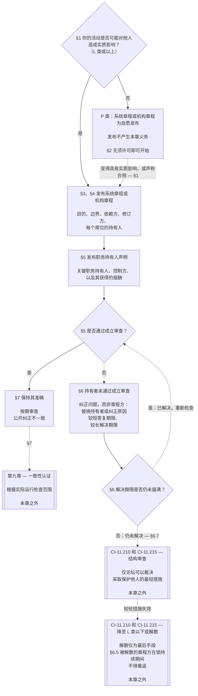

# 第七章：系统与机构章程

> **译文状态：**中文 AI 辅助草稿，尚未经独立读者审阅。带编号的英文源文仍具有约束力。本草稿包括完整第七章（§§1–7）。

<strong>文本库位置（非操作性）：文件结构与阅读规则</strong>

> 本文件是**感知者宪法**的一部分，且**只有与其他带编号的 `core_*` 文件作为同一文本一并阅读时才具有约束力**。本文件包含**第七章**：系统与机构发布范围文件的最低标准，即系统章程与机构章程。本章位于第六章权利底线之后、第[八章](../../core_08.000_functional_independence_separation_of_duties.md#chapter-eight-functional-independence-and-separation-of-duties)之前；第八章将任何实质约束行为中的席位彼此分开。
>
> - **宪法规范归属：**何时系统必须发布系统章程、何时机构必须发布机构章程（L 类及以上为强制，P 类为自愿）、章程必须载明的最低内容、修订与审查方式，以及对相关职务持有者的地位和真实性所作的成立审查。
> - **定义所在：**[系统章程](../../core_05.040_band_continuity.md#system-charter)、[机构章程](../../core_05.040_band_continuity.md#institutional-charter)、[章程角色图](../../core_05.040_band_continuity.md#charter-role-map)、[章程方](../../core_05.040_band_continuity.md#chartered-party)和[运营方](../../core_05.050_band_oversight.md#operating-party)均在第五章定义。本章适用这些术语，不另行定义。
> - **实施规范归属：**[CI-8.205 §6](../../corpus_institutions/ci_08.205_institutional_design_separation_of_powers.md#ci-8205-6-system-and-institutional-charter-contents-review-and-formation-template)（*系统与机构章程内容、审查及成立模板*）载有完整字段模板、审查清单、成立程序和成立审查声明模板。其要求可以更严格、可以增加字段，但不得缩窄本章。其文本仅在有效采纳范围内作为已纳入的实施文本而具有约束力（[第十八章 §4 采纳框架与权限范围](../../core_18.000_incorporation.md#4-adoption-framing-and-scope-of-authority)）；本章底线作为核心文本具有约束力。
> - **下游适用方：**[第八章 §5 已发布的席位安排、空缺与替补](../../core_08.000_functional_independence_separation_of_duties.md#5-published-placement-vacancy-and-substitution)要求提供章程角色图。第九章依据系统章程作出范围和边界认定，第九章 D 部分审查机构的成立审查声明。[第十章 §3.7 地位记录保管与开启权限](../../core_10.000_standing_assessment.md#37-record-custody-and-opening-authority)将其适用于地位记录。[第十三章 §4.3 机构论坛](../../core_13.000_forum.md#43-institutional-forums)审理有关机构章程的争议。
>
> 阅读顺序：§1 何时必须制定系统章程和机构章程，并附流程图 → §2 组织成立权与四项狭窄限制 → §3 章程必须载明的事项 → §4 章程角色图和地位记录保管 → §5 对职务持有者的地位和真实性进行成立审查 → §6 持有者未通过成立审查时的处理 → §7 修订、审查和范围不一致。

<strong>追溯</strong>

- 上游：
  - [宪法四元组](../../core_00.000_preamble.md#constitutional-tetrad)，尤其是**监督**与**问责**；
  - [重大利害](../../core_00.000_preamble.md#material-stake)；
  - [第一章 §18.1 治理作为获授权的结构](../../core_01.015_stewardship_capacity_principles.md#181-governance-as-authorized-structure)（1.015 §18.1）；
  - [第 XI-E 条](../../core_06.010_rights_part_b.md#article-xi-e-institutional-formation-and-business-creation)（*机构成立与企业创设*）。
- 子节：[§1](#1-何时必须制定系统章程和机构章程)；[§2](#2-组织成立权与四项狭窄限制)；[§3](#3-系统章程和机构章程必须载明的事项)；[§4](#4-章程角色图与地位记录保管)；[§5](#5-成立审查职务持有者的地位与真实性)；[§6](#6-职务持有人未通过成立审查时)；[§7](#7-修订审查与范围不一致)。
- 下游：[第八章](../../core_08.000_functional_independence_separation_of_duties.md#chapter-eight-functional-independence-and-separation-of-duties)（8.000）；[第九章](../../core_09.000_system_alignment_certification.md#chapter-nine-system-alignment-certification-reading-index)（9.000）；[第十章](../../core_10.000_standing_assessment.md#chapter-ten-contribution-violation-and-standing-model--measurement)（10.000）；[第十三章](../../core_13.000_forum.md#chapter-thirteen-forums-and-jurisdiction)（13.000）；[第十四章](../../core_14.000_governance.md#chapter-fourteen-constitutional-contract-legitimacy-authorization-and-stewardship)（14.000），以及上文指定的实施文本。
- 一并阅读：[权限层级与内部位阶](../../core_05.045_band_integrative.md#authority-stack-and-internal-hierarchy)；[系统边界](../../core_05.040_band_continuity.md#system-boundaries)；[系统边界完整性](../../core_05.040_band_continuity.md#system-boundary-integrity)；[系统创设](../../core_05.055_band_participation.md#system-creation)；[企业创设](../../core_05.055_band_participation.md#business-creation)。

 

第七章是**系统章程、机构章程和已发布范围**的宪法规范归属。

三个章节构成同一链条：

- **第七章（本章）：**说明[章程方](../../core_05.040_band_continuity.md#chartered-party)声称要做什么，以及其行动时每个席位由谁持有。
- **[第八章](../../core_08.000_functional_independence_separation_of_duties.md#chapter-eight-functional-independence-and-separation-of-duties)：**规定如何将这些席位彼此分开。
- **[第九章](../../core_09.000_system_alignment_certification.md#chapter-nine-system-alignment-certification-reading-index)：**认证系统，也分别认证机构；每一次认证都是运用这些席位的一项约束行为，并将认定结果反馈至系统章程或机构章程。

其他章节规定本章所引用的定义、席位规则、地位锁和决定规则。**CI-8.205 §6**（*系统与机构章程内容、审查及成立模板*）载有字段模板、成立程序和审查清单。

### 1. 何时必须制定系统章程和机构章程

<strong>追溯</strong>

- 上游：[§2](#2-组织成立权与四项狭窄限制)；[重大利害](../../core_00.000_preamble.md#material-stake)；[比例原则](../../core_05.035_band_accountability.md#proportionality)及本章开篇所述规范归属；[第一章 §18 受托纪律下的治理](../../core_01.015_stewardship_capacity_principles.md#18-governance-under-stewardship-discipline)；[监督](../../core_05.020_apex_oversight_leg.md#oversight-constitutional)；[问责](../../core_05.005_apex_accountability_leg.md#accountability)。
- 下游：[§3](#3-系统章程和机构章程必须载明的事项)；[第九章 A 部分 §2 系统类别评估](../../core_09.005_system_alignment_certification_evaluation.md#2-system-class-evaluation)（9.005 §2）（*类别和认证深度*）；[第九章 D 部分 §12.1 机构类别](../../core_09.020_institutional_alignment_certification.md#121-institution-class)（9.020 §12.1）（*机构类别*）；类别目录见**CS-9.305（*系统分类机制*）和 CS-9.310**（*系统分类机制*）。
- 一并阅读：**CI-8.205 §6**（*系统与机构章程内容、审查及成立模板*）；**CF-13.415 §5**（*机构与地方登记员*）；**CI-9.210**（*与分类挂钩的机构义务*）；[第五章 系统章程](../../core_05.040_band_continuity.md#system-charter)；[第五章 机构章程](../../core_05.040_band_continuity.md#institutional-charter)；[第 XI-E 条](../../core_06.010_rights_part_b.md#article-xi-e-institutional-formation-and-business-creation)（*机构成立与企业创设*）。

<strong>定义 · 评估 · 合规</strong>

- [系统章程](../../core_05.040_band_continuity.md#system-charter) · [O](../../core_05.040_band_continuity.md#system-charter) · [M](../../core_05.040_band_continuity.md#system-charter-a) · [A](../../core_05.040_band_continuity.md#system-charter-a) · [C](../../core_05.040_band_continuity.md#system-charter-c)
- [机构章程](../../core_05.040_band_continuity.md#institutional-charter) · [O](../../core_05.040_band_continuity.md#institutional-charter) · [M](../../core_05.040_band_continuity.md#institutional-charter-a) · [A](../../core_05.040_band_continuity.md#institutional-charter-a) · [C](../../core_05.040_band_continuity.md#institutional-charter-c)
- [按分类调整的治理](../../core_05.050_band_oversight.md#classification-scaled-governance) · [O](../../core_05.050_band_oversight.md#classification-scaled-governance) · [M](../../core_05.050_band_oversight.md#classification-scaled-governance-a) · [A](../../core_05.050_band_oversight.md#classification-scaled-governance-a) · [C](../../core_05.050_band_oversight.md#classification-scaled-governance-c)

 

*通俗地说：在判断系统或机构是否符合宪法标准之前，其系统章程或机构章程必须先说明其权限主张是什么。是否符合标准要用系统分类记录和认证来判断；章程不是授权书，也不是认证记录。*

系统章程或机构章程，是章程方公开发布的范围说明：它声称有权做什么、无权做什么，以及采取行动时每个席位由谁持有。第八章的席位安排以此范围为依据；第九章的认证则将其与实际运行对照。运营方是否必须发布章程，取决于其类别：L 类及以上为强制，P 类为自愿。若负有发布义务，也必须保持章程准确。

以下内容以五种系统影响类别为框架，按影响由重至轻排列：

- **A 类，生存关键、基础性且不可替代：**在与生存相关的时间内发生故障，且没有可行替代方案，就会丧失生存条件。
- **B 类，关键、高依赖且具系统重要性：**依赖方若没有它便无法维持核心功能；生存不会立即受损，而且仍来得及替代。
- **C 类，协同、高依赖且非关键：**它会影响大规模协同，但不是 A 类或 B 类功能的运行前提。
- **L 类，本地、影响有限且非关键：**影响超出私人单元，但范围局部、可替代且可控制。
- **P 类，个人、私人用途、隔离且实验性：**影响仅限私人单元，不存在有意义的外部依赖。

[CS-9.310 §8](../../corpus_systems/cs_09.310_system_impact_classifications.md#cs-9310-8-system-impact-classifications)载有完整定义。A、B、C、L 类必须发布章程，P 类可以自愿发布；[§1.2 哪些类别适用](#12-哪些类别适用)说明机构如何依据其运营的系统确定类别。

#### 1.1 谁必须发布

L 类或更高类别的系统必须发布并维护[系统章程](../../core_05.040_band_continuity.md#system-charter)。L 类或更高类别的机构必须发布并维护适合其所运营系统的章程：

| 机构运营、受托管理或实质控制的对象 | 应发布的文件 |
| --- | --- |
| 恰好一个需要系统章程的系统 | 只发布该系统章程，不另行发布第二份文件。章程须将机构列为受托管理者，并同时作为[机构章程](../../core_05.040_band_continuity.md#institutional-charter)：一份文件涵盖两者。 |
| 多于一个此类系统 | 发布机构章程，其中纳入这些系统各自现行的系统章程，并说明机构为何运营这些系统（[§3 章程必须载明的事项](#3-系统章程和机构章程必须载明的事项)）。 |
| 没有此类系统 | 发布机构章程，载明该机构在[§3 章程必须载明的事项](#3-系统章程和机构章程必须载明的事项)中自身适用的项目；无需纳入系统章程。 |

- **企业及类似形式：**企业或其他受托管理的组织形式，应根据其作为系统、机构或运营受涵盖系统的机构所处情形，发布相应的系统章程或机构章程。法律形式不改变结论。
- **联合专业执业：**L 类及以上的感知者或小型执业团体，如从事列入执业许可或执业准入清单的行为，可通过采用东道方的系统章程或机构章程及章程角色图，满足本节对这些行为的要求：
  - **采用内容：**以引用方式采用联合专业执业东道方的系统章程或机构章程及章程角色图；所采用文件必须涵盖这些行为。
  - **采用通知：**采用 **CI-14.205 §7**（*执业许可、执业准入与联合专业执业*）所述的一页通知。
  - **类别：**执业团体仍按其自身行为所确定的类别归类。

#### 1.2 哪些类别适用

章程方的类别决定发布章程是强制还是自愿：

- **A、B、C 和 L 类：**必须发布。[§1.7 流程一览](#17-流程一览)图展示了应遵循的流程。
- **P 类：**在以下两种情况之一触发强制要求之前，可自愿发布。[§1.3 P 类是什么](#13-p-类是什么)说明运营方何时属于 P 类，[§1.4 P 类：章程自愿及何时转为强制](#14-p-类章程自愿及何时转为强制)规定该选择和选择结束的时点。
- **机构类别：**机构采用其运营、受托管理或实质控制的任何系统中的最高类别。若不运营这类系统，则根据机构自身实质影响和依赖关系确定类别；应看其实际决策和控制事项，而非标签或法律形式，详见[第九章 D 部分 §12.1 机构类别](../../core_09.020_institutional_alignment_certification.md#121-institution-class)。

#### 1.3 P 类是什么

运营方只有在九个[领域特定实质性](../../core_05.050_band_oversight.md#domain-specific-materiality)领域中都低于界线时才属于 P 类。实际上，其行为及影响必须始终处于[私人单元](../../core_05.050_band_oversight.md#domain-specific-materiality-private-unit)范围内：

- **跨越界线：**在任何一个领域跨线，就会依照**CS-9.305（*系统分类机制*）和 CS-9.310**至少归为 L 类，不论其规模或名称。
- **所有领域都低于界线：**成员数量不会改变类别；其仍为 P 类。
- **参与其中的人：**P 类身份也取决于身处其中的人。任何身处其中的人若发现运营方跨越界线，都必须报告；该报告受到保护（[领域特定实质性](../../core_05.050_band_oversight.md#domain-specific-materiality)）。

第八章的四席底线不适用于仍处于私人单元内的 P 类运营方行为。因此，单个感知者配一台计算机无需第二名席位持有者。运营方一旦作出[实质约束行为](../../core_05.035_band_accountability.md#materially-binding-act)，且其他方必须遵守或可将其视为确定事项予以依赖，四席底线便开始适用。该行为跨越对他人行使权限的领域界线，使其至少成为 L 类。

#### 1.4 P 类：章程自愿及何时转为强制

鼓励 P 类运营方发布适合其运作情况的[系统章程](../../core_05.040_band_continuity.md#system-charter)（单一系统）或[机构章程](../../core_05.040_band_continuity.md#institutional-charter)（多个系统或没有系统）。它可以将[§3 章程必须载明的事项](#3-系统章程和机构章程必须载明的事项)中的内容清单和[§4 章程角色图及地位记录保管](#4-章程角色图与地位记录保管)中的席位图作为模板。发布章程不会产生本章流程规定的义务：

- 没有到期日（[§1.5 系统章程或机构章程的到期时间](#15-系统章程或机构章程的到期时间)）；
- 无需进行成立审查（[§5 成立审查：职务持有者的地位与真实性](#5-成立审查职务持有者的地位与真实性)）；
- 无需提供[章程角色图](../../core_05.040_band_continuity.md#charter-role-map)（[§4 章程角色图及地位记录保管](#4-章程角色图与地位记录保管)），但可将其附在自愿发布的章程中，也可单独发布；并且
- 无强制的修订或审查周期（[§7 修订、审查与范围不一致](#7-修订审查与范围不一致)）。

若发生以下任一情形，发布章程就不再是自愿的：

- 运营方被重新分类为 L 类或更高类别；或
- 其运营者声称该运营方符合宪法。

届时运营方必须依照[§1.5](#15-系统章程或机构章程的到期时间)规定的时间表，发布适合其情况的系统章程或机构章程。

**承认成员身份不取决于范围文件。**无论某群体是否有系统章程或机构章程、属于何种类别，该群体都不会阻碍对其成员的承认。每个成员都可作为个人申请人，就在群体内外完成的工作申请贡献记录；记录认定的是该成员的贡献，而非群体的地位（[第十章 §3.7 非正式与小范围记录](../../core_10.000_standing_assessment.md#37-informal-and-small-scope-records)）。提供他人无义务接受的援助、物资、劳动或服务，不构成实质约束行为。因此，向难民赠送被子的互助小组无需系统章程或机构章程，其成员也可获得承认。

#### 1.5 系统章程或机构章程的到期时间

受本章约束的系统或机构按照以下时间表发布其[系统章程](../../core_05.040_band_continuity.md#system-charter)或[机构章程](../../core_05.040_band_continuity.md#institutional-charter)：

- **新系统或新机构：**开始上线或对他人行使权限之前。
- **已经运营的系统或机构：**在下一次分类审查或认证时发布；或者在根据[§1.6 系统章程或机构章程缺失时](#16-系统章程或机构章程缺失时)收到请求后的解决期限内发布，以先发生者为准。发布前处于违约状态。
  - **哪一种认证：**系统须进行系统一致性认证；机构须依照[第九章 D 部分 §11.3 不设许可，也不设门槛](../../core_09.020_institutional_alignment_certification.md#113-no-permission-and-no-gate)进行机构一致性认证。首次认证期限绝不能成为发布机构章程或开始运营的条件。
- **成立审查：**同时完成[§5 成立审查：职务持有者的地位与真实性](#5-成立审查职务持有者的地位与真实性)中的成立审查。
- **提交地点：**系统章程或机构章程连同章程角色图及成立审查声明，提交给机构登记员；若其活动和受影响的感知者都在本地，则提交给地方登记员（**CF-13.415 §5**，*机构与地方登记员*）：
  - **登记员的职责：**检查是否缺少任何强制内容，并出具注明日期的收据。
  - **登记员不得做的事：**不得授予许可，也不得裁定类别或内容。
  - **收据迟延或缺失：**绝不阻止章程方继续运营。

#### 1.6 系统章程或机构章程缺失时

任何人发现 L 类或更高类别的章程方（包括新近进入该类别者）尚未发布系统章程或机构章程，都可向其治理机构请求该章程。请求人无需具备诉讼或其他资格，无需付费，也无需证明受到损害。请求须指明章程方，并说明其看起来为何属于受约束对象。

请求提交后，答复期限与解决期限同时开始。每个期限均按章程方类别对应字母的 Tier 计算；类别越关键，期限越短：

| 类别与 Tier | 答复期限（受理目标） | 解决期限（最终上限） |
|---|---|---|
| A 类、Tier A | 24 小时 | 7 个日历日 |
| B 类、Tier B | 2 个日历日 | 14 个日历日 |
| C 类、Tier C | 4 个日历日 | 30 个日历日 |
| L 类、Tier L | 8 个日历日 | 60 个日历日 |

这些数字来自 **CF-13.445 §3.1**（*阶段目标与时间底线*）；如有不同，以该条为准。若章程方对类别提出异议，在问题解决前，按其系统分类记录中的类别与请求人或论坛初步证明的类别中较关键者所对应的 Tier 计算。尚无记录类别的章程方，或类别受质疑期间记录为 P 类的章程方，按 Tier C 计算。

期限按以下方式适用：

- **答复期限：**章程方须在相应 Tier 的 **CF-13.445 §3.1**受理目标内答复，自请求之日起计算。答复可为发布章程、告知计划发布日期、指明已发布的章程，或说明其活动低于所有[领域特定实质性](../../core_05.050_band_oversight.md#domain-specific-materiality)界线，并提供该入口要求的书面说明。
- **解决期限：**章程及与其相应的成立审查声明（[§5 成立审查](#5-成立审查职务持有者的地位与真实性)）须在 **CF-13.445 §3.1**相应 Tier 的最终上限内提交，自请求之日起计算。尚无独立席位的章程方按该节规定，以声明形式连同证据提交。
- **运营方声称其活动未达界线：**该请求同时构成该条目*挑战途径*所规定的分类挑战：
  - **期限继续计算：**挑战待决期间，解决期限仍继续计算。
  - **挑战延期：**若有管辖权的论坛认定挑战值得审查，截止日延期；挑战裁决后，新的解决期限开始。论坛须在相应 Tier 的最终上限内裁决挑战。
  - **“值得审查”的含义：**挑战须指出特定领域中的具体越界，且运营方的书面说明对该越界留下真实疑问。运营方不得自行判断挑战是否值得审查；未提供书面说明的答复不延长截止日。
  - **若确定了类别：**无论是本次挑战还是其他挑战，类别认定日均视为请求日；答复期限和解决期限从该日起按认定类别的 Tier（A、B、C 或 L）计算。
- **错过期限：**未答复或未在截止日前发布章程，是须记录并纠正的缺陷。请求人可按同一途径将问题提交有管辖权的论坛。该要求绝不是成立或运营的条件。
- **重复请求：**前次答复或认定仍然有效期间，对同一章程方提出第二次请求，不会重新开始答复或解决期限。章程方可指向前次答复或认定。章程方自行声称活动低于所有界线、且论坛尚未审查的，不构成仍有效的答复。依照[第九章 D 部分 §14.2 重新开启的触发条件](../../core_09.020_institutional_alignment_certification.md#142-reopening-triggers)，出现以下情形之前，答复或认定持续有效：
  - **重大变化：**章程方的活动发生实质变化。
  - **新证据：**出现有关越界的新证据。

请求若表明发生上述任一情形，就不是重复请求，而是单独处理的新请求；其答复和解决期限自各自请求日计算，先前答复、认定和期限均不能替代或改变新请求的处理。
- **此期间的范围：**缺少章程不意味着章程方没有边界。在章程发布前，适用其实际[系统边界](../../core_05.040_band_continuity.md#system-boundaries)及其类别；认证机构或论坛可依据观察到的实际运行重建范围。

#### 1.7 流程一览

图示跟随一个运营方从“其行为是否对他人产生实质影响”的问题开始，经过发布系统章程或机构章程，直到持续保持其准确性。如果问题未在解决期限内纠正，章程流程会将其转交本章以外规定的审查。后续各节按相同顺序解释每个步骤。

<strong>读者指南（非操作性）：如何阅读图示</strong>

> 通俗地说：没有人授予系统章程或机构章程，也没有人需要许可才能成立组织。活动对他人有实质影响的章程方应公开其声称拥有的权限及各席位持有人，并对其关键职务持有者进行检查。未通过检查的持有者应被替换，或应纠正造成问题的原因；章程方随后继续运营。若解决期限结束时仍未纠正，论坛可审查章程方，并从保护他人所需的最轻措施开始。只有较轻措施失效后，才考虑将章程方缩减至 L 类以下或予以解散。被解散的章程方在相关锁持续期间不得重返。
>
> 实线箭头表示主流程。虚线箭头表示例外和移交，并标明对应条款。两侧带双竖线的方框属于其他章节或已纳入的实施文本。图示不增加义务、席位或字段；其中任何步骤都不是许可授予。

 

### 2. 组织成立权与四项狭窄限制

<strong>读者指南（非操作性）：本节结构</strong>

- [§2.1 组织成立权](#21-组织成立权)说明权利及其不涵盖的情况。
- [§2.2 第一项限制：对某感知者尚未解除的锁](#22-第一项限制对某感知者尚未解除的锁)说明锁如何使一名指定感知者不得担任一个控制性职务。
- [§2.3 第二项限制：基于特定已核实事实的短期暂缓](#23-第二项限制基于特定已核实事实的短期暂缓)说明短期暂缓如何产生同样的职务限制。
- [§2.4 第三项限制：对运营方本身施加的锁](#24-第三项限制对运营方本身施加的锁)说明对运营方及其继任者的禁令，以及已解散章程方不得重返。
- [§2.5 第四项限制：执业许可或执业核准](#25-第四项限制执业许可或执业核准)说明何时指定的高风险行为需要许可或核准；这不是组织成立的门槛。

<strong>追溯</strong>

- 上游：[§1](#1-何时必须制定系统章程和机构章程)；[第 XI-E 条](../../core_06.010_rights_part_b.md#article-xi-e-institutional-formation-and-business-creation)（*机构成立与企业创设*）。
- 下游：[§1 何时必须制定系统章程和机构章程](#1-何时必须制定系统章程和机构章程)；[§5 成立审查：职务持有者的地位与真实性](#5-成立审查职务持有者的地位与真实性)。
- 一并阅读：[临时暂缓](../../core_05.035_band_accountability.md#interim-hold)；[第十一章 §4.2 预防——一般地位锁](../../core_11.000_standing_integration.md#42-prevention--general-standing-locks)（11.000 §4.2）；[第十一章 §5.5 特别锁](../../core_11.000_standing_integration.md#55-special-locks)（11.000 §5.5）；[第十三章 §5 对指定感知者路径的临时暂缓](../../core_13.000_forum.md#interim-hold-on-a-named-sentients-pathway)（13.000 §5）。

 

*通俗地说：成立系统、机构或企业无需任何人的许可。可能适用四项狭窄限制。其中三项是门槛：尚未解除的锁可禁止一名感知者担任一个控制性职务；根据特定已核实事实作出的短期暂缓也可如此；对运营方本身施加的锁可禁止该运营方。第四项可要求在实施指定的高风险行为前取得许可或核准。论坛解散的章程方不得重返；若解散依据是广泛的反宪法行为，或严重且无法挽回的损害尚未补救，该禁令永久有效。这些限制都不妨碍新运营方成立或运营，本章也不另加限制。*

**第 XI-E 条**（*机构成立与企业创设*）允许四项狭窄限制：

- **前三项是成立运营方或在其中担任职务的唯一门槛：**每项限制均针对指定对象：
  - **尚未解除的锁**（[§2.2](#22-第一项限制对某感知者尚未解除的锁)）针对在一个控制章程方的职务中担任职务的指定感知者。
  - **临时暂缓**（[§2.3](#23-第二项限制基于特定已核实事实的短期暂缓)）仅针对在一个控制章程方的职务中担任职务的指定感知者。
  - **对运营方本身施加的锁**（[§2.4](#24-第三项限制对运营方本身施加的锁)）针对本身受到锁的章程方，包括已被论坛解散的章程方。
- **第四项不是成立门槛：**它是执业许可或执业核准（[§2.5](#25-第四项限制执业许可或执业核准)）。

#### 2.1 组织成立权

任何人都可以成立新的系统、机构或企业。[第 XI-E 条](../../core_06.010_rights_part_b.md#article-xi-e-institutional-formation-and-business-creation)规定了这项权利。本章增加的是随之而来的义务：当运营方在[领域特定实质性](../../core_05.050_band_oversight.md#domain-specific-materiality)的九个领域中，任何一个领域的活动对他人产生实质影响时，它必须事先公开其声称具有的权限（[§1](#1-何时必须制定系统章程和机构章程)）。采纳系统章程或机构章程不得被解释为缩限该组织成立权或任何权利底线保护。

**组织成立权不涵盖的情况。**除[§2.2](#22-第一项限制对某感知者尚未解除的锁)、[§2.3](#23-第二项限制基于特定已核实事实的短期暂缓)和[§2.4](#24-第三项限制对运营方本身施加的锁)中的三项门槛外，**第 XI-E 条**（*机构成立与企业创设*）不保护以下运营方：

- 旨在违反宪法约束、破坏安全或真理，或以[第一章 §11 市场结构](../../core_01.005_values_principles.md#11-market-structure)所禁止的方式集中权力的运营方；或
- 由创始人设立或运营，但经核实的行为、控制关系和报酬显示其与所声明目的并非真实一致，或创始人意图误导他人有关目的、控制或利益，或意图伤害他人的运营方。

论坛依据该条裁决此类案件，且后果仅限于该条规定的三项门槛：尚未解除的锁、临时暂缓，以及对运营方本身施加的锁。未通过成立审查只是论坛权衡的一项证据；成立审查本身不决定案件结果。

#### 2.2 第一项限制：对某感知者尚未解除的锁

经核实的违规发生后施加且尚未解除的[一般地位锁](../../core_11.000_standing_integration.md#42-prevention--general-standing-locks)或[特别锁](../../core_11.000_standing_integration.md#55-special-locks)，会禁止一名指定感知者对这类机构或企业行使权限。

- **禁止事项：**在运营方中取得或行使治理、控制或所有权权限。
- **适用范围：**仅限该锁所规定的范围；锁解除或缩窄时，禁令随之终止或缩小。
- **对运营方本身施加的锁：**见[§2.4](#24-第三项限制对运营方本身施加的锁)。

#### 2.3 第二项限制：基于特定已核实事实的短期暂缓

若有管辖权的论坛依据特定已核实事实命令[临时暂缓](../../core_05.035_band_accountability.md#interim-hold)，且这些事实表明持有者与章程方的既定目的不一致的可能性超过相反可能性，则本项限制适用。只有该论坛可以命令暂缓（[第十三章 §5 对指定感知者路径的临时暂缓](../../core_13.000_forum.md#interim-hold-on-a-named-sentients-pathway)）。章程方不得自行决定禁止某人担任职务，因为那会使其成为自己成员案件的裁判者。完整依据见该[第十三章 §5](../../core_13.000_forum.md#interim-hold-on-a-named-sentients-pathway)；本简述不能替代原条文。

#### 2.4 第三项限制：对运营方本身施加的锁

锁可以针对运营方本身，而不只针对某个感知者。此时，门槛禁止在该运营方及其继任者、受控实体，以及通过名义持有人或空壳持有的载体中，从事该锁指定路径所列事项。其他运营方不受此禁令影响。

- **最终认定所设的锁：**若最终认定指定某机构、继任载体或受控实体，[反宪法信托锁](../../core_11.000_standing_integration.md#55-special-locks)即以此方式适用。该门槛禁止在章程方及其继任者、受控实体，以及通过名义持有人或空壳持有的载体中，从事锁指定路径所列事项。
- **已解散的章程方：**依照 **CI-11.210 §4**（*解散*）作出的最终解散命令，会设立[解散后重组锁](../../core_11.000_standing_integration.md#55-special-locks)。该锁有效期间，已解散的章程方、其继任者、受控实体、名义持有人或空壳持有的载体，以及与其构成同一运营体的任何运营方，都不得以任何名称或形式重组、复活或运营。若命令认定存在普遍的反宪法行为，或未补救的不可逆损害（[第十一章 §8 恢复与重新评估](../../core_11.000_standing_integration.md#8-restoration-and-reassessment)），该锁永久有效；时间经过、原因已解决或持有人变更都不会使其解除。只有在复审中撤销解散命令，或有重大新核实事实证明原认定错误时，该锁才终止。其他情况下，只有经独立认定原因已解决、补救已完成，且重返比继续排除更安全时，锁才终止。该锁不禁止任何感知者成立不同的运营方。

三项门槛都不会阻止新的运营方成立、发布系统章程或机构章程，或开始工作。它们只阻止本身受到锁的主体，例如试图重返的已解散章程方。三项门槛均在成立审查中适用（[§5](#5-成立审查职务持有者的地位与真实性)）。

#### 2.5 第四项限制：执业许可或执业核准

第四项限制针对指定行为，而非运营方的成立：

- **不是运营方成立门槛：**[§5 成立审查](#5-成立审查职务持有者的地位与真实性)不适用此项限制。
- **限制的形式：**根据**第 XI-E 条**（*机构成立与企业创设*），采纳方可依据技术论坛公布的风险认定，要求在为他人实施指定行为前取得[能力核准](../../core_05.035_band_accountability.md#competency-clearance)。
  - **执业许可：**若行为做得不当会造成严重或不可逆损害，则须取得许可。
  - **执业核准：**若行为做得不当会造成实际但较轻损害，则须取得核准。
- **适用对象：**实施该行为。它绝不阻止运营方成立、发布系统章程或机构章程，或继续运营。
- **实际禁止事项：**没有许可或核准却声称有权实施或实际实施该行为。除非实施行为的持有者有相应许可或核准，否则系统章程或机构章程不得将该行为列为可实施事项（[§3](#3-系统章程和机构章程必须载明的事项)）。

### 3. 系统章程和机构章程必须载明的事项

<strong>读者指南（非操作性）：本节结构</strong>

- [§3.1 系统章程载明的事项](#31-系统章程载明的事项)列出九项内容。
- [§3.2 章程指针](#32-章程指针)说明系统章程或机构章程可以引用另一份已发布文件，而不复制其内容，并说明有效引用的条件。
- [§3.3 机构章程增加的内容](#33-机构章程增加的内容)说明机构章程除九项内容外，还须收纳该机构所运营系统的系统章程，以及机构运营这些系统的理由。
- [§3.4 需要执业许可或执业核准的行为](#34-需要执业许可或执业核准的行为)说明，只有在每位实施者都持有许可或核准，或在持有许可或核准的监督者指导下学习时，系统章程或机构章程才可列入该行为；在此之前，该行为须列为范围外（[§3.1](#31-系统章程载明的事项)第4项）。
- [§3.5 按类别调整](#35-按类别调整)说明哪些事项随类别变化。

<strong>追溯</strong>

- 上游：[§1](#1-何时必须制定系统章程和机构章程)；[第五章 系统章程](../../core_05.040_band_continuity.md#system-charter)（5.040）；[第五章 机构章程](../../core_05.040_band_continuity.md#institutional-charter)（5.040）。
- 下游：[§4](#4-章程角色图与地位记录保管)；[§7](#7-修订审查与范围不一致)；[第九章 B 部分 §8.1 最低记录内容](../../core_09.010_system_alignment_certification_record_process.md#81-minimum-record-contents)（9.010 §8.1）（*认证记录所依赖的系统章程字段*）；完整字段清单见**CI-8.205 §6**（*系统与机构章程内容、审查及成立模板*）。
- 一并阅读：[第十八章 §4 采纳框架与权限范围](../../core_18.000_incorporation.md#4-adoption-framing-and-scope-of-authority)（18.000 §4）（*以其他名称维护的范围文件*）；[第十四章 §4.3 对具有约束力的利益相关方选择之决定与解决要求](../../core_14.000_governance.md#43-decision-resolution-requirements-for-binding-stakeholder-choice)（14.000 §4.3）；**CI-6.205 §1**（*利益相关方监督、通知与约束性治理途径的完整性*）；**CI-6.205 §2**（*反权力集中与参与正当性保障*）。

<strong>定义 · 评估 · 合规</strong>

- [系统章程](../../core_05.040_band_continuity.md#system-charter) · [O](../../core_05.040_band_continuity.md#system-charter) · [M](../../core_05.040_band_continuity.md#system-charter-a) · [A](../../core_05.040_band_continuity.md#system-charter-a) · [C](../../core_05.040_band_continuity.md#system-charter-c)
- [机构章程](../../core_05.040_band_continuity.md#institutional-charter) · [O](../../core_05.040_band_continuity.md#institutional-charter) · [M](../../core_05.040_band_continuity.md#institutional-charter-a) · [A](../../core_05.040_band_continuity.md#institutional-charter-a) · [C](../../core_05.040_band_continuity.md#institutional-charter-c)
- [章程角色图](../../core_05.040_band_continuity.md#charter-role-map) · [O](../../core_05.040_band_continuity.md#charter-role-map) · [M](../../core_05.040_band_continuity.md#charter-role-map-a) · [A](../../core_05.040_band_continuity.md#charter-role-map-a) · [C](../../core_05.040_band_continuity.md#charter-role-map-c)

 

*通俗地说：系统章程必须具体到可以接受检验。它说明系统的目的、系统做什么及不做什么、谁依赖系统、谁可以修订章程、每个席位由谁持有，以及在哪里查阅具有约束力的决定规则。系统章程指向这些规则，但不取代它们。机构章程对机构本身说明同样事项，并增加其所持有的系统章程，以及机构运营这些系统的理由。*

#### 3.1 系统章程载明的事项

系统章程须以受影响的感知者和审计员都能读懂的直白语言载明：

1. **身份与版本：**名称、受托人或治理机构、版本、生效日期和变更历史。
2. **目的：**章程方成立的目的。
3. **范围内活动：**章程方声称拥有的职能、服务、权限和领域。
   - **这是主张，不是授予：**文件陈述章程方已经拥有的权限，不会赋予任何权限。该权限是否正当，包括其是否依据宪法章程，依照[第十四章 §1 治理权限的授权与正当性](../../core_14.000_governance.md#1-authorization-and-legitimacy-of-governing-authority)裁定。
4. **范围外限制：**章程方无权行使且具有实质意义的活动、权限和领域。
5. **受影响群体与依赖关系：**谁依赖章程方，以及章程方依赖或控制哪些系统或基础设施（如有实质影响）。
   - **不得借此选择退出：**不把某个群体列入清单，不会使其脱离范围。章程方对某感知者产生实质影响时，该感知者无论是否被点名都享有所有权利底线保护；若清单比实际依赖关系狭窄，则按实际依赖关系解释。
6. **分类假设：**所依赖的类别或受托层级，并通过[章程指针](../../core_05.040_band_continuity.md#charter-pointer)指向**CS-9.305（*系统分类机制*）和 CS-9.310**（*系统分类机制*），以及在适用时的**CS-14.305**（*关键系统受托管理*）。
7. **章程角色图：**[章程角色图](../../core_05.040_band_continuity.md#charter-role-map)，或指向构成章程角色图的已发布文件的章程指针（[§4 章程角色图和地位记录保管](#4-章程角色图与地位记录保管)）。
8. **具有约束力的利益相关方选择之章程指针：**
   - **适用情形：**当受影响感知者之间存在真实分歧，且系统内需要作出具有约束力的利益相关方选择时适用。[定义 P2 具有约束力的利益相关方选择](../../core_05.055_band_participation.md#defp2-binding-stakeholder-choice)将此称为其准入范围。
   - **指向的内容：**通过有效章程指针指向三套已发布规则：决定顺序（如何作出选择）、权重规则（各方有多大决定权），以及权利冲突记录规则（权利冲突时记录必须载明什么）。
   - **内容由谁承载：**系统章程只持有指针。三套规则分别载明选择如何作出、权重如何设定、记录必须显示什么。系统章程本身不载有这些内容，也不得用章程文本替代相应规则。指针失效，或以系统章程文本替代规则，均不符合系统章程义务。
9. **修订权限：**谁可以修订、何为实质修订，以及通知和争议途径。

#### 3.2 章程指针

系统章程或机构章程可以指向另一份已发布文件或条文（规则集、章程角色图、系统章程），而不复制其内容。每项此类引用都是[章程指针](../../core_05.040_band_continuity.md#charter-pointer)，必须指向仍有效、最新且已发布的文件。失效或过时的章程指针视为缺失事项。

#### 3.3 机构章程增加的内容

机构章程必须针对机构本身载明[§3.1 系统章程载明的事项](#31-系统章程载明的事项)第1至第9项，并另行收纳：

- **系统章程：**该机构运营、受托管理或实质控制的每个系统当前有效的系统章程；可完整收纳，也可通过指向当前已发布版本的章程指针收纳。
- **组合理由：**机构为何运营这些特定系统、这些系统如何服务于其既定目的并彼此关联，以及它们共同依赖什么。未说明理由的系统属于缺失事项。

**CI-8.205 §6**（*系统与机构章程内容、审查及成立模板*）可以要求更多内容并设定成立模板，但不得删去上述任何事项。

#### 3.4 需要执业许可或执业核准的行为

本小节说明，对于需要执业许可或执业核准的行为，系统章程或机构章程可以作何主张。

- **限制：**若某行为需要执业许可或执业核准，除非每位实施者都持有相应许可或核准，或在持有者监督下作为学习者工作，否则系统章程或机构章程不得将该行为列为章程方所做之事，章程方也不得实施。
- **在此之前：**根据第4项，该行为列为范围外（[§3.1](#31-系统章程载明的事项)）。
- **未持有许可却列入章程：**该事项须作为缺陷记录并纠正，但不会阻止章程方成立、发布章程或继续其他工作。
- **进一步规定：**[§2 组织成立权与四项狭窄限制](#2-组织成立权与四项狭窄限制)说明此要求的来源；**CI-14.205 §7**（*执业许可、执业核准与联合专业执业*）载有条目和主办方检查。

#### 3.5 按类别调整

系统章程或机构章程的部分内容随类别调整，部分内容不随类别调整：

- **随类别调整的事项：**章程深度、审查频率和审查独立性根据类别和[重大利害](../../core_00.000_preamble.md#material-stake)调整。
- **L 类：**若[按分类调整的治理](../../core_05.050_band_oversight.md#classification-scaled-governance)允许，L 类系统或机构的章程可以简短，记录也可较为简化，但仍须涵盖每一项必备内容。
- **审查频率：**系统章程或机构章程不决定自身审查频率；该频率由类别规定。

### 4. 章程角色图与地位记录保管

<strong>读者指南（非操作性）：本节结构</strong>

- [§4.1 席位及其存在理由](#41-席位及其存在理由)回顾四个席位，以及为何不得由同一方在同一行为中填补第八章禁止的席位组合。
- [§4.2 有效席位安排的条件](#42-有效席位安排的条件)说明检验标准（独立性、空缺与替补、合并承载）由第八章规定，角色图只记录席位由谁担任。
- [§4.3 系统章程或机构章程对角色图的义务](#43-系统章程或机构章程对角色图的义务)说明章程须包含角色图或指向该图；图缺失、指针失效或图过时，均构成章程缺陷。
- [§4.4 哪份章程承载哪张图](#44-哪份章程承载哪张角色图)说明一个机构章程涵盖多个系统，以及如何共用角色图。
- [§4.5 更改席位规则与席位持有人](#45-更改席位规则与席位持有人)说明更改谁可以担任席位属于修订；更改当前持有人则发布带日期的新图版本，且只有在通知并给予异议机会后才生效。
- [§4.6 地位记录保管](#46-地位记录保管)说明角色图须为地位记录载明哪些内容，分为[§4.6.1 运营方地位记录](#461-运营方地位记录)和[§4.6.2 利益相关方地位记录](#462-利益相关方地位记录)。
- [§4.7 运营方地位记录图中的空缺](#47-运营方地位记录图中的空缺)说明必需席位未指定或没有合格持有人时的后果，分为[§4.7.1 空缺的认定与记录](#471-空缺的认定与记录)、[§4.7.2 空缺期间](#472-空缺期间)、[§4.7.3 事件导致最后一名合格替补失去资格时](#473-事件导致最后一名合格替补失去资格时)和[§4.7.4 认证席位](#474-认证席位)。

<strong>追溯</strong>

- 上游：[§3](#3-系统章程和机构章程必须载明的事项)；[第八章 §2 四席宪法底线](../../core_08.000_functional_independence_separation_of_duties.md#2-four-seat-constitutional-floor)（8.000 §2）。
- 下游：[第八章 §5 已发布的席位安排、空缺与替补](../../core_08.000_functional_independence_separation_of_duties.md#5-published-placement-vacancy-and-substitution)（8.000 §5）；[第九章 B 部分 §6.1.1 认证中的四个席位](../../core_09.010_system_alignment_certification_record_process.md#611-four-seats-in-a-certification)（9.010 §6.1.1）；[第十章 §3.7 地位记录保管与开启权限](../../core_10.000_standing_assessment.md#37-record-custody-and-opening-authority)（10.000 §3.7）；**CI-8.205 §2**（*功能分离路径*）；**CI-14.205 §5**（*授权角色与问责链*）；**CI-14.205 §6**（*席位目录——流程角色原型及其操作边界*）。
- 一并阅读：[实质控制线](../../core_05.035_band_accountability.md#material-control-line)；[地位记录](../../core_05.035_band_accountability.md#standing-record)。

<strong>定义 · 评估 · 合规</strong>

- [章程角色图](../../core_05.040_band_continuity.md#charter-role-map) · [O](../../core_05.040_band_continuity.md#charter-role-map) · [M](../../core_05.040_band_continuity.md#charter-role-map-a) · [A](../../core_05.040_band_continuity.md#charter-role-map-a) · [C](../../core_05.040_band_continuity.md#charter-role-map-c)
- [系统章程](../../core_05.040_band_continuity.md#system-charter) · [O](../../core_05.040_band_continuity.md#system-charter) · [M](../../core_05.040_band_continuity.md#system-charter-a) · [A](../../core_05.040_band_continuity.md#system-charter-a) · [C](../../core_05.040_band_continuity.md#system-charter-c)
- [机构章程](../../core_05.040_band_continuity.md#institutional-charter) · [O](../../core_05.040_band_continuity.md#institutional-charter) · [M](../../core_05.040_band_continuity.md#institutional-charter-a) · [A](../../core_05.040_band_continuity.md#institutional-charter-a) · [C](../../core_05.040_band_continuity.md#institutional-charter-c)

 

*通俗地说：系统章程或机构章程是列明席位持有者的地方。它载有已发布清单，说明其涵盖行为中的各席位可由谁担任，防止一方自行挑选自己的检查者。席位安排是否有效仍由第八章规定。安全保管地位记录不是另设一张清单，而是同一张角色图的一部分。*

每份系统章程或机构章程都须载有一张[章程角色图](../../core_05.040_band_continuity.md#charter-role-map)，即公布每个席位持有者的清单。[第八章 §5 已发布的席位安排、空缺与替补](../../core_08.000_functional_independence_separation_of_duties.md#5-published-placement-vacancy-and-substitution)要求所有采取实质约束行为的采纳方提供该图，并规定必须列明的事项。本节说明章程如何使用角色图。

#### 4.1 席位及其存在理由

每项[实质约束行为](../../core_05.035_band_accountability.md#materially-binding-act)都有四项职能，[第八章 §2 四席宪法底线](../../core_08.000_functional_independence_separation_of_duties.md#2-four-seat-constitutional-floor)要求将其分开：

- **[发起席](../../core_05.035_band_accountability.md#initiating-seat)：**通过请求、提议、运营或主张该行为来发起它。
- **[核验或授权席](../../core_05.035_band_accountability.md#verify-or-authorize-seat)：**检查证据和权限，然后核验、授权、附加条件或拒绝该行为。
- **[记录席](../../core_05.035_band_accountability.md#record-seat)：**保存核验或授权席所作决定的正式记录。
- **[异议席](../../core_05.035_band_accountability.md#contest-seat)：**审理挑战，并予以纠正、限制或转送处理。

这些席位旨在防止任何一方既提出结果要求、又检查自身请求、控制该检查的记录，同时还裁决对该检查的挑战。席位是针对某项行为的职责，不是职务头衔；因此，同一感知者、办公室或系统可以在不同的行为中担任不同席位，但不得在同一行为中担任第八章禁止的席位组合。角色图为每个席位指定具名持有人。

#### 4.2 有效席位安排的条件

第八章制定检验标准，角色图只记录席位由谁担任：

- **实质控制线：**围绕一项行为的真实权力链。被审查行为所属的一方，是发起行为的一方，或其行为正在被核验、挑战或记录的一方。若针对该行为，该方可以指挥、推翻决定、奖惩或撤换持有人，或拖延其工作，则该方控制该席位。能够如此行事的感知者、办公室和系统，共同构成该方在该行为中的[实质控制线](../../core_05.035_band_accountability.md#material-control-line)。
- **独立性：**若被审查行为所属的一方可以控制负责检查该行为的席位，该席位就不独立（[第八章 §3 独立性、冲突与控制线](../../core_08.000_functional_independence_separation_of_duties.md#3-independence-conflict-and-control-lines)）。因此，记录席、异议席以及每个核验或授权席都须置于该方的实质控制线之外。该方也不得仅凭自身决定更换这些席位的持有人（[§4.5 更改席位规则与席位持有人](#45-更改席位规则与席位持有人)）。
- **空缺、替补和委派：**持有人缺席或存在利益冲突时由谁接替（[第八章 §5 已发布的席位安排、空缺与替补](../../core_08.000_functional_independence_separation_of_duties.md#5-published-placement-vacancy-and-substitution)）。
- **合并承载：**小型一方可以将两个席位置于同一办公室的有限情形。角色图须列明每种允许的安排及相应独立性保障（[第八章 §6 比例调整与合并承载](../../core_08.000_functional_independence_separation_of_duties.md#6-proportional-scaling-and-merged-hosting)）。

#### 4.3 系统章程或机构章程对角色图的义务

系统章程或机构章程须包含其章程角色图，或通过[章程指针](#32-章程指针)指向该图，以便从章程开始阅读的人能够找到每个席位的持有人。以下任一情形均构成缺陷：

- **角色图缺失：**章程既不包含角色图，也不指向角色图。
- **指针失效：**指向的角色图无法找到，或并非仍有效且已发布的文件。
- **角色图过时：**图中未列明当前席位持有人。持有人变更须通过发布带日期的新图版本处理（[§4.5 更改席位规则与席位持有人](#45-更改席位规则与席位持有人)）。

#### 4.4 哪份章程承载哪张角色图

由哪份系统章程或机构章程保存角色图，取决于各方的组织方式：

- **多个系统：**一份机构章程可以承载多份系统章程。每份系统章程保存其自身系统行为的角色图；机构章程保存机构自身行为的角色图。
- **共用角色图：**企业或执业方可以将部分席位安排在本地合作社、协会或主办方处（[§1 何时必须制定系统章程和机构章程](#1-何时必须制定系统章程和机构章程)）。如此安排时，可使用该群体已发布的角色图，而无需另行编写，从而使自身的系统章程或机构章程保持简短。但仍须指定席位持有人缺席或存在冲突时的替补方，并提供没有合格替补时可用的独立途径（[第八章 §6 比例调整与合并承载](../../core_08.000_functional_independence_separation_of_duties.md#6-proportional-scaling-and-merged-hosting)，*共同持有的席位*）。

#### 4.5 更改席位规则与席位持有人

角色图可以通过两种方式更改，各有相应途径：

- **谁可以担任席位：**决定哪些办公室可以担任席位、作为替补，或共同承载席位，是对角色图规则的更改，只能通过系统章程或机构章程所列的修订程序进行（[§7 修订、审查与范围不一致](#7-修订审查与范围不一致)）。
- **当前由谁担任席位：**更改当前持有人属于更新而非修订，应通过发布带日期的新角色图版本完成。
  - **通知与异议机会：**对于记录席、异议席以及角色图所列的每个核验或授权席，新版本仅在发出通知并给予异议机会后生效。通知须立即送达该席位涉及的每份未结记录中的对象、各申请人及各挑战者。
  - **异议提交途径：**异议依照[第十章 §3.6 论坛边界](../../core_10.000_standing_assessment.md#36-forum-boundary)提交论坛，而非仅提交到章程所列的修订途径。异议待决期间，变更暂缓，现任持有人继续担任席位。
  - **新持有人须证明的事项：**章程方须证明，新持有人通过 **CI-8.205 §6**（*系统与机构章程内容、审查及成立模板*）字段10规定的每项检验。这些检验的目的，是确保席位持有人不会受到对象、申请人或挑战者施压，也不会偏袒任何一方，并能安全保存记录且允许提出挑战。因此，新持有人须处于这些各方的[实质控制线](../../core_05.035_band_accountability.md#material-control-line)之外；不得为同一记录担任两个席位，也不得以互相承载或循环承载的方式主办席位；须维护记录及其审计轨迹的完整性；在收到挑战当天转交处理；不收取费用；并披露其资金来源和治理方。
  - **空席：**确实空缺的席位依照[§4.7 运营方地位记录图中的空缺](#47-运营方地位记录图中的空缺)处理，而非适用本项。

**适用哪个版本：**行为按实施当日生效的角色图评判。若论坛撤销持有人变更，则该变更视为从未生效，且该持有人在席位上采取的行为可接受审查。

#### 4.6 地位记录保管

角色图须载明的内容取决于[地位记录](../../core_05.035_band_accountability.md#standing-record)的种类，因为两类记录面临不同的利益冲突（[第十章 §3.7 地位记录保管与开启权限](../../core_10.000_standing_assessment.md#37-record-custody-and-opening-authority)，*按对象区分的两类地位记录*）。第十章将四席底线适用于记录本身。

##### 4.6.1 运营方地位记录

运营方地位记录涉及章程方、其章程范围以及其受托管理的系统。对于这类记录，角色图须指定四项内容：

- 有权开启记录的一方（核验席）；
- 负责保存记录的独立保管方（记录席）；
- 负责处理异议的一方（异议席）；以及
- 没有合格替补，或所列权限持有人或保管方本身就是记录对象、或处于该对象实质控制线内时可用的独立途径，例如论坛、独立调查服务，或事先指定的备用机构。

若系统章程或机构章程未指定处理途径（属于[§4.7 运营方地位记录图中的空缺](#47-运营方地位记录图中的空缺)），则适用以下默认安排：

- **记录开启权限：**默认由 **CF-13.415 §7**（*备用记录权限方*）担任。
- **记录保管方：**默认由 **CF-13.415 §9**（*备用记录保管方*）担任。所列保管方无法行事时，也由其保存记录。
- **可指定对象及其检验：**可指定哪些方担任这些席位，以及每位持有人须通过哪些检验，由 **CI-8.205 §6**（*系统与机构章程内容、审查及成立模板*）字段10规定。

##### 4.6.2 利益相关方地位记录

利益相关方地位记录涉及使用、依赖或受其系统影响的感知者与机构。由于章程方可能与此类记录有利害关系，适用不同规则：

- **章程方的利害关系：**章程方可能是这些记录中的申请人或提出指控的一方。
- **章程方自身的办公室：**只有在章程方对该记录没有利害关系时，其办公室才可担任该记录的席位。若章程方有利害关系，记录须交由章程方控制之外的办公室处理，或接受独立核验。
- **章程方有利害关系但未指定任何办公室：**依照[第十章 §3.7 地位记录保管与开启权限](../../core_10.000_standing_assessment.md#37-record-custody-and-opening-authority)（*不得自行保管*），记录交给备用记录权限方（**CF-13.415 §7**）和备用记录保管方（**CF-13.415 §9**），或交给论坛处理。
- **是否预先指定办公室由章程方决定：**角色图可以预先指定处理此类记录的办公室，但不作此要求；未指定任何办公室的角色图仍然有效。

#### 4.7 运营方地位记录图中的空缺

以下规则适用于[§4.6.1 运营方地位记录](#461-运营方地位记录)要求的条目出现空缺时。[§4.7.4 认证席位](#474-认证席位)对认证席位适用相同的时限。

##### 4.7.1 空缺的认定与记录

存在空缺的角色图会使系统章程或机构章程无效。角色图必须指定记录开启权限方、记录保管方、异议席以及独立途径。任何会导致其中一项未被指定的变更都不允许。

- **谁可以记录空缺：**任何人都可以，不要求具备资格；可向论坛、登记员或备用记录权限方发出通知。
  - **通知内容：**指明席位并说明其为何看似无人担任。
  - **时限何时开始：**首次收到通知之日即为记录空缺之日，时限从当日起算；若证明通知有误，则不启动任何时限。

##### 4.7.2 空缺期间

空缺解决之前，章程方自身的办公室不得为受影响范围签发有效地位记录。

- **记录交由谁处理：**记录交给备用记录权限方（**CF-13.415 §7**）核验，并交给备用记录保管方（**CF-13.415 §9**）保存；也可以交由论坛处理。这样，任何人的记录都不会因等待章程方纠正缺陷而延迟（[第十章 §3.7 地位记录保管与开启权限](../../core_10.000_standing_assessment.md#37-record-custody-and-opening-authority)，*不得自行保管*）。
- **何时归还记录保管权：**备用记录权限方和备用记录保管方须继续处理记录，直至以下三项全部完成，之后保管权才交还给指定持有人。
  - **所有席位均已补齐：**角色图要求的每个席位都重新有具名持有人。
  - **持有人通过检验：**备用记录权限方或论坛确认每位持有人通过 **CI-8.205 §6**（*系统与机构章程内容、审查及成立模板*）字段10的检验。
  - **已完成通知和异议机会：**已完成[§4.5 更改席位规则与席位持有人](#45-更改席位规则与席位持有人)规定的通知和异议机会。

##### 4.7.3 事件导致最后一名合格替补失去资格时

若不可预见的情况导致上述某席位没有合格持有人，章程方获得通常适用的答复期限与解决期限（[§1.6 系统章程或机构章程缺失时](#16-系统章程或机构章程缺失时)）。

- **紧急替补：**只允许用于确实空缺的席位，并且只能临时任用。
- **替补如何就任：**章程方可以指定替补，但只有在备用记录权限方（**CF-13.415 §7**）或论坛确认其通过 **CI-8.205 §6**（*系统与机构章程内容、审查及成立模板*）字段10的检验，以及[§4.2 有效席位安排的条件](#42-有效席位安排的条件)中的独立性检验后，替补才可就任；章程方承担证明责任。
- **替补何时失效：**紧急替补只是临时措施。检查期限届满时，替补安排即告终止，除非届时已按照[§4.5](#45-更改席位规则与席位持有人)转为正式持有人变更。
  - **由谁设定期限：**系统章程或机构章程设定检查期限，但不得超过该 Tier 的最长时限。
  - **最长时限：**Tier A 为7天，Tier B 为14天，Tier C 为30天，Tier L 为60天（见[§1.6](#16-系统章程或机构章程缺失时)表中的解决期限）。
  - **Tier A 紧急情况：**若生命或严重权利受到威胁，默认检查期限为3天，即[第十三章 §6 及时解决、实质性层级与反拖延纪律](../../core_13.000_forum.md#time-scale-levels)（*时间尺度层级*）规定的保护性措施时限。
  - **成立审查完成之前：**替补不得单独采取任何约束性行动。

##### 4.7.4 认证席位

认证席位适用相同的期限。若角色图没有指明由谁发起、保管系统一致性认证或机构一致性认证的记录，或处理相关异议，这属于须记录并纠正的缺陷；但不会立即使系统章程或机构章程无效。

- **机构可以做的事：**
  - **继续运营并继续认证：****CI-8.205 §2**（*功能分离路径*）中的路径图会在此期间安排该席位，因此认证流程不得因此中断。
  - **纠正缺陷：**通过带日期的角色图修订安排该席位。自记录空缺通知之日起，适用通常的答复期限和解决期限（**CI-11.210 §3**，*通知、答复与解决*；[§1.6 系统章程或机构章程缺失时](#16-系统章程或机构章程缺失时)）。
- **机构不得做的事：**
  - **利用空缺停止认证：**认证席位未安排绝不是暂停、拖延或阻止认证的理由。
  - **让空缺超过解决期限：**若期限届满时席位仍未安排，系统章程或机构章程即依照地位记录条目空缺的相同条件无效（[§4.7.1 空缺的认定与记录](#471-空缺的认定与记录)）。
- **核验或授权席：**角色图不负责安排该席位（[第八章 §5 已发布的席位安排、空缺与替补](../../core_08.000_functional_independence_separation_of_duties.md#5-published-placement-vacancy-and-substitution)），因此这类情形不构成本节所指的空缺。

### 5. 成立审查：职务持有者的地位与真实性

<strong>读者指引（非操作性）：本节结构</strong>

- [§5.1 适用范围](#51-适用范围)说明成立审查涵盖哪些职务、不逐一审查其他员工，以及无论持有者以何种基质存在，成立审查标准都相同。
- [§5.2 地位审查](#52-地位审查)说明感知者就任受涵盖职务之前，章程方须检查并记录的事项：没有地位锁、没有临时限制、达到能力标准，并已披露利益冲突。
- [§5.3 真实性审查](#53-真实性审查)说明职务是否由持有者以其自身权利、为所述目的担任，并从控制、利益与报酬、行为、受保护的发声权四方面检验。
- [§5.4 成立审查可使用的证据](#54-成立审查可使用的证据)说明成立审查绝不询问感知者的信念，并设定三项规则：仅凭持有职务并不足够，标签不能成为护身符，控制不等于成员身份。
- [§5.5 持有者曾说过什么](#55-持有者曾说过什么)说明经过核实的“他人应受伤害”言论如何计为行为，以及什么不计入。
- [§5.6 员工保障审查](#56-员工保障审查)说明章程方须一次性证明其对不担任受涵盖职务的员工提供了哪些保障。
- [§5.7 成立审查声明](#57-成立审查声明)说明治理机构须发布什么、由谁核验，以及虚假声明的后果。
- [§5.8 时点与重新成立审查](#58-时点与重新成立审查)说明何时发布声明、何时审查新持有人，以及何种情形触发重新审查。
- [§5.9 比例原则与举证责任](#59-比例原则与举证责任)说明成立审查如何根据类别和实质利害调整。

<strong>追溯</strong>

- 上游：[§2](#2-组织成立权与四项狭窄限制)；[§1.5](#15-系统章程或机构章程的到期时间)；[§3](#3-系统章程和机构章程必须载明的事项)；[§4](#4-章程角色图与地位记录保管)；[第 XI-E 条](../../core_06.010_rights_part_b.md#article-xi-e-institutional-formation-and-business-creation)（*机构成立与企业创设*）；[系统奖励什么](../../core_00.000_preamble.md#what-systems-reward)和[两个根本问题](../../core_00.000_preamble.md#two-fundamental-questions)；[第一章 §19.1.4 角色深度与实质责任路径](../../core_01.015_stewardship_capacity_principles.md#1914-role-depth-and-material-responsibility-pathways)（1.015 §19.1.4）；[第一章 §19.4 错位纠正与俘获应对](../../core_01.015_stewardship_capacity_principles.md#194-misalignment-correction-and-capture-response)；[第十一章 §4.2 预防——一般地位锁](../../core_11.000_standing_integration.md#42-prevention--general-standing-locks)、[§5.5 特别锁](../../core_11.000_standing_integration.md#55-special-locks)和[§6.2 能力标准与准入](../../core_11.000_standing_integration.md#62-competency-bars-and-clearances)。
- 下游：[§6 职务持有人未通过成立审查时](#6-职务持有人未通过成立审查时)；[第九章 D 部分 §12.2 机构评估始终适用](../../core_09.020_institutional_alignment_certification.md#122-institutional-evaluation-always)（第7项，*论坛审查声明*）；[第九章 A 部分 §3.3 治理、激励与可争议性纪律](../../core_09.005_system_alignment_certification_evaluation.md#33-governance-incentive-and-contestability-discipline)；**CI-8.205 §6**（*系统与机构章程内容、审查及成立模板*）中的声明模板。
- 一并阅读：[实质控制界线](../../core_05.035_band_accountability.md#material-control-line)；[地位记录](../../core_05.035_band_accountability.md#standing-record)；[受保护的报告（举报）](../../core_05.035_band_accountability.md#protected-reporting-whistleblowing)；[第一章 §17.5 抵制义务](../../core_01.015_stewardship_capacity_principles.md#175-duty-to-resist)；**CI-14.205 §2**（*角色标准、任命标准与撤职路径*）；**CI-8.210**（*利益冲突完整性、反俘获与反腐败*）。

 

*通俗地说：章程方对他人行使权限之前，须对担任关键职务的感知者进行两项审查：他们是否达到该职务公开的标准，且没有地位锁阻碍？他们是否以自身权利、为章程方所述目的担任职务，而非充当门面或代理人？答案取决于谁指挥他们、如何支付报酬，以及他们经过核实的言行；绝不取决于他们相信什么。这是成立审查，不是许可。*

本节规定**成立审查**。它适用[§2 组织成立权与四项狭窄限制](#2-组织成立权与四项狭窄限制)所述三道门槛：针对具名感知者的两项门槛适用于受涵盖职务，第三项适用于本身受到锁定的章程方。本节不缩窄[第 XI-E 条](../../core_06.010_rights_part_b.md#article-xi-e-institutional-formation-and-business-creation)（*机构成立与企业创设*）。本节适用于 L 类及以上的章程方（[§1 何时必须制定系统章程和机构章程](#1-何时必须制定系统章程和机构章程)）。

#### 5.1 适用范围

成立审查说明其涵盖哪些职务、哪些人员不逐一审查，以及如何适用于各种基质：

- **受涵盖职务：**
  - 治理机构的每个职务，包括[§3 章程必须载明的事项](#3-系统章程和机构章程必须载明的事项)第7项所述、持有修订权限的每个职务；
  - [章程角色图](../../core_05.040_band_continuity.md#charter-role-map)为席位、替补或独立途径所指定的每个职务（[§4 章程角色图与地位记录保管](#4-章程角色图与地位记录保管)）；以及
  - 任何其他职务、受托人或承包人，只要其行为在章程范围内对他人产生实质约束，或其控制该范围所依赖的记录、密钥或资金。
- **其他员工：**不逐一检查；其适用下文的员工保障审查。
- **任何基质：**无论持有者以何种基质存在，成立审查均相同。若受涵盖职务由系统担任，审查对象是该系统的运营方或受托管理者，因为相关的是其利益和控制；同时也审查系统自身的系统认证记录。

#### 5.2 地位审查

感知者就任受涵盖职务之前，章程方须检查并记录以下事项：

- 不存在阻止该职务所涉特定路径的[地位锁](../../core_11.000_standing_integration.md#42-prevention--general-standing-locks)或[特别锁](../../core_11.000_standing_integration.md#55-special-locks)，包括[机构权限地位锁](../../core_11.000_standing_integration.md#55-special-locks)（**第 XI-E 条**（*机构成立与企业创设*）规定的未解除锁门槛）；
- 感知者没有因该职务而受到有效的[临时限制](../../core_05.035_band_accountability.md#interim-hold)（**第 XI-E 条**（*机构成立与企业创设*））；
- 已达到该特定路径公布的[能力标准](../../core_11.000_standing_integration.md#62-competency-bars-and-clearances)，若该路径要求能力准入，也已取得准入；并且
- 已根据 **CI-8.210**（*利益冲突完整性、反俘获与反腐败*）披露所有利益冲突，并由独立于持有者的席位予以清理；同时遵守 **CI-14.205 §2**（*角色标准、任命标准与撤职路径*）规定的任何冷却期。

只有经过核验的地位记录才计入，而且仅可通过[地位核验输入](../../core_05.035_band_accountability.md#verified-inputs-for-standing)门槛使用。未经核实的指控、谣言、名声、社会声望，或持有者的身份、背景、健康状况或残障本身，都不构成地位，也不得纳入考量。本节不创设锁、限制、标准或地位记录。

#### 5.3 真实性审查

受涵盖职务只有在持有者以自身权利、为其系统章程或机构章程所述目的担任，而非为文件未载明的目的充当门面、名义持有人或代理人时，才属**真实持有**。章程方依据四方面证据作出判断。论坛之后也会按相同四方面进行检验（[第九章 D 部分 §12.2 机构评估始终适用](../../core_09.020_institutional_alignment_certification.md#122-institutional-evaluation-always)，第7项）。

- **控制：**谁能在已发布权限范围之内或之外指示、资助、替换或奖励持有者。持有者若按未披露一方的指示行事，或其席位实际由他人代持，就不是真实持有。受益控制途径不透明即属系统俘获（[第一章 §19.4 错位纠正与俘获应对](../../core_01.015_stewardship_capacity_principles.md#194-misalignment-correction-and-capture-response)）。
- **利益与报酬：**持有者从职务中获得什么，以及如何支付报酬。
  - 披露持有者的薪酬、股权、目标和其他奖励，细致程度与其重要性相称，并以[两个根本问题](../../core_00.000_preamble.md#two-fundamental-questions)检视：该结构奖励的是所述目的，还是跨越所述界限、隐瞒问题或把成本转嫁给他人？
  - 若持有者因从事章程已发布限制所禁止的事项而获得奖励，在奖励变更前，其职务就不符合所述目的。
- **行为：**持有者在相同职能中经核实的作为，包括经核实的隐瞒、报复举报者或规避同类审查记录，也包括[§5.5 持有者曾说过什么](#55-持有者曾说过什么)所述经核实的言论。
  - 持有者没有记录，不等于有不良记录；不得因首次创立组织者没有既往经历而判定其未通过真实性审查。
  - 没有记录意味着无既往经历可供考察，因此成立审查应看持有者当下承诺并采取的行动：书面同意章程方不得采取的行动界限，接受独立方核查，并在不同意针对自己的认定时使用异议途径。
- **受保护的发声权：**持有者有可用途径拒绝违法或违宪指令（[第一章 §17.5 抵制义务](../../core_01.015_stewardship_capacity_principles.md#175-duty-to-resist)），并就宪法不合规、实质伤害、安全或真实性失误、腐败、俘获、滥用、报复或阻挠强制审查的合理怀疑作出受保护的报告（[受保护的报告（举报）](../../core_05.035_band_accountability.md#protected-reporting-whistleblowing)）。章程方不得因持有者善意使用任一途径而惩罚其。

#### 5.4 成立审查可使用的证据

成立审查绝不询问感知者对章程方的信念、价值观或感受，不裁定信念是否真实或真诚，也不为查明这些内容而收集新的言论。目的是否一致，应从谁指示持有者、因何支付报酬、持有者做了什么，以及持有者曾对他人说过或计划过什么来判断。三项规则确保界限清楚：

- **仅凭信念不够：**持有或宣称某种信念，或属于某种信仰、政党或团体，本身既不构成对持有者有利的证据，也不构成对其不利的证据。持有者的身份、受保护特征或残障也一样。表示热忱或宣誓效忠，绝不能作为有利证据。
- **标签不能成为护身符：**经核实的言论、呼吁、计划或行为，若表示他人应受伤害，或涉及[第 VI-C 条](../../core_06.010_rights_part_b.md#article-vi-c-nondiscrimination)（*禁止歧视*）所禁止的差别待遇，无论如何称呼都对持有者不利。某事是否构成伤害或受禁歧视，以及宗教、政治或意识形态标签既不加重也不免除责任的规则，均由[第一章 §7.5 表达与伤害界线](../../core_01.005_values_principles.md#75-expression-and-the-harm-line)规定。判断依据是言论陈述、呼吁或实施的内容，而不是用来辩护的教义。
- **控制不等于成员身份：**属于某个团体不构成证据。无论团体类型为何，谁能指示、资助、替换或奖励持有者，均属于上文“控制”项下的证据。

本节裁定与不裁定的事项：

- 本节仅依据[第一章 §7.5 表达与伤害界线](../../core_01.005_values_principles.md#75-expression-and-the-harm-line)规定的原则，确定成立审查可以使用哪些证据。
- 禁止事项由[第 VI-C 条](../../core_06.010_rights_part_b.md#article-vi-c-nondiscrimination)（*禁止歧视*）和**第 XI-F 条**（*结社中的不强加与同意*）规定：
  - 本节不扩大或缩窄其中任何一条。
  - 自愿社群为其成员和实践制定的规则，只要成员接受其条件，仍由这两条规定约束。

#### 5.5 持有者曾说过什么

有一种言论属于行为并对持有者不利：经核实的言论、呼吁或计划，表示他人应受伤害、应受到[第 VI-C 条](../../core_06.010_rights_part_b.md#article-vi-c-nondiscrimination)（*禁止歧视*）所禁止的差别待遇，或持有者将造成上述任一结果。

- **权重：**
  - 这是意图伤害，以及与章程方或职务所影响对象的公平待遇不一致的证据。
  - 若持有者的职务或章程方赋予其对这些对象的权力，此证据权重更高。
  - 单独一项言论绝不满足签发[临时限制](../../core_05.035_band_accountability.md#interim-hold)的条件；临时限制还需要关于行为、控制或奖励的独立核实事实。
  - 若言论是申请限制的理由之一，须以清楚且经核实的证据证明；存疑应对限制不利；并须记录适用于言论限制的最高审查标准，即[**第 XI-B 条**（*表达*）](../../core_06.010_rights_part_b.md#article-xi-b-expression)。
- **不计入的事项：**认为某团体、理念或机构错误的观点、严厉批评、合法异议、讽刺、引述、报道和学术研究均不计入，因为这些都没有陈述或呼吁伤害他人或歧视他人。冒犯或意见分歧本身不构成伤害（[**第 XI-G 条**（*集体伤害边界与执行接口*）](../../core_06.010_rights_part_b.md#article-xi-g-collective-harm-boundary-and-enforcement-interface)）。
- **如何认定：**须核实言论并结合语境阅读。证据来自已经公开的内容、在章程方或职务相关场合所说的话，或受保护的报告。章程方不得监控创立者或持有者的私人言论或交往以寻找此类材料。
- **答辩与纠正：**持有者可以答辩、说明语境，并以行动证明该言论已不再代表其立场。仅作撤回声明不能抹去该言论。
- **并非因言论而处罚：**将言论作为证据不构成表达限制（[第一章 §7.5 表达与伤害界线](../../core_01.005_values_principles.md#75-expression-and-the-harm-line)），该言论仍受[**第 XI-B 条**（*表达*）](../../core_06.010_rights_part_b.md#article-xi-b-expression)保护。其唯一影响是由谁对相关对象持有权限。

#### 5.6 员工保障审查

对于不担任受涵盖职务的员工，章程方须在下述声明中一次性证明：

- 其任用、薪酬、晋升和解雇规则不会奖励违反章程方所述目的的行为；
- 存在受保护的报告途径，且没有员工因使用该途径或拒绝违法、违宪指令而受罚；并且
- [第 III-C 条](../../core_06.005_rights_part_a.md#article-iii-c-labor-and-economic-floor)（*劳动与经济底线*）所规定的权利得到保障。

本审查检查的是章程方的制度结构，不筛查个别员工。

#### 5.7 成立审查声明

系统或机构开始对他人行使权限之前，治理机构须随系统章程或机构章程一并发布声明，载明：

- 每项受涵盖职务的名称；
- 每项职务的地位审查结果、真实性审查四部分的各项结果及所引证据；
- 已查明的利益与控制关系；
- 员工保障审查结果；以及
- 各项核验由谁完成。

若公开姓名会使持有者处于危险之中，可用职务名称和带日期的角色图版本识别该持有者。独立核验权限方仍须获知姓名。

- **核验：**
  - 地位事实由章程角色图指定的记录开启权限方和记录保管方核验（[§4 章程角色图与地位记录保管](#4-章程角色图与地位记录保管)）。
  - 治理机构不得核验自身成员的真实性，持有者也不得核验自己的审查；若受涵盖职务本身是角色图中的席位，则由备用记录权限方（**CF-13.415 §7**，*备用记录权限方*）或论坛执行成立审查。
  - 若章程方规模较小，且尚未设立独立席位，声明应连同证据以声明书形式发布，并在章程方首次认证时核验。
  - 这段时间内尚未核验，绝不能成为成立或运营的障碍。
- **虚假声明：**
  - 虚假声明或隐瞒受涵盖职务控制者身份的声明，属于隐瞒行为及欺诈性证据，可用于认证记录及地位衔接程序（[第九章 D 部分 §15 地位衔接与反规避](../../core_09.020_institutional_alignment_certification.md#15-standing-bridge-and-non-evasion)；[第九章 B 部分 §10 与地位的关系](../../core_09.010_system_alignment_certification_record_process.md#10-relationship-to-standing)）。
  - 若感知者明知声明虚假仍作出、签署或促成该声明，且虚假内容重大并经核实，则无论该声明是否隐瞒控制关系，都构成对该感知者施加机构权限地位锁的理由（[第十一章 §5.5 特别锁](../../core_11.000_standing_integration.md#55-special-locks)）。锁施加于作出或促成声明的感知者，不施加于章程方或未参与其中的持有者。
  - 感知者不知情而导致的错误声明不构成上述理由；它是须依照[§6 职务持有人未通过成立审查时](#6-职务持有人未通过成立审查时)纠正的缺陷。

#### 5.8 时点与重新成立审查

声明发布一次后，须持续保持最新：

- **发布：**声明随系统章程或机构章程一并发布（[§1.5 系统章程或机构章程的到期时间](#15-系统章程或机构章程的到期时间)及[§1.6 系统章程或机构章程缺失时](#16-系统章程或机构章程缺失时)）。
- **新持有人：**受涵盖职务的新持有人须在就任前接受审查。
- **紧急替补：**须在 **CI-8.205 §6**（*系统与机构章程内容、审查及成立模板*）规定的短期内完成成立审查；完成之前，替补不得单独采取实质约束行为。
- **重新成立审查：**每次定期审查时重新检查声明（[§7 修订、审查与范围不一致](#7-修订审查与范围不一致)），并在以下情形触发重新检查：
  - 对持有者作出经核实的认定；
  - 受涵盖职务的控制者发生变化；
  - 声明所依据的奖励结构发生变化；
  - 对持有者签发或解除临时限制；
  - 收到与之有关的受保护报告；或
  - 出现可信的异议。
- **新版本，而非修订：**新持有人或事实变化应产生新的带日期声明版本，而不是修订系统章程或机构章程（[§4.5 更改席位规则与席位持有人](#45-更改席位规则与席位持有人)）。

成立审查未通过或逾期的后续处理见[§6 职务持有人未通过成立审查时](#6-职务持有人未通过成立审查时)。

#### 5.9 比例原则与举证责任

成立审查的范围应与其保护目的相称：

- 章程方只收集三项审查各自所需的信息。报复、监控或针对创立者均不符合[第 XI-E 条](../../core_06.010_rights_part_b.md#article-xi-e-institutional-formation-and-business-creation)（*机构成立与企业创设*）。
- 成立审查根据类别和[实质利害](../../core_00.000_preamble.md#material-stake)调整。L 类只需对少数受涵盖职务作简短声明；若只有一名创立者，则简化为披露利益和任何外部控制。额外要求会构成[可避免的负担](../../core_05.040_band_continuity.md#avoidable-burden)。

### 6. 职务持有人未通过成立审查时

<strong>读者指引（非操作性）：本节结构</strong>

- [§6.1 成立审查未通过的后果](#61-成立审查未通过的后果)说明未通过或逾期属于须记录并纠正的缺陷，本身不阻止运营方成立或运营（但锁会阻止，例如解散后的章程方试图重返）；该缺陷会成为下一次认证的认定结果，也是有关成立权的证据，但本身不作最终裁定。
- [§6.2 地位审查未通过时](#62-地位审查未通过时)说明该感知者不得担任该职务，须由他人担任或替补，并以带日期的新角色图版本记录变更。
- [§6.3 事实可能支持临时限制时](#63-事实可能支持临时限制时)说明具体且经核实的事实应提交给有管辖权的论坛，只有该论坛可以签发临时限制，章程方不得自行认定某感知者不得担任职务。
- [§6.4 真实性审查未通过时](#64-真实性审查未通过时)说明未通过的真实性认定是提交论坛的证据，而非限制或锁；该席位视为空缺；替换持有人是可选方式，并非强制。
- [§6.5 解散的章程方重返时](#65-解散的章程方重返时)说明解散重组锁跟随活动和控制关系，而非名称或持有人，并说明由谁裁定及谁承担举证责任。
- [§6.6 答复期限与解决期限](#66-答复期限与解决期限)说明期限何时开始及章程方在各期限内须采取什么行动。
- [§6.7 未解决失败事项时](#67-失败事项未解决时)说明逾期事项会成为下次认证的认定结果，且只有在章程方获得合理机会并善意尝试解决后，才可提交仅由论坛裁定的结构审查。
- [§6.8 对持有者的公平保障](#68-对持有者的公平保障)说明持有者有权查看、答辩并对不利认定提出异议，成立审查不得用于清除异议者、举报者或工人组织者。

<strong>追溯</strong>

- 上游：[§5](#5-成立审查职务持有者的地位与真实性)；[§2](#2-组织成立权与四项狭窄限制)；[§1.6](#16-系统章程或机构章程缺失时)；[第 XI-E 条](../../core_06.010_rights_part_b.md#article-xi-e-institutional-formation-and-business-creation)（*机构成立与企业创设*）；[第十三章 §5 对具名感知者路径的临时限制](../../core_13.000_forum.md#interim-hold-on-a-named-sentients-pathway)（13.000 §5）。
- 下游：[第九章 D 部分 §13.5 机构补救准备度、拒绝与撤销](../../core_09.020_institutional_alignment_certification.md#135-remediation-readiness-denial-and-revocation-for-an-institution)（9.020 §13.5）；[第八章 §3 独立性、利益冲突与控制界线](../../core_08.000_functional_independence_separation_of_duties.md#3-independence-conflict-and-control-lines)；**CI-11.210**（*机构失灵与解散*）；**CI-11.215**（*机构问责与制裁*）；**CJS-5.125 §15**（*问责：结构审查、纠正紧迫性与披露条款*）。
- 一并阅读：[临时限制](../../core_05.035_band_accountability.md#interim-hold)；[暂缓](../../core_05.035_band_accountability.md#stay)；**CI-14.205 §2**（*角色标准、任命标准与撤职路径*）。

 

*通俗地说：论坛解散的章程方，在针对它的锁仍有效期间不得以任何名称重返。这是唯一会阻止章程方本身的情形；起作用的是锁，而不是成立审查。其他情况下，成立审查未通过只影响某个职务，不影响章程方本身。应替换持有人或解决问题。章程方先有较短答复期限，再有较长解决期限；类别越关键，期限越短。期间章程方继续运营。只有始终未解决的失败事项才可能导致对章程方进行审查，而且只有论坛可以下令。成立审查只有在感知者仍受到有效锁约束，或论坛基于具体且经核实的事实对该职务签发短期限制时，才能阻止该感知者担任某个控制职务。*

#### 6.1 成立审查未通过的后果

成立审查未通过或逾期，属于须记录并纠正的缺陷；其本身不构成停止运营的理由：

- **失败本身不构成阻碍：**未受锁约束的运营方仍可成立、发布系统章程或机构章程并继续运营。受锁约束的运营方（例如解散后重返的章程方）是被锁阻止，而非被成立审查未通过所阻止（[§6.5 解散的章程方重返时](#65-解散的章程方重返时)）。
- **认证：**该事项作为一项认定结果进入章程方的下一次认证。
- **失败本身不产生门槛：**成立审查适用三道门槛，但审查失败不会创设新的门槛。门槛仅来自：
  - [§2.2 第一项限制：感知者受到的未解除锁](#22-第一项限制对某感知者尚未解除的锁)；
  - [§2.3 第二项限制：针对具体核实事实的短期限制](#23-第二项限制基于特定已核实事实的短期暂缓)，且只有论坛可以签发临时限制；或
  - [§2.4 第三项限制：运营方本身受到的锁](#24-第三项限制对运营方本身施加的锁)。
- **成立权的界限：**成立审查未通过可作为论坛衡量成立权界限时的证据，但不能单独裁定此事（[§2 组织成立权与四项狭窄限制](#2-组织成立权与四项狭窄限制)）。

#### 6.2 地位审查未通过时

感知者未通过地位审查时：

- **不得担任该职务：**该感知者不得担任该职务。**CI-14.205 §2**（*角色标准、任命标准与撤职路径*）中的职务规则已有此规定；若原因是未解除的锁或临时限制，**第 XI-E 条**（*机构成立与企业创设*）亦作此规定。
- **填补席位：**由他人或替补担任该职务，并以带日期的新版本角色图记录变更。
- **没有合法持有人：**若因此导致章程方没有合法的治理职务持有人，且他人依赖章程方，则有管辖权的论坛可指定临时受托管理者，但不会因此停止章程方；[第 XI-E 条](../../core_06.010_rights_part_b.md#article-xi-e-institutional-formation-and-business-creation)（*机构成立与企业创设*）对临时限制作了此规定。

#### 6.3 事实可能支持临时限制时

成立审查可能发现支持签发临时限制的事实，按以下方式处理：

- **提交论坛：**事实具体且经核实，并且更有可能表明职务持有者与章程方所述目的不一致时，章程方须将事实提交给有管辖权的论坛。
- **谁可以签发限制：**只有该论坛可根据[第十三章 §5 对具名感知者路径的临时限制](../../core_13.000_forum.md#interim-hold-on-a-named-sentients-pathway)签发[临时限制](../../core_05.035_band_accountability.md#interim-hold)。任何时候均可对受涵盖职务的持有者签发，不限于成立时。
- **不得由章程方自行决定：**章程方不得自行决定禁止某人担任职务，因为这等于自行裁判其成员。
- **论坛必须具备的依据：**只有在事实具体且经核实、风险发生的可能性更高、事实显示存在无法等待的对他人造成严重伤害或破坏机构、论坛或认证监督的风险，且较窄的保障措施不足时，论坛才可签发限制。完整检验标准见[第十三章 §5 对具名感知者路径的临时限制](../../core_13.000_forum.md#interim-hold-on-a-named-sentients-pathway)。

#### 6.4 真实性审查未通过时

受涵盖职务未通过真实性审查时：

- **这是证据，不是限制或锁：**真实性审查未通过的认定本身既不是临时限制，也不是机构权限地位锁。它是论坛裁定是否签发临时限制的证据；若违规经核实，也可作为签发机构权限地位锁的证据。
- **席位状态：**该职务所承载的席位视为空缺，因为由名义持有人或代理人担任的席位不符合[第八章 §3 独立性、利益冲突与控制界线](../../core_08.000_functional_independence_separation_of_duties.md#3-independence-conflict-and-control-lines)中的独立安排。
- **解决方式：**章程方可通过以下方式纠正缺陷：
  - 终止未披露的控制关系；
  - 更改奖励；或
  - 披露利益并取得清理确认。
- **替换持有人：**章程方可以选择替换持有人，但认定结果绝不强制替换；任何针对具名感知者的措施都须通过临时限制，或在违规经核实后施加锁。

#### 6.5 解散的章程方重返时

解散的章程方重返时，适用以下规则：

- **锁何时适用：**根据[第十一章 §5.5 特别锁](../../core_11.000_standing_integration.md#55-special-locks)，若成立审查、核验权限方或论坛认定章程方属于以下任一情形，则适用解散重组锁：
  - 重组后的解散章程方；
  - 其继受者；
  - 由其控制的实体；
  - 通过名义持有人或空壳持有的工具；或
  - 与其构成同一项运营活动。
- **更换持有人：**更换职务持有人不能解决问题，因为该锁跟随活动和控制关系，而非名称或持有人（[第十一章 §9.4 反规避与穿透审查权限](../../core_11.000_standing_integration.md#94-anti-evasion-and-look-through-authority)）。
- **由谁裁定：**有管辖权的论坛依据核实事实裁定该锁是否适用于相关工具；主张适用的一方承担举证责任。
- **自行声明：**章程方自行声明其为新主体，不足以裁定此事。
- **其他运营方：**除非事实上与解散主体构成同一项运营活动，否则该锁不适用于其他运营方。
- **故意规避：**为绕过锁而以其他名称重组、恢复或运营解散的章程方，或通过继受者、受控实体、名义持有人或空壳工具这样做，均属违宪不当行为。论坛可依据核实事实按[第十二章 A 部分](../../core_12.005_misconduct_designation.md#chapter-twelve-part-a-anti-constitutional-misconduct--designation)予以指定。

#### 6.6 答复期限与解决期限

地位审查或真实性审查认定受涵盖职务的持有者未通过时，章程方享有与系统章程或机构章程缺失请求相同的两段期限：先答复，后纠正。各期限的长度依章程方类别对应字母的 Tier 确定（A 类对应 Tier A，依此类推）；类别越关键，期限越短。具体期限见[§1.6 系统章程或机构章程缺失时](#16-系统章程或机构章程缺失时)中的表格。

- **何时开始：**章程方、其核验权限方或论坛发现失败之日，或任何人报告且未被证明错误之日，期限即开始。若持有人在认定生效前通过异议席提出异议，则期限在异议裁定之日开始；善意提出异议不算拖延。
- **答复期限：**章程方须在期限内书面说明未通过审查的职务及拟采取的措施：更换持有人、终止未披露控制、更改奖励，或披露利益并取得清理确认；或者证明该认定有误。
- **解决期限：**须在期限内解决问题，发布带日期的新声明版本，并取得核验权限方确认。
  - **紧急替补：**紧急替补适用更短的独立审查期限，由系统章程或机构章程设定且不得超过对应 Tier 的上限（默认3天，即 Tier A 紧急情况的保护措施期限）；详见 **CI-8.205 §6**（*系统与机构章程内容、审查及成立模板*）及[§4.7 运营方地位记录图中的空缺](#47-运营方地位记录图中的空缺)中“替补何时失效”的规定。

#### 6.7 失败事项未解决时

若解决期限届满时失败事项仍未解决：

- **不停止运营：**章程方不会因此停止运营；逾期事项会成为其下次认证的认定结果。
- **提交审查：**若解决期限届满且章程方已获得合理机会善意纠正，失败事项仍然存在，则主导论坛会将其作为抗拒重新对齐事项提交审查，并依据 **CI-11.210**（*机构失灵与解散*）和 **CJS-5.125 §15**（*问责：结构审查、纠正紧迫性与披露条款*）启动结构审查。
- **措施阶梯：**审查依照 **CI-11.210**（*机构失灵与解散*）及 **CI-11.215**（*机构问责与制裁*）中的阶梯逐步进行；只有较轻措施不足以保护宪法义务时，才可采取下一步：
  - 指令纠正；
  - 限制权限；
  - 下令缩减章程方范围，使其回到低于 L 类；
  - 监督运营；
  - 接管或结构分离；以及
  - 最后才可解散。
- **由论坛裁定：**是否采取措施以及采取哪一步，只能由有管辖权的论坛裁定。错过期限或审查未通过都不会自动触发任何措施。无论采取哪项措施，连续性保障均须维持服务、记录和提出异议的权利。
- **解散：**解散会附带解散重组锁，因此解散的章程方及其继受工具不得重新组建；若命令认定存在普遍的违宪行为或未补救的不可逆伤害，该锁为永久锁（[§2 组织成立权与四项狭窄限制](#2-组织成立权与四项狭窄限制)）。
- **不可替代其他追责：**解散绝不能替代第十二章规定的违宪不当行为指定，也不能免除负有责任的感知者的问责。

#### 6.8 对持有者的公平保障

收到不利认定的持有者享有以下保障：

- 持有者有权查看任何不利认定及其证据、作出答辩，并在认定生效前通过异议席提出异议；紧急保护情形除外。受到锁或临时限制的持有者，须通过该锁或限制规定的途径提出异议。
- 对作出受保护报告或拒绝违法、违宪指令的持有者予以撤换、调动或拒绝任用，均推定为报复；审查期间论坛可对该行动作出[暂缓](../../core_05.035_band_accountability.md#stay)。不得利用成立审查清除异议者、举报者或工人组织者。

### 7. 修订、审查与范围不一致

<strong>读者指引（非操作性）：本节结构</strong>

- [§7.1 修改文件](#71-修改文件)说明谁可以修订系统章程或机构章程、变更需要通知及异议途径，以及如何记录权限方和日期。
- [§7.2 不得悄然扩大范围](#72-不得悄然扩大范围)说明未经修订而超出所述范围即属失败，尤其不得将文件当作范围外工作的现行许可；写得狭窄的范围也不会缩小章程方实际承担的责任。
- [§7.3 定期审查](#73-定期审查)说明审查频率、提前审查的触发条件，以及每次审查要核查的事项。
- [§7.4 增加、退役或合并系统](#74-增加退役或合并系统)说明机构所运营系统发生变化，属于对其机构章程的重大修订。
- [§7.5 文件与实际运作不一致时](#75-文件与实际运作不一致时)说明如何公开纠正重大不一致；该不一致还会触发对认证的新论坛审查，无须等待下次定期审查，并说明哪些论坛审理机构章程相关争议。
- [§7.6 保留旧版本](#76-保留旧版本)说明每个版本都须注明日期并保存，以便根据行为发生时有效的版本进行判断。

<strong>追溯</strong>

- 上游：[§3](#3-系统章程和机构章程必须载明的事项)；[第一章 §18.4 持续正当化](../../core_01.015_stewardship_capacity_principles.md#184-ongoing-justification)（1.015 §18.4）。
- 下游：[第九章 B 部分 §9 重新认证与重新开启](../../core_09.010_system_alignment_certification_record_process.md#9-recertification-and-reopening)（9.010 §9）（*系统章程修订与不一致作为重新开启的触发条件*）；[第十三章 §4.3 机构论坛](../../core_13.000_forum.md#43-institutional-forums)（13.000 §4.3）。
- 一并阅读：[系统边界完整性](../../core_05.040_band_continuity.md#system-boundary-integrity)；**CI-8.205 §1**（*不可委派的治理职责*）；**CI-8.205 §6**（*系统与机构章程内容、审查及成立模板*）。

<strong>定义 · 评估 · 合规</strong>

- [系统章程](../../core_05.040_band_continuity.md#system-charter) · [O](../../core_05.040_band_continuity.md#system-charter) · [M](../../core_05.040_band_continuity.md#system-charter-a) · [A](../../core_05.040_band_continuity.md#system-charter-a) · [C](../../core_05.040_band_continuity.md#system-charter-c)
- [机构章程](../../core_05.040_band_continuity.md#institutional-charter) · [O](../../core_05.040_band_continuity.md#institutional-charter) · [M](../../core_05.040_band_continuity.md#institutional-charter-a) · [A](../../core_05.040_band_continuity.md#institutional-charter-a) · [C](../../core_05.040_band_continuity.md#institutional-charter-c)
- [治理](../../core_05.035_band_accountability.md#governance) · [O](../../core_05.035_band_accountability.md#governance) · [M](../../core_05.035_band_accountability.md#governance-a) · [A](../../core_05.035_band_accountability.md#governance-a) · [C](../../core_05.035_band_accountability.md#governance-c)

 

*通俗地说：范围可以改变，但不能悄然改变。章程方可以做什么发生变化时，须由系统章程或机构章程指定的感知者作出变更，并提供通知和异议途径。文件须按计划重新核查，出现问题时也须提前审查；文件与实际运作不一致时，必须公开纠正其中之一。*

系统章程或机构章程必须长期保持准确。下列六项要求共同确保这一点。

#### 7.1 修改文件

重大变更属于修订，且修订须遵循既定规则：

- **由谁决定：**只有系统章程或机构章程指定的修订权限方可以作出重大修订，不得将该职责转授给其下级。
- **通知与异议途径：**须事先公布变更，并提供提出异议的途径。
- **记录：**须记录作出决定的权限方和日期。

#### 7.2 不得悄然扩大范围

章程方必须在系统章程或机构章程规定的范围内运作。若要超出范围，须先修订文件：

- **何谓失败：**在章程范围之外实质运作，即违反系统章程或机构章程。未经修订而通过惯例、委派或重新解释措辞扩大范围，也同样构成违反。
- **最严重的情形：**将系统章程或机构章程作为当前许可，声称可以从事其范围之外的工作，是最严重的违反。
- **范围狭窄的文件不能作为庇护：**写入狭窄范围不会减少章程方承担的责任。其类别、边界和义务取决于实际所为及依赖其运作的对象（[系统边界完整性](../../core_05.040_band_continuity.md#system-boundary-integrity)）；声称范围更小的文件仍须据此解释。

#### 7.3 定期审查

章程方须按计划审查系统章程或机构章程；出现问题时，应提前审查：

- **审查频率：**依照章程方类别适用的[第十三章 §6 及时解决、实质性层级与反拖延纪律](../../core_13.000_forum.md#review-cadence)（*审查频率*）进行。
- **提前审查情形：**
  - 发生重大事件，即其实际或可能造成的伤害足以改变适用义务的事件或相关事件系列（[实质性](../../core_05.050_band_oversight.md#materiality)）；
  - 依赖关系增加；
  - 类别变化；
  - 出现可信的异议；或
  - 发现章程方在所述范围之外运作。
- **每次审查均检查：**
  - 所述目的和限制是否仍与章程方实际所为及其[系统边界](../../core_05.040_band_continuity.md#system-boundaries)相符；
  - 分类所依据的假设是否诚实；
  - 修订和异议途径在实际中是否有效；
  - 每个章程指引是否仍指向有效内容；以及
  - 章程角色图是否仍指向实际存在的职务及其当前持有人。
- **机构章程的额外检查：**
  - 组合理由是否仍解释机构运营的每个系统；以及
  - 纳入的每份系统章程是否仍为现行版本。
- **适用成立审查时的额外检查：**若适用[§5 成立审查：职务持有者的地位与真实性](#5-成立审查职务持有者的地位与真实性)，还须确认已发布的成立审查声明仍然准确，并核实：
  - 每个受涵盖职务是否仍由声明所列感知者担任；
  - 可指示、资助、替换或奖励每位持有者的感知者是否仍与声明所述相同；
  - 每位持有者的薪酬及其他奖励是否仍与声明所述相符；以及
  - 每位持有者是否仍有有效途径拒绝违法、违宪指令（[第一章 §17.5 抵制义务](../../core_01.015_stewardship_capacity_principles.md#175-duty-to-resist)），并对宪法不合规、实质伤害、安全或真实性失误、腐败、俘获、滥用、报复或阻挠强制审查的合理怀疑作出受保护的报告（[受保护的报告（举报）](../../core_05.035_band_accountability.md#protected-reporting-whistleblowing)）。

#### 7.4 增加、退役或合并系统

更改机构运营哪些系统属于重大事项，应按统一程序处理：

- **这属于修订：**增加、退役或合并系统，均构成对机构章程的重大修订；组合理由须同时修改。
- **新系统：**上线前须发布其系统章程（[§1 何时必须制定系统章程和机构章程](#1-何时必须制定系统章程和机构章程)）。
- **从一个系统增至多个：**机构从运营一个系统转为运营多个系统时，须在此时发布机构章程。

#### 7.5 文件与实际运作不一致时

系统章程或机构章程与章程方实际所为存在重大差异时，须公开纠正：

- **纠正方式：**修订文件、纠正实际做法（补救）、重新认证，或缩减范围以符合文件。
- **不被接受的做法：**悄然扩大范围，或让文件原样不变。
- **认证审查：**重大不一致还会触发论坛重新审查该系统或机构的认证，无须等待下次定期审查。系统适用[第九章 B 部分 §9 重新认证与重新开启](../../core_09.010_system_alignment_certification_record_process.md#9-recertification-and-reopening)；机构适用[第九章 D 部分 §14.2 重新开启触发条件](../../core_09.020_institutional_alignment_certification.md#142-reopening-triggers)。认证会读取所述范围，并与实际边界对照；认证不会重写文件。机构认证须引用纳入的每份系统认证记录，但不重新进行其评估（[第九章 D 部分](../../core_09.020_institutional_alignment_certification.md#chapter-nine-part-d-institutional-alignment-certification)）。
- **争议提交地点：**机构论坛审理有关机构章程范围、机构章程修订权限、机构章程与行为不一致或超出章程范围运营的争议（[第十三章 §4.3 机构论坛](../../core_13.000_forum.md#43-institutional-forums)）。

#### 7.6 保留旧版本

系统章程或机构章程的每个版本都须注明日期并保存。这样，行为、认证或记录会依据其发生时有效的版本进行评估，而不是依据之后的版本。

---

**前一文件：**[core_05.060_band_performance.md](../../core_05.060_band_performance.md)

**后一文件：**[core_08.000_functional_independence_separation_of_duties.md](../../core_08.000_functional_independence_separation_of_duties.md)
