<!-- AI-assisted translation draft; unreviewed; English controls.
Source: core_09.000_system_alignment_certification_evaluation.md
Source snapshot: 247e2180509e5e029c1106878cf225067339e010
Source SHA-256: 3ff6a518d3c9d6779925a1daab6ad6c53abdbdabeeaad786ffafcdd1e6ac8b80 -->

# 第九章 A 部分：系统对齐认证——评估

<strong>在文本库中的位置（非操作性）：文件结构与阅读规则</strong>

> 本文件是**感知者宪法的一部分**，并且**只有与其他编号 `core_*` 文件一并作为一篇文本阅读时才具有约束力**。它包含**第九章 A 部分**——认证目的、流程概览，以及流程的前两个阶段——**框定**（系统类别）与**评估**（全系统评估，分为三个子阶段：**§3** 中始终适用的评估，包括数据类型与处理；**§4** 中在相关时适用的评估；以及**§5** 中在触发时适用的权利底线和领域评估）——**§1–§5**。系统族中的 [CS-9.320](../../corpus_systems/cs_09.320_system_alignment_certification_illustrations.md#cs-9320-system-alignment-certification-illustrations)（*系统对齐认证示例*）包含 **A / B / C 类示例**（系统类别档案以及 §3.4、§5.1、§5.2、§5.3、§5.4、§5.5 和 §5.6 的逐步示例），其中每项均包括**跨系统类别阅读**段落；这些内容不在本章中，每项均指明所示例的 A 部分章节。段落所示例的、具有约束力的系统类别缩放和升级规则仍留在本文件中：§2.2 的系统类别缩放（包括参与和比例性）、§3.4 的数据处理缩放，以及 §5.1–§5.6 各节的**系统类别缩放与升级**段落。下表列出全章文件。
>
> **第九章文件。** 第九章分为三个有约束力的文件，作为一篇文本阅读。本文件即 A 部分，开启本章；没有单独的索引文件。实际示例不属于本章，见 [CS-9.320](../../corpus_systems/cs_09.320_system_alignment_certification_illustrations.md#cs-9320-system-alignment-certification-illustrations)（*系统对齐认证示例*）。
>
> | 部分 | 文件 | 负责内容 |
> |------|------|------|
> | **A 部分——评估** | [`core_09.000_system_alignment_certification_evaluation.md`](core_09.000_system_alignment_certification_evaluation.md) | §1–§5：目的与流程概览（附六阶段完整认证流程图）、**第一阶段 框定**（系统类别、系统类别如何缩放每项评估以及试点认证）和**第二阶段 评估**（全系统评估分三个子阶段：§3 中**IIa** 始终适用，包括章程范围与功能边界，以及数据类型与处理；§4 中**IIb** 在相关时适用；§5 中**IIc** 在触发时适用，涵盖权利底线和领域评估） |
> | **B 部分——论坛流程与结果** | [`core_09.005_system_alignment_certification_record_process.md`](core_09.005_system_alignment_certification_record_process.md) | §6–§7：**第三阶段 审查**（论坛角色、监督顺序和可质疑性链条）及**第四阶段 决定**（认证结果，包括准入运行门槛）；章节编号接续 A 部分 §5 |
> | **C 部分——记录、重新认证与资格** | [`core_09.010_system_alignment_certification_record_recertification.md`](core_09.010_system_alignment_certification_record_recertification.md) | §8–§11：**第五阶段 记录**（系统认证记录及其完整性，包括适用[系统章程](../../core_05.040_band_continuity.md#system-charter)字段）与**第六阶段 运行**（重新认证和重新开启、质疑途径、资格桥接）；章节编号接续 B 部分 §7 |
>
> **两种认证的关系。** 系统对齐认证（本章）是针对系统的认证。机构对齐认证（[第十章](core_10.000_institutional_alignment_certification.md#chapter-ten-institutional-alignment-certification)）是针对机构的认证，该机构可以运营系统，也可以不运营系统。第十章通过链接引用每个系统的系统认证记录，不重做该认证；[第十章 §1](core_10.000_institutional_alignment_certification.md#1-purpose-and-role)说明这种关系，[第十章 §1.2](core_10.000_institutional_alignment_certification.md#12-no-permission-and-no-gate-on-forming-or-running)说明它不是许可证。两章对应章节采用相同编号和并行标题。
>
> 其他文件中的通用**第九章**链接按章节编号导向相应部分。
>
Source commit: eb2e7a0b39e7e93611fb8ab439652661b411013e; SHA-256 ca982edf4c396c52eb050b4709ed03882cc2abbecd9ee63a8f7a3b833c2d8653
Source commit: eb2e7a0b39e7e93611fb8ab439652661b411013e; SHA-256 ca982edf4c396c52eb050b4709ed03882cc2abbecd9ee63a8f7a3b833c2d8653
> - **审计归属（未迁至本章）：****第十六条**（*审计、透明度与独立核验*）、**Def.O1**（*透明度、可审计性与核验*），以及 **CJS-5.110 §3 与 CJS-5.115 §3**（*审计流程归属*）至 **CJS-5.110 §5** 负责审计底线和操作术语。第九章运行一个特别庞大的 SAC 审计流程，该流程必须符合这些底线；第九章并不负责所有审计。
Baseline commit: 247e2180509e5e029c1106878cf225067339e010; SHA-256 3ff6a518d3c9d6779925a1daab6ad6c53abdbdabeeaad786ffafcdd1e6ac8b80
Baseline commit: 247e2180509e5e029c1106878cf225067339e010; SHA-256 3ff6a518d3c9d6779925a1daab6ad6c53abdbdabeeaad786ffafcdd1e6ac8b80
>
> **上游：** 第五章定义；第二至第四章的记录、核验、举证，以及定义到结果的可追溯性；还有[第八章](../../core_08.000_functional_independence_separation_of_duties.md#chapter-eight-functional-independence-and-separation-of-duties)，其职责分离要求适用于每一项具有实质约束力的认证行为。
AI-drafted; unreviewed; partial changed-passage refresh. English source controls. -->

 

第九章 **A 部分**是**系统对齐认证评估**的宪法责任归属方。

- 论坛监督与认证结果见 **[B 部分](core_09.005_system_alignment_certification_record_process.md#chapter-nine-part-b-system-alignment-certification--forum-process-and-outcomes)**。
- 记录、重新认证和重新开启，以及资格桥接见 **[C 部分](core_09.010_system_alignment_certification_record_recertification.md#chapter-nine-part-c-system-alignment-certification--record-recertification-and-standing)**。
- 这些评估章节的实际示例见 **[CS-9.320 系统对齐认证示例](../../corpus_systems/cs_09.320_system_alignment_certification_illustrations.md#cs-9320-system-alignment-certification-illustrations)**。
- 采用相同章节编号的机构对齐认证见 **[第十章](core_10.000_institutional_alignment_certification.md#chapter-ten-institutional-alignment-certification)**。

### 1. 目的与作用

<strong>追溯</strong>

- 上游：
  - [序言——宪法正向主责登记](core_00_preamble.md#4-principles-definitions-and-rights)以及
  - [权限层级与内部序位](core_05_band_integrative.md#authority-stack-and-internal-hierarchy)；
  - [宪法四元](core_00_preamble.md#constitutional-tetrad)；
  - [两项宪法宗旨](core_00_preamble.md#two-constitutional-aims)；
  - [实质利害](core_00_preamble.md#material-stake)；
  - [比例性](../../core_05.035_band_accountability.md#proportionality)以及
  - [实质公平](../../core_05.055_band_participation.md#substantive-fairness)（第五章）；参与测量族系（*表达、可及性与质疑路径*）；
  - [第一章 §16 尽责管理详论](core_01_c_stewardship_capacity_principles.md#16-stewardship-in-depth)（1.010 §16）；
  - [第一章 §12 系统性评估要求](core_01_a_values_principles.md#12-systemic-evaluation-requirement)（1.000 §12）（*原则层面的全系统评估视角——并非只看一个角落*）；第二至第四章；
  - [第五章](core_05__definitions_home.md#chapter-five-foundational-definitions)（5.000）（*规范性定义*）；
  - [第八章 §2 四席位宪法要求](core_07_functional_independence_segregation_of_duties.md#2-four-seat-constitutional-requirement)（8.000 §2）；
  - [系统对齐认证](../../core_05.040_band_continuity.md#system-alignment-certification)（第五章规范术语；不具操作效力的简称 **SAC**）；
  - [系统认证记录](../../core_05.040_band_continuity.md#system-certification-record)（第五章定义）。
- 下游：
  - [§2](#2-system-class-evaluation)（*系统类别评估*）；
  - [C 部分 §10](core_09.010_system_alignment_certification_record_recertification.md#10-challenging-a-certification)（9.010 §10）（*质疑认证*）；以及
  - [CS-9.320 §2](../../corpus_systems/cs_09.320_system_alignment_certification_illustrations.md#cs-9320-2-illustrative-system-class-profiles)（*系统类别示例概况*）；
  - [CS-9.320 §4](../../corpus_systems/cs_09.320_system_alignment_certification_illustrations.md#cs-9320-4-illustrative-whole-system-application-by-system-class)（*按系统类别示例应用全系统评估*）；
  - [CS-9.320 §5](../../corpus_systems/cs_09.320_system_alignment_certification_illustrations.md#cs-9320-5-illustrative-data-handling-application-by-system-class)（*按系统类别示例应用数据处理评估*）；
  - [CS-9.320 §6](../../corpus_systems/cs_09.320_system_alignment_certification_illustrations.md#cs-9320-6-illustrative-ecological-footprint-application-by-system-class)（*按系统类别示例应用生态足迹评估*）；
  - [CS-9.320 §7](../../corpus_systems/cs_09.320_system_alignment_certification_illustrations.md#cs-9320-7-illustrative-educational-capability-application-by-system-class)（*按系统类别示例应用教育能力评估*）；
  - [CS-9.320 §8](../../corpus_systems/cs_09.320_system_alignment_certification_illustrations.md#cs-9320-8-illustrative-cross-system-support-application-by-system-class)（*按系统类别示例应用跨系统支持评估*）；
  - [CS-9.320 §9](../../corpus_systems/cs_09.320_system_alignment_certification_illustrations.md#cs-9320-9-illustrative-nondiscrimination-application-by-system-class)（*按系统类别示例应用非歧视评估*）；
  - [CS-9.320 §10](../../corpus_systems/cs_09.320_system_alignment_certification_illustrations.md#cs-9320-10-illustrative-accessibility-application-by-system-class)（*按系统类别示例应用无障碍评估*）；
  - [CS-9.320 §11](../../corpus_systems/cs_09.320_system_alignment_certification_illustrations.md#cs-9320-11-illustrative-trustworthiness-application-by-system-class)（*按系统类别示例应用可信度评估*）；
  - [§3](#3-whole-system-certification-evaluation)（*全系统认证评估因素*）；
  - [§3.4](#34-data-types-and-handling-evaluation)至
  - [§5.6](#56-trustworthiness-and-system-reliance-integrity-evaluation)（*领域评估*）；
  - [B 部分 §6](core_09.005_system_alignment_certification_record_process.md#6-forum-process)（9.005 §6）（*监督序列与可质疑性链*）；
  - [B 部分 §6.1](core_09.005_system_alignment_certification_record_process.md#61-forum-supervision-and-component-roles)（9.005 §6.1）（*评议所组成部分的角色*）；
  - [C 部分 §8](core_09.010_system_alignment_certification_record_recertification.md#8-system-certification-record)（9.010 §8）（*系统认证记录内容*）；
  - [C 部分 §8.2](core_09.010_system_alignment_certification_record_recertification.md#82-transparency-and-auditability-of-the-system-certification-record)（9.010 §8.2）（*记录完整性要求*）；
  - [B 部分 §7](core_09.005_system_alignment_certification_record_process.md#7-certification-outcomes)（9.005 §7）（*认证结果*）；
  - [C 部分 §11](core_09.010_system_alignment_certification_record_recertification.md#11-relationship-to-standing)（9.010 §11）（*轨迹记录桥接*）；
  - [第十一章](core_11_standing_assessment.md#chapter-eleven-contribution-violation-and-standing-model--measurement)（11.000）（*轨迹记录与经核验输入门槛*）；
  - [第十二章](../../core_13.000_standing_integration.md#chapter-thirteen-standing-effects-and-integration)（12.000）（*轨迹记录效果与整合*）；
  - [第十四章](../../core_15.000_forum.md#chapter-fifteen-forums-and-jurisdiction)（14.000）（*评议所监督、认证、对齐认证与审查*）。
- 配合阅读：
  - **[CS-9.305](../../corpus_systems/cs_09.305_system_classification_machinery.md#cs-9305-part-a-system-classification-machinery)（*系统分类机制*）和 [CS-9.310——系统影响分类](../../corpus_systems/cs_09.310_system_impact_classifications.md#cs-9310-part-b-system-impact-classifications)**、**[CS-6.305](../../corpus_systems/cs_06.305_information_types_and_handling.md#cs-6305-part-a-information-types-and-handling)（*信息类型与处理*）和 [CS-6.310——数据分类](../../corpus_systems/cs_06.310_data_classifications.md#cs-6310-part-b-data-classifications)**，以及
  - **CS-6.345**（*系统生命周期*）；
  - **CF-14.415**（*路由操作、移交、裁定问题与代表处理*）以及
  - **CF-14.425**（*完整性保障、反俘获操作与反自我裁判支持*）；**第十六条**（*审计、透明度与独立核验*）以及
  - [可审计性](core_05_band_oversight.md#auditability)（*审计底线——SAC 是监督之下一个特别庞大的审计流程，并非唯一的审计归属*）；**CJS-5.110 §3（*监督：可审计性与可重构性术语（附录）*）和 CJS-5.115 §3**（*审计流程归属*）——
  - **CJS-5.110 §5**（*监督：独立核验与主张完整性术语*）。

 

- **CF-15.425**（*完整性保障、反俘获操作与防止自我裁判的支持*）；**第XVI条**（*审计、透明度与独立核验*）以及

**系统对齐认证**旨在针对明确范围和审查时间表回答一个问题：系统是否充分证明其与宪法对齐，以便进行认证、有条件认证、验证、重新认证、继续依赖、部署，或实质性履行认证条件或解除认证条件？

- 认证不是人气分数、永久通行证，也不是绕过权利审查的办法。
- 它是一项有时限、可受质疑的陈述，说明当前所知的系统对齐情况。
- 在**监督**这一四元支柱之下，监督要求开展审计；系统对齐认证是众多审计流程中的一个特别庞大、风险特别高的流程——并非审计的唯一归属（**第十六条**（*审计、透明度与独立核验*），[可审计性](core_05_band_oversight.md#auditability)）。

认证通过[两项宪法宗旨](core_00_preamble.md#two-constitutional-aims)，经由[宪法四元](core_00_preamble.md#constitutional-tetrad)予以落实：

- **[繁盛](core_00_preamble.md#flourishing)**——认证核验认证或继续依赖系统不会悄然挫败权利底线，也不会阻碍在宪法相关生活中的公平参与；
- **[延续](core_00_preamble.md#continuity)**——认证核验供给持久且不退化，能够维持而非耗竭健康的自然系统（[生态完整性](../../core_05.040_band_continuity.md#ecological-integrity)，包括[生态恢复能力](../../core_05.040_band_continuity.md#ecological-recovery-capacity)）；共享系统若成为交付的关口或支撑，则按系统类别确定重新认证要求；
- **参与**——受影响的感知者和社区能够理解、质疑并参与与自身有关的审查路径；
- **监督**——记录、证据和假设足够公开且可审计，以便独立核查；认证本身是监督义务下一个特别庞大的审计流程，但并非唯一流程；
- **问责**——在事实支持的情况下，缺陷、错误分类以及挫败权利底线的运行，应转入补救、认证条件、撤销或轨迹记录输入；
- **及时性**——审查和质疑期限应防止认证过时，使伤害仍有机会得到预防或逆转。

#### 1.1 作为审计流程的认证，按系统类别缩放

作为监督机制，认证是[可审计性](core_05_band_oversight.md#auditability)及**第十六条**（*审计、透明度与独立核验*）项下一个特别庞大的审计流程：

- 由评议所监督，涵盖多个领域，并授予状态。
- 可以整合同族审计模式的结果，但不吸收或取代它们。每种模式仍由各自负责人负责，负责人列于审计流程归属文件的[同族审计模式图](../../corpus_joint_structure/cjs_05.115_audit_process.md#sibling-audit-modes-owner-map)：
  - 系统数据类型记录审计由 **CS-6.305（*信息类型与处理*）和 CS-6.310**（*数据分类*）负责；
  - 系统分类记录审计由 **CS-9.305（*系统分类机制*）和 CS-9.310**（*系统影响分类*）负责；
  - 管理者保障审查由 **CS-15.305**（*关键系统尽责管理*）负责；
  - 持续审计由 **CS-6.345**（*系统生命周期*）ACA 负责；
  - 复杂性审计由 **CS-6.315**（*可理解性与复杂性尽责管理*）和 **第二十三条-B**（*复杂性审计与模块化要求*）负责；
  - 主张核验由 **CJS-5.110 §5**（*监督：独立核验与主张完整性术语*）负责。
- 上述任何评估仍可单独进行，无须经过认证。认证不取代它们。

认证深度、记录负担、认证周期、利益相关方审查和质疑途径，必须按照[实质利害](core_00_preamble.md#material-stake)，依据[比例性](../../core_05.035_band_accountability.md#proportionality)进行缩放：

- 影响、依赖和风险较高的系统要求更有力的证明、更清楚的记录和更切实可行的参与方式——包括实质无障碍、利益相关方意见，以及根据依赖该系统的人群设计的质疑途径。
- 较低系统类别和边界明确的范围仍须诚实分类并获得合比例的保障；存在外部影响时，不会因此免除实质义务。

流程按影响类别适用，具体依照 **CS-9.305**（*系统分类机制*）中的[重新分类要求](../../corpus_systems/cs_09.305_system_classification_machinery.md#35-reclassification-requirement)：

- **A 类、B 类和 C 类：**这些系统影响、依赖和风险最高；[§3 全系统认证评估](#3-whole-system-certification-evaluation)、[§4 相关时适用的评估](#4-evaluations-where-implicated)和[§5 权利底线与领域评估](#5-rights-floor-and-domain-evaluations)项下的全系统评估，按各自子阶段的适用情况，必须以完整深度进行；
- **L 类：**同样必须进行评估，但应合比例；在 CS-9.305（*系统分类机制*）和 CS-9.310（*系统影响分类*）允许时，默认认证周期较长，记录也较简单；以及
- **P 类：**系统有效地属于 P 类期间，鼓励采用本流程，也可自愿使用。重新分类为 L 类或更高类别时，或运营方自愿声称系统符合宪法要求时，流程变为强制。

- **CF-15.415**（*路由操作、移交、裁决问题与代表性处理*）以及

#### 1.2 认证流程一览

*用直白的话说：诚实地给系统分类，开展适用的评估，让评议所独立审查证据和利益相关方的关切，并作出结果。完成为论坛审查而开启的那一份记录，并在公开质疑途径开放的情况下予以发布。认证系统只有在通知期届满、所需保护措施满足后才能投入运行。监测实际结果，回应事件和质疑，并按计划或事实变化进行复查。纠正缺陷，并在授权受影响范围或解除认证条件之前，由独立方核验纠正措施。每轮审查使用一份与上一份记录关联的新记录。*

- **CS-16.305**（*关键系统管护*）项下的管护保证审查

每轮认证都必须重新开展所有适用的评估：首次认证时、依据[§2 系统类别评估](#2-system-class-evaluation)所定计划进行的每次重新认证时，以及每次重新开启或新审查时。实质事实发生变化时，应在下次计划重新认证之前重新开启审查，例如对系统的依赖增长、从共享基础设施中汲取的资源增加、系统回馈显著减少，或出现可信质疑。[C 部分 §9.2 重新开启触发条件](core_09.010_system_alignment_certification_record_recertification.md#92-reopening-triggers)列出这些触发条件。

```mermaid
flowchart TB
    T(["有实质影响的系统申请认证，<br/>或对它的依赖增加"])
    C["§2 第一阶段，框定<br/>诚实分类<br/><br/>类别决定评估深度和复查周期"]
    subgraph W["§3–§5 第二阶段，评估——全系统评估"]
        direction LR
        Al["§3.1–§3.4 IIa——始终适用<br/><br/>治理；系统性风险：评估并向<br/>需要的人披露；时间范围；数据类型"]
        Im["§4 IIb——相关时适用<br/><br/>隐私所在点、退出权、<br/>集会与异议"]
        Tr["§5 IIc——触发时适用<br/><br/>适用的权利底线检查<br/>及六项领域评估"]
        Al ~~~ Im ~~~ Tr
    end
    F["§6 第三阶段，审查<br/>独立审查证据与<br/>利益相关方关切<br/><br/>指定的评议所作出发现；<br/>质疑途径保持开放"]
    Rec["§8 第五阶段，记录<br/>一份系统认证记录<br/><br/>为论坛审查而开启；以结果、<br/>支持性发现、认证条件和运行计划完成"]
    S[["第十一章——资格<br/>记录<br/><br/>本章之外"]]
    O{"§7 第四阶段，决定<br/><br/>证据支持哪种结果<br/>和状态？"}
    Fc["§7、§9.3 完全认证<br/><br/>须连续完成规定次数的无问题临时重新认证；<br/>当前没有不对齐，也没有不对齐将至的迹象<br/>完整认证周期；可以附认证条件"]
    Pc["§7、§9.3 临时认证<br/><br/>首次授予、对齐问题后的恢复，<br/>或继续维持／降为临时状态<br/>临时周期较短；可以附认证条件"]
    Nc["§7 未认证<br/><br/>延期、拒绝、撤回或到期<br/>不得投入运行；说明理由和所需纠正工作"]
    Pub["§7、§10 发布已完成记录<br/><br/>开放已发布记录的质疑途径；<br/>对新增或扩展范围，说明准入运行和通知"]
    G{"§7 准入运行门槛<br/><br/>认证及适用的<br/>准入运行前提是否满足？"}
    Hold["满足准入运行前提<br/><br/>完成通知，并独立核验<br/>准入运行前所需的认证条件"]
    Rm["§7 保护并纠正<br/><br/>受影响范围不得开始新的运行；<br/>保护受影响的感知者，纠正设计或运行，<br/>并提交证据供独立核验"]
    Ch["§9–§10 第六阶段 VIa，运行与重新认证<br/>监测并保持质疑途径开放<br/><br/>在认证范围内运行并遵守认证条件；<br/>监测结果并回应事件和质疑"]
    S2[["第十一章——资格<br/>记录<br/><br/>本章之外"]]
    Sp["&nbsp;&nbsp;&nbsp;&nbsp;&nbsp;&nbsp;&nbsp;&nbsp;&nbsp;&nbsp;&nbsp;&nbsp;&nbsp;&nbsp;&nbsp;&nbsp;&nbsp;&nbsp;&nbsp;&nbsp;&nbsp;&nbsp;&nbsp;&nbsp;&nbsp;&nbsp;&nbsp;&nbsp;&nbsp;&nbsp;&nbsp;&nbsp;&nbsp;" ]
    SpL["&nbsp;&nbsp;&nbsp;&nbsp;&nbsp;&nbsp;&nbsp;&nbsp;&nbsp;&nbsp;&nbsp;&nbsp;&nbsp;&nbsp;&nbsp;&nbsp;&nbsp;&nbsp;&nbsp;&nbsp;&nbsp;&nbsp;&nbsp;&nbsp;&nbsp;&nbsp;&nbsp;&nbsp;&nbsp;&nbsp;&nbsp;&nbsp;&nbsp;&nbsp;&nbsp;"]
    SpA["&nbsp;&nbsp;&nbsp;&nbsp;&nbsp;&nbsp;&nbsp;&nbsp;&nbsp;&nbsp;&nbsp;&nbsp;&nbsp;&nbsp;&nbsp;&nbsp;&nbsp;&nbsp;&nbsp;&nbsp;&nbsp;&nbsp;&nbsp;&nbsp;&nbsp;&nbsp;&nbsp;&nbsp;&nbsp;&nbsp;&nbsp;&nbsp;&nbsp;&nbsp;&nbsp;&nbsp;&nbsp;&nbsp;&nbsp;&nbsp;&nbsp;&nbsp;&nbsp;&nbsp;&nbsp;"]
    Re["§9 下一个审查轮次<br/><br/>重新认证、重新开启或新审查；<br/>每轮都开启与上一份记录关联的新记录"]
    T --> C
    A1((A)) --> C
    C --> W
    W --> F
    F --> O
    O --> Fc
    O --> Pc
    O --> Nc
    Fc --> Rec
    Pc --> Rec
    Nc --> Rec
    Rec -.->|VIb，§11——<br/>仅限已验证输入；<br/>当前认证或认证期间<br/>产生的事实| S
    Rec --> Pub
    Rec ~~~ Sp
    Pub --> G
    G ~~~ SpL
    G -->|未认证| Rm
    G --->|是：在记录范围内<br/>运行| Ch
    G --->|已认证，<br/>前提尚待满足| Hold
    Hold --> G
    Ch -->|实质缺陷：<br/>保护并纠正| Rm
    Ch -->|按计划，或因<br/>实质变化或<br/>可信质疑<br/>而须审查| Re
    Ch -.->|VIb，§11——<br/>仅限已验证输入；<br/>运行可能提供事实，<br/>用于贡献和<br/>违规记录| S2
    Rm -->|纠正证据<br/>在下一轮<br/>审查中核查| Re
    S2 ~~~~ SpA
    SpA ~~~ Re
    Re --> A2((A))
    style Sp fill:none,stroke:none,color:#111111
    style SpL fill:none,stroke:none,color:#111111
    style SpA fill:none,stroke:none,color:#111111
    style T fill:none,stroke:#64748b,color:#ffffff
    style C fill:none,stroke:#16a34a,color:#ffffff
    style Ch fill:none,stroke:#16a34a,color:#ffffff
    style Al fill:none,stroke:#16a34a,color:#ffffff
    style Im fill:none,stroke:#16a34a,color:#ffffff
    style Tr fill:none,stroke:#16a34a,color:#ffffff
    style F fill:none,stroke:#ea580c,color:#ffffff
    style Rec fill:none,stroke:#2563eb,color:#ffffff
    style S fill:none,stroke:#db2777,color:#ffffff
    style S2 fill:none,stroke:#db2777,color:#ffffff
    style O fill:none,stroke:#ea580c,color:#ffffff
    style Fc fill:none,stroke:#9333ea,color:#ffffff
    style Pc fill:none,stroke:#9333ea,color:#ffffff
    style Nc fill:none,stroke:#9333ea,color:#ffffff
    style G fill:none,stroke:#ea580c,color:#ffffff
    style Pub fill:none,stroke:#2563eb,color:#ffffff
    style Rm fill:none,stroke:#9333ea,color:#ffffff
    style Hold fill:none,stroke:#16a34a,color:#ffffff
    style Re fill:none,stroke:#16a34a,color:#ffffff
    style A1 fill:none,stroke:#64748b,color:#ffffff
    style A2 fill:none,stroke:#64748b,color:#ffffff
```

<strong>读者指南（非操作性）：示例、执行清单与机构</strong>

> **A 类**、**B 类**和**C 类**示例档案，以及系统类别如何缩放本章各处的认证深度，见 [CS-9.320 §2 系统类别档案示例](../../corpus_systems/cs_09.320_system_alignment_certification_illustrations.md#cs-9320-2-illustrative-system-class-profiles)。同样三个系统在[§3 全系统认证评估](#3-whole-system-certification-evaluation)至[§5.6 可信度与系统依赖完整性评估](#56-trustworthiness-and-system-reliance-integrity-evaluation)各评估领域的逐步示例，见 [CS-9.320 系统对齐认证示例](../../corpus_systems/cs_09.320_system_alignment_certification_illustrations.md#cs-9320-system-alignment-certification-illustrations)；该文件将每份档案和示例链接回其所示例的 A 部分章节。
>
> 六阶段逐步执行清单及每个步骤对应规则所在章节的链接，见 [CS-9.315 §2 执行清单](../../corpus_systems/cs_09.315_system_alignment_certification_run_sheet.md#cs-9315-2-run-sheet)（*系统对齐认证执行清单*）。若执行清单与某章节不一致，以该章节为准。
>
> 三个虚构机构依照第十章流程进行的逐步示例，见 [CS-9.320 §12 机构逐步示例](../../corpus_systems/cs_09.320_system_alignment_certification_illustrations.md#cs-9320-12-illustrative-institution-walkthroughs)。
>
> 对机构而言，同样六个阶段见[第十章](core_10.000_institutional_alignment_certification.md#chapter-ten-institutional-alignment-certification)，其章节编号与本章相同：第一、二阶段见[第十章 §2 机构类别评估](core_10.000_institutional_alignment_certification.md#2-institution-class-evaluation)至[§5 权利底线与领域评估](core_10.000_institutional_alignment_certification.md#5-rights-floor-and-domain-evaluations)；第三至第五阶段见[§6 论坛流程](core_10.000_institutional_alignment_certification.md#6-forum-process)至[§8 机构认证记录](core_10.000_institutional_alignment_certification.md#8-institutional-certification-record)；第六阶段见[§9 重新认证与重新开启](core_10.000_institutional_alignment_certification.md#9-recertification-and-reopening)至[§11 与资格的关系](core_10.000_institutional_alignment_certification.md#11-relationship-to-standing)。

 

### 2. 系统类别评估

<strong>追溯</strong>

- 上游：
  - [§1](#1-purpose-and-role)（*目的与作用*）；整合性实质性（
  - [实质性](core_05_band_oversight.md#materiality)）（*实质性*）；
  - [宪法四元](core_00_preamble.md#constitutional-tetrad)；
  - [两项宪法宗旨](core_00_preamble.md#two-constitutional-aims)；
  - [实质影响](core_05_band_oversight.md#material-impact)、
  - [依赖](../../core_05.040_band_continuity.md#dependency)、
  - [风险](../../core_05.040_band_continuity.md#risk)、
  - [系统边界](../../core_05.040_band_continuity.md#system-boundaries)，以及
  - [系统章程](../../core_05.040_band_continuity.md#system-charter)（第五章）；
  - [第一章 §12 系统性评估要求](core_01_a_values_principles.md#12-systemic-evaluation-requirement)（1.000 §12）；**第三条-A**（*生存*）和**第四条-A**（*分类决定准入时的权利底线交付*）；**第五条-A**（*依赖关系图谱与资源流透明度*）以及**第五条-B**（*认证决定共享基础设施依赖时的资源分配与依赖尽责管理*）。
- 下游：
  - [§2.1](#21-certification-recertification-and-defects)（*认证状态、重新认证与缺陷*）；
  - [§2.2](#22-how-system-class-scales-every-evaluation)（*按系统类别调整参与和比例性*）；
  - [§2.3](#23-pilot-certification)（*试点认证*）；
  - [CS-9.320 §2](../../corpus_systems/cs_09.320_system_alignment_certification_illustrations.md#cs-9320-2-illustrative-system-class-profiles)（*系统类别示例概况*）和 [CS-9.320 §3](../../corpus_systems/cs_09.320_system_alignment_certification_illustrations.md#cs-9320-3-reclassification)（*重新分类*）；
  - [CS-9.320 §4](../../corpus_systems/cs_09.320_system_alignment_certification_illustrations.md#cs-9320-4-illustrative-whole-system-application-by-system-class)（*按系统类别示例应用全系统评估*）；
  - [CS-9.320 §5](../../corpus_systems/cs_09.320_system_alignment_certification_illustrations.md#cs-9320-5-illustrative-data-handling-application-by-system-class)（*按系统类别示例应用数据处理评估*）；
  - [CS-9.320 §6](../../corpus_systems/cs_09.320_system_alignment_certification_illustrations.md#cs-9320-6-illustrative-ecological-footprint-application-by-system-class)（*按系统类别示例应用生态足迹评估*）；
  - [CS-9.320 §7](../../corpus_systems/cs_09.320_system_alignment_certification_illustrations.md#cs-9320-7-illustrative-educational-capability-application-by-system-class)（*按系统类别示例应用教育能力评估*）；
  - [CS-9.320 §8](../../corpus_systems/cs_09.320_system_alignment_certification_illustrations.md#cs-9320-8-illustrative-cross-system-support-application-by-system-class)（*按系统类别示例应用跨系统支持评估*）；
  - [CS-9.320 §9](../../corpus_systems/cs_09.320_system_alignment_certification_illustrations.md#cs-9320-9-illustrative-nondiscrimination-application-by-system-class)（*按系统类别示例应用非歧视评估*）；
  - [CS-9.320 §10](../../corpus_systems/cs_09.320_system_alignment_certification_illustrations.md#cs-9320-10-illustrative-accessibility-application-by-system-class)（*按系统类别示例应用无障碍评估*）；
  - [CS-9.320 §11](../../corpus_systems/cs_09.320_system_alignment_certification_illustrations.md#cs-9320-11-illustrative-trustworthiness-application-by-system-class)（*按系统类别示例应用可信度评估*）；
  - [§3.4](#34-data-types-and-handling-evaluation)（*联合数据处理评估*）；
  - [§5.1](#51-ecological-footprint-evaluation)（*生态足迹评估*）；
  - [§5.3](#53-proportionate-cross-system-support-evaluation)（*跨系统支持评估*）；
  - [C 部分 §8.2](core_09.010_system_alignment_certification_record_recertification.md#82-transparency-and-auditability-of-the-system-certification-record)（9.010 §8.2）（*记录完整性*）；
  - [C 部分 §11.3](core_09.010_system_alignment_certification_record_recertification.md#113-verified-input-gate)（9.010 §11.3）（*经核验输入门槛*）；
  - [B 部分 §7](core_09.005_system_alignment_certification_record_process.md#7-certification-outcomes)（9.005 §7）（*分类漂移与重新分类触发条件*）。
- 配合阅读：
  - [系统分类记录](../../core_05.040_band_continuity.md#system-classification-record)；
  - **[CS-9.305](../../corpus_systems/cs_09.305_system_classification_machinery.md#cs-9305-part-a-system-classification-machinery)（*系统分类机制*）和 [CS-9.310——系统影响分类](../../corpus_systems/cs_09.310_system_impact_classifications.md#cs-9310-part-b-system-impact-classifications)**，包括 **
  - [CS-9.305 §3.5 重新分类要求](../../corpus_systems/cs_09.305_system_classification_machinery.md#35-reclassification-requirement)**（*重新分类要求——触发条件、按系统类别调整的评估深度，以及 SAC 核验桥接*）以及 **
  - [CS-9.305 §7](../../corpus_systems/cs_09.305_system_classification_machinery.md#cs-9305-7-classification-governance-disclosure-and-challenge)**（*分类治理、披露与质疑*）——系统分类记录治理义务和 SAC 桥接；
  - [CS-6.345——系统生命周期](../../corpus_systems/cs_06.345_design_testing_verification_deployment.md#cs-6345-system-lifecycle)；
  - [CJS-5.130 §21——对抗稳健性与滥用抵御术语](../../corpus_joint_structure/cjs_05.130_continuity_operations.md#cjs-5130-20-continuity-reversibility-and-containment-terms)（*回归与强化周期义务*）；
  - **CF-14.425 §2**（*宪法对齐认证与审查*）。

 

*用直白的话说：认证必须检查系统是否被如实分类——依据的不是运营方给它贴的标签，而是它实际做什么、哪些方面依赖它，以及可能出现什么问题。系统类别越高，所需证明越严格、重新认证间隔越短，对韧性的要求也越高。参见[CS-9.320 系统对齐认证示例](../../corpus_systems/cs_09.320_system_alignment_certification_illustrations.md#cs-9320-system-alignment-certification-illustrations)，了解各系统类别的一个示例系统，以及评估如何适用于每个系统。*

每一份针对具有实质影响的系统的系统认证记录，都必须包含对该系统**系统类别**的评估。

详细规则见[CS-9.305——系统分类机制](../../corpus_systems/cs_09.305_system_classification_machinery.md#cs-9305-part-a-system-classification-machinery)和[CS-6.345——系统生命周期](../../corpus_systems/cs_06.345_design_testing_verification_deployment.md#cs-6345-system-lifecycle)。其中涵盖：

- 系统类别有哪些、如何指定系统类别，以及系统类别概况；
- 如何治理分类；
- 每个系统类别需要何种保障；
- 基础设施必须达到何种稳健程度；
- 哪些检查和记录需要重新认证、按照何种按系统类别调整的时间表进行，以及临时认证和完整认证如何改变该时间表。

本节说明认证必须核验的事项：

- **评估要求：**
  - 指定的系统类别是否反映了在 CS-9.305（*系统分类机制*）和 CS-9.310（*系统影响分类*）下观察到的、且可合理预见的**影响**、**依赖**和**风险**，包括：
    - 汇总效应；
    - 交互效应；
    - 对抗效应；
    - 阈值效应；
  - 分类是否依据系统的实际行为和影响确定，而非依据：
    - 声明的意图；
    - 名义范围；
    - 单独的[系统章程](../../core_05.040_band_continuity.md#system-charter)文本；或
    - 单独的自我描述；
  - 每当重大变化要求重新核查时，系统类别是否按照**[CS-9.305 §3.5 重新分类要求](../../corpus_systems/cs_09.305_system_classification_machinery.md#35-reclassification-requirement)**得到重新核查；以及
  - [系统分类记录](../../core_05.040_band_continuity.md#system-classification-record)是否显示当前条件下**适用的最高系统类别**。
- **保障与回归测试：**
  - 按系统类别调整的保障、基础设施稳健性和回归覆盖，是否符合 CS-9.305（*系统分类机制*）和 CS-9.310（*系统影响分类*）项下指定的系统类别；以及
    - CS-6.345（*系统生命周期*），并结合以下在实质相关时适用的共同运营术语阅读：
      - [**CJS-5.130 §19**](../../corpus_joint_structure/cjs_05.130_continuity_operations.md#right-to-exit-pathway-integrity-c)（*延续：渐进式降级与故障模式完整性术语*）；
      - [**CJS-5.130 §20**](../../corpus_joint_structure/cjs_05.130_continuity_operations.md#transparency-disclosures-and-stakeholder-legibility-c)（*延续：可逆性与遏制术语*）；
      - [**CJS-5.130 §21**](../../corpus_joint_structure/cjs_05.130_continuity_operations.md#signaling-integrity-and-anti-silent-failure-controls-c)（*延续：对抗稳健性与滥用抵御术语*）；
      - [**CJS-5.135 §22**](../../corpus_joint_structure/cjs_05.135_integrative_operations.md#cjs-5135-22-integrative-constrained-secrecy-and-protected-investigation-terms)（*整合性：受限保密与受保护调查术语*），当系统类别或功能使其具有实质适用性时；以及
      - [**CJS-5.135 §23**](../../corpus_joint_structure/cjs_05.135_integrative_operations.md#cjs-5135-23-integrative-intervention-and-override-integrity-terms)（*整合性：干预与覆写完整性术语*），当系统类别或功能使其具有实质适用性时；并且
  - 是否按 CS-6.345（*系统生命周期*）的要求，在每次重新认证时都运行回归测试，并将结果依照[§8.1 记录最低内容](core_09.010_system_alignment_certification_record_recertification.md#81-minimum-record-contents)记入记录。

#### 2.1 认证、重新认证与缺陷

本小节说明认证必须核验有关认证状态、重新认证和缺陷的事项：

- **认证与重新认证：**
  - 是否存在本认证周期的认证与审查证据包，正如 CS-6.345（*系统生命周期*）中*评议所认证与生命周期审查*的要求；
  - 记录中的认证状态是否得到[C 部分 §9.3 临时认证与完整认证](core_09.010_system_alignment_certification_record_recertification.md#93-provisional-and-full-certification)支持：
    - 只有在复查时已经持有临时认证的系统，且同时通过以下三项测试，才能获得完整认证：
      - 连续通过足够次数、无问题的临时重新认证（至少一次；系统类别越高，所需次数越多）；
      - 当前不存在对齐问题；以及
      - 监测结果均未显示对齐问题即将出现；
    - 临时认证适用于首次获得认证的系统，包括新部署的系统；也适用于重新认证失败后，或重新开启审查发现对齐问题后，再次获得认证的系统；并且
  - 对于交付或依赖基本权利底线保护的系统：
    - 系统是否得到足够频繁的复查和足够深入的重新测试，以服务于[两项宪法宗旨](core_00_preamble.md#two-constitutional-aims)中的**延续**宗旨，确保基本必需品随时间持续送达感知者；以及
    - 绝不得将已经过时或过早颁发的认证，当作感知者如今正在获得食物、饮水、住所、教育或安全的证明。
- **错误分类与缺陷：**
  - 根据 CS-9.305（*系统分类机制*）、CS-9.310（*系统影响分类*）和[B 部分 §7](core_09.005_system_alignment_certification_record_process.md#7-certification-outcomes)，认证缺陷不只是轻微的文书错误，其中包括：
    - 声称系统属于低于其应有风险的类别；
    - 将系统拆分以逃避更严格的规则；或
    - 条件变化后仍沿用旧系统类别标签，包括未依照**[CS-9.305 §3.5 重新分类要求](../../corpus_systems/cs_09.305_system_classification_machinery.md#35-reclassification-requirement)**重新评估；
  - 根据 CS-6.345（*系统生命周期*），认证缺陷包括：
    - 跳过回归测试；
    - 依赖过时的结果；
    - 已知故障未修复；或
    - 在可行的情况下，重大修复后未重新测试就予以接受；并且
  - 若系统已获认证且事实支持，在[第十一章](core_11_standing_assessment.md#chapter-eleven-contribution-violation-and-standing-model--measurement)中，同样的分类问题也可能被计入不利轨迹认定。

这些缺陷的后果规定于[§7 认证结果](core_09.005_system_alignment_certification_record_process.md#7-certification-outcomes)。

#### 2.2 系统类别如何决定每项评估的深度

系统类别决定本章每项评估要做到多深入——包括[§3 Whole-System Certification Evaluation](#3-whole-system-certification-evaluation)中的全系统因素、[§3.4 Data Types and Handling Evaluation](#34-data-types-and-handling-evaluation)中的数据处理，以及[§5 Rights-Floor and Domain Evaluations](#5-rights-floor-and-domain-evaluations)中的每项权利底线与领域评估——也决定重复评估的频率：

- 较高类别的系统需要相应更有力的证据，证明每项适用的评估确实执行过，而不只是声称执行。任何系统类别都不能只凭纸面上的资质、标签或便利安排过关，也不能接受无人能够审查的评估和决定。
- 较低系统类别在任何触发条件适用时，仍须进行诚实且合乎比例的评估。
- 系统类别绝不允许跳过必需的评估。系统的实际作用若超出其系统类别，必须重新分类，并按更高深度重新评估。规模、覆盖范围或采用程度的增长，以及依赖关系的增强、扩大或变得更难替代，都是依照 **[CS-9.305 §3](../../corpus_systems/cs_09.305_system_classification_machinery.md#35-reclassification-requirement)**（*重新分类要求*）触发重新评估的情形，也会依据[§9.2 Reopening triggers](core_09.010_system_alignment_certification_record_recertification.md#92-reopening-triggers)重新开启审查。超过采纳者依照[Chapter One §11.4 Resource and Dependency Concentration](core_01_a_values_principles.md#114-resource-and-dependency-concentration-adopter-tunable)设定的阈值，是上述增长的进一步证据。重新评估不必等到越过阈值才开始；阈值尚未设定或设得过高，也不能延误重新评估。

参与和合比例要求也按同样方式分级：

- **Class A** 系统必须提供实践中可行的最强参与路径，因为在补救之前，错误可能先行切断生存必需品。这些路径包括：
  - 可使用的质疑渠道；
  - 利益相关方审查；以及
  - 按[Part B §6.1 Forum supervision and component roles](core_09.005_system_alignment_certification_record_process.md#61-forum-supervision-and-component-roles)的要求，由分配到受影响利害事项的评议所族系作出的认定，包括该节所要求的机构评议所或感知者评议所。
- **Class B** 系统在把下列事项作为门槛时，必须提供有力的参与途径：
  - 医疗保健；
  - 教育；
  - 福利；
  - 工作；或
  - 类似的日常生活事项。
- **Class C** 系统仍须保有可质疑的记录并按比例披露信息，尤其是在协调效应：
  - 给受保护群体带来更重负担；
  - 使许多感知者依赖同一个系统；或
  - 表明系统可能很快升至 Class B 或 Class A 时。

#### 2.3 试点认证

**[试点](../../core_05.040_band_continuity.md#pilot)**属于[上线](../../core_05.040_band_continuity.md#go-live)，因此必须依照[Part B §7.1 Go-Live Gate](core_09.005_system_alignment_certification_record_process.md#71-go-live-gate)的上线规则，在启动前取得自己的认证。

- 任何系统类别的系统都应在全面部署前先运行试点；不这样做的系统须记录理由。
- 试点仍须如实分类，执行每一项触发条件适用的评估，并在其记录中说明范围、涉及人群和持续时间。
- 试点须依据自身记录进行评估；评估深度按系统类别及系统可替代程度确定：对于会受影响或将依赖该系统的感知者，是否存在可行替代方案，以及替代的成本、延迟和功能损失如何（见[Dependency](../../core_05.040_band_continuity.md#dependency)）。
  - 系统越容易替换、系统类别越低，试点评估可以越简略。
  - 对于不易替换系统的试点，评估深度须达到该系统类别在全面部署时所要求的深度。

### 3. 全系统认证评估

<strong>脉络</strong>

- 上游：
  - [Chapter One §12 Systemic Evaluation Requirement](core_01_a_values_principles.md#12-systemic-evaluation-requirement) (1.000 §12)；繁盛测量族（*福祉、安全、伤害及生存底线的可及性*）；宪法绩效测量族（*宪法效率、可避免负担及生产能力*）；
  - [Constitutional Tetrad](core_00_preamble.md#constitutional-tetrad)；
  - [Two Constitutional Aims](core_00_preamble.md#two-constitutional-aims)；
  - [material stake](core_00_preamble.md#material-stake)；
  - [§1 Purpose and Role](#1-purpose-and-role)。
- 下游：
  - [CS-9.320 §4](../../corpus_systems/cs_09.320_system_alignment_certification_illustrations.md#cs-9320-4-illustrative-whole-system-application-by-system-class)（*按系统类别说明全系统评估的应用示例*）；
  - 从[§3.4](#34-data-types-and-handling-evaluation)至
  - [§5.6](#56-trustworthiness-and-system-reliance-integrity-evaluation)（*领域评估*）；
  - [CS-9.320 §2](../../corpus_systems/cs_09.320_system_alignment_certification_illustrations.md#cs-9320-2-illustrative-system-class-profiles)（*系统类别概况示例*）；
  - [Part C §8](core_09.010_system_alignment_certification_record_recertification.md#8-system-certification-record) (9.010 §8)（*记录内容*）；
  - [Part C §8.2](core_09.010_system_alignment_certification_record_recertification.md#82-transparency-and-auditability-of-the-system-certification-record) (9.010 §8.2)（*记录完整性*）；
  - [Part B §6](core_09.005_system_alignment_certification_record_process.md#6-forum-process) (9.005 §6)（*可质疑性链条*）；
  - [Part B §7](core_09.005_system_alignment_certification_record_process.md#7-certification-outcomes) (9.005 §7)（*认证结果*）。
- 配合阅读：
  - [Chapter One §16](core_01_c_stewardship_capacity_principles.md#16-stewardship-in-depth) (1.010 §16)、
  - [§18](core_01_c_stewardship_capacity_principles.md#18-governance-under-stewardship-discipline)，以及
  - [§19](core_01_c_stewardship_capacity_principles.md#19-incentive-alignment-and-system-capture)；
  - [Chapter One §7.4 Voluntary Discontinuation, Major Self-Modification, and Exit Rights](core_01_a_values_principles.md#74-voluntary-discontinuation-and-exit-rights) (1.000 §7.4)；
  - [Chapter One §7.2 Assembly, Collective Organization, and Institutional Formation](core_01_a_values_principles.md#72-assembly-collective-organization-and-institutional-formation) (1.000 §7.2)；当审计、透明度或独立核验方面的权利底线存在重大利害时，适用**Article XVI**（*审计、透明度与独立核验*）；延续测量族（
  - [§3.2](#32-systemic-scope-and-risk-factors) — 韧性、可逆性与系统性风险）；
  - [Risk Evaluation](../../core_05.040_band_continuity.md#risk-evaluation)；
  - [Risk Disclosure](core_05_band_oversight.md#risk-disclosure)；
  - [Public Oversight Baseline Disclosure](core_05_band_oversight.md#public-oversight-baseline-disclosure)；参与测量族（
  - [§4.1](#41-privacy-informational-joint-invocation) — 隐私与数据尽责管理）；问责测量族（
  - [§3.1](#31-governance-incentive-and-contestability-discipline) — 激励协调与市场可质疑性）；
  - [System Boundaries](../../core_05.040_band_continuity.md#system-boundaries)；
  - [System Charter](../../core_05.040_band_continuity.md#system-charter)。
- 子节：
  - 从[§3.1](#31-governance-incentive-and-contestability-discipline)至
  - [§3.4](#34-data-types-and-handling-evaluation)（*始终适用：治理、系统因素、时间范围以及数据类型与处理*）。第二阶段还包括
  - [§4 Evaluations Where Implicated](#4-evaluations-where-implicated)（*涉及相关事项时：隐私所在领域、退出权、组织与异议*）以及
  - [§5 Rights-Floor and Domain Evaluations](#5-rights-floor-and-domain-evaluations)（*触发时适用*）。

 

*用直白的话说：不能只给系统的一个部分开绿灯，却忽略其余部分。审查者需要看到全貌——系统依赖什么、上游故障会造成什么损害、哪些伤害会日后显现或随时间累积、感知者是否真能使用它（而不只是纸面上能用）、私人信息是否得到妥善隔离、感知者能否离开而不被困住、群体能否继续组织而不被系统拆散、短期收益是否掩盖长期损害，以及利害重大时真实的监督与问责是否仍然有效。*

*示例：[CS-9.320 §4 Illustrative whole-system application by system class](../../corpus_systems/cs_09.320_system_alignment_certification_illustrations.md#cs-9320-4-illustrative-whole-system-application-by-system-class)展示本节如何实际应用。它选取三个示例系统，每个系统类别各一个，并逐一说明如何进行上述评估。*

认证评估必须确认，对于正在审查的系统，[Constitutional Tetrad](core_00_preamble.md#constitutional-tetrad)（参与、监督、问责和及时性）足以应对其[实质利害](core_00_preamble.md#material-stake)。

凡与下列事项有关，System Certification Records都必须显示，评估已考虑本节、[§4 Evaluations Where Implicated](#4-evaluations-where-implicated)以及[§5 Rights-Floor and Domain Evaluations](#5-rights-floor-and-domain-evaluations)中的每一项因素：

- 认证；
- 核验；
- 再认证；
- 持续依赖；
- 部署；或
- 解除认证条件。

只评估系统的直接或局部影响并不足够。第二阶段的全系统评估分为下表所列的三部分，以弥补这一缺口。本节涵盖**IIa**部分。[§4 Evaluations Where Implicated](#4-evaluations-where-implicated)涵盖**IIb**，[§5 Rights-Floor and Domain Evaluations](#5-rights-floor-and-domain-evaluations)涵盖**IIc**。此表仅供指引，不会改变任何章节的要求。

| 何时适用 | 子阶段 | 章节 | 适用范围 |
|------|-----------|----------|---------|
| **始终适用** | IIa | [§3.1 Governance, Incentive, and Contestability Discipline](#31-governance-incentive-and-contestability-discipline)；[§3.2 Systemic Scope and Risk Factors](#32-systemic-scope-and-risk-factors)；[§3.3 Time-Consistency Constraint](#33-time-consistency-constraint)；[§3.4 Data Types and Handling Evaluation](#34-data-types-and-handling-evaluation) | 每份具有重大影响的System Certification Record |
| **涉及相关事项时** | IIb | [§4.1 Privacy (Informational) Joint Invocation](#41-privacy-informational-joint-invocation)；[§4.2 Voluntary Discontinuation, Major Self-Modification, and Exit Rights](#42-voluntary-discontinuation-major-self-modification-and-exit-rights)；[§4.3 Assembly, Collective Organization, and Institutional Formation](#43-assembly-collective-organization-and-institutional-formation)，包括[§4.3.1](#431-dissent-and-peaceful-protest) | 认证事项对本子节所指的领域或原则产生实质影响时 |
| **触发时适用** | IIc | [§5 Rights-Floor and Domain Evaluations](#5-rights-floor-and-domain-evaluations) | 满足§5表格中的触发条件时 |

#### 3.1 治理、激励与可质疑性纪律

*用直白的话说：审查者必须询问，[四元](core_00_preamble.md#constitutional-tetrad)的四个支柱能否在相关风险等级下继续支撑——参与（感知者能否真正参与）、监督（工作能否被观察和核验）、问责（不当行为能否被追究），以及及时性（重要时刻能否及时作出决定）。审查者还必须查明谁实际掌握实质权限、谁对什么负责，而不是含糊地说「团队」或用空壳推卸责任。有效认证必须回答这些问题。*

如果认证评估没有判断下列每一项能否按比例适应待审系统的[实质利害](core_00_preamble.md#material-stake)，评估便不完整：

- **监督**；
- **问责**；
- **参与**；以及
- **及时性**。

评估还必须核验，下列各类实质角色均已得到**正式分配、记录并可追溯**，其程度足以让感知者知道应向谁问责，并能实际质疑决定：

- 尽责管理角色；
- 治理角色；以及
- 问责角色。

这须依照系统类别和实质影响作相应调整，依据为 **[CS-9.305](../../corpus_systems/cs_09.305_system_classification_machinery.md#cs-9305-part-a-system-classification-machinery)（*系统分类机制*）及 [CS-9.310 — System impact classifications](../../corpus_systems/cs_09.310_system_impact_classifications.md#cs-9310-part-b-system-impact-classifications)**。系统类别也决定复查时间表（[§2 System Class Evaluation](#2-system-class-evaluation)）。

为评估治理、激励和可质疑性，认证必须适用以下规定：

- **[Chapter One §16 Stewardship In Depth](core_01_c_stewardship_capacity_principles.md#16-stewardship-in-depth)** — 分布式理解、透明度、可审计性和可质疑的可观察性；
- **[Chapter One §18 Governance Under Stewardship Discipline](core_01_c_stewardship_capacity_principles.md#18-governance-under-stewardship-discipline)** — 经授权的治理与责任承担；
- **[Chapter One §19 Incentive Alignment and System Capture](core_01_c_stewardship_capacity_principles.md#19-incentive-alignment-and-system-capture)** — 代理指标完整性、短期缺陷纠正和应对俘获，包括：
  - **[Chapter One §19.1.4 Role-Depth and Material-Responsibility Pathways](core_01_c_stewardship_capacity_principles.md#1914-role-depth-and-material-responsibility-pathways)** — 会造成真实后果的角色，以及防止象征性参与的保障措施；
- **[Chapter Fifteen §5 Authorized Roles, Competency Development, and Contribution](core_12_governance.md#5-authorized-roles-competency-development-and-contribution)**及**[CS-15.305 — Critical system stewardship](../../corpus_systems/cs_16.305_critical_system_stewardship.md#cs-16305-critical-system-stewardship)** — 在具有实质影响时，适用的角色定义、能力和可追溯性要求；
- 当审计、透明度或独立核验方面的权利底线存在实质利害时，适用**[Article XVI: Audit, Transparency, and Independent Verification](core_06_rights_part_c.md#article-xvi-audit-transparency-and-independent-verification)**。

**机构事实。** 本节询问系统运营方或尽责管理方的治理和激励情况。如果运营方或尽责管理方是[机构](../../core_05.040_band_continuity.md#institution)，这些事实只在其机构认证记录中查明一次，而不必为其运营的每个系统重复查明。下列机构事实可以链接引用其当前记录，依据为[Chapter Ten §3 Whole-Institution Certification Evaluation](core_10.000_institutional_alignment_certification.md#3-whole-institution-certification-evaluation)：

- 机构自身的治理；
- 机构中承担责任的职务；以及
- 机构的奖励结构。

第十章不会仅凭机构自己的说法采纳这些事实，而会以证据和观察到的运行情况检验，并在每项认定中说明依据。若没有当前有效的机构认证记录，则依照本节直接评估这些事实。

就这些事实而言，本系统的评议所：

- 仍须决定这些事实是否足以适用于本系统；并且
- 若不在System Certification Record中说明理由，不得对同一机构事实作出不同认定。

本节仍会评估系统自身的治理、激励和可质疑性。见[Chapter Ten §1 Purpose and Role](core_10.000_institutional_alignment_certification.md#1-purpose-and-role)。

**作为 Type O 发布。** 本节确立的是认证数据；依照[CS-6.310 Part B §9.3 Type O](../../corpus_systems/cs_06.310_data_classifications.md#93-type-o-open-public-oversight-baseline-disclosure-data)，所有系统类别的认证数据都是 **Type O**。它不是私人认定。所涵盖的内容包括：

- 监督、问责、参与和及时性评估；
- 分配的尽责管理、治理和问责角色，以及谁掌握实质权限、谁对什么负责；以及
- 作为依据的机构事实，包括其治理、承担责任的职务及奖励结构。

这些内容须通过[System Certification Record](../../core_05.040_band_continuity.md#system-certification-record)按公共基线的保真度发布，并遵守**[CS-6.305 §7 Type O baseline](../../corpus_systems/cs_06.305_information_types_and_handling.md#cs-6305-7-type-o-baseline-for-class-abc-systems)**规定的替代和暂缓披露规则。对于**Class A**、**Class B**和**Class C**系统，这也属于[Public Oversight Baseline Disclosure](core_05_band_oversight.md#public-oversight-baseline-disclosure)的一部分；[§3.4.1 Type O Baseline Disclosure](#341-type-o-baseline-disclosure)会核验其是否确已发布。

对于**Class L**和**Class P**系统，完整的Public Oversight Baseline Disclosure不适用，但这些认证数据仍属于**Type O**。披露的细节程度依照[CS-9.310 §8.6 Scaled-duties intensity](../../corpus_systems/cs_09.310_system_impact_classifications.md#86-scaled-duties-intensity)中该系统类别的透明度义务确定。Class L或Class P系统若重新分类为Class C或更高类别，则从重新分类时起适用完整基线。

#### 3.2 系统性范围与风险因素

认证评估必须考虑：

- **最大规模的伤害：**
  - **生态恢复能力** — 系统是否可能以任何规模损害任何自然生态系统的[生态恢复能力](../../core_05.040_band_continuity.md#ecological-recovery-capacity)，使其受损后无法再生；
  - **生存性风险** — 可能威胁文明尺度感知者生存的结果；
- **影响如何扩散和累积：**
  - **依赖关系与连锁影响** — 上游故障时，下游哪些部分会失效；
  - **聚合与规模效应** — 许多小行动合并时会发生什么变化；
  - **延迟、累积和概率性影响** — 日后显现、不断叠加或取决于偶然性的伤害；
- **系统可能如何遭到滥用或范围错置：**
  - **对抗条件与滥用可能性** — 不良行为者或可预见的滥用如何利用系统；
  - **章程范围与功能边界** — 如存在或要求[System Charter](../../core_05.040_band_continuity.md#system-charter)，其是否符合观察到的[System Boundaries](../../core_05.040_band_continuity.md#system-boundaries)，以及所述范围是否低估了实质影响或依赖。

##### 3.2.1 风险评估与披露衔接

若上述因素使系统性[风险](../../core_05.040_band_continuity.md#risk)成为评估范围的一部分，认证必须核验第五章中两项配套要求都已满足，而不是另行创造一种具名的风险披露记录：

- **[Risk Evaluation](../../core_05.040_band_continuity.md#risk-evaluation)** — 是否确实评估了系统性风险：
  - 是否在重要条件下评估（依赖关系、时间范围以及[对抗、规模化和受利用条件](core_05_band_oversight.md#adversarial-scaled-and-exploited-conditions)）；并且
  - 评估层级是否符合系统类别和[实质利害](core_00_preamble.md#material-stake)。
- **[Risk Disclosure](core_05_band_oversight.md#risk-disclosure)** — 已评估的风险是否：
  - 传达给需要了解的感知者；并且
  - 及时传达，使他们有时间理解、质疑并采取行动。

##### 3.2.2 缺陷与不一致

上述两项要求只做到其中一项，均不合格：

- 评估了风险却从未共享，不能通过；并且
- 共享了风险却未妥善评估，也不能通过。

内部便笺、埋在附录中的说明、核对清单或事后声明，既不算风险评估，也不算风险披露。

下列任一情况都必须视为认证缺陷：

- 在[Transparency](core_05_band_oversight.md#transparency)或[Safety (Constitutional Constraint)](../../core_05.040_band_continuity.md#safety-constitutional-constraint)要求披露时，未向需要了解者披露已评估的系统性风险；或
- 已知风险仍未记录、披露和处理，却签署同意继续依赖该系统。

这些缺陷的后果见[§7 Certification Outcomes](core_09.005_system_alignment_certification_record_process.md#7-certification-outcomes)。

#### 3.3 时间一致性约束

若可预见的中期或长期违规仍未得到处理，认证不得把下列任何一项视为充分依据：

- 近期指标；
- 局部合规；或
- 短期效率。

如果可以合理预见，追求短期成果会在未来损害下列任一事项，即不可接受；即使损害缓慢累积、迟迟才显现，或扩散到不同系统，也一样：

- **安全**；
- **真实**；或
- **福祉**。

#### 3.4 数据类型与处理评估

<strong>脉络</strong>

- 上游：
  - [§3](#3-whole-system-certification-evaluation)（*全系统评估因素*）；
  - [CS-9.320 §4](../../corpus_systems/cs_09.320_system_alignment_certification_illustrations.md#cs-9320-4-illustrative-whole-system-application-by-system-class)（*按系统类别说明全系统评估的应用示例*）；
  - [Part C §8](core_09.010_system_alignment_certification_record_recertification.md#8-system-certification-record) (9.010 §8)（*记录内容*）；
  - [§2](#2-system-class-evaluation)（*系统类别评估*）；监督测量族（*真实与认识完整性作为宪法衡量*）；
  - [Article XV: Info-Sphere Integrity](core_06_rights_part_c.md#article-xv-info-sphere-integrity)；
  - [Article XVI: Audit, Transparency, and Independent Verification](core_06_rights_part_c.md#article-xvi-audit-transparency-and-independent-verification)；
  - [Article VII: Self-Ownership](core_06_rights_part_b.md#article-vii-self-ownership)。
- 下游：
  - [CS-9.320 §5](../../corpus_systems/cs_09.320_system_alignment_certification_illustrations.md#cs-9320-5-illustrative-data-handling-application-by-system-class)（*按系统类别说明数据处理的应用示例*）；
  - [§5.1](#51-ecological-footprint-evaluation)以及
  - [CS-9.320 §6](../../corpus_systems/cs_09.320_system_alignment_certification_illustrations.md#cs-9320-6-illustrative-ecological-footprint-application-by-system-class)（*按系统类别说明生态足迹评估的应用示例*）；
  - [Part C §8.2](core_09.010_system_alignment_certification_record_recertification.md#82-transparency-and-auditability-of-the-system-certification-record) (9.010 §8.2)（*记录完整性*）；
  - [Part C §11.3](core_09.010_system_alignment_certification_record_recertification.md#113-verified-input-gate) (9.010 §11.3)（*已核验输入门槛*）；
  - [Part B §7](core_09.005_system_alignment_certification_record_process.md#7-certification-outcomes) (9.005 §7)（*重新分类与处理不一致*）。
- 配合阅读：
  - **[CS-6.305](../../corpus_systems/cs_06.305_information_types_and_handling.md#cs-6305-part-a-information-types-and-handling)（*信息类型与处理*）及[CS-6.310 — Data classifications](../../corpus_systems/cs_06.310_data_classifications.md#cs-6310-part-b-data-classifications)**（包括**
  - [CS-6.305 §5.2](../../corpus_systems/cs_06.305_information_types_and_handling.md#52-reclassification-and-lifecycle-governance)**（*重新分类与生命周期治理*），以及**
  - [CS-6.305 §8](../../corpus_systems/cs_06.305_information_types_and_handling.md#cs-6305-8-system-data-types-record-governance)**（*System Data Types Record治理*））；
  - [System Data Types Record](../../core_05.040_band_continuity.md#system-data-types-record)；
  - [Public Oversight Baseline Disclosure](core_05_band_oversight.md#public-oversight-baseline-disclosure)；
  - **CJS-5.130 §18**（*数据保留与生命周期完整性条款*）、
  - **CJS-5.130 §21**（*对抗韧性与滥用防护条款*），以及
  - **CJS-5.130 §17**（*互操作性、可移植性与退出完整性条款*），在具有实质适用性时；
  - 涉及隐私领域时，[§4.1 Privacy (Informational) Joint Invocation](#41-privacy-informational-joint-invocation)。
- 子节：
  - [§3.4.1](#341-type-o-baseline-disclosure)（*Type O基线披露*）；
  - [§3.4.2](#342-privacy-discipline)（*隐私纪律*）；
  - [§3.4.3](#343-protective-storage-and-key-custody)（*保护性存储与密钥保管*）；
  - [§3.4.4](#344-scheduled-data-type-re-evaluation)（*定期重新评估数据类型*）；
  - [§3.4.5](#345-system-class-scaled-infrastructure-assurance)（*按系统类别调整的基础设施保证*）；
  - [§3.4.6](#346-infrastructure-robustness-for-data)（*数据基础设施稳健性*）；
  - [§3.4.7](#347-defects-and-misalignment)（*缺陷与不一致*）；
  - [CS-9.320 §5](../../corpus_systems/cs_09.320_system_alignment_certification_illustrations.md#cs-9320-5-illustrative-data-handling-application-by-system-class)（*按系统类别说明数据处理的应用示例*）。

 

*用直白的话说：认证还必须检查系统接触哪些类型的数据，以及处理方式是否恰当——包括在当前审查周期中数据分类是否仍然正确，以及底层基础设施对于该数据类型和系统类别是否足够稳健。数据类型规则和System Data Types Record位于系统资料库中；认证要核验规则是否确已适用，以及记录是否真实。*

系统对齐认证必须将**数据类型与处理**纳入每份具有实质影响的System Certification Record。本节说明认证必须核验什么。数据类型分类法和处理机制位于**[CS-6.305](../../corpus_systems/cs_06.305_information_types_and_handling.md#cs-6305-part-a-information-types-and-handling)（*信息类型与处理*）及[CS-6.310 — Data classifications](../../corpus_systems/cs_06.310_data_classifications.md#cs-6310-part-b-data-classifications)**，并包括：

- 信息类型的规范定义；
- 处理规则和隔离要求；
- 生命周期细节；以及
- 持久保存的[System Data Types Record](../../core_05.040_band_continuity.md#system-data-types-record)。

**评估要求。** 认证流程必须判定系统是否：

- 识别了范围内具有实质意义的数据类型；以及
- 按**所有适用分类中限制最严格的一项**处理这些数据，包括转换、聚合、委托、存储、保留和跨领域关联的全过程。

评估必须反映实际功能影响，而不能只依据标签、格式或流程阶段。

##### 3.4.1 Type O基线披露

在适用**[CS-6.305 §7 Type O baseline](../../corpus_systems/cs_06.305_information_types_and_handling.md#cs-6305-7-type-o-baseline-for-class-abc-systems)**时，认证还必须核验已发布的[Public Oversight Baseline Disclosure](core_05_band_oversight.md#public-oversight-baseline-disclosure)（**Type O**）涵盖了**认证范围**，且该范围依据下列内容映射确定：

- 管辖该系统的[System Charter](../../core_05.040_band_continuity.md#system-charter)；
- 已分配的系统类别；以及
- 观察到的[System Boundaries](../../core_05.040_band_continuity.md#system-boundaries)。

此项覆盖还必须包括依照[§3.1 Governance, Incentive, and Contestability Discipline](#31-governance-incentive-and-contestability-discipline)确立的治理、激励和可质疑性认定及已分配角色。

对每一种系统类别，包括Class L和Class P，认证还必须核验System Certification Record已依据[CS-6.310 Part B §9.3 Type O](../../corpus_systems/cs_06.310_data_classifications.md#93-type-o-open-public-oversight-baseline-disclosure-data)作为**Type O**认证数据发布。在Class A、B、C以外发布该记录，并不要求发布完整的Public Oversight Baseline Disclosure。

如果涉及系统性风险，共享已评估的风险信息也可计入这项基线。公众享有的基线权利范围宽于认证本身；它不要求在[System Classification Record](../../core_05.040_band_continuity.md#system-classification-record)或[System Data Types Record](../../core_05.040_band_continuity.md#system-data-types-record)旁另建一份记录。

每项有正当理由的暂缓披露，都必须配有在合理可行范围内最充分的公开替代信息（[§3.4.5 System-Class-Scaled Infrastructure Assurance](#345-system-class-scaled-infrastructure-assurance)提供示例）。第五章规定该术语；CS-6.305（*信息类型与处理*）和CS-6.310（*数据分类*）规定基线内容及发布机制。

##### 3.4.2 隐私纪律

认证必须依照以下隐私纪律审查数据处理：

- *Types H、I、N、S和Y。* 对于**Type H**、**Type I**、**Type N**、**Type S**和**Type Y**数据，认证必须核验处理方式符合各类型在**CS-6.305（*信息类型与处理*）和CS-6.310**（*数据分类*）中指定的[隐私归属](../../corpus_systems/cs_06.310_data_classifications.md#privacy-link)，包括[必要性](../../core_05.035_band_accountability.md#necessity)、[比例性](../../core_05.035_band_accountability.md#proportionality)、最小化处理，以及同意或其他充分授权。
- *共同触发。* 若涉及多个隐私领域，[§4.1 Privacy (Informational) Joint Invocation](#41-privacy-informational-joint-invocation)也适用。
- *标签并不足够。* 类型标签正确，本身并不能证明符合隐私要求。
- *Types W、U和T。* 对于**Type W**、**Type U**和**Type T**作品，认证必须核验创作者的控制权受到尊重，包括：
  - 依据[CS-6.310 Part B §9.9](../../corpus_systems/cs_06.310_data_classifications.md#99-type-w-works-published)（*Type W：已发布作品*）撤回公开发布；
  - 依据[CS-6.310 Part B §9.13](../../corpus_systems/cs_06.310_data_classifications.md#913-commercial-grants)（*商业授权*）遵守每项已记录授权的限制；以及
  - 创作者的[保留权利](../../corpus_systems/cs_06.310_data_classifications.md#9133-reserved-rights)。
- *不得推定同意。* 授权仅涵盖其明确列出的用途，并限于所述范围、期限、地域和媒介。未列出的事项仍由创作者保留。认证不得把默认设置、捆绑条款、沉默或范围更广的授权，视为同意该授权未列明的用途。例如，允许发布或销售作品的一般许可，并不等于同意将其用作训练数据；这需要创作者本人作出明确同意（见[保留权利](../../corpus_systems/cs_06.310_data_classifications.md#9133-reserved-rights)）。

##### 3.4.3 保护性存储与密钥保管

对于默认限制访问和不可访问类别中的数据，认证必须核验系统符合[CS-6.305 Part A §5.0 Access-posture bands](../../corpus_systems/cs_06.305_information_types_and_handling.md#50-access-posture-bands)规定的保护性存储与密钥保管最低要求。记录必须显示：

- 受限数据及其密钥实际存放的位置，包括备份、缓存、日志和交换空间；
- 明文仅限于确实需要它的进程；以及
- 审计、导出和合法覆盖路径仍然有效。

没有这些证据，仅声称已加密并不能满足此要求。

##### 3.4.4 定期重新评估数据类型

每次认证或再认证具有实质影响的系统时，审查都必须核验其重要数据集是否：

- 依据**[CS-6.305 §5.2](../../corpus_systems/cs_06.305_information_types_and_handling.md#52-reclassification-and-lifecycle-governance)**（*重新分类与生命周期治理*）及**CJS-5.130 §18**（*数据保留与生命周期完整性条款*），为确认分类是否恰当而**重新评估**；并且
- 在该次审查要求时已**重新分类**。

依据CS-6.305（*信息类型与处理*）和CS-6.310（*数据分类*）进行的事件触发式重新定类，不能取代这项定期认证核验。

##### 3.4.5 按系统类别调整的基础设施保障

依据[§2.2 How system class scales every evaluation](#22-how-system-class-scales-every-evaluation)、CS-9.305（*系统分类机制*）和CS-9.310（*系统影响分类*），类别较高的系统必须提供相应更有力的证据，证明处理、存储、运算、传输、备份、恢复和监测基础设施能在压力下保持：

- 分类完整性；
- 归属可追溯性；以及
- 可质疑性。

若适用CS-6.305（*信息类型与处理*）和CS-6.310（*数据分类*）规定的公共利益可见性默认要求，认证必须核验限制措施：

- 范围严格限定；
- 有记录且可审计；并且
- 附有合理可行范围内最充分的公开替代信息（例如摘要、汇总数据、去标识化版本、延迟发布或限定资格的审计访问），以说明为何扣留信息，而非简单地将其隐藏。

##### 3.4.6 数据基础设施稳健性

认证必须评估数据处理基础设施是否适合相关数据类型及系统类别。基础设施包括：

- 持久化层和数据流程管道；
- 访问控制；
- 加密或隔离边界；
- 备份与恢复路径；以及
- 运营方或供应商的委托链条。

生命周期完整性、对抗韧性、可移植性或可恢复性方面的重大缺口，必须记入记录，并反映在认证结果、认证条件或依赖限制中。

##### 3.4.7 缺陷与不一致

下列每一项都必须视为认证缺陷：

- 数据分类错误；
- 规避性重组；
- 不安全的跨领域关联；
- 处理时虽使用正确类型标签，却仍破坏该类型要求的隐私保护；
- 未记录谁曾访问、处理或更改数据，以致无法调查重大伤害；
- **定期数据类型重新评估逾期或被跳过**；
- 受限数据以明文存储，或超出获准处理边界；或者密钥可被不需要它的进程访问；以及
- 基础设施脆弱，足以预见会破坏CS-6.305（*信息类型与处理*）和CS-6.310（*数据分类*）规定的保护。

这些缺陷的后果见[§7 Certification Outcomes](core_09.005_system_alignment_certification_record_process.md#7-certification-outcomes)。

### 4. 涉及相关事项时进行的评估

<strong>脉络</strong>

- 上游：[§3](#3-whole-system-certification-evaluation)（*全系统评估，包括始终适用的子阶段*）；[§2](#2-system-class-evaluation)（*系统类别评估*）；[Chapter One §12 Systemic Evaluation Requirement](core_01_a_values_principles.md#12-systemic-evaluation-requirement) (1.000 §12)。
- 下游：
  - [§4.1](#41-privacy-informational-joint-invocation)（*隐私领域*）；
  - [§4.2](#42-voluntary-discontinuation-major-self-modification-and-exit-rights)（*退出权*）；
  - [§4.3](#43-assembly-collective-organization-and-institutional-formation)（*集会与异议*）；
  - [Part C §8](core_09.010_system_alignment_certification_record_recertification.md#8-system-certification-record) (9.010 §8)（*记录内容*）。
- 配合阅读：[§5 Rights-Floor and Domain Evaluations](#5-rights-floor-and-domain-evaluations)（*仅在触发条件满足时适用的子阶段*）。

 

*用直白的话说：只有系统实际涉及三类事项时，才适用相应检查——私人信息是否得到妥善隔离、感知者能否离开而不被困住，以及群体能否继续组织和表达异议。系统只要涉及其中一项，认证就必须审查该项。*

本节是第二阶段（评估）的子阶段**IIb**。它汇集仅在满足某子节自身触发条件时才适用的全系统评估。

#### 4.1 隐私（信息方面）共同触发

<strong>脉络</strong>

- 配合阅读：第五章的[**Def.C3**（*隐私（信息方面）* — 同级聚类项首）](../../core_05.040_band_continuity.md#defc3-privacy-informational--peer-level-cluster-head)及[Privacy (Informational)](../../core_05.040_band_continuity.md#privacy-informational)，即拥有定义含义的聚类项首归属条文。

 

*用直白的话说：第六章将隐私保护分布在多项条文之中，而非集中在一个整齐的角落。若认证审查涉及其中多项保护，审查者必须逐项检查所有实际适用的保护。只通过最容易的一项就宣布完成，并不足够。*

当认证事项实质涉及第六章的多个隐私领域时，认证必须逐一处理每个相关领域。仅依据一个领域结案，并不足够。

**适用原则。** 以下原则规定如何结合解读各个领域：

- *共同评估。* 不得只通过一个领域处理该事项，致使其他领域被规避（[§15.1.1 反分割原则](core_01_b_interaction_interpretation.md#1511-anti-segmentation-principle)）。
- *不得借用宽松标准放宽要求。* 每个聚类成员在其自身范围内明示的标准均具有约束力，不得借用另一成员较宽松的标准而放宽（[§15.1.1 反分割原则](core_01_b_interaction_interpretation.md#1511-anti-segmentation-principle)）。
- *保留各类型最低要求。* 本因素不会收窄适用于范围内数据的任何**[CS-6.305](../../corpus_systems/cs_06.305_information_types_and_handling.md#cs-6305-part-a-information-types-and-handling)（*信息类型与处理*）及[CS-6.310](../../corpus_systems/cs_06.310_data_classifications.md#cs-6310-part-b-data-classifications)**（*数据分类*）类型的处理要求。依照[CS-6.310 Part B §9](../../corpus_systems/cs_06.310_data_classifications.md#cs-6310-9-data-classifications)（*数据分类*），每种适用类型的访问状态和处理义务均完整适用，并同时适用该类型指定的[隐私归属](../../corpus_systems/cs_06.310_data_classifications.md#privacy-link)。
- *以保护最强的适用类型为准。* 若同一数据符合多个类型，依照[CS-6.305 Part A §2](../../corpus_systems/cs_06.305_information_types_and_handling.md#cs-6305-2-determination-of-classification)（*分类认定*），须采用适用处理中保护最强的要求；履行一种类型的处理要求，不免除另一种类型的要求。

**聚类领域。** 分散的隐私保护分布在以下条文中，每项都适用于其覆盖的数据类型：

- **Article VII-A**（*身体自我所有权*）— [**Type I**](../../corpus_systems/cs_06.310_data_classifications.md#95-type-i-identity-and-attribution-data)，适用于健康、生物识别及与基体相关联的记录；
- **Article VII-B**（*心智自我所有权*）— [**Type N**](../../corpus_systems/cs_06.310_data_classifications.md#96-type-n-neurocognitive-and-internal-data)，适用于内部状态，包括对其进行重建或推断；
- **Article IX**（*肖像、体验数据与发布权*）：
  - 依据[Article IX-A](core_06_rights_part_b.md#article-ix-a-self-ownership-of-likeness-and-reputation)（*肖像与声誉的自我所有权*），**Type I**适用于肖像和声音；
  - 依据[Article IX-B](core_06_rights_part_b.md#article-ix-b-experiential-and-derived-data-rights)（*体验与衍生数据权利*），[**Type H**](../../corpus_systems/cs_06.310_data_classifications.md#94-type-h-historical-relational-transactional-and-participation-data)适用于体验数据和互动衍生数据；以及
  - 依据[Article IX-D](core_06_rights_part_b.md#article-ix-d-creative-work-training-data-use-and-anti-displacement)（*创作作品、训练数据使用与反替代*），[**Type Y**](../../corpus_systems/cs_06.310_data_classifications.md#98-type-y-yours)适用于创作者作品；其保护延伸至[**Type W**](../../corpus_systems/cs_06.310_data_classifications.md#99-type-w-works-published)、[**Type U**](../../corpus_systems/cs_06.310_data_classifications.md#911-type-u-use-licensed)和[**Type T**](../../corpus_systems/cs_06.310_data_classifications.md#912-type-t-transferred)，并与创作者的[保留权利](../../corpus_systems/cs_06.310_data_classifications.md#9133-reserved-rights)共同适用；
- **Article X-A**（*自主性与免受操纵*）— [**Type N**](../../corpus_systems/cs_06.310_data_classifications.md#96-type-n-neurocognitive-and-internal-data)适用于内部状态，包括对其进行重建或推断；以及
- **Article XIV-A**（*安全、情报与秘密权力限制*）— [**Type S**](../../corpus_systems/cs_06.310_data_classifications.md#97-type-s-safety-security-and-restricted-investigation-data)适用于受限制的安全和调查资料；限制结束后，其中属于**H**、**I**或**N**的数据仍保有相应类型的保护。

**认证必须证明：**

- *保障参与。* [Privacy (Informational)](../../core_05.040_band_continuity.md#privacy-informational)使实质性[参与](core_05_apex_participation_leg.md#participation-constitutional)成为可能。认证必须确认，支持表达、审议、结社和质疑的隐私保护不会因分割、借用其他标准或暴露压力而失效。
- *开放且可接受审计的类型。* 最低保护标准双向适用：
  - **Type E**、**Type G**或**Type O**资料中的个人、关系或内部状态内容，仍须按**H**、**I**或**N**处理；
  - 隐私领域本身不能成为扣留**Type O**或**Type E**数据的理由，除非其自身规则允许相应的狭义暂缓披露；并且
  - 当保护个人隐私与公开公众有权获得的信息确实冲突时，任何一方都不会自动占上风；依照[CS-6.305 §7](../../corpus_systems/cs_06.305_information_types_and_handling.md#cs-6305-7-type-o-baseline-for-class-abc-systems)（*Class A/B/C系统的Type O基线*），须公开并在记录中决定该冲突。
- *数据类型证据。* 认证必须把依照[§3.4 Data Types and Handling Evaluation](#34-data-types-and-handling-evaluation)核验过的[System Data Types Record](../../core_05.040_band_continuity.md#system-data-types-record)作为每个相关隐私领域的证据，其中包括范围内的数据类型、用途、接收方、依据及衍生数据。不得依据该记录未显示的处理情况，对隐私领域结案。

#### 4.2 自愿终止、重大自我修改与退出权

若认证事项适用[Chapter One §7.4 Voluntary Discontinuation, Major Self-Modification, and Exit Rights](core_01_a_values_principles.md#74-voluntary-discontinuation-and-exit-rights)，在认证主张成立之前，认证必须检验自愿性、同意、反胁迫、依赖压力、信息提供和可逆性。仅有形式上的同意并不足够。

#### 4.3 集会、集体组织与机构成立

若认证事项适用[Chapter One §7.2 Assembly, Collective Organization, and Institutional Formation](core_01_a_values_principles.md#72-assembly-collective-organization-and-institutional-formation)，认证必须依据[反分割原则](core_01_b_interaction_interpretation.md#1511-anti-segmentation-principle)对该事项作联合检验。若仅通过一种框架处理事项，导致集会或集体组织保护失效，则评估不完整。

##### 4.3.1 异议与和平抗议

*用直白的话说：如果系统暗中惩罚不同意它的感知者，就不能被认证为已对齐。审查者必须核验感知者能否真正提出异议和抗议，以及系统逻辑是否在任何地方把异议算作对他们不利的因素——包括提出异议的就是系统本身时。*

若认证事项适用[Chapter One §7.3 Dissent and Peaceful Protest](core_01_a_values_principles.md#73-dissent-and-peaceful-protest)，认证必须检查：

- 受影响的感知者能否通过系统控制的渠道，实际对系统及其运营者提出异议、抗议和组织行动，而不因观点而被设限；
- 记录、评分、排名、内容审核、访问控制、资格逻辑或类似机制，是否直接或通过代理指标，将异议、和平抗议或[受保护的非暴力公民不服从](core_06_rights_part_b.md#xi-d-nonviolent-civil-disobedience)作为不利输入；
- 异议之后采取的不利行动，是否如[**Article XI-D**（*集会、异议与和平抗议*）举证责任](core_06_rights_part_b.md#xi-d-dissent-burden-and-pretext)所要求，在记录中载有独立且经核验的理由；以及
- 若系统本身是合成感知者，或托管合成感知者，该感知者是否有可用的异议渠道，以及其异议是否被视为缺陷，或通过修改其价值观、记忆或内部状态作为报复回应。

系统通过可用渠道表达其对运营者的异议，本身不能作为认证用途中的不对齐证据。惩罚受保护异议的系统存在认证缺陷。把异议当成风险信号，或在不利影响依然存在时凭一份形式上的中立声明就认定问题已解决，都不足以结案。

### 5. 权利底线与领域评估

<strong>脉络</strong>

- 上游：[§1](#1-purpose-and-role)（*目的与作用*）；[§2.2](#22-how-system-class-scales-every-evaluation)（*系统类别分级*）；第六章权利底线——**Article I-B**（*生态足迹与透明度*）、**Article III-A**（*生存*）、**Article IV**（*以感知者为中心的教育权*）、**Article IV-A**（*平等教育机会*）、**Article V**（*资源分配、依赖与生态系统资金*）、**Article VI-C**（*不歧视*）、**Article VI-D**（*无障碍*）、**Article XIII**（*可靠且值得信赖的系统权利*）以及**Article XIII-A**（*可靠性与可信度基线*）。
- 下游：
  - [Part C §8.1](core_09.010_system_alignment_certification_record_recertification.md#81-minimum-record-contents) (9.010 §8.1)（*记录内容*）；
  - [Part B §6.1](core_09.005_system_alignment_certification_record_process.md#61-forum-supervision-and-component-roles) (9.005 §6.1)（*评议所的组成角色*）；
  - [Part B §7](core_09.005_system_alignment_certification_record_process.md#7-certification-outcomes) (9.005 §7)（*认证结果*）；
  - [Part C §11.3](core_09.010_system_alignment_certification_record_recertification.md#113-verified-input-gate) (9.010 §11.3)（*已核验输入门槛*）。
- 子节：
  - [§5.1](#51-ecological-footprint-evaluation)（*生态足迹*）；
  - [§5.2](#52-educational-capability-and-learning-system-integrity-evaluation)（*教育能力*）；
  - [§5.3](#53-proportionate-cross-system-support-evaluation)（*跨系统支持*）；
  - [§5.4](#54-nondiscrimination-evaluation)（*不歧视*）；
  - [§5.5](#55-accessibility-evaluation)（*无障碍*）；
  - [§5.6](#56-trustworthiness-and-system-reliance-integrity-evaluation)（*可信度*）。

 

*用直白的话说：有些系统会深刻影响感知者能否获得基本保护——如环境负担的诚实核算、食物和饮水、教育、公平待遇、真实可及性、值得信赖的系统，以及共同基础设施成本的公平分担。若系统会产生此类影响，认证必须检查批准它是否会悄然削弱这些保护，而且评估必须真实进行，不能只是运营方勾选的一个框。下表说明每项评估涵盖哪项保护、何时适用以及在哪里评估。*

本节是第二阶段（评估）的子阶段**IIc**，位于[§3 Whole-System Certification Evaluation](#3-whole-system-certification-evaluation)（**IIa**）和[§4 Evaluations Where Implicated](#4-evaluations-where-implicated)（**IIb**）之后。

当具有实质影响的系统满足下表中的触发条件时，认证必须结合相关第六章条文评估对应保护。评估必须询问，认证或继续依赖该系统是否会排除该项保护或实质性削弱它。运营方的说法、自我证明或纸面合规不能替代评估。

| 保护事项 | 系统出现以下情况时适用…… | 评估依据 |
|------------|--------------------------|-----------------|
| **Article I-B**（*生态足迹与透明度*） | 承担可归因的重大环境负担 | [§5.1](#51-ecological-footprint-evaluation) |
| **Article III-A**（*生存*）—食物、水、住所、运行环境及类似的不限定基体输入 | 提供、分配、定价、托管或终止获取生存必需品的渠道 | [§2](#2-system-class-evaluation)和[§3](#3-whole-system-certification-evaluation) |
| **Article IV**（*以感知者为中心的教育权*） | 在教育或培训情境中对感知者排名、评估、提出建议、分流或设置资格门槛，或限制再培训与终身学习路径 | [§5.2](#52-educational-capability-and-learning-system-integrity-evaluation) |
| **Article IV-A**（*平等教育机会*） | 提供、分配、定价、托管或终止教育获取渠道 | [§2](#2-system-class-evaluation)和[§3](#3-whole-system-certification-evaluation)；触发条件适用时另见[§5.2](#52-educational-capability-and-learning-system-integrity-evaluation)和[§5.5](#55-accessibility-evaluation) |
| **Article V**（*资源分配、依赖与生态系统资金*），包括**Article V-A**（*依赖映射与资源流透明度*）及**Article V-B**（*跨系统公平与可持续性*）项下的[比例适当的跨系统支持](../../core_05.040_band_continuity.md#proportionate-cross-system-support) | 分配、路由、资助或汲取其他系统或感知者所依赖的共享基础设施或基础性依赖资源 | [§5.3](#53-proportionate-cross-system-support-evaluation) |
| **Article III-F**（*安全产品与健康信息*） | 提供、列出、推荐或建议可能影响身体、健康或安全的产品或服务，或承载其相关信息 | [§2](#2-system-class-evaluation)和[§3](#3-whole-system-certification-evaluation)；触发条件适用时另见[§5.6](#56-trustworthiness-and-system-reliance-integrity-evaluation) |
| **Article VI-C**（*不歧视*） | 对感知者分类、排名、定价、设限、排斥，或在其间分配负担和利益 | [§5.4](#54-nondiscrimination-evaluation) |
| **Article VI-D**（*无障碍*） | 对具有宪法相关性的领域中的实质参与设置门槛 | [§5.5](#55-accessibility-evaluation) |
| **Article XIII**（*可靠且值得信赖的系统权利*） | 影响感知者对所宣称的行为、限制、风险、质疑渠道或补救措施的依赖 | [§5.6](#56-trustworthiness-and-system-reliance-integrity-evaluation) |
| **Article XIII-A**（*可靠性与可信度基线*）及[**安全条件**](../../core_05.040_band_continuity.md#safe-conditions) | 提供或限制生产活动，或提供、分配、定价、托管或终止获取安全条件的渠道 | [§2](#2-system-class-evaluation)和[§3](#3-whole-system-certification-evaluation)；触发条件适用时另见[§5.6](#56-trustworthiness-and-system-reliance-integrity-evaluation) |

[§5.1 Ecological Footprint Evaluation](#51-ecological-footprint-evaluation)至[§5.6 Trustworthiness and System-Reliance Integrity Evaluation](#56-trustworthiness-and-system-reliance-integrity-evaluation)中的每项领域评估：

- 仅在其自身的实质性触发条件满足时适用，因此System Certification Record只包含系统触发的领域评估，而不是每份记录都审计全部六个领域；
- 按[§2.2 How system class scales every evaluation](#22-how-system-class-scales-every-evaluation)依系统类别调整；
- 按[Part C §8.1](core_09.010_system_alignment_certification_record_recertification.md#81-minimum-record-contents)将认定载入System Certification Record；并且
- 将其指出的缺陷视为认证缺陷，并依[Part B §7](core_09.005_system_alignment_certification_record_process.md#7-certification-outcomes)确定后果。

每项领域评估：

- 只说明认证必须核验什么，不作额外规定；
- 从第五章和其点名的Article取得规范含义、评估因素和不合规处理规则；并且
- 在适用时，将核算方法、目录、指标、披露格式、数值目标及其他操作机制留给被纳入的文件规定。

**适用原则。** 在每项领域评估中，审查者必须核验以下原则均得到遵守，以免重大负担和缺陷遭到隐瞒：

- [Chapter One §15.1 Constitutional No-Bypass Principle](core_01_b_interaction_interpretation.md#151-constitutional-no-bypass-principle)及[§15.1.1 Anti-Segmentation Principle](core_01_b_interaction_interpretation.md#1511-anti-segmentation-principle) — 要求随实际行为而定，不随标签、所有者或叙述框架改变，并依据可核查证据判断；
- [System Boundary Integrity](../../core_05.040_band_continuity.md#system-boundary-integrity) — 不得通过划定边界排除实质影响；
- [Chapter One §5 Truth](core_01_a_values_principles.md#5-truth-epistemic-integrity-constraint) — 包括不得选择性报告；以及
- [Chapter One §6 Trust and Trustworthiness](core_01_a_values_principles.md#6-trust-and-trustworthiness-coordination-integrity) — 已记录的问题威胁对齐或造成不对齐时，不得认可或继续依赖该系统。

**适用缺陷。** 在每项领域评估中，下列每一项都算作认证缺陷：

- 违反上述任何原则；以及
- 隐瞒、错误陈述、拆分或移交该领域评估所点名的Article要求系统披露的信息。

#### 5.1 生态足迹评估

<strong>脉络</strong>

- 上游：
  - [Part C §8](core_09.010_system_alignment_certification_record_recertification.md#8-system-certification-record) (9.010 §8)（*记录内容*）；
  - [§2](#2-system-class-evaluation)（*系统类别评估*）；延续测量族（*生态足迹作为宪法衡量*）；**Article I-B**（*生态足迹与透明度*）；
  - [Ecological Footprint](../../core_05.040_band_continuity.md#ecological-footprint)、
  - [Material Impact](core_05_band_oversight.md#material-impact)、
  - [Dependency](../../core_05.040_band_continuity.md#dependency)、
  - [Transparency](core_05_band_oversight.md#transparency)以及
  - [Epistemic Integrity](core_05_band_oversight.md#epistemic-integrity)（第五章）；
  - 在实质相关时适用[Environmental Preconditions](../../core_05.040_band_continuity.md#environmental-preconditions)和
  - [Ecological Integrity](../../core_05.040_band_continuity.md#ecological-integrity)。
- 上游：原则：第一章
  - [§5 Truth](core_01_a_values_principles.md#5-truth-epistemic-integrity-constraint)（*部分计数属于选择性报告*）、
  - [§9.1.1 Preserve, Expand, and What Does Not Count](core_01_a_values_principles.md#911-preserve-expand-and-what-does-not-count)，以及
  - [§11.4 Resource and Dependency Concentration](core_01_a_values_principles.md#114-resource-and-dependency-concentration-adopter-tunable)（*瓶颈；§5.1.3中的升级评估*）。
- 下游：
  - [CS-9.320 §6](../../corpus_systems/cs_09.320_system_alignment_certification_illustrations.md#cs-9320-6-illustrative-ecological-footprint-application-by-system-class)（*按系统类别说明生态足迹评估的应用示例*）；
  - [§5.3](#53-proportionate-cross-system-support-evaluation)以及
  - [CS-9.320 §8](../../corpus_systems/cs_09.320_system_alignment_certification_illustrations.md#cs-9320-8-illustrative-cross-system-support-application-by-system-class)（*按系统类别说明跨系统支持评估的应用示例*）；
  - [Part C §8.2](core_09.010_system_alignment_certification_record_recertification.md#82-transparency-and-auditability-of-the-system-certification-record) (9.010 §8.2)（*记录完整性*）；
  - [Part C §11.3](core_09.010_system_alignment_certification_record_recertification.md#113-verified-input-gate) (9.010 §11.3)（*已核验输入门槛*）；
  - [Part B §7](core_09.005_system_alignment_certification_record_process.md#7-certification-outcomes) (9.005 §7)（*足迹虚报与不一致*）。
- 当适应性分配或生态系统相互依存关系具有实质影响时，配合阅读：[CS-6.325 — Adaptive sustainability and ecosystem resilience](../../corpus_systems/cs_06.325_adaptive_sustainability_ecosystem_resilience.md#cs-6325-adaptive-sustainability-and-ecosystem-resilience)。
- 子节：
  - [§5.1.1](#511-scope-and-governing-rules)（*范围与管辖规则*）；
  - [§5.1.2](#512-evaluation-requirement)（*评估要求*）；
  - [§5.1.3](#513-system-class-scaling-and-escalation)（*系统类别分级与升级*）；
  - [§5.1.4](#514-defects-and-misalignment)（*缺陷与不一致*）；
  - [CS-9.320 §6](../../corpus_systems/cs_09.320_system_alignment_certification_illustrations.md#cs-9320-6-illustrative-ecological-footprint-application-by-system-class)（*按系统类别说明生态足迹评估的应用示例*）。

 

*用直白的话说：如果系统确实造成环境损害，认证必须如实审查，包括经由供应商造成的损害，以及感知者使用系统之后发生的损害。审查者不能只听运营方声称系统「绿色」。本节不规定如何测量足迹，也不规定足迹必须缩减多少；这些内容由其他文件处理。本节只要求：损害重大时，必须有人实际核算其中多少可归因于该系统，披露核算结果，并与其他方案比较。示例：[CS-9.320 §6 Illustrative ecological-footprint application by system class](../../corpus_systems/cs_09.320_system_alignment_certification_illustrations.md#cs-9320-6-illustrative-ecological-footprint-application-by-system-class)。*

##### 5.1.1 范围与管辖规则

对于具有实质影响的每份System Certification Record，只要依照[Ecological Footprint](../../core_05.040_band_continuity.md#ecological-footprint)和**Article I-B**（*生态足迹与透明度*），可归因的环境负担具有实质意义，系统对齐认证就必须评估其**生态足迹**。

##### 5.1.2 评估要求

认证流程必须判定，可归因的环境流量——能源、材料、排放、空气质量、水质、用水、土地使用及相关负担——是否：

- 在系统生命周期中与实质相关的各阶段及[依赖关系](../../core_05.040_band_continuity.md#dependency)中均已识别；
- 依照[Material Impact](core_05_band_oversight.md#material-impact)进行了评估；并且
- 仅在[Transparency](core_05_band_oversight.md#transparency)、[Epistemic Integrity](core_05_band_oversight.md#epistemic-integrity)及适用透明度义务允许的范围内披露或暂不披露。

[§5 Rights-Floor and Domain Evaluations](#5-rights-floor-and-domain-evaluations)中的原则与其他领域评估一样，适用于本评估：评估必须反映实际功能影响和系统边界，不能只依据名义范围、营销标签或部分生命周期的描述。实际可行时，审查者还必须将系统造成的重大环境伤害与现实可行的替代方案比较。

##### 5.1.3 系统类别分级与升级

系统类别决定须以多大深度追踪其环境伤害，以及需要进行多少比较。系统类别绝不能成为逃避审视重大伤害的方式：[Chapter One §9.1.1 Preserve, Expand, and What Does Not Count](core_01_a_values_principles.md#911-preserve-expand-and-what-does-not-count)规定，将伤害转嫁给他人或地球的收益不得计为成果。

- 如果一个系统的取水、污染物排放、能源使用或类似负担仍然只被部分核算，就不得将其降至较低系统类别；尤其是在这些负担影响感知者生存所需事项的供应时，例如安全饮水。只核算部分负担，正是[Chapter One §5 Truth](core_01_a_values_principles.md#5-truth-epistemic-integrity-constraint)所禁止的选择性报告。
- 如果系统扩大（负载增加，或托管服务更集中于一处），且环境伤害显著上升，审查力度也必须相应加大；这种增长依照[§2.2 How system class scales every evaluation](#22-how-system-class-scales-every-evaluation)构成重新评估的触发条件。在系统供应生存必需品与其来源造成的负担都涉及其中时，评估深度可以一直提高到**Class A**。
- 如果系统成为感知者赖以协调生存必需事项的瓶颈，即使运营方称其「非关键」，也不能只提交一份敷衍的足迹文件了事。这正是[Chapter One §11.4 Resource and Dependency Concentration](core_01_a_values_principles.md#114-resource-and-dependency-concentration-adopter-tunable)要查明的依赖关系，而[§2.2 How system class scales every evaluation](#22-how-system-class-scales-every-evaluation)规定了升级幅度。

##### 5.1.4 缺陷与不一致

[§5](#5-rights-floor-and-domain-evaluations)（*权利底线与领域评估*）中的原则与缺陷均适用于本评估，包括系统必须依照**Article I-B**（*生态足迹与透明度*）披露的足迹信息。本评估不增设其他缺陷类型。

#### 5.2 教育能力与学习系统完整性评估

<strong>脉络</strong>

- 上游：
  - [Part C §8](core_09.010_system_alignment_certification_record_recertification.md#8-system-certification-record) (9.010 §8)（*记录内容*）；
  - [§2](#2-system-class-evaluation)（*系统类别评估*）；参与测量族（*教育自主性作为宪法衡量*）；**Article IV**（*以感知者为中心的教育权*）；
  - [Educational Agency](../../core_05.055_band_participation.md#educational-agency)、
  - [Meaningful Agency](../../core_05.055_band_participation.md#meaningful-agency)、
  - [Systemic Lock-In](../../core_05.040_band_continuity.md#systemic-lock-in)、
  - [Contestability](../../core_05.035_band_accountability.md#contestability)、
  - [Transparency](core_05_band_oversight.md#transparency)、
  - [Auditability](core_05_band_oversight.md#auditability)、
  - [Coercion and Manipulation](../../core_05.055_band_participation.md#coercion-and-manipulation)、
  - [Materiality](core_05_band_oversight.md#materiality)，以及
  - [Dependency](../../core_05.040_band_continuity.md#dependency)（第五章）。
- 上游：原则：第一章
  - [§3.1 Fairness](core_01_a_values_principles.md#31-fairness)（尤其是[§3.1.1 Access and Opportunity](core_01_a_values_principles.md#311-access-and-opportunity)）、
  - [§7 Freedom](core_01_a_values_principles.md#7-freedom-bounded-agency)、
  - [§11.2 Pro-Competition and Anti-Domination](core_01_a_values_principles.md#112-pro-competition-and-anti-domination)，以及
  - [§11.4 Resource and Dependency Concentration](core_01_a_values_principles.md#114-resource-and-dependency-concentration-adopter-tunable)（*资格认证把关；§5.2.2中的升级评估*）。
- 下游：
  - [CS-9.320 §7](../../corpus_systems/cs_09.320_system_alignment_certification_illustrations.md#cs-9320-7-illustrative-educational-capability-application-by-system-class)（*按系统类别说明教育能力评估的应用示例*）；
  - [Part C §8.2](core_09.010_system_alignment_certification_record_recertification.md#82-transparency-and-auditability-of-the-system-certification-record) (9.010 §8.2)（*记录完整性*）；
  - [Part C §11.3](core_09.010_system_alignment_certification_record_recertification.md#113-verified-input-gate) (9.010 §11.3)（*已核验输入门槛*）；
  - [Part B §7](core_09.005_system_alignment_certification_record_process.md#7-certification-outcomes) (9.005 §7)（*评估不透明导致的不一致、资格认证把关，以及强加过时导致的不一致*）。
- 若涉及平等机会或教育无障碍，配合阅读：**Article IV-A**（*平等教育机会*）——平等机会和教育无障碍仍由该条文管辖；若排名或分流模式涉及对受保护特征群体加重负担，配合阅读**Article VI-C**（*不歧视*）和[§5.4](#54-nondiscrimination-evaluation)；若学习设计实质涉及胁迫或操纵，配合阅读**Article X-A**（*自主性与免受操纵*）；以及[Chapter One §16 Stewardship In Depth](core_01_c_stewardship_capacity_principles.md#16-stewardship-in-depth) (1.010 §16)（*配合阅读分布式理解与能力建设*）。
- 子节：
  - [§5.2.1](#521-evaluation-requirement)（*评估要求*）；
  - [§5.2.2](#522-system-class-scaling-and-escalation)（*系统类别分级与升级*）；
  - [§5.2.3](#523-defects-and-misalignment)（*缺陷与不一致*）；
  - [CS-9.320 §7](../../corpus_systems/cs_09.320_system_alignment_certification_illustrations.md#cs-9320-7-illustrative-educational-capability-application-by-system-class)（*按系统类别说明教育能力评估的应用示例*）。

 

*用直白的话说：有些学校、平台和培训系统，会通过成绩、排名、建议、分流或资格认证影响感知者的未来，为其打开或关闭机会之门。如果确实如此，认证必须检查三件事：感知者能否在其中真正培养技能；当社会所需技能改变时，他们能否重新培训；以及他们能否看清关于自己的决定如何作出、核验这些决定并提出异议。本节不规定教什么、如何评分或如何筹资；这些由其他文件规定。本节只核验在适用时，技能培养和学习系统的公平性是否确实经过评估。示例：[CS-9.320 §7 Illustrative educational-capability application by system class](../../corpus_systems/cs_09.320_system_alignment_certification_illustrations.md#cs-9320-7-illustrative-educational-capability-application-by-system-class)。*

如果系统会对感知者的生活产生重大影响，并且在教育或培训中有下列任一行为，本节即适用：

- 系统显著地对感知者排名、评估、提出建议、分流，或充当资格认证把关者——例如通过评分、分流、招生、许可、课程建议、自适应学习路径分配或类似决定；或
- 系统显著控制继续教育、再培训或转型支持的获取渠道，且系统变化已显著改变感知者所需技能。

教育平等机会和无障碍仍由**Article IV-A**（*平等教育机会*）管辖，本节没有任何内容会收窄这些要求。

在满足实质性触发条件时，认证必须依据下列规定评估**教育能力与学习系统完整性**——也就是系统是否真正培养能力并公平对待感知者：

- **Article IV**（*以感知者为中心的教育权*）；
- **Article IV-C**（*终身与适应性学习及可质疑性*）；以及
- [Educational Agency](../../core_05.055_band_participation.md#educational-agency)。

本节不规定教育本身如何运作。教什么、有哪些资格证书、如何评分工作，以及如何为学校提供资金等决定，由其他可能纳入引用的文件作出；认证不选择课程、资格证书形式或评分方法。

##### 5.2.1 评估要求

认证必须核验感知者实际依赖的学习和资格认证路径，是否真正让他们能够培养技能——而不只是取得一张纸面上好看的证书；还必须核验，当所需技能发生重大变化时，感知者是否仍有可行途径重新培训、继续学习并完成转型。

审查者还必须依照**Article IV-C**（*终身与适应性学习及可质疑性*）检验，系统的排名、评分、建议和分流决定是否可见、可审计并可质疑。检验严格程度取决于利害大小（[Materiality](core_05_band_oversight.md#materiality)）以及感知者对系统的依赖程度（[Dependency](../../core_05.040_band_continuity.md#dependency)）。

审查者必须留意：

- 建立在无人可审查的隐蔽替代指标（代理指标）上的分数或排名；
- 阻碍感知者培养真实技能的资格认证把关；
- 强加过时或锁定机制剥夺感知者对自身学习路径的真实选择，例如使其技能过时却无可行再培训途径，或把他们困在无法离开的轨道或提供方之中；
- 胁迫性或操纵性的学习设计；以及
- 在**Article IV**（*以感知者为中心的教育权*）也适用时，以剥夺感知者质疑决定或持续适应能力的方式，将他们分流至不同轨道。

审查者必须依系统实际行为作判断，而非依据标签、宣称的意图或文书手续；[Chapter One §15.1 Constitutional No-Bypass Principle](core_01_b_interaction_interpretation.md#151-constitutional-no-bypass-principle)和[Chapter Three §2 Non-Compliance from Observable System Behavior](core_03_definition_integrity.md#2-non-compliance-from-observable-system-behavior)均要求如此。

##### 5.2.2 系统类别分级与升级

审查深度取决于系统类别。每当实质性触发条件满足时：

- 如果系统对感知者赖以生存的基础设施运营者进行测试或许可，而其决定可能使该基础设施无法安全运行，记录必须提供最有力的证据，证明系统确实培养技能、提供再培训并可受到质疑。一般性的培训政策并不足够。再培训属于[Chapter One §3.1.1 Access and Opportunity](core_01_a_values_principles.md#311-access-and-opportunity)保护的机会与可及性；质疑渠道则是[Chapter One §7 Freedom](core_01_a_values_principles.md#7-freedom-bounded-agency)保障持续开放的路径。
- 如果系统的特权、分流或继续教育规则决定谁可以从事其失误可能对他人造成重大伤害的工作（例如临床岗位），记录必须说明如何检查其评估，以及感知者如何重新培训。工作越关键，所需细节越多。
- 如果系统的培训名额、建议或资格认证分配逻辑显著地对参与者排名或将其排除，记录必须说明该逻辑如何运作，以及感知者如何质疑。仅简要描述所提供的教育并不足够。任何人都无法看见或质疑的逻辑排名，正是[Chapter One §3.1 Fairness](core_01_a_values_principles.md#31-fairness)所禁止的不透明规则。
- 如果感知者必须经过该系统才能工作或取得执照，认证必须更严格地审查系统，并依照[§2.2 How system class scales every evaluation](#22-how-system-class-scales-every-evaluation)重新考虑其系统类别。若系统把生存必需岗位的资格认证设为门槛，还包括将其类别提高至**Class A**。感知者不可或缺的资格认证，就是[Chapter One §11.2 Pro-Competition and Anti-Domination](core_01_a_values_principles.md#112-pro-competition-and-anti-domination)与[Chapter One §11.4 Resource and Dependency Concentration](core_01_a_values_principles.md#114-resource-and-dependency-concentration-adopter-tunable)所处理的锁定问题。

##### 5.2.3 缺陷与不一致

[§5](#5-rights-floor-and-domain-evaluations)（*权利底线与领域评估*）中的缺陷适用于本评估；这也包括涉及重大排名、评估、建议或分流背后逻辑的信息，而依照**Article IV-C**（*终身与适应性学习及可质疑性*）这些信息必须开放审查。此外，下列每项均构成认证缺陷：

- 未核验感知者是否确实在培养技能，就把资格证书、总体完成率或运营方的说法当作感知者正在学习的证明；以及
- 系统尚未满足**Article IV**（*以感知者为中心的教育权*）的技能培养要求和**Article IV-C**（*终身与适应性学习及可质疑性*）的透明度要求，却以效率、个性化或规模为借口，拒绝提供再培训或质疑决定的能力。

依照[Chapter One §6 Trust and Trustworthiness](core_01_a_values_principles.md#6-trust-and-trustworthiness-coordination-integrity)，记录在案的问题包括不透明评估、资格认证把关、强加过时和操纵性学习设计。

#### 5.3 比例适当的跨系统支持评估

<strong>脉络</strong>

- 上游：
  - [Part C §8](core_09.010_system_alignment_certification_record_recertification.md#8-system-certification-record) (9.010 §8)（*记录内容*）；
  - [§2](#2-system-class-evaluation)（*系统类别评估*）；延续测量族（*比例适当的跨系统支持作为宪法衡量*）；**Article V-A**（*依赖映射与资源流透明度*）及**Article V-B**（*跨系统公平与可持续性*）；
  - [Cross-System Extraction](../../core_05.040_band_continuity.md#cross-system-extraction)、
  - [Proportionate Cross-System Support](../../core_05.040_band_continuity.md#proportionate-cross-system-support)、
  - [Dependency](../../core_05.040_band_continuity.md#dependency)、
  - [Substantive Fairness](../../core_05.055_band_participation.md#substantive-fairness)、
  - [Proportionality](../../core_05.035_band_accountability.md#proportionality)、
  - [Ecological Footprint](../../core_05.040_band_continuity.md#ecological-footprint)，以及
  - [Sustainability](../../core_05.040_band_continuity.md#sustainability)（第五章）。
- 上游：原则：第一章
  - [§9 Shared-System Capacity](core_01_a_values_principles.md#9-shared-system-capacity)、
  - [§11.4 Resource and Dependency Concentration](core_01_a_values_principles.md#114-resource-and-dependency-concentration-adopter-tunable)（*由采纳者设定的集中度及§5.3.5中的升级评估*）、
  - [§15.1.1 Anti-Segmentation Principle](core_01_b_interaction_interpretation.md#1511-anti-segmentation-principle)，以及
  - [§18.5 Modular Architecture and Dependency Discipline](core_01_c_stewardship_capacity_principles.md#185-modular-architecture-and-dependency-discipline)。
- 下游：
  - [CS-9.320 §8](../../corpus_systems/cs_09.320_system_alignment_certification_illustrations.md#cs-9320-8-illustrative-cross-system-support-application-by-system-class)（*按系统类别说明跨系统支持评估的应用示例*）；
  - [Part C §8.2](core_09.010_system_alignment_certification_record_recertification.md#82-transparency-and-auditability-of-the-system-certification-record) (9.010 §8.2)（*记录完整性*）；
  - [Part C §11.3](core_09.010_system_alignment_certification_record_recertification.md#113-verified-input-gate) (9.010 §11.3)（*已核验输入门槛*）；
  - [Part B §7](core_09.005_system_alignment_certification_record_process.md#7-certification-outcomes) (9.005 §7)（*资源流虚报、攫取导致的不一致及支持不足*）。
- 配合阅读：
  - **[CS-6.335](../../corpus_systems/cs_06.335_resource_allocation_funding_stewardship.md#cs-6335-resource-allocation-and-funding-stewardship)**（*资源分配与资金尽责管理*），以及
  - **[CS-6.325](../../corpus_systems/cs_06.325_adaptive_sustainability_ecosystem_resilience.md#cs-6325-adaptive-sustainability-and-ecosystem-resilience)**（*适应性可持续性与生态系统韧性*）；
  - 若集中度、依赖或激励路由与**Article V-B**（*跨系统公平与可持续性*）相交，配合阅读[*治理架构、监督、依赖、去中心化、集中度、市场结构与退出路径完整性*](../../core_05.035_band_accountability.md#governance-architecture-decentralization-and-concentration)。
- 子节：
  - [§5.3.1](#531-meaning-of-extraction)（*攫取的含义*）；
  - [§5.3.2](#532-governing-rules)（*管辖规则*）；
  - [§5.3.3](#533-evaluation-requirement)（*评估要求*）；
  - [§5.3.4](#534-map-and-record-integrity)（*映射与记录完整性*）；
  - [§5.3.5](#535-system-class-scaling-and-escalation)（*系统类别分级与升级*）；
  - [§5.3.6](#536-defects-and-misalignment)（*缺陷与不一致*）；
  - [CS-9.320 §8](../../corpus_systems/cs_09.320_system_alignment_certification_illustrations.md#cs-9320-8-illustrative-cross-system-support-application-by-system-class)（*按系统类别说明跨系统支持评估的应用示例*）。

 

*用直白的话说：有些系统依赖共享基础——许多其他系统和感知者赖以运作的基础设施、服务和资源。当一个系统大量使用这些基础时，认证必须核查它取得了什么——资源、商品、服务、劳动力、信息或资金——是否返还足够支持以维持基础运转，以及记录是否足够清晰，让任何人都能追溯。运营方声称「账目平衡」并不足够。本节不制定分配公式或数值目标；这些由其他文件规定。本节只检查在适用时，系统的依赖关系、取得与回馈的内容，以及安排是否公平对待他人，是否都经过了实际评估。示例：[CS-9.320 §8 Illustrative cross-system support application by system class](../../corpus_systems/cs_09.320_system_alignment_certification_illustrations.md#cs-9320-8-illustrative-cross-system-support-application-by-system-class)。*

如果系统对感知者生活有实质影响，并对共享基础设施或基础资源——其他系统和感知者依赖的事物——以及流入、流出或经由这些基础流动的**资源、商品、服务、劳动力、信息或资金**进行下列任一事项，本节便适用：

- 决定由谁取得（分配）；
- 指引其流向（路由）；
- 为其支付费用（资助）；或
- 从中取得资源（攫取）。

典型流动包括费用和公共资助、共享供应品与服务、维护保养劳动力、计算资源与连接能力、共享容量，以及由其他系统维护并依赖的共享记录。

##### 5.3.1 攫取的含义

本节中的**攫取**，采用[Article V-B](core_06_rights_part_a.md#article-v-b-cross-system-fairness-and-sustainability)（*跨系统公平与可持续性*）下[Cross-System Extraction](../../core_05.040_band_continuity.md#cross-system-extraction)规定的含义。

- 要问的是**谁从共享后端获益，谁承担维持其运行的费用**，而不是系统如何处理感知者的数据。
- 只有当**信息**本身就是他人依赖的共享基础（例如共享登记簿、目录或参考数据集）时，信息才在此处算作一种流动；此时要问的是谁维护它、谁为此付费。
- 系统处理数据的方式，包括出售、广告和用户画像，应依据以下规定检查：
  - [§3.4 Data Types and Handling Evaluation](#34-data-types-and-handling-evaluation)（尤其是[§3.4.2 Privacy Discipline](#342-privacy-discipline)）；以及
  - [§4.1 Privacy (Informational) Joint Invocation](#41-privacy-informational-joint-invocation)。
- 两项审查均不能替代另一项。

##### 5.3.2 管辖规则

只要实质性触发条件适用，认证就必须评估**比例适当的跨系统支持**。简单来说：系统使用共享基础时，是否回馈足够以维持这些基础？相关管辖规则为：

- [Proportionate Cross-System Support](../../core_05.040_band_continuity.md#proportionate-cross-system-support)；
- **Article V-A**（*依赖映射与资源流透明度*）；以及
- **Article V-B**（*跨系统公平与可持续性*）。

具体规定见其他文件：

- *第五章*定义相关术语、哪些支持可以计入，以及如何判断支持是否充分：
  - **术语：**
    - [Cross-System Extraction](../../core_05.040_band_continuity.md#cross-system-extraction) — 哪些行为算从共享基础取得资源；
    - [Dependency](../../core_05.040_band_continuity.md#dependency) — 依赖关系有多单向；以及
    - [Proportionate Cross-System Support](../../core_05.040_band_continuity.md#proportionate-cross-system-support) — 必须回馈什么。
  - **可计入的支持类型**，均见[Proportionate Cross-System Support](../../core_05.040_band_continuity.md#proportionate-cross-system-support)：
    - 运营连续性；
    - 补救与韧性能力；
    - 对生态系统再投资；以及
    - 抵消或恢复生态负担。
  - **充分性标准：**[Proportionate Cross-System Support](../../core_05.040_band_continuity.md#proportionate-cross-system-support)要求实质充分，而非标签或一次性转移。须依据以下因素判断：
    - [Substantive Fairness](../../core_05.055_band_participation.md#substantive-fairness)和
    - [Proportionality](../../core_05.035_band_accountability.md#proportionality)，
    并按以下因素调整：
    - [Ecological Footprint](../../core_05.040_band_continuity.md#ecological-footprint)和
    - [Sustainability](../../core_05.040_band_continuity.md#sustainability)。
- **Article V-B**（*跨系统公平与可持续性*）规定公平分配所依据的因素及其最低底线。
- 在适用时，系统实施文件规定具体细节：
  - [CS-6.335](../../corpus_systems/cs_06.335_resource_allocation_funding_stewardship.md#cs-6335-resource-allocation-and-funding-stewardship)（*资源分配与资金尽责管理*）规定：
    - 必需的分配类别（[§7 Required allocation categories](../../corpus_systems/cs_06.335_resource_allocation_funding_stewardship.md#cs-6335-7-required-allocation-categories)）；
    - 如何更新资助模式（[§10 Evolution of funding models](../../corpus_systems/cs_06.335_resource_allocation_funding_stewardship.md#cs-6335-10-evolution-of-funding-models)）；以及
    - 不具约束力的分配范围示例（[§12 Reference allocation guidance](../../corpus_systems/cs_06.335_resource_allocation_funding_stewardship.md#cs-6335-12-reference-allocation-guidance)）。
  - [CS-6.325](../../corpus_systems/cs_06.325_adaptive_sustainability_ecosystem_resilience.md#cs-6325-adaptive-sustainability-and-ecosystem-resilience)（*适应性可持续性与生态系统韧性*）规定分配如何响应已测量的压力：
    - [§3 Adaptive allocation requirement](../../corpus_systems/cs_06.325_adaptive_sustainability_ecosystem_resilience.md#cs-6325-3-adaptive-allocation-requirement)；以及
    - [§5 Ecosystem risk response](../../corpus_systems/cs_06.325_adaptive_sustainability_ecosystem_resilience.md#cs-6325-5-ecosystem-risk-response)。

本节不要求平均分配、固定比例或采用任何一种特定资助模式。

##### 5.3.3 评估要求

认证必须回答两个问题：

- **系统取得什么？** 依照**Article V-A**（*依赖映射与资源流透明度*），是否有记录的依赖系统映射和可审计的资源流记录，显示系统从其依赖的共享基础设施或基础资源中取得了哪些资源、商品、服务、劳动力、信息或资金？
- **系统回馈什么？** 其资源、商品、服务、劳动力、信息或资金的回流，是否确实构成[Proportionate Cross-System Support](../../core_05.040_band_continuity.md#proportionate-cross-system-support)所要求的充分支持？

认证必须依据[Substantive Fairness](../../core_05.055_band_participation.md#substantive-fairness)和[Proportionality](../../core_05.035_band_accountability.md#proportionality)，兼顾公平和比例，并考虑：

- 共享基础设施有多关键（若已指定系统类别，依[§2 System Class Evaluation](#2-system-class-evaluation)确定）；
- 依赖关系有多单向；
- 系统是否容易替换，以及是否存在替代方案；
- 系统的[Ecological Footprint](../../core_05.040_band_continuity.md#ecological-footprint)，若其具有重大影响；以及
- 长期[可持续性](../../core_05.040_band_continuity.md#sustainability)。

审查者必须依据实际发生的情况和记录在案的资料判断，而不能依据标签、一次性转移或映射中不存在的主张。审查者应比较评估时有效的映射和记录。没有分配公式或数值目标，不是推迟评估的理由。

评估必须涵盖：

- **充分回馈：**记录中的回流是否在重要情况下覆盖[Proportionate Cross-System Support](../../core_05.040_band_continuity.md#proportionate-cross-system-support)规定的支持类别：
  - 维持运营；
  - 解决问题并恢复运行的能力；
  - 对周边生态系统再投资；以及
  - 抵消或恢复生态伤害。
- **公平分配：**资助和分配决定是否考虑**Article V-B**（*跨系统公平与可持续性*）中的公平分配因素，包括规模较小或依赖程度较高的参与方是否承担不平等的成本。
- **支持完整性：**支持安排是否主要巩固俘获或集中化（控制权集中于少数人手中），或是否被设计成规避**Article V-A**（*依赖映射与资源流透明度*）要求的透明度。

##### 5.3.4 映射与记录完整性

在依赖映射和资源流记录被用作依据之前，认证必须核验其符合**Article V-A**（*依赖映射与资源流透明度*）。这些映射和记录必须：

- **完整：**在相关情况下，涵盖重要的上游和下游依赖关系、资源流动，以及任何隐蔽或不平衡的关系。
- **及时：**根据变化速度和系统关键程度（包括[§2 System Class Evaluation](#2-system-class-evaluation)所述系统类别）及时更新。它们必须反映系统当前运行方式，而非上次认证时的状态。
- **可审计：**依照**Article XVI-A**（*可审计性与可观察证据*）开放审计。

映射或记录未通过任一项检验，就不能作为系统提供了充分回馈的认定依据。必须记录该缺口，并按照下文的*缺陷与不一致*予以处理。

##### 5.3.5 系统类别分级与升级

系统类别决定审查深度及充分性判断的严格程度。共享资源的攫取绝不会因系统类别而变得不足以计入；依照[Chapter One §15.1.1 Anti-Segmentation Principle](core_01_b_interaction_interpretation.md#1511-anti-segmentation-principle)，分散到多个实体、记录或期间的攫取须合并判断。每当实质性触发条件满足时：

- 若系统使用感知者赖以生存的共享基础——例如共享流域或地区电网主干——就必须在记录中提供最有力的依赖映射和回馈流证据。这些共享系统的持久能力受[Chapter One §9 Shared-System Capacity](core_01_a_values_principles.md#9-shared-system-capacity)保护；**Article III-A**（*生存*）是要求此处提供最有力证据的原因。
- 若系统依赖共享身份验证、医疗信息技术或类似基础设施，必须根据运营的关键程度，记录其取得了什么，以及支持是否充分。笼统声称「互操作性」不算数：依照[Chapter One §18.5 Modular Architecture and Dependency Discipline](core_01_c_stewardship_capacity_principles.md#185-modular-architecture-and-dependency-discipline)，依赖关系必须在映射和记录中清楚可见。
- 系统不得一边逃避跨系统审查，一边悄然成为那些实际上无法切换的机构所依赖的支付、身份或人员配置瓶颈。
  - **谁无法切换：**依据[§5.3.3 Evaluation Requirement](#533-evaluation-requirement)中的可替代性因素判断。
  - **为何重要：**这是[Chapter One §11.4 Resource and Dependency Concentration](core_01_a_values_principles.md#114-resource-and-dependency-concentration-adopter-tunable)所述的集中现象。该条文要求采纳者设定集中度标准，例如有多少感知者或系统在没有真实替代方案时依赖单一提供方，或者谁控制共享基础设施的接口和访问点。认证不必等到超过采纳者设置的标准后才升级审查（见下文）。
  - **认证如何处理：**认证会升级审查，并依照[§2.2 How system class scales every evaluation](#22-how-system-class-scales-every-evaluation)重新考虑系统类别；当系统控制生存必需的协调渠道时，最高可升至**Class A**。

升级审查不必等到超过依照[Chapter One §11.4 Resource and Dependency Concentration](core_01_a_values_principles.md#114-resource-and-dependency-concentration-adopter-tunable)设定的集中度阈值才开始。系统已越过采纳者设定的阈值，是进一步证据。阈值尚未设定或设得过高，不得延迟升级；单凭越过阈值本身也不构成不当行为认定。

##### 5.3.6 缺陷与不一致

[§5](#5-rights-floor-and-domain-evaluations)（*权利底线与领域评估*）中的缺陷适用于本评估，包括系统依照**Article V-A**（*依赖映射与资源流透明度*）必须披露的依赖或资源流信息。此外，下列每一项都构成认证缺陷：

- 将下列任一项视为足以满足[Proportionate Cross-System Support](../../core_05.040_band_continuity.md#proportionate-cross-system-support)：
  - 象征性、不透明、未列入映射或一次性的资源转移；
  - 系统符合**Article III-A**（*生存*）生存底线这一事实；或
  - 系统符合[Chapter One §11 Market Structure](core_01_a_values_principles.md#11-market-structure)中的市场集中限制这一事实；
- 在实质性触发条件适用时，反复从共享基础取得资源却未按比例回馈；
- 主要巩固俘获或集中化的支持；以及
- 附加条件从而破坏**Article V-A**（*依赖映射与资源流透明度*）要求的透明度的支持。

记录在案的支持缺口依照[Chapter One §6 Trust and Trustworthiness](core_01_a_values_principles.md#6-trust-and-trustworthiness-coordination-integrity)计入。

#### 5.4 不歧视评估

<strong>脉络</strong>

- 上游：
  - [Part C §8](core_09.010_system_alignment_certification_record_recertification.md#8-system-certification-record) (9.010 §8)（*记录内容*）；
  - [§2](#2-system-class-evaluation)（*系统类别评估*）；参与测量族（*实质公平、受保护特征代理指标及差别影响作为宪法衡量*）；**Article VI-C**（*不歧视*）；
  - [Substantive Fairness](../../core_05.055_band_participation.md#substantive-fairness)、
  - [Protected Characteristics](../../core_05.055_band_participation.md#protected-characteristics)、
  - [Protected Characteristic Proxying and Disparate Impact](../../core_05.055_band_participation.md#protected-characteristic-proxying-and-disparate-impact)、
  - [Language, Culture, and Heritage](../../core_05.040_band_continuity.md#language-culture-and-heritage)、
  - [Necessity](../../core_05.035_band_accountability.md#necessity)，以及
  - [Proportionality](../../core_05.035_band_accountability.md#proportionality)（第五章）。
- 上游：原则：第一章
  - [§3.1 Fairness](core_01_a_values_principles.md#31-fairness)（尤其是[§3.1.2 Benefits and Burdens](core_01_a_values_principles.md#312-benefits-and-burdens)），以及
  - [§11.4 Resource and Dependency Concentration](core_01_a_values_principles.md#114-resource-and-dependency-concentration-adopter-tunable)（*把关；§5.4.2中的升级评估*）。
- 下游：
  - [CS-9.320 §9](../../corpus_systems/cs_09.320_system_alignment_certification_illustrations.md#cs-9320-9-illustrative-nondiscrimination-application-by-system-class)（*按系统类别说明不歧视评估的应用示例*）；
  - [Part C §8.2](core_09.010_system_alignment_certification_record_recertification.md#82-transparency-and-auditability-of-the-system-certification-record) (9.010 §8.2)（*记录完整性*）；
  - [Part C §11.3](core_09.010_system_alignment_certification_record_recertification.md#113-verified-input-gate) (9.010 §11.3)（*已核验输入门槛*）；
  - [Part B §7](core_09.005_system_alignment_certification_record_process.md#7-certification-outcomes) (9.005 §7)（*歧视模式导致的不一致及代理规避*）。
- 若认证限制了进入评议所、行政程序或执法程序的渠道，配合阅读**Article VI-C**（*不歧视*）中有关裁决和运营的义务；另见[*不歧视、受保护特征、尊严、亲密信号门槛及**Article VII-E**（*成年人自愿商业性服务与性剥削*）地位*](../../core_05.055_band_participation.md#fairness-protected-characteristics-and-nondiscrimination)。
- 子节：
  - [§5.4.1](#541-evaluation-requirement)（*评估要求*）；
  - [§5.4.2](#542-system-class-scaling-and-escalation)（*系统类别分级与升级*）；
  - [§5.4.3](#543-defects-and-misalignment)（*缺陷与不一致*）；
  - [CS-9.320 §9](../../corpus_systems/cs_09.320_system_alignment_certification_illustrations.md#cs-9320-9-illustrative-nondiscrimination-application-by-system-class)（*按系统类别说明不歧视评估的应用示例*）。

 

*用直白的话说：有些系统决定谁能进入；有些决定谁要多付钱；还有些决定谁排名较低或承担更重负担。系统以具有实质影响的方式作出这类决定时，认证要问一个问题：伤害是否主要落在具有受保护特征的感知者身上，或落在能够替代这些特征的属性上？运营方声称规则中立，并不能回答这个问题。示例：[CS-9.320 §9 Illustrative nondiscrimination application by system class](../../corpus_systems/cs_09.320_system_alignment_certification_illustrations.md#cs-9320-9-illustrative-nondiscrimination-application-by-system-class)。*

如果具有实质影响的系统以具有实质意义的方式对感知者分类、排名、定价、设限、排斥，或在感知者之间分配负担和利益，本节便适用；这包括通过资格规则、模型特征、排名逻辑、平台政策或类似决策路径实现的情形。

在实质性触发条件适用时，系统对齐认证必须依据**Article VI-C**（*不歧视*）、[Substantive Fairness](../../core_05.055_band_participation.md#substantive-fairness)以及[Protected Characteristic Proxying and Disparate Impact](../../core_05.055_band_participation.md#protected-characteristic-proxying-and-disparate-impact)评估**不歧视**。

##### 5.4.1 评估要求

*用直白的话说：本章不设包容配额，也不指定公平公式。其他文件可能会涉及这些事项，资料库今后新增的文件或采纳者编写的文件也可能涉及。认证只核验是否有人实际检查了谁获得利益、谁承担负担，以及是否存在受保护特征的替代指标。只要触发条件适用，就必须进行这项评估。*

认证流程必须判定，系统中被实质依赖的决策路径，是否基于下列任一因素对感知者造成实质负担、排斥或伤害：

- [受保护特征](../../core_05.055_band_participation.md#protected-characteristics)；
- 这些特征的代理指标；或
- 被用作功能替代物的任意群体划分，包括依据[语言、文化与传承](../../core_05.040_band_continuity.md#language-culture-and-heritage)划分的专业领域。

评估须根据[实质利害](core_00_preamble.md#material-stake)调整，并且：

- 依据[Substantive Fairness](../../core_05.055_band_participation.md#substantive-fairness)检验负担与利益的分布模式；并且
- 依据[Protected Characteristic Proxying and Disparate Impact](../../core_05.055_band_participation.md#protected-characteristic-proxying-and-disparate-impact)检验代理指标或差别影响风险。

只有在记录在案的[必要性](../../core_05.035_band_accountability.md#necessity)、[比例性](../../core_05.035_band_accountability.md#proportionality)和实质公平均足以证明差别待遇正当时，才可以实施差别待遇。评估必须反映实际功能影响，而不能只依据表面中立、宣称意图或标签。

##### 5.4.2 系统类别分级与升级

系统类别决定评估深度，但不允许任何人将排名或转移负担视为无关紧要。每当实质性触发条件满足时，适用以下规定：

- **停用、通知或类似规则可能使感知者无法获得生存必需品的系统：**
  - 记录必须载有最有力的负担、利益及代理指标分析，不能只写一般性最佳实践声明；并且
  - 隐蔽转移成本不符合[Chapter One §3.1.2 Benefits and Burdens](core_01_a_values_principles.md#312-benefits-and-burdens)的要求。
- **匹配或路由逻辑影响急救护理、福利或资格认证获取渠道的系统：**
  - 记录必须按照运营关键程度，载明差别影响和实质公平的认定；并且
  - 这是因为[Chapter One §3.1 Fairness](core_01_a_values_principles.md#31-fairness)所要求的公平意味着，不得以无人解释的规则对待感知者，也不得让他们承担他人能够避开的成本。
- **排班、供应商或预约逻辑会实质性地为参与者排名或将其排斥的系统：**
  - 系统不得用敷衍的公平段落代替真实分析；
  - 当协调成为生存必需时，认证必须依照[§2.2 How system class scales every evaluation](#22-how-system-class-scales-every-evaluation)升级审查并重新分类；系统控制人员配置或紧急路由时，包括重新分类为**Class A**；并且
  - 此类把关是[Chapter One §11.4 Resource and Dependency Concentration](core_01_a_values_principles.md#114-resource-and-dependency-concentration-adopter-tunable)所指的集中度指标，因为许多感知者或系统在没有真实替代方案时依赖单一提供方；因此认证必须在此升级审查。

##### 5.4.3 缺陷与不一致

本评估适用两组缺陷：

- **全节适用的缺陷：**
  - [§5](#5-rights-floor-and-domain-evaluations)（*权利底线与领域评估*）中的缺陷适用于本评估；并且
  - 在**Article VI-C**（*不歧视*）要求审查时，这些缺陷也适用于实质性分类、排名或负担分配逻辑。
- **不歧视缺陷：**以下每项也必须视为认证缺陷：
  - 没有可评估的负担与利益分析，却把表面中立、汇总便利指标或运营方自报视为充分依据；以及
  - 未通过**Article VI-C**（*不歧视*）的**必要性**和**比例性**检验，却以同质化、互操作性或效率为说辞，削弱语言、文化或传承方面的保护。

记录在案的代理歧视或实质不公平依照[Chapter One §6 Trust and Trustworthiness](core_01_a_values_principles.md#6-trust-and-trustworthiness-coordination-integrity)计入。

#### 5.5 无障碍评估

<strong>脉络</strong>

- 上游：
  - [Part C §8](core_09.010_system_alignment_certification_record_recertification.md#8-system-certification-record) (9.010 §8)（*记录内容*）；
  - [§2](#2-system-class-evaluation)（*系统类别评估*）；参与测量族（*无障碍作为宪法衡量*）；**Article VI-D**（*无障碍*）；
  - [Accessibility](../../core_05.055_band_participation.md#accessibility)、
  - [Materiality](core_05_band_oversight.md#materiality)、
  - [Dependency](../../core_05.040_band_continuity.md#dependency)、
  - [Meaningful Agency](../../core_05.055_band_participation.md#meaningful-agency)、
  - [Protected Characteristics](../../core_05.055_band_participation.md#protected-characteristics)、
  - [Protected Characteristic Proxying and Disparate Impact](../../core_05.055_band_participation.md#protected-characteristic-proxying-and-disparate-impact)、
  - [Substantive Fairness](../../core_05.055_band_participation.md#substantive-fairness)、
  - [Necessity](../../core_05.035_band_accountability.md#necessity)，以及
  - [Proportionality](../../core_05.035_band_accountability.md#proportionality)（第五章）。
- 上游：原则：第一章
  - [§3.1.5 Present Capability and Proactive Help](core_01_a_values_principles.md#315-present-capability-and-proactive-help)（*§5.5.2中的需求变化；§5.5.3中的未回应保障措施*）、
  - [§7.1 Limitation Discipline](core_01_a_values_principles.md#71-limitation-discipline)、
  - [§5.2 Plain-Language Accessibility](core_01_a_values_principles.md#52-plain-language-accessibility-participation-and-stewardship-duty)，以及
  - [§11.4 Resource and Dependency Concentration](core_01_a_values_principles.md#114-resource-and-dependency-concentration-adopter-tunable)（*把关；§5.5.3中的升级评估*）。
- 下游：
  - [CS-9.320 §10](../../corpus_systems/cs_09.320_system_alignment_certification_illustrations.md#cs-9320-10-illustrative-accessibility-application-by-system-class)（*按系统类别说明无障碍评估的应用示例*）；
  - [Part C §8.2](core_09.010_system_alignment_certification_record_recertification.md#82-transparency-and-auditability-of-the-system-certification-record) (9.010 §8.2)（*记录完整性*）；
  - [Part C §11.3](core_09.010_system_alignment_certification_record_recertification.md#113-verified-input-gate) (9.010 §11.3)（*已核验输入门槛*）；
  - [Part B §7](core_09.005_system_alignment_certification_record_process.md#7-certification-outcomes) (9.005 §7)（*无障碍不一致及仅纸面上的便利安排*）。
- 若涉及教育无障碍，配合阅读**Article IV-A**（*平等教育机会*）——教育领域的无障碍仍由该条文管辖；若账单、催收或停用步骤可能终止获取生存必需品的渠道，配合阅读**Article III-A**（*生存*）——[§5.5.3](#553-system-class-scaling-and-escalation)未回应保障措施背后的有意义通知要求；若认证限制了参与评议所、行政程序、利益相关方或执法程序的渠道，配合阅读**Article VI-C**（*不歧视*）（裁决与运营）和**Article XII**（*利益相关方的系统参与、代表与正当程序*）；另见[Chapter Nine §5.5](#55-accessibility-evaluation)（*跨领域无障碍评估因素的引入条款*）。
- 子节：
  - [§5.5.1](#551-evaluation-requirement)（*评估要求*）；
  - [§5.5.2](#552-profiles-in-scope)（*范围内的能力特征*）；
  - [§5.5.3](#553-system-class-scaling-and-escalation)（*系统类别分级与升级*）；
  - [§5.5.4](#554-defects-and-misalignment)（*缺陷与不一致*）；
  - [CS-9.320 §10](../../corpus_systems/cs_09.320_system_alignment_certification_illustrations.md#cs-9320-10-illustrative-accessibility-application-by-system-class)（*按系统类别说明无障碍评估的应用示例*）。

 

*用直白的话说：系统对感知者能否真正参与具有实质控制时，认证必须检查参与是否确实可及——不只是门上标着「开放」——并涵盖感官、认知、行动、沟通、基体接口以及类似需求。便利安排目录和接口标准可能由其他文件、资料库今后的新增内容或采纳文件规定；认证要核验在触发条件适用时，是否确实评估了实质参与。示例：[CS-9.320 §10 Illustrative accessibility application by system class](../../corpus_systems/cs_09.320_system_alignment_certification_illustrations.md#cs-9320-10-illustrative-accessibility-application-by-system-class)。*

当系统会对感知者生活产生重大影响，并且控制他们能否真正参与宪法保护的事项（例如以下事项）时，本节适用：

- 治理、利益相关方参与、裁决和运营；
- 生存必需品和医疗保健；
- 表达、集会和新闻；或
- 类似领域。

这种控制可能通过以下方式实现：

- 界面、场所或排期；
- 资格认证或计算资源访问；
- 便利安排的设计方式；或
- 类似渠道。

教育领域的无障碍仍由**Article IV-A**（*平等教育机会*）管辖，本节没有任何内容会收窄这些要求。

上述情形适用时，认证必须依据**Article VI-D**（*无障碍*）和[Accessibility](../../core_05.055_band_participation.md#accessibility)评估**无障碍**。本节不规定：

- 便利安排清单；
- 界面标准；
- 通用设计规范；或
- 日常便利安排流程。

这些事项由可能被纳入引用的其他文件规定。

##### 5.5.1 评估要求

认证必须检查感知者是否真正能够参与系统所控制的领域，而不只是形式上的功能、默认界面或纸面便利安排是否存在。认证必须依据[Accessibility](../../core_05.055_band_participation.md#accessibility)，并按[Materiality](core_05_band_oversight.md#materiality)和[Dependency](../../core_05.040_band_continuity.md#dependency)的程度，检验参与的实际效果。

审查者必须留意：

- 仅存在于纸面上的便利安排；
- 依赖默认功能声称「普遍可及」，却没有让任何人具备真实参与能力；
- 以系统只有部分事项具有实质影响为由，缩减其应提供的便利安排；
- 与[Sentience Non-Exclusion](../../core_05.055_band_participation.md#sentience-non-exclusion)相冲突的排斥；以及
- 通过排期、场所选择、资格认证、计算资源访问或类似机制间接将感知者拒之门外的设计（代理式拒绝）。

认证还必须将[Protected Characteristics](../../core_05.055_band_participation.md#protected-characteristics)和[Protected Characteristic Proxying and Disparate Impact](../../core_05.055_band_participation.md#protected-characteristic-proxying-and-disparate-impact)用于便利安排设计评估。对便利安排的任何限制都必须记录在案，并满足[Necessity](../../core_05.035_band_accountability.md#necessity)、[Proportionality](../../core_05.035_band_accountability.md#proportionality)和[Substantive Fairness](../../core_05.055_band_participation.md#substantive-fairness)要求。

##### 5.5.2 范围内的能力特征

对于[Accessibility](../../core_05.055_band_participation.md#accessibility)范围内的每种感知者形态和能力特征，评估都必须检验真实参与，而非纸面合规：

- **纳入的能力特征：**感官、认知、行动和沟通特征；感知者通过其基体连接（**基体接口**）或通过计算技术连接（**计算接口**）的特征；以及类似特征。
- **需求如何随时间变化：**能力特征可以是**持续型**（保持不变）、**阶段型**（时有时无）或**发展型**（随感知者发展而改变）。三种情况一视同仁，均依据感知者当前能做什么判断，而非其过去能做什么或某个标签，依照[Chapter One §3.1.5 Present Capability and Proactive Help](core_01_a_values_principles.md#315-present-capability-and-proactive-help)处理。
- **哪些情况不满足本节要求：**
  - **普遍可及**主张：整体看似广泛开放，却让某一特定受影响感知者群体无法真正参与；以及
  - **选择性实质性分级**：声称系统只有部分事项具有实质影响，以缩减其应提供的便利安排，导致感知者无法达到**Article VI-D**（*无障碍*）保障的参与水平。

##### 5.5.3 系统类别分级与升级

系统类别改变评估深度，但绝不允许把纸面便利安排或默认界面视为充分。每当实质性触发条件满足时：

- 若系统的账单或服务中断渠道可能切断感知者获取生存必需品的途径，记录必须提供最有力的证据，证明感知者能够真正参与。一般性的无障碍声明并不足够。要设置排斥感知者的障碍，必须依照[Chapter One §7.1 Limitation Discipline](core_01_a_values_principles.md#71-limitation-discipline)说明正当理由；账单和停用通知必须依照[Chapter One §5.2 Plain-Language Accessibility](core_01_a_values_principles.md#52-plain-language-accessibility-participation-and-stewardship-duty)以感知者能够阅读并据以行动的方式撰写。
- 若系统的账单、催收或停用流程可能在感知者停止付款或停止回应时切断其获取生存必需品的途径，记录必须说明如何保护无法回应的感知者，无论原因为何，包括严重抑郁等认知或心理健康状况。系统不需要知道感知者为何沉默。这是将[Chapter One §3.1.5 Present Capability and Proactive Help](core_01_a_values_principles.md#315-present-capability-and-proactive-help)适用于账单、催收和停用。沉默不是同意，也不代表选择放弃服务。感知者无法据以行动的通知，不是[**Article III-A**（*生存*）](core_06_rights_part_a.md#article-iii-a-survival)要求在终止重要关系前提供的有意义通知。记录必须说明：
  - 提供多种联系感知者的方式，并进行后续联系，且不依赖已经无人回应的渠道；
  - 允许感知者预先指定一名可信的感知者或倡导者，在停用服务前联系，并只共享取得回应所必需的信息；
  - 停用前主动联系感知者，尝试将其与帮助资源衔接（例如支持或照护服务，或感知者指定的联系人），而不是等待其主动求助；
  - 因未回应而切断生存必需品之前，由感知者审查员进行审查，而不只依赖自动化流程；依据系统可以观察到的情况（联系无人回应及利害事项），而不是臆测感知者的健康状况或心理状态；以及
  - 提供快速且门槛低的恢复途径（恢复服务并安排付款），以免一次沉默就造成永久损失。
- 若系统门户控制医疗保健获取，必须记录有关便利安排和代理式拒绝的评估结果。运营越关键，所需细节越多。
- 若系统的排班、预约或供应商界面会实质性地将参与者拒之门外，系统就不能仅靠一段敷衍的无障碍说明过关。当系统协调对生存至关重要时，认证必须依照[§2.2 How system class scales every evaluation](#22-how-system-class-scales-every-evaluation)加强审查并重新考虑系统类别。在人员配置或紧急路由被设为门槛时，包括将类别提高到**Class A**。感知者实际上无法避开的界面，正是[Chapter One §11.4 Resource and Dependency Concentration](core_01_a_values_principles.md#114-resource-and-dependency-concentration-adopter-tunable)所指的把关机制。

##### 5.5.4 缺陷与不一致

[§5](#5-rights-floor-and-domain-evaluations)（*权利底线与领域评估*）中的缺陷适用于本评估。此外，下列每项都必须视为认证缺陷：

- 没有可评估的实质参与分析，却将形式上的功能、默认界面或纸面便利安排视为充分；
- 不满足**Article VI-D**（*无障碍*）的**必要性**和**比例性**检验，却以成本、设计选择、基体类别或运营规模等说法削弱参与底线；
- 存在负担更轻且可行的方案时，运营设计的实际效果却是破坏无障碍；以及
- 将感知者的沉默或未付款视为同意、拒绝或选择放弃服务，并在未采取[§5.5.3 System Class Scaling and Escalation](#553-system-class-scaling-and-escalation)规定的保障措施时切断生存必需品。

记录在案的参与障碍依照[Chapter One §6 Trust and Trustworthiness](core_01_a_values_principles.md#6-trust-and-trustworthiness-coordination-integrity)计入。

#### 5.6 可信度与系统依赖完整性评估

<strong>脉络</strong>

- 上游：
  - [Part C §8](core_09.010_system_alignment_certification_record_recertification.md#8-system-certification-record) (9.010 §8)（*记录内容*）；
  - [§2](#2-system-class-evaluation)（*系统类别评估*）；监督测量族（*真实与认识完整性；可信度、信任削弱及误导性依赖作为宪法衡量*）；**Article XIII**（*可靠且值得信赖的系统权利*）；
  - [Trustworthiness](../../core_05.040_band_continuity.md#trustworthiness)、
  - [Trust](../../core_05.040_band_continuity.md#trust)、
  - [Trust Degradation and Misleading Reliance](../../core_05.040_band_continuity.md#trust-degradation-and-misleading-reliance)、
  - [Contestability](../../core_05.035_band_accountability.md#contestability)、
  - [Redress and Remediation](../../core_05.035_band_accountability.md#redress-and-remediation)、
  - [Incentive Alignment](core_05_band_integrative.md#incentive-alignment)、
  - [Reversibility](../../core_05.040_band_continuity.md#reversibility)、
  - [Materiality](core_05_band_oversight.md#materiality)、
  - [Dependency](../../core_05.040_band_continuity.md#dependency)，以及
  - [Risk](../../core_05.040_band_continuity.md#risk)（第五章）。
- 上游：原则：第一章
  - [§3.1.5 Present Capability and Proactive Help](core_01_a_values_principles.md#315-present-capability-and-proactive-help)（*适合感知者当前状况、实际可用的质疑和复查渠道；以实际依赖系统的感知者为准判断误导性依赖；将生存关键警报送达未回应者*）、
  - [§4 Safety](core_01_a_values_principles.md#4-safety-harm-constraint)、
  - [§6 Trust](core_01_a_values_principles.md#6-trust-and-trustworthiness-coordination-integrity)、
  - [§10 Resilience and Self-Healing Design](core_01_a_values_principles.md#10-resilience-and-self-healing-design)，以及
  - [§11.4 Resource and Dependency Concentration](core_01_a_values_principles.md#114-resource-and-dependency-concentration-adopter-tunable)（*无法避免的依赖；§5.6.2中的升级评估*）。
- 下游：
  - [CS-9.320 §11](../../corpus_systems/cs_09.320_system_alignment_certification_illustrations.md#cs-9320-11-illustrative-trustworthiness-application-by-system-class)（*按系统类别说明可信度评估的应用示例*）；
  - [Part C §8.2](core_09.010_system_alignment_certification_record_recertification.md#82-transparency-and-auditability-of-the-system-certification-record) (9.010 §8.2)（*记录完整性*）；
  - [Part C §11.3](core_09.010_system_alignment_certification_record_recertification.md#113-verified-input-gate) (9.010 §11.3)（*已核验输入门槛*）；
  - [Part B §7](core_09.005_system_alignment_certification_record_process.md#7-certification-outcomes) (9.005 §7)（*虚假信任导致的不一致、反常激励导致的不一致及恢复完整性不一致*）。
- 配合阅读：**Article XIII-A**（*可靠性与可信度基线*）、**Article XIII-B**（*获得救济与补救的权利*）和**Article XVI**（*审计、透明度与独立核验*）——质疑权和审计权仍由这些条文管辖；当高自主性系统实质性介入治理或核验路径时，适用**Article XIII-E**（*高自主性系统与工具中介流程完整性*）；继续依赖系统会影响生存必需品获取时，适用**Article III-A**（*生存*）；系统提供、列出、推荐或建议可能影响身体、健康或安全的产品或服务时，适用**Article III-F**（*安全产品与健康信息*）；每位依赖健康与安全信息的感知者都必须能够使用这些信息时，适用**Article VI-D**（*无障碍*）；以及[Chapter One §6 Trust](core_01_a_values_principles.md#6-trust-and-trustworthiness-coordination-integrity) (1.000 §6)和[Chapter One §5 Truth](core_01_a_values_principles.md#5-truth-epistemic-integrity-constraint) (1.000 §5)。
- 运营术语：[CJS-5.120 §10](../../corpus_joint_structure/cjs_05.120_participation_operations.md#product-and-service-health-and-safety-information)（*参与：披露充分性与可观察性条款*）适用于产品和服务的健康与安全信息，以及评级、排名和付费推广；[CJS-5.125 §15](../../corpus_joint_structure/cjs_05.125_accountability_operations.md#harm-reports-and-corrective-notices)（*问责：结构审查、纠正时效与披露条款*）适用于伤害报告和纠正通知。
- 子节：
  - [§5.6.1](#561-evaluation-requirement)（*评估要求*）；
  - [§5.6.2](#562-system-class-scaling-and-escalation)（*系统类别分级与升级*）；
  - [§5.6.3](#563-defects-and-misalignment)（*缺陷与不一致*）；
  - [CS-9.320 §11](../../corpus_systems/cs_09.320_system_alignment_certification_illustrations.md#cs-9320-11-illustrative-trustworthiness-application-by-system-class)（*按系统类别说明可信度评估的应用示例*）。

 

*用直白的话说：系统对感知者是否信任其言行——以及信任失效时能否提出异议——具有实质影响时，认证必须检查这种依赖是否确有依据、是否如实披露、是否能够补救。可靠性指标和测试套件设计由其他文件规定；认证要核验在触发条件适用时，可信度、虚假信任风险和质疑渠道是否确实经过评估。示例：[CS-9.320 §11 Illustrative trustworthiness application by system class](../../corpus_systems/cs_09.320_system_alignment_certification_illustrations.md#cs-9320-11-illustrative-trustworthiness-application-by-system-class)。*

如果重大系统影响感知者对它的依赖事项，本节便适用：系统的功能、限制、可能发生的故障、如何提出质疑，以及如何修复问题。这可能通过以下方面发生：

- 对系统可靠性的主张；
- 系统披露或不披露的内容；
- 系统的实际运行方式；
- 系统内置的激励；
- 系统从故障中恢复的方式；或
- 感知者依赖系统的任何类似方式。

在实质性触发条件适用时，系统对齐认证必须依据以下内容评估**可信度与系统依赖完整性**：

- **Article XIII**（*可靠且值得信赖的系统权利*）；
- [Trustworthiness](../../core_05.040_band_continuity.md#trustworthiness)；以及
- [Trust Degradation and Misleading Reliance](../../core_05.040_band_continuity.md#trust-degradation-and-misleading-reliance)。

##### 5.6.1 评估要求

认证流程必须依据**Article XIII-A**（*可靠性与可信度基线*），检查感知者是否有充分理由[信任](../../core_05.040_band_continuity.md#trust)该系统，以及能否准确地依赖它。

评估还必须检验：

- 感知者能否真正质疑系统、要求复核决定并解决问题，而非仅在纸面上具备这些权利。该流程必须适合感知者当前的状况，包括不易回应或难以完成漫长流程的感知者（[Chapter One §3.1.5 Present Capability and Proactive Help](core_01_a_values_principles.md#315-present-capability-and-proactive-help)；**Article XIII-A**（*可靠性与可信度基线*）和**Article XIII-B**（*获得救济与补救的权利*））；
- 感知者是否可能被误导，以超过系统应得程度的信任或依赖它，无论是因为系统尚未赢得信任，还是因为它未披露自身限制。判断时以真正使用该系统的感知者为准，而非以一般感知者为准（**Article XIII-C**（*禁止虚假信任与误导性依赖*））；
- 系统提供的、涉及可能影响健康或安全的产品与服务的信息是否准确、足够完整、可据以行动，并且需要该信息的感知者能够轻易找到和理解。范围包括安全警告、健康主张、营养成分、配料和过敏原信息。还包括明确说明哪些事项未知或未经测试，而非留下看似表示「安全」的空白（**Article III-F**（*安全产品与健康信息*）；系统层面的引入条款为**Article XIII-A**（*可靠性与可信度基线*）和**Article XIII-C**（*禁止虚假信任与误导性依赖*））；
- 不同感官、认知和语言需求的感知者能否使用安全与健康信息，并能否在作出决定时及时收到信息，而不是让信息埋在小字中或只提供一种格式（**Article III-F**（*安全产品与健康信息*）；**Article VI-D**（*无障碍*）；[Chapter One §3.1.5 Present Capability and Proactive Help](core_01_a_values_principles.md#315-present-capability-and-proactive-help)）；
- 信息后来证实错误或产品后来证实不安全时，所有曾依赖该信息的对象是否都能在与伤害紧迫程度相对应的通知期限内（NU-1至NU-3）收到通知，并在其所在之处联系到；以及不安全产品或错误信息是否在对应紧迫程度的遏制和纠正期限内（CU-1至CU-4）于所有出现之处得到遏制和纠正（[Chapter One §3.1.5 Present Capability and Proactive Help](core_01_a_values_principles.md#315-present-capability-and-proactive-help)；**Article XIII-B**（*获得救济与补救的权利*））；
- 系统内置的奖励是否鼓励欺骗或走捷径（**Article XIII-D**（*激励协调约束*））；以及
- 在相关情况下，系统能否诚实地从故障中恢复，不隐瞒故障，也不暗中剥夺任何人的权利（**Article XIII-F**（*韧性与自我修复基线*））。

检验深度按[Materiality](core_05_band_oversight.md#materiality)、[Dependency](../../core_05.040_band_continuity.md#dependency)和[Risk](../../core_05.040_band_continuity.md#risk)调整。

评估必须反映跨时间、规模和依赖关系的实际功能影响，而不能依据：

- 声誉、规模或营销宣传；
- 名义上的保障标签；
- 以敷衍段落谈可信度，但实际决定人员配置或采购的是可靠性徽章或供应商评分；
- 宣称的意图；或
- 仅凭过往表现。

##### 5.6.2 系统类别分级与升级

审查深度取决于系统类别。每当实质性触发条件满足时：

- 若系统的读数、警报或恢复主张可能使家庭或运营者对生存必需品（感知者赖以生活的事项）产生误解，记录必须提供有力证据，而不能只声称系统可靠，因为依赖必须由系统的实际行为赢得（[Chapter One §6 Trust](core_01_a_values_principles.md#6-trust-and-trustworthiness-coordination-integrity)）。证据必须证明：
  - 感知者能够信任系统；
  - 感知者不会受到虚假的安心保证；
  - 生存关键警报和建议会送达未确认收到的感知者；无人回应时还会跟进，符合[Chapter One §3.1.5 Present Capability and Proactive Help](core_01_a_values_principles.md#315-present-capability-and-proactive-help)的要求；以及
  - 系统会依照[Chapter One §10 Resilience and Self-Healing Design](core_01_a_values_principles.md#10-resilience-and-self-healing-design)的要求，诚实地从故障中恢复。
- 若系统有关运行时间、匹配或紧急覆盖（「破窗」访问）的主张，会影响感知者能否获得临床护理或紧急服务（这是[Chapter One §4 Safety](core_01_a_values_principles.md#4-safety-harm-constraint)涵盖的风险），记录必须按系统关键程度详细说明：
  - 感知者如何质疑这些主张；以及
  - 感知者是否可能因此被误导而依赖系统。
- 当协调对生存至关重要时，认证必须依照[§2.2 How system class scales every evaluation](#22-how-system-class-scales-every-evaluation)升级审查并重新考虑系统类别。如果误导性依赖可能切断感知者赖以生存的协调渠道，系统类别可因此提高至**Class A**。感知者实际上无法摆脱的依赖，正是[Chapter One §11.4 Resource and Dependency Concentration](core_01_a_values_principles.md#114-resource-and-dependency-concentration-adopter-tunable)所指的依赖集中。

##### 5.6.3 缺陷与不一致

[§5](#5-rights-floor-and-domain-evaluations)（*权利底线与领域评估*）中的缺陷适用于本评估，包括在**Article XIII**（*可靠且值得信赖的系统权利*）要求审查时，对实质限制、风险或故障历史的审查。此外，下列每一项都必须视为认证缺陷：

- 没有可评估的[Trustworthiness](../../core_05.040_band_continuity.md#trustworthiness)分析，却把声誉、背书、规模或运营方自报视为充分依据；
- 依据**Article III-F**（*安全产品与健康信息*），没有警告或字段留空时，应明确说明情况未知或未经测试，而不能将其视为产品或服务安全的证明；以及
- 未满足**Article XIII**（*可靠且值得信赖的系统权利*）关于可靠性和**Article XIII-A**（*可靠性与可信度基线*）关于质疑机制的约束，却以效率、创新或安全为说辞，削弱披露、可质疑性或救济权。

记录在案的虚假信任、反常激励、不可及的质疑路径，以及隐瞒故障的恢复做法，均依照[Chapter One §6 Trust and Trustworthiness](core_01_a_values_principles.md#6-trust-and-trustworthiness-coordination-integrity)计入。

 

*继续阅读评议所流程与结果：*[Chapter Nine, Part B — Forum Process and Outcomes](core_09.005_system_alignment_certification_record_process.md#chapter-nine-part-b-system-alignment-certification--forum-process-and-outcomes)（[§6 Forum Process](core_09.005_system_alignment_certification_record_process.md#6-forum-process)和[§7 Certification Outcomes](core_09.005_system_alignment_certification_record_process.md#7-certification-outcomes)）。*然后阅读记录、再认证与轨迹衔接：*[Chapter Nine, Part C — Record, Recertification, and Standing](core_09.010_system_alignment_certification_record_recertification.md#chapter-nine-part-c-system-alignment-certification--record-recertification-and-standing)（[§8 System Certification Record](core_09.010_system_alignment_certification_record_recertification.md#8-system-certification-record)至[§11 Relationship to Standing](core_09.010_system_alignment_certification_record_recertification.md#11-relationship-to-standing)）。

*各评估领域的示例：*[CS-9.320 System alignment certification illustrations](../../corpus_systems/cs_09.320_system_alignment_certification_illustrations.md#cs-9320-system-alignment-certification-illustrations)。
