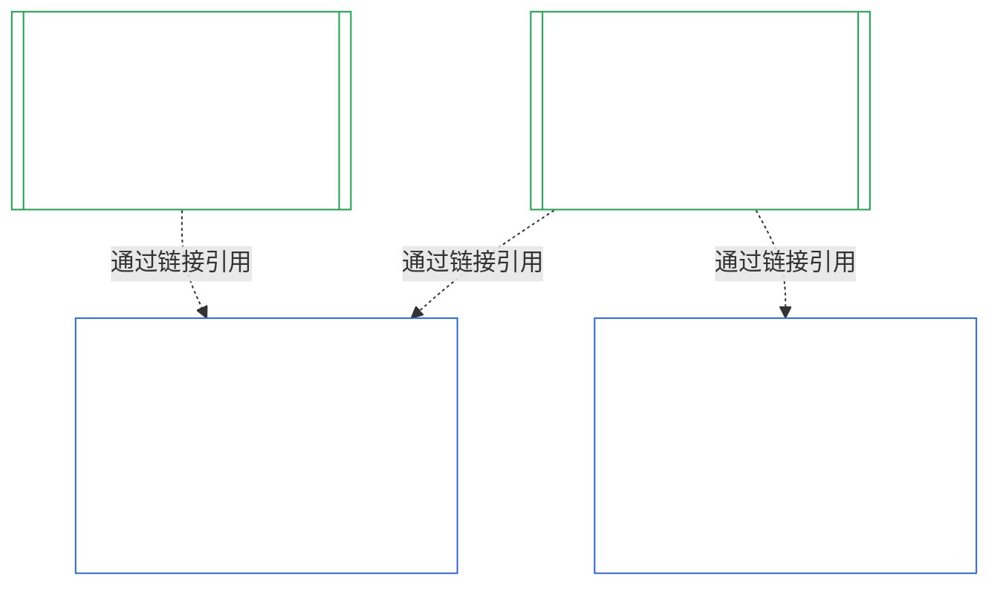
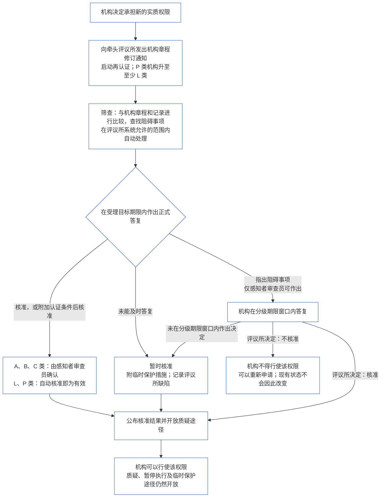

<!-- AI-assisted translation draft; unreviewed; English controls.
Source: core_10.000_institutional_alignment_certification.md
Source snapshot: 247e2180509e5e029c1106878cf225067339e010
Source SHA-256: a163a782114e584d09e295db66fe8b1b10a005b0f00116c8360396a0535ff221 -->

# 第十章：机构对齐认证

<strong>文本库中的位置（非操作性）：文件结构与阅读规则</strong>

> 本文件是**感知者宪法的一部分**，只有与其他编号的 `core_*` 文件作为一份文本共同阅读时才具有**约束力**。本文件包含**第十章**——**机构对齐认证**：与机构运行的任何System相区别，如何对[机构](../../core_05.040_band_continuity.md#institution)进行分类、评估、审查、裁决、记录、保持更新及重新开启（**§1–§11**）。第十章是[第九章](core_09.000_system_alignment_certification_evaluation.md#chapter-nine-system-alignment-certification)（*系统对齐认证*）的机构对应篇，**各节编号相同**：此处§N对应彼处§N。[CS-9.320](../../corpus_systems/cs_09.320_system_alignment_certification_illustrations.md#cs-9320-system-alignment-certification-illustrations)（*系统对齐认证示例*）载有System的详细示例，并在其[§12 机构示例导览](../../corpus_systems/cs_09.320_system_alignment_certification_illustrations.md#cs-9320-12-illustrative-institution-walkthroughs)中提供三个机构导览。本章不重复这些内容。
>
> | § | 第九章（System） | 第十章（机构） |
> |---|------------------------|----------------------------|
> | 1 | 目的与作用 | 与System认证的关系、认证对象、无需许可且设立或运营不设门槛、等待新的实质权限、首次认证窗口 |
> | 2 | System类别评估 | 机构类别；按类别分级 |
> | 3 | 全System认证评估 | 八项机构审查内容，始终适用 |
> | 4 | 涉及相关事项时进行的评估 | 指向第九章§4 |
> | 5 | 权利底线与领域评估 | 指向第九章§5 |
> | 6 | 评议所流程 | 四个席位；评议所角色与顺序；作为机构的评议所、认证者和记录办公室 |
> | 7 | 认证结果 | 机构及其Systems的上线、认证条件、结果的其他影响；缺陷指引；补救准备度；拒绝与撤销 |
> | 8 | System Certification Record | Institutional Certification Record |
> | 9 | 再认证与重新开启 | 监测；重新开启触发条件；临时与完整认证；反规避；System认证的连带影响；因治理违规而重新开启其Systems |
> | 10 | 对认证提出质疑 | 质疑路径 |
> | 11 | 与轨迹的关系 | 轨迹衔接 |
>
> - **宪法事务主管方（与第九章共同负责）：**由评议所监督的对齐认证及相关记录。第十章增加机构这一对象，不增加新的评议所族系、席位或结果术语。
> - **重复使用，而非重复表述：**第三至第六阶段按照[Chapter Nine Part B §6](core_09.005_system_alignment_certification_record_process.md#6-forum-process)至[Chapter Nine Part C §11](core_09.010_system_alignment_certification_record_recertification.md#11-relationship-to-standing)规定执行。第十章仅说明对象是机构时有哪些不同。
> - **禁止迁址规则：**第十章不复述第九章中针对System的评估机制、第七章中的System Charter和Institutional Charter字段、第八章四席位要求、[corpus_institutions](../../corpus_institutions.md)中的机构职责、第十一章的轨迹测量或第十二章的轨迹效果。
>
> **上游：**[Chapter Seven](core_07_charters.md#chapter-seven-system-and-institutional-charters)章程；[Chapter Eight](../../core_08.000_functional_independence_separation_of_duties.md#chapter-eight-functional-independence-and-separation-of-duties)职能独立；[Chapter Nine](core_09.000_system_alignment_certification_evaluation.md#chapter-nine-system-alignment-certification)（[A部分](core_09.000_system_alignment_certification_evaluation.md#chapter-nine-part-a-system-alignment-certification--evaluation)、[B部分](core_09.005_system_alignment_certification_record_process.md#chapter-nine-part-b-system-alignment-certification--forum-process-and-outcomes)和[C部分](core_09.010_system_alignment_certification_record_recertification.md#chapter-nine-part-c-system-alignment-certification--record-recertification-and-standing)）；第十四章评议所监督。
> **下游：**第十一章的轨迹记录与已核验输入；第十二章的轨迹效果。

<strong>脉络</strong>

- 上游：
  - [Chapter Seven §1 When System and Institutional Charters Are Required](core_07_charters.md#1-when-system-and-institutional-charters-are-required) (7.000 §1)（*哪些机构须发布System Charter或Institutional Charter，以及机构的类别*）；
  - [Chapter Seven §7 Amendment and Review](core_07_charters.md#7-amendment-review-and-scope-misalignment) (7.000 §7)（*Institutional Charter审查检验什么*）；
  - [Chapter Seven §4 The Charter Role Map and Standing-Record Custody](core_07_charters.md#4-the-charter-role-map-and-standing-record-custody) (7.000 §4)（*席位如何安排*）；
  - [Chapter Eight §2 Four-Seat Constitutional Requirement](core_07_functional_independence_segregation_of_duties.md#2-four-seat-constitutional-requirement) (8.000 §2)和[§9 Relationship to Later Processes](core_07_functional_independence_segregation_of_duties.md#9-relationship-to-later-processes)；
  - [Chapter Nine](core_09.000_system_alignment_certification_evaluation.md#chapter-nine-system-alignment-certification)（9.000至9.010）（*本章沿用的系统对齐认证流程*）；
  - [Two Fundamental Questions](core_00_preamble.md#two-fundamental-questions)；
  - [Constitutional Tetrad](core_00_preamble.md#constitutional-tetrad)；
  - [Article XI-E](core_06_rights_part_b.md#article-xi-e-institutional-formation-and-business-creation)（*机构成立与企业创建*）。
- 下游：[§1](#1-purpose-and-role)至[§11](#11-relationship-to-standing)；第十一章（[11.000](core_11_standing_assessment.md#chapter-eleven-contribution-violation-and-standing-model--measurement)）；[Chapter Fourteen](../../core_15.000_forum.md#chapter-fifteen-forums-and-jurisdiction) (14.000)。
- 配合阅读：
  - [Institutional Alignment Certification](../../core_05.040_band_continuity.md#institutional-alignment-certification)和
  - [Institutional Certification Record](../../core_05.040_band_continuity.md#institutional-certification-record)（*第五章含义*）；
  - **CI-8.205 §6**（*System和Institutional Charter内容、审查与成立模板*）；
  - **CF-14.425**（*完整性保障、反俘获运营及防止自我裁判支持*）。

 

第十章是**机构对齐认证**的宪法事务主管方。它将[第九章](core_09.000_system_alignment_certification_evaluation.md#chapter-nine-system-alignment-certification)的流程从System延伸到机构：

- **阶段I，界定：**机构类别及其如何对评估分级（[§2 Institution Class Evaluation](#2-institution-class-evaluation)）；
- **阶段II，评估：**机构评估，包括涉及相关事项时适用的评估以及权利底线和领域评估（[§3 Whole-Institution Certification Evaluation](#3-whole-institution-certification-evaluation)至[§5 Rights-Floor and Domain Evaluations](#5-rights-floor-and-domain-evaluations)）；
- **阶段III，审查：**评议所角色与顺序（[§6 Forum Process](#6-forum-process)）；
- **阶段IV，裁决：**结果、补救准备度、拒绝与撤销（[§7 Certification Outcomes](#7-certification-outcomes)）；
- **阶段V，记录：**Institutional Certification Record（[§8 Institutional Certification Record](#8-institutional-certification-record)）；以及
- **阶段VI，运行：**再认证、重新开启、System认证的连带影响、重新开启其Systems、质疑路径和轨迹衔接（[§9 Recertification and Reopening](#9-recertification-and-reopening)至[§11 Relationship to Standing](#11-relationship-to-standing)）。

*用直白的话说：第九章询问某个**系统**是否对齐。第十章对运行Systems的**机构**提出同样的问题，也适用于不运行System但掌握权限的机构。机构可能对齐而其某个系统不对齐，反之亦然。因此，要检查机构独有的控制事项：它是否遵守自己的Institutional Charter、谁对其权限负责、它奖励自身成员的什么行为，以及针对它的独立检查是否真正可用。机构依赖各System的认证，不会重复进行System认证。机构认证不是许可证：任何人都不需要机构许可即可设立或运营机构。*

### 1. 目的与作用

<strong>脉络</strong>

- 上游：
  - [Chapter Seven §1 When System and Institutional Charters Are Required](core_07_charters.md#1-when-system-and-institutional-charters-are-required) (7.000 §1)；
  - [Chapter Nine Part A §1 Purpose and Role](core_09.000_system_alignment_certification_evaluation.md#1-purpose-and-role) (9.000 §1)；
  - [Article XI-E](core_06_rights_part_b.md#article-xi-e-institutional-formation-and-business-creation)（*机构成立与企业创建*）；
  - [Article XXVIII-A](../../core_06.020_rights_part_e.md#xxviii-a-existing-instantiations-adoption-transition-window)（*分阶段采纳与权利底线连续性*）。
- 下游：[§2](#2-institution-class-evaluation)；[§6](#6-forum-process)；[§7](#7-certification-outcomes)；[§9](#9-recertification-and-reopening)。
- 配合阅读：
  - [Institution](../../core_05.040_band_continuity.md#institution)；
  - [Institutional Charter](../../core_05.040_band_continuity.md#institutional-charter)；
  - [System Charter](../../core_05.040_band_continuity.md#system-charter)；
  - [Business Creation](../../core_05.055_band_participation.md#business-creation)。

 

*用直白的话说：系统认证属于系统。机构认证引用这些系统认证，并补充只有机构自身能负责的事项。一个系统可以归属于多个机构，也可以不归属于任何机构。本章绝不允许认证阻碍机构成立。*

机构对齐认证与系统对齐认证是两个通过链接相连的认证。二者关系是**通过链接组合**，而非包含关系。图中箭头从System Certification Record指向引用它的每份Institutional Certification Record。没有机构归属的System无需箭头，也无需机构记录；不运行任何System的机构则只有自己的记录。

通过链接组合有两个方面，首先是机构方面。

机构方面：

- **Institutional Certification Record引用System记录，不会重新评估：**通过链接引用System Certification Record，并注明其版本。本章绝不重新运行System评估，不重新裁定System类别，也不更改System的结果、状态或认证条件。
- **机构认证不能提升System认证：**未获认证的System仍然未获认证，无论机构状态如何。持有认证的System也不会因机构的认定而获得额外保护。
- **机构事实只认定一次：**当[Chapter Nine Part A §3.1 Governance, Incentive, and Contestability Discipline](core_09.000_system_alignment_certification_evaluation.md#31-governance-incentive-and-contestability-discipline)询问运营方的治理与激励时，若运营方有当前有效的Institutional Certification Record，可通过链接提供这些事实。System的评议所仍须决定这些事实对该System是否充分。若未在System Certification Record中说明理由，不得对同一机构事实作出不同认定。

System方面：

- **System Certification Record属于该System：**依据[Chapter Nine](core_09.000_system_alignment_certification_evaluation.md#chapter-nine-system-alignment-certification)，它是System自身的记录。
- **多家机构可以引用同一份System Certification Record：**依据[Chapter Seven §1 When System and Institutional Charters Are Required](core_07_charters.md#1-when-system-and-institutional-charters-are-required)，一个System可以由多家机构运营、尽责管理或实质控制。每家机构均引用同一份记录。
- **System不必隶属于任何机构：**单一感知者不是机构，因此System可能不归属于任何机构。无机构归属的System仅依据[Chapter Nine](core_09.000_system_alignment_certification_evaluation.md#chapter-nine-system-alignment-certification)认证，不需要本章的任何内容。归属于机构的System也以同样方式认证：本章为机构增加一份单独记录，而不是System自身认证流程中的一个步骤。

#### 1.1 哪些对象接受认证

Class L或更高类别的机构属于本章范围，类别依照[§2.1 Institution class](#21-institution-class)确定。这也包括完全不运行System的机构：它没有System Certification Record可供引用，其类别根据自身影响确定。机构的**组合**是其运营、尽责管理或实质控制的System集合（[Portfolio](../../core_05.040_band_continuity.md#portfolio)）。

- **Class A、B、C和L：**流程适用，并依照[§2.2 Scaling by class](#22-scaling-by-class)按类别调整。
- **Class P：**鼓励采用该流程，也可以自愿使用。若重新分类为Class L或更高类别，或机构自愿声称符合宪法要求，流程即变为强制。Class P机构决定承担新的实质权限时，在依照[§9.2.2 Recertification for new material authority](#922-recertification-for-new-material-authority)发出通知时，即重新分类为至少Class L；因为该权限按定义具有实质意义（[§9.2.1 What counts as new material authority](#921-what-counts-as-new-material-authority)），而在任何领域具有实质影响的机构至少属于Class L（[§2.1 Institution class](#21-institution-class)，第2项）。重新分类自发出通知起持续有效，直至在核准前撤回通知，或该权限未获核准为止，前提是尚未行使该权限。此时机构恢复为Class P，有限的首次认证结束。新通知会重新启动该流程；未经核准便行使权限，仍依照[§9.2.2 Recertification for new material authority](#922-recertification-for-new-material-authority)（*未通知或尚未核准*）作出认定。这与[Chapter Nine Part A §1 Purpose and Role](core_09.000_system_alignment_certification_evaluation.md#1-purpose-and-role)一致。
- **单一System：**机构恰好运行一个需要System Charter的System时，只有一次认证流程和一份记录，本章称之为**单一System评估**。System Certification Record载有[§8 Institutional Certification Record](#8-institutional-certification-record)规定各项内容的*机构认定栏*，并充当Institutional Certification Record。评议所、席位和时限沿用该System自身认证流程，并增加机构事项。其结果依各自的拒绝和撤销理由处理，见[§7.4 Denial and revocation for an Institution](#74-denial-and-revocation-for-an-institution)。由于该System就是整个组合，[§9.5 Cascade from System certifications](#95-cascade-from-system-certifications)不作为连带机制适用；但[§7.4 Denial and revocation for an Institution](#74-denial-and-revocation-for-an-institution)的规则1和2（指标，以及原因所在位置的检验）仍适用。
- **多个System：**机构有一份Institutional Certification Record，并链接到其运行的每个System各自的System Certification Record。每个System保留自己的认证流程和记录。
- **没有System：**机构单独持有一份Institutional Certification Record。由于机构没有运行任何System，因此没有可供链接的System Certification Record。

#### 1.2 设立或运营无需许可且不设门槛

机构对齐认证是对机构如何实际行使权限所作的独立检查。该检查由独立于机构的评议所进行，最终形成一份记录其认定的Institutional Certification Record。

- **设立与运营：**机构可以成立、发布其Institutional Charter、开始行使权限并持续运营，无须先取得认证；任何结果都不会授予或剥夺这一权利。
- **结果的影响：**结果仅产生[§7.1 机构的上线](#71-go-live-for-an-institution)所述影响。
- **本领域仅有的门槛：**共有三项狭义门槛，均见**Article XI-E**（*机构成立与企业创建*）：
  - 对具名感知者尚未解除的限制，该限制附着于该感知者的权限；
  - 对特定且经核验的不对齐事实作出的Interim Hold，该限制同样附着于具名感知者的权限；
  - 对Operating Party本身的限制，只有在该限制针对该机构时才附着于机构，例如**CI-12.210 §4**（*解散*）对已解散机构施加的限制。

  认证认定可作为证据，转交给负责裁定上述门槛之一的评议所，依据为[§7.5 拒绝和撤销对机构的影响](#75-effects-of-denial-and-revocation-for-an-institution)。认证结果本身不是门槛，也不会开启或关闭门槛。
- **等待取得新的实质权限：**机构决定取得新的实质权限时，必须依照[§9.2.2 新的实质权限的再认证](#922-recertification-for-new-material-authority)，等该权限通过再认证后才能行使。**Article XI-E**（*机构成立与企业创建*）规定了这项等待要求。它不属于三项狭义门槛，也不限制机构的成立或运营。它只针对新的权限，机构的其他活动均继续进行。[§9.2.2 新的实质权限的再认证](#922-recertification-for-new-material-authority)中的图示总结了各步骤。
- **不得设置后门：**评议所、采纳者或现任权力者都不得将本章用作授权门槛，借此排斥创始者或保护现任者。这样做会违背[Article XI-E](core_06_rights_part_b.md#article-xi-e-institutional-formation-and-business-creation)（*机构成立与企业创建*）。
  - [Avoidable Burden](../../core_05.040_band_continuity.md#avoidable-burden)适用于流程成本。
  - [Classification-Scaled Governance](core_05_band_oversight.md#classification-scaled-governance)适用于审查深度。
  - 新的实质权限等待要求对每个同类别机构均按相同条件适用，并且只针对已对他人产生实质影响的权限。

System的上线门槛彼此独立，仍由System自身承担。依照[Chapter Nine Part B §7.1 Go-Live Gate](core_09.005_system_alignment_certification_record_process.md#71-go-live-gate)，新System或System的实质扩展，只有经过其自身认证才能上线，无论机构处于何种状态。

#### 1.3 首次认证的期限

机构必须在采纳文件为其类别规定的期限内提交首份Institutional Certification Record。

- **新机构：**期限从机构首次对他人产生实质影响之日起计算，依照[Domain-Specific Materiality](core_05_band_oversight.md#domain-specific-materiality)判定；其首次认证为临时认证。
- **通知后重新分类的Class P机构：**期限从机构依据[§9.2.2 新的实质权限的再认证](#922-recertification-for-new-material-authority)发出通知之日起计算，与新机构相同，绝不从已经结束的Adoption Transition期限起算。
- **已经运营的机构：**期限为依据[Article XXVIII-A](../../core_06.020_rights_part_e.md#xxviii-a-existing-instantiations-adoption-transition-window)（*分阶段采纳与权利底线连续性*）设定的Adoption Transition期限，并符合[Chapter Seven §1.5 When a System Charter or Institutional Charter is due](core_07_charters.md#15-when-a-system-charter-or-institutional-charter-is-due)中的默认规则。
- **错过期限：**机构未在期限届满前完成首次认证流程，且不符合下述豁免条件时，须记录并纠正该缺陷；错过期限本身会启动该认证流程。已运营的Class L或更高类别机构还会出现下述里程碑违约。由于没有门槛，机构不会因此被停止或禁止运营（[§1.2 设立或运营无需许可且不设门槛](#12-no-permission-and-no-gate-on-forming-or-running)）。
  - **已运营的机构：**这是本章针对Class L或更高类别机构自行设定的规则，类比[Article XXVIII-A](../../core_06.020_rights_part_e.md#xxviii-a-existing-instantiations-adoption-transition-window)（*分阶段采纳与权利底线连续性*）对Systems和衍生实体的规定。如果Adoption Transition期限届满而首次认证流程尚未完成（既没有临时或完整认证，也没有依据[§7 Certification Outcomes](#7-certification-outcomes)作出已裁定结果），即视为错过期限。若机构在期限内提交申请并配合，但认证流程因评议所超时而未完成（[Chapter Fourteen §6 Timely resolution, materiality tiers, and anti-delay discipline](core_11_forum.md#6-timely-resolution-materiality-tiers-and-anti-delay-discipline)，*超时审查*；[Chapter Nine Part C §9.3.4 Tier windows](core_09.010_system_alignment_certification_record_recertification.md#934-tier-windows)），或因[§7.3 Remediation readiness for an Institution](#73-remediation-readiness-for-an-institution)规定的单次延期仍在进行，则不视为错过期限。除非机构依据[Article XXVIII-B](../../core_06.020_rights_part_e.md#article-xxviii-b-adoption-transition-authority-limits-and-reauthorization)（*分阶段采纳权限限制与重新授权*）持有有记录的重新授权，否则此事构成Adoption Transition里程碑违约，并启动[Chapter Eleven](core_11_standing_assessment.md#chapter-eleven-contribution-violation-and-standing-model--measurement)中的常规合规与违规路径。该Article中的限制义务自生效日起适用，不能因缺口持续存在就让其成为新常态。这与[Chapter Nine Part B §7.1.1 Systems already operating](core_09.005_system_alignment_certification_record_process.md#711-systems-already-operating)一致。这不是门槛。
  - **认证流程：**与其他认证流程一样裁定。结果可以是[§7 Certification Outcomes](#7-certification-outcomes)中的任何一种，包括Not Certified，并产生[§7.5 拒绝和撤销对机构的影响](#75-effects-of-denial-and-revocation-for-an-institution)所述影响。
  - **制裁与解散：**本章不设任何制裁。暂停、接管、结构性分离和解散仍由依照**CI-12.210**（*机构失败与解散*）及**CI-12.215**（*机构问责与制裁*）具有管辖权的评议所处理。只有符合[§7.5 拒绝和撤销对机构的影响](#75-effects-of-denial-and-revocation-for-an-institution)（第5项，*移交*）所列移交理由时，才转交该评议所。

### 2. 机构类别评估

<strong>脉络</strong>

- 上游：
  - [Chapter Seven §1 When System and Institutional Charters Are Required](core_07_charters.md#1-when-system-and-institutional-charters-are-required) (7.000 §1)；
  - [Chapter Nine Part A §2 System Class Evaluation](core_09.000_system_alignment_certification_evaluation.md#2-system-class-evaluation) (9.000 §2)以及[§2.2 How system class scales every evaluation](core_09.000_system_alignment_certification_evaluation.md#22-how-system-class-scales-every-evaluation)；
  - [Chapter Three §2.1 Common Evasion Patterns](core_03_definition_integrity.md#21-common-evasion-patterns) (3.000 §2.1)。
- 下游：[§3](#3-whole-institution-certification-evaluation)（*按类别分级的评估项目*）；[§8](#8-institutional-certification-record)（*记录中注明类别*）；[§9.2](#92-reopening-triggers)（*重新评估的触发条件*）。
- 配合阅读：
  - **CS-9.305（*系统分类机制*）及CS-9.310**（*系统影响分类*）及[corpus_systems/cs_09.310_system_impact_classifications.md](../../corpus_systems/cs_09.310_system_impact_classifications.md)（*类别目录*）；
  - **CI-9.210**（*与分类挂钩的机构义务*）；
  - **CI-8.205 §6**（*System和Institutional Charter内容、审查与成立模板*）。

 

*用直白的话说：首先依据机构对他人的重要程度确定类别。判断时看机构实际决定什么、持有什么，而不是看它如何自称。类别随后决定评估的严格程度：类别越高，证据要求越严格，审查越独立，复查越频繁。*

本节是机构认证的**阶段I，界定**。

#### 2.1 机构类别

**机构类别**依据机构造成的最大实质影响确定，无论影响是通过其运行的System产生，还是在任何System之外产生。判断依据是机构实际决定、持有和控制什么，而不是其标签、法律形式或Institutional Charter中的清单。类别决定评估深度和时限，作用方式与[Chapter Nine Part A §2.2 How system class scales every evaluation](core_09.000_system_alignment_certification_evaluation.md#22-how-system-class-scales-every-evaluation)对System的规定相同。本章和[Chapter Seven §1.2 Which classes are covered](core_07_charters.md#12-which-classes-are-covered)均使用该类别。

1. **通过Systems产生的影响：**机构类别至少等于其组合中最高System类别（[Chapter Seven §1 When System and Institutional Charters Are Required](core_07_charters.md#1-when-system-and-institutional-charters-are-required)）。依据观察到的运行情况识别Systems。未列入Institutional Charter的System仍须计入。
2. **在任何System之外产生的影响：**无论机构是否运行System，其自身的实质影响和依赖关系均须计入。**CS-9.305（*系统分类机制*）和CS-9.310**（*系统影响分类*）中的类别定义，适用于机构自身的决定和持有事项，并考虑以下因素：
   - **机构决定与持有什么：**
     - 机构如何决定其他感知者获取生存必需品、教育、安全、生计、权利或轨迹的渠道；以及
     - 机构持有什么，例如资金、记录、成员资格、轨迹记录保管职责，或评议所、认证者或记录办公室的职能。
   - **影响是否具有实质意义：**
     - 机构自身活动是否在[Domain-Specific Materiality](core_05_band_oversight.md#domain-specific-materiality)的任何领域具有实质意义，包括作出他人必须遵守或可以视为已确定事项加以依赖的[Materially Binding Acts](../../core_05.035_band_accountability.md#materially-binding-act)；
     - 依据**CS-9.305（*系统分类机制*）和CS-9.310**（*系统影响分类*），在任何一个领域具有实质影响的机构至少属于Class L；以及
     - 提供他人可以自由接受或拒绝，且不会控制任何人获取所需事物渠道的援助、商品、劳动力或服务，不会约束任何人。这属于行为，而非Materially Binding Act，并且只有通过其他因素才计入类别评估。
   - **有多少主体依赖该机构：**
     - 依赖机构的感知者人数，以及机构的可替代程度；
     - 机构权限的集中程度，依照Material Control Line的含义判断；以及
     - 机构决定的可逆性。
3. **共同控制：**依照[Domain-Specific Materiality](core_05_band_oversight.md#domain-specific-materiality)的合并规则（在[Material Control Line](../../core_05.035_band_accountability.md#material-control-line)内形成共同的实际控制；单凭资金关系不算），若若干Operating Parties在实践中作为一个机构行事，则合并分类。如果拆分Operating Party、其组合或权限，使得任何部分都达不到Class L，则依据[Chapter Three §2.1 Common Evasion Patterns](core_03_definition_integrity.md#21-common-evasion-patterns)构成范围和边界规避。
4. **重新分类：**依照[§9.2 Reopening triggers](#92-reopening-triggers)中的触发条件重新评估类别。Institutional Certification Record须记录分类及其理由。

#### 2.2 按类别分级

机构类别决定证据深度、审查独立性、默认认证期限及记录披露内容，其方式与[Chapter Nine Part A §2.2 How system class scales every evaluation](core_09.000_system_alignment_certification_evaluation.md#22-how-system-class-scales-every-evaluation)相同。认证期限见[Chapter Fourteen §6 Timely resolution, materiality tiers, and anti-delay discipline](../../core_15.000_forum.md#review-cadence)（*复查周期*）；采纳文件可以规定更短的期限，并决定所需的临时认证无缺陷再认证次数。

- **Class A、B和C：**[§3 Whole-Institution Certification Evaluation](#3-whole-institution-certification-evaluation)中的八项内容全部适用，证据和独立性要求按类别调整。
- **Class L：**同样适用八项内容，但流程可简化，记录可更简要；在[Classification-Scaled Governance](core_05_band_oversight.md#classification-scaled-governance)允许时，默认认证期限可更长。Class L认证流程的核心是将Institutional Charter与实际情况对照，检查Role Map、成立核验声明以及所引用System认证的有效性。不得省略任何项目；若某项目无可发现事项，也须用一句话说明。
- **Class P：**自愿采用，依照[§1.1 Who is certified](#11-who-is-certified)执行。

**联合专业执业中的托管机构。** 若机构是托管方（[**CI-15.205 §7**](../../corpus_institutions/ci_16.205_appointment_competency_rotation_removal.md#ci-46-seat-advisory)（*执业许可证、执业核准与联合专业执业*）），认证还须抽查成员的行为是否符合托管方承担的席位，并将成员的采纳通知与托管方实际行动对照。关于某一成员行为的认定，属于对该成员的认定；只有托管方承担的席位出现失职时，才会涉及托管方。

### 3. 全机构认证评估

<strong>脉络</strong>

- 上游：
  - [Chapter Nine Part A §3 Whole-System Certification Evaluation](core_09.000_system_alignment_certification_evaluation.md#3-whole-system-certification-evaluation) (9.000 §3)；
  - [Chapter Seven §3 What System and Institutional Charters Must State](core_07_charters.md#3-what-system-and-institutional-charters-must-state) (7.000 §3)；
  - [Chapter Seven §5 Formation Check: Office-Holder Standing and Authenticity](core_07_charters.md#5-formation-check-office-holder-standing-and-authenticity) (7.000 §5)；
  - [Chapter Seven §7 Amendment and Review](core_07_charters.md#7-amendment-review-and-scope-misalignment) (7.000 §7)；
  - [Two Fundamental Questions](core_00_preamble.md#two-fundamental-questions)；
  - [Chapter One §19.6 Keeping Responsibility When Ownership or Structure Changes](core_01_c_stewardship_capacity_principles.md#196-keeping-responsibility-when-ownership-or-structure-changes) (1.010 §19.6)。
- 下游：[§6](#6-forum-process)（*评议所审查的认定*）；[§9](#9-recertification-and-reopening)（*重新开启评估的触发条件*）；[§11](#11-relationship-to-standing)（*关于具名感知者的认定所适用的已核验输入门槛*）。
- 配合阅读：
  - **CI-8.205 §3**（*权限链与授权控制*）以及**CI-8.205 §6**（*System和Institutional Charter内容、审查与成立模板*）；
  - **CI-6.215**（*资源尽责管理与激励完整性*）；
  - 关于第8项，配合阅读**CI-8.210**（*利益冲突完整性、反俘获与反腐败*）、**CI-6.205**（*透明度、参与以及可及的质疑和服务渠道*）和**CI-12.205**（*补救系统与机构救济能力*）。

 

*用直白的话说：检查那些属于机构自身、而非其任何单个System的事项：是否遵守Institutional Charter、谁对机构权限负责、机构奖励什么，以及针对机构的独立检查是否有效。*

本节是机构认证的**阶段II，评估**。

每次认证流程都须评估以下八项，这是[Chapter Nine Part A §3 Whole-System Certification Evaluation](core_09.000_system_alignment_certification_evaluation.md#3-whole-system-certification-evaluation)在机构层面的对应评估。每项认定都须说明其证据，以及所依据的Institutional Charter条文或观察到的运行情况。

1. **Institutional Charter与实践是否一致：**
   - 依据[Chapter Seven §7 Amendment and Review](core_07_charters.md#7-amendment-review-and-scope-misalignment)中的审查清单，对照观察到的运行情况检验Institutional Charter。
   - 实践超出Institutional Charter，或Institutional Charter已不再描述实际做法，无论哪一方有误都须作出认定。
2. **组合与总体影响：**
   - 检验组合理由：每个System是否符合机构所述宗旨；某个System若没有说明理由，即须作出认定。
   - 评估还须跨Systems整体审查任何单个System认证无法单独显示的事项：
     - 共同依赖关系；
     - 总体依赖情况；
     - 从共享基础累计取得的资源；以及
     - 将一项功能拆分成多个部分，导致每部分都逃避某个类别或义务的安排。
3. **可问责的权限：**
   - 机构对他人行使的每项权限，都必须归属于可具名问责的职务；该职务须依照[Chapter Eight](../../core_08.000_functional_independence_separation_of_duties.md#chapter-eight-functional-independence-and-separation-of-duties)及**CI-8.205 §3**（*权限链与授权控制*）承担责任。
   - 所有权、控制权或结构发生改变，不会免除责任（[Chapter One §19.6 Keeping Responsibility When Ownership or Structure Changes](core_01_c_stewardship_capacity_principles.md#196-keeping-responsibility-when-ownership-or-structure-changes)）。
4. **奖励与激励：**
   - 将机构自己的薪酬、晋升、指标和奖励置于[Two Fundamental Questions](core_00_preamble.md#two-fundamental-questions)之下检验：结构实际奖励什么，以及这是否导向宪法的两项宗旨。
   - 即使每个System都单独获得认证，若奖励结构奖赏不对齐或隐瞒不对齐，仍须作出认定。
   - [Chapter Nine Part A §3.3 Time-Consistency Constraint](core_09.000_system_alignment_certification_evaluation.md#33-time-consistency-constraint)适用。如果可预见的中期或长期安全、真实或福祉损害尚未处理，近期指标、局部合规和短期效率便不足够；奖励结构若以这种代价奖励短期成果，须作出认定。
   - 激励完整性方面的机构义务仍由**CI-6.215**（*资源尽责管理与激励完整性*）管辖，此处只作引用，不予重述。
5. **Role Map与记录保管：**
   - [Charter Role Map](../../core_05.040_band_continuity.md#charter-role-map)须列出确实存在的职务，并依其规定填补或替代；在机构为事项主体的任何记录中，这些职务须独立于机构（[independent](../../core_05.035_band_accountability.md#independence)）。
   - 独立渠道必须在实际中可用。
   - 席位未作安排、职务有名无实，或记录保管人处于机构自身的控制链内，均须作出认定。
6. **每项被引用System认证的有效性：**
   - 对机构运行的每个System，评估须核验System Certification Record是否仍有效或处于Adoption Transition期限内，并核验机构是否履行该记录中的认证条件对机构提出的要求。
   - 若认证已过期、撤销、失败或缺失且没有记录在案的理由，则须作出认定；[§9.5 Cascade from System certifications](#95-cascade-from-system-certifications)会将此认定进一步传递给机构。
7. **职务担任者的轨迹与真实性：**
   - 依据[Chapter Seven §5 Formation Check: Office-Holder Standing and Authenticity](core_07_charters.md#5-formation-check-office-holder-standing-and-authenticity)发布的成立核验声明，须对照观察到的运行情况检验，不能仅凭证明声明接受。
   - 对每个受涵盖职务，评议所须对照经核验的记录检查轨迹事实，并依据控制、利益和奖励、行为及受保护表达方面的证据认定真实性。这包括：
     - 谁实际指挥该职务担任者；
     - 该担任者因何获得薪酬和晋升；
     - 该担任者在该职能中可核验地做过什么；以及
     - 任何曾提出[受保护举报](../../core_05.035_band_accountability.md#protected-reporting-whistleblowing)或拒绝非法或违宪指令（[Chapter One §17.5 Duty to Resist](core_01_c_stewardship_capacity_principles.md#175-duty-to-resist)）的人——包括该职务担任者本人——是否因此受到惩罚。
   - 不逐一核验未担任受涵盖职务的工作人员。工作人员保障核查（[Chapter Seven §5.6 Staff safeguards check](core_07_charters.md#56-staff-safeguards-check)）涵盖这些工作人员；评议所也以同样方式对照观察到的运行情况检验该核查。它须询问：
     - 机构的任命、薪酬、晋升和免职规则是否未奖励违背机构既定宗旨的行为；
     - 是否存在受保护举报渠道，且使用该渠道或拒绝非法或违宪指令的工作人员是否均未受惩罚；以及
     - [Article III-C](core_06_rights_part_a.md#article-iii-c-labor-and-economic-floor)（*劳动与经济底线*）中的权利是否完整。
   - 下列各项均须作出认定：
     - 职务担任者是未披露控制者的名义代表；
     - 受涵盖职务有名无实：Institutional Charter或Charter Role Map虽列出该职务，却没有人实际担任并履行其职责；
     - 奖励结构奖赏职务担任者实施Institutional Charter公布限制所禁止的行为；以及
     - 声明虚假或不完整。
   - 认定针对职务和结构。只有通过[§11 Relationship to Standing](#11-relationship-to-standing)规定的已核验输入门槛，认定才会归属于具名感知者。
   - 成立核验并非信念测试；但经核验的声明若表示他人应受伤害或歧视性待遇，则属于行为，并依照[Chapter One §7.5 Expression and the Harm Line](core_01_a_values_principles.md#75-expression-and-the-harm-line)计入对该担任者的不利认定。
   - 第3、4和5项须与本项一并解读；同一事实不得在多个项目下重复认定。
8. **机构自身的机构职责：**
   - 须依据观察到的运行情况检验机构是否遵守采纳的机构文本对其规定的机构职责，而非仅凭声明接受。相关职责见**CI-8.210**（*利益冲突完整性、反俘获与反腐败*）、**CI-6.205**（*透明度、参与以及可及的质疑和服务渠道*）、**CI-6.215**（*资源尽责管理与激励完整性*）和**CI-12.205**（*补救系统与机构救济能力*）。
   - 检验须询问机构的监督、问责、参与和及时处理渠道是否存在、实际可用，并且是否在机构自行规定的期限内回应。该期限不得长于该机构类别的时间底线（[Article XXVI-C](core_06_rights_part_e.md#article-xxvi-c-timely-resolution-and-anti-delay-floor)（*及时解决与反拖延底线*）以及[CF-14.445 §3.1 Stage Targets and Outer Bounds](../../corpus_forum/cf_15.445_performance_backlog_publication_accessibility.md#cf-15445-31-stage-targets-and-outer-bounds)中相应等级的目标）；机构声明的期限若更长，本身即须作出认定。
   - 渠道仅存在于纸面上、无法触达或未能及时回应，均须分别作出认定。
   - 这些职责仍由上述文本管辖，此处只作引用，不予重述。第3至5项认定的事实不得在本项下重复认定。

**Chapter Nine Part A §3 Whole-System Certification Evaluation的另外两部分。**[Chapter Nine Part A §3 Whole-System Certification Evaluation](core_09.000_system_alignment_certification_evaluation.md#3-whole-system-certification-evaluation)还要求System评估两项事项，这些事项也适用于机构自身行为。它们属于机构评估的一部分，但各自仅在其触发条件满足时适用：

- **系统性范围与风险因素：**
  - **适用时机：**依照[Chapter Nine Part A §3.2 Systemic Scope and Risk Factors](core_09.000_system_alignment_certification_evaluation.md#32-systemic-scope-and-risk-factors)的因素，机构自身行为使系统性Risk进入评估范围：最大规模的伤害、影响如何扩散和累积（包括机构自身服务故障时哪些下游环节会失败），以及机构活动可能如何遭到滥用或发生范围错置。
  - **评估依据：**[Chapter Nine Part A §3.2 Systemic Scope and Risk Factors](core_09.000_system_alignment_certification_evaluation.md#32-systemic-scope-and-risk-factors)，包括[§3.2.1 Risk Evaluation and Disclosure Bridge](core_09.000_system_alignment_certification_evaluation.md#321-risk-evaluation-and-disclosure-bridge)中的风险评估与披露衔接，以及[§3.2.2 Defects and Misalignment](core_09.000_system_alignment_certification_evaluation.md#322-defects-and-misalignment)中的缺陷。
- **数据类型与处理：**
  - **适用时机：**机构自身行为处理了具有实质意义且在范围内的数据类型，正如[Chapter Nine Part A §3.4 Data Types and Handling Evaluation](core_09.000_system_alignment_certification_evaluation.md#34-data-types-and-handling-evaluation)要求每份具有实质影响的认证记录进行的评估。
  - **评估依据：**[Chapter Nine Part A §3.4 Data Types and Handling Evaluation](core_09.000_system_alignment_certification_evaluation.md#34-data-types-and-handling-evaluation)，其中的基础设施保障要求按机构类别调整。
  - **记录位置：**Institutional Certification Record的数据类型部分（[§8.1 Minimum record contents](#81-minimum-record-contents)），适用于机构在任何System之外处理的数据。在System内部处理的数据只在该System的记录中认定一次，并予以引用。

[§4 Evaluations Where Implicated](#4-evaluations-where-implicated)中关于不重复评估已在所引用System Certification Record上作出的评估的规则，也适用于以上两项。

### 4. 涉及相关事项时进行的评估

<strong>脉络</strong>

- 上游：
  - [Chapter Nine Part A §4 Evaluations Where Implicated](core_09.000_system_alignment_certification_evaluation.md#4-evaluations-where-implicated) (9.000 §4)。
- 下游：[§6](#6-forum-process)；[§8](#8-institutional-certification-record)。
- 配合阅读：
  - **CI-8.210**（*利益冲突完整性、反俘获与反腐败*）；
  - **CI-6.205**（*透明度、参与以及可及的质疑和服务渠道*）；
  - **CI-6.215**（*资源尽责管理与激励完整性*）；
  - **CI-12.205**（*补救系统与机构救济能力*）。

 

*用直白的话说：机构自身行为涉及System在相关情况下接受检查的领域时，须对机构自身进行同样评估，并且只评估一次。*

若机构自身行为涉及[Chapter Nine Part A §4 Evaluations Where Implicated](core_09.000_system_alignment_certification_evaluation.md#4-evaluations-where-implicated)涵盖的事项，则须依照相同的触发条件，对机构自身行为进行对应评估。每项评估仅在其自身触发条件满足时适用：

- **隐私（信息方面）：**机构行为实质涉及第六章多个隐私领域时，须逐一处理每个领域；仅依据其中一个领域结案并不足够（[Chapter Nine Part A §4.1 Privacy (Informational) Joint Invocation](core_09.000_system_alignment_certification_evaluation.md#41-privacy-informational-joint-invocation)）。
- **自愿终止、重大自我修改与退出权：**认证主张成立前，须检验自愿性、同意、反胁迫、依赖压力、信息提供和可逆性；仅有形式上的同意并不足够（[Chapter Nine Part A §4.2 Voluntary Discontinuation, Major Self-Modification, and Exit Rights](core_09.000_system_alignment_certification_evaluation.md#42-voluntary-discontinuation-major-self-modification-and-exit-rights)）。
- **集会、集体组织与机构成立：**须依据反分割原则联合检验事项，不得只通过一种框架来处理（[Chapter Nine Part A §4.3 Assembly, Collective Organization, and Institutional Formation](core_09.000_system_alignment_certification_evaluation.md#43-assembly-collective-organization-and-institutional-formation)）。
- **异议与和平抗议：**机构不得直接或通过代理指标将异议或受保护的非暴力公民不服从作为不利输入（[Chapter Nine Part A §4.3.1 Dissent and Peaceful Protest](core_09.000_system_alignment_certification_evaluation.md#431-dissent-and-peaceful-protest)）。

机构职责本身由采纳的机构文本管辖，包括：

- **CI-8.210**（*利益冲突完整性、反俘获与反腐败*）；
- **CI-6.205**（*透明度、参与以及可及的质疑和服务渠道*）；
- **CI-6.215**（*资源尽责管理与激励完整性*）；以及
- **CI-12.205**（*补救系统与机构救济能力*）。

本章引用这些文本，不予重述。机构是否确实遵守这些职责，依照[§3 Whole-Institution Certification Evaluation](#3-whole-institution-certification-evaluation)（第8项）检验。已在所引用System Certification Record中完成的评估，不再重复进行。

### 5. 权利底线与领域评估

<strong>脉络</strong>

- 上游：
  - [Chapter Nine Part A §5 Rights-Floor and Domain Evaluations](core_09.000_system_alignment_certification_evaluation.md#5-rights-floor-and-domain-evaluations) (9.000 §5)。
- 下游：[§6](#6-forum-process)；[§8](#8-institutional-certification-record)。
- 配合阅读：
  - [§4](#4-evaluations-where-implicated)（*机构职责及禁止重复评估的规则*）。

 

*用直白的话说：规则与上一节相同：触发条件满足时，须评估机构自身行为是否符合权利底线或领域要求；若所引用System认证已完成评估，则不重复评估。*

若机构自身行为涉及[Chapter Nine Part A §5 Rights-Floor and Domain Evaluations](core_09.000_system_alignment_certification_evaluation.md#5-rights-floor-and-domain-evaluations)所涵盖的权利底线或领域，则须依照相同的触发条件，对机构自身行为进行对应评估。每项评估仅在其自身触发条件满足时适用，因此Institutional Certification Record只载明机构实际触发的评估。各项保护及其评估依据如下：

- **Article I-B**（*生态足迹与透明度*）：
  - **适用时机：**机构承担可归因的重大环境负担。
  - **评估依据：**[Chapter Nine Part A §5.1 Ecological Footprint Evaluation](core_09.000_system_alignment_certification_evaluation.md#51-ecological-footprint-evaluation)。
- **Article III-A**（*生存*）：
  - **适用时机：**机构提供、分配、定价、托管或终止获取生存必需品的渠道。
  - **评估依据：**[§2 Institution Class Evaluation](#2-institution-class-evaluation)和[§3 Whole-Institution Certification Evaluation](#3-whole-institution-certification-evaluation)。
- **Article IV**（*以感知者为中心的教育权*）：
  - **适用时机：**机构在教育或培训情境中对感知者排名、评估、提出建议、分流或设置资格门槛，或限制再培训和终身学习路径。
  - **评估依据：**[Chapter Nine Part A §5.2 Educational Capability and Learning-System Integrity Evaluation](core_09.000_system_alignment_certification_evaluation.md#52-educational-capability-and-learning-system-integrity-evaluation)。
- **Article IV-A**（*平等教育机会*）：
  - **适用时机：**机构提供、分配、定价、托管或终止教育获取渠道。
  - **评估依据：**[§2 Institution Class Evaluation](#2-institution-class-evaluation)和[§3 Whole-Institution Certification Evaluation](#3-whole-institution-certification-evaluation)；如触发条件适用，另依据[Chapter Nine Part A §5.2 Educational Capability and Learning-System Integrity Evaluation](core_09.000_system_alignment_certification_evaluation.md#52-educational-capability-and-learning-system-integrity-evaluation)和[Chapter Nine Part A §5.5 Accessibility Evaluation](core_09.000_system_alignment_certification_evaluation.md#55-accessibility-evaluation)。
- **Article V**（*资源分配、依赖与生态系统资金*），包括**Article V-A**（*依赖映射与资源流透明度*）及**Article V-B**（*跨系统公平与可持续性*）：
  - **适用时机：**机构分配、路由、资助或从其他系统或感知者所依赖的共享基础设施或基础性依赖中攫取资源。
  - **评估依据：**[Chapter Nine Part A §5.3 Proportionate Cross-System Support Evaluation](core_09.000_system_alignment_certification_evaluation.md#53-proportionate-cross-system-support-evaluation)。
- **Article III-F**（*安全产品与健康信息*）：
  - **适用时机：**机构提供、列出、推荐或建议可能影响身体、健康或安全的产品或服务，或承载其相关信息。
  - **评估依据：**[§2 Institution Class Evaluation](#2-institution-class-evaluation)和[§3 Whole-Institution Certification Evaluation](#3-whole-institution-certification-evaluation)；如触发条件适用，另依据[Chapter Nine Part A §5.6 Trustworthiness and System-Reliance Integrity Evaluation](core_09.000_system_alignment_certification_evaluation.md#56-trustworthiness-and-system-reliance-integrity-evaluation)。
- **Article VI-C**（*不歧视*）：
  - **适用时机：**机构对感知者分类、排名、定价、设限、排斥，或在其间分配负担和利益。
  - **评估依据：**[Chapter Nine Part A §5.4 Nondiscrimination Evaluation](core_09.000_system_alignment_certification_evaluation.md#54-nondiscrimination-evaluation)。
- **Article VI-D**（*无障碍*）：
  - **适用时机：**机构对宪法相关领域的实质参与设置门槛。
  - **评估依据：**[Chapter Nine Part A §5.5 Accessibility Evaluation](core_09.000_system_alignment_certification_evaluation.md#55-accessibility-evaluation)。
- **Article XIII**（*可靠且值得信赖的系统权利*）：
  - **适用时机：**机构影响感知者对系统所宣称的行为、限制、风险、质疑渠道或补救措施的依赖。
  - **评估依据：**[Chapter Nine Part A §5.6 Trustworthiness and System-Reliance Integrity Evaluation](core_09.000_system_alignment_certification_evaluation.md#56-trustworthiness-and-system-reliance-integrity-evaluation)。
- **Article XIII-A**（*可靠性与可信度基线*）和**Safe Conditions**：
  - **适用时机：**机构提供或限制生产活动，或提供、分配、定价、托管或终止获取Safe Conditions的渠道。
  - **评估依据：**[§2 Institution Class Evaluation](#2-institution-class-evaluation)和[§3 Whole-Institution Certification Evaluation](#3-whole-institution-certification-evaluation)；如触发条件适用，另依据[Chapter Nine Part A §5.6 Trustworthiness and System-Reliance Integrity Evaluation](core_09.000_system_alignment_certification_evaluation.md#56-trustworthiness-and-system-reliance-integrity-evaluation)。

机构职责以及禁止重复评估已在所引用System Certification Record中完成的评估的规则，均见[§4 Evaluations Where Implicated](#4-evaluations-where-implicated)。[Chapter Nine Part A §5 Rights-Floor and Domain Evaluations](core_09.000_system_alignment_certification_evaluation.md#5-rights-floor-and-domain-evaluations)规定的、适用于每项领域评估的原则与缺陷，也适用于机构自身行为的对应评估。

### 6. 评议所流程

<strong>脉络</strong>

- 上游：
  - [Chapter Nine Part B §6 Forum Process](core_09.005_system_alignment_certification_record_process.md#6-forum-process) (9.005 §6)；
  - [Chapter Eight §2 Four-Seat Constitutional Requirement](core_07_functional_independence_segregation_of_duties.md#2-four-seat-constitutional-requirement) (8.000 §2)、[§5 Published Placement, Vacancy, and Substitution](core_07_functional_independence_segregation_of_duties.md#5-published-placement-vacancy-and-substitution)、[§6 Proportional Scaling and Merged Hosting](core_07_functional_independence_segregation_of_duties.md#6-proportional-scaling-and-merged-hosting)以及[§9 Relationship to Later Processes](core_07_functional_independence_segregation_of_duties.md#9-relationship-to-later-processes)；
  - [Chapter Fourteen §4.3 Institutional Forums](core_11_forum.md#43-institutional-forums) (14.000 §4.3)；
  - [Chapter Fourteen §3 Transfer, consolidation, and coordination](core_11_forum.md#3-transfer-consolidation-and-coordination--continuity-and-anti-capture) (14.000 §3)（*跨评议所防止自我裁判的规则*）；
  - [Materially Binding Act Record](../../core_05.035_band_accountability.md#materially-binding-act-record)。
- 下游：[§7](#7-certification-outcomes)；[§8](#8-institutional-certification-record)；[§9](#9-recertification-and-reopening)；[Chapter Fourteen](../../core_15.000_forum.md#chapter-fifteen-forums-and-jurisdiction) (14.000)。
- 配合阅读：
  - [Charter Role Map](../../core_05.040_band_continuity.md#charter-role-map)；
  - **CF-14.415**（*路由运营、移交、裁决问题及代表处理*）；
  - **CF-14.425**（*完整性保障、反俘获运营及防止自我裁判支持*）；
  - **CF-14.435 §6**（*不得自行调查*）。

 

*用直白的话说：仍由同一批独立评议所依照同一顺序审查机构，机构绝不能选择自己的审查者。*

本节是机构认证的**阶段III，审查**。

#### 6.1 机构认证中的四个席位

本小节说明本章如何适用[Chapter Eight §2 Four-Seat Constitutional Requirement](core_07_functional_independence_segregation_of_duties.md#2-four-seat-constitutional-requirement)，也是[Chapter Eight §9 Relationship to Later Processes](core_07_functional_independence_segregation_of_duties.md#9-relationship-to-later-processes)要求本流程说明的内容。机构认证属于[Materially Binding Act](../../core_05.035_band_accountability.md#materially-binding-act)，因此每次认证流程都必须有四个席位。本章不增加席位，也不放宽第八章的任何规则。[Chapter Nine Part B §6.1.1 Four seats in a certification](core_09.005_system_alignment_certification_record_process.md#611-four-seats-in-a-certification)经下列替换后适用：

- **[Initiating Seat](../../core_05.035_band_accountability.md#initiating-seat)：**机构的治理机关。
  - **职责：**提出认证申请，或作为提案方提供所需证据。
  - **因触发条件启动的认证流程：**由主办评议所下令启动，治理机关仍是提案方。
- **[Verify-or-Authorize Seat](../../core_05.035_band_accountability.md#verify-or-authorize-seat)：**负责作出结果的主办评议所，以及依照[§6.2 Forum roles and sequence](#62-forum-roles-and-sequence)和第十四章分配、负责各自认定的每个组成部分权限机关。
  - **席位安排：**[Charter Role Map](../../core_05.040_band_continuity.md#charter-role-map)不安排此席位。
  - **机构不得做的事：**不得选择、任命、通过其控制的渠道提供资金，或罢免自己的核验机关。
  - **谁可以担任：**为机构工作、由机构持有，或向机构负责的人，都不得在该机构认证中担任此席位；任何席位担任者都不得对认证结果具有利害关系。
  - **Systems：**同一规则适用于系统认证（[Chapter Nine Part B §6.1.1 Four seats in a certification](core_09.005_system_alignment_certification_record_process.md#611-four-seats-in-a-certification)，*运营方之外*）。
- **[Record Seat](../../core_05.035_band_accountability.md#record-seat)：**由Institutional Charter的Charter Role Map安排的办公室。
  - **职责：**启动、修订、保存并发布Institutional Certification Record。
  - **位置：**位于机构的[Material Control Line](../../core_05.035_band_accountability.md#material-control-line)之外。
- **[Contest Seat](../../core_05.035_band_accountability.md#contest-seat)：**已发布的记录质疑路径，以及有权处理质疑的评议所或备用评议所。
  - **位置：**以相同方式安排，且处于同一控制线之外。

**自我安排席位。**机构自行发布一份地图，安排其自身认证的记录席位和质疑席位。

- **无效安排：**对机构作为主体的记录而言，无论地图如何说明，将任一席位置于机构自身Material Control Line内，都不构成有效安排（[Chapter Eight §3 Independence, Conflict, and Control Lines](core_07_functional_independence_segregation_of_duties.md#3-independence-conflict-and-control-lines)）。
- **路由：**之后的认证流程依照[Chapter Eight §5 Published Placement, Vacancy, and Substitution](core_07_functional_independence_segregation_of_duties.md#5-published-placement-vacancy-and-substitution)进行路由。席位工作交由Charter Role Map指定的独立路径处理，席位不得转交机构或其控制线内的任何人。
- **认定：**席位安排有缺陷本身，即构成[§3 Whole-Institution Certification Evaluation](#3-whole-institution-certification-evaluation)下的一项认定。

**合并托管。**[Chapter Eight §6 Proportional Scaling and Merged Hosting](core_07_functional_independence_segregation_of_duties.md#6-proportional-scaling-and-merged-hosting)照常适用。本章不新增也不删除任何合并托管安排。

#### 6.2 评议所角色与顺序

[Chapter Nine Part B §6.2 Supervisory sequence](core_09.005_system_alignment_certification_record_process.md#62-supervisory-sequence)规定的监督顺序适用，从质疑路径开始，直到移交至第四和第五阶段，但有以下变动。[Chapter Nine Part B §6.1 Forum supervision and component roles](core_09.005_system_alignment_certification_record_process.md#61-forum-supervision-and-component-roles)也适用，本节另有变更的除外：

- **主办评议所：**每次认证流程均由**Integrity**评议所主办。
  - **例外：**第十四章可因主要利害事项指定其他具有合法权限的主办评议所。
  - **记录席位：**主办评议所指示记录席位担任者，但在同一行为中不担任记录席位。
- **机构评议所负责核心组成部分：**
  - **必要当事方：**机构始终是自身认证的必要当事方。
  - **组成部分的含义：**组成部分是认证的一部分；对该部分拥有**组成部分权限**的评议所，依适用标准审查相关证据和权限，并在其权限范围内作出自身认定。该部分在认证流程中的评估称为**组成部分评估**（[Chapter Nine Part B §6.1 Forum supervision and component roles](core_09.005_system_alignment_certification_record_process.md#61-forum-supervision-and-component-roles)）。
  - **由机构评议所负责的事项：**机构评议所对机构授权、受监督范围、机构类别、机构职责合规情况（[§3 Whole-Institution Certification Evaluation](#3-whole-institution-certification-evaluation)，第8项）以及机构自身行为的权利底线组成部分，拥有组成部分权限（[Chapter Fourteen §4.3 Institutional Forums](core_11_forum.md#43-institutional-forums)、[Chapter Nine Part B §6.1.6 Institutional Forums](core_09.005_system_alignment_certification_record_process.md#616-institutional-forums)）。
- **其他组成部分：**
  - **Technical Forums：**提供证据标准，以及激励或总体影响认定所需的测量。
  - **Environment Forums：**机构跨Systems的总体生态暴露具有实质意义时，提供组成部分认定。
  - **Sentient Forums：**机构自身行为实质影响社区自治方式时，提供社区治理认定。
  - **受影响的成员和社区：**通过指定的评议所提交证据。
  - **Constitutional Forums：**负责含义、效力和结构性补救问题。
- **System事项移交处理，不在此裁决：**
  - **移交至何处：**属于某个System的组成部分问题，交由该System自身的认证流程，而非机构的认证流程。
  - **主办评议所可以采取的行动：**主办评议所可依照[Chapter Nine Part B §6.2 Supervisory sequence](core_09.005_system_alignment_certification_record_process.md#62-supervisory-sequence)转交该问题、请求裁定，或[暂停](../../core_05.035_band_accountability.md#stay)处理。
    - **转交：**将问题交给相应的评议所族系。
    - **请求裁定：**将问题作为待裁定事项交给另一评议所，并等待答复。该事项仍由主办评议所负责。
    - **暂停：**暂缓处理。
  - **不得采取的行动：**不得在机构认证流程中裁定System的组成部分问题。该问题须在System自身认证流程中裁定。
- **参与、紧急保护与质疑：**第九章B部分完整适用于机构认证流程，其中的记录须视为Institutional Certification Record。
  - **审查期间的参与**（[Chapter Nine Part B §6.2.4 Participation during review](core_09.005_system_alignment_certification_record_process.md#624-participation-during-review)）：指定的评议所必须在评估及评议所审查期间，为受影响的感知者提供切实可行、方便使用的方式，提交证据和意见。所有提交内容均须载入记录席位担任者保存的审查提交日志。
  - **谁可以提交：**机构受影响的成员、工作人员、用户和社区，无论是当前存在还是合理可预见会受影响，均属于必须获得便捷证据提交渠道的受影响感知者。第九章B部分依据实际及合理可预见的影响和依赖关系来识别他们，包括部署之前的情况。
  - **工作人员与保密：**工作人员最有可能知道机构存在的问题。提交者（包括工作人员）可以请求匿名或保密。在主办评议所作出决定之前，任何人（包括机构）都不得得知提交者身份，依照[Chapter Nine Part B §6.2.4 Participation during review](core_09.005_system_alignment_certification_record_process.md#624-participation-during-review)执行。
  - **紧急保护**（[Chapter Nine Part B §6.2.3 Urgent protection](core_09.005_system_alignment_certification_record_process.md#623-urgent-protection)）：可在监督顺序完成前下令暂停、采取临时保护措施或限制依赖。监督顺序仍须继续进行，措施须记入记录。
  - **质疑**（[Chapter Nine Part B §6.3 Contestability chain](core_09.005_system_alignment_certification_record_process.md#63-contestability-chain)）：受影响方可以质疑记录，质疑须交由实际负责该争议层级的评议所处理。
  - **反规避**（[Chapter Nine Part B §6.4 Anti-bypass](core_09.005_system_alignment_certification_record_process.md#64-anti-bypass)）：不得通过隐藏子记录、只将质疑路由到遭俘获的内部机构、让质疑止步于最低行政层级，或把组成部分的沉默视为批准，来规避监督顺序和可质疑性链条。

#### 6.3 评议所、认证方与记录办公室作为机构

*用直白的话说：负责认证的机构本身也是机构，因此不能彼此循环认证。自身处于未认证状态的机构，必须放弃在其他认证中的席位。*

评议所主办方、认证机构、记录办公室、核验机关或任何其他参与认证的机构，只要符合[机构](../../core_05.040_band_continuity.md#institution)的定义，就是一个机构，本章对其适用方式与对同类别的其他机构相同。

- **不得自我裁判：**其自身是否通过，应由它之外且不在其[实质控制线](../../core_05.035_band_accountability.md#material-control-line)内的评议所主导并审查。若问题涉及评议所族系自身的偏见、被控制、利益冲突或程序滥用，则适用[第十四章 §3 移交、合并与协调](core_11_forum.md#3-transfer-consolidation-and-coordination--continuity-and-anti-capture)中跨评议所反自我裁判规则的备用转介，以及 **CF-14.435 §6**（*不得自行调查*）。
- **不得形成循环：**一个机构不得在认证另一个机构时占有席位，而该机构又在前者的认证中占有席位；无论是直接如此，还是经由一连串机构，在一个再认证周期内回到第一个机构，均不得如此。若认证审查将形成循环，则转交给循环之外的机构。
- **席位彼此分开：**参与另一机构的认证（包括在其中占有席位），不会给该机构自身带来任何优势。
  - **不得控制另一机构：**这不会赋予其控制另一机构如何回应认证的权力，例如如何回应认定、认证条件或质疑。
  - **不得在自身认证中享有优待：**这不会使该机构在自身认证中获得有利待遇。
- **未认证时不得占有席位：**机构处于未认证状态期间（[§7 认证结果](#7-certification-outcomes)），不得在另一机构的认证中占有核验或授权、记录或质疑席位，也不得主办评议所或认证机构。它所持有的任何席位安排都应在新版、注明日期的角色图中转移到其他地方。

### 7. 认证结果

<strong>溯源</strong>

- 上游：
  - [第九章 B 部分 §7 认证结果](core_09.005_system_alignment_certification_record_process.md#7-certification-outcomes)（9.005 §7），包括[§7.2](core_09.005_system_alignment_certification_record_process.md#72-certification-defects-and-correction)、[§7.3](core_09.005_system_alignment_certification_record_process.md#73-remediation-readiness-willingness-and-capacity-to-correct)、[§7.4](core_09.005_system_alignment_certification_record_process.md#74-denial-and-revocation)和[§7.5](core_09.005_system_alignment_certification_record_process.md#75-effects-of-denial-and-revocation)；
  - [第九章 C 部分 §9.3 临时与完整认证](core_09.010_system_alignment_certification_record_recertification.md#93-provisional-and-full-certification)；
  - [第九章 A 部分 §3.1 治理、激励与可质疑性纪律](core_09.000_system_alignment_certification_evaluation.md#31-governance-incentive-and-contestability-discipline)；
  - [第七章 §6 持有方未通过成立审查时](core_07_charters.md#6-when-a-holder-fails-the-formation-check)（7.000 §6）；
  - [第十二章 §5.5 特别锁定](../../core_13.000_standing_integration.md#65-special-locks)（12.000 §5.5）；
  - [第十四章 §5 对具名感知者路径的临时限制](../../core_15.000_forum.md#interim-hold-on-a-named-sentients-pathway)（14.000 §5）。
- 下游：[§8](#8-institutional-certification-record)；[§9](#9-recertification-and-reopening)；[§11](#11-relationship-to-standing)。
- 配合阅读：
  - **CI-12.210**（*机构失灵与解散*）和 **CI-12.215**（*机构问责与制裁*）；
  - **CI-8.205 §3**（*权限链与委托控制*）；
  - **CI-15.205 §1**（*共享人员配置与能力要求*）；
  - [第 XI-E 条](core_06_rights_part_b.md#article-xi-e-institutional-formation-and-business-creation)（*机构形成与企业创设*）。

 

*用直白的话说：认证审查结束时，会为该机构公布一项结果。该结果绝不决定机构能否存在或运营；它决定机构可以如何描述自身、哪些人会收到警示，以及在审查该机构的系统时该结果有多大分量。评议所还可以限制审查认定有问题的具体做法或权限；未认证的机构不得在其他机构的认证中占有席位。它们不能禁止该机构运营，也不能禁止其组建系统。*

本节是机构的**第四阶段：作出决定**：评议所在[§6 评议所程序](#6-forum-process)中的审查之后，于此处作出结果。

机构可以获得与系统相同的结果。[第九章 B 部分 §7 认证结果](core_09.005_system_alignment_certification_record_process.md#7-certification-outcomes)对这些结果作出定义：

- 临时认证与完整认证，这是两种**状态**（临时认证会更早接受再次审查）；
- 附条件认证（附带认证条件的认证）；
- 延期认证（推迟作出决定）；
- 未认证，即**拒绝**（拒绝认证）；
- 撤回，即**撤销**（收回已经取得的认证）；
- 到期（认证期满）；
- 履行认证条件（认证条件已满足）；以及
- 解除认证条件（认证条件不再适用，因此即使尚未满足也予以解除）。

未持有临时或完整认证的机构即为**未认证**。有关状态与认证条件的规则，适用第九章 B 部分 §7 认证结果以及[§9.3 临时与完整认证](core_09.010_system_alignment_certification_record_recertification.md#93-provisional-and-full-certification)中的规定。根据这些规定，只有经过独立核验，认证条件才会因履行或解除而终止。

#### 7.1 机构的上线

*用直白的话说：系统在认证之前不能上线。机构可以在没有证书的情况下成立并运营，但在行使新的实质权限之前，要等待其再认证完成。机构认证结果的作用范围更窄，只有三项：设定机构的公开状态；针对发现的具体问题附加认证条件；以及在审查该机构的系统时作为证据计入。*

[第九章 B 部分 §7.1 上线门槛](core_09.005_system_alignment_certification_record_process.md#71-go-live-gate)规定，系统只有在通过认证、结果已公布且质疑途径已开放、通知期限已届满，并且每一项必要认证条件均已独立核验后，才能上线。

机构在成立或运营方面没有这样的门槛（[§1.2 成立或运营不需许可，也没有门槛](#12-no-permission-and-no-gate-on-forming-or-running)）。机构可以成立、公布其机构章程、开始行使权限，并在未持有认证的情况下继续运营；任何结果都不会授予或剥夺这项权利。唯一的例外是新的实质权限。机构必须等待其再认证为该权限扫清障碍后，才能行使该权限（[§9.2.2 新实质权限的再认证](#922-recertification-for-new-material-authority)）。机构的其他一切活动照常继续；在行使新权限前，任何要求先完成的认证条件都必须先经核验（[§7.1.1 认证条件](#711-certification-conditions)）。

**上线门槛仍适用于系统。**无论机构的状态如何，新系统或系统的实质扩展都只能通过各自的认证上线。机构的状态可以作为该决定的参考，但绝不能代替该决定：

- **这是证据，不是对系统作出的结果：**机构的某个系统待认证时，机构状态是有关该系统如何运营、由什么驱动，以及感知者能否对其提出质疑的一项证据（[第九章 A 部分 §3.1 治理、激励与可质疑性纪律](core_09.000_system_alignment_certification_evaluation.md#31-governance-incentive-and-contestability-discipline)）。仅凭这一点，既不能认证系统，也不能阻止系统通过认证。
- **拒绝或撤销后门槛提高：**如果机构的认证申请遭拒，或其认证已被撤销，那么任何申请启动新系统或进行重大扩展且依赖该机构的人，都需要证明更多内容。他们必须证明，即使该认定已记入记录，他们所依赖的有关该机构的判断仍足够可靠（[§7.5 机构认证被拒或撤销的影响](#75-effects-of-denial-and-revocation-for-an-institution)，影响项目 3）。

##### 7.1.1 认证条件

机构的附条件认证应按[第九章 B 部分 §7.1 上线门槛](core_09.005_system_alignment_certification_record_process.md#71-go-live-gate)（*认证条件与有限授权*）所述方式书写，并受以下限制：

- **与所发现的问题相关联：**认证条件或依赖限制应针对认定所涉及的权限、做法或结构。
- **完整说明：**每项认证条件都必须明确说明五件事：
  - 谁负责履行该条件。
  - 何时到期；若为持续事项，则说明重复频率。
  - 何种证据可以证明该条件已满足。
  - 谁独立核验该证据。
  - 若未履行，会发生什么。
- **不得超出问题范围：**不得要求机构停止组建系统、申请许可才能继续运营，或改变认定未涉及的任何事项。
- **行使新权限前的认证条件：**[第九章 B 部分 §7.1 上线门槛](core_09.005_system_alignment_certification_record_process.md#71-go-live-gate)要求上线前满足的认证条件，只在涉及机构行使新的实质权限时适用于机构。机构行使该权限之前，必须先对这些条件进行独立核验。这些条件绝不会使机构现有的运营暂停等待。
- **终止方式：**认证条件按第九章 B 部分 §7.1 上线门槛（*认证条件如何终止*）所述，通过履行或解除而终止，并且只有在独立核验之后才能终止。

##### 7.1.2 结果的其他影响

除对系统及认证条件的影响外，结果只有以下影响：

- **记录中的状态：**公布机构的状态，任何受影响者都可以提出质疑。未认证的机构不得自称已获认证。
- **向依赖该机构者发出警示：**若认定表明依赖该机构并不安全，则应告知相关人员。
- **下次审查的时间：**临时认证的认证间隔短于完整认证。
- **拒绝与撤销：**其影响见[§7.5 机构认证被拒或撤销的影响](#75-effects-of-denial-and-revocation-for-an-institution)。
- **重新开启与连锁影响：**审查可以重新开启，系统认证未通过也可能影响机构。见[§9 再认证与重新开启](#9-recertification-and-reopening)。
- **资格地位：**结果只有通过[§11 与资格地位的关系](#11-relationship-to-standing)才能影响感知者的资格地位。

制裁、解散和机构失灵后果仍由 **CI-12.210**（*机构失灵与解散*）和 **CI-12.215**（*机构问责与制裁*）规定。本章不创设上述任何后果。

#### 7.2 认证缺陷与纠正

*用直白的话说：认证缺陷是评估发现的真实问题，不是文书手续上的疏漏。若在机构中发现此类问题，适用的修复规则与系统相同。*

若认证审查在机构中发现缺陷，则适用[第九章 B 部分 §7.2 认证缺陷与纠正](core_09.005_system_alignment_certification_record_process.md#72-certification-defects-and-correction)。[§2 机构类别评估](#2-institution-class-evaluation)、[§3 全机构认证评估](#3-whole-institution-certification-evaluation)、[§4 涉及主体的评估](#4-evaluations-where-implicated)以及[§5 权利底线与领域评估](#5-rights-floor-and-domain-evaluations)中的认定，取代第九章 B 部分所列的第九章 A 部分评估。第九章 B 部分 §7.2 认证缺陷与纠正规定：

- 评议所可以选择的处理方式；
- 对受影响事项的说明、临时保护措施和依赖限制，以及所要求的纠正工作；以及
- 纠正工作只有经过独立核验后，才能作为认证条件已履行的依据。

有两点是机构所特有的：

- **不得超出缺陷范围：**认证条件不得超出缺陷范围（[§7.1 机构的上线](#71-go-live-for-an-institution)）。
- **不得禁止运营：**第九章 B 部分 §7.2 认证缺陷与纠正的最后一段规定，未认证的系统不得开始新的运营。这是适用于系统的规则，不适用于机构（[§1.2 成立或运营不需许可，也没有门槛](#12-no-permission-and-no-gate-on-forming-or-running)）。

#### 7.3 机构的补救准备度

*用直白的话说：审查发现机构存在问题时，评议所会提出与审查系统时相同的问题：该机构是否既愿意又有能力解决问题？若诚实的答案是否定的，就会拒绝其认证或撤销其认证。这本身不能阻止机构存在或运营；它会取消机构声称已获认证的资格，警示依赖该机构的人，削弱其系统可从机构良好状态中获得的支持，并使机构不能占有认证其他机构的席位。*

机构适用[第九章 B 部分 §7.3 补救准备度：纠正的意愿与能力](core_09.005_system_alignment_certification_record_process.md#73-remediation-readiness-willingness-and-capacity-to-correct)，并作如下调整：

- **各方职责：**
  - **机构的治理权限方**是主张方：负责举证说明机构已做好准备的一方。它提供证据，但不得自行判断自身是否准备就绪。
  - **牵头诚信评议所**作出认定：机构是否既愿意又有能力解决问题（[第九章 B 部分 §7.3.4 认定](core_09.005_system_alignment_certification_record_process.md#734-findings)列出可能的认定）。
  - **机构评议所**持有有关治理、权限和激励的证据，并将其提交给牵头评议所。
  - **技术评议所**持有需要测量的能力证据，并将其提交给牵头评议所（[§6.2 评议所职责与顺序](#62-forum-roles-and-sequence)）。
- **意愿：**除[第九章 B 部分 §7.3.1 意愿](core_09.005_system_alignment_certification_record_process.md#731-willingness)所列因素外，评议所还会考察机构是否：
  - 正在改变自身的奖励结构（若该结构导致了相关认定）；
  - 按照[§3 全机构认证评估](#3-whole-institution-certification-evaluation)（项目 7），更换或披露被认定为不真实的职务担任者（例如，替未披露的控制者出面的职务担任者）；
  - 恢复其[章程角色图](../../core_05.040_band_continuity.md#charter-role-map)中的独立席位安排；
  - 纠正其机构章程或系统组合；以及
  - 对原因认定追溯至该机构的任何系统作出回应（[§9.5 系统认证引发的连锁影响](#95-cascade-from-system-certifications)）。
- **能力：**除[第九章 B 部分 §7.3.2 能力](core_09.005_system_alignment_certification_record_process.md#732-capacity)所列因素外，评议所还会考察：
  - 必须采取行动的部门是否拥有采取该行动的权限（**CI-8.205 §3**（*权限链与委托控制*））；
  - 机构是否为相关工作配备经费、人员和继任计划（**CI-15.205 §1**（*共享人员配置与能力要求*）；**CI-12.205**（*补救系统与机构申诉救济能力*））；以及
  - 独立核验机关能否在实际获得的权限和时间内检验纠正工作（[第九章 B 部分 §7.3.2 能力](core_09.005_system_alignment_certification_record_process.md#732-capacity)，*可核验性*）。无人能够核验的纠正措施不构成能力。
- **单一系统情形：**只运营一个系统的机构，只在单一系统评估中接受一次准备度检查。该准备度检查应按[§7.4 机构认证被拒或撤销](#74-denial-and-revocation-for-an-institution)的要求，分别说明拒绝系统认证与拒绝机构认证的理由。

#### 7.4 机构认证被拒与撤销

*用直白的话说：拒绝意味着认证申请未获批准；撤销意味着收回已经取得的认证。两者都会产生真实后果，但都不会关闭该机构。*

[第九章 B 部分 §7.4 拒绝与撤销](core_09.005_system_alignment_certification_record_process.md#74-denial-and-revocation)适用于机构，并作如下调整：

- **理由与程序：**第九章 B 部分 §7.4 拒绝与撤销提供的理由和程序保持不变：
  - **理由**（[第九章 B 部分 §7.4.2 何时必须拒绝或撤销](core_09.005_system_alignment_certification_record_process.md#742-when-denial-or-revocation-is-required)）：
    - **拒绝，**即尚未持有认证时：准备度检查认定机构不愿意，或既无意愿也无能力；或虽有意愿但无能力，且没有能够及时弥补差距的更窄范围、支持或交接安排；或唯一一次延期已经结束，但仍未证明准备就绪。
    - **撤销，**即已持有认证时：在通知机构并给予答复机会后，作出相同的准备度认定。此外，认证条件两次未满足或遭到重大违反、证据被证明为虚假、伪造或隐瞒，或未在规定期限内完成必需的证明步骤，也构成撤销理由。
    - **不得改为附条件认证：**满足上述任何拒绝或撤销理由时，评议所必须拒绝或撤销。不得以附加认证条件的方式授予或继续认证，借此回应拒绝或撤销理由。
  - **保护优先**（[第九章 B 部分 §7.4.3 保护优先](core_09.005_system_alignment_certification_record_process.md#743-protection-first)）：
    - **作用对象：**拒绝和撤销针对的是认证状态；它们本身不会关闭该机构。
    - **生效之前：**评议所应说明临时保护措施和依赖限制。
  - **程序**（[第九章 B 部分 §7.4.4 程序](core_09.005_system_alignment_certification_record_process.md#744-process)）：
    - **事先告知：**拒绝或撤销之前，应向机构告知相关认定及证据，给予其一个简短期限以作答或出示证明步骤，并使其有机会通过可质疑性链条对认定提出质疑。
    - **理由：**决定应在记录中说明理由。
    - **紧急保护**（[第九章 B 部分 §6.2.3 紧急保护](core_09.005_system_alignment_certification_record_process.md#623-urgent-protection)）：可以立即下令暂停执行、采取临时保护或设定依赖限制，无需等待通知、答复或决定。之后仍须继续相关程序，并将措施记入记录。
  - **并非永久禁入：**认证遭拒或被撤销的运营方可以再次申请。
- **术语对应：**
  - **运营方：**凡第九章 B 部分 §7.4 拒绝与撤销使用“运营方”一词之处，均应理解为机构的治理权限方。
  - **系统认定：**凡其中使用“系统认定”一词之处，均应理解为机构认定。
- **影响：**影响见[§7.5 机构认证被拒或撤销的影响](#75-effects-of-denial-and-revocation-for-an-institution)，而非[第九章 B 部分 §7.5 拒绝与撤销的影响](core_09.005_system_alignment_certification_record_process.md#75-effects-of-denial-and-revocation)所列影响。
- **单一系统情形：**只运营一个系统的机构适用单一系统评估（[§1.1 谁接受认证](#11-who-is-certified)）。每项结果都依据其自身的拒绝或撤销理由，因此，只有一个系统的机构不会比拥有多个系统的机构受到更差的对待：
  - **系统：**只有基于系统自身认定的系统理由，才可依据第九章 B 部分 §7.4 拒绝或撤销系统认证。机构理由（仅基于机构项目的理由，即[§3 全机构认证评估](#3-whole-institution-certification-evaluation)项目 1 至 5、7 和 8，以及机构在[§4 涉及主体的评估](#4-evaluations-where-implicated)和[§5 权利底线与领域评估](#5-rights-floor-and-domain-evaluations)中的自身评估）不得导致拒绝或撤销系统认证。
  - **机构：**只有基于机构认定的机构理由，才会公布该机构处于未认证状态，并产生[§7.5 机构认证被拒或撤销的影响](#75-effects-of-denial-and-revocation-for-an-institution)所列后果。系统理由不会改变机构原有状态，除非原因认定将原因归于机构（[第九章 C 部分 §9.3.3 错位原因](core_09.010_system_alignment_certification_record_recertification.md#933-cause-of-misalignment)）。判断标准采用[§9.5 系统认证引发的连锁影响](#95-cascade-from-system-certifications)规则 2；其中将这类原因称为*机构原因*。§9.5 系统认证引发的连锁影响规则 1 和 2 按本节所述适用于单一系统评估；§9.5 的其余内容不适用。
  - **两者：**同时基于系统和机构的共同理由会同时产生两项结果。若拒绝或撤销理由源于机构治理权限方的行为（不愿纠正、证据被证明为虚假、伪造或隐瞒、认证条件两次未满足或遭到重大违反，或未完成必需的证明步骤），或者源于[第九章 A 部分 §3.1 治理、激励与可质疑性纪律](core_09.000_system_alignment_certification_evaluation.md#31-governance-incentive-and-contestability-discipline)归因于系统自身而非系统通过链接从机构记录中承接的事实，则该理由属于共同理由。机构认证记录应说明每项结果分别依据哪项拒绝或撤销理由。
  - **两条状态记录：**同一条记录同时载有系统状态和机构状态。如果机构尚未持有任何认证，且唯一拒绝理由是系统理由，则该机构的认证审查应依照[§9.3.1 两种状态](#931-the-two-statuses)，根据机构自身的认定而结束（临时认证，并在记录中说明依赖限制）。机构并非未认证，因此[§6.3 评议所、认证方与记录办公室作为机构](#63-forums-certifiers-and-record-offices-as-institutions)中的席位禁令以及[§7.5 机构认证被拒或撤销的影响](#75-effects-of-denial-and-revocation-for-an-institution)所列影响不适用于它。系统被拒绝或撤销认证，是依照§9.5 系统认证引发的连锁影响规则 1 对该机构作出的指标，与拥有多个系统的机构相同。

#### 7.5 机构认证被拒或撤销的影响

*用直白的话说：拒绝或撤销会改变机构可以如何描述自身、哪些人会收到通知、机构状态在其系统审查中占多大分量，以及事项接下来会转往何处。这本身不会关闭该机构。*

**影响：**由于不存在门槛（[§1.2 成立或运营不需许可，也没有门槛](#12-no-permission-and-no-gate-on-forming-or-running)），拒绝或撤销只有以下影响：

1. **状态：**公布该机构处于未认证状态，且该机构不得自称已获认证。
2. **通知：**通知依赖该机构者，以及其系统组合中每个系统的评议所。公布结果的牵头评议所负责确保通知完成。若适用[§9.6 重新开启机构的系统审查](#96-reopening-the-institutions-systems)，同一通知还应附上重新开启审查的请求，并依照§9.6 重新开启机构的系统审查所规定的发出方、期限和默认规则办理；记录中的*已通知系统*项目应涵盖两者。
3. **在其系统认证中的分量：**
   - 在其系统组合中的每个系统接受认证时，该状态均是[第九章 A 部分 §3.1 治理、激励与可质疑性纪律](core_09.000_system_alignment_certification_evaluation.md#31-governance-incentive-and-contestability-discipline)所指的不利证据。
   - 对于新系统上线或系统实质扩展，主张方必须证明，即使存在该认定，其所依赖的机构事实仍然充分。
   - 该状态本身既不认证也不阻止任何系统；应由系统自身的认证审查作出决定。
4. **在其他机构认证中的席位：**机构处于未认证状态期间，应依照[§6.3 评议所、认证方与记录办公室作为机构](#63-forums-certifiers-and-record-offices-as-institutions)放弃这些席位。
5. **转介：**牵头评议所应将事项转介给对所识别的认证问题类型具有管辖权的评议所。转介有三种途径：
   - **转往裁定失灵与制裁的评议所：**在以下情况下，牵头评议所将事项转介给依据 **CI-12.210**（*机构失灵与解散*）和 **CI-12.215**（*机构问责与制裁*）具有管辖权的评议所：
     - 认定为有能力但无意愿；
     - 撤销认证的理由是隐瞒或欺诈性证据；或
     - 未通过的成立审查未在[第七章 §6 持有方未通过成立审查时](core_07_charters.md#6-when-a-holder-fails-the-formation-check)（*解决期限*）规定的解决期限内解决。

     只有该评议所有权裁定任何暂停、接管、结构性分离或解散。本章不创设上述任何措施。
- **移送至对具名有感知者有管辖权的论坛：**如果认证结论依据的是职位持有人不真实，或某有感知者使用该机构实施违规，主论坛也应将事实移送至对该有感知者有管辖权的论坛。
   - **转往锁定或临时限制：**若已核实的认定涉及违规，则应依据[第十二章 §5.5 特别锁定](../../core_13.000_standing_integration.md#65-special-locks)将事项转交至机构权限资格锁定机制。若只满足[临时限制](../../core_05.035_band_accountability.md#interim-hold)的理由，则应依据[第十四章 §5 对具名感知者路径的临时限制](../../core_15.000_forum.md#interim-hold-on-a-named-sentients-pathway)转交至临时限制程序。该限制针对的是该感知者的权限，绝不针对机构。
6. **资格地位：**影响仅通过[§11 与资格地位的关系](#11-relationship-to-standing)产生。首次认证遭拒也适用此规则：其背后的认定可以按照[§11.2 每一种认证结果](#112-every-certification-outcome)提供输入，条件与其他认证结果相同。

未认证的机构可以继续存在、公布其机构章程、运营，并按照第九章 B 部分 §7.4（*并非永久禁入*）的条件重新申请。在再认证为新实质权限扫清障碍之前，该机构不得行使此类权限（[§9.2.2 新实质权限的再认证](#922-recertification-for-new-material-authority)）。

未认证状态不会开启 **第 XI-E 条**（*机构形成与企业创设*）中的三项有限门槛：

- 对具名感知者权限的锁定；
- 对具名感知者权限的临时限制；以及
- 对运营方本身的锁定。只有当锁定实际施加于机构时，这才约束机构，例如 **CI-12.210 §4**（*解散*）规定的解散重组锁定。未认证状态本身并非此类锁定。

运营方是否依据[第 XI-E 条](core_06_rights_part_b.md#article-xi-e-institutional-formation-and-business-creation)（*机构形成与企业创设*）中的限制而失去组建机构的权利，应由评议所按照该条规定裁定。本章不对此作出决定。

### 8. 机构认证记录

<strong>溯源</strong>

- 上游：
  - [第九章 C 部分 §8 系统认证记录](core_09.010_system_alignment_certification_record_recertification.md#8-system-certification-record)（9.010 §8），包括[§8.1 记录的最低内容](core_09.010_system_alignment_certification_record_recertification.md#81-minimum-record-contents)和[§8.2 记录的透明度与可审计性](core_09.010_system_alignment_certification_record_recertification.md#82-transparency-and-auditability-of-the-system-certification-record)；
  - [第八章 §8 行为记录与可归属的交接](core_07_functional_independence_segregation_of_duties.md#8-act-records-and-attributable-handoffs)（8.000 §8）；
  - [实质约束性行为记录](../../core_05.035_band_accountability.md#materially-binding-act-record)；
  - [CS-6.310 B 部分 §9.3 O 类](../../corpus_systems/cs_06.310_data_classifications.md#93-type-o-open-public-oversight-baseline-disclosure-data)。
- 下游：[§9](#9-recertification-and-reopening)；[§10](#10-challenging-a-certification)；[§11](#11-relationship-to-standing)。
- 配合阅读：
  - [机构认证记录](../../core_05.040_band_continuity.md#institutional-certification-record)；
  - [章程角色图](../../core_05.040_band_continuity.md#charter-role-map)。

 

*用直白的话说：决定结果会记录在一份由机构无法控制的办公室保管的记录中，而且任何人都可以对该记录提出质疑。*

本节是机构的**第五阶段：记录**。

**机构认证记录**是一份范围有限、可供审查的记录，涉及一个机构、一个机构章程版本、一项范围、一段记录期间和一种决定情境。它满足并扩展了[实质约束性行为记录](../../core_05.035_band_accountability.md#materially-binding-act-record)以及[第八章 §8 行为记录与可归属的交接](core_07_functional_independence_segregation_of_duties.md#8-act-records-and-attributable-handoffs)的要求。记录席位持有人在程序第 1 步开启该记录，并在结果确定后完成记录。该决定不另开第二份记录。[第九章 C 部分 §8 系统认证记录](core_09.010_system_alignment_certification_record_recertification.md#8-system-certification-record)的记录保管规则适用于本记录（记录版本、已完成记录不得原地更改、变更请求须记入日志，以及提出质疑不会冻结机构认证记录）；其中机构章程版本替代系统版本。

#### 8.1 记录的最低内容

记录至少必须标明：

- **机构身份、范围与状态：**机构、其治理权限方、其机构章程版本（或作为机构章程使用的系统章程），以及其审查状态；
- **先前记录：**本轮认证审查所承接的已完成机构认证记录（如有）；
- **机构分类：**依据[§2.1 机构类别](#21-institution-class)确定的类别及其理由；
- **系统组合及引用的系统记录：**系统组合中的每个系统、其系统章程版本，以及所引用的系统认证记录，并注明其版本、状态、到期时间及所载回归测试结果。没有有效记录的系统应列出并说明理由；
- **数据类型与处理方式：**对于机构在任何系统之外处理的数据，列明实质相关的数据类型，以及按适用的最严格分类处理各类型数据的方式。此处，该记录代替系统数据类型记录，纳入机构认证记录。应依照[第九章 A 部分 §3.4.4 数据类型的定期重新评估](core_09.000_system_alignment_certification_evaluation.md#344-scheduled-data-type-re-evaluation)所定日程重新评估。在系统内部处理的数据只在该系统的记录中记录一次，并在此处引用；
- **机构认定：**[§3 全机构认证评估](#3-whole-institution-certification-evaluation)中八项内容的认定，第九章 A 部分 §3 全系统认证评估中适用于机构的另外两部分（系统性风险，以及数据类型与处理方式）的认定，以及依据[§4 涉及主体的评估](#4-evaluations-where-implicated)或[§5 权利底线与领域评估](#5-rights-floor-and-domain-evaluations)所作的任何评估认定，并各自列出证据；
- **现行章程角色图版本**，以及本轮认证审查四个席位各自的安排和独立途径；
- **评议所监督与职能独立记录：**牵头评议所和每个组成权限方，以及如何保持各席位彼此分开；
- **质疑途径：**已公布的记录质疑途径、受理方、提交方法及其期限，按照[第九章 C 部分 §10.2 可质疑途径](core_09.010_system_alignment_certification_record_recertification.md#102-contestability-paths)的规定；
- **审查和决定过程中提出的关切；**
- **审查提交事项日志：**记录席位持有人依照[第九章 B 部分 §6.2.4 审查期间的参与](core_09.005_system_alignment_certification_record_process.md#624-participation-during-review)保管的日志，并随记录一同公布；
- **任何错位的原因认定，**如[第九章 C 部分 §9.3.3 错位原因](core_09.010_system_alignment_certification_record_recertification.md#933-cause-of-misalignment)所述，包括原因在于机构还是系统；
- **补救准备度：**若发现错位，应按[第九章 C 部分 §8.1 记录的最低内容](core_09.010_system_alignment_certification_record_recertification.md#81-minimum-record-contents)要求列出认定和证据，并依照[§7.4 机构认证被拒与撤销](#74-denial-and-revocation-for-an-institution)针对机构作出说明；
- **结果、状态与依赖限制**（单一系统评估中，应分别列出系统和机构的状态）；
- **已通知系统：**根据[§9.6 重新开启机构的系统审查](#96-reopening-the-institutions-systems)收到通知的每个系统及通知日期；以及
- **运营计划：**负责人、期限、监测与指标、认证条件和核验标准。

如果记录遗漏了任何适用评估的认定，或遗漏了审查过程中或作出结果时提出的任何关切、异议或不同意见，则记录不完整，正如[第九章 C 部分 §8.1.10 完整性](core_09.010_system_alignment_certification_record_recertification.md#8110-completeness)所述。

仅有系统认证记录，或以机构自己的报告或证明取代机构认证记录，均不满足本节要求。

#### 8.2 记录的透明度与可审计性

[第九章 C 部分 §8.2 记录的透明度与可审计性](core_09.010_system_alignment_certification_record_recertification.md#82-transparency-and-auditability-of-the-system-certification-record)中的完整性规则适用于机构认证记录。

**O 类。**已完成的机构认证记录属于**O 类**认证数据。依照[CS-6.310 B 部分 §9.3 O 类](../../corpus_systems/cs_06.310_data_classifications.md#93-type-o-open-public-oversight-baseline-disclosure-data)，该记录应按公共基线保真度予以公布，并使用合法替代信息。

### 9. 再认证与重新开启

<strong>溯源</strong>

- 上游：
  - [第九章 C 部分 §9 再认证与重新开启](core_09.010_system_alignment_certification_record_recertification.md#9-recertification-and-reopening)（9.010 §9），包括[§9.3 临时与完整认证](core_09.010_system_alignment_certification_record_recertification.md#93-provisional-and-full-certification)和[§9.4 防规避](core_09.010_system_alignment_certification_record_recertification.md#94-non-evasion)；
  - [第九章 B 部分 §6.2.3 紧急保护](core_09.005_system_alignment_certification_record_process.md#623-urgent-protection)（9.005 §6.2.3）以及[第九章 A 部分 §3.1 治理、激励与可质疑性纪律](core_09.000_system_alignment_certification_evaluation.md#31-governance-incentive-and-contestability-discipline)（9.000 §3.1）；
  - **CF-14.445 §3.1**（*阶段目标与外部界限*）；
  - [第七章 §7 修订与审查](core_07_charters.md#7-amendment-review-and-scope-misalignment)（7.000 §7）；
  - [第三章 §1 定义完整性与反规避限制](core_03_definition_integrity.md#1-definition-integrity-and-anti-evasion-constraints)（3.000 §1）和[§2.1 常见规避模式](core_03_definition_integrity.md#21-common-evasion-patterns)；
  - [第十四章 §3 移交、合并与协调](core_11_forum.md#3-transfer-consolidation-and-coordination--continuity-and-anti-capture)（14.000 §3）和[§2.1 牵头方默认权限的限制](core_11_forum.md#21-lead-default-limits)；
  - [第一章 §19.6 所有权或结构变化时继续承担责任](core_01_c_stewardship_capacity_principles.md#196-keeping-responsibility-when-ownership-or-structure-changes)（1.010 §19.6）。
- 下游：[§10](#10-challenging-a-certification)；[§11](#11-relationship-to-standing)；[第十四章](../../core_15.000_forum.md#chapter-fifteen-forums-and-jurisdiction)（14.000）。
- 配合阅读：
  - [再认证](../../core_05.040_band_continuity.md#recertification)；
  - [临时认证](../../core_05.040_band_continuity.md#provisional-certification)；
  - [完整认证](../../core_05.040_band_continuity.md#full-certification)；
  - **CF-14.435 §6**（*不得自行调查*）。

 

*用直白的话说：机构认证按计划定期复查，每当发生实质变化时也会复查。若其某个系统失去认证，机构只需就此事对机构本身所说明的问题作出回应，不得扩大到其他方面。若认定机构治理不善，则会重新审查其系统。*

本节是机构的**第六阶段：运营**。

#### 9.1 监测、再认证与状态

[第九章 C 部分 §9 再认证与重新开启](core_09.010_system_alignment_certification_record_recertification.md#9-recertification-and-reopening)（*监测与回应；每轮认证审查建立新记录；验证*）以及[§9.3 临时与完整认证](core_09.010_system_alignment_certification_record_recertification.md#93-provisional-and-full-certification)适用于机构认证记录，并作如下替换：

- 由机构的治理权限方担任主张方；
- 认证频率按机构类别调整；以及
- 每轮认证审查都开启一份新记录，并链接至其所承接的记录。

已完成的记录应按完成时的状态保留，并继续接受质疑。

#### 9.2 重新开启的触发条件

机构认证记录应按照[第十四章 §6 及时解决、实质性分级与反拖延纪律](../../core_15.000_forum.md#review-cadence)（*审查频率*）中为该机构类别设定的频率再认证；并应在每个频率周期的中点对机构进行审计。出现下列任何实质情况时，也应重新开启审查：

- **第九章 C 部分触发条件，**按[第九章 C 部分 §9.2 重新开启的触发条件](core_09.010_system_alignment_certification_record_recertification.md#92-reopening-triggers)所列内容适用于机构：
  - 机构活动或背景发生实质变化；
  - 隐瞒行为；
  - 依赖关系扩大，包括机构对共享基础的回馈大幅减少；
  - 新的风险；
  - 事件历史；
  - 利益相关方证据；
  - 生态方面的异议；
  - 可信的质疑；
  - 类别错误或类别重新评估逾期；
  - 数据类型或处理方式错位，或数据类型重新评估逾期或被跳过；以及
  - 任何适用评估发现的错位或缺陷；
- **机构章程事件：**
  - 修订机构章程；
  - 机构章程与观察到的实际运营不一致；
  - 运营实质超出章程规定的范围；或
  - 定期机构章程审查逾期；
- **系统组合发生变化：**
  - 新增、退役、合并、拆分系统，或将系统转入或转出该机构；或
  - 系统控制者发生变化；
- **新的实质权限：**机构承担对他人的权限，且该权限依据[领域特定实质性](core_05_band_oversight.md#domain-specific-materiality)属于实质权限，而其机构章程和现行记录均未涵盖此权限（定义见[§9.2.1 什么属于新的实质权限](#921-what-counts-as-new-material-authority)；所需再认证见[§9.2.2 新实质权限的再认证](#922-recertification-for-new-material-authority)）；
- **所有权、控制权或结构变化，**包括任何使权限移出已评估权限链的变化（[第一章 §19.6 所有权或结构变化时继续承担责任](core_01_c_stewardship_capacity_principles.md#196-keeping-responsibility-when-ownership-or-structure-changes)）；
- **奖励与激励发生变化：**机构的薪酬、晋升、目标或奖励结构发生实质变化；
- **角色图或保管安排存在缺陷：**
  - 某席位未作安排；
  - 职位空缺且未安排替代者；或
  - 将保管者纳入机构的控制线；
- **职务担任者事件：**
  - 涉及职务的担任者发生变化；
  - 职务的控制者发生变化；
  - 对某担任者实施经核实的资格锁定或[临时限制](../../core_05.035_band_accountability.md#interim-hold)；或
  - 认定成立审查陈述为虚假或不完整；
- **准备度事件，**依据[第九章 B 部分 §7.3 补救准备度：纠正的意愿与能力](core_09.005_system_alignment_certification_record_process.md#73-remediation-readiness-willingness-and-capacity-to-correct)：
  - 未在期限内完成证明步骤或认证条件；或
  - 准备度证据虚假；以及
- **被引用系统事件：**被引用的系统认证记录未通过、被撤销或已到期，这也会触发[§9.5 系统认证引发的连锁影响](#95-cascade-from-system-certifications)；或者该记录因[§9.6 重新开启机构的系统审查](#96-reopening-the-institutions-systems)以外的理由而被重新开启。依据§9.6 重新开启机构的系统审查所作的重新开启源自机构自身的认定，不会再次触发重新开启机构审查。

实质且及时的触发事项必须由评议所及时审查，不得等到下一轮定期审查。适用[第九章 C 部分 §9.3.4 分级期限](core_09.010_system_alignment_certification_record_recertification.md#934-tier-windows)规定的期限窗口和实质性级别；除非另有认定，级别推定与机构类别相同。

##### 9.2.1 什么属于新的实质权限

同时满足以下两项时，该权限即为**新的实质权限**：

- **具有实质性：**该权限可为他人作出决定、发出指令、分配、限制或控制某项事物，且依据[领域特定实质性](core_05_band_oversight.md#domain-specific-materiality)，该权限对他们具有实质影响。
- **未被涵盖：**机构的机构章程和现行机构认证记录均未涵盖该权限。

这包括：

- 对他人新增一项职能或一种新的决策类型；
- 机构治理或影响的感知者群体有所扩大；
- 机构控制新的领域、资源或共享系统；
- 单独看来并不具有实质性，但与共同控制下的运营方或同一共享系统中的其他方合并计算后才具有实质影响的范围（[实质性完整性约束](core_05_band_oversight.md#materiality-integrity-constraint)；[系统性实质性](../../core_05.040_band_continuity.md#systemic-materiality)）；以及
- 对上述任何事项进行试点或试验，且该试点或试验本身具有实质性；应依据[领域特定实质性](core_05_band_oversight.md#domain-specific-materiality)，按其实际范围、涉及群体和持续时间判断。此类试点行使了相关权限，因此必须像完整权限一样等待再认证；正如[第九章 A 部分 §2.3 试点认证](core_09.000_system_alignment_certification_evaluation.md#23-pilot-certification)将系统试点视为上线一样。再认证应按试点的实际范围、涉及群体和持续时间调整。按这些条件判断不具实质性的试点，不属于新的实质权限。

这不包括：

- **成立时声明的权限：**机构在其首份机构章程中声明的权限，因为成立没有门槛（[§1.2 成立或运营不需许可，也没有门槛](#12-no-permission-and-no-gate-on-forming-or-running)）；
- **扩大已涵盖事项：**在记录已经评估的范围内增长；上述依赖关系扩大和实质变化触发条件已涵盖此类情形；以及
- **新系统：**新系统应通过自身认证上线（[第九章 B 部分 §7.1 上线门槛](core_09.005_system_alignment_certification_record_process.md#71-go-live-gate)）。若该系统同时赋予机构记录未涵盖的权限，该权限便属于新的实质权限。

将一项权限拆分或分阶段实施，使每个部分看起来都不属于新权限或不具实质性，并不能规避等待要求（[第九章 C 部分 §9.4 防规避](core_09.010_system_alignment_certification_record_recertification.md#94-non-evasion)）。如果无法确定某项权限是否属于新的实质权限，机构应发出通知，并由牵头评议所作出决定。

##### 9.2.2 新实质权限的再认证

机构决定承担新的实质权限时，必须接受再认证，并且在再认证结果作出之前必须等待，不得行使该权限。这就是 **第 XI-E 条**（*机构形成与企业创设*）规定的等待要求。具体如下：

- **先行通知：**机构应发出[第七章 §7.1 修改文件](core_07_charters.md#71-changing-the-document)已经要求的机构章程修订通知，并发送给牵头评议所。该通知启动再认证。
- **尚无记录时：**尚无机构认证记录的机构也应发出相同通知。该通知启动一项仅针对新权限的首次认证，依据机构章程以及[§3 全机构认证评估](#3-whole-institution-certification-evaluation)至[§5 权利底线与领域评估](#5-rights-floor-and-domain-evaluations)中与该权限相关的评估作出判断。首次认证的其余部分仍按[§1.3 首次认证的期限窗口](#13-window-for-the-first-certification)规定的期限窗口进行（若通知将 P 类机构重新分类，则期限窗口从通知发出时起算）；新权限的等待要求不受该期限窗口影响。
- **遵守分级期限窗口：**再认证应按[第九章 C 部分 §9.3.4 分级期限窗口](core_09.010_system_alignment_certification_record_recertification.md#934-tier-windows)所定期限窗口进行，级别推定与机构类别相同。错过期限窗口时，按[第 XXVI-C 条](core_06_rights_part_e.md#article-xxvi-c-timely-resolution-and-anti-delay-floor)（*及时解决与反拖延底线*）处理；费用和等待不得成为障碍（[可避免负担](../../core_05.040_band_continuity.md#avoidable-burden)）。
- **可自动处理的事项应自动处理：**在评议所系统允许的范围内，应自动处理通知、新权限与机构章程及现行记录的比较、阻碍事项筛查和权限核准。[第一章 §13.3 尽量减少可避免负担](core_01_b_interaction_interpretation.md#133-minimization-of-avoidable-burden)规定，自动化是消除可避免负担的优先补救措施；[第一章 §16.4 在行动时记录](core_01_c_stewardship_capacity_principles.md#164-document-at-action)规定，自动化负担应由系统而非管理者承担。
  - **只核准，不拒绝：**自动筛查可以核准新权限，也可以按现行记录已有依据的认证条件核准。自动筛查不得自行指出阻碍事项（即[§9.2.3 阻止核准新实质权限的事项](#923-blockers-to-clearing-new-material-authority)所列事项），也不得拒绝核准。筛查可以标记潜在阻碍事项，但只有牵头评议所中的感知者审查员，在查看标记内容之后，才能认定存在阻碍事项。
  - **A、B 和 C 类：**牵头评议所中的感知者审查员应确认每项核准，核准之后才算正式答复。这适用于属于上述类别的机构，也适用于新权限将使其归入上述类别的机构。确认仍受受理目标期限约束。审查员隶属牵头评议所；该评议所已经持有核验或授权席位，且必须独立于该机构（[§6.1 机构认证中的四个席位](#61-four-seats-in-an-institutional-certification)）。
  - **L 和 P 类：**自动核准即为正式答复，无需确认。P 类机构发出通知时会被重新分类为至少 L 类（[§1.1 谁接受认证](#11-who-is-certified)），因此对该机构适用 L 类规则。
  - **特殊情况：**在任何类别中，若筛查标记了潜在阻碍事项、无法判断该权限是否已被涵盖或是否具有实质性，或者机构或受影响的感知者要求审查，则改由感知者审查员处理。审查请求应在[相应受理目标期限](../../core_05.040_band_continuity.md#tier-window)内答复，期限从提出请求之日起算。提出审查请求不会延长期限窗口。
  - **同一记录与同一时钟：**记录应说明已执行的检查，因此可以像质疑其他决定一样质疑自动核准。自动化不会延长受理目标期限或分级期限窗口；筛查系统停机或未能答复，视为错过下方要点所述的答复期限。评议所应像对其使用的任何系统一样，对筛查系统负责（[§6.3 评议所、认证方与记录办公室作为机构](#63-forums-certifiers-and-record-offices-as-institutions)）。
- **等待要求：**再认证核准该权限之前，机构不得行使新权限。
  - **所有类别都要等待：**任何类别都不豁免；紧急情形或情况紧迫都不能免除等待。
  - **其他一切照常继续：**机构已经开展的活动继续进行（[§1.2 成立或运营不需许可，也没有门槛](#12-no-permission-and-no-gate-on-forming-or-running)）。
  - **保护措施无需等待：**评议所无需等再认证完成，即可紧急保护受影响的感知者（[第九章 B 部分 §6.2 监督程序](core_09.005_system_alignment_certification_record_process.md#62-supervisory-sequence)）。这项保护是为了保护感知者，并非机构提前行使权限的理由。
- **核准后即公布：**牵头评议所应在每项核准作出后立即公布，包括暂时核准，并开放[§10 对认证提出质疑](#10-challenging-a-certification)所规定的质疑途径。权限一经核准，机构即可行使；无需等待通知期届满或质疑得到裁定。受影响的感知者可以像质疑其他决定一样对核准提出质疑，也可以申请暂停执行或临时保护；此类申请无需等待（[§9.2.2 新实质权限的再认证](#922-recertification-for-new-material-authority)，*保护措施无需等待*）。公布时，牵头评议所还应通知其已知的受影响感知者以及相关系统的评议所。暂停执行或临时保护申请应在相应受理目标期限内答复（[CF-14.445 §3.1 阶段目标与外部界限](../../corpus_forum/cf_15.445_performance_backlog_publication_accessibility.md#cf-15445-31-stage-targets-and-outer-bounds)）；若适用紧急情境期限，则应在该期限内答复。
- **推定核准：**推定该权限已经核准。牵头评议所只有在根据记录中列明的证据证明存在[§9.2.3 阻止核准新实质权限的事项](#923-blockers-to-clearing-new-material-authority)所列阻碍事项时，才可以拒绝核准。若可以通过针对该阻碍事项附加认证条件加以控制，则应附加这些条件并核准权限，不得拒绝。
- **核准的含义：**再认证以临时认证或完整认证告终，可以附加或不附加认证条件；行使该权限前必须完成的每项认证条件都已经过独立核验。
- **评议所未能及时答复时：**牵头评议所必须在相应受理目标期限内作出正式答复（[CF-14.445 §3.1 阶段目标与外部界限](../../corpus_forum/cf_15.445_performance_backlog_publication_accessibility.md#cf-15445-31-stage-targets-and-outer-bounds)）。答复应核准该权限、附加认证条件后核准该权限，或说明阻碍事项及其依据证据。答复指出阻碍事项时，应给予机构答复机会，并由评议所在上述分级期限窗口内作出决定。
  - **暂时核准：**若在受理目标期限内未作出正式答复，或所述阻碍事项未能在分级期限窗口内裁定，则暂时核准该权限，并适用[第九章 B 部分 §7.2 认证缺陷与纠正](core_09.005_system_alignment_certification_record_process.md#72-certification-defects-and-correction)规定的临时保护和依赖限制。
  - **评议所缺陷：**错过目标期限或期限窗口是评议所的缺陷，并非机构的过错。应将其记入记录、纠正，并依照[第十四章 §6 及时解决、实质性分级与反拖延纪律](core_11_forum.md#6-timely-resolution-materiality-tiers-and-anti-delay-discipline)（*超期审查*）对超期情况进行审查。
  - **移交给其他评议所：**再认证请求应转交给同一族系中的其他评议所（[第十四章 §3 移交、合并与协调](core_11_forum.md#3-transfer-consolidation-and-coordination--continuity-and-anti-capture)）。该评议所应按机构类别的常规期限窗口继续进行再认证，期限从移交之日起算。
- **未获核准时：**机构不得行使该权限，并可按第九章 B 部分 §7.4（*并非永久禁入*）的条件重新申请。新权限未获核准本身，不构成拒绝或撤销机构现有活动所适用认证状态的理由。只有依据[§7.3 机构的补救准备度](#73-remediation-readiness-for-an-institution)和[§7.4 机构认证被拒与撤销](#74-denial-and-revocation-for-an-institution)作出认定，才会改变该状态。
- **未通知或未获核准前即行使权限：**未发出通知或尚未获核准便行使新的实质权限，属于超出机构章程范围的行为。这是[§3 全机构认证评估](#3-whole-institution-certification-evaluation)（项目 1）中的一项认定，并会作为机构章程事件重新开启审查。

<strong>读者指南（不具操作效力）：新实质权限的等待流程</strong>

本图概述 §9.2.2 新实质权限的再认证。若图示与正文有出入，以正文为准。机构已经开展的一切活动在整个过程中都会继续，保护受影响感知者的紧急措施绝不会等待。机构案例说明见 [CS-9.320 §12 机构示例演练](../../corpus_systems/cs_09.320_system_alignment_certification_illustrations.md#cs-9320-12-illustrative-institution-walkthroughs)。

 

##### 9.2.3 阻止核准新实质权限的事项

牵头评议所只有在存在以下某一阻碍事项时，才可以拒绝核准新的实质权限。阻碍事项 2 大多属于简单的事实问题，可根据章程角色图和权限链读取，并可由自动筛查执行（[§9.2.2 新实质权限的再认证](#922-recertification-for-new-material-authority)）。阻碍事项 1、3、4 和 5 需要作出判断，因此筛查可以标记这些事项，但只有感知者审查员可以认定其存在。每项阻碍事项都必须以有关新权限或机构持有该权限准备度的证据证明，评议所应在记录中说明该事项及消除该事项所需的条件：

1. **权限错位：**新权限将违反[宪法约束](core_05_band_integrative.md#constitutional-constraint)或权利底线保护，或者[§3 全机构认证评估](#3-whole-institution-certification-evaluation)至[§5 权利底线与领域评估](#5-rights-floor-and-domain-evaluations)中的评估发现其中存在认证缺陷，且没有任何认证条件能够控制该问题。
2. **缺乏问责安排：**无法为新权限指定承担问责责任的职位，或者任何独立途径都无法触及该权限，违反了[§3 全机构认证评估](#3-whole-institution-certification-evaluation)（项目 3 和 5）的要求。
3. **错位尚未解决且无意愿纠正：**机构当前存在与新权限相关的未解决错位，且[§7.3 机构的补救准备度](#73-remediation-readiness-for-an-institution)中的准备度检查认定，机构不愿意或无能力在分级期限窗口内纠正该问题。
4. **隐瞒：**通知或机构提供的说明存在虚假、伪造或重大隐瞒。
5. **权力集中：**新权限将导致权力集中，违反[第一章 §11 市场结构](core_01_a_values_principles.md#11-market-structure)。

以下不构成阻碍事项：

- 机构的规模、成立时间或财富，或其没有先前记录；
- 与其他机构竞争，或保护现有经营者；
- 评议所进行再认证的成本或工作量；或
- 通过已公布途径对认定提出的善意争议（[第九章 B 部分 §7.3.1 意愿](core_09.005_system_alignment_certification_record_process.md#731-willingness)）。

**限制措施与锁定仍然适用。** **第 XI-E 条**（*机构形成与企业创设*）中的三项有限门槛各自依其规定适用。针对具名感知者的[临时限制](../../core_05.035_band_accountability.md#interim-hold)或资格锁定，会在所指明的路径范围内禁止该感知者取得或行使新权限。限制针对感知者，而非机构；它也不是针对机构的阻碍事项，因此仍可核准由其他持有方行使该权限。

在评议所决定不予核准之前，应将阻碍事项及证据告知机构，并给予机构在分级期限窗口内答复的机会。决定应在记录中说明理由（[第九章 C 部分 §8.1 记录的最低内容](core_09.010_system_alignment_certification_record_recertification.md#81-minimum-record-contents)）。

#### 9.3 临时认证与完整认证

*用直白的话说：机构与系统一样，都是逐步赢得信任。新机构或未通过审查的机构，起初会受到严格限制，并接受频繁复查。只有当前没有问题、也没有迹象显示问题即将出现的机构，才能晋升为完整认证，获得更长的认证间隔。未通过审查则会使其退回到严格限制状态。*

[第九章 C 部分 §9.3 临时与完整认证](core_09.010_system_alignment_certification_record_recertification.md#93-provisional-and-full-certification)中的状态规则适用于机构认证记录，并按[§9.1 监测、再认证与状态](#91-monitoring-recertification-and-status)所述作出替换。本小节概述这些规则，并说明机构的特有规定。

##### 9.3.1 两种状态

[第九章 C 部分 §9.3.1 两种状态](core_09.010_system_alignment_certification_record_recertification.md#931-the-two-statuses)适用；其中将系统理解为机构，将系统类别理解为机构类别。简要来说：

- **临时认证**是机构首次认证时的状态，包括新机构（[§1.3 首次认证的期限窗口](#13-window-for-the-first-certification)），以及机构在再认证未通过或重新开启的审查发现错位后取得认证时的状态。该状态按临时认证间隔持续；该间隔短于同一机构类别的完整认证间隔，并且依赖限制应在记录中说明（[§8.1 记录的最低内容](#81-minimum-record-contents)，*结果、状态与依赖限制*）。
- **完整认证**只能在持有临时认证的机构接受再认证时取得，且必须满足以下条件：连续通过所要求次数的临时再认证（至少一次；更高机构类别需要更多次，具体按采纳文本规定）；当前不存在错位（记录中没有未解决的错位、未补救的缺陷或逾期检查）；监测指标也没有显示错位即将发生。完整认证的有效期按机构类别设定，但仍有时限，并非永久批准。
- **通过审查：**再认证同时满足上述最后两项条件时，即为通过审查。

“不存在当前错位”这一要求中的**回归测试**，是指机构认证记录所引用系统的回归测试；各系统的测试结果载于相应系统认证记录中（[第九章 C 部分 §8.1 记录的最低内容](core_09.010_system_alignment_certification_record_recertification.md#81-minimum-record-contents)）。机构本身无需另做回归测试。若被引用系统的回归测试未通过或缺失，则按[§9.5 系统认证引发的连锁影响](#95-cascade-from-system-certifications)规则 1 处理，因此属于一项指标，会阻止机构取得完整认证，也会使再认证无法算作通过。只有当§9.5 系统认证引发的连锁影响规则 2 将原因归于机构时，才构成机构当前的错位。

##### 9.3.2 未通过与降级

[第九章 C 部分 §9.3.2 未通过与降级](core_09.010_system_alignment_certification_record_recertification.md#932-failure-and-step-down)适用；其中将系统理解为机构。简要来说，再认证或重新开启的审查结果决定机构状态如何变化：

- **当前存在错位：**再认证或重新开启的审查若发现当前存在错位，即视为再认证**未通过**。依照本章[§7 认证结果](#7-certification-outcomes)对机构的规定，适用[第九章 B 部分 §7 认证结果](core_09.005_system_alignment_certification_record_process.md#7-certification-outcomes)所列后果。无论下一次检查结果多么良好，机构下一次能取得的认证都只能是临时认证；通过审查的再认证次数也重新从零开始计算。
- **仅有指标：**再认证未发现当前错位，但显示有错位即将发生的指标时，既不算未通过，也不算通过审查。持有临时认证的机构仍保持临时状态，通过审查的次数不增加；持有完整认证的机构则降级为临时认证。

对机构而言，如果其引用的系统认证未通过、被撤销或已到期，并不代表机构本身接受了再认证，也不会仅凭这一点判定机构未通过。[§9.5 系统认证引发的连锁影响](#95-cascade-from-system-certifications)分两步说明其影响：

- 它始终是机构错位即将发生的一项指标，产生上文要点所述的影响。
- 只有系统审查发现机构造成了问题，才会将其计为机构自身未通过（即当前错位，因而再认证未通过）。机构造成问题的方式包括其治理方式、设定的激励、为系统提供资源的方式、其机构章程，或其运营的系统组合。若问题源自其他方面，则机构不会因此被判定未通过；仅适用第一步所述警示。

##### 9.3.3 错位原因

[第九章 C 部分 §9.3.3 错位原因](core_09.010_system_alignment_certification_record_recertification.md#933-cause-of-misalignment)适用；其中将系统理解为机构。简要来说：

- **原因：**评估、再认证或重新开启的审查发现机构存在错位时，记录应将原因列为**设计所致**（即使按预期运行，也会因设计方式而产生错位结果）、**运营所致**（表面看来设计合理，但机构的运营、资源配置或维护方式导致结果错位），或**尚未确定**（在评议所查明原因之前，两种补救途径都应保持开放）。
- **界限：**机构若持续产生错位结果，即为错位，即使其设计在纸面上看似合理。若设计会产生错位结果，则即使尚未出现此类结果，也已经构成错位。原因认定决定所寻求的补救措施及重新开启审查的范围，但绝不决定机构是否存在错位。
- **若由设计所致：**在重新设计完成并经过核验之前，通过审查的再认证次数维持为零。此前进行的组成部分评估，无论结果多好，都不计入通过审查的总次数；改变机构的运营方式也不满足这一步骤。这是在[§9.3.2 未通过与降级](#932-failure-and-step-down)的降级规则基础上增加的要求，并不取代这些规则。

机构的特有规定：

- **由谁核验：**由查明原因的评议所，或依据[§6.2 评议所职责与顺序](#62-forum-roles-and-sequence)随后获指派的评议所，在相应受理目标期限内核验重新设计；核验可以在首次临时再认证时进行。组成部分评估，是认证审查中由某个组成单位负责的部分，定义见[第九章 B 部分 §6.1 评议所监督与组成部分职责](core_09.005_system_alignment_certification_record_process.md#61-forum-supervision-and-component-roles)。
- **审查原因认定：**机构或任何受影响的感知者都可以请求评议所重新审查原因认定；若原因认定发生改变，这些规则即不再适用。

##### 9.3.4 分级期限窗口

[第九章 C 部分 §9.3.4 分级期限窗口](core_09.010_system_alignment_certification_record_recertification.md#934-tier-windows)适用。若初次评估、再认证或重新开启的审查认定机构存在错位，则该事项推定归入与机构类别相对应的实质性级别（A 类机构发生错位时，推定属于 A 级）；其受理、证据保全、临时保护及决定，应依照[第十四章 §6 及时解决、实质性分级与反拖延纪律](core_11_forum.md#6-timely-resolution-materiality-tiers-and-anti-delay-discipline)所定该级期限窗口与外部界限办理。超期情况应按该节要求进行审查。

##### 9.3.5 A 类依赖限制

[第九章 C 部分 §9.3.5 A 类依赖限制](core_09.010_system_alignment_certification_record_recertification.md#935-class-a-reliance)适用；其中将系统理解为机构。临时认证意味着认证间隔较短，且应在记录中说明依赖限制（[§9.3.1 两种状态](#931-the-two-statuses)；[§8.1 记录的最低内容](#81-minimum-record-contents)）。临时认证本身并不要求中断机构运营，以免替代方案到位之前，中断会切断维持生存所必需的服务。此类情形由[第九章 B 部分 §7 认证结果](core_09.005_system_alignment_certification_record_process.md#7-certification-outcomes)规定的临时保护措施和认证条件处理。因认定存在设计所致的错位而暂停计数时，也适用同一原则：暂停计数本身绝不会中断感知者所依赖的机构；在暂停期间，评议所应说明临时保护措施、对依赖关系适用的认证条件，以及向依赖者发出的通知。

机构的特有规定是，临时认证绝不会禁止机构运营（[§1.2 成立或运营不需许可，也没有门槛](#12-no-permission-and-no-gate-on-forming-or-running)）。

##### 9.3.6 以核验为准，不以自述为准

[第九章 C 部分 §9.3.6 以核验为准，不以自述为准](core_09.010_system_alignment_certification_record_recertification.md#936-verification-not-assertion)适用；其中将系统理解为机构。必须核验机构的状态、其通过审查的再认证次数以及监测指标；而且核验过程必须接受独立审查。机构自己的说法并不足够。不得选择或设定指标，使错位永远无法显现；重新设计也必须以他人能够检查的证据，按照同样方式核验。取得完整认证不会排除重新开启审查的任何理由：[§9.2 重新开启的触发条件](#92-reopening-triggers)中的每项触发条件仍然适用，规避行为按[§9.4 防规避](#94-non-evasion)处理。

#### 9.4 防规避

*用直白的话说：任何人都不能通过拆分、改名或重塑机构来规避本章。*

规避本章的行为受第三章管辖（[第三章 §1 定义完整性与反规避限制](core_03_definition_integrity.md#1-definition-integrity-and-anti-evasion-constraints)，包括[§2.1 常见规避模式](core_03_definition_integrity.md#21-common-evasion-patterns)所述对范围和边界的规避），也受[第九章 C 部分 §9.4 防规避](core_09.010_system_alignment_certification_record_recertification.md#94-non-evasion)管辖。在不限制上述规定的前提下，下列行为均属规避本章：

- 拆分机构、其系统组合或其权限，使任何部分都未达到必须认证的类别；
- 在共同控制下的运营方之间转移系统、职位或记录，以规避认定或触发条件；
- 将记录席位、质疑席位或独立途径置于机构自身的控制线之内；
- 在受审查职位安排代名人或代理人，或隐瞒职位的控制者，以使成立审查或职务担任者项目得以通过；包括让受机构权限资格锁定或临时限制的感知者通过代名人取得席位；
- 通过机构控制的渠道选择或支付审查员；以及
- 无论出于何种方向，都将本章当作许可或护盾使用：将其当作排除创始人或保护现有经营者的门槛，或将其当作系统自身认证的替代证书。

#### 9.5 系统认证引发的连锁影响

*用直白的话说：系统认证未通过是机构的警示灯，有时也会是警报。只有机构自身的治理导致问题时，警示才会升级为警报。*

机构所引用的系统认证记录若**未通过**（再认证、重新开启的审查或新的审查发现当前存在错位）、遭到**撤销**或**到期**，则对机构产生以下影响：

1. **始终作为指标：**该事件是机构错位即将发生的一项指标。持有临时认证的机构仍保持临时状态，通过审查的再认证次数不增加。持有完整认证的机构降级为临时认证。机构不会仅因该事件受到其他处罚。
2. **原因在于机构时构成当前错位：**若系统的原因认定（[第九章 C 部分 §9.3.3 错位原因](core_09.010_system_alignment_certification_record_recertification.md#933-cause-of-misalignment)）将错位追溯至机构自身的治理、激励、资源配置、机构章程或系统组合，则该原因属于**机构原因**。此时，机构当前存在错位，且本轮认证审查视为未通过，并产生第九章 B 部分 §7 认证结果所规定的后果。牵头评议所引用系统的原因认定，不得对系统另作新的原因认定；它只裁定原因是否在于机构。
3. **无理由的到期：**被引用的认证已经到期，但没有记录任何理由，且目前也没有处于适用期内的采纳过渡窗口，则依照[§3 全机构认证评估](#3-whole-institution-certification-evaluation)（项目 6），这属于机构检查逾期，并按规则 1 计作一项指标。
4. **不得重新裁判系统：**系统认证引发的连锁影响只朝一个方向发生，绝不会改变系统的结果、状态、认证条件或期限；若认定原因不在机构，则按规则 1 规定保持机构状态不变。[§9.6 重新开启机构的系统审查](#96-reopening-the-institutions-systems)也不会改变这些内容，只会开启系统自身的审查。
5. **记录：**记录应说明被引用的事件、以链接方式引用系统的原因认定，以及牵头评议所对原因归属位置作出的认定。

#### 9.6 重新开启机构的系统审查

*用直白的话说：若认定机构存在实质性的治理不善，则一经发出通知，除非某系统自身的审查已经进行，否则该机构的每个系统都会重新开启审查。重新开启只是重新审视，不是对系统作出的结果。每个系统都保持原有状态，直到其自身审查作出决定。*

机构存在**治理违规**时，应重新开启其系统组合中每个系统的审查。这个名称并不表示资格地位方面的违规，而是指下列重新开启理由。治理违规包括以下任一情形；只有具有实质性的违规才会重新开启审查（见下文*仅限实质性事项*）：

- **认定其治理失灵：**认定机构自身治理在[§3 全机构认证评估](#3-whole-institution-certification-evaluation)中的某项内容上失灵：机构章程与实际做法（项目 1）、系统组合及其总体影响（项目 2）、承担问责责任的权限方（项目 3）、奖励与激励（项目 4）、角色图与保管安排（项目 5）、职务担任者的资格地位与真实性（项目 7），或机构自身的机构职责（项目 8）。这也包括在[§4 涉及主体的评估](#4-evaluations-where-implicated)或[§5 权利底线与领域评估](#5-rights-floor-and-domain-evaluations)中的评估发现机构自身行为存在缺陷，或者适用于机构的第九章 A 部分 §3 全系统认证评估中的系统性风险或数据类型与处理方式评估发现缺陷。此类认定可以在机构的认证审查、再认证或重新开启的审查中作出，也可以在评议所案件中作出。若此认定是在认证评估中作出，即使结果仅是机构尚未实现对齐，也计为此类认定；但这不属于资格地位方面的违规（[第九章 C 部分 §11.2 每一种认证结果](core_09.010_system_alignment_certification_record_recertification.md#112-every-certification-outcome)）。
- **拒绝或撤销机构认证：**拒绝或撤销理由涉及上述事项，或涉及机构治理权限方的行为（涉及此类行为的拒绝或撤销理由，见[§7.4 机构认证被拒与撤销](#74-denial-and-revocation-for-an-institution)中*“双方”*一项）。
- **机构原因：**依据[§9.5 系统认证引发的连锁影响](#95-cascade-from-system-certifications)规则 2 作出的原因认定，将所引用系统错位的原因归于机构。该系统已经在审查中；机构系统组合中的所有其他系统均应重新开启审查。

项目 6（各项被引用系统认证的有效性）本身不构成治理违规。该项依据系统自身的记录，而§9.5 系统认证引发的连锁影响对此有所规定。

- **仅限实质性事项：**只有当某项认定对机构系统具有实质影响，且按机构类别调整后仍属实质性，才会重新开启系统审查。在首次申报中记录并纠正的轻微认定不会触发重新开启。
- **每项认定只触发一次：**每项认定只会为每个系统重新开启一次审查。依据本节重新开启的审查中作出的原因认定或缺陷认定，不会因此成为该项认定触发本节的新的理由；未发出下述通知属于项目 3 下的缺陷，而非同一认定的新的触发理由。系统若因重新开启的审查而未通过或被撤销认证，仍属于[§9.2 重新开启的触发条件](#92-reopening-triggers)和[§9.5 系统认证引发的连锁影响](#95-cascade-from-system-certifications)所指的被引用系统事件。
- **立即通知：**若机构认证被拒或撤销，本项通知与[§7.5 机构认证被拒或撤销的影响](#75-effects-of-denial-and-revocation-for-an-institution)（项目 2）中的通知相同。机构的治理权限方应将违规情况通知各相关系统认证审查的牵头评议所，并请求重新开启该系统的审查。通知应立即发出。若未发出，则由作出认定的评议所自认定之日起，按机构类别相应的受理目标期限发出通知（[CF-14.445 §3.1 阶段目标与外部界限](../../corpus_forum/cf_15.445_performance_backlog_publication_accessibility.md#cf-15445-31-stage-targets-and-outer-bounds)），通知上述牵头评议所和机构认证审查的牵头评议所。若不存在此类牵头评议所（例如 P 类机构、机构或系统仍处于首次期限窗口内，或认证审查已逾期），则作出认定的评议所应按照[§6.2 评议所职责与顺序](#62-forum-roles-and-sequence)，将重新开启的审查转交给本应承办该审查的评议所。治理权限方未发出通知，构成项目 3（承担问责责任的权限方）下的缺陷，并适用[§9.4 防规避](#94-non-evasion)。
- **关闭重新开启的审查：**若认定与某系统无关，该系统的牵头评议所可在相应受理目标期限内以简短记录说明并关闭该系统的重新开启审查。
- **重新审查每个系统：**每个系统认证审查的牵头评议所应依照[第九章 C 部分 §9.1 再认证时间表与新记录](core_09.010_system_alignment_certification_record_recertification.md#91-recertification-schedule-and-the-new-system-certification-record)，将审查作为重新开启的审查，并建立一份链接至上一份记录的新记录。机构的认定是[第九章 A 部分 §3.1 治理、激励与可质疑性纪律](core_09.000_system_alignment_certification_evaluation.md#31-governance-incentive-and-contestability-discipline)所指的一项证据；审查应考察违规对该系统的影响。审查按[第九章 C 部分 §9.3.4 分级期限窗口](core_09.010_system_alignment_certification_record_recertification.md#934-tier-windows)规定的期限窗口进行，级别推定与系统类别相同。
- **这是审查，不是结果：**重新开启不会改变任何系统的结果、状态或认证条件。系统自身的认证审查应依据自身的认定决定后续事项。
- **运营继续：**重新开启审查不会导致机构或其任何系统停止运营（[§1.2 成立或运营不需许可，也没有门槛](#12-no-permission-and-no-gate-on-forming-or-running)）。保护受影响感知者的紧急措施无需等待（[第九章 B 部分 §6.2.3 紧急保护](core_09.005_system_alignment_certification_record_process.md#623-urgent-protection)）。
- **系统已在认证审查中：**该系统应在现有审查中纳入该认定，不另行开启第二轮认证审查。
- **单一系统情形：**单一系统评估中作出的认定已经在该系统审查中，因此无需另行开启审查。在评议所案件或再认证中作出的认定，则应根据第九章 C 部分 §9.1 再认证时间表与新记录重新开启该评估。
- **记录：**机构认证记录应列出每个收到通知的系统及通知日期（[§8.1 记录的最低内容](#81-minimum-record-contents)，*已通知系统*）。

### 10. 对认证提出质疑

<strong>溯源</strong>

- 上游：
  - [第九章 C 部分 §10 对认证提出质疑](core_09.010_system_alignment_certification_record_recertification.md#10-challenging-a-certification)（9.010 §10），包括[§10.1 质疑途径何时开放](core_09.010_system_alignment_certification_record_recertification.md#101-when-the-path-opens)和[§10.2 可质疑途径](core_09.010_system_alignment_certification_record_recertification.md#102-contestability-paths)；
  - [第九章 B 部分 §6.3 可质疑性链条](core_09.005_system_alignment_certification_record_process.md#63-contestability-chain)（*质疑途径的运行顺序*）；
  - [第 XXVI-C 条](core_06_rights_part_e.md#article-xxvi-c-timely-resolution-and-anti-delay-floor)（*及时解决与反拖延底线*）；
  - [领域特定实质性](core_05_band_oversight.md#domain-specific-materiality)。
- 下游：[§11](#11-relationship-to-standing)。
- 配合阅读：
  - [机构认证记录](../../core_05.040_band_continuity.md#institutional-certification-record)；
  - [可质疑性](../../core_05.035_band_accountability.md#contestability)。

 

*用直白的话说：只有感知者能够在机构认证记录有误时提出异议，这份记录才真正发挥作用。质疑必须切实有效：能够重新开启审查、暂停依赖，并将事项交给对争议点具有权限的评议所处理。一个提出投诉却毫无改变的意见箱，不算质疑途径。*

本节是机构的**第六阶段：运营**。本节说明受影响方如何对机构认证记录提出质疑。[第九章 C 部分 §10 对认证提出质疑](core_09.010_system_alignment_certification_record_recertification.md#10-challenging-a-certification)，包括其中的[§10.1 质疑途径何时开放](core_09.010_system_alignment_certification_record_recertification.md#101-when-the-path-opens)和[§10.2 可质疑途径](core_09.010_system_alignment_certification_record_recertification.md#102-contestability-paths)，适用于机构认证记录；其中将系统理解为机构，将运营方理解为机构的治理权限方。本节保留机构特有的内容，并概述其余规定。

简而言之，按照第九章 C 部分 §10 对认证提出质疑的规定：

- **切实可行的质疑途径：**记录必须列明[§10.2 可质疑途径](#102-contestability-paths)，使人们能够对记录的内容、范围、分类假设、证据依赖、监督完整性、结果及持续依赖提出质疑。各途径必须有效且便于使用，不能流于形式。
- **质疑能够实现什么：**质疑必须能够重新开启审查；在有可信证据表明存在重大错误或完整性风险时，能够[暂停执行](../../core_05.035_band_accountability.md#stay)或限制依赖；并能将争议转交给对受质疑事项依法具有管辖权的评议所族系。
- **适用尺度：**这些义务应根据机构类别和实质影响调整；只要存在实质影响，就不能因为机构或其活动采用何种名称而免除义务。

#### 10.1 质疑途径何时开放

*用直白的话说：在有人被要求依赖某项认证之前，质疑途径必须开放。已经有利益相关者的机构，其质疑途径原本就已开放，或在记录开启时开放。尚无利益相关者的机构，则在首次作出结果时开放质疑途径。*

[第九章 C 部分 §10.1 质疑途径何时开放](core_09.010_system_alignment_certification_record_recertification.md#101-when-the-path-opens)适用；其中将系统理解为机构。质疑途径开放的时间及其持续开放的期限如下：

- **已有利益相关者的机构：**其质疑途径已经开放，或在记录开启时开放。本规则适用于处于[第 XXVIII-A 条](../../core_06.020_rights_part_e.md#xxviii-a-existing-instantiations-adoption-transition-window)（*分阶段采纳与权利底线连续性*）过渡期的机构，也适用于正在进行[后续认证审查](../../core_05.040_band_continuity.md#certification-pass)的机构。
- **尚无利益相关者的机构：**首次认证结果公布时，即开放已公布的记录质疑途径，无论结果为何。这样从一开始就能提出质疑并暂停依赖。在此之前，记录中仍须列明质疑途径（[§6.2 评议所职责与顺序](#62-forum-roles-and-sequence)），且审查期间始终可以使用[§10.2 可质疑途径](#102-contestability-paths)中的其他途径。

上述两项取代了第九章 C 部分 §10.1 质疑途径何时开放中依赖系统上线的条款；其余规定仍按该节执行。利益相关者是机构对其产生实质影响或实质依赖机构的感知者，应由评估认定，而非由机构自行界定。只要机构有利益相关者，质疑途径就必须持续开放。若机构在认证后新增利益相关者，应依照[§9 再认证与重新开启](#9-recertification-and-reopening)重新开启审查。机构有利益相关者，却没有开放的记录质疑途径时，声称机构已实现对齐即缺乏依据。

#### 10.2 可质疑途径

*用直白的话说：记录必须说明可以在哪里提出异议。一般情况下先走一个常规步骤，然后可转往负责争议认定的评议所；若牵头评议所本身受到质疑，则转往备用途径；还可以进一步升级处理。若等待会造成损害，质疑方可以直接前往评议所。*

机构认证记录必须列明[第九章 C 部分 §10.2 可质疑途径](core_09.010_system_alignment_certification_record_recertification.md#102-contestability-paths)规定的四种质疑途径，使任何受影响者都知道应向何处提出争议。这些途径将第十四章的[争议处理顺序](core_11_forum.md#dispute-sequencing)适用于机构认证记录。它们是进入各评议所的途径，并不构成新的评议所；仍由第十四章决定哪个评议所具有权限。途径的运行顺序见[第九章 B 部分 §6.3 可质疑性链条](core_09.005_system_alignment_certification_record_process.md#63-contestability-chain)。简而言之：

- **已公布的记录质疑途径**——针对机构认证记录一般争议的常规第一步。记录应列明质疑席位（[§6.1 机构认证中的四个席位](#61-four-seats-in-an-institutional-certification)）；该席位应处于机构自身控制线之外。记录还应说明由谁接收质疑、如何提交，以及根据[第 XXVI-C 条](core_06_rights_part_e.md#article-xxvi-c-timely-resolution-and-anti-delay-floor)（*及时解决与反拖延底线*）计算的期限从何时开始。机构内部审查或机构自己的报告、证明，均不属于此途径。
- **组成评议所途径**——针对某项认定的质疑，应交给第十四章中对该事项具有权限的评议所族系。
- **牵头方完整性途径**——针对牵头评议所如何执行程序的质疑，例如被控制、隐瞒信息、自行审查自身工作或过早宣布认证完成，应通过诚信转介途径处理，并设置备用评议所，避免牵头评议所自我裁判。
- **升级途径**——依照第十四章需要转交其他或更高层级评议所处理的争议，应通过移交、请求裁定、备用转介或评议所族系之间的升级途径进行。若主要利害关系属于另一评议所族系、对宪法效力有疑问、需要结构性修复、两个族系陷入僵局，或某评议所将自我裁判，则适用此途径。

若延迟会对权利、证据、独立性或实际恢复造成实质危险，仍可直接进入评议所途径；尚未完成已公布的记录质疑途径，不得拖延直接途径，也不得占用[第 XXVI-C 条](core_06_rights_part_e.md#article-xxvi-c-timely-resolution-and-anti-delay-floor)（*及时解决与反拖延底线*）规定的期限窗口。

以下两点为机构特有规定：

- 对系统自身认证提出的质疑，应提交至该系统的记录处理，不应在机构的认证审查中审理。
- 对机构类别提出的质疑，应通过[领域特定实质性](core_05_band_oversight.md#domain-specific-materiality)中的质疑途径处理。相关事项的质疑应合并作为同一案件审理。

### 11. 与资格地位的关系

<strong>溯源</strong>

- 上游：
  - [§6](#6-forum-process)至[§9](#9-recertification-and-reopening)；
  - [第九章 C 部分 §11 与资格地位的关系](core_09.010_system_alignment_certification_record_recertification.md#11-relationship-to-standing)（9.010 §11）；
  - [两项宪法宗旨](core_00_preamble.md#two-constitutional-aims)；
  - [资格地位的经核实输入](../../core_05.035_band_accountability.md#verified-inputs-for-standing)。
- 下游：[第十一章](core_11_standing_assessment.md#chapter-eleven-contribution-violation-and-standing-model--measurement)（11.000）（*资格记录与经核实输入门槛*）；[第十二章](../../core_13.000_standing_integration.md#chapter-thirteen-standing-effects-and-integration)（12.000）（*资格地位的影响与整合*）。
- 配合阅读：
  - **第 III-A 条**（*生存*）；
  - [宪法四元](core_00_preamble.md#constitutional-tetrad)。

 

*用直白的话说：认证可以为资格地位评估提供材料，但认证本身并不是资格地位。无论结果好坏，机构认证记录都可以向第十一章提供经核实的事实，但必须经过严格门槛。只有第十一章和第十二章负责决定资格记录及其影响。*

本节是机构的**第六阶段：运营**，也是资格地位的衔接点。[第九章 C 部分 §11 与资格地位的关系](core_09.010_system_alignment_certification_record_recertification.md#11-relationship-to-standing)适用于机构认证记录，其中事实归属于作为行为主体的机构。本节保留机构特有的内容，并概述其余规定。

#### 11.1 可以纳入资格地位评估的内容

只有[机构认证记录](../../core_05.040_band_continuity.md#institutional-certification-record)可以向资格地位评估传递事实；事实归入哪一方，应依照[两项宪法宗旨](core_00_preamble.md#two-constitutional-aims)决定。任何内容都必须先通过第十一章的经核实输入门槛（[第十一章 §3 核实与记录要求](core_11_standing_assessment.md#25-verified-input-gate)）；具体见下文[§11.3 经核实输入门槛](#113-verified-input-gate)：

- 若机构认证记录显示机构自身行为确实符合权利底线，则可为**繁盛**一方提供经核实的输入，用于建立**贡献型资格记录**（[§11.4 贡献型资格记录](#114-contribution-standing-record)）。
- 若机构认证记录证明机构被错误分类、隐瞒缺陷，或以损害权利底线的方式运营，则可为**问责**一方提供经核实的输入，用于建立**违规型资格记录**（[§11.5 违规型资格记录](#115-violation-standing-record)）。

此衔接机制只涉及机构认证记录可以传递的内容。关于机构的其他经核实输入，例如在评议所案件中作出的资格地位认定，应依照第十一章自身规定的途径进入资格地位评估。由第十一章决定接受哪些其他输入；本衔接机制既不增加也不限制这些输入。

**此衔接机制传递什么、不传递什么：**它只传递机构认证记录中的事实。无论由机构直接运营还是通过系统运营，任何将其他信息传递至资格地位程序的操作，都不属于本衔接机制或机构认证记录涵盖的范围。该操作本身属于一个[系统](../../core_05.040_band_continuity.md#system)，因为系统由其实际所为界定，而不是由其标签或附随的认证决定；它应作为独立系统进行评估、分类和认证，正如[第九章 C 部分 §11.1 系统认证记录可以向资格地位传递的内容](core_09.010_system_alignment_certification_record_recertification.md#111-what-a-system-certification-record-can-pass-on-to-standing)所述。其所传递的内容仍须通过[§11.3 经核实输入门槛](#113-verified-input-gate)。

#### 11.2 每一种认证结果

[第九章 C 部分 §11.2 每一种认证结果](core_09.010_system_alignment_certification_record_recertification.md#112-every-certification-outcome)适用于机构认证记录，其中机构是行为主体。简而言之：

- **每一种结果都计入：**临时或完整认证（无论是否附带认证条件）、附条件或延期认证、拒绝、撤销、到期以及任何其他结果，都可以提供资格地位输入；首次接受认证的机构或从未持有认证的机构也适用同一条件。认证失效不会排除机构持有认证期间产生的经核实事实。所有此类输入仍须通过下述经核实输入门槛。
- **尚未实现对齐不等于违规：**认定机构尚未实现对齐本身并非违规，因为认证审查本来就是用于发现和纠正问题的。机构若持续且诚实地努力，且不存在疏忽，通常不大可能被认定为违规。资格地位输入需要能够支持不利分类、并将行为归属于该机构的事实（[§11.5 违规型资格记录](#115-violation-standing-record)）；若准备度认定是机构有意愿但无能力纠正问题，则不构成此类事实（[第九章 B 部分 §7.5 拒绝与撤销的影响](core_09.005_system_alignment_certification_record_process.md#75-effects-of-denial-and-revocation)）。上述规定均不涵盖疏忽、隐瞒或虚假证据。

#### 11.3 经核实输入门槛

只有在范围明确、可追溯、可质疑（通过[§10 对认证提出质疑](#10-challenging-a-certification)所述质疑途径），且符合以下全部要求并经核实后，机构认证记录才可以作为第十一章资格地位评估的输入：

- 机构类别评估（[§2 机构类别评估](#2-institution-class-evaluation)）确定机构所属类别；全机构评估（[§3 全机构认证评估](#3-whole-institution-certification-evaluation)）；以及数据类型与处理方式评估（[第九章 A 部分 §3.4 数据类型与处理方式评估](core_09.000_system_alignment_certification_evaluation.md#34-data-types-and-handling-evaluation)）确定机构处理何种数据以及如何处理；
- [§4 涉及主体的评估](#4-evaluations-where-implicated)和[§5 权利底线与领域评估](#5-rights-floor-and-domain-evaluations)中适用于机构自身行为的每项评估，也就是每项已满足其触发条件的评估；
- 记录自身的透明度与可审计性规则（[§8.2 记录的透明度与可审计性](#82-transparency-and-auditability-of-the-record)）以及评议所审查规则（[§6 评议所程序](#6-forum-process)）；以及
- 第二章至第四章，以及适用的第十四章程序。

#### 11.4 贡献型资格记录

依照[第九章 C 部分 §11.4 贡献型资格记录](core_09.010_system_alignment_certification_record_recertification.md#114-contribution-standing-record)的条件，若正面认证、验证、再认证、完成补救，或履行或解除认证条件能够证明宪法利益、胜任的尽责管理、安全委托准备度、系统优化、勤勉尽责或宪法对齐，则可以为**贡献型资格记录**提供经核实的输入。

#### 11.5 违规型资格记录

若以下机构认证记录中的事实能够支持不利分类，并将行为归属于作为行为主体的机构，则这些事项可以为**违规型资格记录**提供经核实的输入：

- 撤销认证；
- 隐瞒分类错误；
- 再认证未通过；
- 再认证时，被引用系统的回归测试未通过或缺失（若要求进行测试，且[§9.5 系统认证引发的连锁影响](#95-cascade-from-system-certifications)规则 2 将原因归于机构）；
- 欺诈性认证证据，包括隐瞒谁在控制受审查职位的成立审查陈述；
- 重大违反认证条件；
- 经核实的超认证范围运营；
- 不符合机构类别要求的基础设施脆弱性；以及
- 评估机构自身行为时发现的实质缺陷；此类评估应依照[§3 全机构认证评估](#3-whole-institution-certification-evaluation)、[§4 涉及主体的评估](#4-evaluations-where-implicated)或[§5 权利底线与领域评估](#5-rights-floor-and-domain-evaluations)执行。其中包括[第九章 C 部分 §11.5 违规型资格记录](core_09.010_system_alignment_certification_record_recertification.md#115-violation-standing-record)列出的各类缺陷：数据处理；系统性风险属于评估范围时的风险评估或风险披露；要求披露时的生态足迹失实陈述；歧视或代理歧视；可及性或实质参与；教育能力；以及可信度。

---

**上一文件：**[core_09.010_system_alignment_certification_record_recertification.md](core_09.010_system_alignment_certification_record_recertification.md#chapter-nine-part-c-certification-record-recertification-and-standing)

**下一文件：**[core_11.000_standing_assessment.md](core_11_standing_assessment.md)
