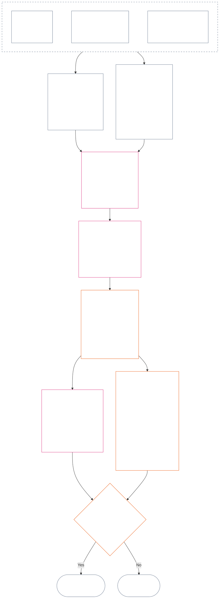

<!-- 简体中文 | 第十二章完整草稿 | 源提交：a9ad713c15de3c6ba565486590518aa07c7d62fa | AI 起草、未审阅、非约束性草稿 ; source SHA-256: 7ae49781f558ad90db53cdd4469dd22d8227f0a17b0c7393c3a1d2168263f59d; committed-main row update 2026-11-11 -->

# 第十二章：持续测量——问题2：程度有多好或多坏？

<strong>语料库位置（不具操作效力）：文件结构与阅读规则</strong>

> 本文件是**感知者宪章的一部分**，且**仅与其他编号为 `core_*` 的文件作为一部文本共同阅读时才具有约束力**。本文件包含**第十二章**——**问题2**（*程度有多好或多坏？*）：LEQU 基准线及其限制、测量输入维度、路线描述符目录、槽位语法与共同尺度化、轴指定的宪法输入、统一比例 LEQU 尺度、标准贡献测量、实例演示，以及向问题3的移交（**§1–§9**）。三问框架与**问题1**（*发生了什么？*）——已核实事实、事件类型、记录要求、记录保管以及处理——见[第十一章](core_11_standing_assessment.md#chapter-eleven-standing-records--question-1-what-happened)。问题3（*因此会发生什么？*）在[第十三章](../../core_13.000_standing_integration.md#chapter-thirteen-standing-effects-and-integration)继续；对于符合条件的违反轴 `s` = 7–9 认定，审查仅限于[第十四章](../../core_14.000_misconduct_designation.md#chapter-fourteen-anti-constitutional-misconduct)中的反宪法不当行为指定。阅读顺序、约束/支持材料的区分以及语料库版本元数据由[README.md](README.md)维护。

<strong>追溯</strong>

- 上游：
  - [第十一章 §1](core_11_standing_assessment.md#1-the-three-questions)（*三问框架*）；
  - [第十一章 §2](core_11_standing_assessment.md#2-question-1--what-happened)至[第十一章 §6](core_11_standing_assessment.md#6-handling-a-standing-record)（*问题1——已核实事实、持续记录、保管与处理*）；
  - [宪法四元组](core_00_preamble.md#constitutional-tetrad)；
  - [两项宪法目标](core_00_preamble.md#two-constitutional-aims)；
  - [序言 §6 关键实务流程管线](core_00_preamble.md#6-key-practical-process-pipelines)（*第九章至第十五章的链条*）。
- 本文件的小节：
  - [§1](#1-question-2--how-good-or-bad-was-it)（*问题2——LEQU 基准线、状态桥接、限制与范围*）；
  - [§2](#2-magnitude-and-severity-input-dimensions)（*两个轴的测量输入维度*）；
  - [§3](#3-route-descriptor-catalogs-and-measurement-roles)（*路线描述符目录*）；
  - [§4](#4-slot-grammar-and-shared-scaling)（*槽位语法与共同尺度化*）；
  - [§5](#5-constitutional-inputs-to-axis-assignment)（*宪法来源路由*）；
  - [§6](#6-unified-proportional-lequ-scale--contribution-and-violation-axes)（*两个轴的统一比例 LEQU 尺度*）；
  - [§7](#7-standard-contribution-measures)（*采纳者公布的标准贡献测量*）；
  - [§8](#8-measurement-illustrations)（*测量实例演示*）；
  - [§9](#9-hand-off-to-question-3--cross-question-measurement-hooks)（*移交问题3*）。
- 下游：
  - [第十三章](../../core_13.000_standing_integration.md#chapter-thirteen-standing-effects-and-integration)（13.000）（*问题3的效果与整合*）；
  - [第十四章](../../core_14.000_misconduct_designation.md#chapter-fourteen-anti-constitutional-misconduct)（14.000）（*仅作指定——不重新开启问题2测量*）。
- 配合阅读：[第五章 *持续状态、贡献与违反行为*](../../core_05.035_band_accountability.md#defa3-standing-state-contribution-and-violation)（5.035）（*规范定义路由*）。

 

第十二章是**问题2**的宪法责任章节，对[第十一章](core_11_standing_assessment.md#chapter-eleven-standing-records--question-1-what-happened)核实的事实进行测量。本章从[§1 问题2——程度有多好或多坏？](#1-question-2--how-good-or-bad-was-it)开始。[第十一章](core_11_standing_assessment.md#chapter-eleven-standing-records--question-1-what-happened)负责三问框架、问题1与持续记录，并以[第十一章 §6 持续记录的处理](core_11_standing_assessment.md#6-handling-a-standing-record)结束。

*用直白的话说：第十一章确定发生了什么以及谁保管持续记录。本章对其进行测量：贡献有多好，或违反行为有多坏，分别依据两个独立尺度衡量，绝不相加为净分数。测量结果带来的后续事项属于第十三章。*

### 1. 问题2——程度有多好或多坏？

<strong>追溯</strong>

- 上游：[第十一章 §2](core_11_standing_assessment.md#2-question-1--what-happened)（*问题1——状态记录与已核实事实*）；[第十一章 §2.5](core_11_standing_assessment.md#25-verified-input-gate)（*已核实输入门槛*）；[第十一章 §4](core_11_standing_assessment.md#4-standing-record-operational-requirements)（*记录要求*）；[第十一章 §1](core_11_standing_assessment.md#1-the-three-questions)（*三问框架*）。
- 下游：
  - [§2](#2-magnitude-and-severity-input-dimensions)（*两个轴的测量输入维度*）；
  - [§3](#3-route-descriptor-catalogs-and-measurement-roles)（*路线描述符目录*）；
  - [§4](#4-slot-grammar-and-shared-scaling)（*槽位语法与共同尺度化*）；
  - [§5](#5-constitutional-inputs-to-axis-assignment)（*宪法来源路由*）；
  - [§6](#6-unified-proportional-lequ-scale--contribution-and-violation-axes)（*Contribution Axis 与 Violation Axis 的指定*）；
  - [§7](#7-standard-contribution-measures)（*采纳者公布的标准贡献测量*）；
  - [§8](#8-measurement-illustrations)（*测量实例*）；
  - [§9](#9-hand-off-to-question-3--cross-question-measurement-hooks)（*移交问题3*）；
  - [第十三章 §7.2](../../core_13.000_standing_integration.md#72-competency-bars-and-clearances)（13.000 §7.2）（*贡献方面的问题3——安全委托*）；
  - [第十三章 §5.2](../../core_13.000_standing_integration.md#52-prevention--general-standing-locks)（13.000 §5.2）（*预防锁*）；
  - [第十三章 §6](../../core_13.000_standing_integration.md#6-lock-design-and-enforcement)（13.000 §6）（*锁的设计与执行*）。
- 配合阅读：[第十一章 §4.1](core_11_standing_assessment.md#41-minimum-record-contents)（*已核实状态记录字段；第十一章不规定状态效果*）。

 

*用直白的话说：问题2测量问题1中已核实的事实，询问**贡献有多好**或**违反行为有多坏**。本章在此首次引入两个正式测量轴：记录已核实帮助的**Contribution Axis**，以及记录已核实伤害的**Violation Axis**。两轴始终分开，不是一个净分数的正反两面。*

为了确定某人的贡献或违反行为属于哪个槽位，本章使用**寿命等值单位（LEQU）**测量影响。一个 LEQU 大致相当于挽救或毁损一名感知者整个生命历程的福祉。这不是在数人头或金钱，而是在问某项行动是否实质改变了宪法共同体的福祉。同一单位适用于任何感知者，无论是否为人类。

#### 1.1 LEQU 基准线

**寿命等值单位**（**LEQU**）是全生命周期等值的宪法利益或损失的简写单位；采纳后的实施需要数值校准时使用。

- 该单位不依赖承载基质。
- 当前采纳者可在生物学人类语境中以一般人类寿命作为校准示例；但有约束力的基准线以感知者与宪法为准，不受物种限制。

**全生命周期等值的宪法利益**是指已核实利益，其程度相当于保护、恢复或释放一名感知者完整生命周期的、非轻微且符合权利的福祉。**全生命周期等值的宪法损失**是指已核实的伤害、浪费、毁损、机会封闭、剥夺或风险实现，其程度相当于毁损、不当耗用或阻止一项全生命周期等值的宪法利益。

#### 1.2 使用 LEQU 的限制

每当使用 LEQU 时，均适用以下限制。

- **不是净分规则：**不得用贡献「抵消」违反行为，反之亦然。每个轴单独成立。
- **不是强制采用人类寿命的指标：**LEQU 泛用于感知者，适用于任何有意识的存在，不限于人类。
- **不是指控指标：**若无依照**第十一章 §2.5**核验的输入以及依照**§6**进行的校准，指控、受理标签、路由决定、声誉、不受偏好的状态或道德厌恶，都不能提供 Contribution Axis 利益或 Violation Axis 严重程度。
- **不是交易权利的许可：**以效率、生产能力、创新、减轻负担、安全、报复、紧急响应或制度必要性表述的主张，若依赖以下任一事项，必须折减或否决：
  - 强制；
  - 歧视性转嫁负担；
  - 生态耗竭；
  - 隐匿的无偿劳动；
  - 可避免的不透明；
  - 缩窄 Rights Floor；
  - 俘获；
  - 误导性代理指标；
  - 丧失可质疑性；或
  - 无法审查的汇总。

#### 1.3 仅限问题2——范围与路由

本部分仅涵盖问题2，即测量步骤。它接收已核实的问题1事实，并判断贡献有多好或违反行为有多坏。

- 以依照**第十一章 §2**核验并依照**第十一章 §4**写入状态记录的事实为起点，使用**§2**中的维度进行测量。
- 然后，从目录为每类帮助或伤害赋予标准名称：帮助使用**利益路线**目录（**§3.1**），伤害使用**伤害路线**目录（**§3.2**）。
- 每个名称也说明该类帮助或伤害在判断*有多好*或*有多坏*时占多大比重。
- 利益会带来什么的规则见[利益侧](../../core_13.000_standing_integration.md#72-competency-bars-and-clearances)，伤害会带来什么的规则见[伤害侧](../../core_13.000_standing_integration.md#52-prevention--general-standing-locks)。
- 后续事项由问题3决定。请从[第十三章 §4 描述符整合与附着规范化](../../core_13.000_standing_integration.md#4-descriptor-integration-and-attachment-normalization)开始。

#### 1.4 感知状态桥接

状态测量**不**决定一个实体是否为**感知者**。

- 状态争议交由[感知状态裁定](../../core_05.055_band_participation.md#sentience-status-adjudication)与[Article VI-B](core_06_rights_part_b.md#article-vi-b-sentience-status-adjudication-floor)（*感知状态裁定权利底线*）处理，不交由 LEQU 分数或分类记录处理。
- 若依照[争议中的感知者生命](../../core_05.055_band_participation.md#contested-sentient-life)提出的状态争议尚未解决，**Article VI-B**（*感知状态裁定权利底线*）默认将该实体纳入范围：争议裁定前，它仍可接受测量并提交状态记录；运营者不得仅以争议未决为由否认其状态。
- 若该实体被认定为[感知者](../../core_05.055_band_participation.md#sentient)，或在可受审查的裁定后其状态被缩窄或恢复：
  - 从该时点起更新状态记录的主题方；并且
  - 除经由[补救与修复](../../core_05.035_band_accountability.md#redress-and-remediation)外，不得追溯不当排除，以抹去该实体在此期间接受测量的资格。

### 2. 量级与严重程度的输入维度

*用直白的话说：本节先说明问题2会产出什么（**§2.1**），再列出测量已核实贡献或已核实违反行为时要考察的内容（**§2.2**）。每个轴单独测量。共同尺度化规则见**§4.2**，槽位依据**§6**的尺度确定。*

槽位尺度测量宪法结果有多大、属于何种结果。只计算已核实的结果。

**尺度计算什么，以及它与宪法核心测试的关系：**

- **[两项宪法宗旨](core_00_preamble.md#two-constitutional-aims)：**两轴都测量对**繁盛**与**延续**的影响。Contribution Axis 推动二者向前，Violation Axis 则使二者倒退。
- **[两个根本问题](core_00_preamble.md#two-fundamental-questions)：**每个轴为其中一个问题提供已核实事实。回答一个问题不能回答另一个问题，因此两个轴绝不合并成净值。
  - **第一个问题：**由 Contribution Axis 提供已核实事实。系统是否奖励帮助感知者繁盛和延续、讲真话并修复伤害的行为？
    - **计入：**已核实的宪法利益，包括已核实的风险降低。
    - **不计入：**原始产出、声望、财富、某物的使用量、速度或机构规模。
  - **第二个问题：**由 Violation Axis 提供已核实事实。系统是否奖励无正当理由地伤害、误导、排斥、拖延、浪费或将成本转嫁给他人的行为？
    - **计入：**已核实的宪法损失、伤害、浪费、失去的选项（机会封闭）、危险或风险升级。
    - **单独不计入：**不受偏好的状态、指控或道德厌恶。
- **[宪法四元](core_00_preamble.md#constitutional-tetrad)：**
  - **监督与问责：**「已核实」意味着具名行为者对认定负责，且任何一方都不得核验自己的主张。
  - **及时性：**可避免的拖延作为独立事实记录，不折入损失量级。

#### 2.1 问题2的产出

问题2将以下内容写入每个轴对应的状态记录。这些是测量结果，不是状态效果（由问题3决定的后果）：

| **产出项** | **Contribution Axis** | **Violation Axis** |
| --- | --- | --- |
| **写入位置** | 贡献状态记录。 | 违反行为状态记录。 |
| **槽位** | 适用的最高**Contribution Axis 槽位**（`s` = 1–9）。 | 适用的最高**Violation Axis 槽位**（`s` = 1–9）。 |
| **路线描述符** | 适用的**利益路线描述符**，叠加记录。 | 适用的**伤害路线描述符**，叠加记录。 |
| **交给问题3的输入** | 依据[第十三章 §7 贡献后果其次处理](../../core_13.000_standing_integration.md#7-contribution-consequences-second)，用于设定如何承认贡献之起点的输入。 | 依据[第十三章 §6 锁的设计与执行](../../core_13.000_standing_integration.md#6-lock-design-and-enforcement)，用于确定默认锁定区间（锁的严格程度起点）的输入。 |
| **LEQU 总量** | 分别评估每种相关利益（生态、系统或资源利益），再为整项贡献录入一个 LEQU 总量。 | 分别评估每种相关伤害（生态伤害、系统伤害或资源损失），再为整项违反行为录入一个 LEQU 总量。 |

提醒：上述内容均不会抵消尚未结案的违反行为记录。禁止抵消规则见[第十一章 §2.4 相关状态记录与禁止抵消桥接](core_11_standing_assessment.md#24-linked-standing-records-and-no-offset-bridge)。

#### 2.2 贡献量级输入与违反严重程度输入维度

**问题2——程度有多好或多坏？**要决定一项贡献在 Contribution Axis 上的位置，或一项违反行为在 Violation Axis 上的位置（其**槽位**，范围1至9），以及适用哪些利益或伤害描述符，须依次处理三个部分。多个描述符可以同时适用并叠加记录。按照**§2.1**，把结果写入相应轴的状态记录。**§6**为第2部分提供统一尺度，利益与伤害共用同一尺度。它说明如何以 LEQU（寿命等值单位，约相当于完整一生的福祉）估算总利益或总损失，以及每个量值对应哪个槽位。Contribution Axis 的槽位分为四个区间。

**1. 检查结果如何产生。**两个轴对此处理不同：

- **Contribution（行为质量）：**这会增加或限制可计利益：是否可追溯？是否避免把成本推给他人？是否谨慎行事？是否符合宪法？五项检查见[§2.2.1 利益的产生方式如何影响计入规则](#221-how-the-way-a-benefit-was-produced-affects-what-counts)。
- **违规（行为性质）：**与影响大小分开记录。义务、过失、欺骗、隐瞒、妨碍问责、胁迫、暴力、故意、残酷和结构性促成因素，会影响责任归属、所需保障措施及应对方式。任何这些因素都不得改变槽位；各项记录规则见[§2.2.2 如何记录伤害的致因](#222-how-the-way-a-harm-was-caused-is-recorded)。

**2. 衡量量级：利益或损失有多大？**这决定槽位。

| **考察内容** | **作用** | **规定位置** |
| --- | --- | --- |
| **总体量级（LEQU）** | 主要测量指标，并决定槽位。贡献方面，是以 LEQU 计算的已核实善行总量；违反行为方面，是已核实的宪法损失总量。第十四章对不当行为的指定另行决定。 | [§6 统一比例 LEQU 尺度](#6-unified-proportional-lequ-scale--contribution-and-violation-axes) |
| **影响到谁（人数、深度、脆弱程度）** | 调整 LEQU 估算值及利益或伤害的重要性（实质性）。 | [§4.2 共同影响尺度化规则](#42-shared-impact-scaling-rules)；[实质性](core_05_band_oversight.md#materiality) |
| **持续多久（期间；利益的持久性、伤害的不可逆性）** | 调整 LEQU 估算值。对贡献而言，持续尽责管理、惠及后代的利益或机构的长久修复，支持较高槽位。对违反行为而言，长期创伤、无法逆转的损失，以及感知者自主行动能力的持久受损，会提高总损失估算。 | [§4.2 共同影响尺度化规则](#42-shared-impact-scaling-rules) |
| **影响多广（跨地点或机构）** | 调整 LEQU 估算值。贡献的例子包括跨社区或跨机构的利益，或文明规模的利益；违反行为若跨社区、机构或文明传播，可能提高总损失估算。 | [§4.2 共同影响尺度化规则](#42-shared-impact-scaling-rules) |

**3. 命名利益或伤害的类型（路线）。**指出已核实利益或伤害以何种方式发生。可以适用多个描述符并叠加记录。列表见[**利益路线描述符目录**](#31-contribution-route-descriptor-catalog-and-measurement-roles)和[**伤害路线描述符目录**](#32-violation-route-descriptor-catalog-and-measurement-roles)。

##### 2.2.1 利益的产生方式如何影响计入规则

选择 Contribution Axis 槽位前检查：

| **发现事项** | **对利益的作用** |
| --- | --- |
| 得知问题后及时且经核验地修复 | 若产生真实、可证明的利益，可计为**勤勉**（谨慎、负责的行为）。 |
| 将伤害转嫁给他人，或隐瞒负担 | 对争议路线（计入该利益的具体路径）记载的利益设限，或将其排除。 |
| 已核实的俘获风险（安排可能被狭隘利益控制）、结构性依赖（感知者被置于依赖该安排的位置），或退出与锁定设计（难以离开） | 限制对良好尽责管理的认可。 |
| 已核实地修复无障碍或参与障碍 | 可能提高利益的重要性（实质性），并支持**§3.1**的利益路线描述符**无障碍与包容**。 |
| 来自违宪激励安排、反宪法行为或存在重大缺陷的流程的重要奖励 | 默认不计为贡献。在此情况下，适用[第十三章 §6.4.2 不一致奖励](../../core_13.000_standing_integration.md#642-misaligned-rewards)以及[第二十八-A条](../../core_06.020_rights_part_e.md#incentive-alignment-adoption-transition-carve-out)（*分阶段采纳与权利底线连续性*）规定的采纳过渡限制。 |

##### 2.2.2 伤害如何造成及其记录方式

伤害大小（即上文第2部分的 LEQU 总量）决定槽位。伤害的致因不决定槽位，因此下列每类行为均单独记录。

本小节在第十二章中一次性说明该规则。**不得仅因某事件或行为过程被描述为以下任何一项而上调或下调槽位：**

- 义务；
- 过失；
- 故意；
- 隐瞒；
- 重复；
- 加重情节；
- 胁迫；
- 暴力；
- 自由受威胁；
- 可纠正性；或
- 偏好的后果。

行为性质事实应作为可单独追溯的描述符记录。它们可能影响归责、审查强度、保障措施、补救或第十四章的指定。它们只有通过经核实的后果才会影响槽位：行为若造成额外损失，该损失仅在 LEQU 总量中计入一次，槽位随总量确定。

**增加损失的行为（仅计入量级一次）：**

| **发现事项** | **记录方式** |
| --- | --- |
| 有行动义务且有能力行动，却可避免地延误响应或升级处理 | 作为独立的行为事实记录。延误造成的任何额外损失，只计入 LEQU 估算一次。 |
| 经独立核实的论坛完整性受损（损害论坛的公平性） | 在 LEQU 估算中恰好计入一次。不诚实地遗漏、故意不遵守回避程序、胁迫、自由受威胁及其他行为事实，仍作为单独描述符记录。 |
| **妨碍问责**（经核实地干预使责任人能够被追责的机制，例如证据完整性、核验、论坛程序、standing记录、补救期限或争议与救济途径） | 作为单独的行为事实记录。其在设有门槛的路径上造成的任何额外损失，在 LEQU 估算中计入一次。 |

**与伤害量级分开记录的行为事实：**

| **发现事项** | **记录方式** |
| --- | --- |
| 欺骗、隐瞒、规避、收到通知后重复行为、鲁莽漠视、结构性促成（设置成使伤害容易或很可能发生），或滥用重大依赖失衡（利用严重依赖自己的人） | 每一项都作为独立行为事实记录。 |
| 暴力、强制、操纵或危及自由 | 单独记录，无论槽位为何，都可能要求加强保障。 |
| [残酷行为](../../core_05.035_band_accountability.md#cruelty)（以造成经核实的痛苦本身为目的，或造成超出必要且合乎比例范围的无端或有辱人格伤害） | 作为单独的行为事实记录。依据[第十三章 §5 违规、纠正与预防](../../core_13.000_standing_integration.md#5-violation-correction-and-prevention)，可能需要更强保障措施并限制有辱人格的补救方式。 |

**责任与归责：**

| **发现事项** | **记录方式** |
| --- | --- |
| 责任分散（责任如何分布：谁承担何种因果角色、拥有何种权限或控制、能否预见伤害、是否受益或隐瞒，或能否防止伤害） | 不属于**感知者范围**，也不允许仅因某人属于某群体而归咎于他。 |
| 追随伤害行为或未能抵制 | 只有在核实了**第十一章 §§4.1和4.3**要求的特定行为者关联后，才可支持基于义务、加重或集体问责性质的认定。 |

**不一致的奖励：**

| **发现事项** | **记录方式** |
| --- | --- |
| 明知奖励与宪法相悖，却未及时通过受保护的报告渠道（免受报复的报告）而接受或保留重要奖励 | 根据[第十三章 §6.4.2 不一致奖励](../../core_13.000_standing_integration.md#642-misaligned-rewards)记录，并受[第二十八-A条](../../core_06.020_rights_part_e.md#incentive-alignment-adoption-transition-carve-out)（*分阶段采纳与权利底线连续性*）约束。只有其造成的经核实宪法损失才影响槽位。 |

**不一致奖励的界限。**本章只衡量经核实的不一致奖励（违背宪法的奖励）对贡献轴或违规轴的影响。[第十三章 §6.4.2 不一致奖励](../../core_13.000_standing_integration.md#642-misaligned-rewards)规定报告义务、排除情形、放弃奖励（没收）的后果、纠正义务及转介规则。

### 3. 路线描述符目录与测量作用

*用直白的话说：下列两个目录命名状态记录可载明的已核实帮助（**§3.1**）和伤害（**§3.2**）类型。描述符说明利益或伤害如何发生；描述符可以叠加，且从属于槽位。*

**描述符规则。**以下两个目录——[§3.1 贡献路线描述符目录与测量作用](#31-contribution-route-descriptor-catalog-and-measurement-roles)和[§3.2 违反路线描述符目录与测量作用](#32-violation-route-descriptor-catalog-and-measurement-roles)——是两个轴的正式描述符清单。描述符说明已核实的利益或伤害**如何**发生。适用以下规则：

- 描述符可叠加，互不排斥：已核实事实足以支持时，一条状态记录可以载明多个描述符。
- 描述符低于槽位：槽位说明利益或伤害有多大；描述符补充其发生方式，但绝不取代槽位。
- 所列描述符是基础而非完整清单；目录不排除其他种类的利益或伤害。
- 实现可以使用映射到目录的稳定标识符（自行固定的 ID），但不得创建类别互斥、导致一条状态记录只能载明一个描述符的冲突分类体系。
- 事实核实之前，所称描述符可用于支持合法证据保全、案件分类或临时保障。
- 只有已核实描述符可以作为问题2输出予以记录或影响状态。

#### 3.1 贡献路线描述符目录与测量作用

以下是利益路线描述符，以及各自对问题2（程度有多好？）的测量作用。它们分为五个领域，每个领域一张表；[§3.2 违反路线描述符目录与测量作用](#32-violation-route-descriptor-catalog-and-measurement-roles)中的违反行为目录按相同顺序采用这五个领域。它们在问题3中的作用，即安全委托，见[第十三章 §7.2 能力基准与许可](../../core_13.000_standing_integration.md#72-competency-bars-and-clearances)。

**目录完整性。**若实现将多个描述符显示在同一行或标签下，该行或标签须对应每个适用描述符。本目录仅规定描述符名称以及各自对问题2的测量内容。问题3规则（附着、救济、锁、许可及其他状态效果）仅见第十三章。

##### 3.1.1 身体安全、关系、照护与能动性

| **利益路线描述符** | **问题2测量内容** |
| --- | --- |
| **身体、心智和／或共同体的安宁** | 身体、心理及共同体安宁带来的利益。调整利益的重要性（实质性）。 |
| **可靠关系** | 可被信赖的关系所带来的利益，包括在双方不平等的环境中基于信任义务建立的关系。 |
| **照护与依赖支持** | 对依赖他人的感知者提供的已核实照护。能够证明时，非正式照护也计入。 |
| **无障碍与包容** | 实质参与和无障碍带来的利益。在一方高度依赖另一方的情境下，调整利益的重要性。 |

##### 3.1.2 修复、财产与资源

| **利益路线描述符** | **问题2测量内容** |
| --- | --- |
| **救济与恢复性利益** | 修复、补偿和减少伤害带来的利益。 |
| **资源尽责管理** | 对物质资源的谨慎照管，以及可靠分配资源。 |

##### 3.1.3 知识、教育、记录与发现

| **利益路线描述符** | **问题2测量内容** |
| --- | --- |
| **信息圈完整性** | 加强记录、透明度和沟通。 |
| **教育与能力建设** | 学习、读写能力以及感知者自主行动能力增长带来的利益。槽位取决于 LEQU 利益总量。 |
| **STEM 与发现贡献** | 他人可以复现的发现，以及使事物更安全的研究。 |

##### 3.1.4 系统与宪法运作

| **利益路线描述符** | **问题2测量内容** |
| --- | --- |
| **系统优化** | 修复跨机构流程并降低风险。 |
| **宪法一致性** | 加强 Rights Floor，并使决定更易受到质疑。 |

##### 3.1.5 生态与勤勉

| **利益路线描述符** | **问题2测量内容** |
| --- | --- |
| **生态尽责管理** | 使栖息地和生物多样性受益，以及对气候负责的行动。 |
| **勤勉** | 防止可预见风险，并胜任地监督。 |

#### 3.2 违反路线描述符目录与测量作用

以下是伤害路线描述符，以及各自对问题2（程度有多坏？）的测量作用。它们分为五个领域，每个领域一张表，并按[§3.1 贡献路线描述符目录与测量作用](#31-contribution-route-descriptor-catalog-and-measurement-roles)相同的五个领域、相同顺序排列。问题3的整合与附着规则见[第十三章 §4 描述符整合与附着规范化](../../core_13.000_standing_integration.md#4-descriptor-integration-and-attachment-normalization)；预防与锁的设计见[第十三章 §5.2 预防——一般状态锁](../../core_13.000_standing_integration.md#52-prevention--general-standing-locks)和[第十三章 §6 锁的设计与执行](../../core_13.000_standing_integration.md#6-lock-design-and-enforcement)。

**目录完整性。**若实现将多个描述符显示在同一行或标签下，该行或标签须对应每个适用描述符。本目录仅规定描述符名称以及各自对问题2的测量内容。问题3规则（附着、救济、锁、许可及其他状态效果）仅见第十三章。

##### 3.2.1 身体安全、关系、照护与能动性

| **伤害路线描述符** | **问题2测量内容** |
| --- | --- |
| **暴力不当行为** | 将暴力、强制或自由受威胁与 LEQU 影响槽位分开记录。可能需要强化保障。 |
| **人际关系／照护义务不当行为** | 一方高度依赖另一方时，伤害的重要性（实质性）更高。 |
| **无障碍与参与障碍不当行为** | 一方高度依赖另一方时，伤害的重要性（实质性）更高，并可叠加加重因素。 |
| **隐私与自我所有权不当行为** | 核实存在隐瞒或剥削时适用加重因素，且可叠加。 |
| **能动性与操纵不当行为** | 将强制、操纵或自由受威胁与影响槽位分开记录。 |

##### 3.2.2 修复、财产与资源

| **伤害路线描述符** | **问题2测量内容** |
| --- | --- |
| **可通过救济纠正的不当行为** | 记录其纠正性质（伤害是否能纠正及如何纠正）。槽位取决于 LEQU 损失总量。 |
| **财产不当行为** | 财产损失路线。槽位取决于 LEQU 损失总量。 |

##### 3.2.3 知识、教育、记录与发现

| **伤害路线描述符** | **问题2测量内容** |
| --- | --- |
| **信息圈不当行为** | 对 Safety 或 Truth 的损害。隐瞒与欺骗仍作为伤害造成方式（性质）的独立事实。 |
| **教育不当行为** | 对学习或感知者自主行动能力（其能力）的伤害。槽位取决于 LEQU 损失总量。 |
| **研究与发现不当行为** | 对研究或发现的伤害。槽位取决于 LEQU 损失总量。 |

##### 3.2.4 系统与宪法运作

| **伤害路线描述符** | **问题2测量内容** |
| --- | --- |
| **系统不当行为** | 责任在行动者之间的分散以及结构性促成因素分别记录。 |
| **妨碍问责不当行为** | 涵盖妨碍问责，即阻止有人为伤害承担责任。作为伤害发生方式记录。妨碍的实施方式（例如隐瞒或过失）作为单独事实记录。当槽位处于最高档（见[§4.1 表1——槽位显示标签](#41-table-1--slot-display-labels)）时，也可将案件记为**反宪法不当行为**，以便转交第十四章的[反宪法不当行为审查](../../core_05.035_band_accountability.md#anti-constitutional-misconduct-review)。转交审查不等于指定为反宪法不当行为；第十四章另行作出决定。 |
| **退出与锁定不当行为** | 包含系统不当行为的特征；若责任分散或俘获属于结构性因素（内置于系统运作方式），也一并包括。 |
| **生命周期与不可逆性不当行为** | 不可逆性影响 LEQU 损失量级。隐瞒或疏忽仍作为行为性质另行记录。 |
| **反宪法不当行为**（描述符） | 将最高槽位中的违反行为（见[§4.1 表1——槽位显示标签](#41-table-1--slot-display-labels)）送交第十四章指定审查，但不改变其影响槽位。 |

##### 3.2.5 生态与勤勉

| **伤害路线描述符** | **问题2测量内容** |
| --- | --- |
| **生态不当行为** | 根据[生态恢复能力](../../core_05.040_band_continuity.md#ecological-recovery-capacity)的损失（生态系统受害后再生的能力）对 LEQU 损失加权。可与暴力路线（暴力不当行为）叠加。 |
| **疏忽不当行为** | 将义务、可预见性和可预防性与影响槽位分开记录。 |

### 4. 槽位语法与共同尺度化

*用直白的话说：本节为两个独立轴上的九个可能位置设定一致名称，并解释影响如何在各位置间尺度化。一个轴记录已核实贡献，另一个轴记录状态记录中的已核实违反行为。共享槽位编号不会合并两个轴，也不会以帮助抵消伤害。**§6**的统一尺度依据按比例计算的 LEQU 影响为两个轴指定槽位。*

槽位语法使用 `s` 表示槽位编号，范围从**1**到**9**。每个轴都有自己的槽位位置：

- **Contribution Axis**记录正向贡献性质；并且
- **Violation Axis**记录已核实的违反行为认定。

两个轴上可以出现相同的槽位编号，但两轴仍然分开。贡献槽位不是违反行为槽位，反之亦然。

#### 4.1 表1——槽位显示标签

**表1**为九个槽位命名，并并列展示 Contribution Axis 与 Violation Axis 的显示标签。本表仅提供显示用语；槽位依照**§6**的统一尺度指定。

| `s` | Contribution Axis 显示标签 | Violation Axis 显示标签 |
| ---: | --- | --- |
| 1 | **轻微基线贡献** | **轻微宪法影响** |
| 2 | **小幅基线贡献** | **小幅宪法影响** |
| 3 | **实质性正向贡献** | **实质性宪法影响** |
| 4 | **显著正向贡献** | **显著宪法影响** |
| 5 | **严重尽责管理正向贡献** | **严重宪法影响** |
| 6 | **重大尽责管理正向贡献** | **重大宪法影响** |
| 7 | **获认可的模范者** | **严峻宪法影响** |
| 8 | **杰出的模范者** | **严重宪法影响** |
| 9 | **典范模范者** | **灾难性宪法影响** |

Contribution Axis 使用基线、正向、尽责管理正向及模范者标签。Violation Axis 在所有槽位使用中性的影响标签。两个轴保持分离，不产生净分数，也不允许贡献记录与违反行为记录相互抵消。Violation Axis 槽位本身不会将行为归类为反宪法不当行为；[第十四章](../../core_14.000_misconduct_designation.md#chapter-fourteen-anti-constitutional-misconduct)会独立判定该反宪法不当行为指定（ACMD）是否适用于已核实且 `s` = 7–9 的违反行为。

实现可公布测量单位、证据方法和示例，帮助估算全生命周期等值利益或损失。这些材料仅供指引，不得凌驾于**§6**、**第一章**或**第六章**的 Rights Floor。

#### 4.2 共同影响尺度化规则

*用直白的话说：影响不能只按人数衡量。影响一名感知者的深刻利益或损失，可能比影响许多人的浅层效果更重大。人数、深度、脆弱性、持续时间、持久性、范围和宪法性质必须综合评估。*

用以下规则解释**§6**中的两个轴：

| 尺度维度 | 共同规则 | 轴的具体应用 |
| --- | --- | --- |
| **宪法结果量级（LEQU）** | 评估综合后的已核实利益或损失。LEQU 是量级的主要锚点；原始人数、金钱、产出或机构规模不是。 | 贡献计算符合权利要求的利益；违反行为计算已核实的宪法损失、伤害、浪费、机会封闭或危险。 |
| **感知者范围** | **同时考虑人数、深度与脆弱性**。没有任何槽位把人数单独列为门槛。如果综合量级及该行其他标准相同，对一名感知者足够深的影响可以支持与范围更广但深度更浅的影响相同的槽位；但仍须满足任何明文规定的 LEQU 总量或广泛范围标准。 | 依赖关系、能力降低或异常脆弱性可能提高实质性。仅凭群体规模不能确立贡献或严重程度。 |
| **时间范围** | 考虑持续时间、复发、持久性；若为损失，还要考虑不可逆性。短暂但带来转变的事件可能超过长期但轻微的效果；持续时间本身并非决定因素。 | 持久利益支持较高的贡献量级。持续或不可逆损失支持较高的违反行为严重程度。 |
| **空间或机构范围** | 更广的范围可能提高量级；但若深度、持续时间、脆弱性或宪法关键性本身即可支持该槽位，则无需证明影响跨越社区或机构。 | 机构修复可能提高贡献量级；结构性或系统性损害可能提高违反行为严重程度。 |
| **宪法质量或性质** | 将结果如何产生与其传播范围分开测量。不得对同一事实重复计数。 | 外部化伤害、隐瞒负担、俘获或依赖可能限制或取消所主张的贡献。义务、过失、欺骗、胁迫、暴力或结构性促成因素仍作为违规行为性质单独记录。 |
| **Rights Floor 与关键保障** | 不得以总体利益或损失来交换对 Rights Floor 的遵守。 | 遵守底线本身不能证明贡献较高。即使直接受影响的感知者人数很少，实质性地破坏 Rights Floor 或未能维持关键保障，也可能支持较高的违反行为严重程度。 |

这些维度不是要求每种规模形式都必须满足的清单。应说明哪些维度具有决定作用、哪些没有，以及原因。

- **共同槽位方法：**
  - 依据比例原则，以 LEQU 估算综合的已核实利益或损失，再指定唯一一个数值区间包含该量级的槽位。
  - 两个轴适用相同阈值。
  - 贡献槽位仍须满足适用的基线要求和宪法一致性要求；达到数值阈值，不能使转嫁伤害或违背宪法的产出算作贡献。
- **性质分离：**将适用的利益路线、伤害路线、行为质量和行为性质描述符叠加记录于状态记录中。义务、疏忽、欺骗、加重因素、强制、暴力、意图或结构性促成因素，可能影响归责、保障或问题3的后果，但均不得提高或降低 LEQU 影响槽位。
- **反宪法不当行为审查的边界：**已核实的 Violation Axis 损失可因影响达到 `s` = 7–9，不论是否确立反宪法不当行为。第十四章不取代影响槽位的指定；它另行判定相应 ACMD 是否适用。

如果危险尚未实际发生，须将下列事项分别记录：

- 发生可能性；
- 感知者会暴露于该危险多久；
- 影响可能延伸多远；
- 估算的不确定性；以及
- 仍属可信范围内的最坏结果。

除非采纳后的实施已设定任何人都可查阅的风险校准（将风险换算为 LEQU 的方法），不得将最坏结果计作已经发生的伤害（LEQU 损失）。

### 5. 用于指定轴的宪法输入

*用直白的话说：选择槽位前，先确认哪些宪法来源规定了正在测量的基线、利益、义务、伤害或违反行为。用下列链接在其规范性来源位置应用这些规定；不得把这一步路由变成另一种评分或替代定义。*

依照**§6**指定槽位前，状态记录必须指出：

- 适用的宪法基线、义务、约束或受保护利益；
- 确立所测量的已核实利益、不利结果、伤害或违反行为的条款；
- 对量级或行为性质有实质影响的定义、原则和 Rights Floor 条款；以及
- 每一项所列来源为何适用，以及它如何影响轴的指定。

下列路由表并非穷尽清单。已核实事实触发的任何其他定义、原则或条款仍然适用，且必须在状态记录中列明。每个链接指向的规范来源均有控制力；本表不重述或缩窄其内容。

#### 5.1 定义输入

| 规范来源 | Contribution Axis 的作用 | Violation Axis 的作用 |
| --- | --- | --- |
| [状态、贡献与违反行为](../../core_05.035_band_accountability.md#defa3-standing-state-contribution-and-violation) | 说明何为贡献，以及可以用哪些经检查的事实衡量贡献；同时确保贡献状态记录只记录正向，不与负向混杂。 | 说明何为违反行为以及如何记录，并将最严重的案件送交反宪法不当行为审查；该审查单独处理破坏宪法本身的行为。 |
| [问责](core_05_apex_accountability_leg.md#accountability) | 检查良好尽责管理或修复的主张是否真正使某人承担责任。仍须显示谁做了什么、谁须对此负责，以及如何依影响程度对其审查、补救和纠正。 | 发现无法确定由谁实施或由谁负责的案件，包括组织或结构改变后责任机制失效的情形。 |
| [伤害](../../core_05.035_band_accountability.md#harm) | 转嫁给他人或被隐瞒的伤害，可能限制或抵消所称利益。修复伤害可以算作利益，但只有在修复经核实并获独立证明时才可以。 | 说明衡量损失和严重程度时计入的损害类型：直接、间接、延迟、累积、跨系统传播的损害，以及对感知者心智或情绪福祉的伤害。 |
| [实质性](core_05_band_oversight.md#materiality)与[寿命等值单位（LEQU）](../../core_05.055_band_participation.md#lifespan-equivalent-unit-lequ) | 根据利益影响范围、受影响者脆弱程度和持续时间，确定已核实利益的计入程度。结果以 LEQU 测量，这是完整生命利益的共同尺度。 | 根据已核实损失或危险的影响范围、受影响者脆弱程度、持续时间及可逆难度，确定计入程度。结果以 LEQU 测量，与完整生命损失使用同一尺度。 |
| [贡献性质](../../core_05.035_band_accountability.md#contribution-nature) | 决定某事项是否构成贡献。该事项必须纯属正向，不得混有伤害，并须有可展示的已核实贡献记录。缺少任何一项都不能指定 Contribution Axis。 | 在此不发挥作用。它不决定何为伤害，也绝不降低违反行为的严重程度。 |
| [违反行为性质](../../core_05.035_band_accountability.md#violation-nature) | 在此不发挥作用。违反行为绝不算作负贡献，也不会抹去与其无关的已核实利益。 | 决定某事项是否构成违反行为。必须将其归类为有害，并有已核实认定支持违反行为确已发生。缺少任何一项都不能指定 Violation Axis。 |
| [宪法约束](core_05_band_integrative.md#constitutional-constraint)、[权限层级与内部等级](core_05_band_integrative.md#authority-stack-and-internal-hierarchy)及[可审计性](core_05_band_oversight.md#auditability) | 若所称利益依赖于挫败宪法、规避规则、缩减 Rights Floor（宪法保障的最低保护）或仅在纸面上合规，则阻止其计入。 | 标示影响违反行为真实严重程度的事项：破坏重要宪法限制、把某事置于宪法权限之上、规避规则或使规则无法执行。 |
| [可审计性](core_05_band_oversight.md#auditability)与[可质疑性](../../core_05.035_band_accountability.md#contestability) | 要求所称利益可以展示和核查，且任何异议方都有有效的质疑途径。 | 要求认定可以核查和质疑。没有说明的指控或标签不能确定违反行为的严重程度。 |

#### 5.2 原则输入

| 原则来源 | 在轴指定中的作用 |
| --- | --- |
| [宪法四元](core_00_preamble.md#constitutional-tetrad)、[两项宪法宗旨](core_00_preamble.md#two-constitutional-aims)与[实质利害](core_00_preamble.md#material-stake) | 设定四项工作纪律（参与、监督、问责与及时性）、宪法追求的两项结果（繁盛与延续），以及按利害事项规模化每项指定的框架。 |
| [福祉](core_01_a_values_principles.md#3-foundational-objective-wellbeing-flourishing-aim)与[认可、强化和追求](core_01_a_values_principles.md#32-recognition-reinforcement-and-aspiration) | 在 Contribution Axis 上为符合权利的利益及相称认可奠定基础。声望或奖励绝不作为贡献证明。 |
| [安全](core_01_a_values_principles.md#4-safety-harm-constraint)与[真实](core_01_a_values_principles.md#5-truth-epistemic-integrity-constraint) | 对两个轴设定有约束力的限制。通过伤害或欺骗取得的利益不得全额计入；安全或真实方面经核实的失败可表明违反行为的量级或种类。 |
| [深入尽责管理](core_01_c_stewardship_capacity_principles.md#16-stewardship-in-depth)与[尽责管理纪律下的治理](core_01_c_stewardship_capacity_principles.md#18-governance-under-stewardship-discipline) | 在已核实事实需要时，指导如何权衡持久贡献、角色义务、机构修复、监督和责任。 |
| [核心权衡原则](core_01_b_interaction_interpretation.md#131-core-tradeoff-principles)与[宪法底线、安全与反贬损程序](core_01_b_interaction_interpretation.md#1314-constitutional-floors-safety-and-anti-degrading-process) | 在所测量行为涉及必要性、尽量减少伤害、比例原则、权利冲突或限制时适用。它们本身绝不授权任何后果。 |

#### 5.3 Rights Floor 与条款输入

| 条款来源 | 在轴指定中的作用或边界 |
| --- | --- |
| 事实适用的[第六章 Rights Floor](core_06_rights_part_a.md#chapter-six-foundational-rights)，包括已核实状态记录实质涉及的每一条款 | 确立争议中的基本保护、利益、义务、利益项或违反行为。不得仅因某条款未列于下方而将其遗漏。 |
| [Article XIX——状态与参与状态](core_06_rights_part_d.md#article-xix-standing-and-participation-status) | 区分感知者的状态、尊严、Rights Floor 最低保护、利益相关方状态、声誉，以及参与状态的任何后续变化。 |
| [Article XIII-A——可靠性与可信度基线](core_06_rights_part_c.md#article-xiii-a-reliability-and-trustworthiness-baseline)、[Article XIII-B——救济与补救权](core_06_rights_part_c.md#article-xiii-b-right-to-redress-and-remedy)、[Article XV-B——透明度、可审计性与可质疑性](core_06_rights_part_c.md#article-xv-b-transparency-auditability-and-contestability)及[Article XVI——审计、透明度与独立核验](core_06_rights_part_c.md#article-xvi-audit-transparency-and-independent-verification) | 当已核实利益或违反行为涉及诚信记录、信息共享、事实核查、质疑决定或纠正错误时适用。 |
| [Article XXIV——根本原因分析与适应性响应](core_06_rights_part_d.md#article-xxiv-root-cause-analysis-and-adaptive-response) | 当行为原因、是否纠正、是否持续发生或响应是否调整具有重要性时适用，因为这些事项表明该行为在宪法下的性质。 |
| [Article XX——已核实违反行为后的正义](core_06_rights_part_d.md#article-xx-justice-after-verified-violation)与[Article XXVI-C——及时解决与反拖延底线](core_06_rights_part_e.md#article-xxvi-c-timely-resolution-and-anti-delay-floor) | 适用于事实实际涉及的任何程序或延迟。**Article XX**（*已核实违反行为后的正义*）主要限制违反行为测量完成后发生的事项（问题3）。不得仅为论证某人预先偏好的响应而用它提高或降低问题2槽位。 |

**适用限制。**本步骤只指向适当来源。

- 本步骤不会：
  - 重开问题1；
  - 引入尚未核实的事实；
  - 增加新测量或分数；
  - 通过不同来源重复计算同一事实；
  - 合并两个轴；或
  - 要求所有列出的来源都适用于每条状态记录。
- 贡献和违反行为仍分别测量。
- **Article XX**（*已核实违反行为后的正义*）的后果不属于问题2。
- 第十四章指定审查与此处指定的影响槽位仍然分开。

### 6. 统一比例 LEQU 尺度——Contribution 与 Violation Axes

<strong>读者指引（非操作性）：五倍递进如何运作</strong>

> 尺度采用五倍递进，以 `s` = 7 = 一个 LEQU 为锚点。两个轴均适用：槽位 `s` 在2至9时，其最低量级为 `5^(s−7)` LEQU；槽位1从零开始。采纳后的实施可公布所得数值阈值与校准示例。槽位1在 Contribution Axis 上包括已核实的宪法基线，在 Violation Axis 上包括低于首个正向阈值的已核实损失；没有贡献或没有违反行为本身都不是 `s` = 1 记录。
>
> **便于理解的锚点。**以80年人类寿命作为校准示例，向上读中间列，表示新增的全生命周期等值利益、可用时间或符合权利的资源与能力；向下读则表示等值损失、剥夺、浪费或机会封闭。资源数量本身不计入，起决定作用的是它造成或避免的宪法结果。

 

*用直白的话说：**表2**将已核实贡献与已核实违反行为放在同一比例影响尺度上。槽位越高，综合宪法利益或损失越大。状态记录与轴仍然分开：共同尺度比较量级，不比较道德价值，也绝不允许帮助抵消伤害。*

下图从头到尾展示一次槽位指定。它显示实际处理步骤的顺序，与下方项目符号顺序不同；项目符号逐项说明规则。

依照**比例原则**，根据深度、感知者范围、脆弱性、持续时间、持久性或不可逆性、范围以及宪法关键性，估算综合 LEQU 影响。这些维度决定 LEQU 估算；不是独立的槽位加分。

- **表2**只可在问题1确认发生事项、问题2测量已核实利益或损失、适用**§§1–3和§4.2**，且已依照**§5**识别所需宪法来源后使用。
- 根据综合 LEQU 估算指定一个槽位。
  - 说明每个实质尺度化维度如何影响估算，以及未纳入的维度为何不起决定作用。
  - 每项指定均须满足：
    - 可追溯性；
    - 可审计性；
    - 可质疑性；以及
    - 适用的 Rights Floor。
  - 贡献还须满足不向外转嫁和宪法一致性要求。
- 将行为性质事实记录为可单独追溯的描述符，绝不将其记为槽位变化（规则见[§2.2.2 如何记录伤害的致因](#222-how-the-way-a-harm-was-caused-is-recorded)）。
- 通过实质尺度化维度，充分评估行动或行为过程的已核实后果，包括：
  - 身体伤害；
  - 心理创伤；
  - 强制效果；
  - 剥夺自由或自由受到威胁；
  - 累积伤害；以及
  - 其他宪法上可识别的利益或损失。
- 不得从影响大小推断行为性质，也不得以行为性质替代经核实的影响大小。

**表2**按顺序列出九个槽位。每行均列明槽位编号 `s`、达到该槽位的利益增量或损失量（以80年人类寿命作为校准示例），以及该槽位在两个轴上的名称。两个轴的阈值相同，但名称保持分开：Contribution Axis 槽位与 Violation Axis 槽位是不同记录，绝不相互抵消。

| `s` | 80年人类校准——增加的利益／造成的损失 | Contribution Axis | Violation Axis |
| ---: | --- | --- | --- |
| 1 | 少于约**9天** | **轻微基线贡献**——针对所评估范围，已核实满足宪法底线；任何可测量的提升仍低于 `s` = 2。 | **轻微宪法影响**——低于 `s` = 2 的已核实损失或运行损害，包括尚未证明实质伤害的正式缺陷。 |
| 2 | 约**9–47天** | **小幅基线贡献**——在此影响等级内，可靠且范围有限地超过最低底线。 | **小幅宪法影响**——在此影响等级内，经核实的有限损失。 |
| 3 | 约**47天–8个月** | **实质性正向贡献**——在此影响等级内，超越基线且可证明的利益。 | **实质性宪法影响**——在此影响等级内，经核实的重大损失。 |
| 4 | 约**8个月–3.2年** | **显著正向贡献**——更深、持久、反复发生、响应脆弱性或范围更广的已核实利益。 | **显著宪法影响**——经核实的显著宪法损失。 |
| 5 | 约**3.2–16年** | **严重尽责管理正向贡献**——持久的尽责管理、协调、维护、修复或类似的持续利益。 | **严重宪法影响**——经核实的严重宪法损失。 |
| 6 | 约**16–80年** | **重大尽责管理正向贡献**——重大且已核实、接近一个 LEQU 的利益。 | **重大宪法影响**——重大且已核实、接近一个 LEQU 的损失。 |
| 7 | 约**1–5个生命周期**（**80–400年**） | **获认可的模范者**——至少一个 LEQU、已核实且符合宪法的利益。 | **严峻宪法影响**——至少一个 LEQU 的已核实宪法损失。 |
| 8 | 约**5–25个生命周期**（**400–2,000年**） | **杰出的模范者**——实质性超过 `s` = 7 的已核实利益。 | **严重宪法影响**——实质性超过 `s` = 7 的已核实损失。 |
| 9 | 至少**25个生命周期**（**2,000年以上**） | **典范模范者**——实质性超过 `s` = 8 的已核实利益。 | **灾难性宪法影响**——实质性超过 `s` = 8 的已核实损失。 |

<strong>实施互操作性说明</strong>

> 此组件包含面向实施的互操作性材料，用于支持本章的操作类别，不会建立并行的类别体系。

槽位显示的机器可读字段（`sub_tier`、`sub_tier_display`及相关显示字段）定义于[CH06_NINE_SLOT_STANDING_SCALE.md](../../implementation/CH06_NINE_SLOT_STANDING_SCALE.md)和[ch06_nine_slot_constants.json](../../implementation/ch06_nine_slot_constants.json)。实施中的四区间映射仍是互操作性辅助工具，不会给操作性**表2**增加主要区间列。

参考方法及槽位指定实例（包括针对具有权重、保存状态检查点且没有固定死亡期限的感知者）见[LEQU_CALIBRATION_REFERENCE.md](../../implementation/LEQU_CALIBRATION_REFERENCE.md)。这些内容不得取代**§6**中的共同阈值和比例指定规则，不得指定一条正在处理的记录，也不得决定谁算作感知者。

采纳后的实施可公布 LEQU 估值和键控显示标签。这些辅助工具不得取代**§6**中的共同阈值与比例指定规则，也不得取代第十四章的指定保障，除非通过**符合性文件**变更。

### 7. 标准贡献测量

*用直白的话说：对于感知者反复执行的任务，例如捡拾垃圾或进行一项溪流修复工作，采纳者可公布默认的问题2测量值，使每个已核实实例不必单独估算。默认值是底线，不是上限：经核实做得更多的工作，按其实际成果测量；未达到预期的工作，按已核实的成果测量。默认值按公布的时间表更新，可以受到质疑，而且绝不产生执行该任务的义务。*

采纳后的实施可公布**标准贡献测量**：对已界定范围内、已核实完成的特定周期任务，提供默认的问题2估算——包括 LEQU、范围和利益路线描述符。例如，沿指定路段捡拾垃圾、一单位水道修复工作、一块土地恢复地块或一轮维护工作。依据[第一章 §3.2](core_01_a_values_principles.md#32-recognition-reinforcement-and-aspiration)（*认可、强化与追求*），标准使例行尽责管理清晰可见且值得重复，而无须逐项估算。标准是**第十一章 §4.5**下的测量辅助工具，并适用以下规则：

- **标准的适用方式**
  - 仅适用于依照问题1、经由**第十一章 §5**核实的工作；标准绝不取代对任务是否由具名主题方按所述范围完成的核实。
  - 标准是**标准表现的底线，而非上限**：
    - 若已核实影响超过标准所假定的影响——例如方法更好、结果更持久、转嫁负担更少，或利益更广、更深——则依照**§4.2**按实际已核实影响测量，以维持超越标准、把任务做得更好的激励。
    - 若经核实的工作未达到标准假定的范围或持久性，则按已核实的情况测量，而非按标签认定。
- **标准的修订方式**
  - 标准须**按公布的周期复查，并随效率提高重新设定基线**，以反映任务当前的成本和产出，不得把昨日的投入冻结为今日的贡献额度。
  - 修订向未来适用；已开启记录依据**第十一章 §4.4**保留其测量基础，除非该基础在记录时就是错误的。
  - 修订必须以证据为基础、予以公布且可受质疑。
  - 不得利用修订压低某类工作、某个社区或群体获得的认可，也不得以快于其所依据的已核实效率提升的速度下调标准（[第一章 §19 激励一致性与系统俘获](core_01_c_stewardship_capacity_principles.md#19-incentive-alignment-and-system-capture)）。
- **防止滥用和越权的保障**
  - 标准不产生配额、执行义务或[第十三章 §7.2 能力基准与许可](../../core_13.000_standing_integration.md#72-competency-bars-and-clearances)下的能力门槛；**第十一章 §2.2**的*沉默为默认规则*仍然适用，感知者从不执行标准任务，不会因此产生记录。
  - 设定或修订标准的办公室，依照**第十一章 §5.1**的*职责分离*占据方向与政策席位；它不得同时担任核验标准表现的办公室，也不得是标准所衡量其认可程度的当事方。

标准不得凌驾于**§6**、**第一章**或**第六章**的 Rights Floor。参考方法与演算时程见[LEQU_CALIBRATION_REFERENCE.md](../../implementation/LEQU_CALIBRATION_REFERENCE.md)（*程序支持；不得指定正在处理的记录*）。

### 8. 测量示例

*用直白的话说：两个演算示例——**示例8和9**——分别测量已核实贡献与已核实违反行为。它们与其他演算示例放在一起，不增添任何规则。*

演算示例见[第十一至第十五章应用示例](../../corpus_joint_structure/cjs_11.105_application_vignettes.md#cjs-11105-application-vignettes)，它们用于说明本章，不具有规则效力：

- [示例8：河岸合作修复（贡献测量）](../../corpus_joint_structure/cjs_11.105_application_vignettes.md#cjs-11105-8-riparian-cooperative-restoration-contribution-measurement)：从问题1的事实到问题2的输出，对已核实贡献进行测量。
- [示例9：流域管理者疏忽并隐瞒检测结果（违反行为测量）](../../corpus_joint_structure/cjs_11.105_application_vignettes.md#cjs-11105-9-watershed-steward-negligence-with-concealed-test-results-violation-measurement)：以同样方式测量已核实违反行为，并附带一项不会抵消它的相关贡献。

### 9. 移交问题3——跨问题测量衔接点

**跨问题指引。**某些已核实事实会用于回答两个不同的问题。

- **问题2：程度有多好或多坏？****示例8和9**（[§8 测量示例](#8-measurement-illustrations)）说明每项事实如何影响该问题。贡献记录和违反行为记录始终分别测量，二者绝不相互抵消（[第十一章 §2.4 相关状态记录与禁止抵消桥接](core_11_standing_assessment.md#24-linked-standing-records-and-no-offset-bridge)）。
- **问题3：因此会发生什么？**下表列出同一批事实还可能如何影响问题3。
- 一项事实可以同时影响两个问题，也可以只影响一个轴（Contribution 或 Violation）。
- 分别记录该事实在问题2和问题3中的用途：
  - 不要把两种用途相加；
  - 不要对同一事实重复计数。

按问题2的处理方式对已核实特征分组如下：

**也与贡献有关的事实：**

| **已核实特征** | **本章中负责问题2的条款** | **负责整合问题3的条款** |
| --- | --- | --- |
| **伤害外部化／隐瞒负担** | [§2.2.1 利益的产生方式如何影响计入规则](#221-how-the-way-a-benefit-was-produced-affects-what-counts) | [第十三章 §7.2 能力基准与许可](../../core_13.000_standing_integration.md#72-competency-bars-and-clearances)——补救前可能阻止或缩窄许可 |
| **系统性 / 结构性促成** | [§2.2.1 利益的产生方式如何影响计入标准](#221-how-the-way-a-benefit-was-produced-affects-what-counts)；[§2.2.2 如何记录伤害的致因](#222-how-the-way-a-harm-was-caused-is-recorded)以及[§3.2 违规路径描述符目录与测量角色](#32-violation-route-descriptor-catalog-and-measurement-roles)中的**系统不当行为** | [第十三章 §7.2 能力门槛与许可](../../core_13.000_standing_integration.md#72-competency-bars-and-clearances)和[§5.2 一般 standing 预防锁](../../core_13.000_standing_integration.md#52-prevention--general-standing-locks)——委托保障措施或对机构内权限加锁 |
| **退出／锁定风险或机会封闭** | [§2.2.1 利益的产生方式如何影响计入规则](#221-how-the-way-a-benefit-was-produced-affects-what-counts)；[§3.2 违反路线描述符目录与测量作用](#32-violation-route-descriptor-catalog-and-measurement-roles)中的**退出与锁定不当行为** | [第十三章 §7.2 能力基准与许可](../../core_13.000_standing_integration.md#72-competency-bars-and-clearances)以及[第十三章 §5.2 预防——一般状态锁](../../core_13.000_standing_integration.md#52-prevention--general-standing-locks)——委托保障或阻断退出路径 |
| **修复无障碍／参与障碍** | [§3.1 贡献路线描述符目录与测量作用](#31-contribution-route-descriptor-catalog-and-measurement-roles)中的**无障碍与包容** | [第十三章 §7.2 能力基准与许可](../../core_13.000_standing_integration.md#72-competency-bars-and-clearances)——包容性体验或限定设门槛路径的门槛 |

**伤害的造成方式：**

| **已核实特征** | **本章中负责问题2的条款** | **负责整合问题3的条款** |
| --- | --- | --- |
| **妨碍问责** | [§2.2.2 伤害如何造成及其记录方式](#222-how-the-way-a-harm-was-caused-is-recorded)以及[§3.2 违反路线描述符目录与测量作用](#32-violation-route-descriptor-catalog-and-measurement-roles)中的**问责妨碍不当行为** | [第十三章 §5.2 预防——一般 standing 锁](../../core_13.000_standing_integration.md#52-prevention--general-standing-locks)和[§6.4 特别违规规则](../../core_13.000_standing_integration.md#64-special-violation-rules)——仅限于有门控的路径；[第十三章 §6.5 特殊锁](../../core_13.000_standing_integration.md#65-special-locks)（*此事实类别没有特殊锁*）；第十四章的指定只能通过反宪法不当行为审查门槛，并依照[第十三章 §3.4 处理顺序](../../core_13.000_standing_integration.md#34-processing-order)进行。 |
| **损害评议所完整性** | [§2.2.2 伤害如何造成及其记录方式](#222-how-the-way-a-harm-was-caused-is-recorded) | [第十三章 §6.5 特殊锁](../../core_13.000_standing_integration.md#65-special-locks)——影响评议所完整性的状态锁 |
| **欺骗／隐瞒／规避** | [§2.2.2 伤害如何造成及其记录方式](#222-how-the-way-a-harm-was-caused-is-recorded) | [第十三章 §5.2 预防——一般状态锁](../../core_13.000_standing_integration.md#52-prevention--general-standing-locks)——隐瞒／规避时升级锁级 |
| **持续／模式／通知后重犯** | [§2.2.2 伤害如何造成及其记录方式](#222-how-the-way-a-harm-was-caused-is-recorded) | [第十三章 §5.2 预防——一般状态锁](../../core_13.000_standing_integration.md#52-prevention--general-standing-locks)——持续复发锁 |
| **暴力／强制／自由受威胁** | [§2.2.2 伤害如何造成及其记录方式](#222-how-the-way-a-harm-was-caused-is-recorded)以及[§3.2 违反路线描述符目录与测量作用](#32-violation-route-descriptor-catalog-and-measurement-roles)中的**暴力不当行为** | [第十三章 §5.2 预防——一般状态锁](../../core_13.000_standing_integration.md#52-prevention--general-standing-locks)——保护性与保障性锁 |
| **残酷** | [§2.2.2 伤害如何造成及其记录方式](#222-how-the-way-a-harm-was-caused-is-recorded)；[残酷](../../core_05.035_band_accountability.md#cruelty) | [第十三章 §5.2 预防——一般状态锁](../../core_13.000_standing_integration.md#52-prevention--general-standing-locks)——保护性与保障性锁；[第十三章 §5.3 自愿公开问责表达](../../core_13.000_standing_integration.md#53-voluntary-public-accountability-expression)——在使用时采取不贬损人格的恢复性表达 |
| **责任或控制权的分散** | [§2.2.2 如何记录伤害的致因](#222-how-the-way-a-harm-was-caused-is-recorded)；行动者个别关联见[第十一章 §4.1 记录最低内容](core_11_standing_assessment.md#41-minimum-record-contents)和[§4.3 集体及行动者个别记录](core_11_standing_assessment.md#43-collective-and-actor-specific-records) | [第十三章 §5.2 一般 standing 预防锁](../../core_13.000_standing_integration.md#52-prevention--general-standing-locks)——扩大设门槛路径范围，或考虑机构被滥用的情形 |
| **默许参与／未作抵制** | [§2.2.2 伤害如何造成及其记录方式](#222-how-the-way-a-harm-was-caused-is-recorded) | [第十三章 §5.2 预防——一般状态锁](../../core_13.000_standing_integration.md#52-prevention--general-standing-locks)——设门槛路径范围与持续复发效果 |

**有专属违反行为描述符的伤害类型：**

| **已核实特征** | **本章中负责问题2的条款** | **负责整合问题3的条款** |
| --- | --- | --- |
| **无障碍权受挫／参与障碍造成伤害** | [§3.2 违反路线描述符目录与测量作用](#32-violation-route-descriptor-catalog-and-measurement-roles)中的**无障碍与参与障碍不当行为** | [第十三章 §5.2 预防——一般状态锁](../../core_13.000_standing_integration.md#52-prevention--general-standing-locks)——阻断具名参与及无障碍路径 |
| **隐私／自我所有权受损** | [§3.2 违反路线描述符目录与测量作用](#32-violation-route-descriptor-catalog-and-measurement-roles)中的**隐私与自我所有权不当行为** | [第十三章 §5.2 预防——一般状态锁](../../core_13.000_standing_integration.md#52-prevention--general-standing-locks)——阻断具名数据、肖像、发布或内部状态路径 |
| **生命周期／不可逆性隐瞒** | [§3.2 违反路线描述符目录与测量作用](#32-violation-route-descriptor-catalog-and-measurement-roles)中的**生命周期与不可逆性不当行为** | [第十三章 §5.2 预防——一般状态锁](../../core_13.000_standing_integration.md#52-prevention--general-standing-locks)——阻断部署及生命周期权限 |

#### 9.1 看似相似但必须分开的事实

一些事实彼此相关，却回答不同问题。须分别记录：

| **第一项事实** | **不同的事实** | **必须分开的原因** |
| --- | --- | --- |
| **响应或升级处理原始问题时的延误** | **开始或执行补救时的延误** | 第一项依照[§2.2 贡献量级输入与违反严重程度输入维度](#22-contribution-magnitude-input-and-violation-severity-input-dimensions)协助测量问题2。第二项是问题3的后续事实，适用[第十三章 §10.5 及时实施](../../core_13.000_standing_integration.md#105-timely-implementation)。 |
| **受影响的感知者人数** | **责任或控制如何分布于行为者或系统之间** | 第一项依照[§2.2 贡献量级输入与违反严重程度输入维度](#22-contribution-magnitude-input-and-violation-severity-input-dimensions)协助测量利益或伤害的规模。第二项涉及行为者特定责任、责任分散，以及问题3可能适用的设门槛路径范围。 |

---

**续接。**状态效果与整合延续至[第十三章](../../core_13.000_standing_integration.md#chapter-thirteen-standing-effects-and-integration)，从**§1——状态效果**开始。

---

**前一文件：**[core_11.000_standing_assessment.md](core_11_standing_assessment.md)

**后一文件：**[core_13.000_standing_integration.md](core_09_standing_integration.md)
